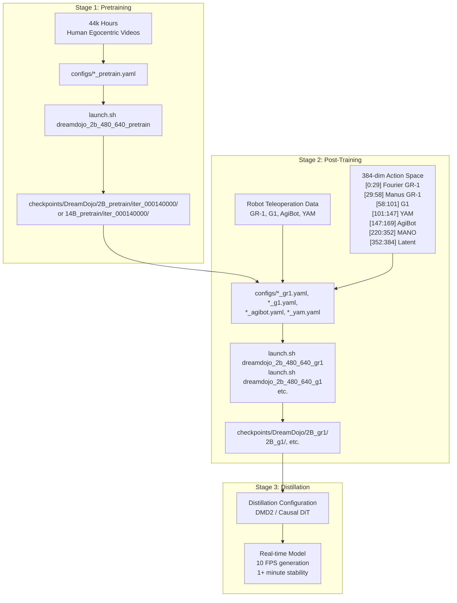
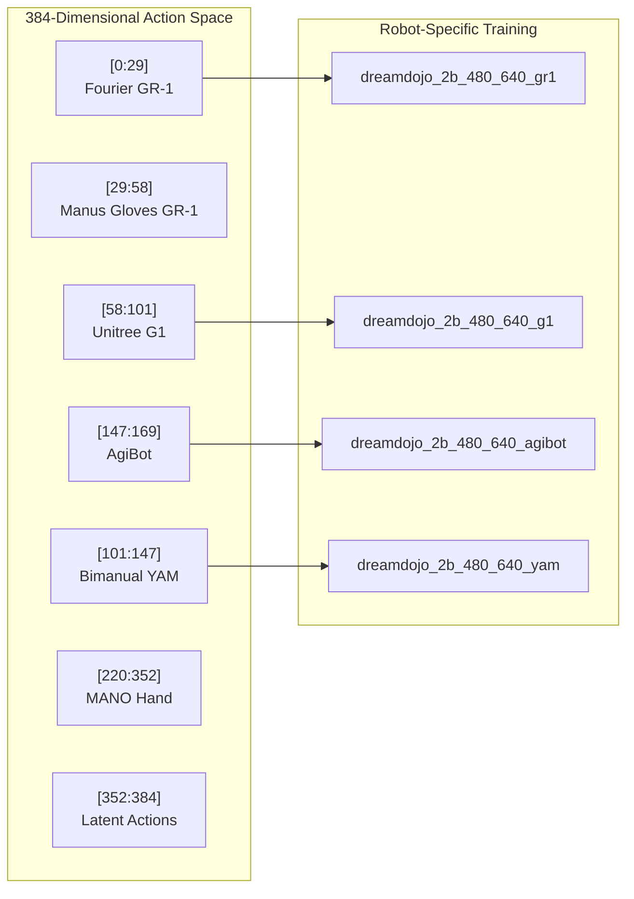
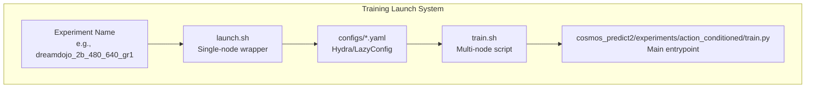
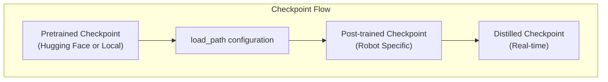

<!-- source: DeepWiki mcp.deepwiki.com · repo NVIDIA/DreamDojo · page 4 Training Pipeline · fetched 2026-10-26 -->

# Training Pipeline

<details>
<summary>Relevant source files</summary>

The following files were used as context for generating this wiki page:

- [README.md](README.md)
- [docs/PRETRAIN.md](docs/PRETRAIN.md)
- [docs/SETUP.md](docs/SETUP.md)

</details>


## Purpose and Scope

This page provides an overview of DreamDojo's three-stage training pipeline: pretraining on large-scale human videos, post-training for robot-specific adaptation, and distillation for real-time generation. Each stage builds upon the previous, transforming a general video world model into a deployable robot control system.

For detailed instructions on each stage, see [Pretraining](#4.1), [Post-Training](#4.2), and [Distillation](#4.3). For information about the underlying model architecture, see [Architecture](#3). For distributed training infrastructure details, see [Distributed Training](#8.1).

**Sources:** [README.md:12-21](), [docs/PRETRAIN.md:1-20](), [docs/POSTTRAIN.md:1-34]()

---

## Three-Stage Pipeline Architecture

The training pipeline consists of three sequential stages, each with distinct objectives and data requirements:

### Pipeline Flow Overview


| Stage | Input Data | Configuration | Output | Purpose |
|-------|-----------|---------------|--------|---------|
| Pretraining | 44k hours human videos | `*_pretrain.yaml` | Foundation checkpoint | Learn general world dynamics |
| Post-Training | Robot teleoperation data | `*_gr1.yaml`, `*_g1.yaml`, etc. | Robot-specific checkpoint | Adapt to robot embodiment |
| Distillation | Post-trained checkpoint | DMD2 Configs | Real-time checkpoint | Enable 10 FPS generation |

**Sources:** [README.md:14-21](), [docs/PRETRAIN.md:1-20](), [docs/POSTTRAIN.md:1-34]()

---

## Stage 1: Pretraining

### Overview

Pretraining trains the `Text2WorldModelRectifiedFlow` model on 44,000 hours of human egocentric videos to learn general world dynamics. This stage produces a foundation checkpoint that understands object interactions, physics, and visual transitions.

### Launch Procedure

Pretraining is initiated using `launch.sh` with a pretraining experiment configuration:

```bash
bash launch.sh dreamdojo_2b_480_640_pretrain
```

### Key Configuration Requirements

1. **Latent Action Model Path**: Set `ckpt_path` in `cosmos_predict2/_src/predict2/models/text2world_model_rectified_flow.py` to the actual LAM path [docs/PRETRAIN.md:6-6]().
2. **Dataset Paths**: Ensure correct paths are set in `launch.sh` [docs/PRETRAIN.md:5-5]().

For detailed pretraining procedures, see [Pretraining](#4.1).

**Sources:** [docs/PRETRAIN.md:1-11](), [README.md:18]()

---

## Stage 2: Post-Training

### Overview

Post-training adapts the pretrained foundation model to specific robot embodiments (GR-1, G1, AgiBot, YAM) using robot teleoperation datasets. This enables action-conditioned generation specific to each platform.

### Action Space Design

DreamDojo uses a unified 384-dimensional action space to support multiple robots within a single model architecture:



### Launch Procedure

1. **Set Pretrained Checkpoint**: Modify `load_path` in `cosmos_predict2/experiments/base/action.py` to point to the pretrained checkpoint [docs/POSTTRAIN.md:6-7]().
2. **Launch Training**:
```bash
bash launch.sh dreamdojo_2b_480_640_gr1
```

For detailed post-training procedures, see [Post-Training](#4.2).

**Sources:** [docs/POSTTRAIN.md:1-34](), [README.md:19]()

---

## Stage 3: Distillation

### Overview

Distillation compresses the post-trained model to achieve real-time video generation at 10 FPS with stable autoregressive rollout for over 1 minute [README.md:20-20](). This stage utilizes the DMD2 model and causal DiT networks.

### Key Components
- **Teacher Generation**: Generating high-quality samples from the rectified flow model.
- **Warmup & Self-forcing**: Progressive training stages for student stability.
- **Inference**: Optimized via `launch_student_inference.sh` for real-time interaction.

For detailed distillation procedures, see [Distillation](#4.3).

**Sources:** [README.md:20-20](), [README.md:35]()

---

## Training Infrastructure

### Launch Scripts

DreamDojo provides two primary launch mechanisms:



### Checkpoint Flow



**Sources:** [docs/PRETRAIN.md:10-11](), [docs/POSTTRAIN.md:6-15](), [README.md:24-26]()

---

