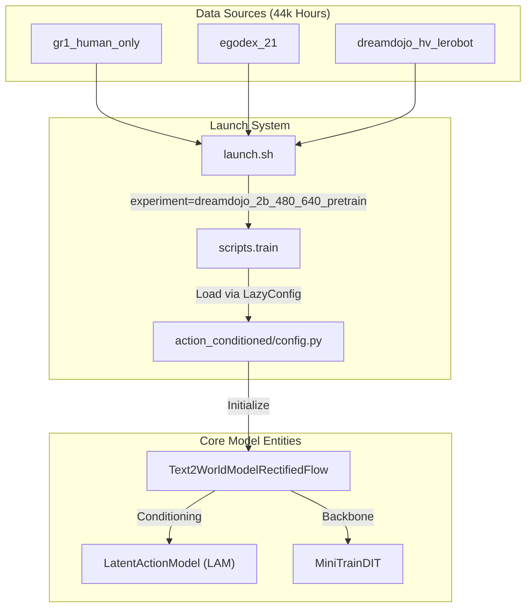
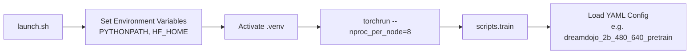

<!-- source: DeepWiki mcp.deepwiki.com · repo NVIDIA/DreamDojo · page 4.1 Pretraining · fetched 2026-10-26 -->

# Pretraining

Relevant source files

The following files were used as context for generating this wiki page:

- [configs/14b_480_640_pretrain.yaml](configs/14b_480_640_pretrain.yaml)
- [configs/2b_480_640_agibot.yaml](configs/2b_480_640_agibot.yaml)
- [configs/2b_480_640_g1.yaml](configs/2b_480_640_g1.yaml)
- [configs/2b_480_640_pretrain.yaml](configs/2b_480_640_pretrain.yaml)
- [configs/2b_480_640_yam.yaml](configs/2b_480_640_yam.yaml)
- [docs/PRETRAIN.md](docs/PRETRAIN.md)
- [docs/SETUP.md](docs/SETUP.md)
- [launch.sh](launch.sh)

## Purpose and Scope

The pretraining phase is the foundational stage of the DreamDojo pipeline, where the model is trained on 44,000 hours of diverse human egocentric video data. This phase establishes the core world modeling capabilities—physics priors, object permanence, and general scene dynamics—before any robot-specific adaptation occurs. This page documents the technical implementation of the pretraining launch procedure, configuration management for 2B and 14B models, and the integration of the Latent Action Model (LAM) during training.

**Sources:** [docs/PRETRAIN.md:1-2]()

---

## Overview

Pretraining utilizes the `Text2WorldModelRectifiedFlow` architecture, specifically the `MiniTrainDIT` network, to learn from massive-scale video datasets. The process produces high-capacity foundation models (2B and 14B variants) that serve as the starting point for all downstream tasks.

**Diagram: Pretraining System Components**

**Sources:** [configs/2b_480_640_pretrain.yaml:34-36](), [launch.sh:31-39](), [docs/PRETRAIN.md:1-11]()

---

## Configuration

Pretraining behavior is governed by specific YAML files that override the base `ActionConditionedSetupArguments`.

### 2B and 14B Pretrain Configs

The configuration files `2b_480_640_pretrain.yaml` and `14b_480_640_pretrain.yaml` define the dataset mixing weights and model-specific hyperparameters.

| Parameter | 2B Pretrain | 14B Pretrain | File Reference |
| :--- | :--- | :--- | :--- |
| `batch_size` | 4 | 2 | [configs/2b_480_640_pretrain.yaml:29](), [configs/14b_480_640_pretrain.yaml:29]() |
| `grad_accum_iter` | 1 | 2 | [configs/2b_480_640_pretrain.yaml:7](), [configs/14b_480_640_pretrain.yaml:7]() |
| `num_frames` | 13 | 13 | [configs/2b_480_640_pretrain.yaml:32](), [configs/14b_480_640_pretrain.yaml:32]() |
| `action_dim` | 384 | 384 | [configs/2b_480_640_pretrain.yaml:23](), [configs/14b_480_640_pretrain.yaml:23]() |
| `zero_init_action_embedder` | `true` | `true` | [configs/2b_480_640_pretrain.yaml:26](), [configs/14b_480_640_pretrain.yaml:26]() |

### Dataset Mixing

Pretraining mixes three primary datasets with specific weights to balance human-only data with egocentric robotics-related data.

*   **gr1_unified.inhouse_human_only**: Weight 1 [configs/2b_480_640_pretrain.yaml:34-38]()
*   **egodex_21**: Weight 2 [configs/2b_480_640_pretrain.yaml:35-39]()
*   **dreamdojo_hv_lerobot_20s_final**: Weight 10 [configs/2b_480_640_pretrain.yaml:36-40]()

**Sources:** [configs/2b_480_640_pretrain.yaml:31-43](), [configs/14b_480_640_pretrain.yaml:31-43]()

---

## Launch Procedures

### Execution Flow

The `launch.sh` script is the entry point for pretraining. It configures the environment and invokes `torchrun` to start the training process across available GPUs.

**Diagram: Pretraining Launch Sequence**

**Sources:** [launch.sh:1-39](), [docs/PRETRAIN.md:9-11]()

### Key Environment Variables

*   `PYTORCH_CUDA_ALLOC_CONF=expandable_segments:True`: Optimizes memory fragmentation [launch.sh:12]().
*   `IMAGINAIRE_OUTPUT_ROOT`: Defines the base directory for training logs and checkpoints [launch.sh:26]().
*   `CUDA_MODULE_LOADING=LAZY`: Forces lazy loading for CUDA 12 compatibility [launch.sh:18]().

**Sources:** [launch.sh:10-29]()

---

## Checkpoint Management

### LAM Path Configuration

Before launching pretraining, the path to the pretrained Latent Action Model (LAM) must be manually specified in the model source code. This is a critical step as the `Text2WorldModelRectifiedFlow` relies on the LAM to extract action representations from the video stream.

*   **File**: `cosmos_predict2/_src/predict2/models/text2world_model_rectified_flow.py`
*   **Variable**: `ckpt_path`

**Sources:** [docs/PRETRAIN.md:5-6]()

### Checkpoint Callbacks

The pretraining process uses two primary callbacks for checkpointing and visualization:
1.  **every_n_sample_reg**: Saves regular model checkpoints every 1000 samples [configs/2b_480_640_pretrain.yaml:9-11]().
2.  **every_n_sample_ema**: Saves Exponential Moving Average (EMA) weights every 1000 samples [configs/2b_480_640_pretrain.yaml:12-14]().

**Sources:** [configs/2b_480_640_pretrain.yaml:8-14](), [configs/14b_480_640_pretrain.yaml:8-14]()

---

## Hardware and Performance

Pretraining is optimized for NVIDIA H100 80GB GPUs.

*   **Parallelism**: Uses `context_parallel_size: 1` by default in pretraining configs, but supports FSDP sharding via the trainer [configs/2b_480_640_pretrain.yaml:17]().
*   **Memory Management**: Employs gradient accumulation (`grad_accum_iter`) to handle large batch sizes on high-parameter models (14B) [configs/14b_480_640_pretrain.yaml:7]().
*   **Initialization**: `zero_init_action_embedder: true` is used during pretraining to ensure the model starts with a neutral action bias [configs/2b_480_640_pretrain.yaml:26]().

**Sources:** [docs/SETUP.md:5](), [configs/14b_480_640_pretrain.yaml:7](), [configs/2b_480_640_pretrain.yaml:26]()

---

