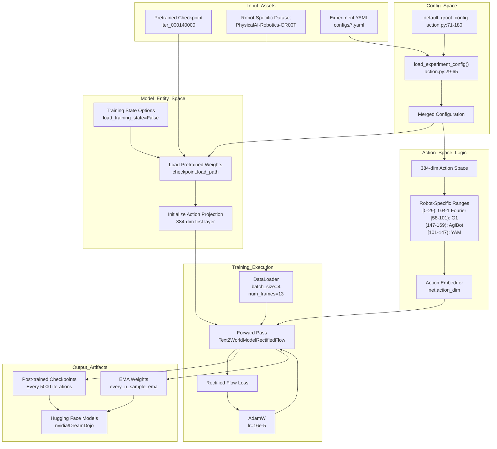
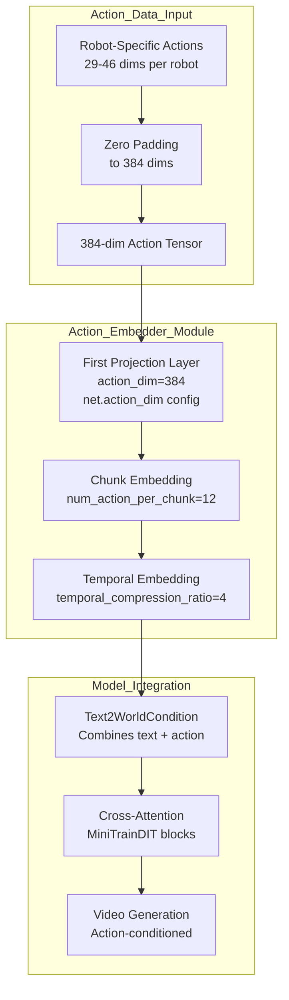

<!-- source: DeepWiki mcp.deepwiki.com · repo NVIDIA/DreamDojo · page 4.2 Post-Training · fetched 2026-10-26 -->

# Post-Training

<details>
<summary>Relevant source files</summary>

The following files were used as context for generating this wiki page:

- [cosmos_predict2/experiments/base/action.py](cosmos_predict2/experiments/base/action.py)
- [docs/POSTTRAIN.md](docs/POSTTRAIN.md)

</details>


Post-training adapts the pretrained DreamDojo world models to specific robot platforms through continued training on robot-specific teleoperation datasets. This phase converts the general human egocentric video models into robot-specific world models capable of generating physically plausible robot behavior sequences.

For information about the initial pretraining phase, see [Pretraining](#4.1). For details on the unified action space design, see [Action Space Design](#4.2.1). For robot-specific training procedures, see [Robot-Specific Training](#4.2.2).

## Overview

Post-training begins with a pretrained checkpoint (trained on 44k hours of human video) and continues training on robot-specific teleoperation data from platforms like GR-1, Unitree G1, AgiBot, and YAM. The process maintains the pretrained model's world understanding while learning robot-specific action-conditioned dynamics.

### System Flow: Pretrain to Post-train



**Sources**: [cosmos_predict2/experiments/base/action.py:71-180](), [docs/POSTTRAIN.md:1-29]()

## Configuration System

Post-training uses a hierarchical configuration system that merges Python-based defaults with YAML overrides for experiment-specific settings.

### Default Configurations

The system provides two base configurations in [cosmos_predict2/experiments/base/action.py]():

| Configuration | Model Size | Lines | Key Settings |
|--------------|------------|-------|--------------|
| `_default_groot_config` | 2B | 71-180 | batch_size=4, lr=16e-5, action_dim=29 |
| `_default_groot_config_14b` | 14B | 182-291 | batch_size=4, lr=16e-5, action_dim=29 |

Both configurations specify:
- **Checkpoint loading**: Path to pretrained model via `checkpoint.load_path` [cosmos_predict2/experiments/base/action.py:95]() or [cosmos_predict2/experiments/base/action.py:206]()
- **Training state**: `load_training_state=False` to start fresh optimizer state [cosmos_predict2/experiments/base/action.py:97](), [cosmos_predict2/experiments/base/action.py:208]()
- **Strict resuming**: `strict_resume=False` to allow action projection layer initialization [cosmos_predict2/experiments/base/action.py:98](), [cosmos_predict2/experiments/base/action.py:209]()
- **Save frequency**: Checkpoints saved every 10,000 iterations (default) [cosmos_predict2/experiments/base/action.py:93](), [cosmos_predict2/experiments/base/action.py:204]()
- **Model settings**: Single conditional frame (`min_num_conditional_frames=1`) [cosmos_predict2/experiments/base/action.py:157-158](), [cosmos_predict2/experiments/base/action.py:268-269]()

**Sources**: [cosmos_predict2/experiments/base/action.py:71-291]()

### YAML Configuration Loading

The `load_experiment_config` function [cosmos_predict2/experiments/base/action.py:29-65]() handles dynamic configuration loading:

1. **Locate YAML**: Constructs path to `configs/{experiment_name}.yaml` [cosmos_predict2/experiments/base/action.py:42-43]()
2. **Load overrides**: Uses `LazyConfig.load()` to parse YAML [cosmos_predict2/experiments/base/action.py:47]()
3. **Recursive merge**: Merges YAML values into default config via `merge_configs` [cosmos_predict2/experiments/base/action.py:50-60]()
4. **Return LazyDict**: Wraps merged configuration with lazy evaluation [cosmos_predict2/experiments/base/action.py:62]()

The system automatically discovers and registers all YAML files in the `configs/` directory [cosmos_predict2/experiments/base/action.py:294-317]().

**Sources**: [cosmos_predict2/experiments/base/action.py:29-65](), [cosmos_predict2/experiments/base/action.py:294-317]()

## Action Space Architecture

Post-training utilizes a unified 384-dimensional action space that accommodates multiple robot platforms within a single model. The first projection layer in the action embedder is configured to accept this full 384-dimensional input to facilitate checkpoint compatibility [docs/POSTTRAIN.md:17-25]().

### Dimension Allocation

| Dimension Range | Robot Platform | Description |
|----------------|----------------|-------------|
| [0, 29) | GR-1 (Fourier) | 29-dimensional Fourier Transform based actions for GR-1 |
| [29, 58) | GR-1 (Manus) | 29-dimensional retargeted actions from Manus gloves |
| [58, 101) | Unitree G1 | 43-dimensional action space for G1 humanoid |
| [101, 147) | YAM | 46-dimensional bimanual YAM robot actions |
| [147, 169) | AgiBot | 22-dimensional AgiBot-specific actions |
| [169, 220) | Reserved | Reserved for future robot platforms |
| [220, 352) | MANO | 132-dimensional MANO hand model parameters |
| [352, 384) | Latent Actions | 32-dimensional learned latent action representations |

### Action Embedding Flow



**Sources**: [docs/POSTTRAIN.md:17-25](), [cosmos_predict2/experiments/base/action.py:163-167]()

## Checkpoint Management

Post-training requires initializing from pretrained weights while adapting the action-conditioning components.

### Loading Pretrained Checkpoints

The checkpoint configuration [cosmos_predict2/experiments/base/action.py:92-105]() specifies:

- **`load_path`**: Points to pretrained checkpoint directory (e.g., `checkpoints/DreamDojo/2B_pretrain/iter_000140000/`) [cosmos_predict2/experiments/base/action.py:95]()
- **`load_training_state=False`**: Resets optimizer state to start post-training from scratch [cosmos_predict2/experiments/base/action.py:97]()
- **`strict_resume=False`**: Allows loading when action projection layer dimensions differ [cosmos_predict2/experiments/base/action.py:98]()

The default checkpoints are defined via the `MODEL_CHECKPOINTS` registry [cosmos_predict2/experiments/base/action.py:25-26]().

**Sources**: [cosmos_predict2/experiments/base/action.py:92-105](), [cosmos_predict2/experiments/base/action.py:25-26](), [docs/POSTTRAIN.md:1-29]()

## Training Process

### Model Configuration

The model configuration specifies action-conditioning behavior [cosmos_predict2/experiments/base/action.py:148-169]():

| Parameter | Value | Description |
|-----------|-------|-------------|
| `min_num_conditional_frames` | 1 | Minimum number of context frames |
| `max_num_conditional_frames` | 1 | Maximum number of context frames |
| `state_t` | 1 + 12 // 4 = 4 | Number of temporal states after compression |

### Optimizer and Callbacks

Post-training uses AdamW with a learning rate of `16e-5` [cosmos_predict2/experiments/base/action.py:87-91](). The trainer includes several monitoring callbacks:

- **`every_n_sample_reg`**: Regular model sampling every 5000 iterations [cosmos_predict2/experiments/base/action.py:110-116]()
- **`every_n_sample_ema`**: EMA model sampling every 5000 iterations [cosmos_predict2/experiments/base/action.py:117-123]()

**Sources**: [cosmos_predict2/experiments/base/action.py:87-91](), [cosmos_predict2/experiments/base/action.py:109-143]()

## Launching Post-Training

Post-training is launched using the `launch.sh` script with experiment name [docs/POSTTRAIN.md:1-15]():

```bash
# Example: GR-1 robot (2B model)
bash launch.sh dreamdojo_2b_480_640_gr1

# Example: Unitree G1 robot (2B model)  
bash launch.sh dreamdojo_2b_480_640_g1
```

The experiment name corresponds to the YAML file name in the `configs/` directory. For more details on the training procedure, see [Robot-Specific Training](#4.2.2).

**Sources**: [docs/POSTTRAIN.md:1-15]()

---

