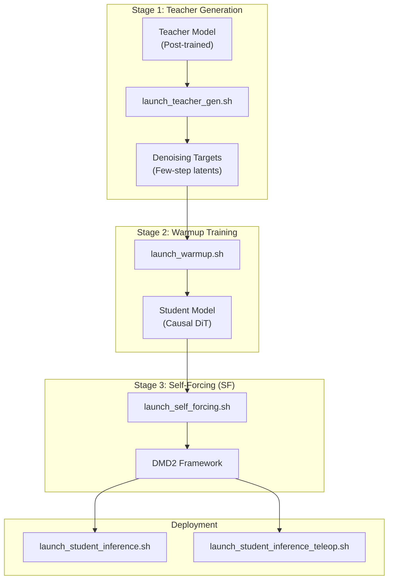
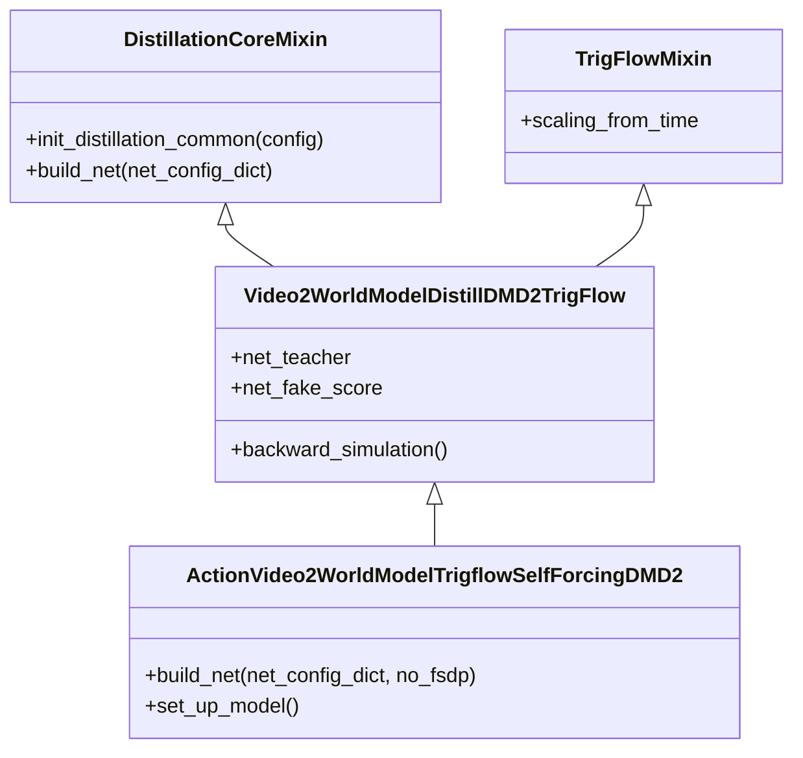

<!-- source: DeepWiki mcp.deepwiki.com · repo NVIDIA/DreamDojo · page 4.3 Distillation · fetched 2026-10-26 -->

# Distillation

Relevant source files

The following files were used as context for generating this wiki page:

- [cosmos_predict2/_src/predict2/distill/models/distillation_base_mixin.py](cosmos_predict2/_src/predict2/distill/models/distillation_base_mixin.py)
- [cosmos_predict2/_src/predict2/distill/models/video2world_model_distill_dmd2.py](cosmos_predict2/_src/predict2/distill/models/video2world_model_distill_dmd2.py)
- [cosmos_predict2/_src/predict2/distill/trainer/trainer_distillation.py](cosmos_predict2/_src/predict2/distill/trainer/trainer_distillation.py)
- [cosmos_predict2/_src/predict2/interactive/models/action_video2world_self_forcing.py](cosmos_predict2/_src/predict2/interactive/models/action_video2world_self_forcing.py)
- [cosmos_predict2/_src/predict2/interactive/models/action_video2world_warmup.py](cosmos_predict2/_src/predict2/interactive/models/action_video2world_warmup.py)
- [cosmos_predict2/_src/predict2/networks/minimal_v4_dit.py](cosmos_predict2/_src/predict2/networks/minimal_v4_dit.py)
- [docs/DISTILL.md](docs/DISTILL.md)
- [docs/ISSUES.md](docs/ISSUES.md)
- [launch_self_forcing.sh](launch_self_forcing.sh)
- [launch_student_inference.sh](launch_student_inference.sh)
- [launch_student_inference_teleop.sh](launch_student_inference_teleop.sh)
- [launch_teacher_gen.sh](launch_teacher_gen.sh)
- [launch_warmup.sh](launch_warmup.sh)

## Purpose and Scope

This document covers the distillation pipeline for DreamDojo, which is the third stage of the training process designed to achieve real-time interactive generation at 10 FPS with stable autoregressive rollouts exceeding 1 minute. Distillation transforms the post-trained world models into efficient, causal variants suitable for real-time robotic control and interactive simulation.

The pipeline consists of three distinct stages: teacher generation, warmup training, and self-forcing distillation using the DMD2 (Distribution Matching Distillation) framework [docs/DISTILL.md:1-9]().

---

## Distillation Pipeline Overview

The distillation process converts a non-causal teacher model (typically a 2B or 14B `Text2WorldModelRectifiedFlow`) into a fast, causal student model.

**Distillation Workflow**

Sources: [docs/DISTILL.md:1-9](), [cosmos_predict2/_src/predict2/distill/models/video2world_model_distill_dmd2.py:99-110]()

---

## 1. Teacher Generation
In this stage, the teacher model generates multi-step denoising targets. These pre-computed latents serve as supervision for the subsequent warmup phase [docs/DISTILL.md:11-14]().

*   **Script**: `launch_teacher_gen.sh` [launch_teacher_gen.sh:34-39]()
*   **Key Parameters**: Uses `query_steps` (e.g., 0, 9, 18, 27, 34) to define the noise levels for supervision [launch_teacher_gen.sh:39]().

Sources: [docs/DISTILL.md:11-18](), [launch_teacher_gen.sh:1-39]()

---

## 2. Warmup Training
The warmup stage initializes the student model by training it to match the teacher's denoising outputs. This phase uses the `ActionConditionedSFWarmupModelRF` class [cosmos_predict2/_src/predict2/interactive/models/action_video2world_warmup.py:46-52]().

### Causal Architecture Transformation
During warmup, the student's transformer network is modified to be temporally causal. The function `make_network_temporal_causal` is called to enforce causality and set the cache window size [cosmos_predict2/_src/predict2/interactive/models/action_video2world_warmup.py:125-130]().

*   **Model Class**: `ActionConditionedSFWarmupModelRF` [cosmos_predict2/_src/predict2/interactive/models/action_video2world_warmup.py:46]()
*   **Config**: `ActionConditionedSFWarmupModelRFConfig` [cosmos_predict2/_src/predict2/interactive/models/action_video2world_warmup.py:35]()
*   **Loss**: MSE between predicted $x_0$ and teacher target latents [cosmos_predict2/_src/predict2/interactive/models/action_video2world_warmup.py:141]().

Sources: [cosmos_predict2/_src/predict2/interactive/models/action_video2world_warmup.py:16-150](), [docs/DISTILL.md:19-28]()

---

## 3. Self-Forcing Distillation (DMD2)
Self-forcing finetunes the student using its own autoregressive predictions to mitigate error accumulation over long horizons [docs/DISTILL.md:29-31](). It employs the **DMD2 (Distribution Matching Distillation)** framework.

### Distribution Matching Framework
The `Video2WorldModelDistillDMD2TrigFlow` class implements the core logic. It utilizes a "fake score net" to approximate the score function of the student generator's output and a teacher score to provide gradient signals [cosmos_predict2/_src/predict2/distill/models/video2world_model_distill_dmd2.py:99-110]().

**Distillation Code Hierarchy**

### Implementation Details
*   **TrigFlow Parameterization**: Uses TrigFlow for noise level sampling, which is then converted to EDM or Rectified Flow scaling coefficients [cosmos_predict2/_src/predict2/distill/models/video2world_model_distill_dmd2.py:108-110]().
*   **Backward Simulation**: Performs denoising with the student net to generate noisy examples $x_t'$ for training [cosmos_predict2/_src/predict2/distill/models/video2world_model_distill_dmd2.py:151-164]().
*   **KVCache Integration**: The self-forcing model supports KVCache rollouts for efficiency [cosmos_predict2/_src/predict2/interactive/models/action_video2world_self_forcing.py:7-8]().

Sources: [cosmos_predict2/_src/predict2/distill/models/distillation_base_mixin.py:111-161](), [cosmos_predict2/_src/predict2/distill/models/video2world_model_distill_dmd2.py:99-164](), [cosmos_predict2/_src/predict2/interactive/models/action_video2world_self_forcing.py:47-135]()

---

## Inference and Real-Time Teleoperation

After distillation, the model can be used for offline or interactive generation.

### Offline Inference
Generates videos from pre-recorded action sequences defined in a JSON file [docs/DISTILL.md:41-50]().
*   **Script**: `launch_student_inference.sh` [launch_student_inference.sh:32-36]()

### Real-Time Teleoperation
Enables 10 FPS interactive generation with live or file-based action inputs [docs/DISTILL.md:52-58]().
*   **Script**: `launch_student_inference_teleop.sh` [launch_student_inference_teleop.sh:40-56]()
*   **Optimizations**: Supports `torch.compile()` and a `--warmup` flag to pre-compile CUDA kernels for low-latency performance [launch_student_inference_teleop.sh:58-61]().

Sources: [docs/DISTILL.md:39-68](), [launch_student_inference.sh:1-36](), [launch_student_inference_teleop.sh:1-65]()

---

## Performance Tuning
To ensure stability and speed, the following environment variables are recommended in training and inference scripts:
*   `PYTORCH_CUDA_ALLOC_CONF=expandable_segments:True`: Prevents memory fragmentation [docs/ISSUES.md:10]().
*   `CUDA_MODULE_LOADING=LAZY`: Speeds up initialization [launch_self_forcing.sh:24]().

Sources: [docs/ISSUES.md:5-14](), [launch_self_forcing.sh:14-24]()

---

