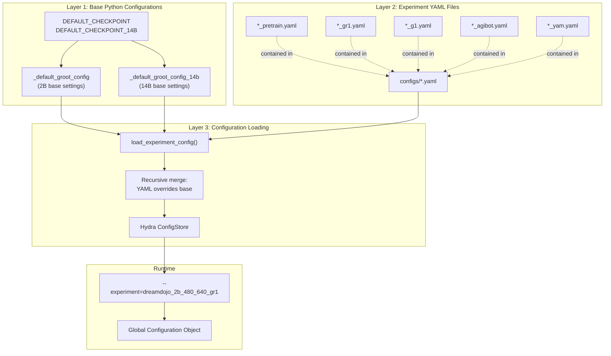
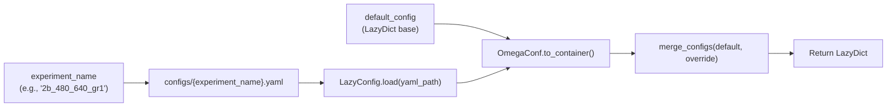
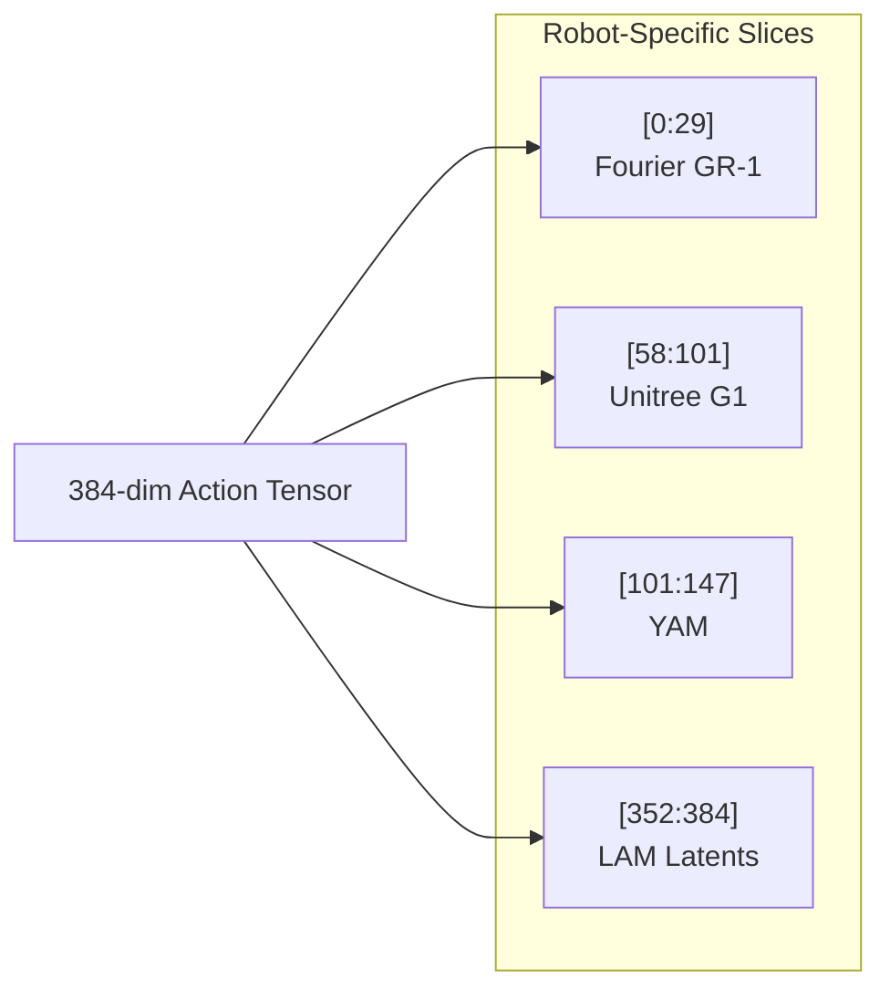

<!-- source: DeepWiki mcp.deepwiki.com · repo NVIDIA/DreamDojo · page 5 Configuration System · fetched 2026-10-26 -->

# Configuration System

<details>
<summary>Relevant source files</summary>

The following files were used as context for generating this wiki page:

- [cosmos_predict2/action_conditioned_config.py](cosmos_predict2/action_conditioned_config.py)
- [cosmos_predict2/experiments/base/action.py](cosmos_predict2/experiments/base/action.py)

</details>


## Purpose and Scope

This document describes DreamDojo's hierarchical configuration management system, which uses Hydra and a custom LazyConfig pattern to manage training and inference parameters across different model sizes, robot platforms, and experimental setups. The system provides base configurations in Python that can be selectively overridden by experiment-specific YAML files.

For information about data-specific configuration, see [Data Pipeline](#6). For training script configuration, see [Training Scripts](#8.5). For inference configuration details, see [Action-Conditioned Configuration](#5.3).

**Sources:** [cosmos_predict2/experiments/base/action.py:1-318]()

## System Overview

The configuration system implements a three-layer architecture that separates default parameters, model size variants, and experiment-specific overrides:



**Figure 1:** Configuration system architecture showing the flow from base configurations through YAML overrides to runtime configuration selection.

**Sources:** [cosmos_predict2/experiments/base/action.py:29-66](), [cosmos_predict2/experiments/base/action.py:293-318]()

## Base Configurations

### LazyDict and LazyConfig Pattern

DreamDojo uses the `LazyDict` and `LazyConfig` classes from the Cosmos framework to enable deferred instantiation of configuration objects. This pattern allows configurations to reference complex objects (model classes, dataset constructors) without instantiating them until needed. For details, see [Base Configurations](#5.1).

**Sources:** [cosmos_predict2/experiments/base/action.py:20-20]()

### _default_groot_config (2B Model)

The `_default_groot_config` defines default parameters for the 2B parameter model variant. Key configuration sections include:

| Section | Purpose | Key Parameters |
|---------|---------|----------------|
| `defaults` | Hydra composition order | Model, network, conditioner, data overrides |
| `job` | Experiment tracking | Project, group, name |
| `optimizer` | Training optimization | `lr=16e-5`, `weight_decay=0.1` |
| `checkpoint` | Checkpoint management | `save_iter=10000`, load paths, EMA settings |
| `trainer` | Training loop settings | `max_iter=100000`, callbacks, sampling |
| `model_parallel` | Distributed training | `context_parallel_size=1` |
| `model.config` | Model architecture | Action dimensions, frame conditioning |
| `dataloader_train` | Data loading | `batch_size=4`, dataset paths |

The defaults array specifies the composition order:

```python
defaults=[
    DEFAULT_CHECKPOINT.experiment,
    {"override /model": "action_conditioned_video2world_fsdp_rectified_flow"},
    {"override /net": "cosmos_v1_2B_action_chunk_conditioned"},
    {"override /conditioner": "action_conditioned_video_conditioner"},
    {"override /data_train": "dreamdojo_13frame_480_640_train"},
    {"override /data_val": "dreamdojo_13frame_480_640_val"},
    "_self_",
]
```

**Sources:** [cosmos_predict2/experiments/base/action.py:71-180]()

### _default_groot_config_14b (14B Model)

The `_default_groot_config_14b` mirrors the 2B configuration but references the 14B model architecture and checkpoints:

```python
defaults=[
    DEFAULT_CHECKPOINT_14B.experiment,
    {"override /model": "action_conditioned_video2world_fsdp_rectified_flow"},
    {"override /net": "cosmos_v1_14B_action_chunk_conditioned"},  # 14B network
    {"override /conditioner": "action_conditioned_video_conditioner"},
    {"override /data_train": "dreamdojo_13frame_480_640_train"},
    {"override /data_val": "dreamdojo_13frame_480_640_val"},
    "_self_",
]
```

**Sources:** [cosmos_predict2/experiments/base/action.py:182-291]()

## Configuration Loading and Merging

### load_experiment_config Function

The `load_experiment_config` function implements the YAML override mechanism by loading files from the `configs/` directory and recursively merging them into the base `LazyDict`. For details, see [Experiment YAML Files](#5.2).



**Figure 2:** Configuration loading flow showing how experiment YAML files are merged with base configurations.

**Sources:** [cosmos_predict2/experiments/base/action.py:29-66]()

### Automatic YAML Discovery

The system automatically discovers and loads all YAML files in the `configs/` directory, registering them with the `dreamdojo_` prefix.

**Sources:** [cosmos_predict2/experiments/base/action.py:293-311]()

## Action-Conditioned Configuration

Inference and evaluation tasks use specialized argument classes to manage parameters like chunk size, guidance, and robot state keys. For details, see [Action-Conditioned Configuration](#5.3).

### ActionConditionedSetupArguments

This class defines the environment and model setup for evaluation scripts.

| Attribute | Type | Purpose |
|-----------|------|---------|
| `config_file` | str | Path to the base Python config |
| `checkpoints_dir` | str | Directory containing model weights |
| `num_frames` | int | Number of frames to generate |
| `dataset_path` | str | Path to evaluation data |

**Sources:** [cosmos_predict2/action_conditioned_config.py:36-54]()

### ActionConditionedInferenceArguments

This dataclass controls the behavior of the inference pipeline.

| Attribute | Type | Purpose |
|-----------|------|---------|
| `chunk_size` | int | Actions per chunk (default 12) |
| `guidance` | float | Classifier-free guidance scale |
| `gripper_key` | str | JSON key for gripper state |
| `state_key` | str | JSON key for robot state |
| `zero_actions` | bool | If true, ignore input actions |

**Sources:** [cosmos_predict2/action_conditioned_config.py:58-105]()

## Configuration Examples

Complete examples of configuration files for various scenarios, including pretraining and robot-specific post-training (GR-1, G1, etc.), are provided in the child pages. For details, see [Configuration Examples](#5.4).

### Example: Unified Action Space Mapping

DreamDojo uses a 384-dimensional action space. Configurations map specific robots to these dimensions.



**Figure 3:** Association of unified action dimensions with robot embodiments.

**Sources:** [cosmos_predict2/experiments/base/action.py:163-167](), [configs/2b_480_640_gr1.yaml:23-26]()

---

