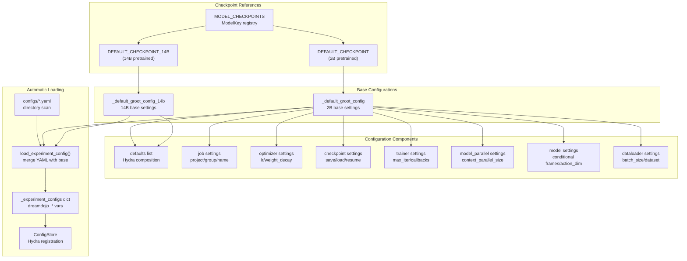
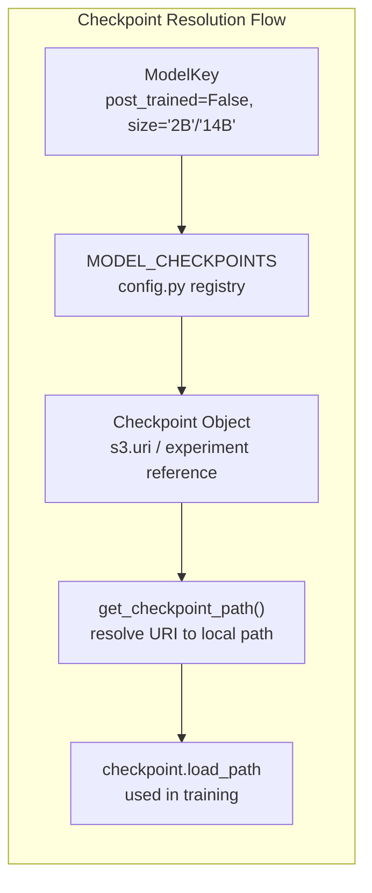
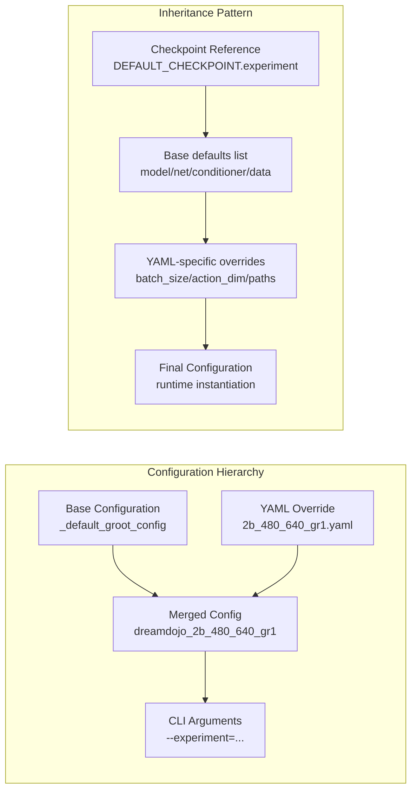

<!-- source: DeepWiki mcp.deepwiki.com · repo NVIDIA/DreamDojo · page 5.1 Base Configurations · fetched 2026-10-26 -->

# Base Configurations

Relevant source files

The following files were used as context for generating this wiki page:

- [cosmos_predict2/_src/predict2/action/configs/action_conditioned/experiment/exp_2B_action_conditioned_rectify_flow_gr00t.py](cosmos_predict2/_src/predict2/action/configs/action_conditioned/experiment/exp_2B_action_conditioned_rectify_flow_gr00t.py)
- [cosmos_predict2/experiments/base/action.py](cosmos_predict2/experiments/base/action.py)

This document describes the base configuration layer in DreamDojo's hierarchical configuration system. Base configurations provide default settings for the 2B and 14B model variants, including checkpoint references, network architecture parameters, training hyperparameters, and data pipeline settings. These configurations serve as the foundation that experiment-specific YAML files override.

For information about experiment YAML files that override these base configurations, see [5.2 Experiment YAML Files](). For runtime inference configuration, see [5.3 Action-Conditioned Configuration]().

## Overview

Base configurations are defined in [cosmos_predict2/experiments/base/action.py:71-291]() and provide two main configuration dictionaries:

- **`_default_groot_config`**: Default settings for 2B parameter models [cosmos_predict2/experiments/base/action.py:71-180]().
- **`_default_groot_config_14b`**: Default settings for 14B parameter models [cosmos_predict2/experiments/base/action.py:182-291]().

These configurations use the `LazyDict` pattern from the Imaginaire framework [cosmos_predict2/experiments/base/action.py:20](), which enables deferred instantiation of complex objects and Hydra-based configuration composition.

### Configuration Entity Mapping

The following diagram maps high-level configuration concepts to the specific code entities defined in the base configuration script.

Title: Configuration Entity Mapping

**Sources:** [cosmos_predict2/experiments/base/action.py:1-318]()

## Checkpoint References

The base configuration system uses primary checkpoint references defined at the module level:

| Variable | Model Size | Default Usage | Definition |
|----------|-----------|---------------|------------|
| `DEFAULT_CHECKPOINT` | 2B | Pretrained starting point for 2B models | [cosmos_predict2/experiments/base/action.py:25]() |
| `DEFAULT_CHECKPOINT_14B` | 14B | Pretrained starting point for 14B models | [cosmos_predict2/experiments/base/action.py:26]() |

These references are resolved from the `MODEL_CHECKPOINTS` registry using `ModelKey` identifiers [cosmos_predict2/experiments/base/action.py:22-26](). The checkpoint paths are later retrieved using `get_checkpoint_path()` in the configuration's `checkpoint.load_path` field [cosmos_predict2/experiments/base/action.py:95-96]().

Title: Checkpoint Resolution Flow

**Sources:** [cosmos_predict2/experiments/base/action.py:16-26](), [cosmos_predict2/experiments/base/action.py:95-96](), [cosmos_predict2/experiments/base/action.py:206-207]()

## Base Configuration Structure

Both `_default_groot_config` and `_default_groot_config_14b` share a standardized structure. The configuration is organized into the following major sections:

### Defaults List
The `defaults` field specifies Hydra composition directives that pull in base component configurations [cosmos_predict2/experiments/base/action.py:73-81]():
- `override /model`: `action_conditioned_video2world_fsdp_rectified_flow`
- `override /net`: `cosmos_v1_2B_action_chunk_conditioned` (or 14B variant)
- `override /conditioner`: `action_conditioned_video_conditioner`
- `override /data_train`: `dreamdojo_13frame_480_640_train`

### Job and Optimizer Settings
- **Job**: Sets W&B project to `cosmos_predict2_action_conditioned` and group to `cosmos_predict_v2p5` [cosmos_predict2/experiments/base/action.py:82-86]().
- **Optimizer**: Uses `AdamW` (implied by trainer) with `lr=16e-5` and `weight_decay=0.1` [cosmos_predict2/experiments/base/action.py:87-91]().

### Checkpoint and Trainer Settings
- **Checkpoint**: Configured for local loading (`load_path`) with `load_training_state=False` and `save_iter=10_000` [cosmos_predict2/experiments/base/action.py:92-105]().
- **Trainer**: Sets `max_iter=100_000` [cosmos_predict2/experiments/base/action.py:107]().
- **Callbacks**: Includes `every_n_sample_reg` and `every_n_sample_ema` for periodic sampling every 5000 iterations, along with `heart_beat`, `iter_speed`, and `wandb` logging [cosmos_predict2/experiments/base/action.py:109-144]().

### Model Parameters
The `model.config` section defines critical architectural hyperparameters [cosmos_predict2/experiments/base/action.py:149-168]():
- `min_num_conditional_frames`: 1
- `max_num_conditional_frames`: 1
- `state_t`: Calculated as `1 + 12 // 4` (reflecting temporal compression) [cosmos_predict2/experiments/base/action.py:161]().
- `net.action_dim`: 29 (Standard for GR-1) [cosmos_predict2/experiments/base/action.py:163]().
- `net.temporal_compression_ratio`: 4 [cosmos_predict2/experiments/base/action.py:164]().
- `net.num_action_per_chunk`: 12 [cosmos_predict2/experiments/base/action.py:165]().

**Sources:** [cosmos_predict2/experiments/base/action.py:71-291]()

## Configuration Loading and Registration

The system automatically discovers experiment YAML files and merges them with these base configurations.

### The load_experiment_config Function
The `load_experiment_config` function [cosmos_predict2/experiments/base/action.py:29-65]() performs the following:
1. Locates the YAML file in the `configs/` directory [cosmos_predict2/experiments/base/action.py:42-43]().
2. Loads the YAML using `LazyConfig.load` [cosmos_predict2/experiments/base/action.py:47]().
3. Recursively merges the YAML overrides into a copy of the base configuration [cosmos_predict2/experiments/base/action.py:50-60]().

### Automatic Registration
At the module level, the script iterates through all YAML files in the `configs/` directory [cosmos_predict2/experiments/base/action.py:298-311]():
- If "14b" is in the filename, it uses `_default_groot_config_14b` as the base [cosmos_predict2/experiments/base/action.py:304-305]().
- Otherwise, it uses `_default_groot_config` [cosmos_predict2/experiments/base/action.py:307]().
- The resulting merged config is registered in the Hydra `ConfigStore` under the `experiment` group [cosmos_predict2/experiments/base/action.py:313-317]().

Title: Configuration Inheritance and Merging

**Sources:** [cosmos_predict2/experiments/base/action.py:29-65](), [cosmos_predict2/experiments/base/action.py:293-318]()

---

