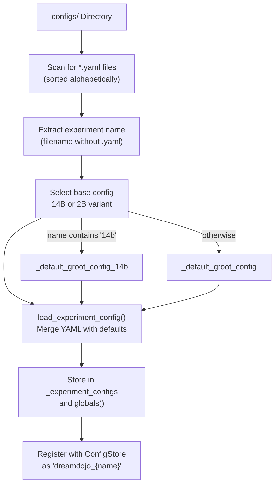
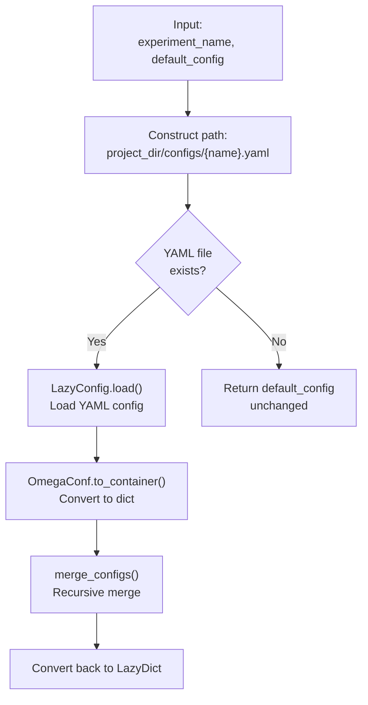
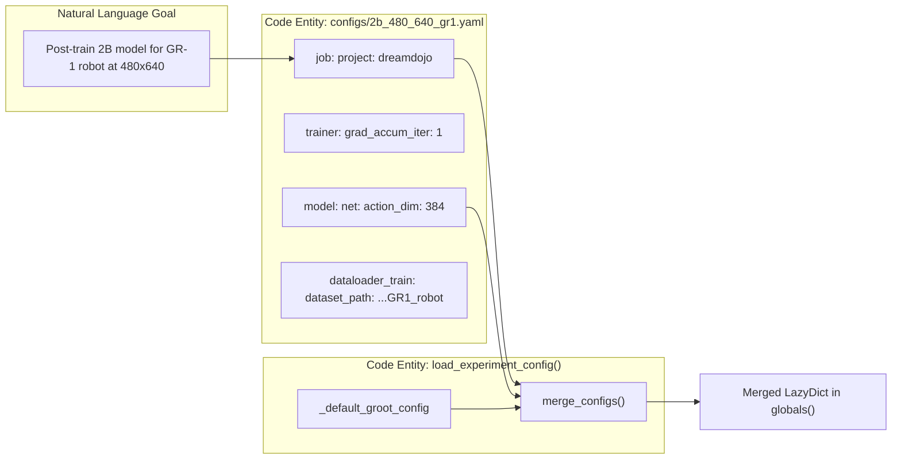

<!-- source: DeepWiki mcp.deepwiki.com · repo NVIDIA/DreamDojo · page 5.2 Experiment YAML Files · fetched 2026-10-26 -->

# Experiment YAML Files

<details>
<summary>Relevant source files</summary>

The following files were used as context for generating this wiki page:

- [configs/2b_480_640_gr1.yaml](configs/2b_480_640_gr1.yaml)
- [cosmos_predict2/experiments/base/action.py](cosmos_predict2/experiments/base/action.py)

</details>


This page documents the YAML-based configuration system used to define and customize training experiments in DreamDojo. YAML files provide a declarative way to override default configurations for specific training scenarios, including robot-specific post-training, dataset combinations, and hyperparameter adjustments.

## Overview

Experiment YAML files are stored in the `configs/` directory at the project root [cosmos_predict2/experiments/base/action.py:43-43](). These files allow users to customize training experiments without modifying Python code. Each YAML file defines overrides for a specific experiment configuration, which are automatically merged with base defaults at runtime via the `load_experiment_config` mechanism [cosmos_predict2/experiments/base/action.py:29-39]().

**Sources**: [cosmos_predict2/experiments/base/action.py:29-66](), [configs/2b_480_640_gr1.yaml:1-38]()

## YAML File Discovery and Loading

### Automatic Discovery Mechanism

The configuration system automatically discovers and registers all YAML files in the `configs/` directory. This discovery happens when the `cosmos_predict2/experiments/base/action.py` module is initialized [cosmos_predict2/experiments/base/action.py:293-317]().

**Experiment Discovery and Registration Flow**


The discovery process follows these steps:
1. **Scan Directory**: All `*.yaml` files in `configs/` are discovered using `sorted(_configs_dir.glob("*.yaml"))` [cosmos_predict2/experiments/base/action.py:293-294]().
2. **Extract Name**: The experiment name is extracted from the filename (e.g., `2b_480_640_gr1.yaml` becomes `2b_480_640_gr1`) [cosmos_predict2/experiments/base/action.py:295-296]().
3. **Select Base**: Files containing `"14b"` in the name use `_default_groot_config_14b`, while others use `_default_groot_config` [cosmos_predict2/experiments/base/action.py:306-310]().
4. **Load and Merge**: `load_experiment_config()` merges YAML overrides with the selected base configuration [cosmos_predict2/experiments/base/action.py:311-311]().
5. **Store and Inject**: The merged configuration is stored in `_experiment_configs` and dynamically injected into the module's `globals()` dictionary with the naming pattern `dreamdojo_{experiment_name}` [cosmos_predict2/experiments/base/action.py:312-312]().
6. **Register**: The configuration is registered with Hydra's `ConfigStore` for command-line selection [cosmos_predict2/experiments/base/action.py:313-317]().

**Sources**: [cosmos_predict2/experiments/base/action.py:293-317]()

### Configuration Loading Function

The `load_experiment_config()` function handles the core loading and merging logic [cosmos_predict2/experiments/base/action.py:29-66]().

**Configuration Merging Logic**


The merging process uses a recursive strategy implemented in the nested `merge_configs()` function [cosmos_predict2/experiments/base/action.py:50-55]():
- **Nested Dictionaries**: If both the default and override contain the same key with dictionary values, recursion continues deeper [cosmos_predict2/experiments/base/action.py:52-53]().
- **Leaf Values**: Non-dictionary values from the YAML override replace default values [cosmos_predict2/experiments/base/action.py:55-55]().
- **Conversion**: The system converts `LazyDict` to standard containers via `OmegaConf.to_container(..., resolve=True)` before merging, then wraps the result back into a `LazyDict` with `allow_objects=True` [cosmos_predict2/experiments/base/action.py:58-62]().

**Sources**: [cosmos_predict2/experiments/base/action.py:29-66]()

## YAML File Structure

### Common Configuration Sections

YAML experiment files typically override five main configuration sections [configs/2b_480_640_gr1.yaml:1-38]():

| Section | Purpose | Common Overrides |
|---------|---------|------------------|
| `job` | Experiment metadata and tracking | `project`, `group`, `name` |
| `trainer` | Training loop parameters | `grad_accum_iter`, `callbacks` (sampling frequency) |
| `model_parallel` | Distributed training settings | `context_parallel_size` |
| `model` | Model architecture and behavior | `state_t`, `net.action_dim`, `net.num_action_per_chunk` |
| `dataloader_train` | Training data configuration | `batch_size`, `dataset.dataset_path`, `dataset.num_frames` |

**Sources**: [configs/2b_480_640_gr1.yaml:1-38]()

### Hierarchical Overrides

YAML files use nested dictionaries to override specific sub-keys without replacing entire sections. For example, in `2b_480_640_gr1.yaml`, the `model` section only overrides `state_t` and the `net` sub-dictionary [configs/2b_480_640_gr1.yaml:19-26]().

## Example: GR-1 Robot Configuration

The `2b_480_640_gr1.yaml` file demonstrates a complete robot-specific post-training configuration.

**GR-1 Experiment YAML Mapping**


### Key Configuration Values for GR-1
- **Action Dimension**: `384` - The unified action space dimension [configs/2b_480_640_gr1.yaml:23-23]().
- **Action Chunking**: `num_action_per_chunk: 12` - Defines the temporal window for action conditioning [configs/2b_480_640_gr1.yaml:25-25]().
- **State Timesteps**: `state_t: 4` - Calculated as `1 + 12 // 4` for alignment with temporal compression [configs/2b_480_640_gr1.yaml:21-21]().
- **Sampling Frequency**: `every_n: 1000` - Overrides the default 5000 to generate validation samples more frequently during training [configs/2b_480_640_gr1.yaml:10-10]().
- **Dataset Path**: Points to the specific GR1 robot teleoperation data [configs/2b_480_640_gr1.yaml:34-34]().

**Sources**: [configs/2b_480_640_gr1.yaml:1-38](), [cosmos_predict2/experiments/base/action.py:161-167]()

## Hydra Integration and Command-Line Usage

All discovered YAML configurations are registered with Hydra's `ConfigStore` under the `experiment` group [cosmos_predict2/experiments/base/action.py:313-317]().

**Registration Parameters**:
- **Group**: `"experiment"` [cosmos_predict2/experiments/base/action.py:314-314]().
- **Package**: `"_global_"` - This ensures that the overrides are merged into the global configuration namespace rather than nested under an `experiment` key [cosmos_predict2/experiments/base/action.py:316-316]().
- **Name**: `dreamdojo_{experiment_name}` (lowercased) [cosmos_predict2/experiments/base/action.py:315-315]().

### Running an Experiment
To launch training with a specific YAML configuration, use the `experiment` override on the command line:

```bash
# Example training command using the gr1 config
torchrun --nproc_per_node=8 -m scripts.train \
    --config=cosmos_predict2/experiments/base/action.py \
    experiment=dreamdojo_2b_480_640_gr1
```

The `load_experiment_config` mechanism ensures that even though the base Python config is loaded, the YAML overrides from `configs/2b_480_640_gr1.yaml` take precedence [cosmos_predict2/experiments/base/action.py:29-66]().

**Sources**: [cosmos_predict2/experiments/base/action.py:69-70](), [cosmos_predict2/experiments/base/action.py:313-317]()

---

