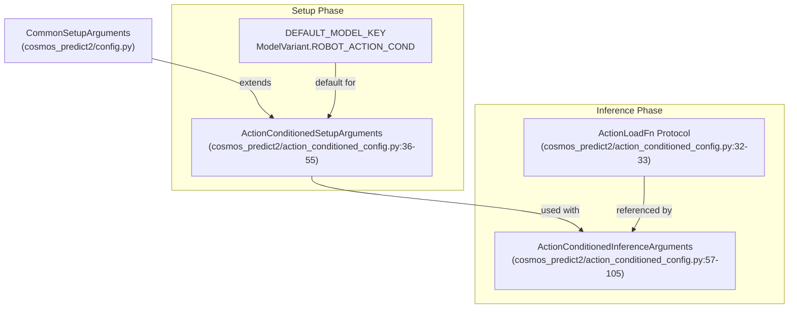
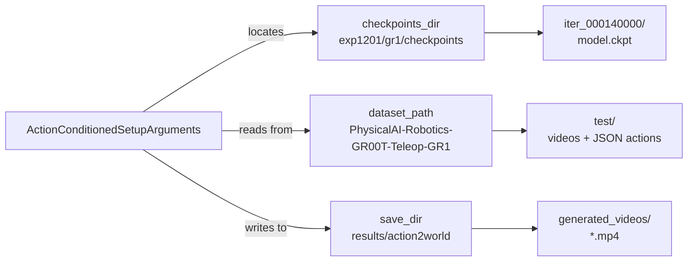
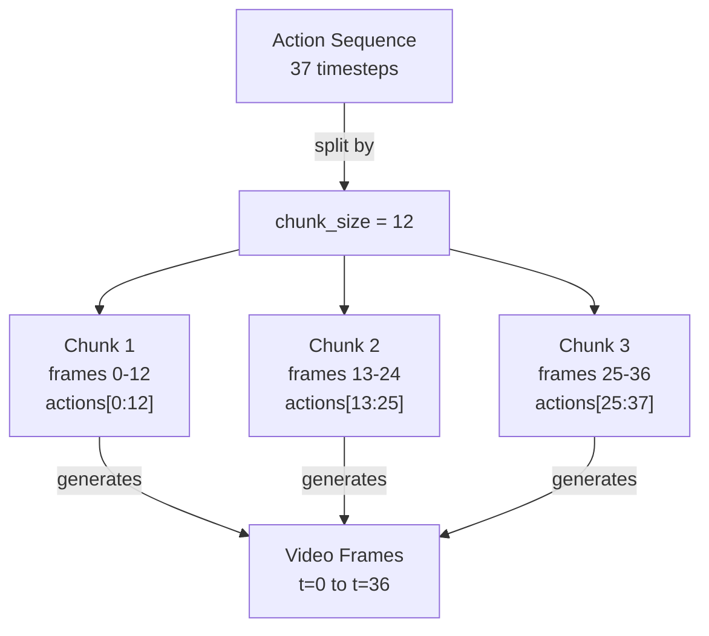
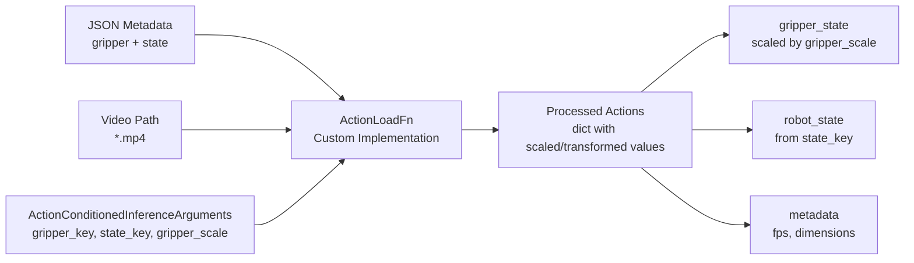
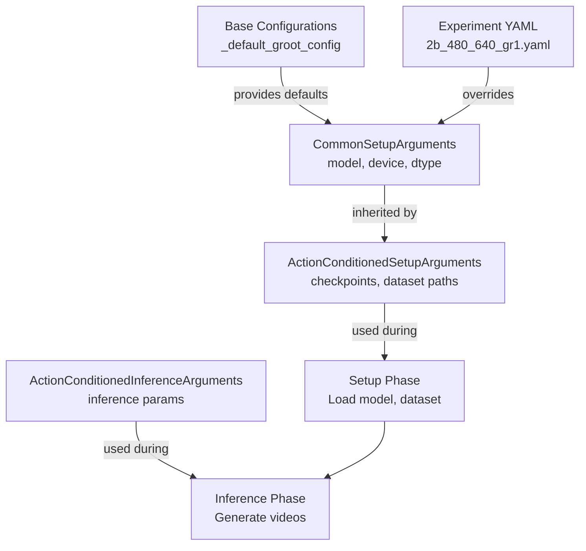

<!-- source: DeepWiki mcp.deepwiki.com · repo NVIDIA/DreamDojo · page 5.3 Action-Conditioned Configuration · fetched 2026-10-26 -->

# Action-Conditioned Configuration

<details>
<summary>Relevant source files</summary>

The following files were used as context for generating this wiki page:

- [cosmos_predict2/action_conditioned_config.py](cosmos_predict2/action_conditioned_config.py)

</details>


## Purpose and Scope

This document covers the configuration system specifically designed for action-conditioned inference in DreamDojo. The system provides two main argument classes that control setup and inference parameters when generating videos conditioned on robot actions. For general configuration management including base configurations, see [5.1 Base Configurations](). For experiment-level YAML configuration, see [5.2 Experiment YAML Files]().

The action-conditioned configuration system is implemented in [cosmos_predict2/action_conditioned_config.py:1-105]() and provides structured interfaces for:
- Dataset and checkpoint path management.
- Action processing parameters (chunk size, gripper scaling).
- Inference control (guidance, resolution, frame sampling).
- Output settings (save paths, video FPS).

---

## Configuration Architecture

The action-conditioned configuration system consists of two primary dataclasses that work together to configure the inference pipeline.

### Configuration Class Hierarchy

Title: Action-Conditioned Configuration Hierarchy

**Sources:** [cosmos_predict2/action_conditioned_config.py:16-105](), [cosmos_predict2/config.py:22-25]()

---

## ActionConditionedSetupArguments

The `ActionConditionedSetupArguments` class extends `CommonSetupArguments` and defines parameters for initializing the action-conditioned inference system [cosmos_predict2/action_conditioned_config.py:36-37](). This class is used during setup to specify model checkpoints, dataset paths, and evaluation configurations.

### Key Parameters

| Parameter | Type | Default | Purpose |
|-----------|------|---------|---------|
| `config_file` | `str` | `"cosmos_predict2/_src/predict2/action/configs/action_conditioned/config.py"` | Path to the action-conditioned config module [cosmos_predict2/action_conditioned_config.py:39]() |
| `model` | `get_model_literal()` | `DEFAULT_MODEL_KEY.name` | Model variant (ROBOT_ACTION_COND) [cosmos_predict2/action_conditioned_config.py:43]() |
| `checkpoints_dir` | `str` | `"checkpoints/exp1201/gr1/checkpoints"` | Directory containing model checkpoints [cosmos_predict2/action_conditioned_config.py:45]() |
| `save_dir` | `str` | `"results/action2world"` | Output directory for generated videos [cosmos_predict2/action_conditioned_config.py:46]() |
| `num_frames` | `int` | `37` | Number of frames to generate per sample [cosmos_predict2/action_conditioned_config.py:47]() |
| `num_samples` | `int` | `100` | Total number of samples to process [cosmos_predict2/action_conditioned_config.py:48]() |
| `dataset_path` | `str` | `"datasets/PhysicalAI-Robotics-GR00T-Teleop-GR1/GR1_robot"` | Path to evaluation dataset [cosmos_predict2/action_conditioned_config.py:49]() |
| `data_split` | `str` | `"test"` | Dataset split to use (train/val/test) [cosmos_predict2/action_conditioned_config.py:50]() |
| `checkpoint_interval` | `int` | `2000` | Interval for checkpoint evaluation [cosmos_predict2/action_conditioned_config.py:53]() |
| `infinite` | `bool` | `False` | Enable continuous monitoring mode [cosmos_predict2/action_conditioned_config.py:54]() |

### Model Variant Configuration

The class sets the default model variant to `ModelVariant.ROBOT_ACTION_COND` through the `DEFAULT_MODEL_KEY` [cosmos_predict2/action_conditioned_config.py:29-43](). This ensures that action-conditioned inference uses the appropriate model architecture and weights trained for robot action conditioning.

### Checkpoint and Dataset Management

Title: Setup Data Flow

**Sources:** [cosmos_predict2/action_conditioned_config.py:36-55]()

### Evaluation Modes

The `infinite` flag enables two distinct evaluation workflows:
- **One-time Evaluation** (`infinite=False`): Process a specific checkpoint once and exit [cosmos_predict2/action_conditioned_config.py:54]().
- **Continuous Monitoring** (`infinite=True`): Continuously watch for new checkpoints and evaluate them automatically during training [cosmos_predict2/action_conditioned_config.py:54]().

The `checkpoint_interval` parameter controls how frequently checkpoints are expected when running in continuous monitoring mode [cosmos_predict2/action_conditioned_config.py:53]().

---

## ActionConditionedInferenceArguments

The `ActionConditionedInferenceArguments` dataclass defines runtime parameters that control the inference process itself [cosmos_predict2/action_conditioned_config.py:58-59](). These parameters are separate from setup arguments to allow flexible reconfiguration during inference without reloading the model.

### Parameter Categories

#### 1. Output Parameters
| Parameter | Type | Default | Purpose |
|-----------|------|---------|---------|
| `save_root` | `Path` | `Path("results/action2world")` | Root directory for saving outputs [cosmos_predict2/action_conditioned_config.py:62]() |
| `save_fps` | `int` | `10` | FPS for output video encoding [cosmos_predict2/action_conditioned_config.py:95]() |

#### 2. Model Parameters
| Parameter | Type | Default | Purpose |
|-----------|------|---------|---------|
| `chunk_size` | `int` | `12` | Number of action frames per conditioning chunk [cosmos_predict2/action_conditioned_config.py:65]() |
| `guidance` | `Guidance` | `0` | Classifier-free guidance strength [cosmos_predict2/action_conditioned_config.py:67]() |
| `resolution` | `str` | `"none"` | Override resolution (H,W); "none" uses model default [cosmos_predict2/action_conditioned_config.py:69]() |
| `negative_prompt` | `str` | `DEFAULT_NEGATIVE_PROMPT` | Text prompt for negative guidance [cosmos_predict2/action_conditioned_config.py:103]() |

#### 3. Dataset-Specific Parameters
| Parameter | Type | Default | Purpose |
|-----------|------|---------|---------|
| `camera_id` | `int` | `0` | Index of camera view to use [cosmos_predict2/action_conditioned_config.py:73]() |
| `start` | `int` | `0` | Start index in dataset file list [cosmos_predict2/action_conditioned_config.py:75]() |
| `end` | `int` | `100` | End index in dataset file list [cosmos_predict2/action_conditioned_config.py:77]() |
| `fps_downsample_ratio` | `int` | `1` | Temporal downsampling factor for input actions [cosmos_predict2/action_conditioned_config.py:79]() |

#### 4. Action Processing Parameters
| Parameter | Type | Default | Purpose |
|-----------|------|---------|---------|
| `gripper_scale` | `float` | `1.0` | Scaling factor for gripper action values [cosmos_predict2/action_conditioned_config.py:81]() |
| `gripper_key` | `str` | `"continuous_gripper_state"` | JSON key for gripper state data [cosmos_predict2/action_conditioned_config.py:83]() |
| `state_key` | `str` | `"state"` | JSON key for robot state data [cosmos_predict2/action_conditioned_config.py:85]() |
| `zero_actions` | `bool` | `False` | Force all action values to zero (for ablation) [cosmos_predict2/action_conditioned_config.py:97]() |

#### 5. Inference Control Parameters
| Parameter | Type | Default | Purpose |
|-----------|------|---------|---------|
| `reverse` | `bool` | `False` | Reverse video generation direction [cosmos_predict2/action_conditioned_config.py:89]() |
| `single_chunk` | `bool` | `False` | Generate only first chunk instead of full sequence [cosmos_predict2/action_conditioned_config.py:91]() |
| `start_frame_idx` | `int` | `0` | Starting frame offset in source video [cosmos_predict2/action_conditioned_config.py:93]() |
| `num_latent_conditional_frames` | `int` | `1` | Number of frames to condition on (0, 1, or 2) [cosmos_predict2/action_conditioned_config.py:100]() |

**Sources:** [cosmos_predict2/action_conditioned_config.py:57-105]()

### Action Chunking Mechanism

The `chunk_size` parameter determines how many future action frames are provided to the model at each generation step [cosmos_predict2/action_conditioned_config.py:65-66]().

Title: Action Chunking Logic

**Sources:** [cosmos_predict2/action_conditioned_config.py:65-66]()

---

## ActionLoadFn Protocol

The `ActionLoadFn` protocol defines the interface for custom action loading functions [cosmos_predict2/action_conditioned_config.py:32-33](). This allows flexibility in how action data is extracted from different dataset formats.

### Protocol Definition

```python
class ActionLoadFn(Protocol):
    def __call__(
        self, 
        json_data: dict, 
        video_path: str, 
        args: "ActionConditionedInferenceArguments"
    ) -> dict: ...
```

### Action Loading Flow

Title: Action Loading Data Flow

**Sources:** [cosmos_predict2/action_conditioned_config.py:32-33](), [cosmos_predict2/action_conditioned_config.py:79-86]()

---

## Integration with Configuration System

The action-conditioned configuration classes integrate with the broader DreamDojo configuration hierarchy [cosmos_predict2/action_conditioned_config.py:20-27]().

Title: Configuration Integration

**Sources:** [cosmos_predict2/action_conditioned_config.py:20-27](), [cosmos_predict2/action_conditioned_config.py:36-55]()

---

