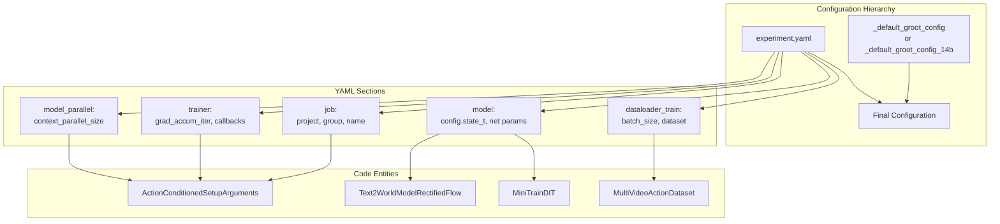
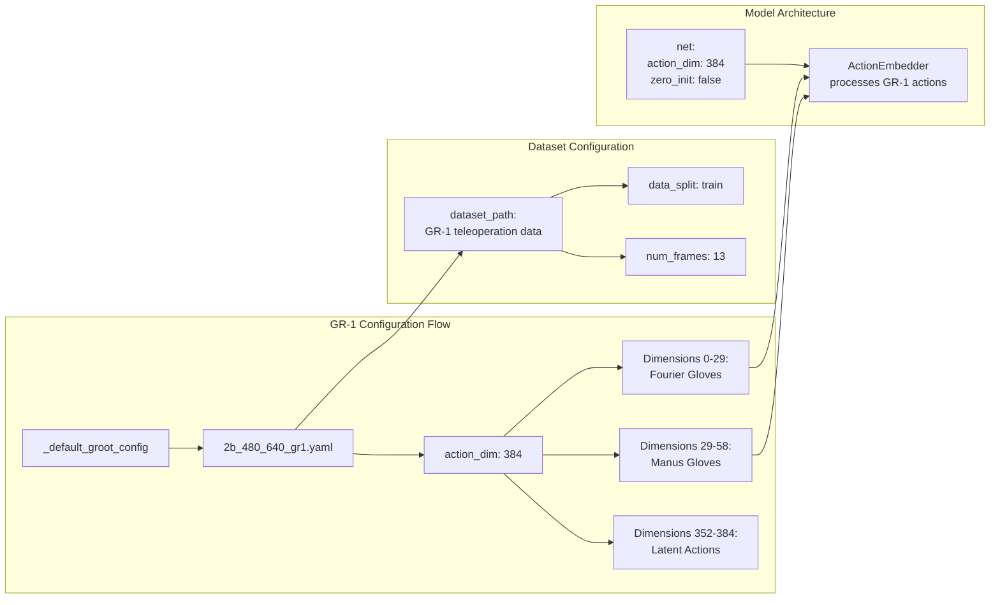
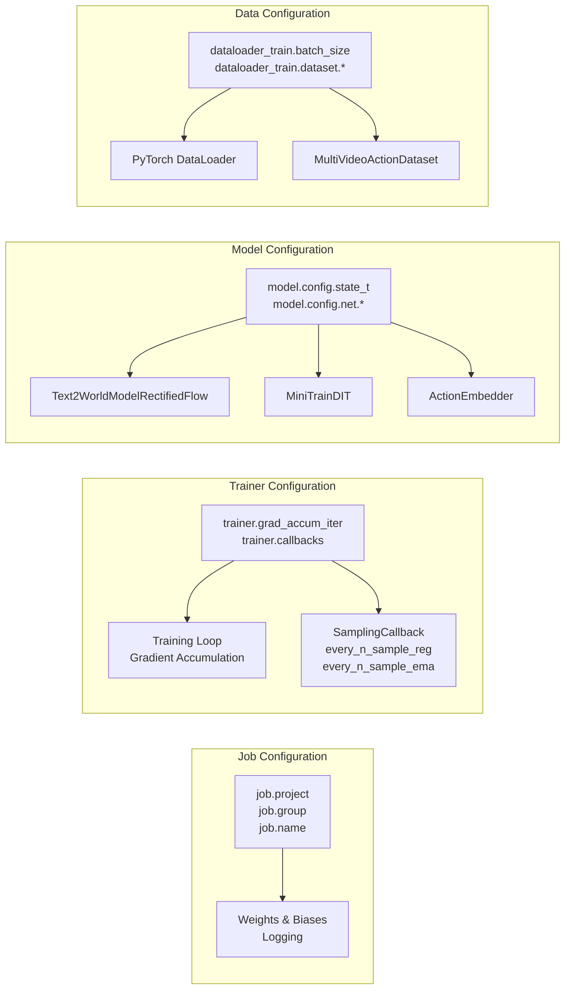

<!-- source: DeepWiki mcp.deepwiki.com · repo NVIDIA/DreamDojo · page 5.4 Configuration Examples · fetched 2026-10-26 -->

# Configuration Examples

<details>
<summary>Relevant source files</summary>

The following files were used as context for generating this wiki page:

- [configs/14b_480_640_gr1.yaml](configs/14b_480_640_gr1.yaml)
- [configs/2b_480_640_agibot.yaml](configs/2b_480_640_agibot.yaml)
- [configs/2b_480_640_g1.yaml](configs/2b_480_640_g1.yaml)
- [configs/2b_480_640_gr1.yaml](configs/2b_480_640_gr1.yaml)
- [configs/2b_480_640_pretrain.yaml](configs/2b_480_640_pretrain.yaml)
- [configs/2b_480_640_yam.yaml](configs/2b_480_640_yam.yaml)

</details>


This page provides complete, working configuration examples for different training scenarios in DreamDojo. Each example demonstrates how to structure YAML configuration files for specific use cases, including pretraining on human video and post-training for various robot platforms.

For information about base configuration defaults and checkpoint references, see [Base Configurations](5.1). For details on YAML file structure and override mechanisms, see [Experiment YAML Files](5.2). For runtime argument configuration, see [Action-Conditioned Configuration](5.3).

---

## Configuration File Structure

All DreamDojo experiment configurations follow a hierarchical structure where YAML files override Python-defined defaults from `_default_groot_config` or `_default_groot_config_14b`. The configuration system uses Hydra's composition mechanism to merge settings.

Title: Configuration Hierarchy and Code Mapping


**Sources:** [configs/14b_480_640_gr1.yaml:1-45](), [configs/2b_480_640_gr1.yaml:1-38]()

---

## Pretraining Configuration

Pretraining uses 44k hours of human egocentric video to learn general world dynamics without robot-specific actions. The key difference from post-training is `zero_init_action_embedder: true`, which initializes action embeddings to zero since no robot actions are available during this phase.

### Complete Pretraining Example

```yaml
job:
  project: dreamdojo
  group: exp1201
  name: pretrain

trainer:
  grad_accum_iter: 1
  callbacks:
    every_n_sample_reg:
      every_n: 1000
      fps: 5
    every_n_sample_ema:
      every_n: 1000
      fps: 5

model_parallel:
  context_parallel_size: 1

model:
  config:
    state_t: 4  # 1 + 12 // 4
    net:
      action_dim: 384
      temporal_compression_ratio: 4
      num_action_per_chunk: 12
      zero_init_action_embedder: true  # Key for pretraining

dataloader_train:
  batch_size: 4
  
  dataset:
    num_frames: 13
    dataset_path:
      - /mnt/amlfs-03/shared/datasets/gear_humanoid/joelj/0911/gr1_unified.inhouse_human_only
      - /mnt/amlfs-03/shared/datasets/egodex_21
      - /mnt/amlfs-02/shared/datasets/dreamdojo_hv_lerobot_20s_final
    dataset_mixing_weights:
      - 1
      - 2
      - 10
    data_split: full
    single_base_index: false
    deterministic_uniform_sampling: false
```

**Sources:** [configs/2b_480_640_pretrain.yaml:1-44]()

### Pretraining Parameter Mapping

| Parameter | Value | Code Entity | Purpose |
|-----------|-------|-------------|---------|
| `job.name` | `pretrain` | Logging identifier | Experiment tracking |
| `grad_accum_iter` | `1` | Training loop accumulation | Number of steps to accumulate gradients |
| `every_n_sample_reg` | `1000` | Sampling callback frequency | Generate samples every 1000 iterations |
| `context_parallel_size` | `1` | Sequence parallelism | Size of the context parallel group |
| `state_t` | `4` | Latent temporal dimension | 1 + 12 // 4 = 4 timesteps |
| `action_dim` | `384` | `MiniTrainDIT.action_dim` | Unified action space size |
| `zero_init_action_embedder` | `true` | Action embedder initialization | Zero initialization for no-action training |
| `num_frames` | `13` | Video clip length | 13 frames per training sample |
| `dataset_mixing_weights` | `[1, 2, 10]` | Dataset sampling probability | DreamDojo-HV sampled 10× more frequently |

**Sources:** [configs/2b_480_640_pretrain.yaml:1-44]()

---

## Post-Training Configuration: GR-1 Robot

Post-training adapts the pretrained model to specific robot platforms. For GR-1, the configuration differs from pretraining in:
1. `zero_init_action_embedder: false` - Actions are now used for conditioning.
2. Robot-specific datasets with teleoperation data.
3. Action dimensions map to Fourier (0-29) and Manus (29-58) ranges.

Title: GR-1 Action and Data Flow


**Sources:** [configs/2b_480_640_gr1.yaml:1-38](), [configs/14b_480_640_gr1.yaml:1-38]()

---

## Post-Training Configuration: Unitree G1

The Unitree G1 configuration uses action dimensions 58-101 from the unified 384-dimensional action space. G1 datasets contain corrected waist control and in-the-wild demonstrations.

### Complete G1 Example

```yaml
job:
  project: dreamdojo
  group: exp1201
  name: g1

trainer:
  grad_accum_iter: 1
  callbacks:
    every_n_sample_reg:
      every_n: 1000
      fps: 5
    every_n_sample_ema:
      every_n: 1000
      fps: 5

model_parallel:
  context_parallel_size: 1

model:
  config:
    state_t: 4
    net:
      action_dim: 384
      temporal_compression_ratio: 4
      num_action_per_chunk: 12
      zero_init_action_embedder: false

dataloader_train:
  batch_size: 4
  
  dataset:
    num_frames: 13
    dataset_path:
      - /mnt/amlfs-02/shared/datasets/standardized_v1/g1/unitree_g1.corl-demo_locked-waist_sep5-sep11
      - /mnt/amlfs-02/shared/datasets/standardized_v1/g1/unitree_g1.g1-cart_corrected-waist_sep19-sep30
      - /mnt/amlfs-02/shared/datasets/standardized_v1/g1/unitree_g1.g1-corl-basket_corrected-waist_aug22-aug27
      - /mnt/amlfs-02/shared/datasets/standardized_v1/g1/unitree_g1.g1-shelf_corrected-waist_aug18-sep3
      - /mnt/amlfs-02/shared/datasets/standardized_v1/g1/unitree_g1.g1-shelf_locked-waist_aug7-aug18
      - /mnt/amlfs-02/shared/datasets/standardized_v1/g1/unitree_g1.in-the-wild_corrected-waist_oct7-oct29
      - /mnt/amlfs-02/shared/datasets/standardized_v1/g1/unitree_g1.in-the-wild_nov2-nov12
      - /mnt/amlfs-02/shared/datasets/standardized_v1/g1/unitree_g1.in-the-wild_oct27-oct31
    data_split: train
    single_base_index: false
    deterministic_uniform_sampling: false
```

**Sources:** [configs/2b_480_640_g1.yaml:1-45]()

---

## Post-Training Configuration: AgiBot

AgiBot uses action dimensions 147-169 and includes extensive datasets covering diverse manipulation tasks across multiple collection batches.

### Complete AgiBot Example (Abbreviated)

```yaml
job:
  project: dreamdojo
  group: exp1201
  name: agibot

trainer:
  grad_accum_iter: 1
  callbacks:
    every_n_sample_reg:
      every_n: 1000
      fps: 5
    every_n_sample_ema:
      every_n: 1000
      fps: 5

model_parallel:
  context_parallel_size: 1

model:
  config:
    state_t: 4
    net:
      action_dim: 384
      temporal_compression_ratio: 4
      num_action_per_chunk: 12
      zero_init_action_embedder: false

dataloader_train:
  batch_size: 4
  
  dataset:
    num_frames: 13
    dataset_path:
      - /mnt/amlfs-03/shared/datasets/agibot-custom-converted-0829-fullres/agibot.0703_2544
      - /mnt/amlfs-03/shared/datasets/agibot-custom-converted-0829-fullres/agibot.0703_2565
      # ... 100+ additional dataset paths
    data_split: train
    single_base_index: false
    deterministic_uniform_sampling: false
```

**Sources:** [configs/2b_480_640_agibot.yaml:1-115]()

---

## Post-Training Configuration: YAM Robot

YAM (Yet Another Manipulator) is a bimanual robot using action dimensions 101-147. The configuration includes 200+ task variations covering household, industrial, and manipulation scenarios.

### Complete YAM Example (Abbreviated)

```yaml
job:
  project: dreamdojo
  group: exp1201
  name: yam

trainer:
  grad_accum_iter: 1
  callbacks:
    every_n_sample_reg:
      every_n: 1000
      fps: 5
    every_n_sample_ema:
      every_n: 1000
      fps: 5

model_parallel:
  context_parallel_size: 1

model:
  config:
    state_t: 4
    net:
      action_dim: 384
      temporal_compression_ratio: 4
      num_action_per_chunk: 12
      zero_init_action_embedder: false

dataloader_train:
  batch_size: 4
  
  dataset:
    num_frames: 13
    dataset_path:
      - /mnt/amlfs-02/shared/datasets/standardized_v1/yam_v5/xdof.a1_2025-11-05_05-50-45_USA
      - /mnt/amlfs-02/shared/datasets/standardized_v1/yam_v5/xdof.a1_jimmy_2025-11-07_00-16-18_USA
      # ... 200+ additional dataset paths for diverse tasks
    data_split: train
    single_base_index: false
    deterministic_uniform_sampling: false
```

**Sources:** [configs/2b_480_640_yam.yaml:1-275]()

---

## Configuration Parameter Reference

This table maps all major configuration parameters to their corresponding code entities and purposes.

Title: Parameter to Code Mapping


**Sources:** [configs/2b_480_640_pretrain.yaml:1-44](), [configs/2b_480_640_g1.yaml:1-45](), [configs/2b_480_640_agibot.yaml:1-115](), [configs/2b_480_640_yam.yaml:1-275]()

### Complete Parameter Mapping Table

| YAML Path | Type | Code Entity | Description |
|-----------|------|-------------|-------------|
| `job.project` | `str` | Logging project name | Weights & Biases project name |
| `job.group` | `str` | Experiment group | Logical grouping for related runs |
| `job.name` | `str` | Experiment name | Unique identifier for this run |
| `trainer.grad_accum_iter` | `int` | Training loop | Steps to accumulate gradients before update |
| `trainer.callbacks.every_n_sample_reg.every_n` | `int` | `SamplingCallback` | Sample generation frequency (iterations) |
| `trainer.callbacks.every_n_sample_reg.fps` | `int` | Video generation | Frames per second for regular samples |
| `trainer.callbacks.every_n_sample_ema.every_n` | `int` | `SamplingCallback` | EMA sample generation frequency |
| `model_parallel.context_parallel_size` | `int` | Sequence parallelism | Size of the context parallel group |
| `model.config.state_t` | `int` | `Text2WorldModelRectifiedFlow` | Temporal latent dimension size |
| `model.config.net.action_dim` | `int` | `MiniTrainDIT.action_dim` | Action space dimensionality |
| `model.config.net.temporal_compression_ratio` | `int` | `MiniTrainDIT` | Temporal compression factor (frames to latents) |
| `model.config.net.num_action_per_chunk` | `int` | Action chunking | Actions per temporal latent chunk |
| `model.config.net.zero_init_action_embedder` | `bool` | `ActionEmbedder` | Initialize action embedder weights to zero |
| `dataloader_train.batch_size` | `int` | `DataLoader` | Local batch size per GPU |
| `dataloader_train.dataset.num_frames` | `int` | `MultiVideoActionDataset` | Number of video frames per sample |
| `dataloader_train.dataset.dataset_path` | `List[str]` | `Dataset_3D` | Paths to training data |
| `dataloader_train.dataset.dataset_mixing_weights` | `List[float]` | Sampling probability | Relative weights for sampling from multiple paths |
| `dataloader_train.dataset.data_split` | `str` | Train/val split | `"train"`, `"test"`, or `"full"` |
| `dataloader_train.dataset.single_base_index` | `bool` | Dataset indexing | Use single index across all dataset paths |
| `dataloader_train.dataset.deterministic_uniform_sampling` | `bool` | Sampling strategy | Whether to use deterministic sampling |

**Sources:** [configs/2b_480_640_pretrain.yaml:1-44](), [configs/2b_480_640_g1.yaml:1-45](), [configs/2b_480_640_agibot.yaml:1-115](), [configs/2b_480_640_yam.yaml:1-275]()

---

## Action Dimension Allocation

The unified 384-dimensional action space is partitioned to support multiple robot embodiments simultaneously. Each robot platform uses a specific dimension range, with latent actions (from LAM) occupying dimensions 352-384.

| Robot / Component | Action Dimension Range | Description |
|-------------------|------------------------|-------------|
| GR-1 (Fourier)    | [0, 29)                | Fourier Gloves control |
| GR-1 (Manus)      | [29, 58)               | Manus Gloves control |
| Unitree G1        | [58, 101)              | 43-dimensional G1 control |
| YAM               | [101, 147)             | 46-dimensional bimanual control |
| AgiBot            | [147, 169)             | 22-dimensional control |
| MANO Hand         | [220, 352)             | 132-dimensional hand control |
| Latent Actions    | [352, 384)             | 32-dimensional LAM latents |

**Sources:** [configs/2b_480_640_pretrain.yaml:23](), [configs/2b_480_640_g1.yaml:23](), [configs/2b_480_640_agibot.yaml:23](), [configs/2b_480_640_yam.yaml:23]()

---

## Dataset Configuration Patterns

All DreamDojo configurations follow consistent dataset configuration patterns. The key parameters control video sampling, dataset mixing, and train/test splits.

### Data Split Options

| `data_split` Value | Behavior | Use Case |
|-------------------|----------|----------|
| `"train"` | Uses first 95% of dataset | Standard training |
| `"test"` | Uses last 5% of dataset | Validation/evaluation |
| `"full"` | Uses entire dataset | Pretraining on all available data |

**Sources:** [configs/2b_480_640_pretrain.yaml:41](), [configs/2b_480_640_g1.yaml:42](), [configs/2b_480_640_gr1.yaml:35]()

### Dataset Mixing Weights

When multiple datasets are specified, `dataset_mixing_weights` controls relative sampling probability. For example, in pretraining:

```yaml
dataset_path:
  - inhouse_human_only      # Weight: 1
  - egodex_21              # Weight: 2
  - dreamdojo_hv_lerobot   # Weight: 10
dataset_mixing_weights:
  - 1
  - 2
  - 10
```

This configuration samples from `dreamdojo_hv_lerobot` with 10× higher probability than `inhouse_human_only`, enabling balanced training across datasets of vastly different sizes.

**Sources:** [configs/2b_480_640_pretrain.yaml:33-40]()

---

## Model Configuration Deep Dive

Model configuration parameters directly control the `Text2WorldModelRectifiedFlow` and `MiniTrainDIT` network architecture.

### Temporal Dimension Calculation

The `state_t` parameter determines the latent temporal dimension after VAE compression. It is calculated based on the number of input frames and the temporal compression ratio:

```
state_t = 1 + (num_frames - 1) // temporal_compression_ratio
state_t = 1 + (13 - 1) // 4 = 1 + 12 // 4 = 1 + 3 = 4
```

This means 13 input frames compress to 4 temporal latent frames.

**Sources:** [configs/2b_480_640_pretrain.yaml:21](), [configs/2b_480_640_g1.yaml:21](), [configs/2b_480_640_gr1.yaml:21]()

### Action Chunking Configuration

The `num_action_per_chunk` parameter controls how many future actions are embedded per temporal step:

- `num_action_per_chunk: 12` means each of the 4 latent timesteps contains embeddings for 12 future actions.
- Total action sequence length: `state_t × num_action_per_chunk = 4 × 12 = 48 actions`.

This enables long-horizon action prediction and smoother temporal control.

**Sources:** [configs/2b_480_640_pretrain.yaml:25](), [configs/2b_480_640_g1.yaml:25](), [configs/2b_480_640_gr1.yaml:25]()

---

