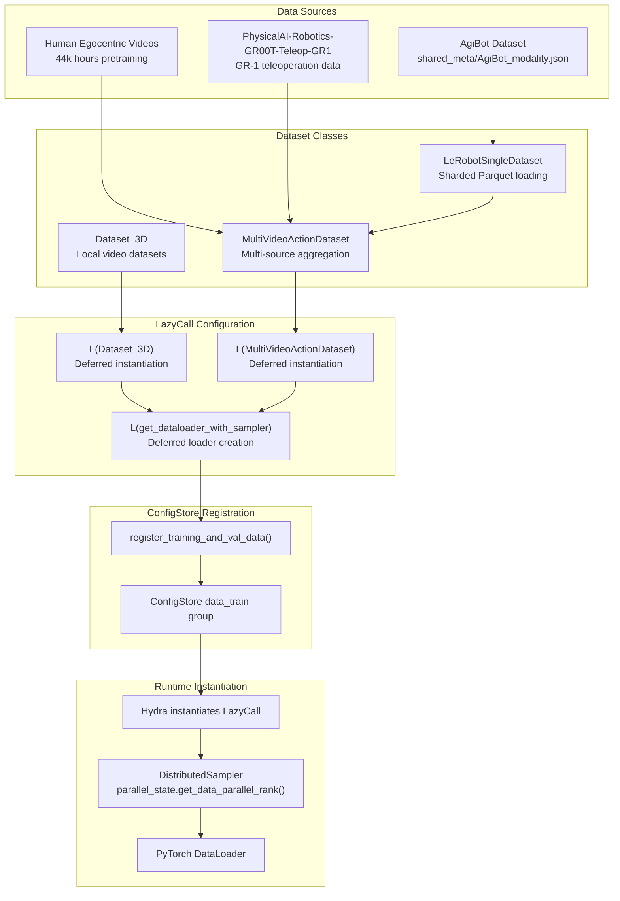
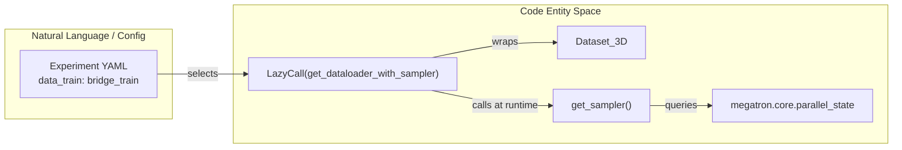

<!-- source: DeepWiki mcp.deepwiki.com · repo NVIDIA/DreamDojo · page 6 Data Pipeline · fetched 2026-10-26 -->

# Data Pipeline

<details>
<summary>Relevant source files</summary>

The following files were used as context for generating this wiki page:

- [cosmos_predict2/_src/predict2/action/configs/action_conditioned/data.py](cosmos_predict2/_src/predict2/action/configs/action_conditioned/data.py)
- [groot_dreams/data/dataset.py](groot_dreams/data/dataset.py)
- [shared_meta/AgiBot_modality.json](shared_meta/AgiBot_modality.json)

</details>


## Purpose and Scope

The Data Pipeline is responsible for loading, preprocessing, and batching video and action data for DreamDojo training and evaluation. This system supports heterogeneous data sources including large-scale pretraining datasets (44,000 hours of human egocentric video), robot-specific teleoperation datasets (GR-1, G1, AgiBot, YAM), and evaluation benchmarks.

This page provides an overview of the data pipeline architecture, dataset types, and configuration patterns. For detailed information on:
- Dataset configuration and registration, see [Dataset Configuration](#6.1)
- Video normalization, frame sampling, and action loading, see [Data Preprocessing](#6.2)
- Batch creation and distributed sampling, see [DataLoader and Sampling](#6.3)

---

## System Architecture

The data pipeline follows a hierarchical design where dataset definitions are configured using lazy instantiation patterns, registered with Hydra's `ConfigStore`, and instantiated during training with `DistributedSampler` support integrated with Megatron-Core parallel states.

### Data Flow Overview



**Sources:** [cosmos_predict2/_src/predict2/action/configs/action_conditioned/data.py:1-183](), [groot_dreams/data/dataset.py:76-141]()

---

## Dataset Types

DreamDojo supports several primary dataset classes for different data loading scenarios:

| Dataset Class | Purpose | Key Features | Typical Use Case |
|---------------|---------|--------------|------------------|
| `Dataset_3D` | Local video datasets with annotations | Single-source, file-based loading, train/val/test splits | Bridge dataset, single robot evaluation |
| `LeRobotSingleDataset` | Sharded robot data loading | Parquet-based action loading, modality-specific configs | AgiBot, G1, and YAM robot data |
| `MultiVideoActionDataset` | Multi-source video aggregation | Multiple dataset paths, flexible composition | DreamDojo post-training |

### LeRobotSingleDataset

The `LeRobotSingleDataset` class is the foundation for modern robot datasets in the pipeline. It uses `ModalityConfig` to define how to sample different data types (video, state, action) using `delta_indices` relative to a `base_index`.

```python
LeRobotSingleDataset(
    dataset_path="datasets/AgiBot",
    modality_configs={
        "video": ModalityConfig(delta_indices=[0, 1, 2, ...], modality_keys=["top_head"]),
        "action": ModalityConfig(delta_indices=[0, 1, 2, ...], modality_keys=["action"])
    },
    embodiment_tag=EmbodimentTag.AGIBOT,
    num_frames=13,
    single_base_index=False
)
```

It leverages `shared_meta` JSON files (e.g., `shared_meta/AgiBot_modality.json`) to map internal keys to the underlying data schema.

**Sources:** [groot_dreams/data/dataset.py:76-134](), [shared_meta/AgiBot_modality.json:1-163]()

---

## LazyCall Configuration Pattern

DreamDojo uses the `LazyCall` (aliased as `L`) pattern to defer dataset and dataloader instantiation. This allows the configuration to reference components that require a distributed environment (like `parallel_state`) before that environment is fully initialized.

### LazyCall to Code Mapping



**Sources:** [cosmos_predict2/_src/predict2/action/configs/action_conditioned/data.py:102-156]()

---

## DataLoader and Sampling

### get_dataloader_with_sampler

This utility function is the standard entry point for creating data iterators. It ensures that the `DistributedSampler` is correctly synchronized with the Megatron-Core data parallel groups.

```python
def get_dataloader_with_sampler(dataset, batch_size=1, drop_last=True, **kwargs):
    # Create sampler with the instantiated dataset
    sampler = get_sampler(dataset)
    
    # Create DataLoader with the instantiated dataset and sampler
    return DataLoader(
        dataset=dataset,
        sampler=sampler,
        batch_size=batch_size,
        drop_last=drop_last,
        **kwargs,
    )
```

The `get_sampler` function uses `parallel_state.get_data_parallel_world_size()` and `parallel_state.get_data_parallel_rank()` to shard the dataset across GPUs.

**Sources:** [cosmos_predict2/_src/predict2/action/configs/action_conditioned/data.py:102-149]()

---

## Dataset Registration System

The `register_training_and_val_data()` function registers dataset configurations with Hydra's `ConfigStore`, making them selectable via the `data_train` and `data_val` keys in experiment YAMLs.

```python
def register_training_and_val_data():
    cs = ConfigStore.instance()
    # Registering bridge_train_dataloader under name 'bridge_train'
    cs.store(
        group="data_train",
        package="dataloader_train",
        name="bridge_train",
        node=bridge_train_dataloader,
    )
```

**Sources:** [cosmos_predict2/_src/predict2/action/configs/action_conditioned/data.py:186-215]()

---

## Next Steps

- **[Dataset Configuration](#6.1)**: Detailed information on `register_training_and_val_data()`, `EmbodimentTag` system, and `shared_meta` schemas.
- **[Data Preprocessing](#6.2)**: Documentation on `ComposedModalityTransform`, video normalization, and action remapping.
- **[DataLoader and Sampling](#6.3)**: Details on `DistributedSampler` integration and `CachedLeRobotSingleDataset` for performance optimization.

---

