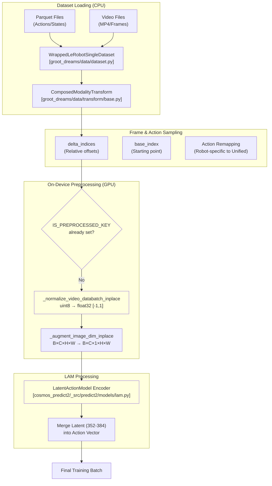
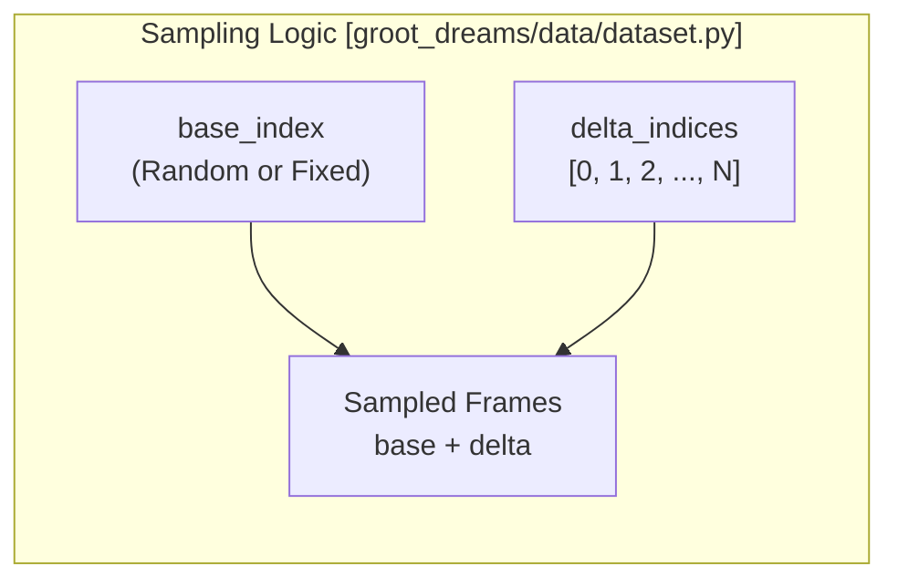

<!-- source: DeepWiki mcp.deepwiki.com · repo NVIDIA/DreamDojo · page 6.2 Data Preprocessing · fetched 2026-10-26 -->

# Data Preprocessing

Relevant source files

The following files were used as context for generating this wiki page:

- [groot_dreams/data/dataset.py](groot_dreams/data/dataset.py)
- [groot_dreams/dataloader.py](groot_dreams/dataloader.py)
- [shared_meta/AgiBot_modality.json](shared_meta/AgiBot_modality.json)

## Purpose and Scope

This document covers the data preprocessing operations applied to video, image, and action data before they are fed into the DreamDojo model. Preprocessing includes video normalization, frame sampling (via `delta_indices` and `base_index`), action loading from parquet files, and LAM (Latent Action Model) video processing. These operations occur both during dataset loading (CPU/Host) and within the model's forward pass (GPU/Device).

The pipeline is designed to handle diverse robotics datasets (GR-1, G1, AgiBot, YAM) by mapping them into a unified 384-dimensional action space and standardizing video formats.

---

## Preprocessing Pipeline Overview

**Sources**: [groot_dreams/data/dataset.py:76-146](), [cosmos_predict2/_src/predict2/models/text2world_model_rectified_flow.py:953-1000](), [groot_dreams/dataloader.py:37-48]()

---

## Video Normalization and Augmentation

### On-Device CUDA Normalization
To optimize throughput, video normalization is performed on the GPU. Raw data is loaded as `uint8` [0, 255] and transformed to `float32` or `bfloat16` in the range [-1, 1].

| Operation | Details |
|-----------|---------|
| **Method** | `_normalize_video_databatch_inplace` [cosmos_predict2/_src/predict2/models/text2world_model_rectified_flow.py:953-987]() |
| **Formula** | `(value / 127.5) - 1.0` |
| **Flag** | `IS_PREPROCESSED_KEY` prevents redundant operations [cosmos_predict2/_src/predict2/models/text2world_model_rectified_flow.py:72]() |

### Image Dimension Augmentation
Single images are treated as 1-frame videos by adding a temporal dimension.
- **Method**: `_augment_image_dim_inplace` [cosmos_predict2/_src/predict2/models/text2world_model_rectified_flow.py:989-1000]()
- **Transformation**: `(B, C, H, W) -> (B, C, 1, H, W)` using `einops.rearrange`.

---

## Frame Sampling and Delta Indices

The `LeRobotSingleDataset` uses a flexible sampling strategy based on `delta_indices`.

- **delta_indices**: A list of integers relative to the `base_index`. For a 13-frame sequence, this is typically `[0, 1, ..., 12]` [groot_dreams/data/dataset.py:70-74]().
- **single_base_index**: If `True`, the dataset uses a fixed starting point (usually 0), common for evaluation [groot_dreams/data/dataset.py:89]().
- **timestep_interval**: Calculated as the difference between the last two `delta_indices` [groot_dreams/data/dataset.py:123]().

**Sources**: [groot_dreams/data/dataset.py:76-132](), [groot_dreams/dataloader.py:37-48]()

---

## Action Loading and Remapping

### Parquet Data Loading
Actions and states are loaded from `.parquet` files located in `data/*/*.parquet` [groot_dreams/data/dataset.py:30](). The function `calculate_dataset_statistics` computes the mean, std, min, and max for all low-dimensional modalities to support normalization [groot_dreams/data/dataset.py:33-64]().

### WrappedLeRobotSingleDataset and Remapping
The `WrappedLeRobotSingleDataset` acts as a decorator for `LeRobotSingleDataset`, handling the mapping from robot-specific parquet columns to the unified 384-dimensional action space.

1. **Modality Config**: Defines which keys to load (e.g., `left_arm_joint_position`) and their `delta_indices` [groot_dreams/data/dataset.py:67-74]().
2. **Action Remapping**: Maps original keys (like `observation.state` in `AgiBot_modality.json`) to specific index ranges in the unified vector [shared_meta/AgiBot_modality.json:2-65]().
3. **Delta Action Calculation**: In `VideoActionDataset`, an additional prefix frame is often sampled to compute the change in action relative to the baseline [groot_dreams/dataloader.py:37-39]().

### AgiBot Example Mapping
| Modality | Original Key | Indices |
|----------|--------------|---------|
| Left Arm | `action` | [0, 7) |
| Right Arm | `action` | [7, 14) |
| Head | `action` | [16, 18) |
| Robot Velocity | `action` | [20, 22) |

**Sources**: [groot_dreams/data/dataset.py:33-74](), [shared_meta/AgiBot_modality.json:1-163](), [groot_dreams/dataloader.py:37-48]()

---

## LAM Preprocessing and Integration

The Latent Action Model (LAM) processes pairs of video frames to extract a 32-dimensional latent action representation.

1. **Input Reshaping**: `lam_video` data (shape `B x (P*T) x H x W x C`) is rearranged to `(B*P) x T x H x W x C` where `T=2` (frame pairs) [cosmos_predict2/_src/predict2/models/text2world_model_rectified_flow.py:863]().
2. **Latent Extraction**: The `LAMEncoder` produces `z_rep`, a 32-dim latent [cosmos_predict2/_src/predict2/models/text2world_model_rectified_flow.py:864-866]().
3. **Merging**: These latents are multiplied into the last 32 dimensions (352-384) of the main action vector [cosmos_predict2/_src/predict2/models/text2world_model_rectified_flow.py:868-869]().

**Sources**: [cosmos_predict2/_src/predict2/models/text2world_model_rectified_flow.py:856-870](), [cosmos_predict2/_src/predict2/models/text2world_model_rectified_flow.py:179-188]()

---

## ComposedModalityTransform Pipeline

Data transformations are managed by the `ComposedModalityTransform` class, located in `groot_dreams/data/transform/`. This pipeline applies a sequence of operations to different modalities (video, state, action) during the `__getitem__` call of the dataset.

- **Initialization**: Configured via `construct_modality_config_and_transforms` [groot_dreams/dataloader.py:37-38]().
- **Execution**: The dataset calls `self.transforms(data)` before returning the batch [groot_dreams/data/dataset.py:111-113]().

**Sources**: [groot_dreams/data/dataset.py:111-113](), [groot_dreams/dataloader.py:37-48]()

---

