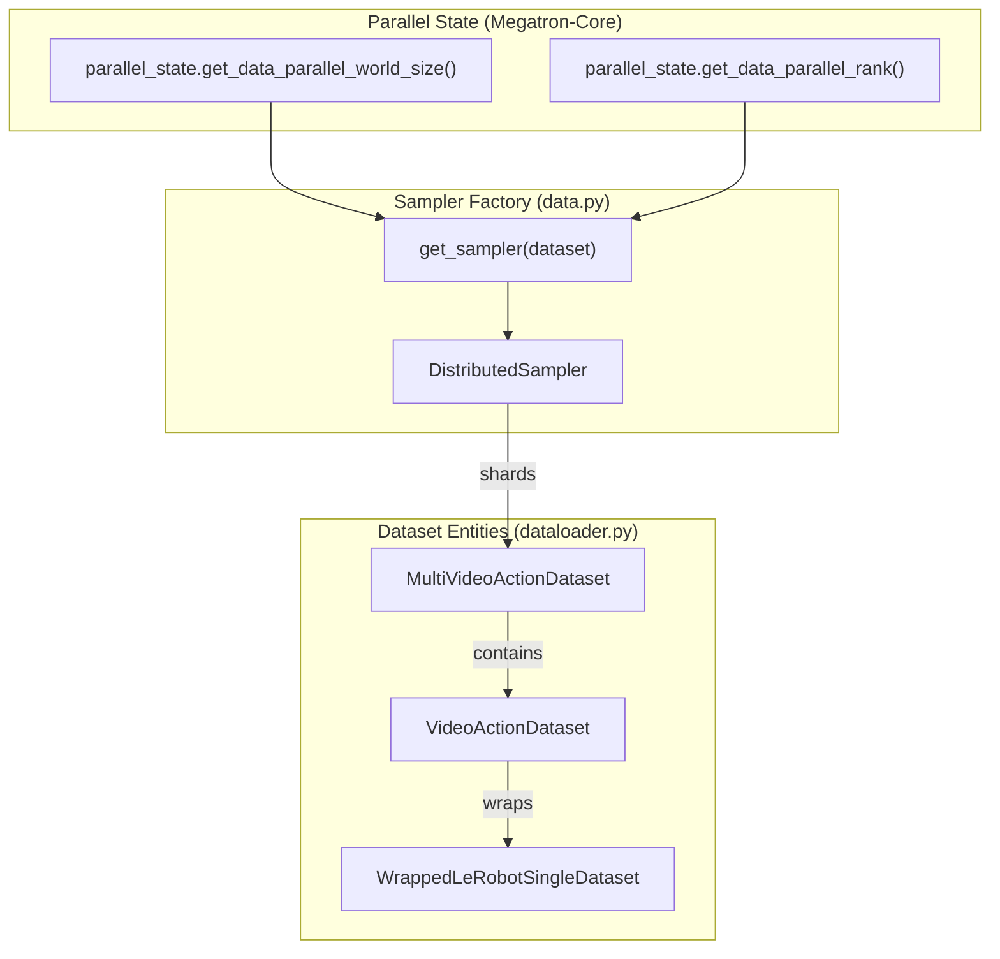
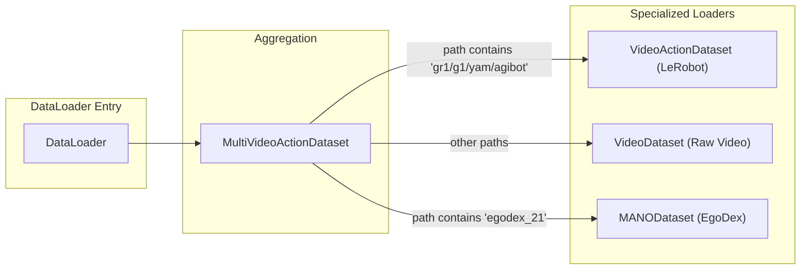

<!-- source: DeepWiki mcp.deepwiki.com · repo NVIDIA/DreamDojo · page 6.3 DataLoader and Sampling · fetched 2026-10-26 -->

# DataLoader and Sampling

<details>
<summary>Relevant source files</summary>

The following files were used as context for generating this wiki page:

- [cosmos_predict2/_src/predict2/action/configs/action_conditioned/data.py](cosmos_predict2/_src/predict2/action/configs/action_conditioned/data.py)
- [cosmos_predict2/_src/predict2/interactive/configs/data.py](cosmos_predict2/_src/predict2/interactive/configs/data.py)
- [groot_dreams/dataloader.py](groot_dreams/dataloader.py)

</details>


## Purpose and Scope

This document describes the DataLoader and sampling infrastructure in DreamDojo, focusing on how data is batched and distributed across multiple GPUs during training and inference. The system uses PyTorch's `DistributedSampler` integrated with Megatron-Core's parallel state management to ensure efficient data parallelism. It also documents specialized sampling behaviors like `deterministic_uniform_sampling` and the `CachedLeRobotSingleDataset` logic for pre-loaded video frames.

The dataloader system is implemented primarily in [cosmos_predict2/_src/predict2/action/configs/action_conditioned/data.py](), [cosmos_predict2/_src/predict2/interactive/configs/data.py](), and [groot_dreams/dataloader.py]().

Sources: [cosmos_predict2/_src/predict2/action/configs/action_conditioned/data.py:1-20](), [groot_dreams/dataloader.py:1-11]()

## DistributedSampler Architecture

DreamDojo uses PyTorch's `DistributedSampler` to partition data across multiple GPUs. The sampler integrates with Megatron's `parallel_state` module to coordinate data parallel ranks, ensuring that `num_replicas` and `rank` are correctly aligned with the model's data-parallel world size.

### Entity Mapping: Sampling Logic
The following diagram bridges the high-level sampling concepts to the specific code entities in the configuration and dataloader files.


Sources: [cosmos_predict2/_src/predict2/action/configs/action_conditioned/data.py:102-109](), [cosmos_predict2/_src/predict2/interactive/configs/data.py:170-177](), [groot_dreams/dataloader.py:17-48]()

### Sampler Configuration
The `get_sampler()` function creates the sampler instance with the following parameters:

| Parameter | Value | Source |
|-----------|-------|--------|
| `num_replicas` | `parallel_state.get_data_parallel_world_size()` | [cosmos_predict2/_src/predict2/action/configs/action_conditioned/data.py:105]() |
| `rank` | `parallel_state.get_data_parallel_rank()` | [cosmos_predict2/_src/predict2/action/configs/action_conditioned/data.py:106]() |
| `shuffle` | `True` | [cosmos_predict2/_src/predict2/action/configs/action_conditioned/data.py:107]() |
| `seed` | `0` or `1234` | [cosmos_predict2/_src/predict2/action/configs/action_conditioned/data.py:108](), [cosmos_predict2/_src/predict2/interactive/configs/data.py:176]() |

## DataLoader and Sampling Functions

### get_dataloader_with_sampler()
This function handles both sampler creation and DataLoader instantiation in a single call to avoid double instantiation of the dataset, which is critical when using the `LazyCall` system.

| Function | File | Description |
|----------|------|-------------|
| `get_dataloader_with_sampler` | [cosmos_predict2/_src/predict2/action/configs/action_conditioned/data.py:131-149]() | Standard training dataloader setup. |
| `make_dataloader` | [cosmos_predict2/_src/predict2/interactive/configs/data.py:180-190]() | Interactive/inference dataloader setup with `num_workers=4` and `pin_memory=True`. |

### Sampling Strategies

#### Deterministic Uniform Sampling
In `MultiVideoActionDataset`, the `deterministic_uniform_sampling` flag (default `False`) controls how samples are selected from the underlying datasets. When enabled, it allows for reproducible evaluation by ensuring samples are chosen at fixed intervals rather than randomly.

Sources: [groot_dreams/dataloader.py:97, 117]()

#### single_base_index
The `single_base_index` parameter in `VideoActionDataset` and `MultiVideoActionDataset` is passed down to `WrappedLeRobotSingleDataset`. It forces the dataset to sample from a single fixed base index (usually for testing or specific temporal alignment tasks) instead of sliding windows across the video.

Sources: [groot_dreams/dataloader.py:29, 47, 95, 167]()

## Multi-Dataset Management

The `MultiVideoActionDataset` acts as a container for multiple robot-specific datasets (GR1, G1, AgiBot, YAM). It handles the routing of data requests to the appropriate `VideoActionDataset` or `VideoDataset` based on the path.

### Data Flow: Multi-Dataset Loading

Sources: [groot_dreams/dataloader.py:130-169]()

## CachedLeRobotSingleDataset
While the primary training uses `WrappedLeRobotSingleDataset` [groot_dreams/dataloader.py:40-48](), the system supports pre-loaded video frames for distillation and interactive tasks.

### ActionDatasetSFWarmup
Used for DMD2 distillation and real-time generation warmup, this dataset loads pre-generated latent embeddings and actions.

| Parameter | Purpose | Source |
|-----------|---------|--------|
| `data_path` | Path to regenerated 4-step warmup data | [cosmos_predict2/_src/predict2/interactive/configs/data.py:28]() |
| `cr1_embeddings_path` | Path to pre-computed text embeddings | [cosmos_predict2/_src/predict2/interactive/configs/data.py:29]() |

Sources: [cosmos_predict2/_src/predict2/interactive/configs/data.py:25-65]()

## Lazy Configuration Pattern

DreamDojo uses the `LazyCall` pattern (aliased as `L`) to defer dataset instantiation. This allows Hydra to merge experiment-specific YAML overrides (like `batch_size` or `num_frames`) before the heavy dataset objects are created in memory.

### LazyCall Syntax Example
```python
# Defined in data.py
dreamdojo_13frame_train_dataloader = L(get_dataloader_with_sampler)(
    dataset=L(MultiVideoActionDataset)(
        num_frames=13,
        dataset_path=["datasets/GR1_robot"],
    ),
    batch_size=1,
    drop_last=True,
)
```
Sources: [cosmos_predict2/_src/predict2/action/configs/action_conditioned/data.py:91-98, 174-178]()

## WebDataset Support
For large-scale streaming, the `build_webdataset` helper allows overriding parameters like `gripper_rescale_factor` on a `WebDataset` instance before calling its `build_dataset()` method.

Sources: [cosmos_predict2/_src/predict2/action/configs/action_conditioned/data.py:112-128]()

---

