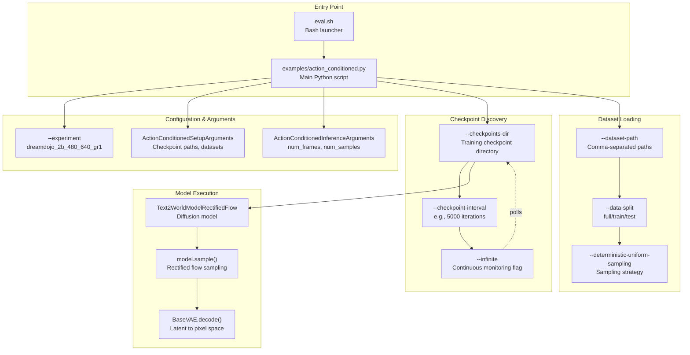
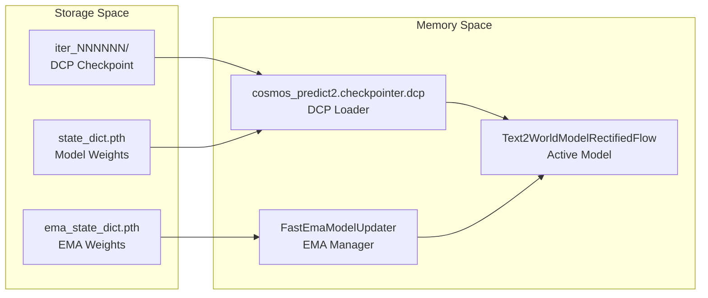

<!-- source: DeepWiki mcp.deepwiki.com · repo NVIDIA/DreamDojo · page 7 Evaluation · fetched 2026-10-26 -->

# Evaluation

Relevant source files

The following files were used as context for generating this wiki page:

- [docs/EVAL.md](docs/EVAL.md)
- [eval.sh](eval.sh)

This document covers the evaluation system for trained DreamDojo models. Evaluation enables testing model checkpoints on benchmark datasets and generating video samples to assess quality. The system supports both one-time evaluation runs and continuous monitoring during training.

For information about the training process that produces checkpoints, see [Training Pipeline](#4). For details on checkpoint storage and EMA weight management, see [Checkpoint Management](#7.3). For distributed training infrastructure that produces these checkpoints, see [Distributed Training](#8.1).

## Overview

The DreamDojo evaluation system provides functionality to:

- Load trained model checkpoints from disk.
- Generate video samples conditioned on text captions and robot actions.
- Evaluate on multiple benchmark datasets (In-lab tasks, EgoDex, DreamDojo-HV).
- Monitor training progress by continuously evaluating new checkpoints.
- Save generated videos for qualitative and quantitative analysis.

The evaluation pipeline is orchestrated through the `eval.sh` script [eval.sh:1-16]() and implemented in the `examples/action_conditioned.py` entrypoint.

**Sources**: [eval.sh:1-16](), [docs/EVAL.md:1-21]()

## Evaluation Pipeline Architecture

The following diagram bridges the high-level evaluation concepts to the specific code entities and script parameters used in the system.

### System to Code Entity Mapping

**Sources**: [eval.sh:5-16](), [docs/EVAL.md:9-20]()

## Evaluation Script Parameters

The primary evaluation interface is `eval.sh` [eval.sh:1-16](), which sets up the environment and invokes `examples/action_conditioned.py` with command-line arguments.

### Core Parameters

| Parameter | Type | Description | Example |
|-----------|------|-------------|---------|
| `--checkpoints-dir` | Path | Directory containing training checkpoints | `/path/to/checkpoints` [docs/EVAL.md:11]() |
| `--experiment` | String | Configuration name from experiment YAML | `dreamdojo_2b_480_640_gr1` [docs/EVAL.md:12]() |
| `--save-dir` | Path | Output directory for generated videos | `/path/to/results` [docs/EVAL.md:13]() |
| `--num-frames` | Integer | Video length including condition frame | `49` [docs/EVAL.md:14]() |
| `--num-samples` | Integer | Number of samples to generate | `100` [docs/EVAL.md:15]() |
| `--dataset-path` | String | Comma-separated evaluation dataset paths | `datasets/path1,datasets/path2` [docs/EVAL.md:16]() |
| `--data-split` | String | Dataset subset: `full`, `train`, `test` | `test` [docs/EVAL.md:17]() |
| `--deterministic-uniform-sampling` | Flag | Enable uniform sampling across datasets | (flag) [docs/EVAL.md:18]() |
| `--checkpoint-interval` | Integer | Iteration interval between checkpoints | `5000` [docs/EVAL.md:19]() |
| `--infinite` | Flag | Continuously monitor for new checkpoints | (flag) [docs/EVAL.md:20]() |

For more details on running evaluations, see [Running Evaluations](#7.1).

**Sources**: [eval.sh:5-16](), [docs/EVAL.md:9-20]()

## Evaluation Datasets

DreamDojo provides three benchmark evaluation configurations, each testing different aspects of model performance. For detailed paths and split behavior, see [Evaluation Datasets](#7.2).

### In-Lab Evaluation
Consists of 10 diverse robotics tasks including `pnp_handover_plate`, `fold_cloth`, and `color_puzzles` [docs/EVAL.md:24-31](). These tasks test manipulation, bimanual coordination, and spatial reasoning.

### EgoDex Evaluation
Tests generalization to diverse egocentric manipulation scenarios [docs/EVAL.md:32-39](). It assesses the model's ability to predict realistic camera motions and hand-object interactions.

### DreamDojo-HV Evaluation
Tests the model's understanding of general human manipulation behaviors [docs/EVAL.md:40-47](). This benchmark evaluates cross-domain transfer from human video pretraining to robot scenarios.

**Sources**: [docs/EVAL.md:24-47]()

## Checkpoint Management

Evaluation relies on a robust checkpointing system. For technical details on saving and EMA updates, see [Checkpoint Management](#7.3).

### Continuous Monitoring Logic
When the `--infinite` flag is enabled [eval.sh:16](), the system continuously polls the `--checkpoints-dir` for new iterations matching the `--checkpoint-interval` [docs/EVAL.md:20]().

### Checkpoint to Model Loading

**Sources**: [eval.sh:7,15,16](), [docs/EVAL.md:3,11,19,20]()

## Integration with Training

The evaluation system is designed to run alongside the training pipeline. Training (see [Training Pipeline](#4)) produces checkpoints using the `DCP` checkpointer and maintains `EMA` weights via `FastEmaModelUpdater`. The evaluation script [eval.sh:1-16]() then consumes these checkpoints to track performance metrics across the `full`, `train`, or `test` data splits [docs/EVAL.md:17]().

**Sources**: [eval.sh:1-16](), [docs/EVAL.md:3,17]()

---

