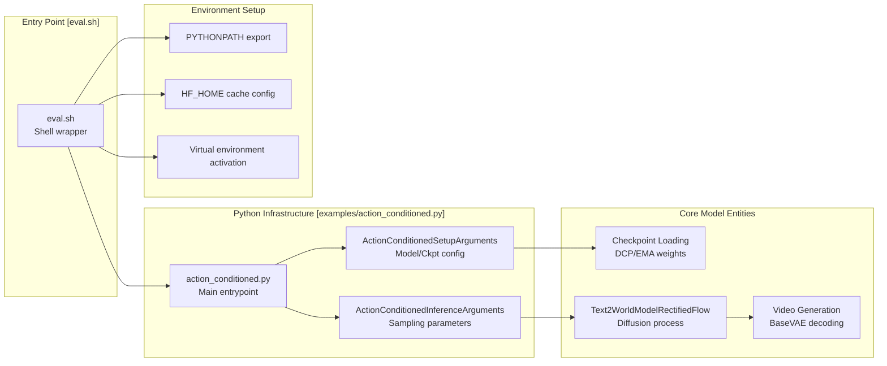
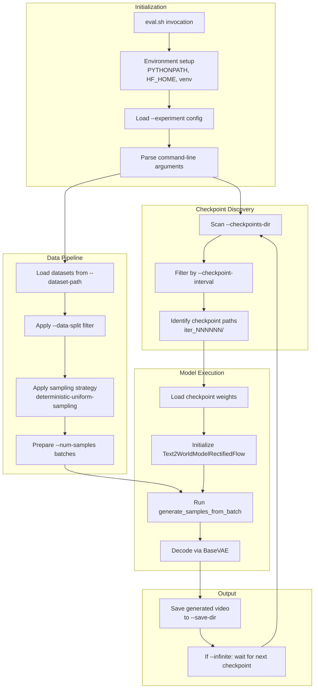

<!-- source: DeepWiki mcp.deepwiki.com · repo NVIDIA/DreamDojo · page 7.1 Running Evaluations · fetched 2026-10-26 -->

# Running Evaluations

<details>
<summary>Relevant source files</summary>

The following files were used as context for generating this wiki page:

- [docs/EVAL.md](docs/EVAL.md)
- [eval.sh](eval.sh)

</details>


## Purpose and Scope

This page documents how to execute evaluations of trained DreamDojo models using the `eval.sh` script and `examples/action_conditioned.py` inference pipeline. It covers command-line parameters, evaluation modes (one-time vs. continuous monitoring), and the execution workflow from checkpoint loading to video generation. This process is typically performed after adapting to a target robot action space through post-training [docs/EVAL.md:3-4]().

**Sources:** [eval.sh:1-16](), [docs/EVAL.md:1-51]()

---

## Evaluation Script Architecture

The evaluation system is built around a shell script wrapper that invokes the Python inference pipeline with appropriate parameters. The `eval.sh` script serves as the primary entry point for all evaluation workflows.

### Script Components

The following diagram bridges the shell-level execution to the internal Python configuration classes used for evaluation.



The evaluation script [eval.sh:1-16]() configures the environment and invokes the action-conditioned inference example. It sets up the Python path, Hugging Face cache location [eval.sh:2](), and activates the virtual environment [eval.sh:3]() before calling `examples/action_conditioned.py` with evaluation-specific arguments [eval.sh:5]().

**Sources:** [eval.sh:1-16](), [docs/EVAL.md:9-20]()

---

## Evaluation Modes

DreamDojo supports two primary evaluation modes: one-time checkpoint evaluation and continuous monitoring during training.

### One-Time Evaluation

One-time evaluation processes a single checkpoint or a set of checkpoints at specified intervals. This mode is used for final model assessment or ad-hoc testing.

```bash
python examples/action_conditioned.py \
  --checkpoints-dir /path/to/checkpoints \
  --experiment dreamdojo_2b_480_640_gr1 \
  --save-dir /path/to/output \
  --num-frames 49 \
  --num-samples 100
```

### Continuous Monitoring

Continuous monitoring mode uses the `--infinite` flag to automatically detect and evaluate new checkpoints as they are saved during training [docs/EVAL.md:20](). This enables real-time performance tracking.

```mermaid
graph TB
    subgraph "One-Time Mode"
        OTStart["Start Evaluation"]
        OTCheckDir["Check --checkpoints-dir"]
        OTFindCkpt["Find checkpoints at<br/>--checkpoint-interval"]
        OTEval["Evaluate checkpoints"]
        OTSave["Save videos to --save-dir"]
        OTEnd["Exit"]
        
        OTStart --> OTCheckDir
        OTCheckDir --> OTFindCkpt
        OTFindCkpt --> OTEval
        OTEval --> OTSave
        OTSave --> OTEnd
    end
    
    subgraph "Continuous Mode [--infinite]"
        CTStart["Start Monitoring"]
        CTCheckDir["Check --checkpoints-dir"]
        CTWait["Wait for new checkpoint"]
        CTDetect["Detect checkpoint at interval"]
        CTEval["Evaluate checkpoint"]
        CTSave["Save videos"]
        CTLoop["Continue monitoring"]
        
        CTStart --> CTCheckDir
        CTCheckDir --> CTWait
        CTWait --> CTDetect
        CTDetect --> CTEval
        CTEval --> CTSave
        CTSave --> CTLoop
        CTLoop --> CTWait
    end
```



When `--infinite` is enabled [eval.sh:16](), the evaluation script continuously polls the checkpoints directory for new checkpoints at the specified `--checkpoint-interval` [docs/EVAL.md:19-20]().

**Sources:** [eval.sh:15-16](), [docs/EVAL.md:20]()

---

## Command-Line Parameters

The following table documents the parameters supported by the `eval.sh` and the underlying `examples/action_conditioned.py` script.

| Parameter | Type | Description | Example |
|-----------|------|-------------|---------|
| `-o` | string | Output directory for logs and metadata | `outputs/action_conditioned/basic` |
| `--checkpoints-dir` | string | Path to directory containing saved checkpoints [docs/EVAL.md:11]() | `/path/to/checkpoints` |
| `--experiment` | string | Configuration name from registered experiments [docs/EVAL.md:12]() | `dreamdojo_2b_480_640_gr1` |
| `--save-dir` | string | Directory where generated videos will be saved [docs/EVAL.md:13]() | `/path/to/results` |
| `--num-frames` | int | Length of ground truth video including first condition frame [docs/EVAL.md:14]() | `49` |
| `--num-samples` | int | Number of samples to evaluate [docs/EVAL.md:15]() | `100` |
| `--dataset-path` | string | Path(s) to evaluation dataset(s), comma-separated for multiple [docs/EVAL.md:16]() | `datasets/GR1/eval` |
| `--data-split` | string | Subset selection: `full`, `train` (first 95%), `test` (last 5%) [docs/EVAL.md:17]() | `test` |
| `--deterministic-uniform-sampling` | flag | Sample from concatenated datasets uniformly instead of by length [docs/EVAL.md:18]() | (present or absent) |
| `--checkpoint-interval` | int | Interval (in iterations) between checkpoints to evaluate [docs/EVAL.md:19]() | `5000` |
| `--infinite` | flag | Enable continuous monitoring mode to track performance during training [docs/EVAL.md:20]() | (present or absent) |

### Parameter Details

**Checkpoint Discovery:** The system looks for directories named `iter_NNNNNN` where `NNNNNN` is a multiple of the `--checkpoint-interval` [eval.sh:15]().

**Dataset Configuration:** Multiple datasets can be evaluated by providing comma-separated paths to `--dataset-path` [docs/EVAL.md:16](). The `--deterministic-uniform-sampling` flag ensures each dataset contributes equally to the evaluation sample count [docs/EVAL.md:18]().

**Data Splits:** The `--data-split` parameter [eval.sh:13]() controls which portion of each dataset is used:
- `full`: Sample from 100% of the dataset [docs/EVAL.md:17]().
- `train`: The first 95% of each concatenated evaluation set [docs/EVAL.md:17]().
- `test`: The last 5% of each concatenated evaluation set [docs/EVAL.md:17]().

**Sources:** [eval.sh:5-16](), [docs/EVAL.md:9-20]()

---

## Evaluation Workflow

The following diagram maps the complete evaluation process from script invocation through model sampling.



### Workflow Stages

1. **Environment Initialization** [eval.sh:1-3](): The script exports `PYTHONPATH`, sets `HF_HOME` for Hugging Face cache, and activates the virtual environment.
2. **Configuration Loading**: The `--experiment` parameter specifies which registered configuration to load (e.g., `dreamdojo_2b_480_640_gr1`) [eval.sh:8]().
3. **Checkpoint Discovery**: The system scans `--checkpoints-dir` for checkpoint directories matching the pattern `iter_NNNNNN` [eval.sh:7,15]().
4. **Dataset Loading**: Evaluation datasets are loaded from paths specified in `--dataset-path` [eval.sh:12]().
5. **Model Initialization**: Checkpoint weights are loaded into the `Text2WorldModelRectifiedFlow` model.
6. **Inference Execution**: The model generates `--num-frames` frames using rectified flow sampling [eval.sh:10]().
7. **Output Saving**: Generated videos are saved to `--save-dir` [eval.sh:9]().
8. **Continuous Monitoring**: If `--infinite` is enabled, the process loops back to checkpoint discovery to wait for new checkpoints [eval.sh:16]().

**Sources:** [eval.sh:1-16](), [docs/EVAL.md:1-20]()

---

## Execution Examples

### In-lab Evaluation

To reproduce evaluation samples for in-lab tasks (e.g., `pnp_handover_plate`, `fold_cloth`, `color_puzzles`), use the following configuration [docs/EVAL.md:24-31]():

```bash
python examples/action_conditioned.py \
  --num-frames 49 \
  --num-samples 100 \
  --dataset-path "datasets/PhysicalAI-Robotics-GR00T-Teleop-GR1/In-lab_Eval/gr1_unified.pnp_handover_plate_robot,datasets/PhysicalAI-Robotics-GR00T-Teleop-GR1/In-lab_Eval/gr1_unified.pnp_cucumber_robot,..." \
  --data-split full \
  --deterministic-uniform-sampling
```

### EgoDex and DreamDojo-HV Evaluation

For EgoDex or DreamDojo-HV benchmarks [docs/EVAL.md:32-47]():

```bash
# EgoDex
python examples/action_conditioned.py \
  --num-frames 49 --num-samples 100 \
  --dataset-path "datasets/PhysicalAI-Robotics-GR00T-Teleop-GR1/EgoDex_Eval" \
  --data-split full --deterministic-uniform-sampling

# DreamDojo-HV
python examples/action_conditioned.py \
  --num-frames 49 --num-samples 100 \
  --dataset-path "datasets/PhysicalAI-Robotics-GR00T-Teleop-GR1/DreamDojo-HV_Eval" \
  --data-split full --deterministic-uniform-sampling
```

**Sources:** [docs/EVAL.md:22-47]()

---

