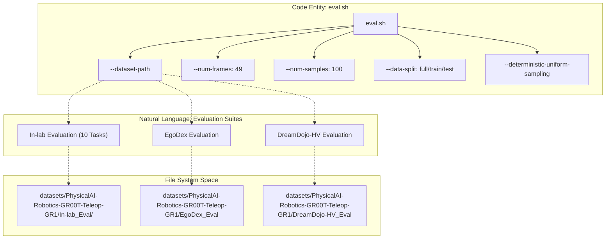
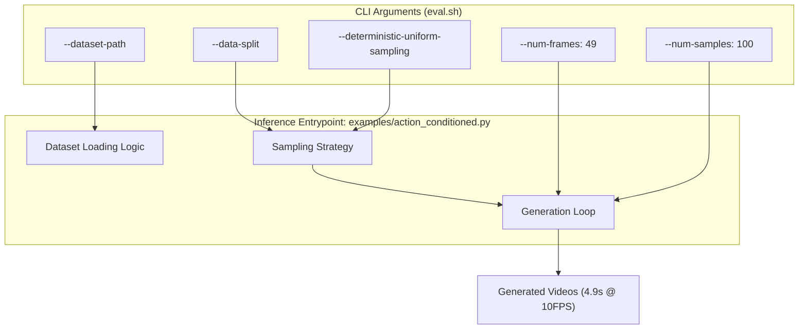

<!-- source: DeepWiki mcp.deepwiki.com · repo NVIDIA/DreamDojo · page 7.2 Evaluation Datasets · fetched 2026-10-26 -->

# Evaluation Datasets

<details>
<summary>Relevant source files</summary>

The following files were used as context for generating this wiki page:

- [docs/EVAL.md](docs/EVAL.md)
- [eval.sh](eval.sh)

</details>


This page documents the three evaluation dataset configurations used to assess DreamDojo model performance: **In-lab Evaluation**, **EgoDex Evaluation**, and **DreamDojo-HV Evaluation**. Each configuration provides different scenarios and challenges for testing long-horizon video generation capabilities with robot actions. For information on running these evaluations, see [Running Evaluations](7.1). For checkpoint management during evaluation, see [Checkpoint Management](7.3).

**Sources:** [docs/EVAL.md:1-52]()

## Overview of Evaluation Datasets

DreamDojo uses three distinct evaluation configurations to comprehensively assess model performance across different scenarios. All evaluations use standardized parameters: 49 frames for long-horizon generation, 100 samples per evaluation run, and uniform deterministic sampling across datasets.

### Dataset Configuration Mapping
The following diagram bridges the high-level dataset concepts to the specific command-line arguments and directory structures used in the `eval.sh` script.



**Sources:** [docs/EVAL.md:10-47](), [eval.sh:5-16]()

## In-lab Evaluation

The In-lab evaluation set consists of 10 distinct robotics tasks designed to test the GR-1 robot's capabilities in controlled laboratory scenarios. These tasks span manipulation, bi-manual coordination, and complex multi-step operations.

### Task Categories

| Task ID | Task Name | Category | Description |
|---------|-----------|----------|-------------|
| 1 | `pnp_handover_plate_robot` | Pick-and-Place | Handover plate between robot hands |
| 2 | `pnp_cucumber_robot` | Pick-and-Place | Pick and place cucumber |
| 3 | `pnp_corn_robot` | Pick-and-Place | Pick and place corn |
| 4 | `pnp_dragonfruit_robot` | Pick-and-Place | Pick and place dragonfruit |
| 5 | `pour_items_into_basket_robot` | Manipulation | Pour items into a basket |
| 6 | `right_to_left_handover_corn_robot` | Bi-manual | Hand over corn from right to left hand |
| 7 | `mug_robot` | Manipulation | Mug handling task |
| 8 | `fold_cloth_long_robot` | Complex | Long cloth folding sequence |
| 9 | `fold_cloth_robot` | Complex | Standard cloth folding |
| 10 | `color_puzzles_robot` | Complex | Color puzzle solving |

**Sources:** [docs/EVAL.md:24-31]()

### Dataset Structure

Each In-lab task is organized as a separate dataset directory under the main evaluation root. In the code, these are concatenated using a comma-separated string passed to the `--dataset-path` argument in `eval.sh`.

```
datasets/PhysicalAI-Robotics-GR00T-Teleop-GR1/In-lab_Eval/
├── gr1_unified.pnp_handover_plate_robot/
├── gr1_unified.pnp_cucumber_robot/
├── gr1_unified.pnp_corn_robot/
├── gr1_unified.pnp_dragonfruit_robot/
├── gr1_unified.pour_items_into_basket_robot/
├── gr1_unified.right_to_left_handover_corn_robot/
├── gr1_unified.mug_robot/
├── gr1_unified.fold_cloth_long_robot/
├── gr1_unified.fold_cloth_robot/
└── gr1_unified.color_puzzles_robot/
```

**Sources:** [docs/EVAL.md:24-31](), [eval.sh:12]()

## EgoDex Evaluation

The EgoDex evaluation set focuses on human-robot interaction scenarios captured from egocentric (first-person) perspectives. This dataset tests the model's ability to generate realistic robot behavior in contexts involving human hand-object interactions.

### Evaluation Configuration
The evaluation is invoked by pointing to the specific directory:
```bash
--dataset-path "datasets/PhysicalAI-Robotics-GR00T-Teleop-GR1/EgoDex_Eval"
```

**Sources:** [docs/EVAL.md:32-39]()

## DreamDojo-HV Evaluation

The DreamDojo-HV (High-Variety) evaluation set provides diverse scenarios to test model generalization across a wide range of robot behaviors, environments, and task types. This evaluation set is designed to assess robustness and versatility.

### Evaluation Configuration
```bash
--dataset-path "datasets/PhysicalAI-Robotics-GR00T-Teleop-GR1/DreamDojo-HV_Eval"
```

**Sources:** [docs/EVAL.md:40-47]()

## Dataset Sampling and Configuration

### Data Split Options

The evaluation system supports three data split configurations via the `--data-split` parameter in `eval.sh`. These splits determine the subset of samples selected from the directories provided in `--dataset-path`.

| Split | Description | Implementation Logic |
|-------|-------------|----------|
| `full` | Uses entire dataset (100%) | Sample from 100% of available data |
| `train` | Uses first 95% | The first 95% of each concatenated eval set |
| `test` | Uses last 5% | The last 5% of each concatenated eval set |

**Sources:** [docs/EVAL.md:17](), [eval.sh:13]()

### Deterministic Uniform Sampling

The `--deterministic-uniform-sampling` flag controls how samples are selected when multiple datasets (like the 10 In-lab tasks) are concatenated:

- **Enabled**: Samples uniformly across all concatenated datasets, ensuring equal representation regardless of individual dataset lengths.
- **Disabled**: Samples are drawn based on their relative lengths (default behavior).

All three official evaluation configurations (In-lab, EgoDex, DreamDojo-HV) are documented to use this flag to ensure balanced coverage across tasks.

**Sources:** [docs/EVAL.md:18](), [eval.sh:14]()

## Evaluation Parameters and Data Flow

The following diagram illustrates how the parameters from `eval.sh` flow into the generation process within `examples/action_conditioned.py`.



### Frame Generation Details

The 49-frame configuration enables long-horizon video generation evaluation:
- **Frame 0**: Condition frame from ground truth.
- **Frames 1-48**: Generated by the model.
- **Duration**: Approximately 4.9 seconds of video at 10 FPS generation rate.

**Sources:** [docs/EVAL.md:14-15](), [eval.sh:10-11]()

---

