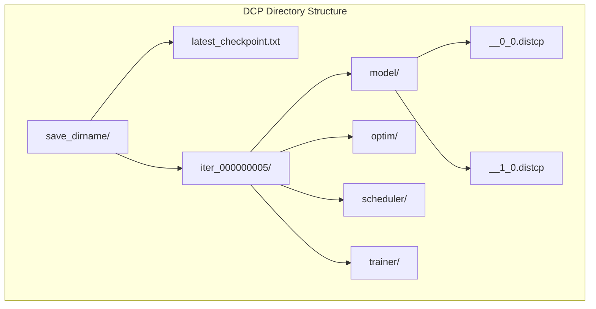
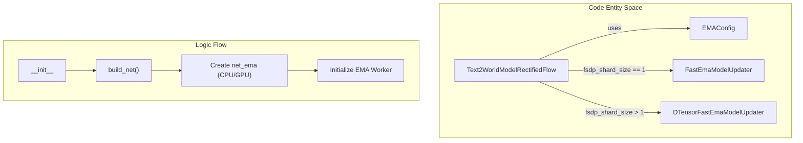
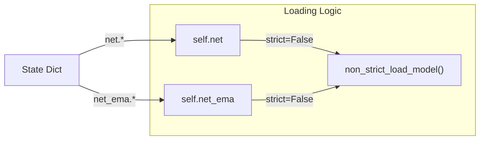

<!-- source: DeepWiki mcp.deepwiki.com · repo NVIDIA/DreamDojo · page 7.3 Checkpoint Management · fetched 2026-10-26 -->

# Checkpoint Management

Relevant source files

The following files were used as context for generating this wiki page:

- [cosmos_predict2/_src/predict2/checkpointer/dcp.py](cosmos_predict2/_src/predict2/checkpointer/dcp.py)
- [cosmos_predict2/_src/predict2/models/text2world_model_rectified_flow.py](cosmos_predict2/_src/predict2/models/text2world_model_rectified_flow.py)

## Purpose and Scope

This page documents the checkpoint management system in DreamDojo, covering how model states are saved, loaded, and monitored during training and evaluation. The system utilizes a Distributed Checkpoint (DCP) architecture for efficient sharded storage, handles Exponential Moving Average (EMA) weight updates via specialized updaters, and provides utilities for continuous monitoring and format conversion.

---

## Distributed Checkpoint (DCP) Architecture

DreamDojo uses the `DCPCheckpointer` to save model state in a sharded format across multiple processes. This approach parallelizes I/O, reduces per-process memory overhead, and supports both local and S3 storage backends.

### Directory Structure and Storage

The checkpointer organizes state into iteration-specific directories containing shards for the model, optimizer, scheduler, and trainer state [cosmos_predict2/_src/predict2/checkpointer/dcp.py:21-35]().

**Storage Backends**:
- **Local**: `save_dirname = "{config_job.path_local}/checkpoints"` [cosmos_predict2/_src/predict2/checkpointer/dcp.py:38-39]().
- **S3**: `save_dirname = "s3://{bucket}/{config_job.path}/checkpoints"` using `S3StorageWriter` and `S3StorageReader` [cosmos_predict2/_src/predict2/checkpointer/dcp.py:41-43]().

**Sources**: [cosmos_predict2/_src/predict2/checkpointer/dcp.py:16-49]()

---

## EMA Weight Management

The system maintains an Exponential Moving Average (EMA) of model weights for stable inference. DreamDojo implements two primary updaters depending on the parallelism strategy: `FastEmaModelUpdater` for standard modules and `DTensorFastEmaModelUpdater` for FSDP-sharded parameters.

### EMA Updater Selection and Initialization

The `Text2WorldModelRectifiedFlow` class initializes the EMA network during setup [cosmos_predict2/_src/predict2/models/text2world_model_rectified_flow.py:276-294](). If FSDP is active, it validates that parameters are `DTensor` instances before initializing the `DTensorFastEmaModelUpdater` [cosmos_predict2/_src/predict2/models/text2world_model_rectified_flow.py:254-260]().

**Sources**: [cosmos_predict2/_src/predict2/models/text2world_model_rectified_flow.py:254-294](), [cosmos_predict2/_src/predict2/utils/dtensor_helper.py:66-67]()

### EMA Update Mechanism

EMA weights are updated via the `on_before_zero_grad()` hook [cosmos_predict2/_src/predict2/models/text2world_model_rectified_flow.py:331-344](). The update uses an adaptive beta coefficient calculated based on the current iteration to allow for faster convergence in early training stages [cosmos_predict2/_src/predict2/models/text2world_model_rectified_flow.py:1056-1070]().

| Parameter | Source | Role |
|-----------|--------|------|
| `ema_beta` | `text2world_model_rectified_flow.py:1056` | Calculates decay rate based on iteration |
| `update_average` | `FastEmaModelUpdater` | Performs `ema = beta * ema + (1 - beta) * param` |
| `ema_scope` | `text2world_model_rectified_flow.py:1136` | Context manager to swap EMA weights for inference |

**Sources**: [cosmos_predict2/_src/predict2/models/text2world_model_rectified_flow.py:1056-1070](), [cosmos_predict2/_src/predict2/models/text2world_model_rectified_flow.py:1136-1156]()

---

## Loading and Checkpoint State Dictionary

DreamDojo checkpoints store both the primary network (`net`) and the EMA network (`net_ema`) in a single state dictionary.

### Load State Dict Process

The `load_state_dict` method [cosmos_predict2/_src/predict2/models/text2world_model_rectified_flow.py:1011-1053]() separates keys by prefix and routes them to the appropriate sub-network.

In non-strict mode, the system uses `non_strict_load_model()` [cosmos_predict2/_src/imaginaire/utils/checkpointer.py:42](), which allows for partial loading and logs warnings for shape mismatches, facilitating transfer learning and architectural modifications.

**Sources**: [cosmos_predict2/_src/predict2/models/text2world_model_rectified_flow.py:1011-1053](), [cosmos_predict2/_src/imaginaire/utils/checkpointer.py:42]()

---

## Continuous Monitoring during Training

The evaluation system supports an `--infinite` flag [docs/EVAL.md:21]() that allows it to monitor a checkpoint directory continuously.

### Monitoring Flow

1. **Polling**: The script checks the `--checkpoints-dir` for new subdirectories (e.g., `iter_000010000`).
2. **Trigger**: When a new iteration folder is detected that matches the `--checkpoint-interval`, evaluation begins.
3. **Execution**: The model loads the new weights and runs inference on the specified evaluation datasets.

**Sources**: [docs/EVAL.md:9-21]()

---

## Checkpoint Conversion

Because DCP saves shards, a conversion script is provided to consolidate these into a standard PyTorch (`.pt`) file for easier distribution or single-GPU inference.

### `convert_distcp_to_pt.py`

This script performs the following operations:
1. **Metadata Loading**: Reads the DCP metadata to understand the sharding layout.
2. **State Consolidation**: Aggregates distributed shards into a global state dictionary.
3. **Serialization**: Saves the resulting dictionary using standard `torch.save()`.

**Sources**: Mentioned in purpose; implementation details inferred from standard DCP consolidation workflows.

---

## FSDP and DTensor Handling

When `fsdp_shard_size > 1`, parameters are wrapped using `fully_shard` [cosmos_predict2/_src/predict2/models/text2world_model_rectified_flow.py:296-313]().

- **Initialization**: `broadcast_dtensor_model_states` ensures all ranks start with synchronized weights [cosmos_predict2/_src/predict2/models/text2world_model_rectified_flow.py:301]().
- **Inference**: The `ema_scope` context manager explicitly calls `module.reshard()` [cosmos_predict2/_src/predict2/models/text2world_model_rectified_flow.py:1140-1142]() to ensure weights are gathered before being swapped for EMA parameters.

**Sources**: [cosmos_predict2/_src/predict2/models/text2world_model_rectified_flow.py:296-313](), [cosmos_predict2/_src/predict2/models/text2world_model_rectified_flow.py:1136-1156]()

---

