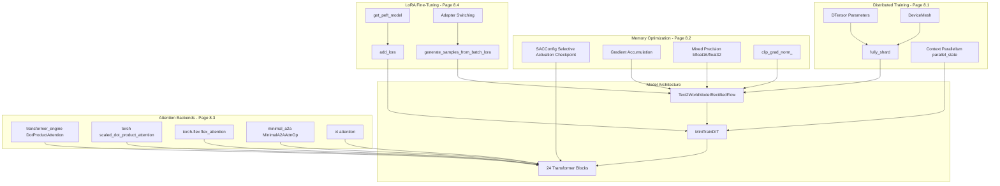
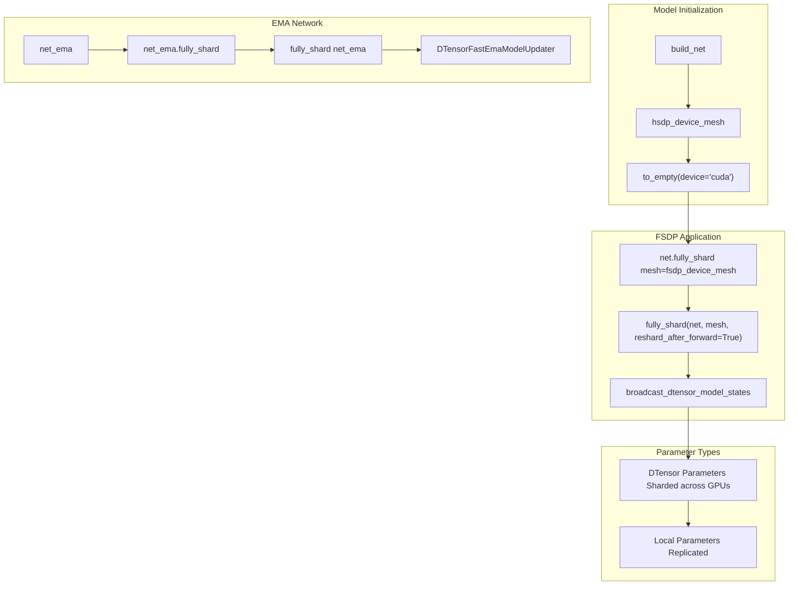
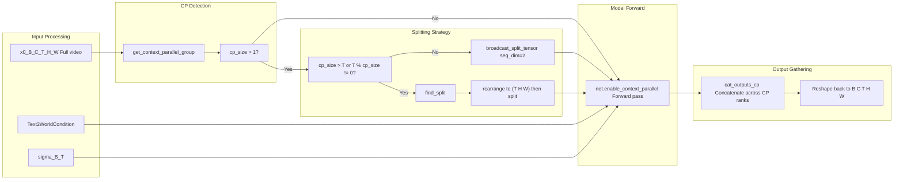
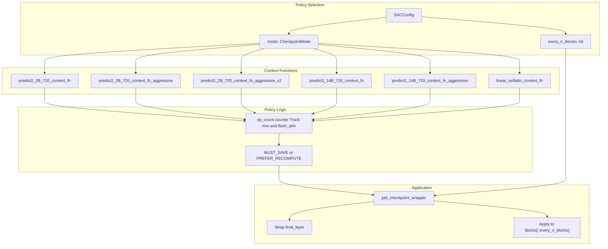
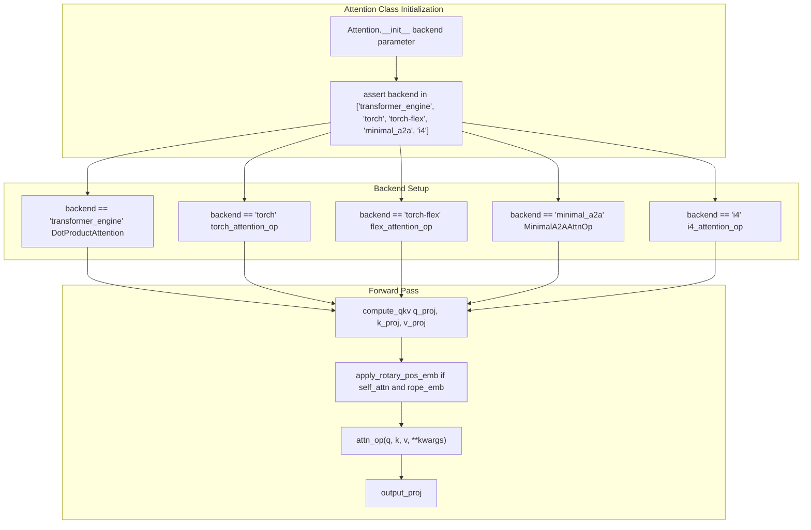
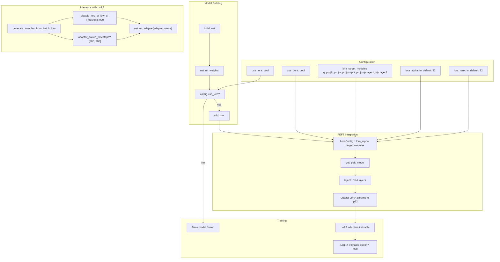
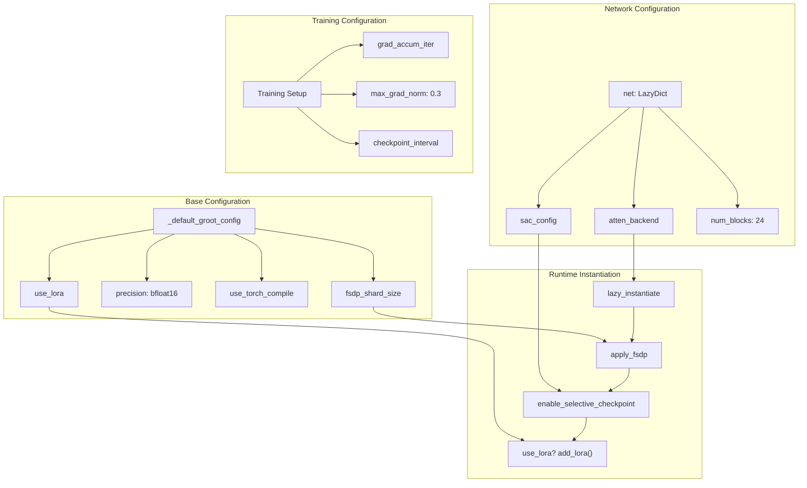

<!-- source: DeepWiki mcp.deepwiki.com · repo NVIDIA/DreamDojo · page 8 Advanced Topics · fetched 2026-10-26 -->

# Advanced Topics

<details>
<summary>Relevant source files</summary>

The following files were used as context for generating this wiki page:

- [cosmos_predict2/_src/predict2/models/text2world_model_rectified_flow.py](cosmos_predict2/_src/predict2/models/text2world_model_rectified_flow.py)
- [cosmos_predict2/_src/predict2/networks/minimal_v4_dit.py](cosmos_predict2/_src/predict2/networks/minimal_v4_dit.py)
- [docs/DISTILL.md](docs/DISTILL.md)
- [docs/ISSUES.md](docs/ISSUES.md)

</details>


This page introduces advanced features and optimization techniques in DreamDojo for production-scale training and deployment. These topics are essential for training large models (2B-14B parameters) efficiently across multiple GPUs and achieving real-time inference performance.

**Scope**: This section covers distributed training strategies, memory optimization techniques, attention backend selection, LoRA fine-tuning, and training script usage. For basic model architecture, see [Architecture](#3). For standard training procedures, see [Training Pipeline](#4). For configuration management, see [Configuration System](#5).

---

## Overview of Advanced Features

DreamDojo implements several sophisticated optimization strategies to enable training of large video generation models:

| Feature Category | Key Technologies | Primary Use Case |
|-----------------|------------------|------------------|
| **Distributed Training** | FSDP, Context Parallelism, DTensor | Multi-GPU scaling for 2B/14B models |
| **Memory Optimization** | Selective Activation Checkpointing, Gradient Accumulation | Training with limited GPU memory |
| **Attention Backends** | TransformerEngine, PyTorch, FlexAttention, I4 | Performance/memory trade-offs |
| **Parameter-Efficient Fine-Tuning** | LoRA, DoRA, AdaLN-LoRA | Robot-specific adaptation |
| **Training Infrastructure** | launch.sh, train.sh, torchrun | Single/multi-node orchestration |

---

## Architecture of Advanced Features

The following diagram shows how advanced features integrate with the core model architecture:



**Sources**: [cosmos_predict2/_src/predict2/models/text2world_model_rectified_flow.py:122-314](), [cosmos_predict2/_src/predict2/networks/minimal_v4_dit.py:1386-1885]()

---

## Distributed Training Components

The distributed training system uses a multi-level parallelism strategy combining FSDP for parameter sharding and context parallelism for sequence splitting.

### FSDP Sharding Architecture



The FSDP system uses 2-level hierarchical sharding:
1. **Submodule sharding** via `net.fully_shard(mesh=dp_mesh)` at [cosmos_predict2/_src/predict2/models/text2world_model_rectified_flow.py:299]()
2. **Top-level wrapping** via `fully_shard(net, mesh=dp_mesh, reshard_after_forward=True)` at [cosmos_predict2/_src/predict2/models/text2world_model_rectified_flow.py:300]()

The EMA network follows the same sharding strategy but is initially kept on CPU during checkpoint loading to avoid OOM errors [cosmos_predict2/_src/predict2/models/text2world_model_rectified_flow.py:278-280]().

**Key Classes**:
- `Text2WorldModelRectifiedFlow.apply_fsdp()` at [cosmos_predict2/_src/predict2/models/text2world_model_rectified_flow.py:296-313]()
- `DTensorFastEmaModelUpdater` at [cosmos_predict2/_src/predict2/models/text2world_model_rectified_flow.py:284]()
- `broadcast_dtensor_model_states()` at [cosmos_predict2/_src/predict2/models/text2world_model_rectified_flow.py:301]()

**Sources**: [cosmos_predict2/_src/predict2/models/text2world_model_rectified_flow.py:164-313]()

---

### Context Parallelism Flow

Context parallelism splits video sequences across GPUs to handle long videos that don't fit in a single GPU's memory:



The system performs **temporal splitting** when possible (sequence length divisible by CP size), falling back to **combined temporal-spatial splitting** when necessary. This is determined by `find_split()` at [cosmos_predict2/_src/predict2/models/text2world_model_rectified_flow.py:423]().

**Key Methods**:
- `broadcast_split_for_model_parallelsim()` at [cosmos_predict2/_src/predict2/models/text2world_model_rectified_flow.py:412-450]()
- `net.enable_context_parallel()` at [cosmos_predict2/_src/predict2/networks/minimal_v4_dit.py:1865-1880]()
- `net.disable_context_parallel()` at [cosmos_predict2/_src/predict2/networks/minimal_v4_dit.py:1849-1863]()

**Sources**: [cosmos_predict2/_src/predict2/models/text2world_model_rectified_flow.py:407-450](), [cosmos_predict2/_src/predict2/networks/minimal_v4_dit.py:1849-1885]()

---

## Memory Optimization Techniques

### Selective Activation Checkpointing

The `SACConfig` system provides multiple checkpoint policies optimized for different model sizes and memory constraints:

| Checkpoint Mode | Memory Savings | Compute Overhead | Use Case |
|----------------|----------------|------------------|----------|
| `none` | 0% | 0% | Debugging, small models |
| `mm_only` | ~20% | Low | Save only matrix multiplications |
| `block_wise` | ~40% | Medium | Standard training |
| `linear_selfattn` | ~50% | Medium | Balance memory/speed |
| `predict2_2b_720` | ~60% | High | 2B model, 720p resolution |
| `predict2_2b_720_aggressive` | ~70% | Higher | 2B model, memory constrained |
| `predict2_2b_720_aggressive_v2` | ~80% | Highest | Maximum memory savings |
| `predict2_14b_720` | ~65% | High | 14B model |
| `predict2_14b_720_aggressive` | ~75% | Higher | 14B model, memory constrained |



**Implementation Details**:

The `predict2_2B_720_context_fn()` at [cosmos_predict2/_src/predict2/networks/minimal_v4_dit.py:69-89]() selectively saves:
- Self-attention outputs (flash_attn)
- Matrix multiplications (mm) based on an operation counter.

The aggressive variants at [cosmos_predict2/_src/predict2/networks/minimal_v4_dit.py:92-124]() only save flash_attn outputs or recompute everything, maximizing memory savings at the cost of 30-50% more compute.

**Sources**: [cosmos_predict2/_src/predict2/networks/minimal_v4_dit.py:68-215](), [cosmos_predict2/_src/predict2/networks/minimal_v4_dit.py:1809-1835]()

---

### Gradient Management

```mermaid
graph LR
    subgraph "Training Step"
        Forward["Forward Pass"]
        Loss["Compute Loss"]
    end
    
    subgraph "Gradient Computation"
        Backward["loss.backward"]
        ClipGrad["clip_grad_norm_ max_norm=0.3"]
    end
    
    subgraph "Gradient Accumulation"
        Accum["grad_accum_iter > 1?"]
        AccumStep["Accumulate gradients"]
        UpdateStep["optimizer.step"]
    end
    
    subgraph "EMA Update"
        CheckEMA["ema.enabled?"]
        CalcBeta["ema_beta iteration"]
        UpdateEMA["net_ema_worker.update_average"]
    end
    
    subgraph "Cleanup"
        ZeroGrad["optimizer.zero_grad"]
    end
    
    Forward --> Loss
    Loss --> Backward
    Backward --> ClipGrad
    ClipGrad --> Accum
    
    Accum -->|Yes| AccumStep
    Accum -->|No| UpdateStep
    AccumStep --> UpdateStep
    
    UpdateStep --> CheckEMA
    CheckEMA -->|Yes| CalcBeta
    CheckEMA -->|No| ZeroGrad
    CalcBeta --> UpdateEMA
    UpdateEMA --> ZeroGrad
```



**Gradient Clipping**: Implemented via `clip_grad_norm_()` at [cosmos_predict2/_src/predict2/models/text2world_model_rectified_flow.py:35]() with `max_norm=0.3` to prevent gradient explosion.

**EMA Updates**: The `ema_beta()` method at [cosmos_predict2/_src/predict2/models/text2world_model_rectified_flow.py:1056-1070]() calculates adaptive beta based on iteration count.

**CUDA Memory**: The environment variable `PYTORCH_CUDA_ALLOC_CONF=expandable_segments:True` is recommended to reduce memory fragmentation [docs/ISSUES.md:10]().

**Sources**: [cosmos_predict2/_src/predict2/models/text2world_model_rectified_flow.py:1056-1171](), [docs/ISSUES.md:8-14]()

---

## Attention Backend Options

The `Attention` module supports 5 different backends, each optimized for different scenarios:

### Backend Comparison

| Backend | Implementation | Use Case | Memory | Speed |
|---------|---------------|----------|---------|-------|
| `transformer_engine` | `DotProductAttention` | Production training | Optimized | Fastest |
| `torch` | `scaled_dot_product_attention` | Standard PyTorch | Standard | Fast |
| `torch-flex` | `flex_attention` | Sparse patterns | Lower | Medium |
| `minimal_a2a` | `MinimalA2AAttnOp` | Context parallelism | Distributed | Medium |
| `i4` | I4 spatio-temporal attention | Research | Experimental | Variable |

### Backend Selection Flow



**Implementation**:

The `Attention` class at [cosmos_predict2/_src/predict2/networks/minimal_v4_dit.py:389-581]() selects the backend in `__init__()` at [cosmos_predict2/_src/predict2/networks/minimal_v4_dit.py:439-486]().

**FlexAttention Features**: The `flex_attention_op()` at [cosmos_predict2/_src/predict2/networks/minimal_v4_dit.py:292-360]() provides support for `BlockMask` patterns for sparse attention.

**Sources**: [cosmos_predict2/_src/predict2/networks/minimal_v4_dit.py:389-581](), [cosmos_predict2/_src/predict2/networks/minimal_v4_dit.py:268-387]()

---

## LoRA Fine-Tuning Architecture

Low-Rank Adaptation enables parameter-efficient fine-tuning by training only small adapter matrices while keeping the base model frozen.

### LoRA Integration Flow



**Key Implementation**:

The `add_lora()` method at [cosmos_predict2/_src/predict2/models/text2world_model_rectified_flow.py:1173-1264]() handles LoRA injection, including support for Weight-Decomposed Low-Rank Adaptation (DoRA) via `use_dora` [cosmos_predict2/_src/predict2/models/text2world_model_rectified_flow.py:102]().

**Inference with Adapter Switching**:

The `generate_samples_from_batch_lora()` method at [cosmos_predict2/_src/predict2/models/text2world_model_rectified_flow.py:617-746]() supports:
- **Disabling LoRA at low timesteps** via `disable_lora_at_low_t` [cosmos_predict2/_src/predict2/models/text2world_model_rectified_flow.py:711-714]()
- **Multi-adapter switching** during sampling via `adapter_switch_timesteps` [cosmos_predict2/_src/predict2/models/text2world_model_rectified_flow.py:716-721]()

**AdaLN-LoRA**: When `use_adaln_lora=True`, the system uses LoRA-enhanced adaptive layer normalization via `TimestepEmbedding` at [cosmos_predict2/_src/predict2/networks/minimal_v4_dit.py:884-922]().

**Sources**: [cosmos_predict2/_src/predict2/models/text2world_model_rectified_flow.py:1173-1264](), [cosmos_predict2/_src/predict2/models/text2world_model_rectified_flow.py:617-746](), [cosmos_predict2/_src/predict2/networks/minimal_v4_dit.py:884-922]()

---

## Training Configuration Integration

All advanced features are configured through a hierarchical system:



**Configuration Example**:
```python
config = Text2WorldModelRectifiedFlowConfig(
    fsdp_shard_size=8,
    precision="bfloat16",
    use_lora=True,
    lora_rank=32,
    lora_alpha=32,
    net=LazyDict({
        "atten_backend": "transformer_engine",
        "sac_config": SACConfig(
            mode=CheckpointMode.PREDICT2_2B_720_AGGRESSIVE,
            every_n_blocks=1
        ),
        "num_blocks": 24,
        "num_heads": 16
    })
)
```

**Sources**: [cosmos_predict2/_src/predict2/models/text2world_model_rectified_flow.py:75-120]()

---

## Related Pages

- For detailed distributed training setup and multi-node configuration, see [Distributed Training](#8.1)
- For memory optimization strategies and checkpoint policies, see [Memory Optimization](#8.2)
- For attention backend selection and performance tuning, see [Attention Backends](#8.3)
- For LoRA fine-tuning workflows and adapter management, see [LoRA Fine-Tuning](#8.4)
- For training script usage and launch commands, see [Training Scripts](#8.5)

---

