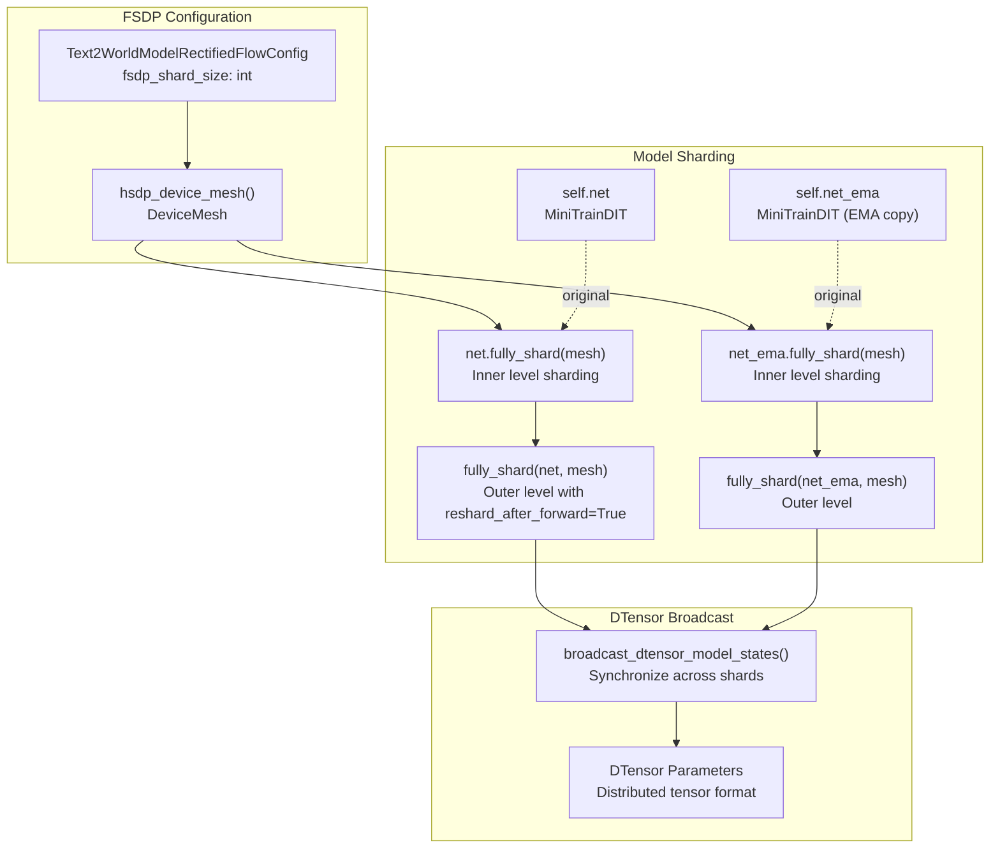
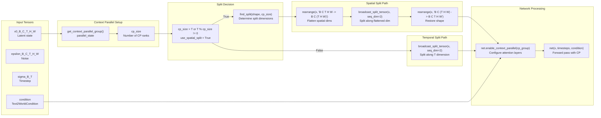
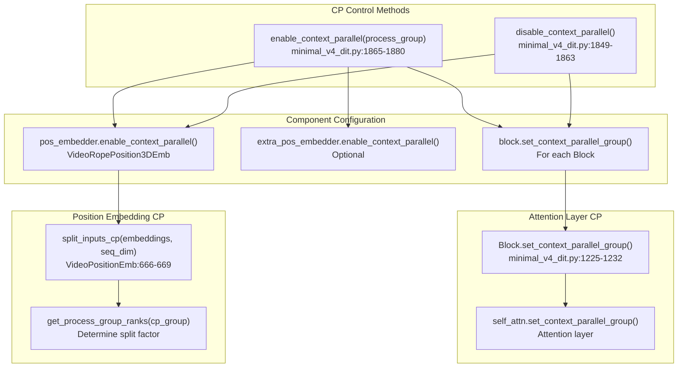
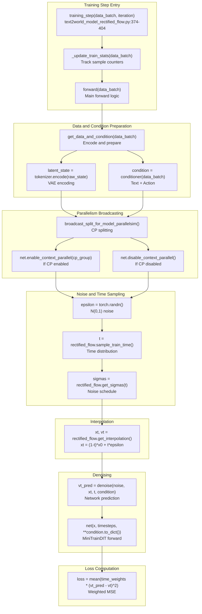

<!-- source: DeepWiki mcp.deepwiki.com · repo NVIDIA/DreamDojo · page 8.1 Distributed Training · fetched 2026-10-26 -->

# Distributed Training

<details>
<summary>Relevant source files</summary>

The following files were used as context for generating this wiki page:

- [cosmos_predict2/_src/predict2/models/text2world_model_rectified_flow.py](cosmos_predict2/_src/predict2/models/text2world_model_rectified_flow.py)
- [cosmos_predict2/_src/predict2/utils/dtensor_helper.py](cosmos_predict2/_src/predict2/utils/dtensor_helper.py)
- [cosmos_predict2/_src/predict2/utils/fused_adam_dtensor.py](cosmos_predict2/_src/predict2/utils/fused_adam_dtensor.py)

</details>


This page documents DreamDojo's distributed training infrastructure, including FSDP (Fully Sharded Data Parallel) sharding, context parallelism for sequence splitting, DDP (Distributed Data Parallel) strategy, and multi-node training setup. These parallelism techniques enable training 2B and 14B parameter models across multi-GPU nodes.

For memory optimization techniques like selective activation checkpointing and gradient accumulation, see [Memory Optimization](#8.2). For training launch scripts and their usage, see [Training Scripts](#8.5).

## Parallelism Strategies Overview

DreamDojo employs three complementary parallelism strategies:

| Strategy | Purpose | Sharding Dimension | Primary Benefit |
|----------|---------|-------------------|-----------------|
| **FSDP** | Parameter sharding | Model parameters | Reduces per-GPU memory for large models |
| **Context Parallelism (CP)** | Sequence splitting | Temporal/Spatial sequence | Enables longer sequence lengths |
| **DDP** | Data parallelism | Training batches | Scales training across multiple nodes |

These strategies are configured through `Text2WorldModelRectifiedFlowConfig.fsdp_shard_size` [cosmos_predict2/_src/predict2/models/text2world_model_rectified_flow.py:86]() and Megatron's `parallel_state` [cosmos_predict2/_src/predict2/models/text2world_model_rectified_flow.py:29]() for context parallelism.

**Sources:** [cosmos_predict2/_src/predict2/models/text2world_model_rectified_flow.py:86-169](), [cosmos_predict2/_src/predict2/networks/minimal_v4_dit.py:1849-1880]()

## FSDP Architecture

### Device Mesh and Hierarchical Sharding



**FSDP Sharding Process:**

FSDP is configured and applied in `Text2WorldModelRectifiedFlow` [cosmos_predict2/_src/predict2/models/text2world_model_rectified_flow.py:122]():

1. **Device Mesh Creation** ([cosmos_predict2/_src/predict2/models/text2world_model_rectified_flow.py:164-169]()):
   - If `fsdp_shard_size > 1`, creates hierarchical device mesh using `hsdp_device_mesh` [cosmos_predict2/_src/imaginaire/utils/fsdp_helper.py:52]().
   - Device mesh defines the sharding topology across GPUs.

2. **Two-Level Sharding** ([cosmos_predict2/_src/predict2/models/text2world_model_rectified_flow.py:254-258]()):
   - Inner level: Shards submodules via `net.fully_shard(mesh=self.fsdp_device_mesh)`.
   - Outer level: Shards the top-level module with `fully_shard(net, mesh=self.fsdp_device_mesh, reshard_after_forward=True)`.

3. **EMA Model Sharding** ([cosmos_predict2/_src/predict2/models/text2world_model_rectified_flow.py:302-313]()):
   - EMA model is initially kept on CPU during checkpoint loading to avoid OOM.
   - Moved to CUDA and sharded using the same device mesh.
   - Separate `DTensorFastEmaModelUpdater` [cosmos_predict2/_src/predict2/utils/dtensor_helper.py:28]() handles EMA updates for distributed tensors.

4. **Parameter Broadcasting** ([cosmos_predict2/_src/predict2/models/text2world_model_rectified_flow.py:258-260]()):
   - `broadcast_dtensor_model_states` [cosmos_predict2/_src/predict2/utils/dtensor_helper.py:73]() ensures all shards are synchronized.
   - All parameters become `DTensor` instances after sharding.

**Sources:** [cosmos_predict2/_src/predict2/models/text2world_model_rectified_flow.py:164-313](), [cosmos_predict2/_src/predict2/utils/dtensor_helper.py:28-73]()

### Network Component Sharding

The `MiniTrainDIT.fully_shard` method ([cosmos_predict2/_src/predict2/networks/minimal_v4_dit.py:1837-1847]()) applies FSDP to specific network components:

**Sharded Components:**
- **Transformer Blocks** (`self.blocks`): Each block is individually sharded with resharding between blocks.
- **Final Layer** (`self.final_layer`): Sharded with resharding enabled.
- **Position Embedders**: Optional extra position embedder is sharded if enabled.
- **Timestep Embedder** (`self.t_embedder`): Sharded without resharding (final component).

**Resharding Strategy:**
- `reshard_after_forward=True`: Parameters are resharded after forward pass to free memory.
- `reshard_after_forward=False`: Parameters remain sharded (used for final components).
- Last block in sequence uses `False` to avoid unnecessary resharding.

**Sources:** [cosmos_predict2/_src/predict2/networks/minimal_v4_dit.py:1837-1847]()

### DTensor and State Management

When FSDP is enabled, model parameters are converted to `DTensor` format.

**DTensor Characteristics:**
- Distributed tensor format that spans multiple devices.
- Automatic handling of sharded parameter updates.
- Special checkpointing via `DTensorFastEmaModelUpdater` [cosmos_predict2/_src/predict2/utils/dtensor_helper.py:28]() for EMA models.

**State Dictionary Handling** ([cosmos_predict2/_src/predict2/models/text2world_model_rectified_flow.py:1004-1054]()):
- `state_dict()`: Collects states from both `net` and `net_ema` with prefixes.
- `load_state_dict()`: Supports both strict and non-strict loading modes.
- Separate handling for regular and EMA model states.

**Sources:** [cosmos_predict2/_src/predict2/models/text2world_model_rectified_flow.py:1004-1054](), [cosmos_predict2/_src/predict2/utils/dtensor_helper.py:28-69]()

## Context Parallelism

### Sequence Splitting Strategy



**Context Parallelism Implementation:**

Context parallelism splits long sequences across multiple GPUs to enable processing of longer videos. The implementation is in `broadcast_split_for_model_parallelsim` ([cosmos_predict2/_src/predict2/models/text2world_model_rectified_flow.py:412-450]()):

1. **Process Group Retrieval** ([cosmos_predict2/_src/predict2/models/text2world_model_rectified_flow.py:407-410]()):
   - Uses `parallel_state.get_context_parallel_group()` [cosmos_predict2/_src/predict2/models/text2world_model_rectified_flow.py:29]() to identify the communication group.

2. **Split Strategy Selection** ([cosmos_predict2/_src/predict2/models/text2world_model_rectified_flow.py:422-423]()):
   - **Temporal split**: When `cp_size <= T` and `T % cp_size == 0`, split along temporal dimension.
   - **Spatial split**: Otherwise, combine temporal and spatial dimensions for splitting using `find_split` [cosmos_predict2/_src/imaginaire/utils/context_parallel.py:47]().

3. **Spatial Split Process** ([cosmos_predict2/_src/predict2/models/text2world_model_rectified_flow.py:424-437]()):
   - Flatten `(T, H, W)` → `(T*H*W)`.
   - Split along flattened dimension using `broadcast_split_tensor` [cosmos_predict2/_src/imaginaire/utils/context_parallel.py:45]().
   - Reshape back to `(T', H', W')` where dimensions are split across ranks.

4. **Condition Broadcasting** ([cosmos_predict2/_src/predict2/models/text2world_model_rectified_flow.py:444-446]()):
   - `condition.broadcast(cp_group)` ensures conditioning information is available to all ranks.

**Sources:** [cosmos_predict2/_src/predict2/models/text2world_model_rectified_flow.py:407-450](), [cosmos_predict2/_src/imaginaire/utils/context_parallel.py:43-48]()

### Network-Level Context Parallel Support

The `MiniTrainDIT` network provides context parallel control methods:



**Context Parallel Configuration:**

1. **Enable CP** ([cosmos_predict2/_src/predict2/networks/minimal_v4_dit.py:1865-1880]()):
   - Configures `pos_embedder` and `blocks` to use the provided `process_group`.
   - Each block receives `cp_ranks` and a dedicated CUDA stream.

2. **Position Embedding Handling** ([cosmos_predict2/_src/predict2/networks/minimal_v4_dit.py:642-669]()):
   - `split_inputs_cp` splits embeddings to match the split input sequence length.

3. **Block-Level CP** ([cosmos_predict2/_src/predict2/networks/minimal_v4_dit.py:1225-1232]()):
   - Stores `cp_size` for video size adjustments.
   - Corrects `video_size` internally: `VideoSize(T=T * cp_size, H=H, W=W)`.

**Sources:** [cosmos_predict2/_src/predict2/networks/minimal_v4_dit.py:1849-1880](), [cosmos_predict2/_src/predict2/networks/minimal_v4_dit.py:642-669](), [cosmos_predict2/_src/predict2/networks/minimal_v4_dit.py:1225-1232]()

## DDP Strategy and Multi-Node Training

### DDP Configuration

DreamDojo uses PyTorch's Distributed Data Parallel (DDP) for data parallelism, specifically for the Latent Action Model (LAM) training.

**Key DDP Parameters:**

| Parameter | Value | Purpose |
|-----------|-------|---------|
| `strategy` | `ddp_find_unused_parameters_false` | Optimized DDP without checking for unused parameters. |
| `precision` | `16-mixed` | Mixed precision training. |
| `gradient_clip_val` | 0.3 | Max gradient norm for stability. |

### Multi-Node Training with torchrun

For main model training, `torchrun` coordinates multiple nodes.

**Multi-Node Environment Variables:**
- `NNODES`: Total number of nodes.
- `NPROC_PER_NODE`: Number of GPUs per node (typically 8).
- `MASTER_ADDR`: IP address of the rank 0 node.
- `MASTER_PORT`: Port for communication.

**Data Parallelism Size:**
The model tracks data parallel world size ([cosmos_predict2/_src/predict2/models/text2world_model_rectified_flow.py:191-194]()):
```python
if parallel_state.is_initialized():
    self.data_parallel_size = parallel_state.get_data_parallel_world_size()
else:
    self.data_parallel_size = 1
```

**Sources:** [cosmos_predict2/_src/predict2/models/text2world_model_rectified_flow.py:191-194]()

## Integration with Training Loop

### Distributed Training in Forward Pass



**Distributed Forward Pass Flow:**

1. **Training Step** ([cosmos_predict2/_src/predict2/models/text2world_model_rectified_flow.py:374-404]()):
   - Entry point for each training iteration.
   - Updates training statistics using `self.data_parallel_size`.

2. **Parallelism Setup** ([cosmos_predict2/_src/predict2/models/text2world_model_rectified_flow.py:412-450]()):
   - Splits tensors across CP ranks using `broadcast_split_for_model_parallelsim`.

3. **Loss Computation** ([cosmos_predict2/_src/predict2/models/text2world_model_rectified_flow.py:918-927]()):
   - Computes weighted MSE loss.
   - For context parallelism, outputs are gathered using `cat_outputs_cp` [cosmos_predict2/_src/imaginaire/utils/context_parallel.py:46]() before loss calculation if required.

**Sources:** [cosmos_predict2/_src/predict2/models/text2world_model_rectified_flow.py:374-937](), [cosmos_predict2/_src/imaginaire/utils/context_parallel.py:43-48]()

### EMA Updates and Optimizer

**EMA in Distributed Setting:**
- If FSDP enabled: Uses `DTensorFastEmaModelUpdater` [cosmos_predict2/_src/predict2/utils/dtensor_helper.py:28]().
- Updates are applied in `on_before_zero_grad` ([cosmos_predict2/_src/predict2/models/text2world_model_rectified_flow.py:332-343]()).

**Optimizer:**
DreamDojo includes a specialized `FusedAdam` [cosmos_predict2/_src/predict2/utils/fused_adam_dtensor.py:24]() optimizer designed to work with `DTensor` parameters. It handles master weights for FP16/BF16 training and integrates with Transformer Engine's multi-tensor Adam kernels [cosmos_predict2/_src/predict2/utils/fused_adam_dtensor.py:118]().

**Sources:** [cosmos_predict2/_src/predict2/models/text2world_model_rectified_flow.py:332-343](), [cosmos_predict2/_src/predict2/utils/dtensor_helper.py:28-69](), [cosmos_predict2/_src/predict2/utils/fused_adam_dtensor.py:24-121]()

---

