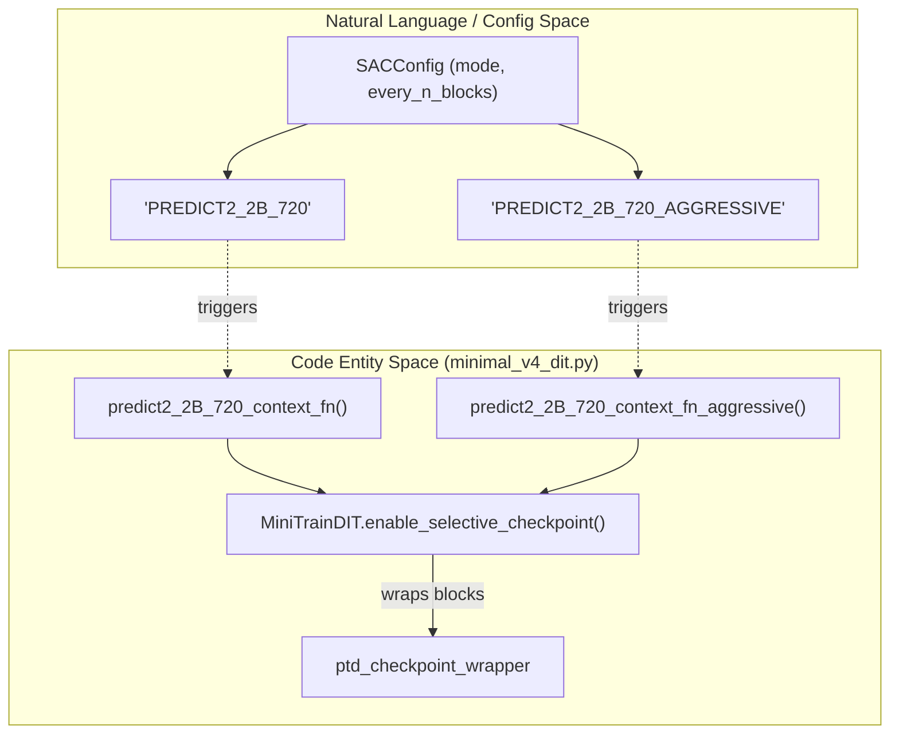
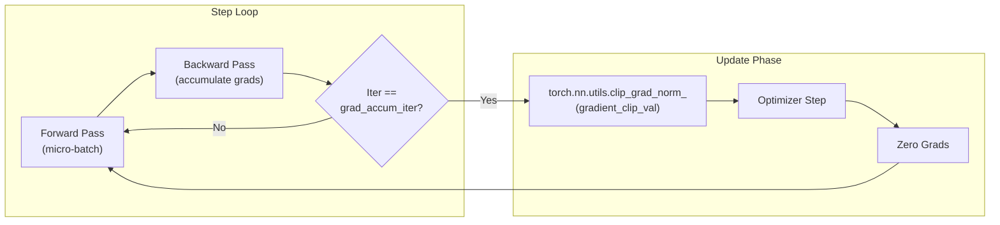

<!-- source: DeepWiki mcp.deepwiki.com · repo NVIDIA/DreamDojo · page 8.2 Memory Optimization · fetched 2026-10-26 -->

# Memory Optimization

Relevant source files

The following files were used as context for generating this wiki page:

- [cosmos_predict2/_src/imaginaire/trainer.py](cosmos_predict2/_src/imaginaire/trainer.py)
- [cosmos_predict2/_src/predict2/networks/minimal_v4_dit.py](cosmos_predict2/_src/predict2/networks/minimal_v4_dit.py)
- [docs/DISTILL.md](docs/DISTILL.md)
- [docs/ISSUES.md](docs/ISSUES.md)

This page documents the memory optimization techniques used in DreamDojo to enable efficient training of large models (2B and 14B parameters) on GPU clusters. These techniques manage memory constraints during forward and backward passes, working in conjunction with distributed training strategies.

## Overview

DreamDojo implements a multi-layered memory optimization strategy that combines:

1.  **Selective Activation Checkpointing (SAC)**: Fine-grained control over intermediate activations to save vs. recompute during backpropagation [cosmos_predict2/_src/predict2/networks/minimal_v4_dit.py:68-163]().
2.  **Gradient Accumulation**: Effective batch size expansion without proportional memory increase [cosmos_predict2/_src/imaginaire/trainer.py:257-261]().
3.  **Mixed Precision Training**: 16-bit floating point computation (fp16/bf16) to reduce memory footprint [cosmos_predict2/_src/imaginaire/trainer.py:49-50]().
4.  **CUDA Memory Configuration**: Use of `expandable_segments` to mitigate memory fragmentation [docs/ISSUES.md:10]().

**Sources:** [cosmos_predict2/_src/predict2/networks/minimal_v4_dit.py:68-163](), [cosmos_predict2/_src/imaginaire/trainer.py:45-55](), [docs/ISSUES.md:10]()

---

## Selective Activation Checkpointing (SAC)

### Policy Modes and Context Functions

DreamDojo provides specialized activation checkpointing policies defined in `cosmos_predict2/_src/predict2/networks/minimal_v4_dit.py`. These policies use `create_selective_checkpoint_contexts` to define which operations should be saved or recomputed.

| Policy Function | Target Model | Behavior |
| :--- | :--- | :--- |
| `predict2_2B_720_context_fn` | 2B Model | Saves last 8 of 16 matrix multiplications per block and alternating flash attention outputs [cosmos_predict2/_src/predict2/networks/minimal_v4_dit.py:69-89](). |
| `predict2_2B_720_context_fn_aggressive` | 2B Model | Saves only Flash Attention outputs; recomputes all linear layers and norms [cosmos_predict2/_src/predict2/networks/minimal_v4_dit.py:92-110](). |
| `predict2_2B_720_context_fn_aggressive_v2` | 2B Model | Recomputes ALL operations for maximum memory savings [cosmos_predict2/_src/predict2/networks/minimal_v4_dit.py:113-124](). |
| `predict2_14B_720_context_fn` | 14B Model | Saves last 8 of 16 matrix multiplications and alternating flash attention [cosmos_predict2/_src/predict2/networks/minimal_v4_dit.py:127-147](). |
| `predict2_14B_720_context_fn_aggressive` | 14B Model | Saves only the last 4 of 16 matrix multiplications [cosmos_predict2/_src/predict2/networks/minimal_v4_dit.py:150-162](). |

### Code Entity Mapping: SAC Configuration

The following diagram bridges the configuration logic to the specific implementation functions in the DiT network.

**Title: SAC Configuration to Implementation Mapping**

**Sources:** [cosmos_predict2/_src/predict2/networks/minimal_v4_dit.py:65-162](), [cosmos_predict2/_src/predict2/networks/minimal_v4_dit.py:1809-1835]()

---

## Gradient Accumulation

Gradient accumulation is handled by the `ImaginaireTrainer` and `LatentActionModel` (LAM) training pipelines. It allows the model to process a large effective batch size by splitting it into smaller micro-batches.

*   **Main Trainer**: Uses `grad_accum_iter` to determine how many forward/backward passes to perform before calling `optimizer.step()` [cosmos_predict2/_src/imaginaire/trainer.py:257-261]().
*   **LAM Project**: Configured via `accumulate_grad_batches` in YAML files [external/lam_project/config/lam_0.yaml:39]().

### Data Flow: Gradient Accumulation Loop

**Title: Gradient Accumulation and Clipping Data Flow**

**Sources:** [cosmos_predict2/_src/imaginaire/trainer.py:257-261](), [external/lam_project/config/lam_0.yaml:39-40]()

---

## Mixed Precision and Gradient Clipping

### Mixed Precision (16-mixed)
The system supports both `fp16` and `bf16` via `torch.amp`. 
*   **LAM**: Uses `precision: 16-mixed` in its configuration [external/lam_project/config/lam_0.yaml:37]().
*   **DiT**: Implements a `use_wan_fp32_strategy` which selectively forces certain operations (like RoPE or AdaLN modulations) into `fp32` for numerical stability while keeping the bulk of the model in `fp16` [cosmos_predict2/_src/predict2/networks/minimal_v4_dit.py:523-537](), [cosmos_predict2/_src/predict2/networks/minimal_v4_dit.py:1271-1289]().

### Gradient Clipping
To prevent training instability, gradients are clipped using a global norm.
*   **LAM**: Uses `gradient_clip_val: 0.3` [external/lam_project/config/lam_0.yaml:40]().
*   **Main Trainer**: Configurable via the `trainer.gradient_clipping` settings.

---

## CUDA Memory Configuration

For large-scale training on H100/A100 GPUs, specific environment variables are recommended to optimize the CUDA memory allocator and prevent "Out of Memory" (OOM) errors due to fragmentation.

### Expandable Segments
The variable `PYTORCH_CUDA_ALLOC_CONF=expandable_segments:True` is critical. It allows the CUDA allocator to create segments that can be expanded in place, reducing fragmentation in long-running training jobs [docs/ISSUES.md:10]().

### Recommended Environment Variables
| Variable | Value | Purpose |
| :--- | :--- | :--- |
| `PYTORCH_CUDA_ALLOC_CONF` | `expandable_segments:True` | Reduces memory fragmentation [docs/ISSUES.md:10](). |
| `TORCH_NCCL_HEARTBEAT_TIMEOUT_SEC` | `1800` | Prevents timeouts during heavy recomputation [docs/ISSUES.md:9](). |
| `CUDA_DEVICE_MAX_CONNECTIONS` | `1` | Required when `sequence_parallel` is enabled [cosmos_predict2/_src/imaginaire/trainer.py:101](). |

**Sources:** [docs/ISSUES.md:5-14](), [cosmos_predict2/_src/imaginaire/trainer.py:100-101]()

---

