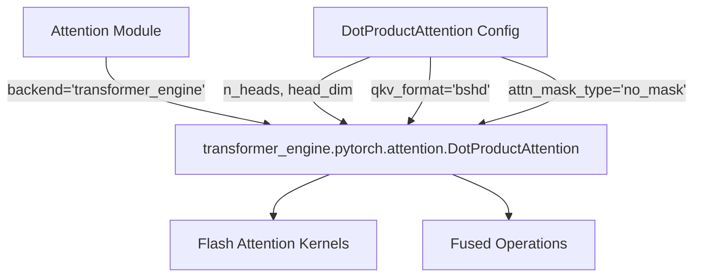
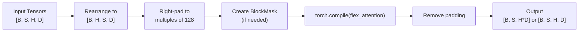
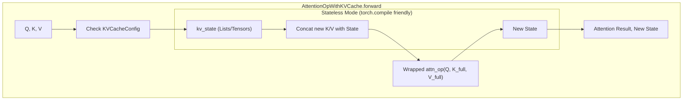

<!-- source: DeepWiki mcp.deepwiki.com · repo NVIDIA/DreamDojo · page 8.3 Attention Backends · fetched 2026-10-26 -->

# Attention Backends

<details>
<summary>Relevant source files</summary>

The following files were used as context for generating this wiki page:

- [cosmos_predict2/_src/predict2/interactive/networks/dit_action_causal.py](cosmos_predict2/_src/predict2/interactive/networks/dit_action_causal.py)
- [cosmos_predict2/_src/predict2/interactive/networks/dit_causal.py](cosmos_predict2/_src/predict2/interactive/networks/dit_causal.py)
- [cosmos_predict2/_src/predict2/networks/minimal_v4_dit.py](cosmos_predict2/_src/predict2/networks/minimal_v4_dit.py)
- [cosmos_predict2/_src/predict2/utils/kv_cache.py](cosmos_predict2/_src/predict2/utils/kv_cache.py)
- [docs/DISTILL.md](docs/DISTILL.md)
- [docs/ISSUES.md](docs/ISSUES.md)

</details>


## Purpose and Scope

This document describes the attention backend implementations available in DreamDojo's `MiniTrainDIT` network, their characteristics, configuration options, and integration with distributed training and inference features. The attention backend determines how the core scaled dot-product attention operation is computed during both self-attention and cross-attention operations.

DreamDojo supports five distinct attention backends, sparse attention via Neighborhood Attention (NATTEN), and specialized handling for image-to-video (I2V) cross-attention and KV caching during inference.

**Sources:** [cosmos_predict2/_src/predict2/networks/minimal_v4_dit.py:389-581]()

---

## Available Backends

The backend is specified via the `backend` parameter when constructing an `Attention` module.

### Backend Comparison

| Backend | Implementation | Primary Use Case | Special Features |
|---------|---------------|------------------|------------------|
| `transformer_engine` | NVIDIA TransformerEngine | Default, optimized training | Fused kernels, Flash Attention [cosmos_predict2/_src/predict2/networks/minimal_v4_dit.py:466-476]() |
| `torch` | PyTorch SDPA | Standard PyTorch workflows | Native PyTorch compatibility [cosmos_predict2/_src/predict2/networks/minimal_v4_dit.py:268-290]() |
| `torch-flex` | FlexAttention API | Custom attention patterns | Block-sparse masking, compiled kernels [cosmos_predict2/_src/predict2/networks/minimal_v4_dit.py:292-361]() |
| `minimal_a2a` | Custom all-to-all | Context parallelism | Distributed sequence attention [cosmos_predict2/_src/predict2/networks/minimal_v4_dit.py:478]() |
| `i4` | Imaginaire library | Spatio-temporal patterns | Bidirectional attention [cosmos_predict2/_src/predict2/networks/minimal_v4_dit.py:363-387]() |

---

## Backend Implementations

### TransformerEngine Backend

The default backend uses NVIDIA TransformerEngine's `DotProductAttention` module, providing highly optimized fused kernels.



**Sources:** [cosmos_predict2/_src/predict2/networks/minimal_v4_dit.py:466-476]()

### Torch Backend

Uses PyTorch's native `scaled_dot_product_attention` function with automatic kernel selection.

```python
def torch_attention_op(
    q_B_S_H_D: torch.Tensor,
    k_B_S_H_D: torch.Tensor,
    v_B_S_H_D: torch.Tensor,
    attn_mask: Optional[torch.Tensor] = None,
    flatten_heads: bool = True,
) -> torch.Tensor
```

**Sources:** [cosmos_predict2/_src/predict2/networks/minimal_v4_dit.py:268-290]()

### FlexAttention Backend

Leverages PyTorch's FlexAttention API for block-sparse attention patterns with compiled kernels. It is notably used in `CausalDIT` for temporal-causal masking [cosmos_predict2/_src/predict2/interactive/networks/dit_causal.py:33-36]().



**Sources:** [cosmos_predict2/_src/predict2/networks/minimal_v4_dit.py:292-361](), [cosmos_predict2/_src/predict2/interactive/networks/dit_causal.py:29-36]()

---

## Sparse Attention Support

DreamDojo supports replacing dense self-attention with sparse neighborhood attention (NATTEN) in selected transformer blocks via `replace_selfattn_op_with_sparse_attn_op` [cosmos_predict2/_src/predict2/networks/minimal_v4_dit.py:1887-1900]().

### Neighborhood Attention (NATTEN)

The `NeighborhoodAttention` module implements sliding window attention where each token only attends to its neighbors in a local window [cosmos_predict2/_src/predict2/modules/neighborhood_attn.py:16-25]().

**Configuration Parameters:**
- `n_dense_blocks`: Number of blocks to keep as dense attention [cosmos_predict2/_src/predict2/networks/minimal_v4_dit.py:1890]().
- `natten_parameters`: Dict or list containing `window_size`, `stride`, and `dilation` [cosmos_predict2/_src/predict2/networks/minimal_v4_dit.py:1891-1896]().

**Sources:** [cosmos_predict2/_src/predict2/networks/minimal_v4_dit.py:1887-1958](), [cosmos_predict2/_src/predict2/modules/neighborhood_attn.py:16-40]()

---

## Specialized Attention Modules

### I2VCrossAttention

`I2VCrossAttention` is a specialized module for image-to-video cross-attention. It allows video tokens to attend to a set of conditioning image tokens (e.g., the first frame) [cosmos_predict2/_src/predict2/networks/minimal_v4_dit.py:584-595]().

**Key Features:**
- Uses `DotProductAttention` from TransformerEngine [cosmos_predict2/_src/predict2/networks/minimal_v4_dit.py:627-635]().
- Supports `qkv_format='sbhd'` or `'bshd'` [cosmos_predict2/_src/predict2/networks/minimal_v4_dit.py:611]().
- Integrated into `MiniTrainDIT` blocks when `use_i2v_crossattn` is enabled [cosmos_predict2/_src/predict2/networks/minimal_v4_dit.py:1179-1188]().

**Sources:** [cosmos_predict2/_src/predict2/networks/minimal_v4_dit.py:584-688]()

---

## Inference Optimization: KV Caching

For real-time generation (10 FPS) in distilled models, DreamDojo uses KV caching to avoid recomputing keys and values for past frames [docs/DISTILL.md:3-9]().

### AttentionOpWithKVCache

The `AttentionOpWithKVCache` class is a wrapper that adds K/V caching to an existing attention operator [cosmos_predict2/_src/predict2/utils/kv_cache.py:43-67]().



**Modes:**
- **Stateful**: K/V tensors are stored on the module [cosmos_predict2/_src/predict2/utils/kv_cache.py:59-61]().
- **Stateless**: Cache state is passed as arguments, enabling `torch.compile` traceability [cosmos_predict2/_src/predict2/utils/kv_cache.py:62-66]().
- **Tensor State**: Uses pre-allocated tensors instead of Python lists for maximum performance [cosmos_predict2/_src/predict2/utils/kv_cache.py:127-145]().

**Sources:** [cosmos_predict2/_src/predict2/utils/kv_cache.py:43-166](), [cosmos_predict2/_src/predict2/interactive/networks/dit_causal.py:113-115]()

### CUDA Graph Precapture

Causal models like `CausalDIT` and `ActionChunkCausalDITwithConditionalMask` support `precapture_cuda_graphs` to reduce CPU overhead during autoregressive inference [cosmos_predict2/_src/predict2/interactive/networks/dit_causal.py:41-51](), [cosmos_predict2/_src/predict2/interactive/networks/dit_action_causal.py:45-55]().

**Sources:** [cosmos_predict2/_src/predict2/interactive/networks/dit_causal.py:41-102](), [cosmos_predict2/_src/predict2/interactive/networks/dit_action_causal.py:45-106]()

---

## Memory Optimization: Selective Activation Checkpointing (SAC)

DreamDojo implements `predict2_2B_720_context_fn` and `predict2_14B_720_context_fn` to selectively save activations during the forward pass [cosmos_predict2/_src/predict2/networks/minimal_v4_dit.py:69-147]().

**Policies:**
- **Default**: Recomputes most operations but saves Flash Attention outputs [cosmos_predict2/_src/predict2/networks/minimal_v4_dit.py:82-86]().
- **Aggressive**: Recomputes everything to save maximum memory [cosmos_predict2/_src/predict2/networks/minimal_v4_dit.py:113-124]().

**Sources:** [cosmos_predict2/_src/predict2/networks/minimal_v4_dit.py:69-162](), [docs/ISSUES.md:10]()

---

