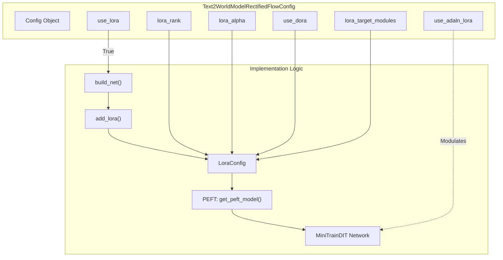
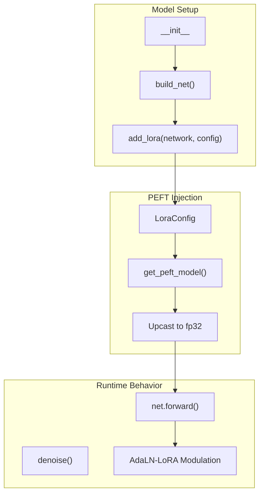
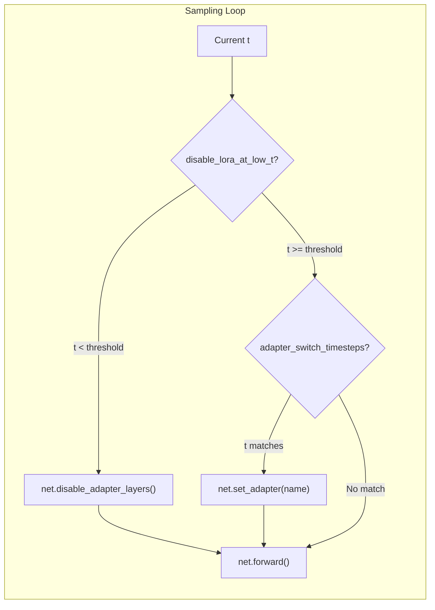

<!-- source: DeepWiki mcp.deepwiki.com · repo NVIDIA/DreamDojo · page 8.4 LoRA Fine-Tuning · fetched 2026-10-26 -->

# LoRA Fine-Tuning

<details>
<summary>Relevant source files</summary>

The following files were used as context for generating this wiki page:

- [cosmos_predict2/_src/predict2/models/text2world_model_rectified_flow.py](cosmos_predict2/_src/predict2/models/text2world_model_rectified_flow.py)
- [cosmos_predict2/_src/predict2/networks/minimal_v4_dit.py](cosmos_predict2/_src/predict2/networks/minimal_v4_dit.py)
- [docs/DISTILL.md](docs/DISTILL.md)
- [docs/ISSUES.md](docs/ISSUES.md)

</details>


This document describes the Low-Rank Adaptation (LoRA) fine-tuning system in DreamDojo. LoRA enables parameter-efficient fine-tuning by training only a small number of additional parameters while keeping the base model frozen. DreamDojo integrates LoRA using the PEFT library and provides specialized sampling features including dynamic adapter switching, timestep-based LoRA disabling, and AdaLN-LoRA modulation.

---

## Overview

DreamDojo's LoRA implementation allows fine-tuning the `Text2WorldModelRectifiedFlow` by injecting low-rank adapter matrices into specific modules of the `MiniTrainDIT` network. The system supports:

- Parameter-efficient training with configurable rank and alpha.
- **DoRA** (Weight-Decomposed Low-Rank Adaptation) variant for improved performance.
- **AdaLN-LoRA** (Adaptive Layer Norm LoRA) for dynamic activation adjustment.
- Multi-adapter management during inference.
- Dynamic adapter switching based on diffusion timesteps.
- Selective LoRA disabling at low noise levels (low $t$).

**Sources:** [cosmos_predict2/_src/predict2/models/text2world_model_rectified_flow.py:99-105](), [cosmos_predict2/_src/predict2/models/text2world_model_rectified_flow.py:1173-1264]()

---

## Configuration

LoRA behavior is controlled through configuration parameters in `Text2WorldModelRectifiedFlowConfig`:

| Parameter | Type | Default | Description |
|-----------|------|---------|-------------|
| `use_lora` | bool | False | Enable/disable LoRA training |
| `lora_rank` | int | 32 | Rank of LoRA adaptation matrices |
| `lora_alpha` | int | 32 | Scaling parameter for LoRA |
| `use_dora` | bool | False | Enable Weight-Decomposed LoRA (DoRA) |
| `lora_target_modules` | str | "q_proj,k_proj,v_proj,output_proj,mlp.layer1,mlp.layer2" | Target modules for adaptation |
| `init_lora_weights` | bool | True | Initialize LoRA weights (A~N, B=0) |
| `use_adaln_lora` | bool | False | Enable AdaLN-LoRA modulation |

### Configuration Mapping to Code Entities

The following diagram maps configuration fields to the internal model building logic.



**Sources:** [cosmos_predict2/_src/predict2/models/text2world_model_rectified_flow.py:76-105](), [cosmos_predict2/_src/predict2/models/text2world_model_rectified_flow.py:211-263]()

---

## LoRA Integration and AdaLN-LoRA

LoRA adapters are injected after base model initialization. The `add_lora` method handles the integration with the PEFT library. Additionally, the system supports **AdaLN-LoRA**, which modulates activations dynamically.

### AdaLN-LoRA Modulation
While standard LoRA adapts linear projections, `use_adaln_lora` enables adaptation of the Adaptive Layer Norm (AdaLN) parameters. This allows the model to adjust its normalization statistics dynamically based on the conditioning signal during fine-tuning, providing finer control over the generation process.

### Implementation Flow



**Sources:** [cosmos_predict2/_src/predict2/models/text2world_model_rectified_flow.py:1173-1264](), [cosmos_predict2/_src/predict2/networks/minimal_v4_dit.py:1010-1045]()

---

## Adapter Management during Sampling

DreamDojo provides specialized inference logic in `generate_samples_from_batch_lora` to manage adapters dynamically across diffusion timesteps.

### 1. Timestep-based Disabling
The `disable_lora_at_low_t` feature allows the model to revert to base model behavior at low noise levels.
- **Logic**: If $t < \text{threshold}$, call `self.net.disable_adapter_layers()`.
- **Rationale**: Task-specific LoRA guidance is most critical at high noise (structure formation), while the base model often handles fine details (low noise) better.

### 2. Multi-Adapter Switching
The system can switch between multiple loaded adapters (e.g., `adapter_0`, `adapter_1`) at specific timesteps defined in `adapter_switch_timesteps`.

```python
# Logic in generate_samples_from_batch_lora
if adapter_switch_timesteps:
    for adapter_idx, switch_t in enumerate(adapter_switch_timesteps):
        if t <= switch_t and t_prev >= switch_t:
            adapter_name = f"adapter_{adapter_idx}"
            self.net.set_adapter(adapter_name)
```

### Sampling Data Flow



**Sources:** [cosmos_predict2/_src/predict2/models/text2world_model_rectified_flow.py:617-746](), [cosmos_predict2/_src/predict2/models/text2world_model_rectified_flow.py:707-721]()

---

## DoRA (Weight-Decomposed Low-Rank Adaptation)

When `use_dora=True` is set in the `Text2WorldModelRectifiedFlowConfig`, the `add_lora` function passes this flag to the PEFT `LoraConfig`. 

DoRA decomposes the weights into magnitude ($m$) and direction ($V$). It updates the direction using a low-rank matrix while keeping the magnitude update separate. This decomposition helps the fine-tuning process mimic full-parameter fine-tuning more closely than standard LoRA.

**Sources:** [cosmos_predict2/_src/predict2/models/text2world_model_rectified_flow.py:102](), [cosmos_predict2/_src/predict2/models/text2world_model_rectified_flow.py:1238-1244]()

---

## Implementation Details

### Target Modules
By default, LoRA targets the primary projection layers within the `MiniTrainDIT` blocks:
- `q_proj`, `k_proj`, `v_proj`: Attention input projections.
- `output_proj`: Attention output projection.
- `mlp.layer1`, `mlp.layer2`: Feed-forward network layers.

### Parameter Handling
During `add_lora`, trainable parameters are upcast to `float32` to maintain numerical stability during the gradient update, even if the base model is in `bfloat16`.

```python
for name, param in network.named_parameters():
    if param.requires_grad:
        param.data = param.to(torch.float32)
```

**Sources:** [cosmos_predict2/_src/predict2/models/text2world_model_rectified_flow.py:103](), [cosmos_predict2/_src/predict2/models/text2world_model_rectified_flow.py:1257-1259]()

---

