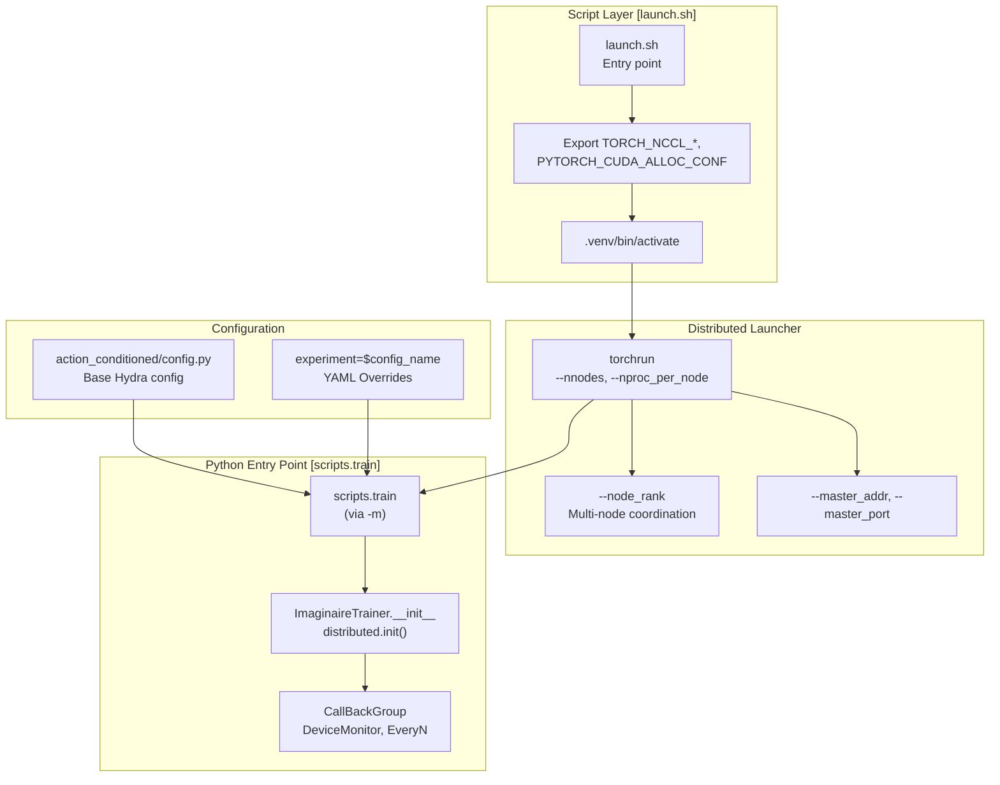
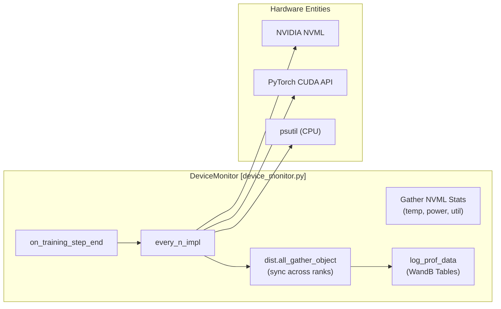

<!-- source: DeepWiki mcp.deepwiki.com · repo NVIDIA/DreamDojo · page 8.5 Training Scripts · fetched 2026-10-26 -->

# Training Scripts

<details>
<summary>Relevant source files</summary>

The following files were used as context for generating this wiki page:

- [cosmos_predict2/_src/imaginaire/callbacks/every_n.py](cosmos_predict2/_src/imaginaire/callbacks/every_n.py)
- [cosmos_predict2/_src/imaginaire/trainer.py](cosmos_predict2/_src/imaginaire/trainer.py)
- [cosmos_predict2/_src/predict2/callbacks/device_monitor.py](cosmos_predict2/_src/predict2/callbacks/device_monitor.py)
- [launch.sh](launch.sh)

</details>


## Purpose and Scope

This document covers the shell scripts used to launch training and evaluation runs in DreamDojo. These scripts provide a wrapper around the underlying Python training code, handling environment activation, distributed process coordination via `torchrun`, and output logging. The scripts support both single-node and multi-node training configurations for the main DreamDojo models as well as the Latent Action Model (LAM) subsystem.

For information about the configuration files passed to these scripts, see [Configuration System](5). For details on the underlying distributed training mechanisms (FSDP, context parallelism), see [Distributed Training](8.1). For the training pipeline stages themselves (pretraining, post-training, distillation), see [Training Pipeline](4).

## Script Architecture Overview

Training scripts in DreamDojo follow a consistent pattern across the codebase:

1.  **Environment Activation**: Source the Python virtual environment and set critical `TORCH_NCCL` and `CUDA` environment variables.
2.  **Process Coordination**: Launch distributed training via `torchrun`.
3.  **Configuration Loading**: Pass YAML/Python config files to the training command.
4.  **Output Management**: Redirect stdout/stderr to log files and initialize the `ImaginaireTrainer` which handles local job directory creation [cosmos_predict2/_src/imaginaire/trainer.py:104-110]().

The codebase contains training scripts in two primary locations:
*   **Main Training**: `launch.sh` for DreamDojo model training (pretraining and post-training phases) [launch.sh:1-39]().
*   **Environment Validation**: `check_environment.py` (referenced in documentation) for verifying hardware and software readiness.

### Script Execution Flow



**Sources**: [launch.sh:1-39](), [cosmos_predict2/_src/imaginaire/trainer.py:45-136](), [cosmos_predict2/_src/imaginaire/callbacks/every_n.py:27-42]()

## Environment Variable Configuration

The `launch.sh` script exports several critical environment variables to optimize distributed communication and memory management [launch.sh:10-26]():

| Variable | Value | Purpose |
| :--- | :--- | :--- |
| `TORCH_NCCL_ENABLE_MONITORING` | `0` | Disables NCCL monitoring to reduce overhead [launch.sh:10](). |
| `TORCH_NCCL_HEARTBEAT_TIMEOUT_SEC` | `1800` | Extends timeout to 30 minutes for large-scale synchronization [launch.sh:11](). |
| `PYTORCH_CUDA_ALLOC_CONF` | `expandable_segments:True` | Enables CUDA memory fragmentation optimization [launch.sh:12](). |
| `IMAGINAIRE_OUTPUT_ROOT` | User-defined path | Root directory for all experiment logs and checkpoints [launch.sh:26](). |
| `HF_HOME` | User-defined path | Cache directory for Hugging Face models [launch.sh:25](). |
| `CUDA_MODULE_LOADING` | `LAZY` | Defers CUDA kernel loading to save host memory [launch.sh:18](). |

**Sources**: [launch.sh:10-26]()

## Main DreamDojo Training Scripts

The primary entry point for training is `launch.sh`, which wraps `torchrun` and calls `scripts.train`.

### Multi-Node and Single-Node Setup

The script uses default values that allow it to run on a single node out-of-the-box while accepting overrides for multi-node clusters [launch.sh:3-8]():

*   `NNODES`: Total number of nodes (default: 1).
*   `NPROC`: Processes per node (default: 8).
*   `MASTER_ADDR`: IP of rank 0 node (default: localhost).
*   `NODE_RANK`: Index of the current node (default: 0).

### Execution Command

The script executes the following command [launch.sh:33-39]():
```bash
torchrun --nnodes=$NNODES --nproc_per_node=$NPROC \
  --master_port=$MASTER_PORT --master_addr $MASTER_ADDR \
  --node_rank=$NODE_RANK -m scripts.train \
  --config=cosmos_predict2/_src/predict2/action/configs/action_conditioned/config.py -- \
  experiment=$config_name \
  job.wandb_mode=disabled \
  ~dataloader_train.dataloaders
```

This command initializes the `ImaginaireTrainer`, which in turn sets up the distributed environment using `parallel_state.initialize_model_parallel` if Megatron-Core is available [cosmos_predict2/_src/imaginaire/trainer.py:80-96]().

**Sources**: [launch.sh:3-39](), [cosmos_predict2/_src/imaginaire/trainer.py:80-96]()

## Trainer Initialization and Callbacks

When `scripts.train` is invoked, it instantiates the `ImaginaireTrainer`. This class is responsible for the core training orchestration.

### Training Callbacks

The trainer initializes a `CallBackGroup` [cosmos_predict2/_src/imaginaire/trainer.py:127](), which includes several monitoring utilities:

*   **EveryN**: An abstract base class for callbacks that execute every $N$ steps [cosmos_predict2/_src/imaginaire/callbacks/every_n.py:27-42]().
*   **DeviceMonitor**: Inherits from `EveryN` and monitors CPU/GPU usage, temperature, and power draw [cosmos_predict2/_src/predict2/callbacks/device_monitor.py:83-101](). It uses `pynvml` to gather hardware statistics [cosmos_predict2/_src/predict2/callbacks/device_monitor.py:146-148]().

### Hardware Monitoring Logic



**Sources**: [cosmos_predict2/_src/imaginaire/trainer.py:127-134](), [cosmos_predict2/_src/predict2/callbacks/device_monitor.py:122-168](), [cosmos_predict2/_src/imaginaire/callbacks/every_n.py:53-75]()

## Usage Summary

### Running a Training Job

To start a training run (e.g., for GR-1 robot adaptation), users provide the experiment configuration name as the first argument to `launch.sh`:

```bash
# Usage: bash launch.sh [config_name]
bash launch.sh 2b_480_640_gr1
```

### Checkpoint and Log Output

The trainer automatically manages the output directory structure based on `config.job.path_local` [cosmos_predict2/_src/imaginaire/trainer.py:104-110]():
1.  Creates the local job directory.
2.  Saves `config.pkl` for reproducibility.
3.  Saves `config.yaml` for human-readable reference.
4.  Redirects logs to `stdout.log` [cosmos_predict2/_src/imaginaire/trainer.py:112]().

**Sources**: [launch.sh:31](), [cosmos_predict2/_src/imaginaire/trainer.py:104-115]()

---

