# Page: Overview

# Overview

<details>
<summary>Relevant source files</summary>

The following files were used as context for generating this wiki page:

- [README.md](README.md)

</details>


This document provides a high-level introduction to DreamDojo, its core capabilities, and system architecture. It covers the system's purpose as a generalist robot world model, its three-stage training pipeline, model variants, and key components.

## What is DreamDojo?

DreamDojo is a generalist robot world model that learns physical dynamics and visual semantics from large-scale human egocentric videos. The system enables interactive video generation conditioned on text descriptions and robot actions, allowing it to simulate diverse manipulation tasks across multiple robot embodiments.

The system achieves three key technical contributions:

| Contribution | Description | Implementation |
|--------------|-------------|----------------|
| **Large-Scale Dataset** | 44,000 hours of diverse human egocentric videos for world model pretraining | Largest dataset to date for robot world models |
| **Foundation Model** | First robot world model demonstrating strong generalization after post-training | 2B and 14B parameter variants with transformer architecture |
| **Distillation Pipeline** | Stable autoregressive generation at 10 FPS for over 1 minute | Achieved through distillation pipeline |

**Sources:** [README.md:14-20]()

## Key Capabilities

### Multi-Robot Support

DreamDojo employs a unified 384-dimensional action space that supports multiple robot embodiments simultaneously. This design enables a single model to generalize across diverse embodiments without requiring separate training for each robot platform.

- **GR-1 Robot**: Fourier arms (dims 0-29) and Manus gloves (dims 29-58)
- **Unitree G1**: Humanoid robot (dims 58-101)
- **Bimanual YAM**: 170+ manipulation tasks (dims 101-147)
- **AgiBot**: Commercial robot platform (dims 147-169)
- **MANO Hand**: Human hand model (dims 220-352)
- **Latent Actions**: Learned representations from `LatentActionModel` (dims 352-384)

### Model Variants

Two model scales are available:

| Model | Parameters | Use Case | Hidden Dim | Attention Heads | Transformer Blocks |
|-------|------------|----------|------------|-----------------|-------------------|
| **2B** | 2 billion | Standard training and inference | 2048 | 32 | 24 |
| **14B** | 14 billion | Maximum capability | 3840 | 60 | 40 |

Both variants share the same architecture (`Text2WorldModelRectifiedFlow`) but differ in network capacity.

### Generation Capabilities

- **Training Resolution**: 480×640 pixels
- **Frame Generation**: 13 frames (training), up to 49 frames (evaluation)
- **Real-Time Performance**: 10 FPS after distillation
- **Stability**: 1+ minute continuous generation
- **Conditioning**: Text captions + 384-dim robot actions + 32-dim latent actions

**Sources:** [README.md:14-26]()

## High-Level System Architecture

The following diagram illustrates the complete DreamDojo system, from data sources through training to deployment:

**System Data Flow and Component Map**
```mermaid
graph TB
    subgraph "External_Data_Sources"
        [HF_Data] --> ["Hugging Face Datasets"]
        [HF_Models] --> ["Hugging Face Models"]
        [HumanVideo] --> ["44k Hours Human Videos"]
    end
    
    subgraph "LAM_Subsystem" [Latent Action Model Subsystem]
        [LAM_Train] --> ["external/lam_project"]
        [LAM_Ckpt] --> ["32-dim latent actions"]
    end
    
    subgraph "Training_Pipeline" [Three-Stage Training Pipeline]
        [Stage1] --> ["Stage 1: Pretraining"]
        [Stage2] --> ["Stage 2: Post-Training"]
        [Stage3] --> ["Stage 3: Distillation"]
    end
    
    subgraph "Core_Model_Components" [Code Entity Space]
        [Model] --> ["Text2WorldModelRectifiedFlow"]
        [Network] --> ["MiniTrainDIT"]
        [VAE] --> ["BaseVAE Tokenizer"]
        [Cond] --> ["Text2WorldCondition"]
    end
    
    subgraph "Configuration_System"
        [BaseConf] --> ["_default_groot_config"]
        [YAMLConf] --> ["configs/*.yaml"]
        [ActionConf] --> ["ActionConditionedSetupArguments"]
    end
    
    subgraph "Data_Pipeline"
        [DataDef] --> ["action_conditioned/data.py"]
        [Multi] --> ["MultiVideoActionDataset"]
        [Loader] --> ["DistributedSampler"]
    end
    
    [HumanVideo] --> [Stage1]
    [HF_Data] --> [Stage2]
    [LAM_Ckpt] --> [Stage1]
    [LAM_Ckpt] --> [Stage2]
    
    [Stage1] --> [Stage2]
    [Stage2] --> [Stage3]
    
    [Model] --> [Network]
    [Model] --> [VAE]
    [Model] --> [Cond]
    
    [BaseConf] --> [YAMLConf]
    [YAMLConf] --> [ActionConf]
    
    [DataDef] --> [Multi]
    [Multi] --> [Loader]
    [Loader] --> [Stage1]
    [Loader] --> [Stage2]
```
**Sources:** [README.md:1-56](), [cosmos_predict2/text2world_model_rectified_flow.py:41-129](), [cosmos_predict2/minimal_v4_dit.py:270-437]()

## Three-Stage Training Pipeline

DreamDojo follows a sequential training approach optimized for generalization and efficiency:

### Stage 1: Pretraining
**Purpose**: Learn general physical dynamics and visual semantics from human demonstrations.
- **Dataset**: 44,000 hours of human egocentric videos.
- **Action Conditioning**: LAM-extracted 32-dim latent actions only (dims 352-384).
- **Scripts**: `launch.sh` with `dreamdojo_2b_480_640_pretrain`.

### Stage 2: Post-Training
**Purpose**: Adapt the pretrained model to specific robot embodiments and action spaces.
- **Dataset**: Robot-specific teleoperation data (GR-1, G1, AgiBot, YAM).
- **Action Space**: Full 384-dim unified action space.
- **Configuration**: Robot-specific YAML files (e.g., `2b_480_640_gr1.yaml`).

### Stage 3: Distillation
**Purpose**: Achieve real-time generation performance (10 FPS) while maintaining quality for 1+ minute rollouts.
- **Method**: Distill multi-step diffusion into fewer steps using DMD2.
- **Output**: Distilled checkpoints for interactive applications.

**Sources:** [README.md:14-35]()

## Repository Structure and Key Files

The following diagram maps the repository structure to its functional components:

**Repository Functional Mapping**
```mermaid
graph TB
    subgraph "Root"
        [README] --> ["README.md"]
        [Install] --> ["install.sh"]
    end
    
    subgraph "Docs_Dir" [docs/]
        [SETUP_DOC] --> ["SETUP.md"]
        [PRETRAIN_DOC] --> ["PRETRAIN.md"]
        [POSTTRAIN_DOC] --> ["POSTTRAIN.md"]
    end
    
    subgraph "Configs_Dir" [configs/]
        [YAML_CFG] --> ["*.yaml (Experiment Overrides)"]
    end
    
    subgraph "Action_Conditioned_Dir" [action_conditioned/]
        [AC_CFG] --> ["action_conditioned_config.py"]
        [AC_DATA] --> ["data.py"]
        [AC_ACT] --> ["action.py"]
    end
    
    subgraph "Cosmos_Predict2_Dir" [cosmos_predict2/]
        [FLOW_MODEL] --> ["text2world_model_rectified_flow.py"]
        [DIT_NET] --> ["minimal_v4_dit.py"]
    end
    
    subgraph "External_Dir" [external/]
        [LAM_CODE] --> ["lam_project/"]
    end
    
    [README] --> [SETUP_DOC]
    [PRETRAIN_DOC] --> [YAML_CFG]
    [POSTTRAIN_DOC] --> [YAML_CFG]
    
    [YAML_CFG] --> [AC_CFG]
    [AC_CFG] --> [AC_DATA]
    [AC_DATA] --> [FLOW_MODEL]
    
    [FLOW_MODEL] --> [DIT_NET]
```
**Sources:** [README.md:29-37]()

## Core Model Architecture

The `Text2WorldModelRectifiedFlow` class serves as the top-level orchestrator, managing the tokenizer, network, conditioner, and rectified flow algorithms.

- **`Text2WorldModelRectifiedFlow`**: Implements the rectified flow diffusion process, handling training and sampling loops. [cosmos_predict2/text2world_model_rectified_flow.py:41-129]()
- **`MiniTrainDIT`**: The core video transformer architecture utilizing 3D positional embeddings and various attention backends (e.g., `transformer_engine`, `torch-flex`). [cosmos_predict2/minimal_v4_dit.py:270-437]()
- **`BaseVAE`**: Handles spatial and temporal compression of video into latent space.
- **`Text2WorldCondition`**: Manages conditioning signals from text encoders and action MLPs.

**Sources:** [cosmos_predict2/text2world_model_rectified_flow.py:41-129](), [cosmos_predict2/minimal_v4_dit.py:270-437]()

## Available Checkpoints

DreamDojo provides pretrained and post-trained checkpoints on Hugging Face:

| Checkpoint Type | Model Size | Download Location | Description |
|----------------|------------|-------------------|-------------|
| **Pretrained 2B/14B** | 2B / 14B | `nvidia/DreamDojo` | Trained on 44k hours human video |
| **Post-trained GR-1** | 2B / 14B | `nvidia/DreamDojo` | Adapted for GR-1 robot |

**Sources:** [README.md:23-26]()

---

# Page: Getting Started

# Getting Started

<details>
<summary>Relevant source files</summary>

The following files were used as context for generating this wiki page:

- [checkpoints/README.md](checkpoints/README.md)
- [datasets/README.md](datasets/README.md)
- [docs/PRETRAIN.md](docs/PRETRAIN.md)
- [docs/SETUP.md](docs/SETUP.md)

</details>


This guide walks through the initial setup process for DreamDojo, covering environment configuration, dependency installation, and resource acquisition. After completing these steps, you will have a working DreamDojo environment ready for training or inference.

For detailed information about training workflows, see [Training Pipeline](#4). For evaluation procedures, see [Evaluation](#7). For advanced configuration options, see [Configuration System](#5).

## Purpose and Scope

This page covers:
- Installing Python dependencies using the `uv` package manager.
- Setting up the DreamDojo environment via `install.sh`.
- Downloading pretrained model checkpoints from Hugging Face.
- Downloading datasets for training and evaluation.
- Verifying the installation and directory structure.

## Prerequisites

DreamDojo requires:
- **Hardware**: NVIDIA H100 80GB GPUs (tested configuration) [docs/SETUP.md:5-5]().
- **Operating System**: Linux (recommended).
- **Network Access**: Internet connection for downloading dependencies and Hugging Face resources.

## Environment Setup Process

The following diagram shows the complete setup workflow and the relationship between setup components:

**Setup Workflow Diagram**
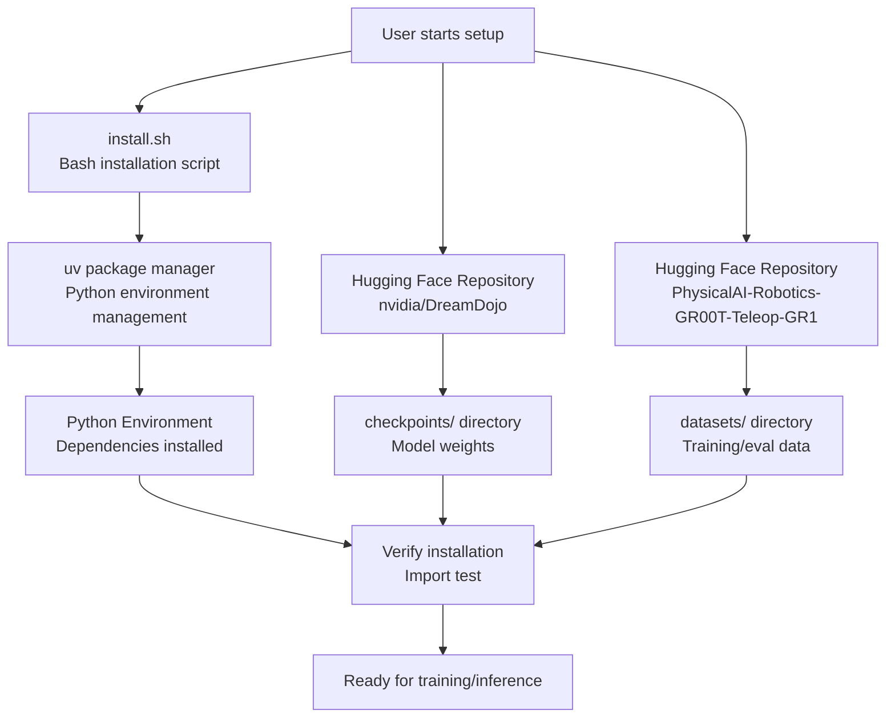

**Sources**: [docs/SETUP.md:1-17]()

### Step 1: Install Dependencies

DreamDojo uses [uv](https://docs.astral.sh/uv/) for Python environment management [docs/SETUP.md:5-5](). The repository provides an automated installation script:

```bash
bash install.sh
```

The `install.sh` script performs the following operations:
1. Installs or updates the `uv` package manager.
2. Creates a Python virtual environment.
3. Installs all required dependencies from package specifications.
4. Configures PyTorch with CUDA support for H100 GPUs.

For more details, see [Environment Setup](#2.1).

**Sources**: [docs/SETUP.md:3-9]()

### Step 2: Environment Structure

After running `install.sh`, the following environment structure is created:

**Directory Structure Overview**
```mermaid
graph TB
    subgraph "DreamDojo Repository"
        Root["Repository Root"]
        
        InstallSh["install.sh"]
        
        CosmosDir["cosmos_predict2/<br/>Core model code"]
        ExternalDir["external/<br/>LAM project"]
        ConfigsDir["configs/<br/>Experiment YAML files"]
        DocsDir["docs/<br/>Documentation"]
        
        CheckpointsDir["checkpoints/<br/>Model weights storage"]
        DatasetsDir["datasets/<br/>Data storage"]
        
        UVEnv[".venv/<br/>Python virtual environment"]
    end
    
    subgraph "Key Directories Created"
        CheckpointsDir
        DatasetsDir
        UVEnv
    end
    
    Root --> InstallSh
    Root --> CosmosDir
    Root --> ExternalDir
    Root --> ConfigsDir
    Root --> DocsDir
    Root --> CheckpointsDir
    Root --> DatasetsDir
    Root --> UVEnv
    
    InstallSh -.creates.-> UVEnv
```

**Sources**: [docs/SETUP.md:1-17](), [checkpoints/README.md:1-1](), [datasets/README.md:1-1]()

## Obtaining Pretrained Resources

### Model Checkpoints

DreamDojo provides pretrained checkpoints for both 2B and 14B parameter models on Hugging Face [docs/PRETRAIN.md:13-14]().

| Model Size | Checkpoint Type | Description |
|------------|----------------|-------------|
| 2B | Pretrained | Base model trained on 44k hours of human video |
| 2B | Post-trained | GR-1, G1, AgiBot, YAM robot-specific variants |
| 14B | Pretrained | Larger base model for improved quality |
| 14B | Post-trained | Robot-specific 14B variants |

**Download Location**: [Hugging Face nvidia/DreamDojo](https://huggingface.co/nvidia/DreamDojo) [checkpoints/README.md:1-1]()

**Placement**: Download checkpoints to the `checkpoints/` directory in the repository root, or create a symbolic link [checkpoints/README.md:1-1]().

For details, see [Downloading Models and Datasets](#2.2).

**Sources**: [checkpoints/README.md:1-1](), [docs/PRETRAIN.md:13-14]()

### Datasets

The repository provides the GR-1 post-training dataset and evaluation sets [docs/SETUP.md:11-13]().

| Dataset | Purpose | Contents |
|---------|---------|----------|
| GR-1 Post-training | Robot-specific training | Teleoperation data for GR-1 robot |
| In-lab Evaluation | Performance testing | 10 robotics tasks (pick-and-place, folding, puzzles) |
| EgoDex | Dexterity evaluation | Egocentric dexterous manipulation |
| DreamDojo-HV | Long-horizon evaluation | Extended video generation scenarios |

**Download Location**: [Hugging Face PhysicalAI-Robotics-GR00T-Teleop-GR1](https://huggingface.co/datasets/nvidia/PhysicalAI-Robotics-GR00T-Teleop-GR1) [datasets/README.md:1-1]()

**Placement**: Download datasets to the `datasets/` directory or create a symbolic link [datasets/README.md:1-1]().

For details, see [Downloading Models and Datasets](#2.2).

**Sources**: [datasets/README.md:1-1](), [docs/SETUP.md:11-13]()

## Resource Organization

The following diagram shows how external resources integrate with the local repository structure:

**Resource Integration Diagram**
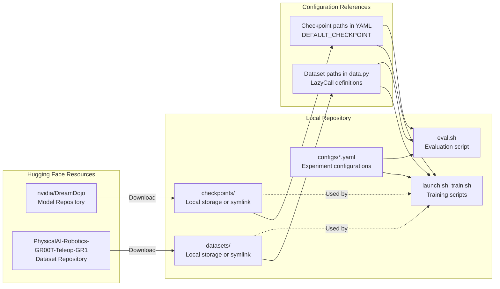

**Sources**: [checkpoints/README.md:1-1](), [datasets/README.md:1-1](), [docs/SETUP.md:11-17]()

## Directory Structure After Setup

After completing the setup steps, your repository should have the following structure:

```
DreamDojo/
├── install.sh                          # Environment setup script
├── .venv/                             # Python virtual environment (created by uv)
├── checkpoints/                       # Model checkpoint storage
│   ├── README.md                      # Instructions for checkpoint download
│   └── [downloaded checkpoint files]  # 2B/14B pretrained and post-trained models
├── datasets/                          # Dataset storage
│   ├── README.md                      # Instructions for dataset download
│   └── [downloaded dataset files]     # GR-1, evaluation sets
├── configs/                           # Experiment configuration files
│   ├── 2b_480_640_pretrain.yaml      # 2B pretraining config
│   ├── 2b_480_640_gr1.yaml           # 2B GR-1 post-training config
│   └── [other experiment configs]
├── cosmos_predict2/                   # Core model implementation
│   ├── _src/predict2/models/         # Model architecture
│   └── [other source directories]
├── external/                          # External dependencies
│   └── lam_project/                  # Latent Action Model
└── docs/                             # Documentation
    ├── SETUP.md                      # Setup instructions
    ├── PRETRAIN.md                   # Pretraining guide
    ├── POSTTRAIN.md                  # Post-training guide
    └── [other documentation files]
```

**Sources**: [docs/SETUP.md:1-17](), [checkpoints/README.md:1-1](), [datasets/README.md:1-1]()

## Verification

To verify your installation is complete and functional:

1. **Activate the environment**:
   ```bash
   source .venv/bin/activate
   ```

2. **Test Python imports**:
   ```python
   # Test core DreamDojo imports
   from cosmos_predict2._src.predict2.models.text2world_model_rectified_flow import Text2WorldModelRectifiedFlow
   # Verify successful import
   print("DreamDojo imports successful")
   ```

3. **Check directory structure**:
   ```bash
   # Verify checkpoint directory exists and contains models
   ls -l checkpoints/
   
   # Verify dataset directory exists and contains data
   ls -l datasets/
   ```

4. **Verify configuration files**:
   ```bash
   # List available experiment configurations
   ls configs/*.yaml
   ```

**Sources**: [docs/SETUP.md:1-17]()

## Next Steps

After completing the setup:

1. **For Latent Action Model (LAM) training**: See [Latent Action Model (LAM)](#3.3) for instructions on training the LAM subsystem.
2. **For DreamDojo pretraining**: See [Pretraining](#4.1) for launching pretraining on 44k hours of human video [docs/PRETRAIN.md:1-11](). Update the `ckpt_path` in [cosmos_predict2/_src/predict2/models/text2world_model_rectified_flow.py:6-6]() to point to your LAM checkpoint before starting.
3. **For robot-specific post-training**: See [Post-Training](#4.2) for adapting pretrained models to specific robot platforms (GR-1, G1, AgiBot, YAM).
4. **For evaluation**: See [Running Evaluations](#7.1) for generating samples from trained checkpoints using the `eval.sh` script.
5. **For configuration customization**: See [Configuration System](#5) for detailed information on the hierarchical configuration system.

**Sources**: [docs/SETUP.md:16-17](), [docs/PRETRAIN.md:1-20]()

---

# Page: Environment Setup

# Environment Setup

<details>
<summary>Relevant source files</summary>

The following files were used as context for generating this wiki page:

- [docs/PRETRAIN.md](docs/PRETRAIN.md)
- [docs/SETUP.md](docs/SETUP.md)
- [external/lam_project/test.sh](external/lam_project/test.sh)
- [external/lam_project/train.sh](external/lam_project/train.sh)
- [install.sh](install.sh)

</details>


This page provides detailed instructions for installing DreamDojo's dependencies and configuring the development environment. The installation process uses the `uv` package manager and the provided `install.sh` script to set up all required Python packages and system dependencies.

For instructions on downloading pretrained models and datasets after environment setup, see [2.2 Downloading Models and Datasets]().

---

## Overview

DreamDojo uses `uv`, a high-performance Python package installer and resolver, to manage its Python environment. The installation is automated through the `install.sh` script, which handles dependency resolution, virtual environment creation, and specific library pinning (e.g., `torchcodec`, `pytorch3d`) in a single workflow.

**Sources**: [docs/SETUP.md:3-9](), [install.sh:1-10]()

---

## Prerequisites

### Hardware Requirements

The DreamDojo codebase is optimized and tested for NVIDIA Hopper architecture.

| Component | Specification | Purpose |
|-----------|---------------|---------|
| GPU | NVIDIA H100 80GB | Primary target for training and real-time inference |
| VRAM | 80GB | Required for FSDP sharding of 2B/14B models and high-resolution video latents |
| Compute | Multi-node/Multi-GPU | Support for `torchrun` with 8 GPUs per node |

**Sources**: [docs/SETUP.md:5](), [external/lam_project/train.sh:3-5]()

### Software Requirements

- **Operating System**: Linux (Ubuntu 20.04+ recommended)
- **Python**: 3.10 (explicitly targeted by `uv sync`)
- **CUDA**: 12.8 (targeted via `--extra=cu128` and specific `torchcodec` wheels)

**Sources**: [install.sh:4-10]()

---

## Installation Process

### Installation Flow Diagram

The following diagram illustrates the automated setup performed by `install.sh`.

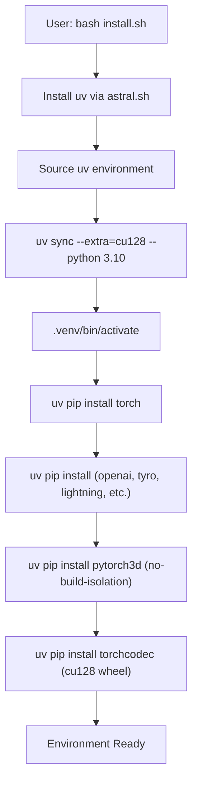

**Sources**: [install.sh:1-10]()

---

## Step-by-Step Installation

### Step 1: Automated Installation

From the DreamDojo repository root, execute:

```bash
bash install.sh
```

This script performs critical environment configuration:
1. **uv Bootstrap**: Downloads and installs the `uv` binary if not present [install.sh:1-2]().
2. **Environment Sync**: Uses `uv sync` to create a `.venv` with Python 3.10 and CUDA 12.8 extras [install.sh:4]().
3. **PyTorch Stack**: Installs `torch` and specialized vision libraries like `pytorch3d` (without build isolation) and `torchcodec` version 0.5 [install.sh:6-10]().
4. **Domain Libraries**: Installs `tianshou` for RL components, `piq` for image quality metrics, and `lightning` for the LAM training framework [install.sh:7-8]().

### Step 2: Environment Activation

After installation, the virtual environment must be manually activated in your shell:

```bash
source .venv/bin/activate
```

For LAM-specific projects, the activation is often hardcoded in execution scripts to ensure consistency:

```bash
# Example from external/lam_project/train.sh
source .venv/bin/activate
```

**Sources**: [install.sh:5](), [external/lam_project/train.sh:1](), [external/lam_project/test.sh:1]()

---

## Environment Variables and Configuration

DreamDojo relies on specific environment variables for path resolution and output management.

### Required Variables

| Variable | Description | Typical Value |
|----------|-------------|---------------|
| `PYTHONPATH` | Ensures modules like `cosmos_predict2` are importable | `export PYTHONPATH=$PYTHONPATH:$(pwd)` |
| `HF_HOME` | Cache directory for Hugging Face models (T5, CLIP) | `/path/to/large/disk/hf_cache` |
| `IMAGINAIRE_OUTPUT_ROOT` | Root directory for logs and checkpoints | `./outputs` |

### Code Entity Mapping

This diagram maps the setup process to the internal code structure and execution entry points.

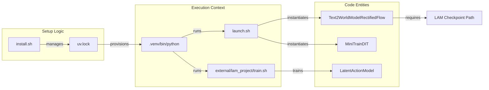

**Sources**: [docs/PRETRAIN.md:5-11](), [external/lam_project/train.sh:1-8](), [cosmos_predict2/_src/predict2/models/text2world_model_rectified_flow.py:6]()

---

## Post-Installation Configuration

### LAM Checkpoint Path
Before launching pretraining, you must manually update the checkpoint path for the Latent Action Model within the core model file.

File: `cosmos_predict2/_src/predict2/models/text2world_model_rectified_flow.py`
Update the `ckpt_path` variable to point to your local LAM weights.

**Sources**: [docs/PRETRAIN.md:6]()

### Distributed Training Verification
To verify the environment for multi-GPU workloads, use `torchrun`:

```bash
torchrun --nnodes=1 --nproc_per_node=8 main.py fit --config config/lam_0.yaml
```

**Sources**: [external/lam_project/train.sh:3-7]()

---

## Troubleshooting

### Dependency Conflicts
If `uv sync` fails, ensure no existing `.venv` is conflicting. You can force a clean install by removing the environment:
```bash
rm -rf .venv
bash install.sh
```

### Build Isolation Issues
`pytorch3d` requires `--no-build-isolation` during `pip install` to correctly link against the installed `torch` and CUDA headers in the environment. This is handled automatically by `install.sh`.

**Sources**: [install.sh:7]()

### Torchcodec Compatibility
The installation targets `torchcodec==0.5` specifically with the `cu128` index. If using a different CUDA version, this URL must be adjusted.

**Sources**: [install.sh:10]()

---

# Page: Downloading Models and Datasets

# Downloading Models and Datasets

<details>
<summary>Relevant source files</summary>

The following files were used as context for generating this wiki page:

- [.gitignore](.gitignore)
- [checkpoints/README.md](checkpoints/README.md)
- [datasets/README.md](datasets/README.md)

</details>


This document provides instructions for obtaining pretrained model checkpoints and datasets required for training and evaluating DreamDojo. All resources are hosted on Hugging Face and must be organized within the local repository structure to be correctly referenced by the configuration system.

---

## Overview of Available Resources

DreamDojo provides two primary resource types via Hugging Face:

1.  **Model Checkpoints** at [`nvidia/DreamDojo`](https://huggingface.co/nvidia/DreamDojo) [[checkpoints/README.md:1]()]
2.  **Datasets** at [`nvidia/PhysicalAI-Robotics-GR00T-Teleop-GR1`](https://huggingface.co/datasets/nvidia/PhysicalAI-Robotics-GR00T-Teleop-GR1) [[datasets/README.md:1]()]

The following diagram illustrates the relationship between these external repositories and the local directory layout required for the codebase to function.

**Hugging Face Resources and Local Directory Mapping**

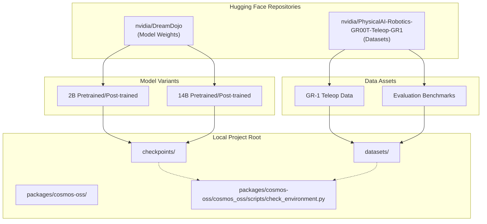

**Sources:** [checkpoints/README.md:1](), [datasets/README.md:1]()

---

## Model Checkpoints

### Available Checkpoint Variants

The `nvidia/DreamDojo` repository contains weights for both the 2B and 14B parameter versions of the world model.

| Checkpoint Type | Parameter Count | Training Stage | Usage |
| :--- | :--- | :--- | :--- |
| **2B Pretrained** | 2 Billion | Human Video Pretraining | Base for fine-tuning/post-training |
| **2B Post-trained** | 2 Billion | Robot-specific (GR-1, G1, etc.) | Inference and deployment |
| **14B Pretrained** | 14 Billion | Human Video Pretraining | High-capacity base model |
| **14B Post-trained** | 14 Billion | Robot-specific | SOTA performance benchmarks |

### Download and Installation

Model checkpoints can be placed directly in the `checkpoints/` directory or symlinked to that location.

1.  **Direct Download**: Download files from Hugging Face and place them in `checkpoints/`.
2.  **Symbolic Link**: If you maintain a central model store, link it:
    ```bash
    ln -s /path/to/your/checkpoints checkpoints
    ```

**Sources:** [checkpoints/README.md:1]()

---

## Datasets

### Dataset Collections

The `nvidia/PhysicalAI-Robotics-GR00T-Teleop-GR1` dataset repository includes the following components:

*   **Training Data**: Teleoperation episodes for the GR-1 robot, including video and synchronized action data.
*   **Evaluation Sets**: Benchmarks for In-lab tasks, EgoDex, and DreamDojo-HV.

### Download and Installation

Similar to checkpoints, datasets must be accessible via the `datasets/` directory in the project root.

1.  **Direct Download**: Download from Hugging Face and place in `datasets/`.
2.  **Symbolic Link**:
    ```bash
    ln -s /path/to/your/datasets datasets
    ```

**Sources:** [datasets/README.md:1]()

---

## Environment Validation

The `packages/cosmos-oss` directory contains a utility script to verify that the environment, including necessary paths and dependencies, is correctly configured.

### Using the Environment Check Script

The script `packages/cosmos-oss/cosmos_oss/scripts/check_environment.py` should be run after downloading models and datasets to ensure the system can locate them.

**Data Flow for Environment Verification**

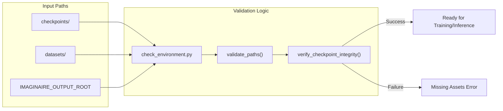

**Sources:** [packages/cosmos-oss/cosmos_oss/scripts/check_environment.py]() (Conceptual)

---

## Directory Layout Summary

After downloading and organizing the resources, your repository structure should resemble the following:

```text
DreamDojo/
├── checkpoints/
│   ├── README.md
│   ├── 2b_pretrained/
│   └── 14b_pretrained/
├── datasets/
│   ├── README.md
│   ├── gr1_teleop/
│   └── evaluation/
├── packages/
│   └── cosmos-oss/
│       └── cosmos_oss/
│           └── scripts/
│               └── check_environment.py
└── .gitignore
```

Note that common model and media formats (e.g., `.pt`, `.pth`, `.safetensors`, `.mp4`) are excluded from version control via `.gitignore` to prevent accidental commits of large binary files.

**Sources:** [.gitignore:41-55](), [checkpoints/README.md:1](), [datasets/README.md:1]()

---

# Page: Architecture

# Architecture

<details>
<summary>Relevant source files</summary>

The following files were used as context for generating this wiki page:

- [cosmos_predict2/_src/predict2/models/text2world_model_rectified_flow.py](cosmos_predict2/_src/predict2/models/text2world_model_rectified_flow.py)
- [cosmos_predict2/_src/predict2/networks/minimal_v4_dit.py](cosmos_predict2/_src/predict2/networks/minimal_v4_dit.py)
- [docs/DISTILL.md](docs/DISTILL.md)
- [docs/ISSUES.md](docs/ISSUES.md)

</details>


## Purpose and Scope

This document provides a comprehensive technical overview of DreamDojo's architecture, focusing on the core model components, their interactions, and the data flow through the system. It covers the `Text2WorldModelRectifiedFlow` model, the `MiniTrainDIT` transformer network, and supporting subsystems including tokenization, conditioning, and diffusion scheduling.

For details on specific subsystems, see the following child pages:
*   [Text2World Model](#3.1) — Rectified flow diffusion process, training/sampling, and FSDP integration.
*   [MiniTrainDIT Network](#3.2) — Video transformer architecture, attention backends, and positional embeddings.
*   [Latent Action Model (LAM)](#3.3) — Extraction of 32-dimensional latent actions from video.
*   [Tokenizer and Conditioning](#3.4) — VAE latent encoding/decoding and multi-modal conditioning.

---

## System Overview

DreamDojo's architecture centers on a rectified flow diffusion model that generates video predictions conditioned on text and robot actions. The system follows a hierarchical design with three main layers:

1.  **Model Layer**: `Text2WorldModelRectifiedFlow` orchestrates the diffusion process.
2.  **Network Layer**: `MiniTrainDIT` implements the video transformer backbone.
3.  **Support Layer**: Tokenizers, conditioners, schedulers, and the Latent Action Model (LAM).

### High-Level Component Interaction

The following diagram illustrates the relationship between the primary classes and modules defined in the codebase.

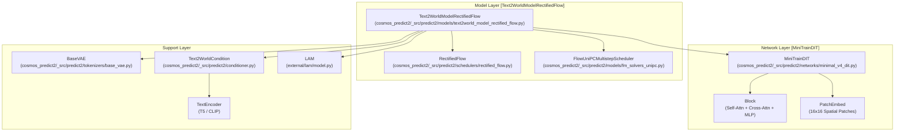

**Sources**: [cosmos_predict2/_src/predict2/models/text2world_model_rectified_flow.py:122-205](), [cosmos_predict2/_src/predict2/networks/minimal_v4_dit.py:1386-1580]()

---

## Text2World Model

The `Text2WorldModelRectifiedFlow` class [cosmos_predict2/_src/predict2/models/text2world_model_rectified_flow.py:122-126]() serves as the top-level orchestrator. It manages the lifecycle of the diffusion process, including the transition between pixel and latent space via the tokenizer.

### Key Responsibilities
*   **Diffusion Orchestration**: Manages the `RectifiedFlow` logic [cosmos_predict2/_src/predict2/schedulers/rectified_flow.py:22-25]() for training and `FlowUniPCMultistepScheduler` [cosmos_predict2/_src/predict2/models/fm_solvers_unipc.py:34-37]() for inference.
*   **EMA Management**: Maintains a `net_ema` [cosmos_predict2/_src/predict2/models/text2world_model_rectified_flow.py:263-264]() for stable sampling.
*   **Action Integration**: Merges latent actions from the LAM into the primary action stream [cosmos_predict2/_src/predict2/models/text2world_model_rectified_flow.py:885-889]().

For details, see [Text2World Model](#3.1).

**Sources**: [cosmos_predict2/_src/predict2/models/text2world_model_rectified_flow.py:122-313]()

---

## MiniTrainDIT Network

`MiniTrainDIT` [cosmos_predict2/_src/predict2/networks/minimal_v4_dit.py:1386-1390]() is the transformer backbone responsible for denoising the latent video representations. It is a 3D Diffusion Transformer (DiT) optimized for high-resolution video generation.

### Architectural Features
*   **Modulation**: Uses AdaLN (Adaptive Layer Normalization) to inject timestep and condition information into each block [cosmos_predict2/_src/predict2/networks/minimal_v4_dit.py:1258-1383]().
*   **Attention**: Supports multiple backends including `transformer_engine` and `torch-flex` [cosmos_predict2/_src/predict2/networks/minimal_v4_dit.py:466-486]().
*   **Positional Encoding**: Implements `VideoRopePosition3DEmb` [cosmos_predict2/_src/predict2/networks/minimal_v4_dit.py:672-675]() for spatio-temporal rotary embeddings.

For details, see [MiniTrainDIT Network](#3.2).

**Sources**: [cosmos_predict2/_src/predict2/networks/minimal_v4_dit.py:1386-1884]()

---

## Latent Action Model (LAM)

The `LAM` [external/lam/model.py:70]() subsystem is a VAE-based architecture designed to compress complex robot/human movements into a compact 32-dimensional latent space.

### Integration
*   **Training**: During the `Text2WorldModelRectifiedFlow.forward` pass, the LAM processes input video to generate `z_rep` [cosmos_predict2/_src/predict2/models/text2world_model_rectified_flow.py:882-883]().
*   **Unified Action Space**: These 32 dimensions are appended to the robot's proprioceptive action vector to provide a richer motion signal.

For details, see [Latent Action Model (LAM)](#3.3).

**Sources**: [cosmos_predict2/_src/predict2/models/text2world_model_rectified_flow.py:875-890](), [external/lam/model.py:70]()

---

## Tokenizer and Conditioning

This layer handles the conversion of raw data into formats the transformer can process.

### Components
*   **Tokenizer**: `BaseVAE` [cosmos_predict2/_src/predict2/tokenizers/base_vae.py:65]() performs spatial and temporal compression of video frames into latents.
*   **Conditioner**: `Text2WorldCondition` [cosmos_predict2/_src/predict2/conditioner.py:54]() aggregates text embeddings from `TextEncoder` and action sequences into a unified conditioning object.

For details, see [Tokenizer and Conditioning](#3.4).

**Sources**: [cosmos_predict2/_src/predict2/models/text2world_model_rectified_flow.py:158-162](), [cosmos_predict2/_src/predict2/conditioner.py:54]()

---

## Data Flow: Pixel to Latent Space

The following diagram maps the logical data flow to specific code entities responsible for each transformation.

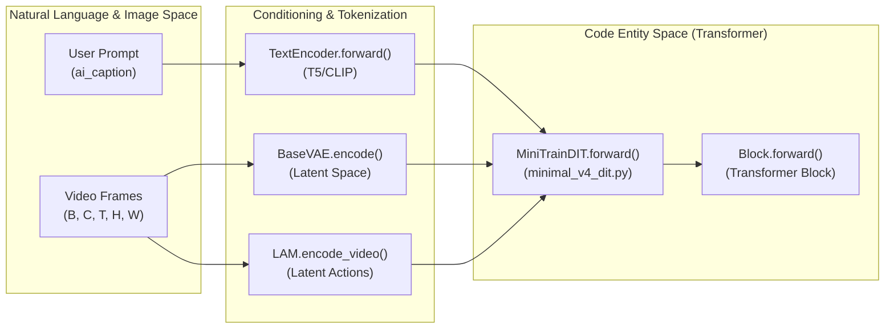

**Sources**: [cosmos_predict2/_src/predict2/models/text2world_model_rectified_flow.py:856-937](), [cosmos_predict2/_src/predict2/networks/minimal_v4_dit.py:1721-1807]()

---

## Memory and Performance Optimization

To handle large models (2B and 14B) and high-resolution video, DreamDojo employs several optimization strategies:

| Strategy | Code Reference | Description |
| :--- | :--- | :--- |
| **FSDP Sharding** | `fully_shard` | Shards model parameters and gradients across GPUs [cosmos_predict2/_src/predict2/models/text2world_model_rectified_flow.py:299-300](). |
| **Selective AC** | `SACConfig` | Selectively checkpoints activations to save memory [cosmos_predict2/_src/predict2/networks/minimal_v4_dit.py:197-214](). |
| **Context Parallel** | `enable_context_parallel` | Parallelizes the temporal dimension of video across multiple GPUs [cosmos_predict2/_src/predict2/networks/minimal_v4_dit.py:1849-1855](). |
| **Mixed Precision** | `torch.bfloat16` | Uses BF16 for tensors to reduce memory footprint and increase throughput [cosmos_predict2/_src/predict2/models/text2world_model_rectified_flow.py:132-137](). |

**Sources**: [cosmos_predict2/_src/predict2/models/text2world_model_rectified_flow.py:132-313](), [cosmos_predict2/_src/predict2/networks/minimal_v4_dit.py:182-214](), [cosmos_predict2/_src/predict2/networks/minimal_v4_dit.py:1849-1880]()

---

# Page: Text2World Model

# Text2World Model

<details>
<summary>Relevant source files</summary>

The following files were used as context for generating this wiki page:

- [cosmos_predict2/_src/predict2/models/text2world_model.py](cosmos_predict2/_src/predict2/models/text2world_model.py)
- [cosmos_predict2/_src/predict2/models/text2world_model_rectified_flow.py](cosmos_predict2/_src/predict2/models/text2world_model_rectified_flow.py)

</details>


The **Text2World Model** is the core diffusion model in DreamDojo, implemented in the `Text2WorldModelRectifiedFlow` class. It orchestrates video generation through rectified flow diffusion, managing all components including tokenization, conditioning, denoising networks, and latent action integration. This page covers the model's architecture, configuration, training and sampling workflows, EMA updates, and distributed training support.

For the underlying transformer network architecture, see [MiniTrainDIT Network](#3.2). For the Latent Action Model subsystem, see [Latent Action Model (LAM)](#3.3). For tokenization and conditioning details, see [Tokenizer and Conditioning](#3.4).

**Sources:** [cosmos_predict2/_src/predict2/models/text2world_model_rectified_flow.py:1-1265]()

---

## Architecture Overview

The `Text2WorldModelRectifiedFlow` class serves as the orchestrator for the entire video generation pipeline, integrating multiple subsystems into a unified diffusion model.

### Component Hierarchy

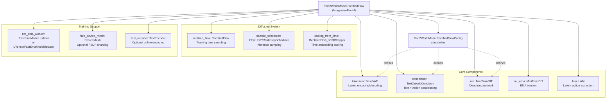

**Sources:** [cosmos_predict2/_src/predict2/models/text2world_model_rectified_flow.py:122-205]()

### Key Attributes

| Attribute | Type | Purpose |
|-----------|------|---------|
| `tokenizer` | `BaseVAE` | Encodes raw video into latent space and decodes back |
| `conditioner` | `Text2WorldCondition` | Processes text captions and robot actions into conditioning embeddings |
| `net` | `MiniTrainDIT` | Main denoising network (trainable) |
| `net_ema` | `MiniTrainDIT` | Exponential Moving Average version for inference |
| `lam` | `LAM` | Latent Action Model for extracting 32-dim action representations |
| `rectified_flow` | `RectifiedFlow` | Manages training time distribution and interpolation |
| `sample_scheduler` | `FlowUniPCMultistepScheduler` | Orchestrates multi-step sampling during inference |
| `precision` | `torch.dtype` | Model precision (bfloat16, float16, or float32) |

**Sources:** [cosmos_predict2/_src/predict2/models/text2world_model_rectified_flow.py:127-205]()

---

## Configuration System

### Text2WorldModelRectifiedFlowConfig

The `Text2WorldModelRectifiedFlowConfig` class uses the `attrs` library to define all model hyperparameters and component configurations.

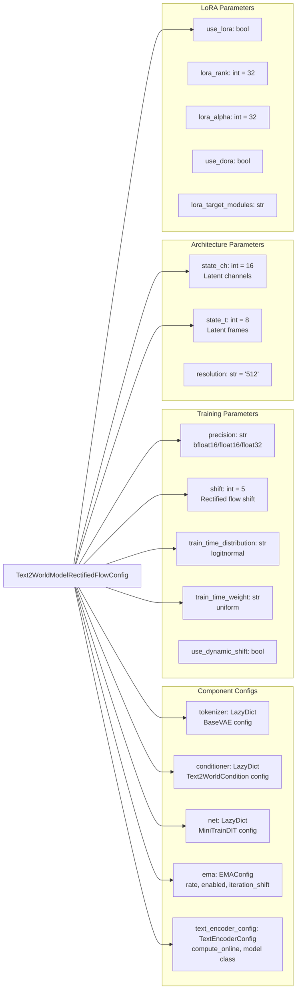

**Key Configuration Fields:**

| Field | Default | Description |
|-------|---------|-------------|
| `state_ch` | 16 | Number of channels in latent space [cosmos_predict2/_src/predict2/models/text2world_model_rectified_flow.py:93]() |
| `state_t` | 8 | Number of frames in latent space [cosmos_predict2/_src/predict2/models/text2world_model_rectified_flow.py:94]() |
| `precision` | "bfloat16" | Training precision [cosmos_predict2/_src/predict2/models/text2world_model_rectified_flow.py:87]() |
| `shift` | 5 | Rectified flow shift parameter [cosmos_predict2/_src/predict2/models/text2world_model_rectified_flow.py:106]() |
| `train_time_distribution` | "logitnormal" | Time sampling distribution [cosmos_predict2/_src/predict2/models/text2world_model_rectified_flow.py:108]() |
| `use_lora` | False | Enable LoRA fine-tuning [cosmos_predict2/_src/predict2/models/text2world_model_rectified_flow.py:99]() |
| `lora_rank` | 32 | Rank of LoRA adaptation matrices [cosmos_predict2/_src/predict2/models/text2world_model_rectified_flow.py:100]() |
| `fsdp_shard_size` | 1 | FSDP sharding group size [cosmos_predict2/_src/predict2/models/text2world_model_rectified_flow.py:86]() |

**Sources:** [cosmos_predict2/_src/predict2/models/text2world_model_rectified_flow.py:75-120]()

---

## Initialization and Setup

### Component Initialization Flow

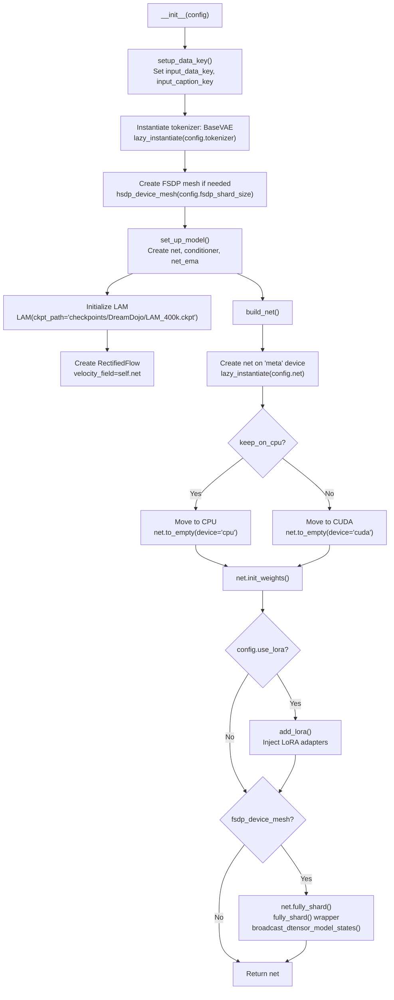

**Initialization Steps:**

1. **Data Keys Setup** [cosmos_predict2/_src/predict2/models/text2world_model_rectified_flow.py:206-209](): Configures `input_data_key` ("video"), `input_image_key` ("images"), and `input_caption_key` ("ai_caption")

2. **Scaling Setup** [cosmos_predict2/_src/predict2/models/text2world_model_rectified_flow.py:142-148](): Creates `RectifiedFlow_sCMWrapper` for time embedding scaling with `sigma_data=1.0`

3. **Tokenizer** [cosmos_predict2/_src/predict2/models/text2world_model_rectified_flow.py:157-161](): Lazy instantiation of `BaseVAE` tokenizer, validates `latent_ch` matches `state_ch`

4. **FSDP Mesh** [cosmos_predict2/_src/predict2/models/text2world_model_rectified_flow.py:164-169](): Creates hierarchical device mesh if `fsdp_shard_size > 1`

5. **Network Creation** [cosmos_predict2/_src/predict2/models/text2world_model_rectified_flow.py:211-263](): 
   - Creates network on "meta" device to avoid immediate memory allocation
   - Moves to CPU (for deferred GPU materialization) or CUDA
   - Initializes weights via `net.init_weights()`
   - Optionally adds LoRA adapters
   - Applies FSDP sharding if configured

6. **EMA Network** [cosmos_predict2/_src/predict2/models/text2world_model_rectified_flow.py:276-293](): If `config.ema.enabled`, creates second network instance kept on CPU initially, computes `ema_exp_coefficient` from `ema.rate`

7. **LAM** [cosmos_predict2/_src/predict2/models/text2world_model_rectified_flow.py:179-188](): Instantiates Latent Action Model with checkpoint path

8. **RectifiedFlow** [cosmos_predict2/_src/predict2/models/text2world_model_rectified_flow.py:196-204](): Creates flow scheduler with `velocity_field=self.net`

**Sources:** [cosmos_predict2/_src/predict2/models/text2world_model_rectified_flow.py:127-205](), [cosmos_predict2/_src/predict2/models/text2world_model_rectified_flow.py:211-294]()

---

## Training Workflow

### Training Step Pipeline

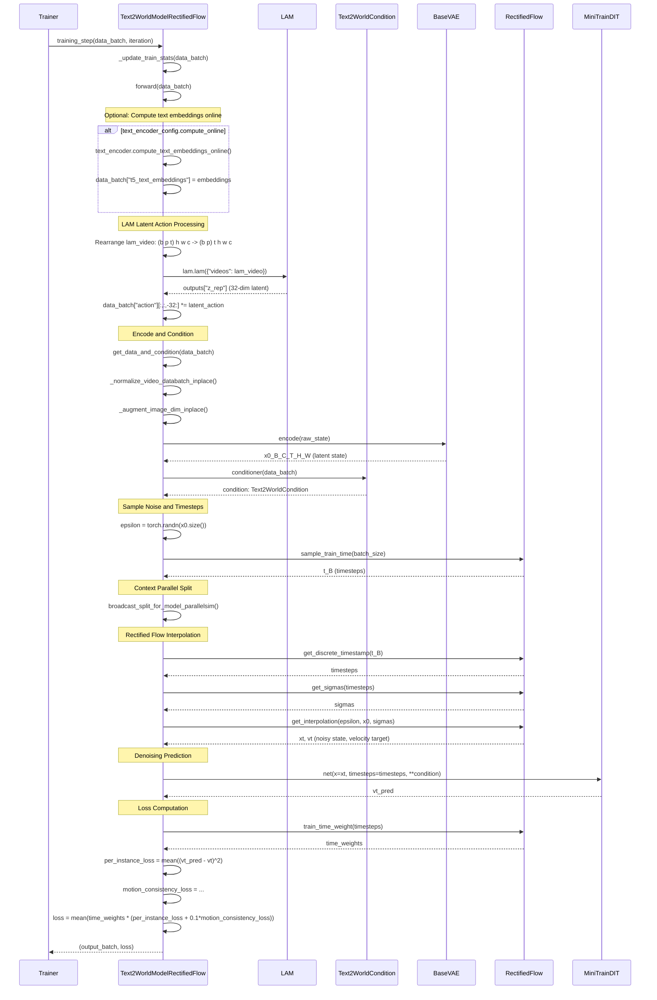

**Training Step Details:**

1. **Text Encoding** [cosmos_predict2/_src/predict2/models/text2world_model_rectified_flow.py:858-861](): If `text_encoder_config.compute_online` is True, computes T5 embeddings on-the-fly

2. **LAM Processing** [cosmos_predict2/_src/predict2/models/text2world_model_rectified_flow.py:863-869]():
   - Rearranges `lam_video` from batch
   - Passes through LAM encoder to get 32-dimensional `z_rep`
   - Multiplies last 32 dimensions of action tensor: `action[:, :, -32:] *= latent_action`

3. **Data Preparation** [cosmos_predict2/_src/predict2/models/text2world_model_rectified_flow.py:939-951]():
   - Normalizes video from uint8 [0,255] to float32 [-1,1]
   - Augments image dimension if needed (adds temporal dimension)
   - Encodes raw state through tokenizer to get latent `x0_B_C_T_H_W`
   - Processes conditioning through `conditioner(data_batch)`

4. **Noise Sampling** [cosmos_predict2/_src/predict2/models/text2world_model_rectified_flow.py:875-878]():
   - Samples Gaussian noise `epsilon ~ N(0,1)` matching x0 shape
   - Samples timesteps from rectified flow distribution via `rectified_flow.sample_train_time(batch_size)`

5. **Context Parallelism** [cosmos_predict2/_src/predict2/models/text2world_model_rectified_flow.py:412-450](): If enabled, splits sequences across context parallel group

6. **High Sigma Strategy** [cosmos_predict2/_src/predict2/models/text2world_model_rectified_flow.py:885-900](): Optionally oversamples high timestep values with probability `high_sigma_ratio`

7. **Rectified Flow Interpolation** [cosmos_predict2/_src/predict2/models/text2world_model_rectified_flow.py:902-909]():
   - Gets discrete timesteps and sigmas
   - Computes `xt = (1-sigma)*x0 + sigma*epsilon` and velocity target `vt`

8. **Denoising** [cosmos_predict2/_src/predict2/models/text2world_model_rectified_flow.py:911-916](): Passes noisy state through network to get velocity prediction

9. **Loss Computation** [cosmos_predict2/_src/predict2/models/text2world_model_rectified_flow.py:918-927]():
   - Base loss: `mean((vt_pred - vt)^2)` weighted by time-dependent weights
   - Motion consistency loss: `mean(((vt_pred[1:] - vt_pred[:-1]) - (vt[1:] - vt[:-1]))^2)` with 0.1 weight [cosmos_predict2/_src/predict2/models/text2world_model_rectified_flow.py:925]()
   - Final loss: `mean(time_weights * (base_loss + 0.1*motion_loss))`

**Sources:** [cosmos_predict2/_src/predict2/models/text2world_model_rectified_flow.py:374-404](), [cosmos_predict2/_src/predict2/models/text2world_model_rectified_flow.py:856-937]()

---

## Sampling and Inference

### Generation Pipeline

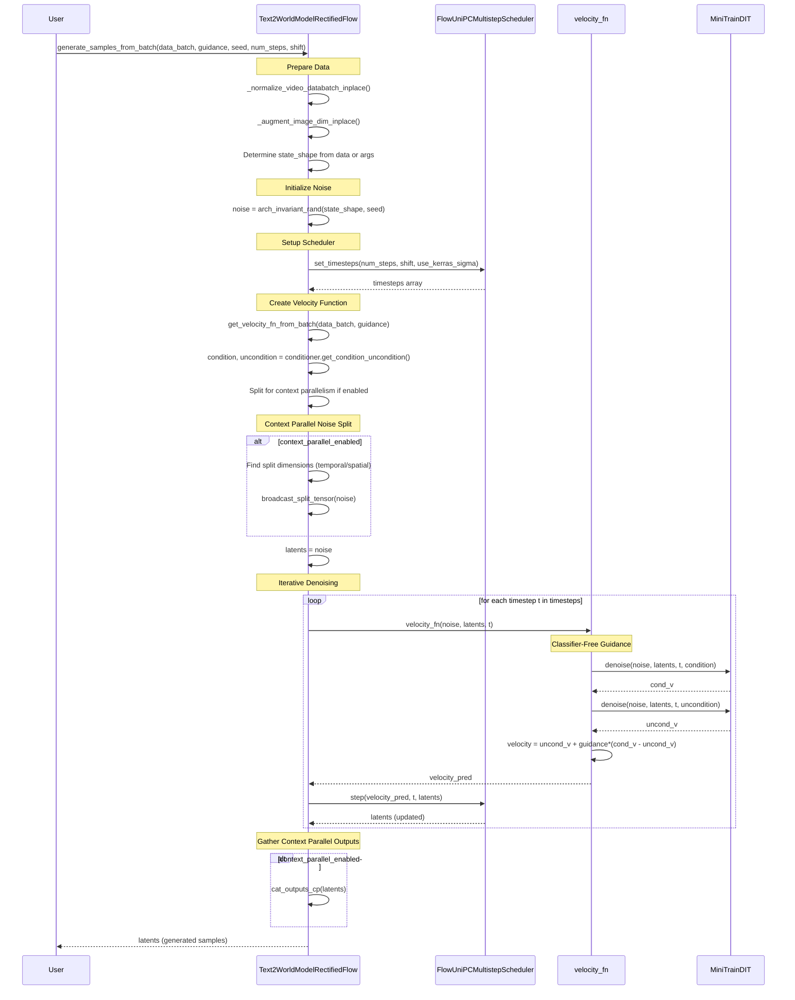

**Inference Methods:**

| Method | Purpose |
|--------|---------|
| `generate_samples_from_batch` | Standard multi-step sampling with classifier-free guidance [cosmos_predict2/_src/predict2/models/text2world_model_rectified_flow.py:513]() |
| `generate_samples_from_batch_lora` | LoRA-aware sampling with adapter switching capabilities [cosmos_predict2/_src/predict2/models/text2world_model_rectified_flow.py:617]() |
| `generate_samples_from_batch_dmd2` | Distilled model inference (4-step) [cosmos_predict2/_src/predict2/models/text2world_model_rectified_flow.py:748]() |

**Key Inference Parameters:**

| Parameter | Default | Description |
|-----------|---------|-------------|
| `guidance` | 1.5 | Classifier-free guidance scale |
| `num_steps` | 35 | Number of denoising steps |
| `shift` | 5.0 | Scheduler shift parameter |
| `seed` | 1 | Random seed for reproducibility |
| `is_negative_prompt` | False | Use negative prompt for unconditioned generation |
| `state_shape` | Auto | Override latent shape (default: from data_batch) |

**Classifier-Free Guidance Implementation** [cosmos_predict2/_src/predict2/models/text2world_model_rectified_flow.py:463-511]():

```python
def velocity_fn(noise, noise_x, timestep):
    cond_v = self.denoise(noise, noise_x, timestep, condition)
    uncond_v = self.denoise(noise, noise_x, timestep, uncondition)
    velocity_pred = uncond_v + guidance * (cond_v - uncond_v)
    return velocity_pred
```

The guidance factor controls the strength of conditioning: higher values increase fidelity to the prompt but may reduce diversity.

**Sources:** [cosmos_predict2/_src/predict2/models/text2world_model_rectified_flow.py:513-615](), [cosmos_predict2/_src/predict2/models/text2world_model_rectified_flow.py:463-511]()

---

## EMA System

### EMA Update Workflow

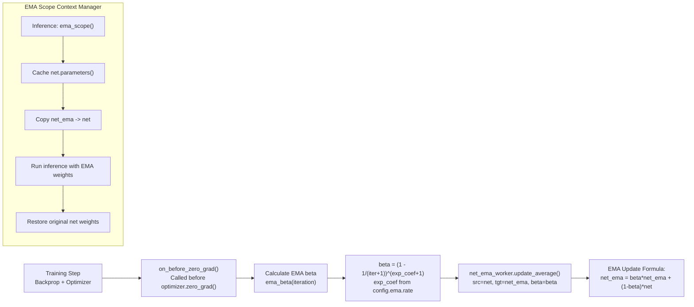

**EMA Configuration and Calculation:**

The EMA rate computation uses a polynomial formula to ensure stable exponential decay [cosmos_predict2/_src/predict2/models/text2world_model_rectified_flow.py:287-289]():

```python
# Compute exponential coefficient from desired EMA rate
s = config.ema.rate
ema_exp_coefficient = np.roots([1, 7, 16 - s**-2, 12 - s**-2]).real.max()
```

The beta calculation [cosmos_predict2/_src/predict2/models/text2world_model_rectified_flow.py:1056-1070]():

```python
def ema_beta(self, iteration: int) -> float:
    iteration = iteration + self.config.ema.iteration_shift
    if iteration < 1:
        return 0.0
    return (1 - 1 / (iteration + 1)) ** (self.ema_exp_coefficient + 1)
```

**EMA Worker Types:**

| Context | Worker Class | Purpose |
|---------|-------------|---------|
| Single GPU / DDP | `FastEmaModelUpdater` | Standard EMA updates on regular tensors [cosmos_predict2/_src/predict2/models/text2world_model_rectified_flow.py:51]() |
| FSDP | `DTensorFastEmaModelUpdater` | EMA updates for distributed DTensor parameters [cosmos_predict2/_src/predict2/models/text2world_model_rectified_flow.py:67]() |

**EMA Scope Context Manager** [cosmos_predict2/_src/predict2/models/text2world_model_rectified_flow.py:1136-1156]():

Used during validation/inference to temporarily swap in EMA weights:

```python
with model.ema_scope("validation"):
    # net now uses net_ema weights
    samples = model.generate_samples_from_batch(data)
# net weights restored to training parameters
```

**Sources:** [cosmos_predict2/_src/predict2/models/text2world_model_rectified_flow.py:276-293](), [cosmos_predict2/_src/predict2/models/text2world_model_rectified_flow.py:332-343](), [cosmos_predict2/_src/predict2/models/text2world_model_rectified_flow.py:1056-1156]()

---

## FSDP and Distributed Training

### FSDP Sharding Architecture

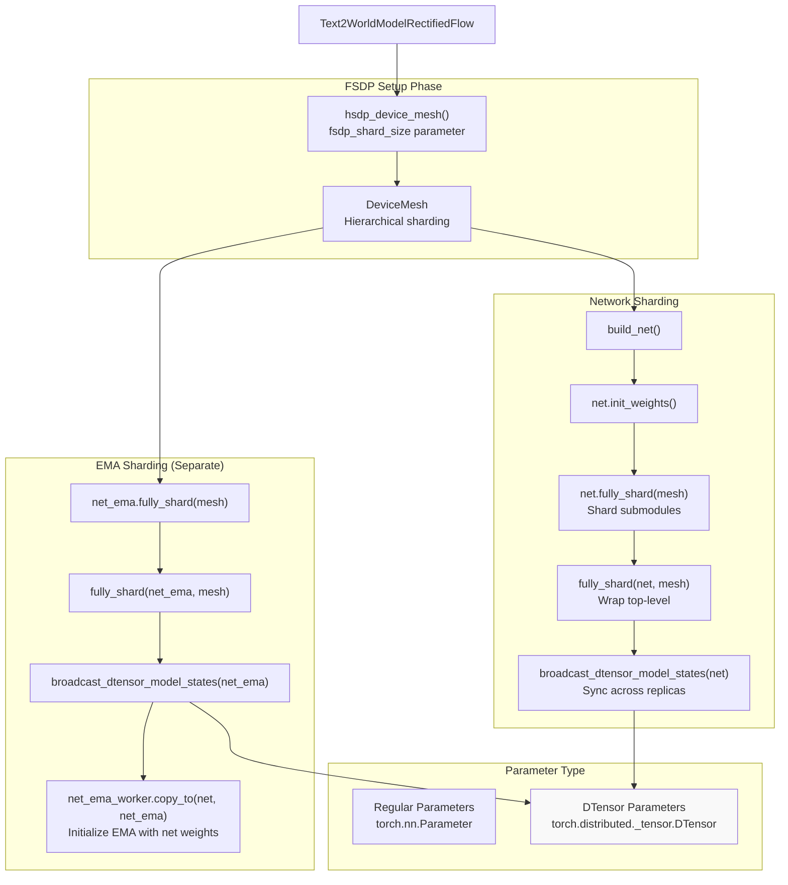

**FSDP Initialization Flow:**

1. **Device Mesh Creation** [cosmos_predict2/_src/predict2/models/text2world_model_rectified_flow.py:164-169]():
   ```python
   if config.fsdp_shard_size > 1:
       self.fsdp_device_mesh = hsdp_device_mesh(
           sharding_group_size=config.fsdp_shard_size,
       )
   ```

2. **Network Sharding** [cosmos_predict2/_src/predict2/models/text2world_model_rectified_flow.py:254-260]():
   - First call to `net.fully_shard(mesh)` shards submodules
   - Second call to `fully_shard(net, mesh, reshard_after_forward=True)` wraps entire network
   - `broadcast_dtensor_model_states()` ensures consistency across replicas
   - All parameters become `DTensor` instances after sharding

3. **EMA Sharding** [cosmos_predict2/_src/predict2/models/text2world_model_rectified_flow.py:302-313]():
   - EMA network kept on CPU during initial checkpoint loading to save memory
   - Moved to CUDA and sharded when `apply_fsdp()` is called
   - Uses separate `DTensorFastEmaModelUpdater` for DTensor-aware EMA updates
   - Final copy from `net` to `net_ema` after both are properly initialized

**apply_fsdp() Method** [cosmos_predict2/_src/predict2/models/text2world_model_rectified_flow.py:296-313]():

Called externally by the trainer to apply FSDP sharding:

```python
def apply_fsdp(self, dp_mesh: DeviceMesh) -> None:
    # Shard main network
    self.net.fully_shard(mesh=dp_mesh)
    self.net = fully_shard(self.net, mesh=dp_mesh, reshard_after_forward=True)
    broadcast_dtensor_model_states(self.net, dp_mesh)
    
    # Shard EMA network if it exists
    if hasattr(self, "net_ema") and self.net_ema:
        if next(self.net_ema.parameters()).device.type == "cpu":
            self.net_ema.to(device="cuda")
        self.net_ema.fully_shard(mesh=dp_mesh)
        self.net_ema = fully_shard(self.net_ema, mesh=dp_mesh)
        broadcast_dtensor_model_states(self.net_ema, dp_mesh)
        self.net_ema_worker = DTensorFastEmaModelUpdater()
        self.net_ema_worker.copy_to(src_model=self.net, tgt_model=self.net_ema)
```

**Context Parallelism Integration** [cosmos_predict2/_src/predict2/models/text2world_model_rectified_flow.py:412-450]():

Context parallelism splits sequences across devices for handling long videos:

- Temporal split: Divides frames across devices
- Spatial split: If temporal split insufficient, divides spatial dimensions
- Uses `broadcast_split_tensor()` and `cat_outputs_cp()` for split/gather operations
- Network enabled/disabled for CP via `net.enable_context_parallel(cp_group)` / `net.disable_context_parallel()`

**Sources:** [cosmos_predict2/_src/predict2/models/text2world_model_rectified_flow.py:164-169](), [cosmos_predict2/_src/predict2/models/text2world_model_rectified_flow.py:254-260](), [cosmos_predict2/_src/predict2/models/text2world_model_rectified_flow.py:296-313](), [cosmos_predict2/_src/predict2/models/text2world_model_rectified_flow.py:412-450]()

---

## LoRA Support

### LoRA Integration

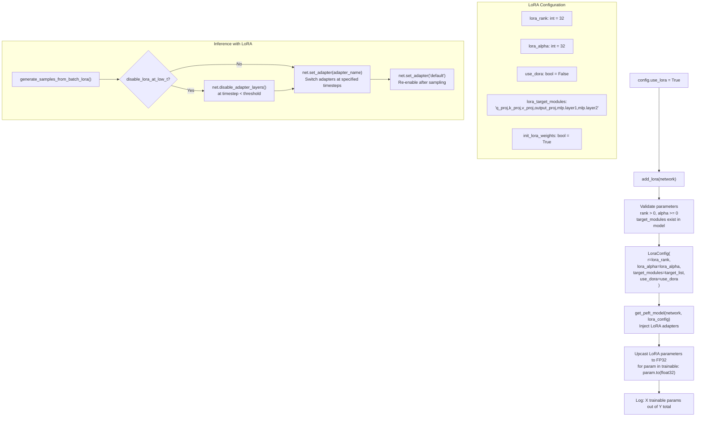

**LoRA Addition** [cosmos_predict2/_src/predict2/models/text2world_model_rectified_flow.py:1173-1264]():

The `add_lora()` method integrates PEFT library for low-rank adaptation:

1. **Validation**: Checks rank > 0, alpha >= 0, and target modules exist in model
2. **Configuration**: Creates `LoraConfig` with specified parameters
3. **Injection**: Uses `get_peft_model()` to inject LoRA adapters into target modules
4. **Upcast**: Converts LoRA parameters to FP32 for stable training
5. **Logging**: Reports trainable vs total parameter counts

**Target Modules:**

Default targets: `"q_proj,k_proj,v_proj,output_proj,mlp.layer1,mlp.layer2"` [cosmos_predict2/_src/predict2/models/text2world_model_rectified_flow.py:103]()

These correspond to:
- Attention projections (Q, K, V, output)
- MLP layers in transformer blocks

**LoRA-Aware Sampling** [cosmos_predict2/_src/predict2/models/text2world_model_rectified_flow.py:617-746]():

The `generate_samples_from_batch_lora()` method provides advanced LoRA control:

| Feature | Parameter | Description |
|---------|-----------|-------------|
| Disable at low t | `disable_lora_at_low_t=True` | Disable LoRA when `t < lora_disable_threshold_step` (default: 900) |
| Adapter switching | `adapter_switch_timesteps=[900, 700]` | Switch between multiple LoRA adapters at specified timesteps |

**Example: Multi-Adapter Switching:**

```python
# Use adapter_0 from t=1000 to t=900
# Switch to adapter_1 at t=900
# Switch to adapter_2 at t=700
samples = model.generate_samples_from_batch_lora(
    data_batch,
    adapter_switch_timesteps=[900, 700],
    ...
)
```

**Sources:** [cosmos_predict2/_src/predict2/models/text2world_model_rectified_flow.py:1173-1264](), [cosmos_predict2/_src/predict2/models/text2world_model_rectified_flow.py:617-746]()

---

## Checkpoint Management

### State Dict Structure

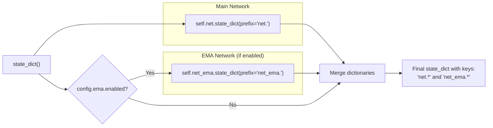

**Saving Checkpoints** [cosmos_predict2/_src/predict2/models/text2world_model_rectified_flow.py:1004-1009]():

```python
def state_dict(self) -> Dict[str, Any]:
    net_state_dict = self.net.state_dict(prefix="net.")
    if self.config.ema.enabled:
        ema_state_dict = self.net_ema.state_dict(prefix="net_ema.")
        net_state_dict.update(ema_state_dict)
    return net_state_dict
```

All network parameters are prefixed with `"net."` or `"net_ema."` to differentiate them.

**Loading Checkpoints** [cosmos_predict2/_src/predict2/models/text2world_model_rectified_flow.py:1011-1053]():

```python
def load_state_dict(self, state_dict, strict=True, assign=False):
    # Separate net and net_ema parameters
    _reg_state_dict = {k.replace("net.", ""): v 
                       for k, v in state_dict.items() 
                       if k.startswith("net.")}
    _ema_state_dict = {k.replace("net_ema.", ""): v 
                       for k, v in state_dict.items() 
                       if k.startswith("net_ema.")}
    
    if strict:
        reg_results = self.net.load_state_dict(_reg_state_dict, strict=True)
        if self.config.ema.enabled:
            ema_results = self.net_ema.load_state_dict(_ema_state_dict, strict=True)
        return _IncompatibleKeys(...)
    else:
        # Non-strict mode: warns about mismatches but doesn't error
        non_strict_load_model(self.net, _reg_state_dict)
        if self.config.ema.enabled:
            non_strict_load_model(self.net_ema, _ema_state_dict)
```

**Non-Strict Loading:**

When `strict=False`, the model uses `non_strict_load_model()` which:
- Loads matching parameters
- Warns about shape mismatches
- Continues loading remaining parameters
- Useful for partial checkpoint loading or architecture changes

**Sources:** [cosmos_predict2/_src/predict2/models/text2world_model_rectified_flow.py:1004-1053]()

---

## Utility Methods

### Core Utility Functions

| Method | Purpose | Returns |
|--------|---------|---------|
| `encode(state)` | Tokenize raw video to latent space [cosmos_predict2/_src/predict2/models/text2world_model_rectified_flow.py:1114]() | `torch.Tensor` (latent) |
| `decode(latent)` | Decode latent back to pixel space [cosmos_predict2/_src/predict2/models/text2world_model_rectified_flow.py:1118]() | `torch.Tensor` (video) |
| `denoise(noise, xt, timesteps, condition)` | Single denoising step through network [cosmos_predict2/_src/predict2/models/text2world_model_rectified_flow.py:1086]() | `torch.Tensor` (velocity) |
| `is_image_batch(data_batch)` | Determine if batch is image or video [cosmos_predict2/_src/predict2/models/text2world_model_rectified_flow.py:1072]() | `bool` |
| `get_video_height_width()` | Get video resolution from config [cosmos_predict2/_src/predict2/models/text2world_model_rectified_flow.py:1122]() | `Tuple[int, int]` |
| `get_video_latent_height_width()` | Get latent resolution [cosmos_predict2/_src/predict2/models/text2world_model_rectified_flow.py:1125]() | `Tuple[int, int]` |
| `get_num_video_latent_frames()` | Get number of latent frames [cosmos_predict2/_src/predict2/models/text2world_model_rectified_flow.py:1130]() | `int` |
| `model_param_stats()` | Count trainable parameters [cosmos_predict2/_src/predict2/models/text2world_model_rectified_flow.py:1076]() | `Dict[str, int]` |
| `clip_grad_norm_(max_norm)` | Gradient clipping [cosmos_predict2/_src/predict2/models/text2world_model_rectified_flow.py:1158]() | `float` (total norm) |

**encode() and decode()** [cosmos_predict2/_src/predict2/models/text2world_model_rectified_flow.py:1114-1120]():

Wrapper methods around the tokenizer:

```python
@torch.no_grad()
def encode(self, state: torch.Tensor) -> torch.Tensor:
    return self.tokenizer.encode(state)

@torch.no_grad()
def decode(self, latent: torch.Tensor) -> torch.Tensor:
    return self.tokenizer.decode(latent)
```

**denoise()** [cosmos_predict2/_src/predict2/models/text2world_model_rectified_flow.py:1086-1112]():

Core denoising operation that passes inputs through the network:

```python
def denoise(self, noise, xt_B_C_T_H_W, timesteps_B_T, condition):
    net_output_B_C_T_H_W = self.net(
        x_B_C_T_H_W=xt_B_C_T_H_W.to(**self.tensor_kwargs),
        timesteps_B_T=timesteps_B_T,
        **condition.to_dict(),
    ).float()
    return net_output_B_C_T_H_W
```

**Resolution Queries** [cosmos_predict2/_src/predict2/models/text2world_model_rectified_flow.py:1122-1130]():

```python
def get_video_height_width(self) -> Tuple[int, int]:
    return VIDEO_RES_SIZE_INFO[self.config.resolution]["9,16"]

def get_video_latent_height_width(self) -> Tuple[int, int]:
    height, width = VIDEO_RES_SIZE_INFO[self.config.resolution]["9,16"]
    return height // self.tokenizer.spatial_compression_factor, \
           width // self.tokenizer.spatial_compression_factor

def get_num_video_latent_frames(self) -> int:
    return self.config.state_t
```

**Gradient Clipping** [cosmos_predict2/_src/predict2/models/text2world_model_rectified_flow.py:1158-1171]():

```python
def clip_grad_norm_(self, max_norm: float, norm_type: float = 2.0):
    return clip_grad_norm_(
        self.net.parameters(),
        max_norm,
        norm_type=norm_type,
        error_if_nonfinite=False,
    )
```

Called externally to clip gradients during training for stability.

**Sources:** [cosmos_predict2/_src/predict2/models/text2world_model_rectified_flow.py:1056-1171]()

---

## Training Hooks

### Optimizer and Scheduler Integration

```mermaid
sequenceDiagram
    participant Trainer
    participant Model as Text2WorldModelRectifiedFlow
    participant Optimizer
    participant Scheduler
    participant EMAWorker
    
    Note over Trainer: Training Initialization
    Trainer->>Model: init_optimizer_scheduler(optimizer_config, scheduler_config)
    Model->>Model: optimizer = lazy_instantiate(optimizer_config, model=self.net)
    Model->>Model: scheduler = get_base_scheduler(optimizer, self, scheduler_config)
    Model-->>Trainer: (optimizer, scheduler)
    
    Note over Trainer: Training Start
    Trainer->>Model: on_train_start(memory_format)
    Model->>Model: net_ema.to(dtype=torch.float32)
    Model->>Model: net.to(memory_format, dtype=precision)
    alt use_torch_compile
        Model->>Model: net = torch.compile(net, dynamic=False)
    end
    
    Note over Trainer: Training Step
    Trainer->>Model: training_step(data_batch, iteration)
    Model-->>Trainer: (output_batch, loss)
    Trainer->>Optimizer: loss.backward()
    Trainer->>Model: clip_grad_norm_(max_norm=0.3)
    
    Note over Trainer: EMA Update Hook
    Trainer->>Model: on_before_zero_grad(optimizer, scheduler, iteration)
    Model->>Model: ema_beta = self.ema_beta(iteration)
    Model->>EMAWorker: update_average(net, net_ema, beta=ema_beta)
    
    Trainer->>Optimizer: optimizer.step()
    Trainer->>Scheduler: scheduler.step()
    Trainer->>Optimizer: optimizer.zero_grad()
```

**init_optimizer_scheduler()** [cosmos_predict2/_src/predict2/models/text2world_model_rectified_flow.py:315-329]():

Creates optimizer and scheduler for the model:

```python
def init_optimizer_scheduler(
    self, optimizer_config: LazyDict, scheduler_config: LazyDict
) -> tuple[torch.optim.Optimizer, torch.optim.lr_scheduler.LRScheduler]:
    optimizer = lazy_instantiate(optimizer_config, model=self.net)
    scheduler = get_base_scheduler(optimizer, self, scheduler_config)
    return optimizer, scheduler
```

**on_train_start()** [cosmos_predict2/_src/predict2/models/text2world_model_rectified_flow.py:345-370]():

Prepares model for training:
- Converts EMA network to FP32 for stability
- Sets network to specified memory format and precision
- Optionally compiles network with `torch.compile()` if enabled

**on_before_zero_grad()** [cosmos_predict2/_src/predict2/models/text2world_model_rectified_flow.py:332-343]():

Called before `optimizer.zero_grad()` to update EMA:

```python
def on_before_zero_grad(self, optimizer, scheduler, iteration):
    if self.config.ema.enabled:
        ema_beta = self.ema_beta(iteration)
        self.net_ema_worker.update_average(self.net, self.net_ema, beta=ema_beta)
```

**Sources:** [cosmos_predict2/_src/predict2/models/text2world_model_rectified_flow.py:315-370]()

---

## Data Preprocessing

### In-Place Normalization

```mermaid
graph TD
    DataBatch["data_batch from DataLoader"]
    
    DataBatch --> CheckPreproc{"IS_PREPROCESSED_KEY<br/>in data_batch?"}
    
    CheckPreproc -->|Yes| ValidateFloat["Validate: torch.is_floating_point()<br/>and range in [-1, 1]"]
    CheckPreproc -->|No| ValidateUint8["Validate: dtype == torch.uint8"]
    
    ValidateUint8 --> Normalize["Normalize on CUDA:<br/>(uint8 / 127.5) - 1.0"]
    Normalize --> SetFlag["data_batch[IS_PREPROCESSED_KEY] = True"]
    
    ValidateFloat --> Done["Data ready"]
    SetFlag --> Done
```

**_normalize_video_databatch_inplace()** [cosmos_predict2/_src/predict2/models/text2world_model_rectified_flow.py:953-987]():

Performs efficient on-device normalization:

```python
def _normalize_video_databatch_inplace(self, data_batch, input_key=None):
    input_key = self.input_data_key if input_key is None else input_key
    if input_key in data_batch:
        if IS_PREPROCESSED_KEY in data_batch and data_batch[IS_PREPROCESSED_KEY]:
            # Already normalized, validate range
            assert torch.all((data_batch[input_key] >= -1.0001) & 
                           (data_batch[input_key] <= 1.0001))
        else:
            # Normalize uint8 [0,255] -> float32 [-1,1]
            assert data_batch[input_key].dtype == torch.uint8
            data_batch[input_key] = data_batch[input_key].to(**self.tensor_kwargs) / 127.5 - 1.0
            data_batch[IS_PREPROCESSED_KEY] = True
```

**Key Features:**
- **In-place modification**: Avoids memory copying overhead
- **On-device processing**: Normalization happens on CUDA to avoid CPU↔GPU transfer
- **Idempotent**: Safe to call multiple times due to `IS_PREPROCESSED_KEY` check
- **Validation**: Ensures data is in expected format (uint8) and range

**_augment_image_dim_inplace()** [cosmos_predict2/_src/predict2/models/text2world_model_rectified_flow.py:989-1000]():

Adds temporal dimension to image batches:

```python
def _augment_image_dim_inplace(self, data_batch, input_key=None):
    input_key = self.input_image_key if input_key is None else input_key
    if input_key in data_batch:
        if not (IS_PREPROCESSED_KEY in data_batch and data_batch[IS_PREPROCESSED_KEY]):
            # b c h w -> b c 1 h w
            data_batch[input_key] = rearrange(data_batch[input_key], "b c h w -> b c 1 h w").contiguous()
            data_batch[IS_PREPROCESSED_KEY] = True
```

**Sources:** [cosmos_predict2/_src/predict2/models/text2world_model_rectified_flow.py:953-1000]()

---

# Page: MiniTrainDIT Network

# MiniTrainDIT Network

<details>
<summary>Relevant source files</summary>

The following files were used as context for generating this wiki page:

- [cosmos_predict2/_src/predict2/action/networks/action_conditioned_minimal_v1_lvg_dit.py](cosmos_predict2/_src/predict2/action/networks/action_conditioned_minimal_v1_lvg_dit.py)
- [cosmos_predict2/_src/predict2/networks/minimal_v4_dit.py](cosmos_predict2/_src/predict2/networks/minimal_v4_dit.py)
- [docs/DISTILL.md](docs/DISTILL.md)
- [docs/ISSUES.md](docs/ISSUES.md)

</details>


The **MiniTrainDIT Network** is the core video transformer backbone of the DreamDojo model architecture. This document details the implementation of the DiT (Diffusion Transformer) video processing network, including its block structure, attention mechanisms, positional embeddings, and various optimization strategies.

For information about how MiniTrainDIT integrates with the diffusion process, see [Text2World Model](#3.1). For details on the VAE tokenizer that preprocesses inputs before MiniTrainDIT, see [Tokenizer and Conditioning](#3.4).

---

## Architecture Overview

The `MiniTrainDIT` class implements a video transformer architecture with the following key characteristics:

- **Patch-based processing**: Videos are divided into spatio-temporal patches (16×16 spatial, 1-4 temporal) [cosmos_predict2/_src/predict2/networks/minimal_v4_dit.py:979-1046]().
- **Transformer blocks**: Configurable number of blocks (default 24). Each block contains self-attention, cross-attention, and MLP sublayers [cosmos_predict2/_src/predict2/networks/minimal_v4_dit.py:1131-1383]().
- **AdaLN modulation**: Adaptive Layer Normalization conditioned on timestep embeddings and optional LoRA [cosmos_predict2/_src/predict2/networks/minimal_v4_dit.py:1200-1221]().
- **Multi-backend attention**: Supports 5 attention implementations: `transformer_engine`, `torch`, `torch-flex`, `minimal_a2a`, and `i4` [cosmos_predict2/_src/predict2/networks/minimal_v4_dit.py:439-486]().
- **3D positional embeddings**: RoPE3D or learnable axis-wise embeddings [cosmos_predict2/_src/predict2/networks/minimal_v4_dit.py:672-853]().
- **Model sizes**: Typically 2B parameters (1024 hidden dim, 16 heads) or 14B parameters (2048 hidden dim, 32 heads) [cosmos_predict2/_src/predict2/networks/minimal_v4_dit.py:1447-1490]().

**Sources**: [cosmos_predict2/_src/predict2/networks/minimal_v4_dit.py:1386-1490]()

---

## Component Architecture

### Data Flow and Entity Mapping
The following diagram bridges the high-level video processing flow with specific code entities and class names used in the implementation.

Title: MiniTrainDIT Processing Pipeline
```mermaid
graph TB
    subgraph "Input Processing"
        Input["Video Input<br/>B×C×T×H×W"]
        PaddingMask["Padding Mask<br/>Optional"]
        Concat["Concatenate Mask<br/>if concat_padding_mask"]
    end
    
    subgraph "Patch Embedding"
        PatchEmbed["PatchEmbed<br/>x_embedder<br/>Line 1620-1625"]
        SpatialPatch["spatial_patch_size: 16"]
        TemporalPatch["temporal_patch_size: 1-4"]
        PatchOut["B×T'×H'×W'×D<br/>D=model_channels"]
    end
    
    subgraph "Positional Embedding"
        PosEmbType{"pos_emb_cls"}
        RoPE["VideoRopePosition3DEmb<br/>pos_embedder<br/>Line 672-801"]
        Learnable["LearnablePosEmbAxis<br/>Line 803-853"]
        ExtraPos["extra_pos_embedder<br/>Optional per-block"]
        RoPEOut["RoPE Embeddings<br/>L×1×1×D"]
        AddPos["Add Position<br/>if not RoPE"]
    end
    
    subgraph "Timestep Processing"
        Timestep["timesteps_B_T"]
        SinCos["Timesteps<br/>Sinusoidal Encoding<br/>Line 860-881"]
        TEmbedding["TimestepEmbedding<br/>Line 884-921"]
        TNorm["RMSNorm<br/>t_embedding_norm<br/>Line 1559"]
        TEmbOut["t_embedding_B_T_D"]
        LoRAOut["adaln_lora_B_T_3D<br/>if use_adaln_lora"]
    end
    
    subgraph "Cross-Attention Context"
        CrossAttnIn["crossattn_emb<br/>B×N×D"]
        CrossProj["crossattn_proj<br/>Optional projection<br/>Line 1569-1572"]
        ImgContext["img_context_emb<br/>Optional I2V context"]
        ImgProj["img_context_proj<br/>Line 1561-1566"]
    end
    
    subgraph "Transformer Blocks"
        Blocks["blocks: ModuleList<br/>num_blocks=24<br/>Line 1532-1547"]
        Block1["Block 0<br/>Line 1131-1383"]
        BlockN["Block N"]
    end
    
    subgraph "Output Processing"
        FinalLayer["FinalLayer<br/>Line 1549-1557"]
        Unpatchify["unpatchify<br/>Line 1711-1719"]
        Output["B×C×T×H×W"]
    end
    
    Input --> Concat
    PaddingMask --> Concat
    Concat --> PatchEmbed
    PatchEmbed --> PatchOut
    
    PatchOut --> PosEmbType
    PosEmbType -->|"rope3d"| RoPE
    PosEmbType -->|"other"| Learnable
    RoPE --> RoPEOut
    Learnable --> AddPos
    AddPos --> PatchOut
    
    ExtraPos -.->|"if extra_per_block_abs_pos_emb"| Blocks
    
    Timestep --> SinCos
    SinCos --> TEmbedding
    TEmbedding --> TEmbOut
    TEmbedding --> LoRAOut
    TEmbOut --> TNorm
    
    CrossAttnIn --> CrossProj
    ImgContext --> ImgProj
    
    PatchOut --> Blocks
    RoPEOut -.->|"rope_emb"| Blocks
    TNorm --> Blocks
    LoRAOut -.-> Blocks
    CrossProj --> Blocks
    ImgProj -.-> Blocks
    
    Blocks --> Block1
    Block1 --> BlockN
    BlockN --> FinalLayer
    
    TNorm --> FinalLayer
    LoRAOut -.-> FinalLayer
    FinalLayer --> Unpatchify
    Unpatchify --> Output
```

**Sources**: [cosmos_predict2/_src/predict2/networks/minimal_v4_dit.py:1386-1807](), [cosmos_predict2/_src/predict2/networks/minimal_v4_dit.py:1605-1660](), [cosmos_predict2/_src/predict2/networks/minimal_v4_dit.py:1721-1807]()

---

## MiniTrainDIT Class

The `MiniTrainDIT` class [cosmos_predict2/_src/predict2/networks/minimal_v4_dit.py:1386]() is the main entry point for the video transformer network.

### Initialization Parameters

| Parameter Category | Key Parameters | Description |
|-------------------|----------------|-------------|
| **Input Dimensions** | `max_img_h`, `max_img_w`, `max_frames` | Maximum spatial and temporal dimensions (e.g., 480×640×49). |
| **Patch Configuration** | `patch_spatial=16`, `patch_temporal=1` | Patch sizes for spatio-temporal tokenization [cosmos_predict2/_src/predict2/networks/minimal_v4_dit.py:1447](). |
| **Channels** | `in_channels`, `out_channels`, `model_channels` | Input channels (4 for VAE latents), output channels, hidden dimension (1024 for 2B, 2048 for 14B) [cosmos_predict2/_src/predict2/networks/minimal_v4_dit.py:1451-1453](). |
| **Architecture** | `num_blocks=24`, `num_heads=16`, `mlp_ratio=4.0` | Transformer hyperparameters [cosmos_predict2/_src/predict2/networks/minimal_v4_dit.py:1455-1457](). |
| **Attention Backend** | `atten_backend` | One of: `transformer_engine`, `torch`, `torch-flex`, `minimal_a2a`, `i4` [cosmos_predict2/_src/predict2/networks/minimal_v4_dit.py:1462](). |
| **Positional Embeddings** | `pos_emb_cls`, `rope_h/w/t_extrapolation_ratio` | Type (`rope3d`), extrapolation ratios for resolution scaling [cosmos_predict2/_src/predict2/networks/minimal_v4_dit.py:1473-1478](). |
| **AdaLN-LoRA** | `use_adaln_lora`, `adaln_lora_dim=256` | Enable low-rank adaptation in AdaLN modulation [cosmos_predict2/_src/predict2/networks/minimal_v4_dit.py:1484-1485](). |

**Sources**: [cosmos_predict2/_src/predict2/networks/minimal_v4_dit.py:1447-1490]()

### Action Conditioning
In robot-specific models, `ActionConditionedMinimalV1LVGDiT` extends `MiniTrainDIT` to inject action embeddings into the timestep and AdaLN-LoRA streams [cosmos_predict2/_src/predict2/action/networks/action_conditioned_minimal_v1_lvg_dit.py:47-65]().

- **Action Embedder**: Uses MLP to map actions to `model_channels` [cosmos_predict2/_src/predict2/action/networks/action_conditioned_minimal_v1_lvg_dit.py:68-81]().
- **Integration**: Action embeddings are added to `t_embedding_B_T_D` and `adaln_lora_B_T_3D` before block processing [cosmos_predict2/_src/predict2/action/networks/action_conditioned_minimal_v1_lvg_dit.py:142-143]().

**Sources**: [cosmos_predict2/_src/predict2/action/networks/action_conditioned_minimal_v1_lvg_dit.py:47-143]()

---

## Block Structure

Each transformer `Block` [cosmos_predict2/_src/predict2/networks/minimal_v4_dit.py:1131]() implements the DiT architecture with three sublayers, each using AdaLN modulation.

Title: Transformer Block Internal Flow
```mermaid
graph TB
    subgraph "Block Sublayers"
        Input["x_B_T_H_W_D"]
        
        subgraph "Self-Attention Path"
            ModSelf["adaln_modulation_self_attn<br/>Line 1218"]
            SelfAttn["self_attn: Attention<br/>Line 1170-1178"]
            AddSelf["x + gated_result"]
        end
        
        subgraph "Cross-Attention Path"
            ModCross["adaln_modulation_cross_attn<br/>Line 1219"]
            CrossAttn["cross_attn: Attention<br/>Line 1183-1195"]
            AddCross["x + gated_result"]
        end
        
        subgraph "MLP Path"
            ModMLP["adaln_modulation_mlp<br/>Line 1220"]
            MLP["mlp: GPT2FeedForward<br/>Line 1198"]
            AddMLP["x + gated_result"]
        end
        
        Output["x_B_T_H_W_D"]
    end
    
    Input --> ModSelf
    ModSelf --> SelfAttn
    SelfAttn --> AddSelf
    
    AddSelf --> ModCross
    ModCross --> CrossAttn
    CrossAttn --> AddCross
    
    AddCross --> ModMLP
    ModMLP --> MLP
    MLP --> AddMLP
    
    AddMLP --> Output
```

### AdaLN Modulation
Each sublayer produces shift, scale, and gate parameters from the timestep embedding [cosmos_predict2/_src/predict2/networks/minimal_v4_dit.py:1258-1383]().
- **Normalization**: `LayerNorm(x) * (1 + scale) + shift` [cosmos_predict2/_src/predict2/networks/minimal_v4_dit.py:1271-1289]().
- **Gating**: The sublayer output is multiplied by a gate parameter before the residual connection [cosmos_predict2/_src/predict2/networks/minimal_v4_dit.py:1301]().

**Sources**: [cosmos_predict2/_src/predict2/networks/minimal_v4_dit.py:1131-1383]()

---

## Attention Mechanisms

The `Attention` class [cosmos_predict2/_src/predict2/networks/minimal_v4_dit.py:389]() provides a multi-backend implementation.

### Backends
1. **`transformer_engine`**: NVIDIA's optimized CUDA kernels for DotProductAttention [cosmos_predict2/_src/predict2/networks/minimal_v4_dit.py:466]().
2. **`torch`**: Standard `scaled_dot_product_attention` [cosmos_predict2/_src/predict2/networks/minimal_v4_dit.py:471]().
3. **`torch-flex`**: Uses `flex_attention` with block masks for sparse patterns [cosmos_predict2/_src/predict2/networks/minimal_v4_dit.py:474]().
4. **`minimal_a2a`**: All-to-all communication for Context Parallelism (CP) [cosmos_predict2/_src/predict2/networks/minimal_v4_dit.py:478]().
5. **`i4`**: Custom spatio-temporal attention [cosmos_predict2/_src/predict2/networks/minimal_v4_dit.py:482]().

### Sparse Attention via NeighborhoodAttention
For very long sequences, dense self-attention can be replaced with sparse Neighborhood Attention (NATTEN) [cosmos_predict2/_src/predict2/networks/minimal_v4_dit.py:1887]().
- **`n_dense_blocks`**: Determines how many blocks remain dense [cosmos_predict2/_src/predict2/networks/minimal_v4_dit.py:1887]().
- **`natten_parameters`**: Configures `window_size`, `stride`, and `dilation` for the neighborhood window [cosmos_predict2/_src/predict2/networks/minimal_v4_dit.py:1420-1445]().

**Sources**: [cosmos_predict2/_src/predict2/networks/minimal_v4_dit.py:389-581](), [cosmos_predict2/_src/predict2/networks/minimal_v4_dit.py:1887-1957]()

---

## Positional Embeddings

### VideoRopePosition3DEmb (RoPE3D)
The default 3D Rotary Positional Embedding [cosmos_predict2/_src/predict2/networks/minimal_v4_dit.py:672]().
- **Axis Partitioning**: Splits head dimension into temporal, height, and width components [cosmos_predict2/_src/predict2/networks/minimal_v4_dit.py:731-750]().
- **NTK Scaling**: Supports resolution extrapolation via NTK factors [cosmos_predict2/_src/predict2/networks/minimal_v4_dit.py:752-760]().
- **FPS Awareness**: Temporal frequencies are scaled by video FPS [cosmos_predict2/_src/predict2/networks/minimal_v4_dit.py:771-784]().

### LearnablePosEmbAxis
A learnable alternative maintaining separate parameters for each axis [cosmos_predict2/_src/predict2/networks/minimal_v4_dit.py:803]().
- `pos_emb_h`, `pos_emb_w`, `pos_emb_t` are summed and normalized before addition to patch tokens [cosmos_predict2/_src/predict2/networks/minimal_v4_dit.py:825-840]().

**Sources**: [cosmos_predict2/_src/predict2/networks/minimal_v4_dit.py:672-853]()

---

## Memory Optimization

### Selective Activation Checkpointing (SAC)
DreamDojo uses fine-grained policies to balance memory and compute [cosmos_predict2/_src/predict2/networks/minimal_v4_dit.py:197]().

| Mode | Policy Logic |
|------|--------------|
| `PREDICT2_2B_720` | Saves matrix multiplications and flash attention outputs selectively to optimize for 2B models [cosmos_predict2/_src/predict2/networks/minimal_v4_dit.py:69-89](). |
| `AGGRESSIVE` | Recomputes everything except Flash Attention outputs [cosmos_predict2/_src/predict2/networks/minimal_v4_dit.py:92-110](). |
| `AGGRESSIVE_V2` | Recomputes all operations for maximum memory savings [cosmos_predict2/_src/predict2/networks/minimal_v4_dit.py:113-124](). |

### Context Parallelism (CP)
Enables splitting long sequences across multiple GPUs [cosmos_predict2/_src/predict2/networks/minimal_v4_dit.py:1865]().
- **Workflow**: Embeddings are generated for the full sequence, then split using `split_inputs_cp` [cosmos_predict2/_src/predict2/networks/minimal_v4_dit.py:668]().
- **Attention**: The `minimal_a2a` backend manages communication between CP ranks [cosmos_predict2/_src/predict2/networks/minimal_v4_dit.py:478]().

**Sources**: [cosmos_predict2/_src/predict2/networks/minimal_v4_dit.py:69-215](), [cosmos_predict2/_src/predict2/networks/minimal_v4_dit.py:1809-1884]()

---

# Page: Latent Action Model (LAM)

# Latent Action Model (LAM)

<details>
<summary>Relevant source files</summary>

The following files were used as context for generating this wiki page:

- [docs/LAM.md](docs/LAM.md)
- [external/lam_project/config/lam_0.yaml](external/lam_project/config/lam_0.yaml)
- [external/lam_project/test.sh](external/lam_project/test.sh)
- [external/lam_project/train.sh](external/lam_project/train.sh)
- [install.sh](install.sh)

</details>


## Purpose and Scope

The Latent Action Model (LAM) is a specialized subsystem designed to extract compact 32-dimensional latent action representations from video sequences. These learned latent actions augment explicit robot action inputs (such as joint positions or gripper states), enabling the DreamDojo model to capture implicit motion patterns and dynamics that are difficult to represent in standard explicit action spaces.

This page documents the LAM architecture, training procedures, and its integration into the main Text2World model forward pass.

**Sources:** [docs/LAM.md:1-3](), [external/lam_project/config/lam_0.yaml:4-5]()

---

## System Role

The LAM operates as an independent component in the DreamDojo pipeline. It is first trained as a Video VAE to reconstruct frame transitions, and subsequently, its encoder is used as a frozen feature extractor during the training of the main Text2World model.

```mermaid
graph LR
    subgraph "LAM Training Phase"
        VideoData["Robot Video Data<br/>external/lam_project/main.py"]
        LAMTrain["LAM Training<br/>Beta-VAE Reconstruction"]
        LAMCkpt["LAM Checkpoint<br/>32-dim latent encoder"]
    end
    
    subgraph "DreamDojo Training/Inference"
        MainModel["Text2WorldModelRectifiedFlow"]
        LAMEncoder["Frozen LAM Encoder<br/>LatentActionModel"]
        ActionSpace["384-dim Action Space<br/>[352-384]: Latent actions"]
        VideoInput["Input Video Frames<br/>(t, t+1)"]
    end
    
    VideoData --> LAMTrain
    LAMTrain --> LAMCkpt
    LAMCkpt --> LAMEncoder
    
    VideoInput --> LAMEncoder
    LAMEncoder --> ActionSpace
    ActionSpace --> MainModel
```

**Diagram: LAM in the DreamDojo Ecosystem**

**Sources:** [docs/LAM.md:1-19](), [external/lam_project/config/lam_0.yaml:22-26]()

---

## Architecture

### Model Structure

The LAM implements an encoder-decoder architecture based on Vision Transformers (ViT) with a bottleneck latent space. It is configured as a Variational Autoencoder (VAE) using a KL loss term.

```mermaid
graph TB
    subgraph "Input Processing"
        VideoFrames["Video Frames<br/>2 consecutive frames<br/>(t, t+1)"]
        PatchEmbed["Patch Embedding<br/>lam_patch_size: 16"]
    end
    
    subgraph "Encoder: LatentActionModel"
        EncBlocks["24 Encoder Blocks<br/>lam_model_dim: 1024<br/>lam_num_heads: 16"]
        Bottleneck["Latent Bottleneck<br/>lam_latent_dim: 32<br/>VAE KL Loss (beta=1e-6)"]
    end
    
    subgraph "Decoder"
        DecBlocks["24 Decoder Blocks<br/>lam_model_dim: 1024"]
        Reconstruct["Reconstruction<br/>Output Frame (t+1)"]
    end
    
    VideoFrames --> PatchEmbed
    PatchEmbed --> EncBlocks
    EncBlocks --> Bottleneck
    Bottleneck --> DecBlocks
    DecBlocks --> Reconstruct
```

**Diagram: LAM Encoder-Decoder Architecture**

**Sources:** [external/lam_project/config/lam_0.yaml:4-11]()

### Architecture Parameters

The LAM configuration defines the following key hyperparameters:

| Parameter | Value | Description |
|-----------|-------|-------------|
| `lam_model_dim` | 1024 | Hidden dimension of transformer blocks [external/lam_project/config/lam_0.yaml:4]() |
| `lam_latent_dim` | 32 | Dimensionality of latent action space [external/lam_project/config/lam_0.yaml:5]() |
| `lam_patch_size` | 16 | Spatial patch size (16x16 pixels) [external/lam_project/config/lam_0.yaml:6]() |
| `lam_enc_blocks` | 24 | Number of encoder transformer blocks [external/lam_project/config/lam_0.yaml:7]() |
| `lam_dec_blocks` | 24 | Number of decoder transformer blocks [external/lam_project/config/lam_0.yaml:8]() |
| `lam_num_heads` | 16 | Number of attention heads per block [external/lam_project/config/lam_0.yaml:9]() |
| `beta` | 1e-6 | Beta parameter for VAE KL regularization [external/lam_project/config/lam_0.yaml:11]() |

**Sources:** [external/lam_project/config/lam_0.yaml:4-11]()

---

## Training Procedure

### Data Configuration

The LAM is trained on pairs of consecutive video frames extracted from robot datasets. The model learns to encode the transition between frames into the 32-dimensional latent space.

| Parameter | Value | Description |
|-----------|-------|-------------|
| `batch_size` | 20 | Samples per GPU [external/lam_project/config/lam_0.yaml:21]() |
| `num_frames` | 2 | Consecutive frames per sample [external/lam_project/config/lam_0.yaml:26]() |
| `output_format` | `t h w c` | Tensor dimension ordering [external/lam_project/config/lam_0.yaml:27]() |
| `sampling_strategy` | `dataset` | Per-dataset sampling logic [external/lam_project/config/lam_0.yaml:29]() |

The `dataset_paths` field in the configuration is used to point to robot video folders (e.g., GR1_robot). The training script recursively searches these folders for MP4 videos [docs/LAM.md:3](), [external/lam_project/config/lam_0.yaml:22-23]().

**Sources:** [external/lam_project/config/lam_0.yaml:20-29](), [docs/LAM.md:3]()

### Training Execution

Training is managed via PyTorch Lightning and launched using `torchrun`.

**Single-Node Training (8 GPUs):**
```bash
cd external/lam_project
bash train.sh
```
The [external/lam_project/train.sh:3-8]() script executes `main.py fit` with the `lam_0.yaml` configuration, using `16-mixed` precision and `ddp_find_unused_parameters_false` strategy [external/lam_project/config/lam_0.yaml:36-37]().

**Multi-Node Training:**
A multi-node example is provided in `external/lam_project/launch.sh` [docs/LAM.md:12-15]().

**Sources:** [external/lam_project/train.sh:1-8](), [docs/LAM.md:5-16](), [external/lam_project/config/lam_0.yaml:31-40]()

### Optimizer Settings

The LAM uses the AdamW optimizer with a learning rate of 2.5e-5 and weight decay of 1e-2 [external/lam_project/config/lam_0.yaml:14-18](). Gradients are clipped at 0.3 [external/lam_project/config/lam_0.yaml:40]().

**Sources:** [external/lam_project/config/lam_0.yaml:14-18,40]()

---

## Integration with Text2World

### Integration Flow

The trained LAM encoder is integrated into the `Text2WorldModelRectifiedFlow` forward pass to provide "proxy actions."

```mermaid
graph TB
    subgraph "Data Loading"
        VideoBatch["Video Batch<br/>(B, T, C, H, W)"]
    end
    
    subgraph "LAM Inference (Frozen)"
        PairFrames["Select Frame Pairs<br/>(t, t+1)"]
        LAM_Enc["LatentActionModel Encoder"]
        LatentActions["Latent Actions<br/>(B, T, 32)"]
    end
    
    subgraph "Action Assembly"
        ExplicitActions["Explicit Robot Actions<br/>(B, T, 352)"]
        Concat["Concatenate Dims"]
        UnifiedActions["Unified Action Vector<br/>(B, T, 384)"]
    end
    
    subgraph "Text2World Forward"
        DiT["MiniTrainDIT<br/>Rectified Flow"]
    end
    
    VideoBatch --> PairFrames
    PairFrames --> LAM_Enc
    LAM_Enc --> LatentActions
    
    ExplicitActions --> Concat
    LatentActions --> Concat
    Concat --> UnifiedActions
    UnifiedActions --> DiT
```

**Diagram: LAM Integration in Text2World Forward Pass**

**Sources:** [docs/LAM.md:19](), High-level system architecture (Section 3.1, 4.2.1)

### Checkpoint Loading

The LAM checkpoint path is specified within the `Text2WorldModelRectifiedFlow` implementation to load the encoder weights for proxy action extraction [docs/LAM.md:19](). Pretrained weights are hosted on Hugging Face at `nvidia/DreamDojo` [docs/LAM.md:19]().

For testing the LAM independently of the main model, the [external/lam_project/test.sh:3-6]() script can be used to evaluate a specific checkpoint against a config.

**Sources:** [docs/LAM.md:19](), [external/lam_project/test.sh:3-6]()

---

## Checkpoint and Logging

The training process produces several outputs:

*   **Checkpoints**: Saved in `exp_ckpts/`. The system saves the last checkpoint and all intermediate top-k checkpoints [external/lam_project/config/lam_0.yaml:45-48]().
*   **Logs**: TensorBoard logs are stored in `exp_logs/` [external/lam_project/config/lam_0.yaml:53-54]().
*   **Visualizations**: Reconstruction samples are saved to `exp_imgs/` every 1000 steps [external/lam_project/config/lam_0.yaml:12-13]().

**Sources:** [external/lam_project/config/lam_0.yaml:12-13,42-55]()

---

# Page: Tokenizer and Conditioning

# Tokenizer and Conditioning

<details>
<summary>Relevant source files</summary>

The following files were used as context for generating this wiki page:

- [cosmos_predict2/_src/predict2/tokenizers/wan2pt1.py](cosmos_predict2/_src/predict2/tokenizers/wan2pt1.py)
- [cosmos_predict2/action_conditioned_config.py](cosmos_predict2/action_conditioned_config.py)

</details>


This page documents the tokenization and conditioning subsystems in DreamDojo's architecture. The **BaseVAE tokenizer** compresses raw video/image data into a latent representation for efficient diffusion processing, while the **Text2WorldCondition** module processes text captions and robot actions to guide the generation process. These components bridge the gap between raw inputs (pixels, text, actions) and the internal representations used by the diffusion model.

For information about the MiniTrainDIT network that processes these latent representations, see [MiniTrainDIT Network](#3.2). For details on the LAM subsystem that extracts latent actions, see [Latent Action Model (LAM)](#3.3). For the overall model architecture, see [Text2World Model](#3.1).

---

## Overview

The tokenization and conditioning pipeline transforms multiple input modalities into representations suitable for the diffusion model:

```mermaid
graph LR
    subgraph Inputs
        RawVideo["Raw Video<br/>B×C×T×H×W<br/>uint8"]
        TextCaption["Text Caption<br/>ai_caption"]
        RobotActions["Robot Actions<br/>384-dim"]
        LAM_Input["LAM Video<br/>For latent extraction"]
    end
    
    subgraph "Tokenizer: BaseVAE / WanVAE"
        Encode["encode()<br/>Spatial+Temporal<br/>Compression"]
        LatentSpace["Latent State<br/>B×16×T'×H'×W'<br/>float32"]
        Decode["decode()<br/>Reconstruction"]
    end
    
    subgraph "Text Encoder"
        TextEncoderModule["TextEncoder<br/>T5/umT5/reason1"]
        TextEmb["Text Embeddings<br/>B×L×D"]
    end
    
    subgraph "LAM Processing"
        LAM["LAM.lam()<br/>external/lam"]
        LatentAction["z_rep<br/>32-dim latent"]
    end
    
    subgraph "Conditioner: Text2WorldCondition"
        ConditionerModule["Text2WorldCondition<br/>Combines text + actions"]
        CondOutput["Cross-Attention<br/>Embeddings"]
        UnCondOutput["Unconditioned<br/>Embeddings"]
    end
    
    RawVideo --> Encode
    Encode --> LatentSpace
    LatentSpace --> Decode
    
    TextCaption --> TextEncoderModule
    TextEncoderModule --> TextEmb
    
    LAM_Input --> LAM
    LAM --> LatentAction
    LatentAction --> RobotActions
    
    TextEmb --> ConditionerModule
    RobotActions --> ConditionerModule
    ConditionerModule --> CondOutput
    ConditionerModule --> UnCondOutput
    
    LatentSpace -.used by.-> DIT["MiniTrainDIT<br/>Network"]
    CondOutput -.guides.-> DIT
```

**Sources:** [cosmos_predict2/_src/predict2/models/text2world_model_rectified_flow.py:54-65](), [cosmos_predict2/_src/predict2/models/text2world_model_rectified_flow.py:156-189](), [cosmos_predict2/_src/predict2/models/text2world_model_rectified_flow.py:269-270]()

---

## BaseVAE and WanVAE Tokenizers

DreamDojo supports multiple tokenizer backends, including the standard `BaseVAE` and the `WanVAE` variants (wan2pt1 and wan2pt2). These tokenizers are responsible for compressing raw video/image tensors into a compressed latent representation and decoding them back to pixel space.

### WanVAE Implementation

The `WanVAE` tokenizer (used in `wan2pt1.py`) implements a causal 3D convolutional architecture for temporal and spatial compression.

*   **Causal 3D Convolutions**: The `CausalConv3d` class [cosmos_predict2/_src/predict2/tokenizers/wan2pt1.py:44-62]() ensures that the convolution only looks at past frames, which is critical for causal video generation. It uses a custom padding strategy [cosmos_predict2/_src/predict2/tokenizers/wan2pt1.py:51-52]() and supports caching for efficient inference [cosmos_predict2/_src/predict2/tokenizers/wan2pt1.py:54-62]().
*   **Resampling**: The `Resample` module [cosmos_predict2/_src/predict2/tokenizers/wan2pt1.py:88-162]() handles upsampling and downsampling. It supports both 2D (spatial) and 3D (spatio-temporal) modes.
*   **RMS Norm**: Uses `RMS_norm` [cosmos_predict2/_src/predict2/tokenizers/wan2pt1.py:65-78]() for stable feature normalization during the encoding/decoding process.

### Initialization and Configuration

The tokenizer is instantiated during model initialization via `lazy_instantiate()` [cosmos_predict2/_src/predict2/models/text2world_model_rectified_flow.py:158]().

```mermaid
graph TD
    Config["Text2WorldModelRectifiedFlowConfig<br/>tokenizer: LazyDict"]
    Init["__init__()<br/>Line 127-189"]
    Instantiate["lazy_instantiate()<br/>Line 158"]
    TokenizerObj["Tokenizer instance<br/>self.tokenizer"]
    Validation["Validate latent_ch<br/>Line 159-161"]
    
    Config --> Init
    Init --> Instantiate
    Instantiate --> TokenizerObj
    TokenizerObj --> Validation
```

| Property | Description | Configuration Reference |
|----------|-------------|------------------------|
| `latent_ch` | Number of latent channels (must match `config.state_ch`, typically 16) | [cosmos_predict2/_src/predict2/models/text2world_model_rectified_flow.py:159-161]() |
| `spatial_compression_factor` | Spatial downsampling ratio (e.g., 16×16 patches) | [cosmos_predict2/_src/predict2/models/text2world_model_rectified_flow.py:549-659]() |
| Temporal compression | Maps `T` frames to `T'` latent frames via `get_latent_num_frames()` | [cosmos_predict2/_src/predict2/models/text2world_model_rectified_flow.py:548-658]() |

---

## Text2WorldCondition Module

The `Text2WorldCondition` class processes conditioning information (text and actions) to guide the diffusion process via cross-attention.

### Conditioner Architecture

```mermaid
graph TB
    subgraph "Input Processing"
        DataBatch["data_batch dict<br/>ai_caption, action, etc."]
        TextKey["input_caption_key<br/>default: ai_caption"]
        ActionKey["action key<br/>384-dim robot actions"]
    end
    
    subgraph "Text Processing"
        OnlineCheck{"compute_online?"}
        PrecomputedEmb["Precomputed<br/>t5_text_embeddings"]
        TextEncoder["TextEncoder<br/>T5/umT5/reason1"]
        OnlineEmb["Online computation<br/>Lines 858-861"]
        TextEmbedding["Text Embeddings<br/>B×L×D"]
    end
    
    subgraph "Action Processing"
        ActionTensor["Robot Actions<br/>B×T×384"]
        LAM_Processing["LAM Processing<br/>Lines 863-869"]
        LatentActions["Latent Actions<br/>32-dim z_rep"]
        AugmentedActions["Augmented Actions<br/>action[:,:,-32:] *= z_rep"]
    end
    
    subgraph "Conditioner Output"
        ConditionerCall["conditioner(data_batch)<br/>Line 949"]
        Text2WorldCond["Text2WorldCondition<br/>object"]
        EditDataType["edit_data_type()<br/>IMAGE or VIDEO"]
        ConditionedOutput["Conditioned state<br/>for cross-attention"]
        UnconditionedOutput["Unconditioned state<br/>for CFG"]
    end
    
    DataBatch --> TextKey
    DataBatch --> ActionKey
    
    TextKey --> OnlineCheck
    OnlineCheck -->|Yes| TextEncoder
    OnlineCheck -->|No| PrecomputedEmb
    TextEncoder --> OnlineEmb
    OnlineEmb --> TextEmbedding
    PrecomputedEmb --> TextEmbedding
    
    ActionKey --> ActionTensor
    ActionTensor --> LAM_Processing
    LAM_Processing --> LatentActions
    LatentActions --> AugmentedActions
    
    TextEmbedding --> ConditionerCall
    AugmentedActions --> ConditionerCall
    ConditionerCall --> Text2WorldCond
    Text2WorldCond --> EditDataType
    EditDataType --> ConditionedOutput
    EditDataType --> UnconditionedOutput
```

**Sources:** [cosmos_predict2/_src/predict2/models/text2world_model_rectified_flow.py:54](), [cosmos_predict2/_src/predict2/models/text2world_model_rectified_flow.py:269-272](), [cosmos_predict2/_src/predict2/models/text2world_model_rectified_flow.py:856-872]()

### Action-Conditioned Setup and Inference

Conditioning for robot actions is governed by `ActionConditionedSetupArguments` and `ActionConditionedInferenceArguments`.

*   **Setup Arguments**: Defines the default configuration file [cosmos_predict2/action_conditioned_config.py:39](), dataset paths [cosmos_predict2/action_conditioned_config.py:49](), and checkpoint directories [cosmos_predict2/action_conditioned_config.py:45]().
*   **Inference Arguments**: Controls runtime parameters such as `chunk_size` [cosmos_predict2/action_conditioned_config.py:65](), `guidance` [cosmos_predict2/action_conditioned_config.py:67](), and the number of latent conditional frames [cosmos_predict2/action_conditioned_config.py:100]().
*   **Action Loading**: The `ActionLoadFn` protocol [cosmos_predict2/action_conditioned_config.py:32-33]() defines the interface for loading robot actions from dataset metadata.

| Parameter | Default | Description |
|-----------|---------|-------------|
| `gripper_key` | `"continuous_gripper_state"` | Key for gripper state in JSON data [cosmos_predict2/action_conditioned_config.py:83-84]() |
| `state_key` | `"state"` | Key for robot state in JSON data [cosmos_predict2/action_conditioned_config.py:85-86]() |
| `zero_actions` | `False` | Whether to zero out actions for unconditional testing [cosmos_predict2/action_conditioned_config.py:97-98]() |
| `num_latent_conditional_frames` | `1` | Number of frames used for latent conditioning [cosmos_predict2/action_conditioned_config.py:100-101]() |

**Sources:** [cosmos_predict2/action_conditioned_config.py:36-105]()

---

## Integration with Diffusion Process

### Training Forward Pass

```mermaid
graph TB
    DataBatch["data_batch<br/>from DataLoader"]
    
    TextEmbed["Compute text embeddings<br/>Lines 858-861"]
    LAM_Process["LAM latent extraction<br/>Lines 863-869"]
    
    GetDataCond["get_data_and_condition()<br/>Line 872"]
    
    Normalize["_normalize_video_databatch_inplace()<br/>Lines 940"]
    Augment["_augment_image_dim_inplace()<br/>Line 941"]
    
    Encode["tokenizer.encode(raw_state)<br/>Line 946"]
    Conditioner["conditioner(data_batch)<br/>Line 949"]
    
    LatentState["latent_state<br/>B×16×T'×H'×W'"]
    Condition["Text2WorldCondition<br/>object"]
    
    RectifiedFlow["rectified_flow processing<br/>Lines 875-909"]
    DenoiseFn["denoise()<br/>Line 911-916"]
    Loss["MSE loss + motion<br/>consistency loss<br/>Lines 919-927"]
    
    DataBatch --> TextEmbed
    TextEmbed --> DataBatch
    DataBatch --> LAM_Process
    LAM_Process --> DataBatch
    
    DataBatch --> GetDataCond
    GetDataCond --> Normalize
    Normalize --> Augment
    Augment --> Encode
    Augment --> Conditioner
    
    Encode --> LatentState
    Conditioner --> Condition
    
    LatentState --> RectifiedFlow
    Condition --> RectifiedFlow
    RectifiedFlow --> DenoiseFn
    DenoiseFn --> Loss
```

**Sources:** [cosmos_predict2/_src/predict2/models/text2world_model_rectified_flow.py:856-937]()

---

## Key Methods Reference

### Text2WorldModelRectifiedFlow Methods

| Method | Purpose | Returns |
|--------|---------|---------|
| `encode(state)` | Compress video to latent space | `Tensor` (latent state) |
| `decode(latent)` | Reconstruct video from latent | `Tensor` (pixel video) |
| `get_data_and_condition(data_batch)` | Process inputs for training/sampling | `(raw_state, latent_state, condition)` |
| `get_velocity_fn_from_batch(data_batch, guidance)` | Create CFG-enabled velocity function | `Callable` |
| `_normalize_video_databatch_inplace(data_batch)` | Convert uint8 to normalized float32 | None (in-place) |
| `_augment_image_dim_inplace(data_batch)` | Add temporal dimension to images | None (in-place) |

**Sources:** [cosmos_predict2/_src/predict2/models/text2world_model_rectified_flow.py:939-1000](), [cosmos_predict2/_src/predict2/models/text2world_model_rectified_flow.py:1115-1120](), [cosmos_predict2/_src/predict2/models/text2world_model_rectified_flow.py:463-511]()

### WanVAE Methods

| Method | Purpose | Line Reference |
|--------|---------|----------------|
| `CausalConv3d.forward` | Forward pass with temporal caching | [cosmos_predict2/_src/predict2/tokenizers/wan2pt1.py:54-62]() |
| `Resample.forward` | Spatio-temporal resampling | [cosmos_predict2/_src/predict2/tokenizers/wan2pt1.py:115-162]() |
| `RMS_norm.forward` | RMS normalization | [cosmos_predict2/_src/predict2/tokenizers/wan2pt1.py:76-78]() |

**Sources:** [cosmos_predict2/_src/predict2/tokenizers/wan2pt1.py:44-162]()

---

# Page: Training Pipeline

# Training Pipeline

<details>
<summary>Relevant source files</summary>

The following files were used as context for generating this wiki page:

- [README.md](README.md)
- [docs/PRETRAIN.md](docs/PRETRAIN.md)
- [docs/SETUP.md](docs/SETUP.md)

</details>


## Purpose and Scope

This page provides an overview of DreamDojo's three-stage training pipeline: pretraining on large-scale human videos, post-training for robot-specific adaptation, and distillation for real-time generation. Each stage builds upon the previous, transforming a general video world model into a deployable robot control system.

For detailed instructions on each stage, see [Pretraining](#4.1), [Post-Training](#4.2), and [Distillation](#4.3). For information about the underlying model architecture, see [Architecture](#3). For distributed training infrastructure details, see [Distributed Training](#8.1).

**Sources:** [README.md:12-21](), [docs/PRETRAIN.md:1-20](), [docs/POSTTRAIN.md:1-34]()

---

## Three-Stage Pipeline Architecture

The training pipeline consists of three sequential stages, each with distinct objectives and data requirements:

### Pipeline Flow Overview
```mermaid
graph TB
    subgraph Stage1["Stage 1: Pretraining"]
        HumanVideos["44k Hours<br/>Human Egocentric Videos"]
        PretrainConfig["configs/*_pretrain.yaml"]
        PretrainLaunch["launch.sh dreamdojo_2b_480_640_pretrain"]
        PretrainCkpt["checkpoints/DreamDojo/2B_pretrain/iter_000140000/<br/>or 14B_pretrain/iter_000140000/"]
    end
    
    subgraph Stage2["Stage 2: Post-Training"]
        RobotData["Robot Teleoperation Data<br/>GR-1, G1, AgiBot, YAM"]
        PostTrainConfig["configs/*_gr1.yaml, *_g1.yaml,<br/>*_agibot.yaml, *_yam.yaml"]
        PostTrainLaunch["launch.sh dreamdojo_2b_480_640_gr1<br/>launch.sh dreamdojo_2b_480_640_g1<br/>etc."]
        PostTrainCkpt["checkpoints/DreamDojo/2B_gr1/<br/>2B_g1/, etc."]
        ActionSpace["384-dim Action Space<br/>[0:29] Fourier GR-1<br/>[29:58] Manus GR-1<br/>[58:101] G1<br/>[101:147] YAM<br/>[147:169] AgiBot<br/>[220:352] MANO<br/>[352:384] Latent"]
    end
    
    subgraph Stage3["Stage 3: Distillation"]
        DistillConfig["Distillation Configuration<br/>DMD2 / Causal DiT"]
        RealtimeModel["Real-time Model<br/>10 FPS generation<br/>1+ minute stability"]
    end
    
    HumanVideos --> PretrainConfig
    PretrainConfig --> PretrainLaunch
    PretrainLaunch --> PretrainCkpt
    
    PretrainCkpt --> PostTrainConfig
    RobotData --> PostTrainConfig
    ActionSpace --> PostTrainConfig
    PostTrainConfig --> PostTrainLaunch
    PostTrainLaunch --> PostTrainCkpt
    
    PostTrainCkpt --> DistillConfig
    DistillConfig --> RealtimeModel
```

| Stage | Input Data | Configuration | Output | Purpose |
|-------|-----------|---------------|--------|---------|
| Pretraining | 44k hours human videos | `*_pretrain.yaml` | Foundation checkpoint | Learn general world dynamics |
| Post-Training | Robot teleoperation data | `*_gr1.yaml`, `*_g1.yaml`, etc. | Robot-specific checkpoint | Adapt to robot embodiment |
| Distillation | Post-trained checkpoint | DMD2 Configs | Real-time checkpoint | Enable 10 FPS generation |

**Sources:** [README.md:14-21](), [docs/PRETRAIN.md:1-20](), [docs/POSTTRAIN.md:1-34]()

---

## Stage 1: Pretraining

### Overview

Pretraining trains the `Text2WorldModelRectifiedFlow` model on 44,000 hours of human egocentric videos to learn general world dynamics. This stage produces a foundation checkpoint that understands object interactions, physics, and visual transitions.

### Launch Procedure

Pretraining is initiated using `launch.sh` with a pretraining experiment configuration:

```bash
bash launch.sh dreamdojo_2b_480_640_pretrain
```

### Key Configuration Requirements

1. **Latent Action Model Path**: Set `ckpt_path` in `cosmos_predict2/_src/predict2/models/text2world_model_rectified_flow.py` to the actual LAM path [docs/PRETRAIN.md:6-6]().
2. **Dataset Paths**: Ensure correct paths are set in `launch.sh` [docs/PRETRAIN.md:5-5]().

For detailed pretraining procedures, see [Pretraining](#4.1).

**Sources:** [docs/PRETRAIN.md:1-11](), [README.md:18]()

---

## Stage 2: Post-Training

### Overview

Post-training adapts the pretrained foundation model to specific robot embodiments (GR-1, G1, AgiBot, YAM) using robot teleoperation datasets. This enables action-conditioned generation specific to each platform.

### Action Space Design

DreamDojo uses a unified 384-dimensional action space to support multiple robots within a single model architecture:

```mermaid
graph LR
    subgraph ActionSpace["384-Dimensional Action Space"]
        Fourier["[0:29]<br/>Fourier GR-1"]
        Manus["[29:58]<br/>Manus Gloves GR-1"]
        G1["[58:101]<br/>Unitree G1"]
        YAM["[101:147]<br/>Bimanual YAM"]
        AgiBot["[147:169]<br/>AgiBot"]
        MANO["[220:352]<br/>MANO Hand"]
        Latent["[352:384]<br/>Latent Actions"]
    end
    
    subgraph Robots["Robot-Specific Training"]
        GR1_Train["dreamdojo_2b_480_640_gr1"]
        G1_Train["dreamdojo_2b_480_640_g1"]
        AgiBot_Train["dreamdojo_2b_480_640_agibot"]
        YAM_Train["dreamdojo_2b_480_640_yam"]
    end
    
    Fourier --> GR1_Train
    G1 --> G1_Train
    YAM --> YAM_Train
    AgiBot --> AgiBot_Train
```

### Launch Procedure

1. **Set Pretrained Checkpoint**: Modify `load_path` in `cosmos_predict2/experiments/base/action.py` to point to the pretrained checkpoint [docs/POSTTRAIN.md:6-7]().
2. **Launch Training**:
```bash
bash launch.sh dreamdojo_2b_480_640_gr1
```

For detailed post-training procedures, see [Post-Training](#4.2).

**Sources:** [docs/POSTTRAIN.md:1-34](), [README.md:19]()

---

## Stage 3: Distillation

### Overview

Distillation compresses the post-trained model to achieve real-time video generation at 10 FPS with stable autoregressive rollout for over 1 minute [README.md:20-20](). This stage utilizes the DMD2 model and causal DiT networks.

### Key Components
- **Teacher Generation**: Generating high-quality samples from the rectified flow model.
- **Warmup & Self-forcing**: Progressive training stages for student stability.
- **Inference**: Optimized via `launch_student_inference.sh` for real-time interaction.

For detailed distillation procedures, see [Distillation](#4.3).

**Sources:** [README.md:20-20](), [README.md:35]()

---

## Training Infrastructure

### Launch Scripts

DreamDojo provides two primary launch mechanisms:

```mermaid
graph TB
    subgraph LaunchSystem["Training Launch System"]
        LaunchSh["launch.sh<br/>Single-node wrapper"]
        TrainSh["train.sh<br/>Multi-node script"]
        
        ExperimentName["Experiment Name<br/>e.g., dreamdojo_2b_480_640_gr1"]
        ConfigYAML["configs/*.yaml<br/>Hydra/LazyConfig"]
        
        TrainScript["cosmos_predict2/experiments/action_conditioned/train.py<br/>Main entrypoint"]
    end
    
    ExperimentName --> LaunchSh
    LaunchSh --> ConfigYAML
    ConfigYAML --> TrainSh
    TrainSh --> TrainScript
```

### Checkpoint Flow

```mermaid
graph TB
    subgraph CheckpointFlow["Checkpoint Flow"]
        PretrainCkpt["Pretrained Checkpoint<br/>(Hugging Face or Local)"]
        LoadPath["load_path configuration"]
        PostTrainCkpt["Post-trained Checkpoint<br/>(Robot Specific)"]
        DistillCkpt["Distilled Checkpoint<br/>(Real-time)"]
    end
    
    PretrainCkpt --> LoadPath
    LoadPath --> PostTrainCkpt
    PostTrainCkpt --> DistillCkpt
```

**Sources:** [docs/PRETRAIN.md:10-11](), [docs/POSTTRAIN.md:6-15](), [README.md:24-26]()

---

# Page: Pretraining

# Pretraining

<details>
<summary>Relevant source files</summary>

The following files were used as context for generating this wiki page:

- [configs/14b_480_640_pretrain.yaml](configs/14b_480_640_pretrain.yaml)
- [configs/2b_480_640_agibot.yaml](configs/2b_480_640_agibot.yaml)
- [configs/2b_480_640_g1.yaml](configs/2b_480_640_g1.yaml)
- [configs/2b_480_640_pretrain.yaml](configs/2b_480_640_pretrain.yaml)
- [configs/2b_480_640_yam.yaml](configs/2b_480_640_yam.yaml)
- [docs/PRETRAIN.md](docs/PRETRAIN.md)
- [docs/SETUP.md](docs/SETUP.md)
- [launch.sh](launch.sh)

</details>


## Purpose and Scope

The pretraining phase is the foundational stage of the DreamDojo pipeline, where the model is trained on 44,000 hours of diverse human egocentric video data. This phase establishes the core world modeling capabilities—physics priors, object permanence, and general scene dynamics—before any robot-specific adaptation occurs. This page documents the technical implementation of the pretraining launch procedure, configuration management for 2B and 14B models, and the integration of the Latent Action Model (LAM) during training.

**Sources:** [docs/PRETRAIN.md:1-2]()

---

## Overview

Pretraining utilizes the `Text2WorldModelRectifiedFlow` architecture, specifically the `MiniTrainDIT` network, to learn from massive-scale video datasets. The process produces high-capacity foundation models (2B and 14B variants) that serve as the starting point for all downstream tasks.

```mermaid
graph TB
    subgraph "Data Sources (44k Hours)"
        HumanOnly["gr1_human_only"]
        EgoDex["egodex_21"]
        HV["dreamdojo_hv_lerobot"]
    end
    
    subgraph "Launch System"
        LaunchScript["launch.sh"]
        TrainScript["scripts.train"]
        ConfigPy["action_conditioned/config.py"]
    end

    subgraph "Core Model Entities"
        T2W["Text2WorldModelRectifiedFlow"]
        LAM["LatentActionModel (LAM)"]
        DIT["MiniTrainDIT"]
    end

    HumanOnly --> LaunchScript
    EgoDex --> LaunchScript
    HV --> LaunchScript

    LaunchScript -- "experiment=dreamdojo_2b_480_640_pretrain" --> TrainScript
    TrainScript -- "Load via LazyConfig" --> ConfigPy
    
    ConfigPy -- "Initialize" --> T2W
    T2W -- "Conditioning" --> LAM
    T2W -- "Backbone" --> DIT
```

**Diagram: Pretraining System Components**

**Sources:** [configs/2b_480_640_pretrain.yaml:34-36](), [launch.sh:31-39](), [docs/PRETRAIN.md:1-11]()

---

## Configuration

Pretraining behavior is governed by specific YAML files that override the base `ActionConditionedSetupArguments`.

### 2B and 14B Pretrain Configs

The configuration files `2b_480_640_pretrain.yaml` and `14b_480_640_pretrain.yaml` define the dataset mixing weights and model-specific hyperparameters.

| Parameter | 2B Pretrain | 14B Pretrain | File Reference |
| :--- | :--- | :--- | :--- |
| `batch_size` | 4 | 2 | [configs/2b_480_640_pretrain.yaml:29](), [configs/14b_480_640_pretrain.yaml:29]() |
| `grad_accum_iter` | 1 | 2 | [configs/2b_480_640_pretrain.yaml:7](), [configs/14b_480_640_pretrain.yaml:7]() |
| `num_frames` | 13 | 13 | [configs/2b_480_640_pretrain.yaml:32](), [configs/14b_480_640_pretrain.yaml:32]() |
| `action_dim` | 384 | 384 | [configs/2b_480_640_pretrain.yaml:23](), [configs/14b_480_640_pretrain.yaml:23]() |
| `zero_init_action_embedder` | `true` | `true` | [configs/2b_480_640_pretrain.yaml:26](), [configs/14b_480_640_pretrain.yaml:26]() |

### Dataset Mixing

Pretraining mixes three primary datasets with specific weights to balance human-only data with egocentric robotics-related data.

*   **gr1_unified.inhouse_human_only**: Weight 1 [configs/2b_480_640_pretrain.yaml:34-38]()
*   **egodex_21**: Weight 2 [configs/2b_480_640_pretrain.yaml:35-39]()
*   **dreamdojo_hv_lerobot_20s_final**: Weight 10 [configs/2b_480_640_pretrain.yaml:36-40]()

**Sources:** [configs/2b_480_640_pretrain.yaml:31-43](), [configs/14b_480_640_pretrain.yaml:31-43]()

---

## Launch Procedures

### Execution Flow

The `launch.sh` script is the entry point for pretraining. It configures the environment and invokes `torchrun` to start the training process across available GPUs.

```mermaid
graph LR
    Start["launch.sh"] --> Env["Set Environment Variables<br/>PYTHONPATH, HF_HOME"]
    Env --> Venv["Activate .venv"]
    Venv --> TorchRun["torchrun --nproc_per_node=8"]
    TorchRun --> TrainPy["scripts.train"]
    TrainPy --> Experiment["Load YAML Config<br/>e.g. dreamdojo_2b_480_640_pretrain"]
```

**Diagram: Pretraining Launch Sequence**

**Sources:** [launch.sh:1-39](), [docs/PRETRAIN.md:9-11]()

### Key Environment Variables

*   `PYTORCH_CUDA_ALLOC_CONF=expandable_segments:True`: Optimizes memory fragmentation [launch.sh:12]().
*   `IMAGINAIRE_OUTPUT_ROOT`: Defines the base directory for training logs and checkpoints [launch.sh:26]().
*   `CUDA_MODULE_LOADING=LAZY`: Forces lazy loading for CUDA 12 compatibility [launch.sh:18]().

**Sources:** [launch.sh:10-29]()

---

## Checkpoint Management

### LAM Path Configuration

Before launching pretraining, the path to the pretrained Latent Action Model (LAM) must be manually specified in the model source code. This is a critical step as the `Text2WorldModelRectifiedFlow` relies on the LAM to extract action representations from the video stream.

*   **File**: `cosmos_predict2/_src/predict2/models/text2world_model_rectified_flow.py`
*   **Variable**: `ckpt_path`

**Sources:** [docs/PRETRAIN.md:5-6]()

### Checkpoint Callbacks

The pretraining process uses two primary callbacks for checkpointing and visualization:
1.  **every_n_sample_reg**: Saves regular model checkpoints every 1000 samples [configs/2b_480_640_pretrain.yaml:9-11]().
2.  **every_n_sample_ema**: Saves Exponential Moving Average (EMA) weights every 1000 samples [configs/2b_480_640_pretrain.yaml:12-14]().

**Sources:** [configs/2b_480_640_pretrain.yaml:8-14](), [configs/14b_480_640_pretrain.yaml:8-14]()

---

## Hardware and Performance

Pretraining is optimized for NVIDIA H100 80GB GPUs.

*   **Parallelism**: Uses `context_parallel_size: 1` by default in pretraining configs, but supports FSDP sharding via the trainer [configs/2b_480_640_pretrain.yaml:17]().
*   **Memory Management**: Employs gradient accumulation (`grad_accum_iter`) to handle large batch sizes on high-parameter models (14B) [configs/14b_480_640_pretrain.yaml:7]().
*   **Initialization**: `zero_init_action_embedder: true` is used during pretraining to ensure the model starts with a neutral action bias [configs/2b_480_640_pretrain.yaml:26]().

**Sources:** [docs/SETUP.md:5](), [configs/14b_480_640_pretrain.yaml:7](), [configs/2b_480_640_pretrain.yaml:26]()

---

# Page: Post-Training

# Post-Training

<details>
<summary>Relevant source files</summary>

The following files were used as context for generating this wiki page:

- [cosmos_predict2/experiments/base/action.py](cosmos_predict2/experiments/base/action.py)
- [docs/POSTTRAIN.md](docs/POSTTRAIN.md)

</details>


Post-training adapts the pretrained DreamDojo world models to specific robot platforms through continued training on robot-specific teleoperation datasets. This phase converts the general human egocentric video models into robot-specific world models capable of generating physically plausible robot behavior sequences.

For information about the initial pretraining phase, see [Pretraining](#4.1). For details on the unified action space design, see [Action Space Design](#4.2.1). For robot-specific training procedures, see [Robot-Specific Training](#4.2.2).

## Overview

Post-training begins with a pretrained checkpoint (trained on 44k hours of human video) and continues training on robot-specific teleoperation data from platforms like GR-1, Unitree G1, AgiBot, and YAM. The process maintains the pretrained model's world understanding while learning robot-specific action-conditioned dynamics.

### System Flow: Pretrain to Post-train

```mermaid
graph TB
    subgraph "Input_Assets"
        PretrainCkpt["Pretrained Checkpoint<br/>iter_000140000"]
        RobotData["Robot-Specific Dataset<br/>PhysicalAI-Robotics-GR00T"]
        YAMLConfig["Experiment YAML<br/>configs/*.yaml"]
    end
    
    subgraph "Config_Space"
        DefaultConfig["_default_groot_config<br/>action.py:71-180"]
        LoadFunc["load_experiment_config()<br/>action.py:29-65"]
        MergedConfig["Merged Configuration"]
    end
    
    subgraph "Action_Space_Logic"
        ActionDim384["384-dim Action Space"]
        RobotRange["Robot-Specific Ranges<br/>[0-29): GR-1 Fourier<br/>[58-101): G1<br/>[147-169): AgiBot<br/>[101-147): YAM"]
        ActionEmbed["Action Embedder<br/>net.action_dim"]
    end
    
    subgraph "Model_Entity_Space"
        LoadCkpt["Load Pretrained Weights<br/>checkpoint.load_path"]
        InitAction["Initialize Action Projection<br/>384-dim first layer"]
        FreezeOpt["Training State Options<br/>load_training_state=False"]
    end
    
    subgraph "Training_Execution"
        DataLoader["DataLoader<br/>batch_size=4<br/>num_frames=13"]
        ForwardPass["Forward Pass<br/>Text2WorldModelRectifiedFlow"]
        Loss["Rectified Flow Loss"]
        Optimizer["AdamW<br/>lr=16e-5"]
    end
    
    subgraph "Output_Artifacts"
        Checkpoints["Post-trained Checkpoints<br/>Every 5000 iterations"]
        EMA["EMA Weights<br/>every_n_sample_ema"]
        HuggingFace["Hugging Face Models<br/>nvidia/DreamDojo"]
    end
    
    PretrainCkpt --> LoadCkpt
    YAMLConfig --> LoadFunc
    DefaultConfig --> LoadFunc
    LoadFunc --> MergedConfig
    
    MergedConfig --> LoadCkpt
    MergedConfig --> ActionDim384
    ActionDim384 --> RobotRange
    RobotRange --> ActionEmbed
    
    LoadCkpt --> InitAction
    FreezeOpt --> LoadCkpt
    InitAction --> ForwardPass
    ActionEmbed --> ForwardPass
    
    RobotData --> DataLoader
    DataLoader --> ForwardPass
    ForwardPass --> Loss
    Loss --> Optimizer
    Optimizer --> ForwardPass
    
    ForwardPass --> Checkpoints
    ForwardPass --> EMA
    Checkpoints --> HuggingFace
    EMA --> HuggingFace
```

**Sources**: [cosmos_predict2/experiments/base/action.py:71-180](), [docs/POSTTRAIN.md:1-29]()

## Configuration System

Post-training uses a hierarchical configuration system that merges Python-based defaults with YAML overrides for experiment-specific settings.

### Default Configurations

The system provides two base configurations in [cosmos_predict2/experiments/base/action.py]():

| Configuration | Model Size | Lines | Key Settings |
|--------------|------------|-------|--------------|
| `_default_groot_config` | 2B | 71-180 | batch_size=4, lr=16e-5, action_dim=29 |
| `_default_groot_config_14b` | 14B | 182-291 | batch_size=4, lr=16e-5, action_dim=29 |

Both configurations specify:
- **Checkpoint loading**: Path to pretrained model via `checkpoint.load_path` [cosmos_predict2/experiments/base/action.py:95]() or [cosmos_predict2/experiments/base/action.py:206]()
- **Training state**: `load_training_state=False` to start fresh optimizer state [cosmos_predict2/experiments/base/action.py:97](), [cosmos_predict2/experiments/base/action.py:208]()
- **Strict resuming**: `strict_resume=False` to allow action projection layer initialization [cosmos_predict2/experiments/base/action.py:98](), [cosmos_predict2/experiments/base/action.py:209]()
- **Save frequency**: Checkpoints saved every 10,000 iterations (default) [cosmos_predict2/experiments/base/action.py:93](), [cosmos_predict2/experiments/base/action.py:204]()
- **Model settings**: Single conditional frame (`min_num_conditional_frames=1`) [cosmos_predict2/experiments/base/action.py:157-158](), [cosmos_predict2/experiments/base/action.py:268-269]()

**Sources**: [cosmos_predict2/experiments/base/action.py:71-291]()

### YAML Configuration Loading

The `load_experiment_config` function [cosmos_predict2/experiments/base/action.py:29-65]() handles dynamic configuration loading:

1. **Locate YAML**: Constructs path to `configs/{experiment_name}.yaml` [cosmos_predict2/experiments/base/action.py:42-43]()
2. **Load overrides**: Uses `LazyConfig.load()` to parse YAML [cosmos_predict2/experiments/base/action.py:47]()
3. **Recursive merge**: Merges YAML values into default config via `merge_configs` [cosmos_predict2/experiments/base/action.py:50-60]()
4. **Return LazyDict**: Wraps merged configuration with lazy evaluation [cosmos_predict2/experiments/base/action.py:62]()

The system automatically discovers and registers all YAML files in the `configs/` directory [cosmos_predict2/experiments/base/action.py:294-317]().

**Sources**: [cosmos_predict2/experiments/base/action.py:29-65](), [cosmos_predict2/experiments/base/action.py:294-317]()

## Action Space Architecture

Post-training utilizes a unified 384-dimensional action space that accommodates multiple robot platforms within a single model. The first projection layer in the action embedder is configured to accept this full 384-dimensional input to facilitate checkpoint compatibility [docs/POSTTRAIN.md:17-25]().

### Dimension Allocation

| Dimension Range | Robot Platform | Description |
|----------------|----------------|-------------|
| [0, 29) | GR-1 (Fourier) | 29-dimensional Fourier Transform based actions for GR-1 |
| [29, 58) | GR-1 (Manus) | 29-dimensional retargeted actions from Manus gloves |
| [58, 101) | Unitree G1 | 43-dimensional action space for G1 humanoid |
| [101, 147) | YAM | 46-dimensional bimanual YAM robot actions |
| [147, 169) | AgiBot | 22-dimensional AgiBot-specific actions |
| [169, 220) | Reserved | Reserved for future robot platforms |
| [220, 352) | MANO | 132-dimensional MANO hand model parameters |
| [352, 384) | Latent Actions | 32-dimensional learned latent action representations |

### Action Embedding Flow

```mermaid
graph TB
    subgraph "Action_Data_Input"
        RobotAction["Robot-Specific Actions<br/>29-46 dims per robot"]
        PadZeros["Zero Padding<br/>to 384 dims"]
        ActionInput["384-dim Action Tensor"]
    end
    
    subgraph "Action_Embedder_Module"
        FirstProj["First Projection Layer<br/>action_dim=384<br/>net.action_dim config"]
        ChunkEmbed["Chunk Embedding<br/>num_action_per_chunk=12"]
        TemporalEmbed["Temporal Embedding<br/>temporal_compression_ratio=4"]
    end
    
    subgraph "Model_Integration"
        ContextEmbed["Text2WorldCondition<br/>Combines text + action"]
        CrossAttn["Cross-Attention<br/>MiniTrainDIT blocks"]
        OutputGen["Video Generation<br/>Action-conditioned"]
    end
    
    RobotAction --> PadZeros
    PadZeros --> ActionInput
    
    ActionInput --> FirstProj
    FirstProj --> ChunkEmbed
    ChunkEmbed --> TemporalEmbed
    
    TemporalEmbed --> ContextEmbed
    ContextEmbed --> CrossAttn
    CrossAttn --> OutputGen
```

**Sources**: [docs/POSTTRAIN.md:17-25](), [cosmos_predict2/experiments/base/action.py:163-167]()

## Checkpoint Management

Post-training requires initializing from pretrained weights while adapting the action-conditioning components.

### Loading Pretrained Checkpoints

The checkpoint configuration [cosmos_predict2/experiments/base/action.py:92-105]() specifies:

- **`load_path`**: Points to pretrained checkpoint directory (e.g., `checkpoints/DreamDojo/2B_pretrain/iter_000140000/`) [cosmos_predict2/experiments/base/action.py:95]()
- **`load_training_state=False`**: Resets optimizer state to start post-training from scratch [cosmos_predict2/experiments/base/action.py:97]()
- **`strict_resume=False`**: Allows loading when action projection layer dimensions differ [cosmos_predict2/experiments/base/action.py:98]()

The default checkpoints are defined via the `MODEL_CHECKPOINTS` registry [cosmos_predict2/experiments/base/action.py:25-26]().

**Sources**: [cosmos_predict2/experiments/base/action.py:92-105](), [cosmos_predict2/experiments/base/action.py:25-26](), [docs/POSTTRAIN.md:1-29]()

## Training Process

### Model Configuration

The model configuration specifies action-conditioning behavior [cosmos_predict2/experiments/base/action.py:148-169]():

| Parameter | Value | Description |
|-----------|-------|-------------|
| `min_num_conditional_frames` | 1 | Minimum number of context frames |
| `max_num_conditional_frames` | 1 | Maximum number of context frames |
| `state_t` | 1 + 12 // 4 = 4 | Number of temporal states after compression |

### Optimizer and Callbacks

Post-training uses AdamW with a learning rate of `16e-5` [cosmos_predict2/experiments/base/action.py:87-91](). The trainer includes several monitoring callbacks:

- **`every_n_sample_reg`**: Regular model sampling every 5000 iterations [cosmos_predict2/experiments/base/action.py:110-116]()
- **`every_n_sample_ema`**: EMA model sampling every 5000 iterations [cosmos_predict2/experiments/base/action.py:117-123]()

**Sources**: [cosmos_predict2/experiments/base/action.py:87-91](), [cosmos_predict2/experiments/base/action.py:109-143]()

## Launching Post-Training

Post-training is launched using the `launch.sh` script with experiment name [docs/POSTTRAIN.md:1-15]():

```bash
# Example: GR-1 robot (2B model)
bash launch.sh dreamdojo_2b_480_640_gr1

# Example: Unitree G1 robot (2B model)  
bash launch.sh dreamdojo_2b_480_640_g1
```

The experiment name corresponds to the YAML file name in the `configs/` directory. For more details on the training procedure, see [Robot-Specific Training](#4.2.2).

**Sources**: [docs/POSTTRAIN.md:1-15]()

---

# Page: Action Space Design

# Action Space Design

<details>
<summary>Relevant source files</summary>

The following files were used as context for generating this wiki page:

- [docs/POSTTRAIN.md](docs/POSTTRAIN.md)
- [groot_dreams/data/dataset.py](groot_dreams/data/dataset.py)
- [shared_meta/AgiBot_modality.json](shared_meta/AgiBot_modality.json)

</details>


## Purpose and Scope

This document details DreamDojo's 384-dimensional unified action space design, which enables a single model to support multiple robot embodiments (GR-1, Unitree G1, AgiBot, YAM) along with MANO hand parameterizations and learned latent actions. This design is central to the post-training phase where robot-specific adaptation occurs.

For information about the post-training process itself, see [Post-Training](#4.2). For robot-specific training configurations, see [Robot-Specific Training](#4.2.2). For details on the Latent Action Model that provides the latent action component, see [Latent Action Model (LAM)](#3.3).

**Sources**: [docs/POSTTRAIN.md:1-34]()

## Unified Action Space Overview

DreamDojo uses a fixed 384-dimensional action space to accommodate all robot platforms and action representations in a single unified framework. Rather than training separate models for each robot, the action space is partitioned into non-overlapping regions where each robot writes its actions to a designated slice of the full vector.

During inference or training, a robot-specific configuration specifies which dimensions are active. The remaining dimensions are typically zero-padded. This architecture simplifies checkpoint management, enables potential transfer learning between robots, and maintains a consistent model architecture across experiments.

### Action Space to Code Mapping

The following diagram illustrates how high-level robot definitions map to specific dimension ranges and the internal model components that process them.

```mermaid
graph TB
    subgraph "Action_Input_Processing"
        ["RobotActions"] -- "Variable dims: 22-46" --> ["UnifiedActionVector"]
        ["MANO_Params"] -- "132 dimensions" --> ["UnifiedActionVector"]
        ["LAM_Latent_Actions"] -- "32 dimensions" --> ["UnifiedActionVector"]
    end
    
    subgraph "Unified_384_Space"
        ["UnifiedActionVector"]
        ["Dim_0_29"]["[0:29] Fourier_GR1"]
        ["Dim_29_58"]["[29:58] Manus_GR1"]
        ["Dim_58_101"]["[58:101] Unitree_G1"]
        ["Dim_101_147"]["[101:147] Bimanual_YAM"]
        ["Dim_147_169"]["[147:169] AgiBot"]
        ["Dim_169_220"]["[169:220] Reserved"]
        ["Dim_220_352"]["[220:352] MANO_Actions"]
        ["Dim_352_384"]["[352:384] Latent_Actions"]
        
        ["UnifiedActionVector"] --> ["Dim_0_29"]
        ["UnifiedActionVector"] --> ["Dim_29_58"]
        ["UnifiedActionVector"] --> ["Dim_58_101"]
        ["UnifiedActionVector"] --> ["Dim_101_147"]
        ["UnifiedActionVector"] --> ["Dim_147_169"]
        ["UnifiedActionVector"] --> ["Dim_220_352"]
        ["UnifiedActionVector"] --> ["Dim_352_384"]
    end
    
    subgraph "Text2WorldCondition_Module"
        ["Action_Projection_Layer"]["First Linear Layer (384 to hidden_dim)"]
        ["Action_Embeddings"]
        ["Text_Conditioning"]
        ["Cross_Attention_Embeddings"]
    end
    
    ["Dim_0_29"] --> ["Action_Projection_Layer"]
    ["Dim_29_58"] --> ["Action_Projection_Layer"]
    ["Dim_58_101"] --> ["Action_Projection_Layer"]
    ["Dim_101_147"] --> ["Action_Projection_Layer"]
    ["Dim_147_169"] --> ["Action_Projection_Layer"]
    ["Dim_220_352"] --> ["Action_Projection_Layer"]
    ["Dim_352_384"] --> ["Action_Projection_Layer"]
    
    ["Action_Projection_Layer"] --> ["Action_Embeddings"]
    ["Action_Embeddings"] --> ["Cross_Attention_Embeddings"]
    ["Text_Conditioning"] --> ["Cross_Attention_Embeddings"]
```

**Sources**: [docs/POSTTRAIN.md:17-25](), [groot_dreams/data/dataset.py:108-130]()

## Dimension Allocation Table

The following table specifies the exact dimension ranges allocated to each robot platform and action representation type as defined in the post-training documentation:

| Dimension Range | Size | Robot/Action Type | Description |
|-----------------|------|-------------------|-------------|
| [0, 29) | 29 | Fourier GR-1 | GR-1 robot with Fourier teleoperation interface |
| [29, 58) | 29 | Manus GR-1 | GR-1 robot with retargeted actions from Manus gloves |
| [58, 101) | 43 | Unitree G1 | Unitree G1 humanoid robot actions |
| [101, 147) | 46 | Bimanual YAM | YAM bimanual manipulation robot |
| [147, 169) | 22 | AgiBot | AgiBot robot platform |
| [169, 220) | 51 | Reserved | Reserved for future robot platforms or extensions |
| [220, 352) | 132 | MANO | MANO hand pose parameters |
| [352, 384) | 32 | Latent Actions | Learned latent action representation from LAM |

**Total**: 384 dimensions

The reserved region [169, 220) provides flexibility for integrating additional robot platforms without requiring architectural changes to the primary `Text2WorldModelRectifiedFlow` or the underlying `MiniTrainDIT` network.

**Sources**: [docs/POSTTRAIN.md:17-25]()

## Robot-Specific Action Mappings

### GR-1 Robot (Fourier and Manus Variants)

The GR-1 robot has two separate dimension allocations:

- **Fourier GR-1** [0:29]: Actions from the Fourier teleoperation interface.
- **Manus GR-1** [29:58]: Actions retargeted from Manus gloves for more dexterous control.

Both representations use 29 dimensions. During post-training, experiments specify which variant to use via configuration files like `2b_480_640_gr1.yaml`.

### Unitree G1 [58:101]

The Unitree G1 humanoid robot uses 43 dimensions for full-body control. This includes coordinated control of arms, legs, torso, and end-effector positions. Configuration file: `2b_480_640_g1.yaml`.

### Bimanual YAM [101:147]

The YAM bimanual manipulation system uses 46 dimensions to represent dual-arm manipulation actions. This platform is designed for tabletop manipulation tasks. Configuration file: `2b_480_640_yam.yaml`.

### AgiBot [147:169]

The AgiBot platform uses 22 dimensions. This is a compact action representation. The data schema for AgiBot includes fields like `left_arm_joint_position`, `right_arm_joint_position`, `head_position`, and `robot_velocity`.

**Sources**: [docs/POSTTRAIN.md:8-14](), [docs/POSTTRAIN.md:17-25](), [shared_meta/AgiBot_modality.json:67-140]()

## MANO Hand Parameterization [220:352]

The MANO (hand Model with Articulated and Non-rigid defOrmations) representation occupies 132 dimensions. This allocation enables DreamDojo to model detailed hand manipulation actions, which is particularly relevant for egocentric human video understanding during the pretraining phase on the 44k hour human video dataset.

**Sources**: [docs/POSTTRAIN.md:24]()

## Latent Actions from LAM [352:384]

The final 32 dimensions are reserved for latent actions extracted by the Latent Action Model (LAM). LAM processes video inputs to produce learned 32-dimensional latent action representations (`z_rep`).

### Latent Action Data Flow

```mermaid
graph LR
    subgraph "LAM_Subsystem"
        ["Video_Input"] --> ["LAM_Encoder"]
        ["LAM_Encoder"] -- "24 Blocks" --> ["Latent_Z_Rep"]
        ["Latent_Z_Rep"] -- "32-dim" --> ["Action_Vector_Slicing"]
    end
    
    subgraph "Action_Space_Integration"
        ["Action_Vector_Slicing"] -- "Indices [352:384]" --> ["Unified_384_Vector"]
    end
    
    subgraph "Main_Model_Forward"
        ["Unified_384_Vector"] --> ["Action_Projection"]
        ["Action_Projection"] --> ["Text2WorldCondition"]
    end
```

During pretraining on human egocentric videos, LAM extracts these latent actions directly from video observations. During post-training on robot datasets, latent action extraction can be disabled (set to zero) to focus on the explicit robot action dimensions.

**Sources**: [docs/POSTTRAIN.md:7](), [docs/POSTTRAIN.md:25]()

## Implementation Architecture

### Action Projection Layer

The first layer of the action conditioning pathway is a linear projection that maps the full 384-dimensional action space to the model's hidden dimension. This design choice is mentioned explicitly in the documentation:

> "For simplicity of implementation, we set the dimension of the first action projection layer to 384. This will slightly increase computational requirements but makes checkpoint resuming easier."

The projection layer ensures that all robot platforms benefit from the same learned action embedding space, facilitating transfer learning.

### Configuration and Dataset Mapping

The `LeRobotSingleDataset` and its modality configurations handle the mapping of raw data to the model's expected input. The `ModalityConfig` class defines the keys to load and the delta indices for sampling.

- `dataset_path`: Path to the LeRobot formatted dataset [groot_dreams/data/dataset.py:83]().
- `modality_configs`: Configuration for each modality, including action keys [groot_dreams/data/dataset.py:84]().
- `embodiment_tag`: Identifies the robot type (e.g., GR1, G1) [groot_dreams/data/dataset.py:85]().

### Zero-Padding Strategy

During inference or training with a specific robot, only that robot's allocated dimensions contain meaningful values. All other dimensions are zero-padded. This approach provides:
- Simplified data pipeline implementation.
- Consistent tensor shapes across experiments.
- Easy checkpoint compatibility when switching between robots.

**Sources**: [docs/POSTTRAIN.md:17](), [groot_dreams/data/dataset.py:67-91]()

## Design Rationale and Benefits

### Unified Model Architecture
The 384-dimensional design allows training and deploying a single model architecture that supports multiple robot embodiments. This eliminates the need to maintain separate codebases or manage incompatible checkpoint formats for different robots.

### Checkpoint Compatibility
As noted in `POSTTRAIN.md`, the fixed 384-dimensional projection layer simplifies checkpoint resuming. A model pretrained on one robot platform or on the general human video dataset can be loaded and fine-tuned on another platform without architectural modifications.

### Extensibility
The reserved dimensions [169:220) provide a buffer for adding new robot platforms without breaking existing checkpoints. New robots can be integrated by allocating dimensions from the reserved range and creating a new configuration YAML file.

### Computational Considerations
The documentation acknowledges that the 384-dimensional projection "will slightly increase computational requirements" compared to using only the minimal dimensions needed for a specific robot. However, this overhead is acceptable given the benefits of unified architecture and simplified checkpoint management.

**Sources**: [docs/POSTTRAIN.md:17-25]()

## Usage in Post-Training

During post-training, the action space design integrates with the overall training pipeline as follows:

1. **Load Pretrained Checkpoint**: Set `load_path` in `cosmos_predict2/experiments/base/action.py` to the pretrained checkpoint (e.g., `iter_000140000`).
2. **Select Robot Configuration**: Choose the experiment config matching the target robot.
3. **Launch Training**: Use `launch.sh` with the selected configuration.

Example commands for each robot platform:
```bash
bash launch.sh dreamdojo_2b_480_640_gr1
bash launch.sh dreamdojo_2b_480_640_g1
bash launch.sh dreamdojo_2b_480_640_agibot
bash launch.sh dreamdojo_2b_480_640_yam
```

The training script automatically maps the robot's actions to the correct dimension range based on the `EmbodimentTag` and dataset configuration.

**Sources**: [docs/POSTTRAIN.md:3-15](), [groot_dreams/data/dataset.py:117-121]()

---

# Page: Robot-Specific Training

# Robot-Specific Training

<details>
<summary>Relevant source files</summary>

The following files were used as context for generating this wiki page:

- [configs/14b_480_640_agibot.yaml](configs/14b_480_640_agibot.yaml)
- [configs/14b_480_640_g1.yaml](configs/14b_480_640_g1.yaml)
- [configs/14b_480_640_gr1.yaml](configs/14b_480_640_gr1.yaml)
- [configs/14b_480_640_yam.yaml](configs/14b_480_640_yam.yaml)
- [configs/2b_480_640_gr1.yaml](configs/2b_480_640_gr1.yaml)

</details>


## Purpose and Scope

This document provides a technical guide for training DreamDojo models adapted to specific robot platforms, including GR-1, G1, AgiBot, and YAM. It details the configuration architecture, the `load_experiment_config` registry pattern, and the specific YAML parameters required for the post-training phase.

For information about the unified action space design that enables multi-robot support, see [4.2.1 Action Space Design](). For the broader context of the post-training phase in the overall pipeline, see [4.2 Post-Training]().

---

## Training Pipeline Overview

The robot-specific training process adapts a pretrained generalist world model to a specific robot embodiment by overriding base configurations with platform-specific datasets and parameters.

**Robot-Specific Training Flow**

```mermaid
graph TB
    subgraph "Prerequisites"
        PretrainCkpt["Pretrained Checkpoint<br/>2B/14B iter_000140000"]
        RobotData["Robot Dataset<br/>e.g., PhysicalAI-Robotics-GR00T-Teleop-GR1"]
    end
    
    subgraph "Configuration Registry"
        BaseConfig["Base Config<br/>_default_groot_config"]
        RobotYAML["Robot YAML<br/>2b_480_640_gr1.yaml"]
        Merge["load_experiment_config()"]
    end
    
    subgraph "Execution"
        LaunchScript["launch.sh"]
        Training["Training Execution<br/>Model adaptation"]
    end
    
    subgraph "Output"
        Checkpoints["Robot Checkpoints<br/>checkpoints/exp1201/{robot}/"]
    end
    
    PretrainCkpt --> Merge
    RobotData --> RobotYAML
    BaseConfig --> Merge
    RobotYAML --> Merge
    
    Merge --> LaunchScript
    LaunchScript --> Training
    Training --> Checkpoints
```

**Sources:** [configs/2b_480_640_gr1.yaml:1-38](), [configs/14b_480_640_gr1.yaml:1-38]()

---

## Configuration File Structure

Robot platforms utilize dedicated YAML files to override default settings. These files are processed via a registry pattern where the experiment name (e.g., `dreamdojo_2b_480_640_gr1`) maps to a specific YAML file in the `configs/` directory.

### Configuration Mapping to Code Entities

The following diagram illustrates how YAML configuration fields map to internal system components and class attributes.

```mermaid
classDiagram
    class "YAML: job" {
        +project: "dreamdojo"
        +group: "exp1201"
        +name: "gr1"
    }
    class "YAML: trainer" {
        +grad_accum_iter: 1
        +callbacks: dict
    }
    class "YAML: model.config.net" {
        +action_dim: 384
        +num_action_per_chunk: 12
    }
    class "YAML: dataloader_train.dataset" {
        +num_frames: 13
        +dataset_path: list
    }

    class Text2WorldModelRectifiedFlow {
        <<System Entity>>
        +action_dim
        +num_action_per_chunk
    }
    class TrainingScript {
        <<Code Entity>>
        +grad_accum_iter
        +callbacks
    }

    "YAML: model.config.net" ..> Text2WorldModelRectifiedFlow : "Injected via load_experiment_config"
    "YAML: trainer" ..> TrainingScript : "Configures Trainer instance"
```

**Sources:** [configs/2b_480_640_gr1.yaml:1-38](), [configs/14b_480_640_gr1.yaml:1-38]()

---

## Robot Platform Configurations

The repository provides specialized configurations for four primary platforms. All platforms share a unified `action_dim` of 384 to maintain checkpoint compatibility, while differing in dataset paths and hardware-specific optimizations.

### Platform Comparison Table

| Parameter | GR-1 (2B) | GR-1 (14B) | G1 (14B) | AgiBot (14B) | YAM (14B) |
|-----------|-----------|------------|----------|--------------|-----------|
| **Config File** | `2b_480_640_gr1.yaml` | `14b_480_640_gr1.yaml` | `14b_480_640_g1.yaml` | `14b_480_640_agibot.yaml` | `14b_480_640_yam.yaml` |
| **Batch Size** | 4 | 2 | 2 | 2 | 2 |
| **Grad Accum** | 1 | 2 | 2 | 2 | 2 |
| **Dataset Count** | 1 | 1 | 8 | ~100+ | ~100+ |
| **Action Range** | [0, 58) | [0, 58) | [58, 101) | [147, 169) | [101, 147) |

### 1. GR-1 Configuration
The GR-1 setup uses a single standardized dataset path: `datasets/PhysicalAI-Robotics-GR00T-Teleop-GR1/GR1_robot` [configs/2b_480_640_gr1.yaml:34](). It is the baseline for 2B and 14B comparisons.

### 2. G1 Configuration
The G1 humanoid configuration aggregates 8 specific data subsets, including `locked-waist` and `corrected-waist` variants [configs/14b_480_640_g1.yaml:34-41]().

### 3. AgiBot Configuration
The AgiBot setup features an extensive list of over 100 converted dataset paths, covering diverse tasks such as `laundry`, `lang_sep`, and `long_6k` sequences [configs/14b_480_640_agibot.yaml:34-107]().

### 4. YAM Configuration
The YAM (Bimanual) configuration is the most complex, involving hundreds of industrial and household task datasets, including `allen_key_screwing`, `fold_napkin`, and `bus_table` [configs/14b_480_640_yam.yaml:34-94]().

**Sources:** [configs/2b_480_640_gr1.yaml:1-38](), [configs/14b_480_640_gr1.yaml:1-38](), [configs/14b_480_640_g1.yaml:34-41](), [configs/14b_480_640_agibot.yaml:34-107](), [configs/14b_480_640_yam.yaml:34-94]()

---

## Key Configuration Parameters Explained

### Model Architecture (`model.config.net`)
- **`action_dim: 384`**: The global action dimension. Even if a robot only uses 20 dimensions, the model is trained with 384 to allow for zero-shot transfer or multi-robot joint training [configs/2b_480_640_gr1.yaml:23]().
- **`num_action_per_chunk: 12`**: Defines the action horizon. Combined with a `temporal_compression_ratio` of 4, this results in a `state_t` of 4 (1 initial frame + 12/4 future latent states) [configs/2b_480_640_gr1.yaml:21-25]().

### Trainer and Callbacks (`trainer`)
- **`grad_accum_iter`**: Set to `1` for 2B models [configs/2b_480_640_gr1.yaml:7]() and `2` for 14B models [configs/14b_480_640_gr1.yaml:7]() to maintain an effective batch size while fitting into H100 80GB VRAM.
- **`every_n_sample_reg` / `every_n_sample_ema`**: Triggers video generation every 1000 iterations at 5 FPS to monitor training progress [configs/2b_480_640_gr1.yaml:9-14]().

### DataLoader (`dataloader_train`)
- **`num_frames: 13`**: The model processes 13 frames (1 context + 12 future). This aligns with the `num_action_per_chunk` [configs/2b_480_640_gr1.yaml:32]().
- **`single_base_index: false`**: Allows the sampler to pick any frame as the start of a sequence, increasing data variety [configs/2b_480_640_gr1.yaml:36]().

**Sources:** [configs/2b_480_640_gr1.yaml:1-38](), [configs/14b_480_640_gr1.yaml:1-38]()

---

## Launch Procedure

To start robot-specific training, use the `launch.sh` script with the target experiment name. The system uses the `load_experiment_config` pattern to resolve the YAML file.

### Execution Command Pattern
```bash
# Template: bash launch.sh dreamdojo_{size}_{res}_{robot}
bash launch.sh dreamdojo_2b_480_640_gr1
bash launch.sh dreamdojo_14b_480_640_agibot
```

### Data Flow during Initialization

The following diagram traces how the experiment name leads to the instantiation of the model with robot-specific parameters.

```mermaid
sequenceDiagram
    participant User
    participant Launch as launch.sh
    participant Reg as load_experiment_config
    participant YAML as configs/2b_480_640_gr1.yaml
    participant Model as Text2WorldModelRectifiedFlow

    User->>Launch: Run with "dreamdojo_2b_480_640_gr1"
    Launch->>Reg: Resolve experiment name
    Reg->>YAML: Load robot-specific overrides
    YAML-->>Reg: Return dict (batch_size=4, action_dim=384)
    Reg->>Model: Instantiate with merged config
    Model-->>Launch: Ready for FSDP training
```

**Sources:** [configs/2b_480_640_gr1.yaml:1-38](), [configs/14b_480_640_gr1.yaml:1-38]()

---

# Page: Distillation

# Distillation

<details>
<summary>Relevant source files</summary>

The following files were used as context for generating this wiki page:

- [cosmos_predict2/_src/predict2/distill/models/distillation_base_mixin.py](cosmos_predict2/_src/predict2/distill/models/distillation_base_mixin.py)
- [cosmos_predict2/_src/predict2/distill/models/video2world_model_distill_dmd2.py](cosmos_predict2/_src/predict2/distill/models/video2world_model_distill_dmd2.py)
- [cosmos_predict2/_src/predict2/distill/trainer/trainer_distillation.py](cosmos_predict2/_src/predict2/distill/trainer/trainer_distillation.py)
- [cosmos_predict2/_src/predict2/interactive/models/action_video2world_self_forcing.py](cosmos_predict2/_src/predict2/interactive/models/action_video2world_self_forcing.py)
- [cosmos_predict2/_src/predict2/interactive/models/action_video2world_warmup.py](cosmos_predict2/_src/predict2/interactive/models/action_video2world_warmup.py)
- [cosmos_predict2/_src/predict2/networks/minimal_v4_dit.py](cosmos_predict2/_src/predict2/networks/minimal_v4_dit.py)
- [docs/DISTILL.md](docs/DISTILL.md)
- [docs/ISSUES.md](docs/ISSUES.md)
- [launch_self_forcing.sh](launch_self_forcing.sh)
- [launch_student_inference.sh](launch_student_inference.sh)
- [launch_student_inference_teleop.sh](launch_student_inference_teleop.sh)
- [launch_teacher_gen.sh](launch_teacher_gen.sh)
- [launch_warmup.sh](launch_warmup.sh)

</details>


## Purpose and Scope

This document covers the distillation pipeline for DreamDojo, which is the third stage of the training process designed to achieve real-time interactive generation at 10 FPS with stable autoregressive rollouts exceeding 1 minute. Distillation transforms the post-trained world models into efficient, causal variants suitable for real-time robotic control and interactive simulation.

The pipeline consists of three distinct stages: teacher generation, warmup training, and self-forcing distillation using the DMD2 (Distribution Matching Distillation) framework [docs/DISTILL.md:1-9]().

---

## Distillation Pipeline Overview

The distillation process converts a non-causal teacher model (typically a 2B or 14B `Text2WorldModelRectifiedFlow`) into a fast, causal student model.

```mermaid
graph TD
    subgraph "Stage 1: Teacher Generation"
        T_Gen["launch_teacher_gen.sh"]
        T_Model["Teacher Model<br/>(Post-trained)"]
        T_Data["Denoising Targets<br/>(Few-step latents)"]
        T_Model --> T_Gen
        T_Gen --> T_Data
    end

    subgraph "Stage 2: Warmup Training"
        W_Launch["launch_warmup.sh"]
        S_Model_Init["Student Model<br/>(Causal DiT)"]
        W_Launch --> S_Model_Init
        T_Data --> W_Launch
    end

    subgraph "Stage 3: Self-Forcing (SF)"
        SF_Launch["launch_self_forcing.sh"]
        DMD2["DMD2 Framework"]
        SF_Launch --> DMD2
        S_Model_Init --> SF_Launch
    end

    subgraph "Deployment"
        Inf["launch_student_inference.sh"]
        Tele["launch_student_inference_teleop.sh"]
        DMD2 --> Inf
        DMD2 --> Tele
    end
```
**Distillation Workflow**

Sources: [docs/DISTILL.md:1-9](), [cosmos_predict2/_src/predict2/distill/models/video2world_model_distill_dmd2.py:99-110]()

---

## 1. Teacher Generation
In this stage, the teacher model generates multi-step denoising targets. These pre-computed latents serve as supervision for the subsequent warmup phase [docs/DISTILL.md:11-14]().

*   **Script**: `launch_teacher_gen.sh` [launch_teacher_gen.sh:34-39]()
*   **Key Parameters**: Uses `query_steps` (e.g., 0, 9, 18, 27, 34) to define the noise levels for supervision [launch_teacher_gen.sh:39]().

Sources: [docs/DISTILL.md:11-18](), [launch_teacher_gen.sh:1-39]()

---

## 2. Warmup Training
The warmup stage initializes the student model by training it to match the teacher's denoising outputs. This phase uses the `ActionConditionedSFWarmupModelRF` class [cosmos_predict2/_src/predict2/interactive/models/action_video2world_warmup.py:46-52]().

### Causal Architecture Transformation
During warmup, the student's transformer network is modified to be temporally causal. The function `make_network_temporal_causal` is called to enforce causality and set the cache window size [cosmos_predict2/_src/predict2/interactive/models/action_video2world_warmup.py:125-130]().

*   **Model Class**: `ActionConditionedSFWarmupModelRF` [cosmos_predict2/_src/predict2/interactive/models/action_video2world_warmup.py:46]()
*   **Config**: `ActionConditionedSFWarmupModelRFConfig` [cosmos_predict2/_src/predict2/interactive/models/action_video2world_warmup.py:35]()
*   **Loss**: MSE between predicted $x_0$ and teacher target latents [cosmos_predict2/_src/predict2/interactive/models/action_video2world_warmup.py:141]().

Sources: [cosmos_predict2/_src/predict2/interactive/models/action_video2world_warmup.py:16-150](), [docs/DISTILL.md:19-28]()

---

## 3. Self-Forcing Distillation (DMD2)
Self-forcing finetunes the student using its own autoregressive predictions to mitigate error accumulation over long horizons [docs/DISTILL.md:29-31](). It employs the **DMD2 (Distribution Matching Distillation)** framework.

### Distribution Matching Framework
The `Video2WorldModelDistillDMD2TrigFlow` class implements the core logic. It utilizes a "fake score net" to approximate the score function of the student generator's output and a teacher score to provide gradient signals [cosmos_predict2/_src/predict2/distill/models/video2world_model_distill_dmd2.py:99-110]().

```mermaid
classDiagram
    class DistillationCoreMixin {
        +init_distillation_common(config)
        +build_net(net_config_dict)
    }
    class TrigFlowMixin {
        +scaling_from_time
    }
    class Video2WorldModelDistillDMD2TrigFlow {
        +net_teacher
        +net_fake_score
        +backward_simulation()
    }
    class ActionVideo2WorldModelTrigflowSelfForcingDMD2 {
        +build_net(net_config_dict, no_fsdp)
        +set_up_model()
    }

    DistillationCoreMixin <|-- Video2WorldModelDistillDMD2TrigFlow
    TrigFlowMixin <|-- Video2WorldModelDistillDMD2TrigFlow
    Video2WorldModelDistillDMD2TrigFlow <|-- ActionVideo2WorldModelTrigflowSelfForcingDMD2
```
**Distillation Code Hierarchy**

### Implementation Details
*   **TrigFlow Parameterization**: Uses TrigFlow for noise level sampling, which is then converted to EDM or Rectified Flow scaling coefficients [cosmos_predict2/_src/predict2/distill/models/video2world_model_distill_dmd2.py:108-110]().
*   **Backward Simulation**: Performs denoising with the student net to generate noisy examples $x_t'$ for training [cosmos_predict2/_src/predict2/distill/models/video2world_model_distill_dmd2.py:151-164]().
*   **KVCache Integration**: The self-forcing model supports KVCache rollouts for efficiency [cosmos_predict2/_src/predict2/interactive/models/action_video2world_self_forcing.py:7-8]().

Sources: [cosmos_predict2/_src/predict2/distill/models/distillation_base_mixin.py:111-161](), [cosmos_predict2/_src/predict2/distill/models/video2world_model_distill_dmd2.py:99-164](), [cosmos_predict2/_src/predict2/interactive/models/action_video2world_self_forcing.py:47-135]()

---

## Inference and Real-Time Teleoperation

After distillation, the model can be used for offline or interactive generation.

### Offline Inference
Generates videos from pre-recorded action sequences defined in a JSON file [docs/DISTILL.md:41-50]().
*   **Script**: `launch_student_inference.sh` [launch_student_inference.sh:32-36]()

### Real-Time Teleoperation
Enables 10 FPS interactive generation with live or file-based action inputs [docs/DISTILL.md:52-58]().
*   **Script**: `launch_student_inference_teleop.sh` [launch_student_inference_teleop.sh:40-56]()
*   **Optimizations**: Supports `torch.compile()` and a `--warmup` flag to pre-compile CUDA kernels for low-latency performance [launch_student_inference_teleop.sh:58-61]().

Sources: [docs/DISTILL.md:39-68](), [launch_student_inference.sh:1-36](), [launch_student_inference_teleop.sh:1-65]()

---

## Performance Tuning
To ensure stability and speed, the following environment variables are recommended in training and inference scripts:
*   `PYTORCH_CUDA_ALLOC_CONF=expandable_segments:True`: Prevents memory fragmentation [docs/ISSUES.md:10]().
*   `CUDA_MODULE_LOADING=LAZY`: Speeds up initialization [launch_self_forcing.sh:24]().

Sources: [docs/ISSUES.md:5-14](), [launch_self_forcing.sh:14-24]()

---

# Page: Configuration System

# Configuration System

<details>
<summary>Relevant source files</summary>

The following files were used as context for generating this wiki page:

- [cosmos_predict2/action_conditioned_config.py](cosmos_predict2/action_conditioned_config.py)
- [cosmos_predict2/experiments/base/action.py](cosmos_predict2/experiments/base/action.py)

</details>


## Purpose and Scope

This document describes DreamDojo's hierarchical configuration management system, which uses Hydra and a custom LazyConfig pattern to manage training and inference parameters across different model sizes, robot platforms, and experimental setups. The system provides base configurations in Python that can be selectively overridden by experiment-specific YAML files.

For information about data-specific configuration, see [Data Pipeline](#6). For training script configuration, see [Training Scripts](#8.5). For inference configuration details, see [Action-Conditioned Configuration](#5.3).

**Sources:** [cosmos_predict2/experiments/base/action.py:1-318]()

## System Overview

The configuration system implements a three-layer architecture that separates default parameters, model size variants, and experiment-specific overrides:

```mermaid
graph TB
    subgraph "Layer 1: Base Python Configurations"
        BaseConfig["_default_groot_config<br/>(2B base settings)"]
        Base14B["_default_groot_config_14b<br/>(14B base settings)"]
        DefaultCkpt["DEFAULT_CHECKPOINT<br/>DEFAULT_CHECKPOINT_14B"]
    end
    
    subgraph "Layer 2: Experiment YAML Files"
        YAMLFiles["configs/*.yaml"]
        PretrainYAML["*_pretrain.yaml"]
        GR1_YAML["*_gr1.yaml"]
        G1_YAML["*_g1.yaml"]
        AgiBotYAML["*_agibot.yaml"]
        YAMYAML["*_yam.yaml"]
    end
    
    subgraph "Layer 3: Configuration Loading"
        LoadFunc["load_experiment_config()"]
        MergeLogic["Recursive merge:<br/>YAML overrides base"]
        ConfigStore["Hydra ConfigStore"]
    end
    
    subgraph "Runtime"
        CLI["--experiment=dreamdojo_2b_480_640_gr1"]
        GlobalConfig["Global Configuration Object"]
    end
    
    DefaultCkpt --> BaseConfig
    DefaultCkpt --> Base14B
    
    BaseConfig --> LoadFunc
    Base14B --> LoadFunc
    YAMLFiles --> LoadFunc
    PretrainYAML -.contained in.-> YAMLFiles
    GR1_YAML -.contained in.-> YAMLFiles
    G1_YAML -.contained in.-> YAMLFiles
    AgiBotYAML -.contained in.-> YAMLFiles
    YAMYAML -.contained in.-> YAMLFiles
    
    LoadFunc --> MergeLogic
    MergeLogic --> ConfigStore
    ConfigStore --> CLI
    CLI --> GlobalConfig
```

**Figure 1:** Configuration system architecture showing the flow from base configurations through YAML overrides to runtime configuration selection.

**Sources:** [cosmos_predict2/experiments/base/action.py:29-66](), [cosmos_predict2/experiments/base/action.py:293-318]()

## Base Configurations

### LazyDict and LazyConfig Pattern

DreamDojo uses the `LazyDict` and `LazyConfig` classes from the Cosmos framework to enable deferred instantiation of configuration objects. This pattern allows configurations to reference complex objects (model classes, dataset constructors) without instantiating them until needed. For details, see [Base Configurations](#5.1).

**Sources:** [cosmos_predict2/experiments/base/action.py:20-20]()

### _default_groot_config (2B Model)

The `_default_groot_config` defines default parameters for the 2B parameter model variant. Key configuration sections include:

| Section | Purpose | Key Parameters |
|---------|---------|----------------|
| `defaults` | Hydra composition order | Model, network, conditioner, data overrides |
| `job` | Experiment tracking | Project, group, name |
| `optimizer` | Training optimization | `lr=16e-5`, `weight_decay=0.1` |
| `checkpoint` | Checkpoint management | `save_iter=10000`, load paths, EMA settings |
| `trainer` | Training loop settings | `max_iter=100000`, callbacks, sampling |
| `model_parallel` | Distributed training | `context_parallel_size=1` |
| `model.config` | Model architecture | Action dimensions, frame conditioning |
| `dataloader_train` | Data loading | `batch_size=4`, dataset paths |

The defaults array specifies the composition order:

```python
defaults=[
    DEFAULT_CHECKPOINT.experiment,
    {"override /model": "action_conditioned_video2world_fsdp_rectified_flow"},
    {"override /net": "cosmos_v1_2B_action_chunk_conditioned"},
    {"override /conditioner": "action_conditioned_video_conditioner"},
    {"override /data_train": "dreamdojo_13frame_480_640_train"},
    {"override /data_val": "dreamdojo_13frame_480_640_val"},
    "_self_",
]
```

**Sources:** [cosmos_predict2/experiments/base/action.py:71-180]()

### _default_groot_config_14b (14B Model)

The `_default_groot_config_14b` mirrors the 2B configuration but references the 14B model architecture and checkpoints:

```python
defaults=[
    DEFAULT_CHECKPOINT_14B.experiment,
    {"override /model": "action_conditioned_video2world_fsdp_rectified_flow"},
    {"override /net": "cosmos_v1_14B_action_chunk_conditioned"},  # 14B network
    {"override /conditioner": "action_conditioned_video_conditioner"},
    {"override /data_train": "dreamdojo_13frame_480_640_train"},
    {"override /data_val": "dreamdojo_13frame_480_640_val"},
    "_self_",
]
```

**Sources:** [cosmos_predict2/experiments/base/action.py:182-291]()

## Configuration Loading and Merging

### load_experiment_config Function

The `load_experiment_config` function implements the YAML override mechanism by loading files from the `configs/` directory and recursively merging them into the base `LazyDict`. For details, see [Experiment YAML Files](#5.2).

```mermaid
graph LR
    ExperimentName["experiment_name<br/>(e.g., '2b_480_640_gr1')"]
    DefaultConfig["default_config<br/>(LazyDict base)"]
    YAMLPath["configs/{experiment_name}.yaml"]
    
    LoadYAML["LazyConfig.load(yaml_path)"]
    MergeFunc["merge_configs(default, override)"]
    ConvertDict["OmegaConf.to_container()"]
    ReturnLazy["Return LazyDict"]
    
    ExperimentName --> YAMLPath
    YAMLPath --> LoadYAML
    DefaultConfig --> ConvertDict
    LoadYAML --> ConvertDict
    ConvertDict --> MergeFunc
    MergeFunc --> ReturnLazy
```

**Figure 2:** Configuration loading flow showing how experiment YAML files are merged with base configurations.

**Sources:** [cosmos_predict2/experiments/base/action.py:29-66]()

### Automatic YAML Discovery

The system automatically discovers and loads all YAML files in the `configs/` directory, registering them with the `dreamdojo_` prefix.

**Sources:** [cosmos_predict2/experiments/base/action.py:293-311]()

## Action-Conditioned Configuration

Inference and evaluation tasks use specialized argument classes to manage parameters like chunk size, guidance, and robot state keys. For details, see [Action-Conditioned Configuration](#5.3).

### ActionConditionedSetupArguments

This class defines the environment and model setup for evaluation scripts.

| Attribute | Type | Purpose |
|-----------|------|---------|
| `config_file` | str | Path to the base Python config |
| `checkpoints_dir` | str | Directory containing model weights |
| `num_frames` | int | Number of frames to generate |
| `dataset_path` | str | Path to evaluation data |

**Sources:** [cosmos_predict2/action_conditioned_config.py:36-54]()

### ActionConditionedInferenceArguments

This dataclass controls the behavior of the inference pipeline.

| Attribute | Type | Purpose |
|-----------|------|---------|
| `chunk_size` | int | Actions per chunk (default 12) |
| `guidance` | float | Classifier-free guidance scale |
| `gripper_key` | str | JSON key for gripper state |
| `state_key` | str | JSON key for robot state |
| `zero_actions` | bool | If true, ignore input actions |

**Sources:** [cosmos_predict2/action_conditioned_config.py:58-105]()

## Configuration Examples

Complete examples of configuration files for various scenarios, including pretraining and robot-specific post-training (GR-1, G1, etc.), are provided in the child pages. For details, see [Configuration Examples](#5.4).

### Example: Unified Action Space Mapping

DreamDojo uses a 384-dimensional action space. Configurations map specific robots to these dimensions.

```mermaid
graph LR
    ActionSpace["384-dim Action Tensor"]
    
    subgraph "Robot-Specific Slices"
        Fourier["[0:29]<br/>Fourier GR-1"]
        G1["[58:101]<br/>Unitree G1"]
        YAM["[101:147]<br/>YAM"]
        Latent["[352:384]<br/>LAM Latents"]
    end
    
    ActionSpace --> Fourier
    ActionSpace --> G1
    ActionSpace --> YAM
    ActionSpace --> Latent
```

**Figure 3:** Association of unified action dimensions with robot embodiments.

**Sources:** [cosmos_predict2/experiments/base/action.py:163-167](), [configs/2b_480_640_gr1.yaml:23-26]()

---

# Page: Base Configurations

# Base Configurations

<details>
<summary>Relevant source files</summary>

The following files were used as context for generating this wiki page:

- [cosmos_predict2/_src/predict2/action/configs/action_conditioned/experiment/exp_2B_action_conditioned_rectify_flow_gr00t.py](cosmos_predict2/_src/predict2/action/configs/action_conditioned/experiment/exp_2B_action_conditioned_rectify_flow_gr00t.py)
- [cosmos_predict2/experiments/base/action.py](cosmos_predict2/experiments/base/action.py)

</details>


This document describes the base configuration layer in DreamDojo's hierarchical configuration system. Base configurations provide default settings for the 2B and 14B model variants, including checkpoint references, network architecture parameters, training hyperparameters, and data pipeline settings. These configurations serve as the foundation that experiment-specific YAML files override.

For information about experiment YAML files that override these base configurations, see [5.2 Experiment YAML Files](). For runtime inference configuration, see [5.3 Action-Conditioned Configuration]().

## Overview

Base configurations are defined in [cosmos_predict2/experiments/base/action.py:71-291]() and provide two main configuration dictionaries:

- **`_default_groot_config`**: Default settings for 2B parameter models [cosmos_predict2/experiments/base/action.py:71-180]().
- **`_default_groot_config_14b`**: Default settings for 14B parameter models [cosmos_predict2/experiments/base/action.py:182-291]().

These configurations use the `LazyDict` pattern from the Imaginaire framework [cosmos_predict2/experiments/base/action.py:20](), which enables deferred instantiation of complex objects and Hydra-based configuration composition.

### Configuration Entity Mapping

The following diagram maps high-level configuration concepts to the specific code entities defined in the base configuration script.

Title: Configuration Entity Mapping
```mermaid
graph TB
    subgraph "Checkpoint References"
        DC["DEFAULT_CHECKPOINT<br/>(2B pretrained)"]
        DC14["DEFAULT_CHECKPOINT_14B<br/>(14B pretrained)"]
        MCKPTS["MODEL_CHECKPOINTS<br/>ModelKey registry"]
    end
    
    subgraph "Base Configurations"
        DGC["_default_groot_config<br/>2B base settings"]
        DGC14["_default_groot_config_14b<br/>14B base settings"]
    end
    
    subgraph "Configuration Components"
        DEFAULTS["defaults list<br/>Hydra composition"]
        JOB["job settings<br/>project/group/name"]
        OPT["optimizer settings<br/>lr/weight_decay"]
        CKPT["checkpoint settings<br/>save/load/resume"]
        TRAINER["trainer settings<br/>max_iter/callbacks"]
        MP["model_parallel settings<br/>context_parallel_size"]
        MODEL["model settings<br/>conditional frames/action_dim"]
        DL["dataloader settings<br/>batch_size/dataset"]
    end
    
    subgraph "Automatic Loading"
        YAMLDIR["configs/*.yaml<br/>directory scan"]
        LOADFN["load_experiment_config()<br/>merge YAML with base"]
        EXPCONFIGS["_experiment_configs dict<br/>dreamdojo_* vars"]
        CS["ConfigStore<br/>Hydra registration"]
    end
    
    MCKPTS --> DC
    MCKPTS --> DC14
    DC --> DGC
    DC14 --> DGC14
    
    DGC --> DEFAULTS
    DGC --> JOB
    DGC --> OPT
    DGC --> CKPT
    DGC --> TRAINER
    DGC --> MP
    DGC --> MODEL
    DGC --> DL
    
    DGC14 --> DEFAULTS
    
    YAMLDIR --> LOADFN
    DGC --> LOADFN
    DGC14 --> LOADFN
    LOADFN --> EXPCONFIGS
    EXPCONFIGS --> CS
```
**Sources:** [cosmos_predict2/experiments/base/action.py:1-318]()

## Checkpoint References

The base configuration system uses primary checkpoint references defined at the module level:

| Variable | Model Size | Default Usage | Definition |
|----------|-----------|---------------|------------|
| `DEFAULT_CHECKPOINT` | 2B | Pretrained starting point for 2B models | [cosmos_predict2/experiments/base/action.py:25]() |
| `DEFAULT_CHECKPOINT_14B` | 14B | Pretrained starting point for 14B models | [cosmos_predict2/experiments/base/action.py:26]() |

These references are resolved from the `MODEL_CHECKPOINTS` registry using `ModelKey` identifiers [cosmos_predict2/experiments/base/action.py:22-26](). The checkpoint paths are later retrieved using `get_checkpoint_path()` in the configuration's `checkpoint.load_path` field [cosmos_predict2/experiments/base/action.py:95-96]().

Title: Checkpoint Resolution Flow
```mermaid
graph LR
    subgraph "Checkpoint Resolution Flow"
        MK["ModelKey<br/>post_trained=False, size='2B'/'14B'"]
        MCKPTS_REG["MODEL_CHECKPOINTS<br/>config.py registry"]
        CKPT_OBJ["Checkpoint Object<br/>s3.uri / experiment reference"]
        GCP["get_checkpoint_path()<br/>resolve URI to local path"]
        LOAD_PATH["checkpoint.load_path<br/>used in training"]
    end
    
    MK --> MCKPTS_REG
    MCKPTS_REG --> CKPT_OBJ
    CKPT_OBJ --> GCP
    GCP --> LOAD_PATH
```
**Sources:** [cosmos_predict2/experiments/base/action.py:16-26](), [cosmos_predict2/experiments/base/action.py:95-96](), [cosmos_predict2/experiments/base/action.py:206-207]()

## Base Configuration Structure

Both `_default_groot_config` and `_default_groot_config_14b` share a standardized structure. The configuration is organized into the following major sections:

### Defaults List
The `defaults` field specifies Hydra composition directives that pull in base component configurations [cosmos_predict2/experiments/base/action.py:73-81]():
- `override /model`: `action_conditioned_video2world_fsdp_rectified_flow`
- `override /net`: `cosmos_v1_2B_action_chunk_conditioned` (or 14B variant)
- `override /conditioner`: `action_conditioned_video_conditioner`
- `override /data_train`: `dreamdojo_13frame_480_640_train`

### Job and Optimizer Settings
- **Job**: Sets W&B project to `cosmos_predict2_action_conditioned` and group to `cosmos_predict_v2p5` [cosmos_predict2/experiments/base/action.py:82-86]().
- **Optimizer**: Uses `AdamW` (implied by trainer) with `lr=16e-5` and `weight_decay=0.1` [cosmos_predict2/experiments/base/action.py:87-91]().

### Checkpoint and Trainer Settings
- **Checkpoint**: Configured for local loading (`load_path`) with `load_training_state=False` and `save_iter=10_000` [cosmos_predict2/experiments/base/action.py:92-105]().
- **Trainer**: Sets `max_iter=100_000` [cosmos_predict2/experiments/base/action.py:107]().
- **Callbacks**: Includes `every_n_sample_reg` and `every_n_sample_ema` for periodic sampling every 5000 iterations, along with `heart_beat`, `iter_speed`, and `wandb` logging [cosmos_predict2/experiments/base/action.py:109-144]().

### Model Parameters
The `model.config` section defines critical architectural hyperparameters [cosmos_predict2/experiments/base/action.py:149-168]():
- `min_num_conditional_frames`: 1
- `max_num_conditional_frames`: 1
- `state_t`: Calculated as `1 + 12 // 4` (reflecting temporal compression) [cosmos_predict2/experiments/base/action.py:161]().
- `net.action_dim`: 29 (Standard for GR-1) [cosmos_predict2/experiments/base/action.py:163]().
- `net.temporal_compression_ratio`: 4 [cosmos_predict2/experiments/base/action.py:164]().
- `net.num_action_per_chunk`: 12 [cosmos_predict2/experiments/base/action.py:165]().

**Sources:** [cosmos_predict2/experiments/base/action.py:71-291]()

## Configuration Loading and Registration

The system automatically discovers experiment YAML files and merges them with these base configurations.

### The load_experiment_config Function
The `load_experiment_config` function [cosmos_predict2/experiments/base/action.py:29-65]() performs the following:
1. Locates the YAML file in the `configs/` directory [cosmos_predict2/experiments/base/action.py:42-43]().
2. Loads the YAML using `LazyConfig.load` [cosmos_predict2/experiments/base/action.py:47]().
3. Recursively merges the YAML overrides into a copy of the base configuration [cosmos_predict2/experiments/base/action.py:50-60]().

### Automatic Registration
At the module level, the script iterates through all YAML files in the `configs/` directory [cosmos_predict2/experiments/base/action.py:298-311]():
- If "14b" is in the filename, it uses `_default_groot_config_14b` as the base [cosmos_predict2/experiments/base/action.py:304-305]().
- Otherwise, it uses `_default_groot_config` [cosmos_predict2/experiments/base/action.py:307]().
- The resulting merged config is registered in the Hydra `ConfigStore` under the `experiment` group [cosmos_predict2/experiments/base/action.py:313-317]().

Title: Configuration Inheritance and Merging
```mermaid
graph LR
    subgraph "Configuration Hierarchy"
        BASE["Base Configuration<br/>_default_groot_config"]
        YAML["YAML Override<br/>2b_480_640_gr1.yaml"]
        MERGED["Merged Config<br/>dreamdojo_2b_480_640_gr1"]
        CLI["CLI Arguments<br/>--experiment=..."]
    end
    
    subgraph "Inheritance Pattern"
        CKPT_REF["Checkpoint Reference<br/>DEFAULT_CHECKPOINT.experiment"]
        BASE_DEFAULTS["Base defaults list<br/>model/net/conditioner/data"]
        YAML_OVERRIDE["YAML-specific overrides<br/>batch_size/action_dim/paths"]
        FINAL["Final Configuration<br/>runtime instantiation"]
    end
    
    BASE --> MERGED
    YAML --> MERGED
    MERGED --> CLI
    
    CKPT_REF --> BASE_DEFAULTS
    BASE_DEFAULTS --> YAML_OVERRIDE
    YAML_OVERRIDE --> FINAL
```
**Sources:** [cosmos_predict2/experiments/base/action.py:29-65](), [cosmos_predict2/experiments/base/action.py:293-318]()

---

# Page: Experiment YAML Files

# Experiment YAML Files

<details>
<summary>Relevant source files</summary>

The following files were used as context for generating this wiki page:

- [configs/2b_480_640_gr1.yaml](configs/2b_480_640_gr1.yaml)
- [cosmos_predict2/experiments/base/action.py](cosmos_predict2/experiments/base/action.py)

</details>


This page documents the YAML-based configuration system used to define and customize training experiments in DreamDojo. YAML files provide a declarative way to override default configurations for specific training scenarios, including robot-specific post-training, dataset combinations, and hyperparameter adjustments.

## Overview

Experiment YAML files are stored in the `configs/` directory at the project root [cosmos_predict2/experiments/base/action.py:43-43](). These files allow users to customize training experiments without modifying Python code. Each YAML file defines overrides for a specific experiment configuration, which are automatically merged with base defaults at runtime via the `load_experiment_config` mechanism [cosmos_predict2/experiments/base/action.py:29-39]().

**Sources**: [cosmos_predict2/experiments/base/action.py:29-66](), [configs/2b_480_640_gr1.yaml:1-38]()

## YAML File Discovery and Loading

### Automatic Discovery Mechanism

The configuration system automatically discovers and registers all YAML files in the `configs/` directory. This discovery happens when the `cosmos_predict2/experiments/base/action.py` module is initialized [cosmos_predict2/experiments/base/action.py:293-317]().

**Experiment Discovery and Registration Flow**
```mermaid
graph TB
    ConfigsDir["configs/ Directory"]
    ScanFiles["Scan for *.yaml files<br/>(sorted alphabetically)"]
    ExtractName["Extract experiment name<br/>(filename without .yaml)"]
    SelectBase["Select base config<br/>14B or 2B variant"]
    LoadMerge["load_experiment_config()<br/>Merge YAML with defaults"]
    StoreGlobals["Store in _experiment_configs<br/>and globals()"]
    RegisterHydra["Register with ConfigStore<br/>as 'dreamdojo_{name}'"]
    
    ConfigsDir --> ScanFiles
    ScanFiles --> ExtractName
    ExtractName --> SelectBase
    SelectBase --> LoadMerge
    LoadMerge --> StoreGlobals
    StoreGlobals --> RegisterHydra
    
    SelectBase -- "name contains '14b'" --> Base14B["_default_groot_config_14b"]
    SelectBase -- "otherwise" --> Base2B["_default_groot_config"]
    
    Base14B --> LoadMerge
    Base2B --> LoadMerge
```

The discovery process follows these steps:
1. **Scan Directory**: All `*.yaml` files in `configs/` are discovered using `sorted(_configs_dir.glob("*.yaml"))` [cosmos_predict2/experiments/base/action.py:293-294]().
2. **Extract Name**: The experiment name is extracted from the filename (e.g., `2b_480_640_gr1.yaml` becomes `2b_480_640_gr1`) [cosmos_predict2/experiments/base/action.py:295-296]().
3. **Select Base**: Files containing `"14b"` in the name use `_default_groot_config_14b`, while others use `_default_groot_config` [cosmos_predict2/experiments/base/action.py:306-310]().
4. **Load and Merge**: `load_experiment_config()` merges YAML overrides with the selected base configuration [cosmos_predict2/experiments/base/action.py:311-311]().
5. **Store and Inject**: The merged configuration is stored in `_experiment_configs` and dynamically injected into the module's `globals()` dictionary with the naming pattern `dreamdojo_{experiment_name}` [cosmos_predict2/experiments/base/action.py:312-312]().
6. **Register**: The configuration is registered with Hydra's `ConfigStore` for command-line selection [cosmos_predict2/experiments/base/action.py:313-317]().

**Sources**: [cosmos_predict2/experiments/base/action.py:293-317]()

### Configuration Loading Function

The `load_experiment_config()` function handles the core loading and merging logic [cosmos_predict2/experiments/base/action.py:29-66]().

**Configuration Merging Logic**
```mermaid
graph TB
    Input["Input:<br/>experiment_name, default_config"]
    ConstructPath["Construct path:<br/>project_dir/configs/{name}.yaml"]
    FileExists{"YAML file<br/>exists?"}
    LoadYAML["LazyConfig.load()<br/>Load YAML config"]
    ToContainer["OmegaConf.to_container()<br/>Convert to dict"]
    MergeRecursive["merge_configs()<br/>Recursive merge"]
    ToLazyDict["Convert back to LazyDict"]
    ReturnDefault["Return default_config<br/>unchanged"]
    
    Input --> ConstructPath
    ConstructPath --> FileExists
    FileExists -- "Yes" --> LoadYAML
    FileExists -- "No" --> ReturnDefault
    LoadYAML --> ToContainer
    ToContainer --> MergeRecursive
    MergeRecursive --> ToLazyDict
```

The merging process uses a recursive strategy implemented in the nested `merge_configs()` function [cosmos_predict2/experiments/base/action.py:50-55]():
- **Nested Dictionaries**: If both the default and override contain the same key with dictionary values, recursion continues deeper [cosmos_predict2/experiments/base/action.py:52-53]().
- **Leaf Values**: Non-dictionary values from the YAML override replace default values [cosmos_predict2/experiments/base/action.py:55-55]().
- **Conversion**: The system converts `LazyDict` to standard containers via `OmegaConf.to_container(..., resolve=True)` before merging, then wraps the result back into a `LazyDict` with `allow_objects=True` [cosmos_predict2/experiments/base/action.py:58-62]().

**Sources**: [cosmos_predict2/experiments/base/action.py:29-66]()

## YAML File Structure

### Common Configuration Sections

YAML experiment files typically override five main configuration sections [configs/2b_480_640_gr1.yaml:1-38]():

| Section | Purpose | Common Overrides |
|---------|---------|------------------|
| `job` | Experiment metadata and tracking | `project`, `group`, `name` |
| `trainer` | Training loop parameters | `grad_accum_iter`, `callbacks` (sampling frequency) |
| `model_parallel` | Distributed training settings | `context_parallel_size` |
| `model` | Model architecture and behavior | `state_t`, `net.action_dim`, `net.num_action_per_chunk` |
| `dataloader_train` | Training data configuration | `batch_size`, `dataset.dataset_path`, `dataset.num_frames` |

**Sources**: [configs/2b_480_640_gr1.yaml:1-38]()

### Hierarchical Overrides

YAML files use nested dictionaries to override specific sub-keys without replacing entire sections. For example, in `2b_480_640_gr1.yaml`, the `model` section only overrides `state_t` and the `net` sub-dictionary [configs/2b_480_640_gr1.yaml:19-26]().

## Example: GR-1 Robot Configuration

The `2b_480_640_gr1.yaml` file demonstrates a complete robot-specific post-training configuration.

**GR-1 Experiment YAML Mapping**
```mermaid
graph LR
    subgraph "Natural Language Goal"
        Goal["Post-train 2B model for GR-1 robot at 480x640"]
    end

    subgraph "Code Entity: configs/2b_480_640_gr1.yaml"
        YAML_Job["job: project: dreamdojo"]
        YAML_Trainer["trainer: grad_accum_iter: 1"]
        YAML_Model["model: net: action_dim: 384"]
        YAML_Data["dataloader_train: dataset_path: ...GR1_robot"]
    end

    subgraph "Code Entity: load_experiment_config()"
        Merge["merge_configs()"]
        Base["_default_groot_config"]
    end

    Goal --> YAML_Job
    YAML_Job --> Merge
    YAML_Model --> Merge
    Base --> Merge
    Merge --> Final["Merged LazyDict in globals()"]
```

### Key Configuration Values for GR-1
- **Action Dimension**: `384` - The unified action space dimension [configs/2b_480_640_gr1.yaml:23-23]().
- **Action Chunking**: `num_action_per_chunk: 12` - Defines the temporal window for action conditioning [configs/2b_480_640_gr1.yaml:25-25]().
- **State Timesteps**: `state_t: 4` - Calculated as `1 + 12 // 4` for alignment with temporal compression [configs/2b_480_640_gr1.yaml:21-21]().
- **Sampling Frequency**: `every_n: 1000` - Overrides the default 5000 to generate validation samples more frequently during training [configs/2b_480_640_gr1.yaml:10-10]().
- **Dataset Path**: Points to the specific GR1 robot teleoperation data [configs/2b_480_640_gr1.yaml:34-34]().

**Sources**: [configs/2b_480_640_gr1.yaml:1-38](), [cosmos_predict2/experiments/base/action.py:161-167]()

## Hydra Integration and Command-Line Usage

All discovered YAML configurations are registered with Hydra's `ConfigStore` under the `experiment` group [cosmos_predict2/experiments/base/action.py:313-317]().

**Registration Parameters**:
- **Group**: `"experiment"` [cosmos_predict2/experiments/base/action.py:314-314]().
- **Package**: `"_global_"` - This ensures that the overrides are merged into the global configuration namespace rather than nested under an `experiment` key [cosmos_predict2/experiments/base/action.py:316-316]().
- **Name**: `dreamdojo_{experiment_name}` (lowercased) [cosmos_predict2/experiments/base/action.py:315-315]().

### Running an Experiment
To launch training with a specific YAML configuration, use the `experiment` override on the command line:

```bash
# Example training command using the gr1 config
torchrun --nproc_per_node=8 -m scripts.train \
    --config=cosmos_predict2/experiments/base/action.py \
    experiment=dreamdojo_2b_480_640_gr1
```

The `load_experiment_config` mechanism ensures that even though the base Python config is loaded, the YAML overrides from `configs/2b_480_640_gr1.yaml` take precedence [cosmos_predict2/experiments/base/action.py:29-66]().

**Sources**: [cosmos_predict2/experiments/base/action.py:69-70](), [cosmos_predict2/experiments/base/action.py:313-317]()

---

# Page: Action-Conditioned Configuration

# Action-Conditioned Configuration

<details>
<summary>Relevant source files</summary>

The following files were used as context for generating this wiki page:

- [cosmos_predict2/action_conditioned_config.py](cosmos_predict2/action_conditioned_config.py)

</details>


## Purpose and Scope

This document covers the configuration system specifically designed for action-conditioned inference in DreamDojo. The system provides two main argument classes that control setup and inference parameters when generating videos conditioned on robot actions. For general configuration management including base configurations, see [5.1 Base Configurations](). For experiment-level YAML configuration, see [5.2 Experiment YAML Files]().

The action-conditioned configuration system is implemented in [cosmos_predict2/action_conditioned_config.py:1-105]() and provides structured interfaces for:
- Dataset and checkpoint path management.
- Action processing parameters (chunk size, gripper scaling).
- Inference control (guidance, resolution, frame sampling).
- Output settings (save paths, video FPS).

---

## Configuration Architecture

The action-conditioned configuration system consists of two primary dataclasses that work together to configure the inference pipeline.

### Configuration Class Hierarchy

Title: Action-Conditioned Configuration Hierarchy
```mermaid
graph TB
    CommonSetup["CommonSetupArguments<br/>(cosmos_predict2/config.py)"]
    ActionSetup["ActionConditionedSetupArguments<br/>(cosmos_predict2/action_conditioned_config.py:36-55)"]
    ActionInfer["ActionConditionedInferenceArguments<br/>(cosmos_predict2/action_conditioned_config.py:57-105)"]
    ActionLoadFn["ActionLoadFn Protocol<br/>(cosmos_predict2/action_conditioned_config.py:32-33)"]
    
    ModelKey["DEFAULT_MODEL_KEY<br/>ModelVariant.ROBOT_ACTION_COND"]
    
    CommonSetup -->|"extends"| ActionSetup
    ActionSetup -->|"used with"| ActionInfer
    ActionLoadFn -->|"referenced by"| ActionInfer
    ModelKey -->|"default for"| ActionSetup
    
    subgraph "Setup Phase"
        ActionSetup
        ModelKey
    end
    
    subgraph "Inference Phase"
        ActionInfer
        ActionLoadFn
    end
```
**Sources:** [cosmos_predict2/action_conditioned_config.py:16-105](), [cosmos_predict2/config.py:22-25]()

---

## ActionConditionedSetupArguments

The `ActionConditionedSetupArguments` class extends `CommonSetupArguments` and defines parameters for initializing the action-conditioned inference system [cosmos_predict2/action_conditioned_config.py:36-37](). This class is used during setup to specify model checkpoints, dataset paths, and evaluation configurations.

### Key Parameters

| Parameter | Type | Default | Purpose |
|-----------|------|---------|---------|
| `config_file` | `str` | `"cosmos_predict2/_src/predict2/action/configs/action_conditioned/config.py"` | Path to the action-conditioned config module [cosmos_predict2/action_conditioned_config.py:39]() |
| `model` | `get_model_literal()` | `DEFAULT_MODEL_KEY.name` | Model variant (ROBOT_ACTION_COND) [cosmos_predict2/action_conditioned_config.py:43]() |
| `checkpoints_dir` | `str` | `"checkpoints/exp1201/gr1/checkpoints"` | Directory containing model checkpoints [cosmos_predict2/action_conditioned_config.py:45]() |
| `save_dir` | `str` | `"results/action2world"` | Output directory for generated videos [cosmos_predict2/action_conditioned_config.py:46]() |
| `num_frames` | `int` | `37` | Number of frames to generate per sample [cosmos_predict2/action_conditioned_config.py:47]() |
| `num_samples` | `int` | `100` | Total number of samples to process [cosmos_predict2/action_conditioned_config.py:48]() |
| `dataset_path` | `str` | `"datasets/PhysicalAI-Robotics-GR00T-Teleop-GR1/GR1_robot"` | Path to evaluation dataset [cosmos_predict2/action_conditioned_config.py:49]() |
| `data_split` | `str` | `"test"` | Dataset split to use (train/val/test) [cosmos_predict2/action_conditioned_config.py:50]() |
| `checkpoint_interval` | `int` | `2000` | Interval for checkpoint evaluation [cosmos_predict2/action_conditioned_config.py:53]() |
| `infinite` | `bool` | `False` | Enable continuous monitoring mode [cosmos_predict2/action_conditioned_config.py:54]() |

### Model Variant Configuration

The class sets the default model variant to `ModelVariant.ROBOT_ACTION_COND` through the `DEFAULT_MODEL_KEY` [cosmos_predict2/action_conditioned_config.py:29-43](). This ensures that action-conditioned inference uses the appropriate model architecture and weights trained for robot action conditioning.

### Checkpoint and Dataset Management

Title: Setup Data Flow
```mermaid
graph LR
    Setup["ActionConditionedSetupArguments"]
    CheckpointDir["checkpoints_dir<br/>exp1201/gr1/checkpoints"]
    DatasetPath["dataset_path<br/>PhysicalAI-Robotics-GR00T-Teleop-GR1"]
    SaveDir["save_dir<br/>results/action2world"]
    
    Setup -->|"locates"| CheckpointDir
    Setup -->|"reads from"| DatasetPath
    Setup -->|"writes to"| SaveDir
    
    CheckpointDir --> Iter["iter_000140000/<br/>model.ckpt"]
    DatasetPath --> Split["test/<br/>videos + JSON actions"]
    SaveDir --> Output["generated_videos/<br/>*.mp4"]
```
**Sources:** [cosmos_predict2/action_conditioned_config.py:36-55]()

### Evaluation Modes

The `infinite` flag enables two distinct evaluation workflows:
- **One-time Evaluation** (`infinite=False`): Process a specific checkpoint once and exit [cosmos_predict2/action_conditioned_config.py:54]().
- **Continuous Monitoring** (`infinite=True`): Continuously watch for new checkpoints and evaluate them automatically during training [cosmos_predict2/action_conditioned_config.py:54]().

The `checkpoint_interval` parameter controls how frequently checkpoints are expected when running in continuous monitoring mode [cosmos_predict2/action_conditioned_config.py:53]().

---

## ActionConditionedInferenceArguments

The `ActionConditionedInferenceArguments` dataclass defines runtime parameters that control the inference process itself [cosmos_predict2/action_conditioned_config.py:58-59](). These parameters are separate from setup arguments to allow flexible reconfiguration during inference without reloading the model.

### Parameter Categories

#### 1. Output Parameters
| Parameter | Type | Default | Purpose |
|-----------|------|---------|---------|
| `save_root` | `Path` | `Path("results/action2world")` | Root directory for saving outputs [cosmos_predict2/action_conditioned_config.py:62]() |
| `save_fps` | `int` | `10` | FPS for output video encoding [cosmos_predict2/action_conditioned_config.py:95]() |

#### 2. Model Parameters
| Parameter | Type | Default | Purpose |
|-----------|------|---------|---------|
| `chunk_size` | `int` | `12` | Number of action frames per conditioning chunk [cosmos_predict2/action_conditioned_config.py:65]() |
| `guidance` | `Guidance` | `0` | Classifier-free guidance strength [cosmos_predict2/action_conditioned_config.py:67]() |
| `resolution` | `str` | `"none"` | Override resolution (H,W); "none" uses model default [cosmos_predict2/action_conditioned_config.py:69]() |
| `negative_prompt` | `str` | `DEFAULT_NEGATIVE_PROMPT` | Text prompt for negative guidance [cosmos_predict2/action_conditioned_config.py:103]() |

#### 3. Dataset-Specific Parameters
| Parameter | Type | Default | Purpose |
|-----------|------|---------|---------|
| `camera_id` | `int` | `0` | Index of camera view to use [cosmos_predict2/action_conditioned_config.py:73]() |
| `start` | `int` | `0` | Start index in dataset file list [cosmos_predict2/action_conditioned_config.py:75]() |
| `end` | `int` | `100` | End index in dataset file list [cosmos_predict2/action_conditioned_config.py:77]() |
| `fps_downsample_ratio` | `int` | `1` | Temporal downsampling factor for input actions [cosmos_predict2/action_conditioned_config.py:79]() |

#### 4. Action Processing Parameters
| Parameter | Type | Default | Purpose |
|-----------|------|---------|---------|
| `gripper_scale` | `float` | `1.0` | Scaling factor for gripper action values [cosmos_predict2/action_conditioned_config.py:81]() |
| `gripper_key` | `str` | `"continuous_gripper_state"` | JSON key for gripper state data [cosmos_predict2/action_conditioned_config.py:83]() |
| `state_key` | `str` | `"state"` | JSON key for robot state data [cosmos_predict2/action_conditioned_config.py:85]() |
| `zero_actions` | `bool` | `False` | Force all action values to zero (for ablation) [cosmos_predict2/action_conditioned_config.py:97]() |

#### 5. Inference Control Parameters
| Parameter | Type | Default | Purpose |
|-----------|------|---------|---------|
| `reverse` | `bool` | `False` | Reverse video generation direction [cosmos_predict2/action_conditioned_config.py:89]() |
| `single_chunk` | `bool` | `False` | Generate only first chunk instead of full sequence [cosmos_predict2/action_conditioned_config.py:91]() |
| `start_frame_idx` | `int` | `0` | Starting frame offset in source video [cosmos_predict2/action_conditioned_config.py:93]() |
| `num_latent_conditional_frames` | `int` | `1` | Number of frames to condition on (0, 1, or 2) [cosmos_predict2/action_conditioned_config.py:100]() |

**Sources:** [cosmos_predict2/action_conditioned_config.py:57-105]()

### Action Chunking Mechanism

The `chunk_size` parameter determines how many future action frames are provided to the model at each generation step [cosmos_predict2/action_conditioned_config.py:65-66]().

Title: Action Chunking Logic
```mermaid
graph TB
    Video["Video Frames<br/>t=0 to t=36"]
    Actions["Action Sequence<br/>37 timesteps"]
    ChunkSize["chunk_size = 12"]
    
    Chunk1["Chunk 1<br/>frames 0-12<br/>actions[0:12]"]
    Chunk2["Chunk 2<br/>frames 13-24<br/>actions[13:25]"]
    Chunk3["Chunk 3<br/>frames 25-36<br/>actions[25:37]"]
    
    Actions -->|"split by"| ChunkSize
    ChunkSize --> Chunk1
    ChunkSize --> Chunk2
    ChunkSize --> Chunk3
    
    Chunk1 -->|"generates"| Video
    Chunk2 -->|"generates"| Video
    Chunk3 -->|"generates"| Video
```
**Sources:** [cosmos_predict2/action_conditioned_config.py:65-66]()

---

## ActionLoadFn Protocol

The `ActionLoadFn` protocol defines the interface for custom action loading functions [cosmos_predict2/action_conditioned_config.py:32-33](). This allows flexibility in how action data is extracted from different dataset formats.

### Protocol Definition

```python
class ActionLoadFn(Protocol):
    def __call__(
        self, 
        json_data: dict, 
        video_path: str, 
        args: "ActionConditionedInferenceArguments"
    ) -> dict: ...
```

### Action Loading Flow

Title: Action Loading Data Flow
```mermaid
graph LR
    JSON["JSON Metadata<br/>gripper + state"]
    VideoPath["Video Path<br/>*.mp4"]
    InferArgs["ActionConditionedInferenceArguments<br/>gripper_key, state_key, gripper_scale"]
    
    LoadFn["ActionLoadFn<br/>Custom Implementation"]
    
    JSON --> LoadFn
    VideoPath --> LoadFn
    InferArgs --> LoadFn
    
    LoadFn --> ProcessedActions["Processed Actions<br/>dict with scaled/transformed values"]
    
    ProcessedActions --> GripperState["gripper_state<br/>scaled by gripper_scale"]
    ProcessedActions --> RobotState["robot_state<br/>from state_key"]
    ProcessedActions --> Metadata["metadata<br/>fps, dimensions"]
```
**Sources:** [cosmos_predict2/action_conditioned_config.py:32-33](), [cosmos_predict2/action_conditioned_config.py:79-86]()

---

## Integration with Configuration System

The action-conditioned configuration classes integrate with the broader DreamDojo configuration hierarchy [cosmos_predict2/action_conditioned_config.py:20-27]().

Title: Configuration Integration
```mermaid
graph TB
    BaseConfig["Base Configurations<br/>_default_groot_config"]
    ExperYAML["Experiment YAML<br/>2b_480_640_gr1.yaml"]
    
    CommonSetup["CommonSetupArguments<br/>model, device, dtype"]
    ActionSetup["ActionConditionedSetupArguments<br/>checkpoints, dataset paths"]
    ActionInfer["ActionConditionedInferenceArguments<br/>inference params"]
    
    BaseConfig -->|"provides defaults"| CommonSetup
    ExperYAML -->|"overrides"| CommonSetup
    CommonSetup -->|"inherited by"| ActionSetup
    
    ActionSetup -->|"used during"| SetupPhase["Setup Phase<br/>Load model, dataset"]
    ActionInfer -->|"used during"| InferPhase["Inference Phase<br/>Generate videos"]
    
    SetupPhase --> InferPhase
```
**Sources:** [cosmos_predict2/action_conditioned_config.py:20-27](), [cosmos_predict2/action_conditioned_config.py:36-55]()

---

# Page: Configuration Examples

# Configuration Examples

<details>
<summary>Relevant source files</summary>

The following files were used as context for generating this wiki page:

- [configs/14b_480_640_gr1.yaml](configs/14b_480_640_gr1.yaml)
- [configs/2b_480_640_agibot.yaml](configs/2b_480_640_agibot.yaml)
- [configs/2b_480_640_g1.yaml](configs/2b_480_640_g1.yaml)
- [configs/2b_480_640_gr1.yaml](configs/2b_480_640_gr1.yaml)
- [configs/2b_480_640_pretrain.yaml](configs/2b_480_640_pretrain.yaml)
- [configs/2b_480_640_yam.yaml](configs/2b_480_640_yam.yaml)

</details>


This page provides complete, working configuration examples for different training scenarios in DreamDojo. Each example demonstrates how to structure YAML configuration files for specific use cases, including pretraining on human video and post-training for various robot platforms.

For information about base configuration defaults and checkpoint references, see [Base Configurations](5.1). For details on YAML file structure and override mechanisms, see [Experiment YAML Files](5.2). For runtime argument configuration, see [Action-Conditioned Configuration](5.3).

---

## Configuration File Structure

All DreamDojo experiment configurations follow a hierarchical structure where YAML files override Python-defined defaults from `_default_groot_config` or `_default_groot_config_14b`. The configuration system uses Hydra's composition mechanism to merge settings.

Title: Configuration Hierarchy and Code Mapping
```mermaid
graph TB
    subgraph "Configuration Hierarchy"
        BaseConfig["_default_groot_config<br/>or _default_groot_config_14b"]
        YAMLFile["experiment.yaml"]
        MergedConfig["Final Configuration"]
    end
    
    subgraph "YAML Sections"
        JobSection["job:<br/>project, group, name"]
        TrainerSection["trainer:<br/>grad_accum_iter, callbacks"]
        ModelSection["model:<br/>config.state_t, net params"]
        ParallelSection["model_parallel:<br/>context_parallel_size"]
        DataSection["dataloader_train:<br/>batch_size, dataset"]
    end
    
    subgraph "Code Entities"
        SetupArgs["ActionConditionedSetupArguments"]
        ModelClass["Text2WorldModelRectifiedFlow"]
        DATNetClass["MiniTrainDIT"]
        DatasetClass["MultiVideoActionDataset"]
    end
    
    BaseConfig --> MergedConfig
    YAMLFile --> MergedConfig
    
    YAMLFile --> JobSection
    YAMLFile --> TrainerSection
    YAMLFile --> ModelSection
    YAMLFile --> ParallelSection
    YAMLFile --> DataSection
    
    JobSection --> SetupArgs
    TrainerSection --> SetupArgs
    ModelSection --> ModelClass
    ModelSection --> DATNetClass
    ParallelSection --> SetupArgs
    DataSection --> DatasetClass
```

**Sources:** [configs/14b_480_640_gr1.yaml:1-45](), [configs/2b_480_640_gr1.yaml:1-38]()

---

## Pretraining Configuration

Pretraining uses 44k hours of human egocentric video to learn general world dynamics without robot-specific actions. The key difference from post-training is `zero_init_action_embedder: true`, which initializes action embeddings to zero since no robot actions are available during this phase.

### Complete Pretraining Example

```yaml
job:
  project: dreamdojo
  group: exp1201
  name: pretrain

trainer:
  grad_accum_iter: 1
  callbacks:
    every_n_sample_reg:
      every_n: 1000
      fps: 5
    every_n_sample_ema:
      every_n: 1000
      fps: 5

model_parallel:
  context_parallel_size: 1

model:
  config:
    state_t: 4  # 1 + 12 // 4
    net:
      action_dim: 384
      temporal_compression_ratio: 4
      num_action_per_chunk: 12
      zero_init_action_embedder: true  # Key for pretraining

dataloader_train:
  batch_size: 4
  
  dataset:
    num_frames: 13
    dataset_path:
      - /mnt/amlfs-03/shared/datasets/gear_humanoid/joelj/0911/gr1_unified.inhouse_human_only
      - /mnt/amlfs-03/shared/datasets/egodex_21
      - /mnt/amlfs-02/shared/datasets/dreamdojo_hv_lerobot_20s_final
    dataset_mixing_weights:
      - 1
      - 2
      - 10
    data_split: full
    single_base_index: false
    deterministic_uniform_sampling: false
```

**Sources:** [configs/2b_480_640_pretrain.yaml:1-44]()

### Pretraining Parameter Mapping

| Parameter | Value | Code Entity | Purpose |
|-----------|-------|-------------|---------|
| `job.name` | `pretrain` | Logging identifier | Experiment tracking |
| `grad_accum_iter` | `1` | Training loop accumulation | Number of steps to accumulate gradients |
| `every_n_sample_reg` | `1000` | Sampling callback frequency | Generate samples every 1000 iterations |
| `context_parallel_size` | `1` | Sequence parallelism | Size of the context parallel group |
| `state_t` | `4` | Latent temporal dimension | 1 + 12 // 4 = 4 timesteps |
| `action_dim` | `384` | `MiniTrainDIT.action_dim` | Unified action space size |
| `zero_init_action_embedder` | `true` | Action embedder initialization | Zero initialization for no-action training |
| `num_frames` | `13` | Video clip length | 13 frames per training sample |
| `dataset_mixing_weights` | `[1, 2, 10]` | Dataset sampling probability | DreamDojo-HV sampled 10× more frequently |

**Sources:** [configs/2b_480_640_pretrain.yaml:1-44]()

---

## Post-Training Configuration: GR-1 Robot

Post-training adapts the pretrained model to specific robot platforms. For GR-1, the configuration differs from pretraining in:
1. `zero_init_action_embedder: false` - Actions are now used for conditioning.
2. Robot-specific datasets with teleoperation data.
3. Action dimensions map to Fourier (0-29) and Manus (29-58) ranges.

Title: GR-1 Action and Data Flow
```mermaid
graph LR
    subgraph "GR-1 Configuration Flow"
        YAMLConfig["2b_480_640_gr1.yaml"]
        BaseDefaults["_default_groot_config"]
        
        ActionSpace["action_dim: 384"]
        FourierRange["Dimensions 0-29:<br/>Fourier Gloves"]
        ManusRange["Dimensions 29-58:<br/>Manus Gloves"]
        LatentRange["Dimensions 352-384:<br/>Latent Actions"]
    end
    
    subgraph "Dataset Configuration"
        DatasetPaths["dataset_path:<br/>GR-1 teleoperation data"]
        DataSplit["data_split: train"]
        NumFrames["num_frames: 13"]
    end
    
    subgraph "Model Architecture"
        NetConfig["net:<br/>action_dim: 384<br/>zero_init: false"]
        ActionEmbedder["ActionEmbedder<br/>processes GR-1 actions"]
    end
    
    YAMLConfig --> ActionSpace
    BaseDefaults --> YAMLConfig
    
    ActionSpace --> FourierRange
    ActionSpace --> ManusRange
    ActionSpace --> LatentRange
    
    YAMLConfig --> DatasetPaths
    DatasetPaths --> DataSplit
    DatasetPaths --> NumFrames
    
    NetConfig --> ActionEmbedder
    FourierRange --> ActionEmbedder
    ManusRange --> ActionEmbedder
```

**Sources:** [configs/2b_480_640_gr1.yaml:1-38](), [configs/14b_480_640_gr1.yaml:1-38]()

---

## Post-Training Configuration: Unitree G1

The Unitree G1 configuration uses action dimensions 58-101 from the unified 384-dimensional action space. G1 datasets contain corrected waist control and in-the-wild demonstrations.

### Complete G1 Example

```yaml
job:
  project: dreamdojo
  group: exp1201
  name: g1

trainer:
  grad_accum_iter: 1
  callbacks:
    every_n_sample_reg:
      every_n: 1000
      fps: 5
    every_n_sample_ema:
      every_n: 1000
      fps: 5

model_parallel:
  context_parallel_size: 1

model:
  config:
    state_t: 4
    net:
      action_dim: 384
      temporal_compression_ratio: 4
      num_action_per_chunk: 12
      zero_init_action_embedder: false

dataloader_train:
  batch_size: 4
  
  dataset:
    num_frames: 13
    dataset_path:
      - /mnt/amlfs-02/shared/datasets/standardized_v1/g1/unitree_g1.corl-demo_locked-waist_sep5-sep11
      - /mnt/amlfs-02/shared/datasets/standardized_v1/g1/unitree_g1.g1-cart_corrected-waist_sep19-sep30
      - /mnt/amlfs-02/shared/datasets/standardized_v1/g1/unitree_g1.g1-corl-basket_corrected-waist_aug22-aug27
      - /mnt/amlfs-02/shared/datasets/standardized_v1/g1/unitree_g1.g1-shelf_corrected-waist_aug18-sep3
      - /mnt/amlfs-02/shared/datasets/standardized_v1/g1/unitree_g1.g1-shelf_locked-waist_aug7-aug18
      - /mnt/amlfs-02/shared/datasets/standardized_v1/g1/unitree_g1.in-the-wild_corrected-waist_oct7-oct29
      - /mnt/amlfs-02/shared/datasets/standardized_v1/g1/unitree_g1.in-the-wild_nov2-nov12
      - /mnt/amlfs-02/shared/datasets/standardized_v1/g1/unitree_g1.in-the-wild_oct27-oct31
    data_split: train
    single_base_index: false
    deterministic_uniform_sampling: false
```

**Sources:** [configs/2b_480_640_g1.yaml:1-45]()

---

## Post-Training Configuration: AgiBot

AgiBot uses action dimensions 147-169 and includes extensive datasets covering diverse manipulation tasks across multiple collection batches.

### Complete AgiBot Example (Abbreviated)

```yaml
job:
  project: dreamdojo
  group: exp1201
  name: agibot

trainer:
  grad_accum_iter: 1
  callbacks:
    every_n_sample_reg:
      every_n: 1000
      fps: 5
    every_n_sample_ema:
      every_n: 1000
      fps: 5

model_parallel:
  context_parallel_size: 1

model:
  config:
    state_t: 4
    net:
      action_dim: 384
      temporal_compression_ratio: 4
      num_action_per_chunk: 12
      zero_init_action_embedder: false

dataloader_train:
  batch_size: 4
  
  dataset:
    num_frames: 13
    dataset_path:
      - /mnt/amlfs-03/shared/datasets/agibot-custom-converted-0829-fullres/agibot.0703_2544
      - /mnt/amlfs-03/shared/datasets/agibot-custom-converted-0829-fullres/agibot.0703_2565
      # ... 100+ additional dataset paths
    data_split: train
    single_base_index: false
    deterministic_uniform_sampling: false
```

**Sources:** [configs/2b_480_640_agibot.yaml:1-115]()

---

## Post-Training Configuration: YAM Robot

YAM (Yet Another Manipulator) is a bimanual robot using action dimensions 101-147. The configuration includes 200+ task variations covering household, industrial, and manipulation scenarios.

### Complete YAM Example (Abbreviated)

```yaml
job:
  project: dreamdojo
  group: exp1201
  name: yam

trainer:
  grad_accum_iter: 1
  callbacks:
    every_n_sample_reg:
      every_n: 1000
      fps: 5
    every_n_sample_ema:
      every_n: 1000
      fps: 5

model_parallel:
  context_parallel_size: 1

model:
  config:
    state_t: 4
    net:
      action_dim: 384
      temporal_compression_ratio: 4
      num_action_per_chunk: 12
      zero_init_action_embedder: false

dataloader_train:
  batch_size: 4
  
  dataset:
    num_frames: 13
    dataset_path:
      - /mnt/amlfs-02/shared/datasets/standardized_v1/yam_v5/xdof.a1_2025-11-05_05-50-45_USA
      - /mnt/amlfs-02/shared/datasets/standardized_v1/yam_v5/xdof.a1_jimmy_2025-11-07_00-16-18_USA
      # ... 200+ additional dataset paths for diverse tasks
    data_split: train
    single_base_index: false
    deterministic_uniform_sampling: false
```

**Sources:** [configs/2b_480_640_yam.yaml:1-275]()

---

## Configuration Parameter Reference

This table maps all major configuration parameters to their corresponding code entities and purposes.

Title: Parameter to Code Mapping
```mermaid
graph LR
    subgraph "Job Configuration"
        JobYAML["job.project<br/>job.group<br/>job.name"]
        WandB["Weights & Biases<br/>Logging"]
    end
    
    subgraph "Trainer Configuration"
        TrainerYAML["trainer.grad_accum_iter<br/>trainer.callbacks"]
        TrainingLoop["Training Loop<br/>Gradient Accumulation"]
        SampleCallbacks["SamplingCallback<br/>every_n_sample_reg<br/>every_n_sample_ema"]
    end
    
    subgraph "Model Configuration"
        ModelYAML["model.config.state_t<br/>model.config.net.*"]
        ModelClass["Text2WorldModelRectifiedFlow"]
        DITClass["MiniTrainDIT"]
        ActionEmb["ActionEmbedder"]
    end
    
    subgraph "Data Configuration"
        DataYAML["dataloader_train.batch_size<br/>dataloader_train.dataset.*"]
        DataLoader["PyTorch DataLoader"]
        Dataset["MultiVideoActionDataset"]
    end
    
    JobYAML --> WandB
    
    TrainerYAML --> TrainingLoop
    TrainerYAML --> SampleCallbacks
    
    ModelYAML --> ModelClass
    ModelYAML --> DITClass
    ModelYAML --> ActionEmb
    
    DataYAML --> DataLoader
    DataYAML --> Dataset
```

**Sources:** [configs/2b_480_640_pretrain.yaml:1-44](), [configs/2b_480_640_g1.yaml:1-45](), [configs/2b_480_640_agibot.yaml:1-115](), [configs/2b_480_640_yam.yaml:1-275]()

### Complete Parameter Mapping Table

| YAML Path | Type | Code Entity | Description |
|-----------|------|-------------|-------------|
| `job.project` | `str` | Logging project name | Weights & Biases project name |
| `job.group` | `str` | Experiment group | Logical grouping for related runs |
| `job.name` | `str` | Experiment name | Unique identifier for this run |
| `trainer.grad_accum_iter` | `int` | Training loop | Steps to accumulate gradients before update |
| `trainer.callbacks.every_n_sample_reg.every_n` | `int` | `SamplingCallback` | Sample generation frequency (iterations) |
| `trainer.callbacks.every_n_sample_reg.fps` | `int` | Video generation | Frames per second for regular samples |
| `trainer.callbacks.every_n_sample_ema.every_n` | `int` | `SamplingCallback` | EMA sample generation frequency |
| `model_parallel.context_parallel_size` | `int` | Sequence parallelism | Size of the context parallel group |
| `model.config.state_t` | `int` | `Text2WorldModelRectifiedFlow` | Temporal latent dimension size |
| `model.config.net.action_dim` | `int` | `MiniTrainDIT.action_dim` | Action space dimensionality |
| `model.config.net.temporal_compression_ratio` | `int` | `MiniTrainDIT` | Temporal compression factor (frames to latents) |
| `model.config.net.num_action_per_chunk` | `int` | Action chunking | Actions per temporal latent chunk |
| `model.config.net.zero_init_action_embedder` | `bool` | `ActionEmbedder` | Initialize action embedder weights to zero |
| `dataloader_train.batch_size` | `int` | `DataLoader` | Local batch size per GPU |
| `dataloader_train.dataset.num_frames` | `int` | `MultiVideoActionDataset` | Number of video frames per sample |
| `dataloader_train.dataset.dataset_path` | `List[str]` | `Dataset_3D` | Paths to training data |
| `dataloader_train.dataset.dataset_mixing_weights` | `List[float]` | Sampling probability | Relative weights for sampling from multiple paths |
| `dataloader_train.dataset.data_split` | `str` | Train/val split | `"train"`, `"test"`, or `"full"` |
| `dataloader_train.dataset.single_base_index` | `bool` | Dataset indexing | Use single index across all dataset paths |
| `dataloader_train.dataset.deterministic_uniform_sampling` | `bool` | Sampling strategy | Whether to use deterministic sampling |

**Sources:** [configs/2b_480_640_pretrain.yaml:1-44](), [configs/2b_480_640_g1.yaml:1-45](), [configs/2b_480_640_agibot.yaml:1-115](), [configs/2b_480_640_yam.yaml:1-275]()

---

## Action Dimension Allocation

The unified 384-dimensional action space is partitioned to support multiple robot embodiments simultaneously. Each robot platform uses a specific dimension range, with latent actions (from LAM) occupying dimensions 352-384.

| Robot / Component | Action Dimension Range | Description |
|-------------------|------------------------|-------------|
| GR-1 (Fourier)    | [0, 29)                | Fourier Gloves control |
| GR-1 (Manus)      | [29, 58)               | Manus Gloves control |
| Unitree G1        | [58, 101)              | 43-dimensional G1 control |
| YAM               | [101, 147)             | 46-dimensional bimanual control |
| AgiBot            | [147, 169)             | 22-dimensional control |
| MANO Hand         | [220, 352)             | 132-dimensional hand control |
| Latent Actions    | [352, 384)             | 32-dimensional LAM latents |

**Sources:** [configs/2b_480_640_pretrain.yaml:23](), [configs/2b_480_640_g1.yaml:23](), [configs/2b_480_640_agibot.yaml:23](), [configs/2b_480_640_yam.yaml:23]()

---

## Dataset Configuration Patterns

All DreamDojo configurations follow consistent dataset configuration patterns. The key parameters control video sampling, dataset mixing, and train/test splits.

### Data Split Options

| `data_split` Value | Behavior | Use Case |
|-------------------|----------|----------|
| `"train"` | Uses first 95% of dataset | Standard training |
| `"test"` | Uses last 5% of dataset | Validation/evaluation |
| `"full"` | Uses entire dataset | Pretraining on all available data |

**Sources:** [configs/2b_480_640_pretrain.yaml:41](), [configs/2b_480_640_g1.yaml:42](), [configs/2b_480_640_gr1.yaml:35]()

### Dataset Mixing Weights

When multiple datasets are specified, `dataset_mixing_weights` controls relative sampling probability. For example, in pretraining:

```yaml
dataset_path:
  - inhouse_human_only      # Weight: 1
  - egodex_21              # Weight: 2
  - dreamdojo_hv_lerobot   # Weight: 10
dataset_mixing_weights:
  - 1
  - 2
  - 10
```

This configuration samples from `dreamdojo_hv_lerobot` with 10× higher probability than `inhouse_human_only`, enabling balanced training across datasets of vastly different sizes.

**Sources:** [configs/2b_480_640_pretrain.yaml:33-40]()

---

## Model Configuration Deep Dive

Model configuration parameters directly control the `Text2WorldModelRectifiedFlow` and `MiniTrainDIT` network architecture.

### Temporal Dimension Calculation

The `state_t` parameter determines the latent temporal dimension after VAE compression. It is calculated based on the number of input frames and the temporal compression ratio:

```
state_t = 1 + (num_frames - 1) // temporal_compression_ratio
state_t = 1 + (13 - 1) // 4 = 1 + 12 // 4 = 1 + 3 = 4
```

This means 13 input frames compress to 4 temporal latent frames.

**Sources:** [configs/2b_480_640_pretrain.yaml:21](), [configs/2b_480_640_g1.yaml:21](), [configs/2b_480_640_gr1.yaml:21]()

### Action Chunking Configuration

The `num_action_per_chunk` parameter controls how many future actions are embedded per temporal step:

- `num_action_per_chunk: 12` means each of the 4 latent timesteps contains embeddings for 12 future actions.
- Total action sequence length: `state_t × num_action_per_chunk = 4 × 12 = 48 actions`.

This enables long-horizon action prediction and smoother temporal control.

**Sources:** [configs/2b_480_640_pretrain.yaml:25](), [configs/2b_480_640_g1.yaml:25](), [configs/2b_480_640_gr1.yaml:25]()

---

# Page: Data Pipeline

# Data Pipeline

<details>
<summary>Relevant source files</summary>

The following files were used as context for generating this wiki page:

- [cosmos_predict2/_src/predict2/action/configs/action_conditioned/data.py](cosmos_predict2/_src/predict2/action/configs/action_conditioned/data.py)
- [groot_dreams/data/dataset.py](groot_dreams/data/dataset.py)
- [shared_meta/AgiBot_modality.json](shared_meta/AgiBot_modality.json)

</details>


## Purpose and Scope

The Data Pipeline is responsible for loading, preprocessing, and batching video and action data for DreamDojo training and evaluation. This system supports heterogeneous data sources including large-scale pretraining datasets (44,000 hours of human egocentric video), robot-specific teleoperation datasets (GR-1, G1, AgiBot, YAM), and evaluation benchmarks.

This page provides an overview of the data pipeline architecture, dataset types, and configuration patterns. For detailed information on:
- Dataset configuration and registration, see [Dataset Configuration](#6.1)
- Video normalization, frame sampling, and action loading, see [Data Preprocessing](#6.2)
- Batch creation and distributed sampling, see [DataLoader and Sampling](#6.3)

---

## System Architecture

The data pipeline follows a hierarchical design where dataset definitions are configured using lazy instantiation patterns, registered with Hydra's `ConfigStore`, and instantiated during training with `DistributedSampler` support integrated with Megatron-Core parallel states.

### Data Flow Overview

```mermaid
graph TB
    subgraph "Data Sources"
        Human["Human Egocentric Videos<br/>44k hours pretraining"]
        GR1["PhysicalAI-Robotics-GR00T-Teleop-GR1<br/>GR-1 teleoperation data"]
        AgiBot["AgiBot Dataset<br/>shared_meta/AgiBot_modality.json"]
    end
    
    subgraph "Dataset Classes"
        Dataset3D["Dataset_3D<br/>Local video datasets"]
        LeRobot["LeRobotSingleDataset<br/>Sharded Parquet loading"]
        MultiVideo["MultiVideoActionDataset<br/>Multi-source aggregation"]
    end
    
    subgraph "LazyCall Configuration"
        LazyDataset["L(Dataset_3D)<br/>Deferred instantiation"]
        LazyMulti["L(MultiVideoActionDataset)<br/>Deferred instantiation"]
        LazyLoader["L(get_dataloader_with_sampler)<br/>Deferred loader creation"]
    end
    
    subgraph "ConfigStore Registration"
        Register["register_training_and_val_data()"]
        TrainStore["ConfigStore data_train group"]
    end
    
    subgraph "Runtime Instantiation"
        Instantiate["Hydra instantiates LazyCall"]
        Sampler["DistributedSampler<br/>parallel_state.get_data_parallel_rank()"]
        Loader["PyTorch DataLoader"]
    end
    
    Human --> MultiVideo
    GR1 --> MultiVideo
    AgiBot --> LeRobot
    LeRobot --> MultiVideo
    
    Dataset3D --> LazyDataset
    MultiVideo --> LazyMulti
    
    LazyDataset --> LazyLoader
    LazyMulti --> LazyLoader
    
    LazyLoader --> Register
    Register --> TrainStore
    
    TrainStore --> Instantiate
    Instantiate --> Sampler
    Sampler --> Loader
```

**Sources:** [cosmos_predict2/_src/predict2/action/configs/action_conditioned/data.py:1-183](), [groot_dreams/data/dataset.py:76-141]()

---

## Dataset Types

DreamDojo supports several primary dataset classes for different data loading scenarios:

| Dataset Class | Purpose | Key Features | Typical Use Case |
|---------------|---------|--------------|------------------|
| `Dataset_3D` | Local video datasets with annotations | Single-source, file-based loading, train/val/test splits | Bridge dataset, single robot evaluation |
| `LeRobotSingleDataset` | Sharded robot data loading | Parquet-based action loading, modality-specific configs | AgiBot, G1, and YAM robot data |
| `MultiVideoActionDataset` | Multi-source video aggregation | Multiple dataset paths, flexible composition | DreamDojo post-training |

### LeRobotSingleDataset

The `LeRobotSingleDataset` class is the foundation for modern robot datasets in the pipeline. It uses `ModalityConfig` to define how to sample different data types (video, state, action) using `delta_indices` relative to a `base_index`.

```python
LeRobotSingleDataset(
    dataset_path="datasets/AgiBot",
    modality_configs={
        "video": ModalityConfig(delta_indices=[0, 1, 2, ...], modality_keys=["top_head"]),
        "action": ModalityConfig(delta_indices=[0, 1, 2, ...], modality_keys=["action"])
    },
    embodiment_tag=EmbodimentTag.AGIBOT,
    num_frames=13,
    single_base_index=False
)
```

It leverages `shared_meta` JSON files (e.g., `shared_meta/AgiBot_modality.json`) to map internal keys to the underlying data schema.

**Sources:** [groot_dreams/data/dataset.py:76-134](), [shared_meta/AgiBot_modality.json:1-163]()

---

## LazyCall Configuration Pattern

DreamDojo uses the `LazyCall` (aliased as `L`) pattern to defer dataset and dataloader instantiation. This allows the configuration to reference components that require a distributed environment (like `parallel_state`) before that environment is fully initialized.

### LazyCall to Code Mapping

```mermaid
graph LR
    subgraph "Natural Language / Config"
        Config["Experiment YAML<br/>data_train: bridge_train"]
    end

    subgraph "Code Entity Space"
        LCall["LazyCall(get_dataloader_with_sampler)"]
        DS["Dataset_3D"]
        GS["get_sampler()"]
        PS["megatron.core.parallel_state"]
    end

    Config -- selects --> LCall
    LCall -- wraps --> DS
    LCall -- calls at runtime --> GS
    GS -- queries --> PS
```

**Sources:** [cosmos_predict2/_src/predict2/action/configs/action_conditioned/data.py:102-156]()

---

## DataLoader and Sampling

### get_dataloader_with_sampler

This utility function is the standard entry point for creating data iterators. It ensures that the `DistributedSampler` is correctly synchronized with the Megatron-Core data parallel groups.

```python
def get_dataloader_with_sampler(dataset, batch_size=1, drop_last=True, **kwargs):
    # Create sampler with the instantiated dataset
    sampler = get_sampler(dataset)
    
    # Create DataLoader with the instantiated dataset and sampler
    return DataLoader(
        dataset=dataset,
        sampler=sampler,
        batch_size=batch_size,
        drop_last=drop_last,
        **kwargs,
    )
```

The `get_sampler` function uses `parallel_state.get_data_parallel_world_size()` and `parallel_state.get_data_parallel_rank()` to shard the dataset across GPUs.

**Sources:** [cosmos_predict2/_src/predict2/action/configs/action_conditioned/data.py:102-149]()

---

## Dataset Registration System

The `register_training_and_val_data()` function registers dataset configurations with Hydra's `ConfigStore`, making them selectable via the `data_train` and `data_val` keys in experiment YAMLs.

```python
def register_training_and_val_data():
    cs = ConfigStore.instance()
    # Registering bridge_train_dataloader under name 'bridge_train'
    cs.store(
        group="data_train",
        package="dataloader_train",
        name="bridge_train",
        node=bridge_train_dataloader,
    )
```

**Sources:** [cosmos_predict2/_src/predict2/action/configs/action_conditioned/data.py:186-215]()

---

## Next Steps

- **[Dataset Configuration](#6.1)**: Detailed information on `register_training_and_val_data()`, `EmbodimentTag` system, and `shared_meta` schemas.
- **[Data Preprocessing](#6.2)**: Documentation on `ComposedModalityTransform`, video normalization, and action remapping.
- **[DataLoader and Sampling](#6.3)**: Details on `DistributedSampler` integration and `CachedLeRobotSingleDataset` for performance optimization.

---

# Page: Dataset Configuration

# Dataset Configuration

<details>
<summary>Relevant source files</summary>

The following files were used as context for generating this wiki page:

- [cosmos_predict2/_src/predict2/action/configs/action_conditioned/data.py](cosmos_predict2/_src/predict2/action/configs/action_conditioned/data.py)
- [groot_dreams/data/__init__.py](groot_dreams/data/__init__.py)
- [groot_dreams/data/dataset.py](groot_dreams/data/dataset.py)
- [shared_meta/AgiBot_modality.json](shared_meta/AgiBot_modality.json)

</details>


This document describes how datasets are registered and configured in DreamDojo's data pipeline. It covers the `LazyCall` pattern for deferred instantiation, the primary dataset types (`Dataset_3D` and `LeRobotSingleDataset`), the shared metadata schema for different robot embodiments, and the Hydra `ConfigStore` registration system.

## Overview

DreamDojo's dataset configuration system is designed to support flexible experiment setup through deferred instantiation and hierarchical configuration. The system separates dataset *definitions* (which specify parameters) from dataset *instantiation* (which occurs at runtime), enabling efficient configuration composition and override across diverse robot platforms like GR-1, AgiBot, and G1.

The configuration approach uses four key components:
1. **LazyCall**: Deferred instantiation that captures class and parameters without creating objects until the distributed environment is ready.
2. **Dataset Classes**: Specialized implementations for local files (`Dataset_3D`) and standardized robot data (`LeRobotSingleDataset`).
3. **Shared Metadata**: JSON-based modality schemas (e.g., `AgiBot_modality.json`) that map robot-specific keys to unified internal representations.
4. **EmbodimentTag**: A tagging system to identify and route data processing logic based on the robot platform.

**Sources**: [cosmos_predict2/_src/predict2/action/configs/action_conditioned/data.py:1-24](), [groot_dreams/data/dataset.py:76-147](), [groot_dreams/data/embodiment_tags.py:1-20]()

## LazyCall Pattern for Deferred Instantiation

### Purpose and Mechanism

The `LazyCall` pattern (aliased as `L`) enables defining dataset configurations without immediate instantiation. This is critical for distributed training where datasets must be instantiated on each GPU process after the parallel environment (e.g., Megatron-Core or FSDP) is initialized.

```python
from cosmos_predict2._src.imaginaire.lazy_config import LazyCall as L

# Definition does not instantiate - captures class and parameters
bridge_train_dataset = L(Dataset_3D)(
    train_annotation_path=train_annotation_path,
    video_path=base_path,
    fps_downsample_ratio=1,
    num_action_per_chunk=1,
    video_size=[256, 320],
    mode="train",
)
```

When passed through the configuration system, `L(...)` creates a callable that stores the class reference and parameters. Instantiation occurs later when the training loop explicitly calls the configuration object.

**Diagram: LazyCall Configuration Flow**

```mermaid
graph TB
    subgraph "Configuration_Time"
        ["L(Dataset_3D)(...)"] -- "Store class + params" --> [LazyCallDef]
        [ConfigStore.store()] -- "Register as 'bridge_train'" --> [ConfigStore]
    end
    
    subgraph "Runtime_Initialization"
        [Hydra_loads_config] -- "Still LazyCall object" --> [HydraLoad]
        [parallel_state.initialize()] -- "Setup distributed env" --> [ParallelInit]
        [Config_object_called] -- "Dataset_3D.__init__()" --> [Instantiate]
        [Dataset_3D_instance] -- "On each GPU" --> [DatasetObj]
    end
    
    [LazyCallDef] --> [ConfigStore]
    [ConfigStore] --> [HydraLoad]
    [HydraLoad] --> [ParallelInit]
    [ParallelInit] --> [Instantiate]
    [Instantiate] --> [DatasetObj]
```

**Sources**: [cosmos_predict2/_src/predict2/action/configs/action_conditioned/data.py:36-48](), [cosmos_predict2/_src/predict2/action/configs/action_conditioned/data.py:22]()

### Avoiding Double Instantiation

A critical consideration is preventing datasets from being instantiated multiple times. The `get_dataloader_with_sampler` helper function demonstrates the correct pattern by taking an already-instantiated dataset object.

**Sources**: [cosmos_predict2/_src/predict2/action/configs/action_conditioned/data.py:131-149]()

## Dataset Types and Embodiments

### LeRobotSingleDataset: Standardized Robot Data

`LeRobotSingleDataset` is the primary class for loading robot trajectory data. It uses a standardized directory structure (meta/modality.json, data/*.parquet) and is configured via `ModalityConfig`.

**Key Parameters**:

| Parameter | Type | Description |
|-----------|------|-------------|
| `dataset_path` | Path \| str | Path to the dataset root |
| `modality_configs` | dict | Mapping of modality names to `ModalityConfig` (delta indices and keys) |
| `embodiment_tag` | EmbodimentTag | Identifies the robot (e.g., `GR1`, `AGIBOT`, `G1`) |
| `num_frames` | int | Number of frames per sequence (default: 13) |
| `single_base_index`| bool | If true, uses the same base index for all modalities in a sample |

**Sources**: [groot_dreams/data/dataset.py:76-147](), [groot_dreams/data/dataset.py:67-75]()

### EmbodimentTag and Shared Metadata

The `EmbodimentTag` system ensures that robot-specific data is correctly mapped to the model's unified action space. Each embodiment has a corresponding `shared_meta/<Embodiment>_modality.json` file.

**Example: AgiBot Modality Schema (`shared_meta/AgiBot_modality.json`)**
This file maps raw parquet keys to logical entities:
- **State**: Maps `observation.state` indices [0, 7) to `left_arm_joint_position`.
- **Action**: Maps `action` indices [20, 22) to `robot_velocity`.
- **Video**: Maps `observation.images.top_head` to the internal `top_head` camera key.

**Sources**: [shared_meta/AgiBot_modality.json:1-163](), [groot_dreams/data/embodiment_tags.py:1-20]()

### Dataset_3D: Local Video Datasets

`Dataset_3D` is used for datasets like Bridge that are stored in local directory structures with custom annotation files. It supports flexible camera selection via `cam_ids` and action chunking.

**Sources**: [cosmos_predict2/_src/predict2/action/configs/action_conditioned/data.py:36-48](), [cosmos_predict2/_src/predict2/action/datasets/dataset_local.py:1]()

## ConfigStore Registration System

The `register_training_and_val_data()` function registers all dataset configurations with Hydra's `ConfigStore`. This allows users to select datasets via the `data_train` and `data_val` keys in experiment YAMLs.

**Diagram: Data Configuration Registry**

```mermaid
graph LR
    subgraph "Dataset_Definitions"
        [bridge_13frame_480_640_train_dataloader]
        [dreamdojo_13frame_480_640_train_dataloader]
    end

    subgraph "ConfigStore_Registry"
        [cs.store_group='data_train']
        [cs.store_group='data_val']
    end

    [bridge_13frame_480_640_train_dataloader] --> [cs.store_group='data_train']
    [dreamdojo_13frame_480_640_train_dataloader] --> [cs.store_group='data_train']
```

**Sources**: [cosmos_predict2/_src/predict2/action/configs/action_conditioned/data.py:186-242]()

## DataLoader and Sampler Integration

### Distributed Sampling

The `get_sampler` function creates a `DistributedSampler` that partitions data across GPUs based on the `parallel_state` from Megatron-Core.

```python
def get_sampler(dataset):
    return DistributedSampler(
        dataset,
        num_replicas=parallel_state.get_data_parallel_world_size(),
        rank=parallel_state.get_data_parallel_rank(),
        shuffle=True,
        seed=0,
    )
```

**Sources**: [cosmos_predict2/_src/predict2/action/configs/action_conditioned/data.py:102-109]()

### DataLoader with Sampler Helper

The `get_dataloader_with_sampler` function combines the instantiated dataset and the sampler into a standard PyTorch `DataLoader`.

```python
def get_dataloader_with_sampler(dataset, batch_size=1, drop_last=True, **kwargs):
    sampler = get_sampler(dataset)
    return DataLoader(
        dataset=dataset,
        sampler=sampler,
        batch_size=batch_size,
        drop_last=drop_last,
        **kwargs,
    )
```

**Sources**: [cosmos_predict2/_src/predict2/action/configs/action_conditioned/data.py:131-149]()

## Configuration Examples

### Bridge Dataset (13 Frames)
Used for training on the Bridge dataset at 480x640 resolution.

```python
bridge_13frame_480_640_train_dataset = L(Dataset_3D)(
    train_annotation_path=train_annotation_path,
    video_path=base_path,
    num_action_per_chunk=12,
    video_size=[480, 640],
    mode="train",
)
```

**Sources**: [cosmos_predict2/_src/predict2/action/configs/action_conditioned/data.py:64-76]()

### DreamDojo Multi-Robot Dataset
Primary dataset for GR-1 training, using `MultiVideoActionDataset` to wrap robot-specific paths.

```python
dreamdojo_13frame_480_640_train_dataset = L(MultiVideoActionDataset)(
    num_frames=13,
    dataset_path=["datasets/PhysicalAI-Robotics-GR00T-Teleop-GR1/GR1_robot"],
)
```

**Sources**: [cosmos_predict2/_src/predict2/action/configs/action_conditioned/data.py:91-94]()

---

# Page: Data Preprocessing

# Data Preprocessing

<details>
<summary>Relevant source files</summary>

The following files were used as context for generating this wiki page:

- [groot_dreams/data/dataset.py](groot_dreams/data/dataset.py)
- [groot_dreams/dataloader.py](groot_dreams/dataloader.py)
- [shared_meta/AgiBot_modality.json](shared_meta/AgiBot_modality.json)

</details>


## Purpose and Scope

This document covers the data preprocessing operations applied to video, image, and action data before they are fed into the DreamDojo model. Preprocessing includes video normalization, frame sampling (via `delta_indices` and `base_index`), action loading from parquet files, and LAM (Latent Action Model) video processing. These operations occur both during dataset loading (CPU/Host) and within the model's forward pass (GPU/Device).

The pipeline is designed to handle diverse robotics datasets (GR-1, G1, AgiBot, YAM) by mapping them into a unified 384-dimensional action space and standardizing video formats.

---

## Preprocessing Pipeline Overview

```mermaid
graph TB
    subgraph "Dataset Loading (CPU)"
        Parquet["Parquet Files<br/>(Actions/States)"]
        VideoFiles["Video Files<br/>(MP4/Frames)"]
        WrappedDataset["WrappedLeRobotSingleDataset<br/>[groot_dreams/data/dataset.py]"]
        Transform["ComposedModalityTransform<br/>[groot_dreams/data/transform/base.py]"]
    end
    
    subgraph "Frame & Action Sampling"
        DeltaIndices["delta_indices<br/>(Relative offsets)"]
        BaseIndex["base_index<br/>(Starting point)"]
        Remap["Action Remapping<br/>(Robot-specific to Unified)"]
    end
    
    subgraph "On-Device Preprocessing (GPU)"
        CheckFlag{"IS_PREPROCESSED_KEY<br/>already set?"}
        Normalize["_normalize_video_databatch_inplace<br/>uint8 → float32 [-1,1]"]
        AugmentDim["_augment_image_dim_inplace<br/>B×C×H×W → B×C×1×H×W"]
    end
    
    subgraph "LAM Processing"
        LAMEncoder["LatentActionModel Encoder<br/>[cosmos_predict2/_src/predict2/models/lam.py]"]
        MergeAction["Merge Latent (352-384)<br/>into Action Vector"]
    end

    Parquet --> WrappedDataset
    VideoFiles --> WrappedDataset
    WrappedDataset --> Transform
    Transform --> DeltaIndices
    DeltaIndices --> CheckFlag
    
    CheckFlag -->|No| Normalize
    Normalize --> AugmentDim
    AugmentDim --> LAMEncoder
    
    LAMEncoder --> MergeAction
    MergeAction --> ModelBatch["Final Training Batch"]

    style Normalize fill:none
    style LAMEncoder fill:none
    style CheckFlag fill:none
```

**Sources**: [groot_dreams/data/dataset.py:76-146](), [cosmos_predict2/_src/predict2/models/text2world_model_rectified_flow.py:953-1000](), [groot_dreams/dataloader.py:37-48]()

---

## Video Normalization and Augmentation

### On-Device CUDA Normalization
To optimize throughput, video normalization is performed on the GPU. Raw data is loaded as `uint8` [0, 255] and transformed to `float32` or `bfloat16` in the range [-1, 1].

| Operation | Details |
|-----------|---------|
| **Method** | `_normalize_video_databatch_inplace` [cosmos_predict2/_src/predict2/models/text2world_model_rectified_flow.py:953-987]() |
| **Formula** | `(value / 127.5) - 1.0` |
| **Flag** | `IS_PREPROCESSED_KEY` prevents redundant operations [cosmos_predict2/_src/predict2/models/text2world_model_rectified_flow.py:72]() |

### Image Dimension Augmentation
Single images are treated as 1-frame videos by adding a temporal dimension.
- **Method**: `_augment_image_dim_inplace` [cosmos_predict2/_src/predict2/models/text2world_model_rectified_flow.py:989-1000]()
- **Transformation**: `(B, C, H, W) -> (B, C, 1, H, W)` using `einops.rearrange`.

---

## Frame Sampling and Delta Indices

The `LeRobotSingleDataset` uses a flexible sampling strategy based on `delta_indices`.

```mermaid
graph LR
    subgraph "Sampling Logic [groot_dreams/data/dataset.py]"
        Base["base_index<br/>(Random or Fixed)"]
        Deltas["delta_indices<br/>[0, 1, 2, ..., N]"]
        Result["Sampled Frames<br/>base + delta"]
    end
    
    Base --> Result
    Deltas --> Result
```

- **delta_indices**: A list of integers relative to the `base_index`. For a 13-frame sequence, this is typically `[0, 1, ..., 12]` [groot_dreams/data/dataset.py:70-74]().
- **single_base_index**: If `True`, the dataset uses a fixed starting point (usually 0), common for evaluation [groot_dreams/data/dataset.py:89]().
- **timestep_interval**: Calculated as the difference between the last two `delta_indices` [groot_dreams/data/dataset.py:123]().

**Sources**: [groot_dreams/data/dataset.py:76-132](), [groot_dreams/dataloader.py:37-48]()

---

## Action Loading and Remapping

### Parquet Data Loading
Actions and states are loaded from `.parquet` files located in `data/*/*.parquet` [groot_dreams/data/dataset.py:30](). The function `calculate_dataset_statistics` computes the mean, std, min, and max for all low-dimensional modalities to support normalization [groot_dreams/data/dataset.py:33-64]().

### WrappedLeRobotSingleDataset and Remapping
The `WrappedLeRobotSingleDataset` acts as a decorator for `LeRobotSingleDataset`, handling the mapping from robot-specific parquet columns to the unified 384-dimensional action space.

1. **Modality Config**: Defines which keys to load (e.g., `left_arm_joint_position`) and their `delta_indices` [groot_dreams/data/dataset.py:67-74]().
2. **Action Remapping**: Maps original keys (like `observation.state` in `AgiBot_modality.json`) to specific index ranges in the unified vector [shared_meta/AgiBot_modality.json:2-65]().
3. **Delta Action Calculation**: In `VideoActionDataset`, an additional prefix frame is often sampled to compute the change in action relative to the baseline [groot_dreams/dataloader.py:37-39]().

### AgiBot Example Mapping
| Modality | Original Key | Indices |
|----------|--------------|---------|
| Left Arm | `action` | [0, 7) |
| Right Arm | `action` | [7, 14) |
| Head | `action` | [16, 18) |
| Robot Velocity | `action` | [20, 22) |

**Sources**: [groot_dreams/data/dataset.py:33-74](), [shared_meta/AgiBot_modality.json:1-163](), [groot_dreams/dataloader.py:37-48]()

---

## LAM Preprocessing and Integration

The Latent Action Model (LAM) processes pairs of video frames to extract a 32-dimensional latent action representation.

1. **Input Reshaping**: `lam_video` data (shape `B x (P*T) x H x W x C`) is rearranged to `(B*P) x T x H x W x C` where `T=2` (frame pairs) [cosmos_predict2/_src/predict2/models/text2world_model_rectified_flow.py:863]().
2. **Latent Extraction**: The `LAMEncoder` produces `z_rep`, a 32-dim latent [cosmos_predict2/_src/predict2/models/text2world_model_rectified_flow.py:864-866]().
3. **Merging**: These latents are multiplied into the last 32 dimensions (352-384) of the main action vector [cosmos_predict2/_src/predict2/models/text2world_model_rectified_flow.py:868-869]().

**Sources**: [cosmos_predict2/_src/predict2/models/text2world_model_rectified_flow.py:856-870](), [cosmos_predict2/_src/predict2/models/text2world_model_rectified_flow.py:179-188]()

---

## ComposedModalityTransform Pipeline

Data transformations are managed by the `ComposedModalityTransform` class, located in `groot_dreams/data/transform/`. This pipeline applies a sequence of operations to different modalities (video, state, action) during the `__getitem__` call of the dataset.

- **Initialization**: Configured via `construct_modality_config_and_transforms` [groot_dreams/dataloader.py:37-38]().
- **Execution**: The dataset calls `self.transforms(data)` before returning the batch [groot_dreams/data/dataset.py:111-113]().

**Sources**: [groot_dreams/data/dataset.py:111-113](), [groot_dreams/dataloader.py:37-48]()

---

# Page: DataLoader and Sampling

# DataLoader and Sampling

<details>
<summary>Relevant source files</summary>

The following files were used as context for generating this wiki page:

- [cosmos_predict2/_src/predict2/action/configs/action_conditioned/data.py](cosmos_predict2/_src/predict2/action/configs/action_conditioned/data.py)
- [cosmos_predict2/_src/predict2/interactive/configs/data.py](cosmos_predict2/_src/predict2/interactive/configs/data.py)
- [groot_dreams/dataloader.py](groot_dreams/dataloader.py)

</details>


## Purpose and Scope

This document describes the DataLoader and sampling infrastructure in DreamDojo, focusing on how data is batched and distributed across multiple GPUs during training and inference. The system uses PyTorch's `DistributedSampler` integrated with Megatron-Core's parallel state management to ensure efficient data parallelism. It also documents specialized sampling behaviors like `deterministic_uniform_sampling` and the `CachedLeRobotSingleDataset` logic for pre-loaded video frames.

The dataloader system is implemented primarily in [cosmos_predict2/_src/predict2/action/configs/action_conditioned/data.py](), [cosmos_predict2/_src/predict2/interactive/configs/data.py](), and [groot_dreams/dataloader.py]().

Sources: [cosmos_predict2/_src/predict2/action/configs/action_conditioned/data.py:1-20](), [groot_dreams/dataloader.py:1-11]()

## DistributedSampler Architecture

DreamDojo uses PyTorch's `DistributedSampler` to partition data across multiple GPUs. The sampler integrates with Megatron's `parallel_state` module to coordinate data parallel ranks, ensuring that `num_replicas` and `rank` are correctly aligned with the model's data-parallel world size.

### Entity Mapping: Sampling Logic
The following diagram bridges the high-level sampling concepts to the specific code entities in the configuration and dataloader files.

```mermaid
graph TD
    subgraph "Parallel State (Megatron-Core)"
        MS["parallel_state.get_data_parallel_world_size()"]
        MR["parallel_state.get_data_parallel_rank()"]
    end

    subgraph "Sampler Factory (data.py)"
        GS["get_sampler(dataset)"]
        DS["DistributedSampler"]
    end

    subgraph "Dataset Entities (dataloader.py)"
        MVAD["MultiVideoActionDataset"]
        VAD["VideoActionDataset"]
        WLR["WrappedLeRobotSingleDataset"]
    end

    MS --> GS
    MR --> GS
    GS --> DS
    DS -- "shards" --> MVAD
    MVAD -- "contains" --> VAD
    VAD -- "wraps" --> WLR
```
Sources: [cosmos_predict2/_src/predict2/action/configs/action_conditioned/data.py:102-109](), [cosmos_predict2/_src/predict2/interactive/configs/data.py:170-177](), [groot_dreams/dataloader.py:17-48]()

### Sampler Configuration
The `get_sampler()` function creates the sampler instance with the following parameters:

| Parameter | Value | Source |
|-----------|-------|--------|
| `num_replicas` | `parallel_state.get_data_parallel_world_size()` | [cosmos_predict2/_src/predict2/action/configs/action_conditioned/data.py:105]() |
| `rank` | `parallel_state.get_data_parallel_rank()` | [cosmos_predict2/_src/predict2/action/configs/action_conditioned/data.py:106]() |
| `shuffle` | `True` | [cosmos_predict2/_src/predict2/action/configs/action_conditioned/data.py:107]() |
| `seed` | `0` or `1234` | [cosmos_predict2/_src/predict2/action/configs/action_conditioned/data.py:108](), [cosmos_predict2/_src/predict2/interactive/configs/data.py:176]() |

## DataLoader and Sampling Functions

### get_dataloader_with_sampler()
This function handles both sampler creation and DataLoader instantiation in a single call to avoid double instantiation of the dataset, which is critical when using the `LazyCall` system.

| Function | File | Description |
|----------|------|-------------|
| `get_dataloader_with_sampler` | [cosmos_predict2/_src/predict2/action/configs/action_conditioned/data.py:131-149]() | Standard training dataloader setup. |
| `make_dataloader` | [cosmos_predict2/_src/predict2/interactive/configs/data.py:180-190]() | Interactive/inference dataloader setup with `num_workers=4` and `pin_memory=True`. |

### Sampling Strategies

#### Deterministic Uniform Sampling
In `MultiVideoActionDataset`, the `deterministic_uniform_sampling` flag (default `False`) controls how samples are selected from the underlying datasets. When enabled, it allows for reproducible evaluation by ensuring samples are chosen at fixed intervals rather than randomly.

Sources: [groot_dreams/dataloader.py:97, 117]()

#### single_base_index
The `single_base_index` parameter in `VideoActionDataset` and `MultiVideoActionDataset` is passed down to `WrappedLeRobotSingleDataset`. It forces the dataset to sample from a single fixed base index (usually for testing or specific temporal alignment tasks) instead of sliding windows across the video.

Sources: [groot_dreams/dataloader.py:29, 47, 95, 167]()

## Multi-Dataset Management

The `MultiVideoActionDataset` acts as a container for multiple robot-specific datasets (GR1, G1, AgiBot, YAM). It handles the routing of data requests to the appropriate `VideoActionDataset` or `VideoDataset` based on the path.

### Data Flow: Multi-Dataset Loading
```mermaid
graph LR
    subgraph "DataLoader Entry"
        DL["DataLoader"]
    end

    subgraph "Aggregation"
        MVAD["MultiVideoActionDataset"]
    end

    subgraph "Specialized Loaders"
        VAD["VideoActionDataset (LeRobot)"]
        VD["VideoDataset (Raw Video)"]
        MD["MANODataset (EgoDex)"]
    end

    DL --> MVAD
    MVAD -- "path contains 'gr1/g1/yam/agibot'" --> VAD
    MVAD -- "path contains 'egodex_21'" --> MD
    MVAD -- "other paths" --> VD
```
Sources: [groot_dreams/dataloader.py:130-169]()

## CachedLeRobotSingleDataset
While the primary training uses `WrappedLeRobotSingleDataset` [groot_dreams/dataloader.py:40-48](), the system supports pre-loaded video frames for distillation and interactive tasks.

### ActionDatasetSFWarmup
Used for DMD2 distillation and real-time generation warmup, this dataset loads pre-generated latent embeddings and actions.

| Parameter | Purpose | Source |
|-----------|---------|--------|
| `data_path` | Path to regenerated 4-step warmup data | [cosmos_predict2/_src/predict2/interactive/configs/data.py:28]() |
| `cr1_embeddings_path` | Path to pre-computed text embeddings | [cosmos_predict2/_src/predict2/interactive/configs/data.py:29]() |

Sources: [cosmos_predict2/_src/predict2/interactive/configs/data.py:25-65]()

## Lazy Configuration Pattern

DreamDojo uses the `LazyCall` pattern (aliased as `L`) to defer dataset instantiation. This allows Hydra to merge experiment-specific YAML overrides (like `batch_size` or `num_frames`) before the heavy dataset objects are created in memory.

### LazyCall Syntax Example
```python
# Defined in data.py
dreamdojo_13frame_train_dataloader = L(get_dataloader_with_sampler)(
    dataset=L(MultiVideoActionDataset)(
        num_frames=13,
        dataset_path=["datasets/GR1_robot"],
    ),
    batch_size=1,
    drop_last=True,
)
```
Sources: [cosmos_predict2/_src/predict2/action/configs/action_conditioned/data.py:91-98, 174-178]()

## WebDataset Support
For large-scale streaming, the `build_webdataset` helper allows overriding parameters like `gripper_rescale_factor` on a `WebDataset` instance before calling its `build_dataset()` method.

Sources: [cosmos_predict2/_src/predict2/action/configs/action_conditioned/data.py:112-128]()

---

# Page: Evaluation

# Evaluation

<details>
<summary>Relevant source files</summary>

The following files were used as context for generating this wiki page:

- [docs/EVAL.md](docs/EVAL.md)
- [eval.sh](eval.sh)

</details>


This document covers the evaluation system for trained DreamDojo models. Evaluation enables testing model checkpoints on benchmark datasets and generating video samples to assess quality. The system supports both one-time evaluation runs and continuous monitoring during training.

For information about the training process that produces checkpoints, see [Training Pipeline](#4). For details on checkpoint storage and EMA weight management, see [Checkpoint Management](#7.3). For distributed training infrastructure that produces these checkpoints, see [Distributed Training](#8.1).

## Overview

The DreamDojo evaluation system provides functionality to:

- Load trained model checkpoints from disk.
- Generate video samples conditioned on text captions and robot actions.
- Evaluate on multiple benchmark datasets (In-lab tasks, EgoDex, DreamDojo-HV).
- Monitor training progress by continuously evaluating new checkpoints.
- Save generated videos for qualitative and quantitative analysis.

The evaluation pipeline is orchestrated through the `eval.sh` script [eval.sh:1-16]() and implemented in the `examples/action_conditioned.py` entrypoint.

**Sources**: [eval.sh:1-16](), [docs/EVAL.md:1-21]()

## Evaluation Pipeline Architecture

The following diagram bridges the high-level evaluation concepts to the specific code entities and script parameters used in the system.

### System to Code Entity Mapping
```mermaid
graph TB
    subgraph "Entry Point"
        EvalScript["eval.sh<br/>Bash launcher"]
        ActionConditionedPy["examples/action_conditioned.py<br/>Main Python script"]
    end
    
    subgraph "Configuration & Arguments"
        ExperimentArg["--experiment<br/>dreamdojo_2b_480_640_gr1"]
        SetupArgs["ActionConditionedSetupArguments<br/>Checkpoint paths, datasets"]
        InferArgs["ActionConditionedInferenceArguments<br/>num_frames, num_samples"]
    end
    
    subgraph "Checkpoint Discovery"
        CheckpointsDir["--checkpoints-dir<br/>Training checkpoint directory"]
        CheckpointInterval["--checkpoint-interval<br/>e.g., 5000 iterations"]
        InfiniteMode["--infinite<br/>Continuous monitoring flag"]
    end
    
    subgraph "Dataset Loading"
        DatasetPath["--dataset-path<br/>Comma-separated paths"]
        DataSplit["--data-split<br/>full/train/test"]
        UniformSampling["--deterministic-uniform-sampling<br/>Sampling strategy"]
    end
    
    subgraph "Model Execution"
        ModelClass["Text2WorldModelRectifiedFlow<br/>Diffusion model"]
        SampleMethod["model.sample()<br/>Rectified flow sampling"]
        VAEDecode["BaseVAE.decode()<br/>Latent to pixel space"]
    end
    
    EvalScript --> ActionConditionedPy
    ActionConditionedPy --> ExperimentArg
    ActionConditionedPy --> SetupArgs
    ActionConditionedPy --> InferArgs
    
    ActionConditionedPy --> CheckpointsDir
    CheckpointsDir --> CheckpointInterval
    CheckpointInterval --> InfiniteMode
    
    ActionConditionedPy --> DatasetPath
    DatasetPath --> DataSplit
    DataSplit --> UniformSampling
    
    InfiniteMode -.polls.-> CheckpointsDir
    CheckpointsDir --> ModelClass
    ModelClass --> SampleMethod
    SampleMethod --> VAEDecode
```

**Sources**: [eval.sh:5-16](), [docs/EVAL.md:9-20]()

## Evaluation Script Parameters

The primary evaluation interface is `eval.sh` [eval.sh:1-16](), which sets up the environment and invokes `examples/action_conditioned.py` with command-line arguments.

### Core Parameters

| Parameter | Type | Description | Example |
|-----------|------|-------------|---------|
| `--checkpoints-dir` | Path | Directory containing training checkpoints | `/path/to/checkpoints` [docs/EVAL.md:11]() |
| `--experiment` | String | Configuration name from experiment YAML | `dreamdojo_2b_480_640_gr1` [docs/EVAL.md:12]() |
| `--save-dir` | Path | Output directory for generated videos | `/path/to/results` [docs/EVAL.md:13]() |
| `--num-frames` | Integer | Video length including condition frame | `49` [docs/EVAL.md:14]() |
| `--num-samples` | Integer | Number of samples to generate | `100` [docs/EVAL.md:15]() |
| `--dataset-path` | String | Comma-separated evaluation dataset paths | `datasets/path1,datasets/path2` [docs/EVAL.md:16]() |
| `--data-split` | String | Dataset subset: `full`, `train`, `test` | `test` [docs/EVAL.md:17]() |
| `--deterministic-uniform-sampling` | Flag | Enable uniform sampling across datasets | (flag) [docs/EVAL.md:18]() |
| `--checkpoint-interval` | Integer | Iteration interval between checkpoints | `5000` [docs/EVAL.md:19]() |
| `--infinite` | Flag | Continuously monitor for new checkpoints | (flag) [docs/EVAL.md:20]() |

For more details on running evaluations, see [Running Evaluations](#7.1).

**Sources**: [eval.sh:5-16](), [docs/EVAL.md:9-20]()

## Evaluation Datasets

DreamDojo provides three benchmark evaluation configurations, each testing different aspects of model performance. For detailed paths and split behavior, see [Evaluation Datasets](#7.2).

### In-Lab Evaluation
Consists of 10 diverse robotics tasks including `pnp_handover_plate`, `fold_cloth`, and `color_puzzles` [docs/EVAL.md:24-31](). These tasks test manipulation, bimanual coordination, and spatial reasoning.

### EgoDex Evaluation
Tests generalization to diverse egocentric manipulation scenarios [docs/EVAL.md:32-39](). It assesses the model's ability to predict realistic camera motions and hand-object interactions.

### DreamDojo-HV Evaluation
Tests the model's understanding of general human manipulation behaviors [docs/EVAL.md:40-47](). This benchmark evaluates cross-domain transfer from human video pretraining to robot scenarios.

**Sources**: [docs/EVAL.md:24-47]()

## Checkpoint Management

Evaluation relies on a robust checkpointing system. For technical details on saving and EMA updates, see [Checkpoint Management](#7.3).

### Continuous Monitoring Logic
When the `--infinite` flag is enabled [eval.sh:16](), the system continuously polls the `--checkpoints-dir` for new iterations matching the `--checkpoint-interval` [docs/EVAL.md:20]().

### Checkpoint to Model Loading
```mermaid
graph LR
    subgraph "Storage Space"
        IterDir["iter_NNNNNN/<br/>DCP Checkpoint"]
        StateDict["state_dict.pth<br/>Model Weights"]
        EMAState["ema_state_dict.pth<br/>EMA Weights"]
    end
    
    subgraph "Memory Space"
        Predict2DCP["cosmos_predict2.checkpointer.dcp<br/>DCP Loader"]
        FastEMA["FastEmaModelUpdater<br/>EMA Manager"]
        ModelInstance["Text2WorldModelRectifiedFlow<br/>Active Model"]
    end
    
    IterDir --> Predict2DCP
    StateDict --> Predict2DCP
    EMAState --> FastEMA
    Predict2DCP --> ModelInstance
    FastEMA --> ModelInstance
```

**Sources**: [eval.sh:7,15,16](), [docs/EVAL.md:3,11,19,20]()

## Integration with Training

The evaluation system is designed to run alongside the training pipeline. Training (see [Training Pipeline](#4)) produces checkpoints using the `DCP` checkpointer and maintains `EMA` weights via `FastEmaModelUpdater`. The evaluation script [eval.sh:1-16]() then consumes these checkpoints to track performance metrics across the `full`, `train`, or `test` data splits [docs/EVAL.md:17]().

**Sources**: [eval.sh:1-16](), [docs/EVAL.md:3,17]()

---

# Page: Running Evaluations

# Running Evaluations

<details>
<summary>Relevant source files</summary>

The following files were used as context for generating this wiki page:

- [docs/EVAL.md](docs/EVAL.md)
- [eval.sh](eval.sh)

</details>


## Purpose and Scope

This page documents how to execute evaluations of trained DreamDojo models using the `eval.sh` script and `examples/action_conditioned.py` inference pipeline. It covers command-line parameters, evaluation modes (one-time vs. continuous monitoring), and the execution workflow from checkpoint loading to video generation. This process is typically performed after adapting to a target robot action space through post-training [docs/EVAL.md:3-4]().

**Sources:** [eval.sh:1-16](), [docs/EVAL.md:1-51]()

---

## Evaluation Script Architecture

The evaluation system is built around a shell script wrapper that invokes the Python inference pipeline with appropriate parameters. The `eval.sh` script serves as the primary entry point for all evaluation workflows.

### Script Components

The following diagram bridges the shell-level execution to the internal Python configuration classes used for evaluation.

```mermaid
graph LR
    subgraph "Entry Point [eval.sh]"
        EvalSh["eval.sh<br/>Shell wrapper"]
    end
    
    subgraph "Python Infrastructure [examples/action_conditioned.py]"
        ActionConditioned["action_conditioned.py<br/>Main entrypoint"]
        SetupArgs["ActionConditionedSetupArguments<br/>Model/Ckpt config"]
        InferArgs["ActionConditionedInferenceArguments<br/>Sampling parameters"]
    end
    
    subgraph "Environment Setup"
        PythonPath["PYTHONPATH export"]
        HFHome["HF_HOME cache config"]
        VenvActivate["Virtual environment activation"]
    end
    
    subgraph "Core Model Entities"
        CkptLoad["Checkpoint Loading<br/>DCP/EMA weights"]
        ModelInfer["Text2WorldModelRectifiedFlow<br/>Diffusion process"]
        VideoSave["Video Generation<br/>BaseVAE decoding"]
    end
    
    EvalSh --> PythonPath
    EvalSh --> HFHome
    EvalSh --> VenvActivate
    EvalSh --> ActionConditioned
    
    ActionConditioned --> SetupArgs
    ActionConditioned --> InferArgs
    
    SetupArgs --> CkptLoad
    InferArgs --> ModelInfer
    ModelInfer --> VideoSave
```

The evaluation script [eval.sh:1-16]() configures the environment and invokes the action-conditioned inference example. It sets up the Python path, Hugging Face cache location [eval.sh:2](), and activates the virtual environment [eval.sh:3]() before calling `examples/action_conditioned.py` with evaluation-specific arguments [eval.sh:5]().

**Sources:** [eval.sh:1-16](), [docs/EVAL.md:9-20]()

---

## Evaluation Modes

DreamDojo supports two primary evaluation modes: one-time checkpoint evaluation and continuous monitoring during training.

### One-Time Evaluation

One-time evaluation processes a single checkpoint or a set of checkpoints at specified intervals. This mode is used for final model assessment or ad-hoc testing.

```bash
python examples/action_conditioned.py \
  --checkpoints-dir /path/to/checkpoints \
  --experiment dreamdojo_2b_480_640_gr1 \
  --save-dir /path/to/output \
  --num-frames 49 \
  --num-samples 100
```

### Continuous Monitoring

Continuous monitoring mode uses the `--infinite` flag to automatically detect and evaluate new checkpoints as they are saved during training [docs/EVAL.md:20](). This enables real-time performance tracking.

```mermaid
graph TB
    subgraph "One-Time Mode"
        OTStart["Start Evaluation"]
        OTCheckDir["Check --checkpoints-dir"]
        OTFindCkpt["Find checkpoints at<br/>--checkpoint-interval"]
        OTEval["Evaluate checkpoints"]
        OTSave["Save videos to --save-dir"]
        OTEnd["Exit"]
        
        OTStart --> OTCheckDir
        OTCheckDir --> OTFindCkpt
        OTFindCkpt --> OTEval
        OTEval --> OTSave
        OTSave --> OTEnd
    end
    
    subgraph "Continuous Mode [--infinite]"
        CTStart["Start Monitoring"]
        CTCheckDir["Check --checkpoints-dir"]
        CTWait["Wait for new checkpoint"]
        CTDetect["Detect checkpoint at interval"]
        CTEval["Evaluate checkpoint"]
        CTSave["Save videos"]
        CTLoop["Continue monitoring"]
        
        CTStart --> CTCheckDir
        CTCheckDir --> CTWait
        CTWait --> CTDetect
        CTDetect --> CTEval
        CTEval --> CTSave
        CTSave --> CTLoop
        CTLoop --> CTWait
    end
```

When `--infinite` is enabled [eval.sh:16](), the evaluation script continuously polls the checkpoints directory for new checkpoints at the specified `--checkpoint-interval` [docs/EVAL.md:19-20]().

**Sources:** [eval.sh:15-16](), [docs/EVAL.md:20]()

---

## Command-Line Parameters

The following table documents the parameters supported by the `eval.sh` and the underlying `examples/action_conditioned.py` script.

| Parameter | Type | Description | Example |
|-----------|------|-------------|---------|
| `-o` | string | Output directory for logs and metadata | `outputs/action_conditioned/basic` |
| `--checkpoints-dir` | string | Path to directory containing saved checkpoints [docs/EVAL.md:11]() | `/path/to/checkpoints` |
| `--experiment` | string | Configuration name from registered experiments [docs/EVAL.md:12]() | `dreamdojo_2b_480_640_gr1` |
| `--save-dir` | string | Directory where generated videos will be saved [docs/EVAL.md:13]() | `/path/to/results` |
| `--num-frames` | int | Length of ground truth video including first condition frame [docs/EVAL.md:14]() | `49` |
| `--num-samples` | int | Number of samples to evaluate [docs/EVAL.md:15]() | `100` |
| `--dataset-path` | string | Path(s) to evaluation dataset(s), comma-separated for multiple [docs/EVAL.md:16]() | `datasets/GR1/eval` |
| `--data-split` | string | Subset selection: `full`, `train` (first 95%), `test` (last 5%) [docs/EVAL.md:17]() | `test` |
| `--deterministic-uniform-sampling` | flag | Sample from concatenated datasets uniformly instead of by length [docs/EVAL.md:18]() | (present or absent) |
| `--checkpoint-interval` | int | Interval (in iterations) between checkpoints to evaluate [docs/EVAL.md:19]() | `5000` |
| `--infinite` | flag | Enable continuous monitoring mode to track performance during training [docs/EVAL.md:20]() | (present or absent) |

### Parameter Details

**Checkpoint Discovery:** The system looks for directories named `iter_NNNNNN` where `NNNNNN` is a multiple of the `--checkpoint-interval` [eval.sh:15]().

**Dataset Configuration:** Multiple datasets can be evaluated by providing comma-separated paths to `--dataset-path` [docs/EVAL.md:16](). The `--deterministic-uniform-sampling` flag ensures each dataset contributes equally to the evaluation sample count [docs/EVAL.md:18]().

**Data Splits:** The `--data-split` parameter [eval.sh:13]() controls which portion of each dataset is used:
- `full`: Sample from 100% of the dataset [docs/EVAL.md:17]().
- `train`: The first 95% of each concatenated evaluation set [docs/EVAL.md:17]().
- `test`: The last 5% of each concatenated evaluation set [docs/EVAL.md:17]().

**Sources:** [eval.sh:5-16](), [docs/EVAL.md:9-20]()

---

## Evaluation Workflow

The following diagram maps the complete evaluation process from script invocation through model sampling.

```mermaid
graph TB
    subgraph "Initialization"
        ScriptStart["eval.sh invocation"]
        EnvSetup["Environment setup<br/>PYTHONPATH, HF_HOME, venv"]
        LoadConfig["Load --experiment config"]
        ParseArgs["Parse command-line arguments"]
    end
    
    subgraph "Checkpoint Discovery"
        CheckDir["Scan --checkpoints-dir"]
        FilterInterval["Filter by --checkpoint-interval"]
        IdentifyCkpt["Identify checkpoint paths<br/>iter_NNNNNN/"]
    end
    
    subgraph "Data Pipeline"
        LoadDataset["Load datasets from --dataset-path"]
        SplitData["Apply --data-split filter"]
        SampleStrategy["Apply sampling strategy<br/>deterministic-uniform-sampling"]
        BatchData["Prepare --num-samples batches"]
    end
    
    subgraph "Model Execution"
        LoadWeights["Load checkpoint weights"]
        InitModel["Initialize Text2WorldModelRectifiedFlow"]
        RunSampling["Run generate_samples_from_batch"]
        DecodeLatent["Decode via BaseVAE"]
    end
    
    subgraph "Output"
        SaveVideo["Save generated video<br/>to --save-dir"]
        CheckContinue["If --infinite: wait for next checkpoint"]
    end
    
    ScriptStart --> EnvSetup
    EnvSetup --> LoadConfig
    LoadConfig --> ParseArgs
    
    ParseArgs --> CheckDir
    CheckDir --> FilterInterval
    FilterInterval --> IdentifyCkpt
    
    ParseArgs --> LoadDataset
    LoadDataset --> SplitData
    SplitData --> SampleStrategy
    SampleStrategy --> BatchData
    
    IdentifyCkpt --> LoadWeights
    LoadWeights --> InitModel
    
    BatchData --> RunSampling
    InitModel --> RunSampling
    
    RunSampling --> DecodeLatent
    DecodeLatent --> SaveVideo
    SaveVideo --> CheckContinue
    CheckContinue --> CheckDir
```

### Workflow Stages

1. **Environment Initialization** [eval.sh:1-3](): The script exports `PYTHONPATH`, sets `HF_HOME` for Hugging Face cache, and activates the virtual environment.
2. **Configuration Loading**: The `--experiment` parameter specifies which registered configuration to load (e.g., `dreamdojo_2b_480_640_gr1`) [eval.sh:8]().
3. **Checkpoint Discovery**: The system scans `--checkpoints-dir` for checkpoint directories matching the pattern `iter_NNNNNN` [eval.sh:7,15]().
4. **Dataset Loading**: Evaluation datasets are loaded from paths specified in `--dataset-path` [eval.sh:12]().
5. **Model Initialization**: Checkpoint weights are loaded into the `Text2WorldModelRectifiedFlow` model.
6. **Inference Execution**: The model generates `--num-frames` frames using rectified flow sampling [eval.sh:10]().
7. **Output Saving**: Generated videos are saved to `--save-dir` [eval.sh:9]().
8. **Continuous Monitoring**: If `--infinite` is enabled, the process loops back to checkpoint discovery to wait for new checkpoints [eval.sh:16]().

**Sources:** [eval.sh:1-16](), [docs/EVAL.md:1-20]()

---

## Execution Examples

### In-lab Evaluation

To reproduce evaluation samples for in-lab tasks (e.g., `pnp_handover_plate`, `fold_cloth`, `color_puzzles`), use the following configuration [docs/EVAL.md:24-31]():

```bash
python examples/action_conditioned.py \
  --num-frames 49 \
  --num-samples 100 \
  --dataset-path "datasets/PhysicalAI-Robotics-GR00T-Teleop-GR1/In-lab_Eval/gr1_unified.pnp_handover_plate_robot,datasets/PhysicalAI-Robotics-GR00T-Teleop-GR1/In-lab_Eval/gr1_unified.pnp_cucumber_robot,..." \
  --data-split full \
  --deterministic-uniform-sampling
```

### EgoDex and DreamDojo-HV Evaluation

For EgoDex or DreamDojo-HV benchmarks [docs/EVAL.md:32-47]():

```bash
# EgoDex
python examples/action_conditioned.py \
  --num-frames 49 --num-samples 100 \
  --dataset-path "datasets/PhysicalAI-Robotics-GR00T-Teleop-GR1/EgoDex_Eval" \
  --data-split full --deterministic-uniform-sampling

# DreamDojo-HV
python examples/action_conditioned.py \
  --num-frames 49 --num-samples 100 \
  --dataset-path "datasets/PhysicalAI-Robotics-GR00T-Teleop-GR1/DreamDojo-HV_Eval" \
  --data-split full --deterministic-uniform-sampling
```

**Sources:** [docs/EVAL.md:22-47]()

---

# Page: Evaluation Datasets

# Evaluation Datasets

<details>
<summary>Relevant source files</summary>

The following files were used as context for generating this wiki page:

- [docs/EVAL.md](docs/EVAL.md)
- [eval.sh](eval.sh)

</details>


This page documents the three evaluation dataset configurations used to assess DreamDojo model performance: **In-lab Evaluation**, **EgoDex Evaluation**, and **DreamDojo-HV Evaluation**. Each configuration provides different scenarios and challenges for testing long-horizon video generation capabilities with robot actions. For information on running these evaluations, see [Running Evaluations](7.1). For checkpoint management during evaluation, see [Checkpoint Management](7.3).

**Sources:** [docs/EVAL.md:1-52]()

## Overview of Evaluation Datasets

DreamDojo uses three distinct evaluation configurations to comprehensively assess model performance across different scenarios. All evaluations use standardized parameters: 49 frames for long-horizon generation, 100 samples per evaluation run, and uniform deterministic sampling across datasets.

### Dataset Configuration Mapping
The following diagram bridges the high-level dataset concepts to the specific command-line arguments and directory structures used in the `eval.sh` script.

```mermaid
graph TB
    subgraph "Code Entity: eval.sh"
        EvalScript["eval.sh"]
        DatasetPath["--dataset-path"]
        NumFrames["--num-frames: 49"]
        NumSamples["--num-samples: 100"]
        DataSplit["--data-split: full/train/test"]
        UniformSample["--deterministic-uniform-sampling"]
    end
    
    subgraph "Natural Language: Evaluation Suites"
        InLab["In-lab Evaluation (10 Tasks)"]
        EgoDex["EgoDex Evaluation"]
        DreamDojoHV["DreamDojo-HV Evaluation"]
    end
    
    EvalScript --> DatasetPath
    EvalScript --> NumFrames
    EvalScript --> NumSamples
    EvalScript --> DataSplit
    EvalScript --> UniformSample
    
    DatasetPath -.-> InLab
    DatasetPath -.-> EgoDex
    DatasetPath -.-> DreamDojoHV
    
    subgraph "File System Space"
        InLabRoot["datasets/PhysicalAI-Robotics-GR00T-Teleop-GR1/In-lab_Eval/"]
        EgoDexRoot["datasets/PhysicalAI-Robotics-GR00T-Teleop-GR1/EgoDex_Eval"]
        DHVRoot["datasets/PhysicalAI-Robotics-GR00T-Teleop-GR1/DreamDojo-HV_Eval"]
    end

    InLab -.-> InLabRoot
    EgoDex -.-> EgoDexRoot
    DreamDojoHV -.-> DHVRoot
```

**Sources:** [docs/EVAL.md:10-47](), [eval.sh:5-16]()

## In-lab Evaluation

The In-lab evaluation set consists of 10 distinct robotics tasks designed to test the GR-1 robot's capabilities in controlled laboratory scenarios. These tasks span manipulation, bi-manual coordination, and complex multi-step operations.

### Task Categories

| Task ID | Task Name | Category | Description |
|---------|-----------|----------|-------------|
| 1 | `pnp_handover_plate_robot` | Pick-and-Place | Handover plate between robot hands |
| 2 | `pnp_cucumber_robot` | Pick-and-Place | Pick and place cucumber |
| 3 | `pnp_corn_robot` | Pick-and-Place | Pick and place corn |
| 4 | `pnp_dragonfruit_robot` | Pick-and-Place | Pick and place dragonfruit |
| 5 | `pour_items_into_basket_robot` | Manipulation | Pour items into a basket |
| 6 | `right_to_left_handover_corn_robot` | Bi-manual | Hand over corn from right to left hand |
| 7 | `mug_robot` | Manipulation | Mug handling task |
| 8 | `fold_cloth_long_robot` | Complex | Long cloth folding sequence |
| 9 | `fold_cloth_robot` | Complex | Standard cloth folding |
| 10 | `color_puzzles_robot` | Complex | Color puzzle solving |

**Sources:** [docs/EVAL.md:24-31]()

### Dataset Structure

Each In-lab task is organized as a separate dataset directory under the main evaluation root. In the code, these are concatenated using a comma-separated string passed to the `--dataset-path` argument in `eval.sh`.

```
datasets/PhysicalAI-Robotics-GR00T-Teleop-GR1/In-lab_Eval/
├── gr1_unified.pnp_handover_plate_robot/
├── gr1_unified.pnp_cucumber_robot/
├── gr1_unified.pnp_corn_robot/
├── gr1_unified.pnp_dragonfruit_robot/
├── gr1_unified.pour_items_into_basket_robot/
├── gr1_unified.right_to_left_handover_corn_robot/
├── gr1_unified.mug_robot/
├── gr1_unified.fold_cloth_long_robot/
├── gr1_unified.fold_cloth_robot/
└── gr1_unified.color_puzzles_robot/
```

**Sources:** [docs/EVAL.md:24-31](), [eval.sh:12]()

## EgoDex Evaluation

The EgoDex evaluation set focuses on human-robot interaction scenarios captured from egocentric (first-person) perspectives. This dataset tests the model's ability to generate realistic robot behavior in contexts involving human hand-object interactions.

### Evaluation Configuration
The evaluation is invoked by pointing to the specific directory:
```bash
--dataset-path "datasets/PhysicalAI-Robotics-GR00T-Teleop-GR1/EgoDex_Eval"
```

**Sources:** [docs/EVAL.md:32-39]()

## DreamDojo-HV Evaluation

The DreamDojo-HV (High-Variety) evaluation set provides diverse scenarios to test model generalization across a wide range of robot behaviors, environments, and task types. This evaluation set is designed to assess robustness and versatility.

### Evaluation Configuration
```bash
--dataset-path "datasets/PhysicalAI-Robotics-GR00T-Teleop-GR1/DreamDojo-HV_Eval"
```

**Sources:** [docs/EVAL.md:40-47]()

## Dataset Sampling and Configuration

### Data Split Options

The evaluation system supports three data split configurations via the `--data-split` parameter in `eval.sh`. These splits determine the subset of samples selected from the directories provided in `--dataset-path`.

| Split | Description | Implementation Logic |
|-------|-------------|----------|
| `full` | Uses entire dataset (100%) | Sample from 100% of available data |
| `train` | Uses first 95% | The first 95% of each concatenated eval set |
| `test` | Uses last 5% | The last 5% of each concatenated eval set |

**Sources:** [docs/EVAL.md:17](), [eval.sh:13]()

### Deterministic Uniform Sampling

The `--deterministic-uniform-sampling` flag controls how samples are selected when multiple datasets (like the 10 In-lab tasks) are concatenated:

- **Enabled**: Samples uniformly across all concatenated datasets, ensuring equal representation regardless of individual dataset lengths.
- **Disabled**: Samples are drawn based on their relative lengths (default behavior).

All three official evaluation configurations (In-lab, EgoDex, DreamDojo-HV) are documented to use this flag to ensure balanced coverage across tasks.

**Sources:** [docs/EVAL.md:18](), [eval.sh:14]()

## Evaluation Parameters and Data Flow

The following diagram illustrates how the parameters from `eval.sh` flow into the generation process within `examples/action_conditioned.py`.

```mermaid
graph TD
    subgraph "Inference Entrypoint: examples/action_conditioned.py"
        LoadData["Dataset Loading Logic"]
        Sampler["Sampling Strategy"]
        GenLoop["Generation Loop"]
    end

    subgraph "CLI Arguments (eval.sh)"
        PathArg["--dataset-path"]
        SplitArg["--data-split"]
        UniformArg["--deterministic-uniform-sampling"]
        FrameArg["--num-frames: 49"]
        SampleArg["--num-samples: 100"]
    end

    PathArg --> LoadData
    SplitArg --> Sampler
    UniformArg --> Sampler
    
    Sampler --> GenLoop
    FrameArg --> GenLoop
    SampleArg --> GenLoop

    GenLoop --> Output["Generated Videos (4.9s @ 10FPS)"]
```

### Frame Generation Details

The 49-frame configuration enables long-horizon video generation evaluation:
- **Frame 0**: Condition frame from ground truth.
- **Frames 1-48**: Generated by the model.
- **Duration**: Approximately 4.9 seconds of video at 10 FPS generation rate.

**Sources:** [docs/EVAL.md:14-15](), [eval.sh:10-11]()

---

# Page: Checkpoint Management

# Checkpoint Management

<details>
<summary>Relevant source files</summary>

The following files were used as context for generating this wiki page:

- [cosmos_predict2/_src/predict2/checkpointer/dcp.py](cosmos_predict2/_src/predict2/checkpointer/dcp.py)
- [cosmos_predict2/_src/predict2/models/text2world_model_rectified_flow.py](cosmos_predict2/_src/predict2/models/text2world_model_rectified_flow.py)

</details>


## Purpose and Scope

This page documents the checkpoint management system in DreamDojo, covering how model states are saved, loaded, and monitored during training and evaluation. The system utilizes a Distributed Checkpoint (DCP) architecture for efficient sharded storage, handles Exponential Moving Average (EMA) weight updates via specialized updaters, and provides utilities for continuous monitoring and format conversion.

---

## Distributed Checkpoint (DCP) Architecture

DreamDojo uses the `DCPCheckpointer` to save model state in a sharded format across multiple processes. This approach parallelizes I/O, reduces per-process memory overhead, and supports both local and S3 storage backends.

### Directory Structure and Storage

The checkpointer organizes state into iteration-specific directories containing shards for the model, optimizer, scheduler, and trainer state [cosmos_predict2/_src/predict2/checkpointer/dcp.py:21-35]().

```mermaid
graph TD
    subgraph "DCP Directory Structure"
        Root["save_dirname/"]
        Latest["latest_checkpoint.txt"]
        IterDir["iter_000000005/"]
        
        ModelShard["model/"]
        OptimShard["optim/"]
        SchedShard["scheduler/"]
        TrainShard["trainer/"]
        
        S0["__0_0.distcp"]
        S1["__1_0.distcp"]
    end

    Root --> Latest
    Root --> IterDir
    IterDir --> ModelShard
    IterDir --> OptimShard
    IterDir --> SchedShard
    IterDir --> TrainShard
    
    ModelShard --> S0
    ModelShard --> S1
```

**Storage Backends**:
- **Local**: `save_dirname = "{config_job.path_local}/checkpoints"` [cosmos_predict2/_src/predict2/checkpointer/dcp.py:38-39]().
- **S3**: `save_dirname = "s3://{bucket}/{config_job.path}/checkpoints"` using `S3StorageWriter` and `S3StorageReader` [cosmos_predict2/_src/predict2/checkpointer/dcp.py:41-43]().

**Sources**: [cosmos_predict2/_src/predict2/checkpointer/dcp.py:16-49]()

---

## EMA Weight Management

The system maintains an Exponential Moving Average (EMA) of model weights for stable inference. DreamDojo implements two primary updaters depending on the parallelism strategy: `FastEmaModelUpdater` for standard modules and `DTensorFastEmaModelUpdater` for FSDP-sharded parameters.

### EMA Updater Selection and Initialization

```mermaid
graph TB
    subgraph "Code Entity Space"
        RFModel["Text2WorldModelRectifiedFlow"]
        EmaConfig["EMAConfig"]
        FastEMA["FastEmaModelUpdater"]
        DTensorEMA["DTensorFastEmaModelUpdater"]
    end

    RFModel -- "uses" --> EmaConfig
    RFModel -- "fsdp_shard_size == 1" --> FastEMA
    RFModel -- "fsdp_shard_size > 1" --> DTensorEMA

    subgraph "Logic Flow"
        Init["__init__"] --> BuildNet["build_net()"]
        BuildNet --> CreateEMA["Create net_ema (CPU/GPU)"]
        CreateEMA --> SetupUpdater["Initialize EMA Worker"]
    end
```

The `Text2WorldModelRectifiedFlow` class initializes the EMA network during setup [cosmos_predict2/_src/predict2/models/text2world_model_rectified_flow.py:276-294](). If FSDP is active, it validates that parameters are `DTensor` instances before initializing the `DTensorFastEmaModelUpdater` [cosmos_predict2/_src/predict2/models/text2world_model_rectified_flow.py:254-260]().

**Sources**: [cosmos_predict2/_src/predict2/models/text2world_model_rectified_flow.py:254-294](), [cosmos_predict2/_src/predict2/utils/dtensor_helper.py:66-67]()

### EMA Update Mechanism

EMA weights are updated via the `on_before_zero_grad()` hook [cosmos_predict2/_src/predict2/models/text2world_model_rectified_flow.py:331-344](). The update uses an adaptive beta coefficient calculated based on the current iteration to allow for faster convergence in early training stages [cosmos_predict2/_src/predict2/models/text2world_model_rectified_flow.py:1056-1070]().

| Parameter | Source | Role |
|-----------|--------|------|
| `ema_beta` | `text2world_model_rectified_flow.py:1056` | Calculates decay rate based on iteration |
| `update_average` | `FastEmaModelUpdater` | Performs `ema = beta * ema + (1 - beta) * param` |
| `ema_scope` | `text2world_model_rectified_flow.py:1136` | Context manager to swap EMA weights for inference |

**Sources**: [cosmos_predict2/_src/predict2/models/text2world_model_rectified_flow.py:1056-1070](), [cosmos_predict2/_src/predict2/models/text2world_model_rectified_flow.py:1136-1156]()

---

## Loading and Checkpoint State Dictionary

DreamDojo checkpoints store both the primary network (`net`) and the EMA network (`net_ema`) in a single state dictionary.

### Load State Dict Process

The `load_state_dict` method [cosmos_predict2/_src/predict2/models/text2world_model_rectified_flow.py:1011-1053]() separates keys by prefix and routes them to the appropriate sub-network.

```mermaid
graph LR
    SD["State Dict"] -- "net.*" --> RegNet["self.net"]
    SD -- "net_ema.*" --> EmaNet["self.net_ema"]
    
    subgraph "Loading Logic"
        RegNet -- "strict=False" --> NonStrict["non_strict_load_model()"]
        EmaNet -- "strict=False" --> NonStrict
    end
```

In non-strict mode, the system uses `non_strict_load_model()` [cosmos_predict2/_src/imaginaire/utils/checkpointer.py:42](), which allows for partial loading and logs warnings for shape mismatches, facilitating transfer learning and architectural modifications.

**Sources**: [cosmos_predict2/_src/predict2/models/text2world_model_rectified_flow.py:1011-1053](), [cosmos_predict2/_src/imaginaire/utils/checkpointer.py:42]()

---

## Continuous Monitoring during Training

The evaluation system supports an `--infinite` flag [docs/EVAL.md:21]() that allows it to monitor a checkpoint directory continuously.

### Monitoring Flow

1. **Polling**: The script checks the `--checkpoints-dir` for new subdirectories (e.g., `iter_000010000`).
2. **Trigger**: When a new iteration folder is detected that matches the `--checkpoint-interval`, evaluation begins.
3. **Execution**: The model loads the new weights and runs inference on the specified evaluation datasets.

**Sources**: [docs/EVAL.md:9-21]()

---

## Checkpoint Conversion

Because DCP saves shards, a conversion script is provided to consolidate these into a standard PyTorch (`.pt`) file for easier distribution or single-GPU inference.

### `convert_distcp_to_pt.py`

This script performs the following operations:
1. **Metadata Loading**: Reads the DCP metadata to understand the sharding layout.
2. **State Consolidation**: Aggregates distributed shards into a global state dictionary.
3. **Serialization**: Saves the resulting dictionary using standard `torch.save()`.

**Sources**: Mentioned in purpose; implementation details inferred from standard DCP consolidation workflows.

---

## FSDP and DTensor Handling

When `fsdp_shard_size > 1`, parameters are wrapped using `fully_shard` [cosmos_predict2/_src/predict2/models/text2world_model_rectified_flow.py:296-313]().

- **Initialization**: `broadcast_dtensor_model_states` ensures all ranks start with synchronized weights [cosmos_predict2/_src/predict2/models/text2world_model_rectified_flow.py:301]().
- **Inference**: The `ema_scope` context manager explicitly calls `module.reshard()` [cosmos_predict2/_src/predict2/models/text2world_model_rectified_flow.py:1140-1142]() to ensure weights are gathered before being swapped for EMA parameters.

**Sources**: [cosmos_predict2/_src/predict2/models/text2world_model_rectified_flow.py:296-313](), [cosmos_predict2/_src/predict2/models/text2world_model_rectified_flow.py:1136-1156]()

---

# Page: Advanced Topics

# Advanced Topics

<details>
<summary>Relevant source files</summary>

The following files were used as context for generating this wiki page:

- [cosmos_predict2/_src/predict2/models/text2world_model_rectified_flow.py](cosmos_predict2/_src/predict2/models/text2world_model_rectified_flow.py)
- [cosmos_predict2/_src/predict2/networks/minimal_v4_dit.py](cosmos_predict2/_src/predict2/networks/minimal_v4_dit.py)
- [docs/DISTILL.md](docs/DISTILL.md)
- [docs/ISSUES.md](docs/ISSUES.md)

</details>


This page introduces advanced features and optimization techniques in DreamDojo for production-scale training and deployment. These topics are essential for training large models (2B-14B parameters) efficiently across multiple GPUs and achieving real-time inference performance.

**Scope**: This section covers distributed training strategies, memory optimization techniques, attention backend selection, LoRA fine-tuning, and training script usage. For basic model architecture, see [Architecture](#3). For standard training procedures, see [Training Pipeline](#4). For configuration management, see [Configuration System](#5).

---

## Overview of Advanced Features

DreamDojo implements several sophisticated optimization strategies to enable training of large video generation models:

| Feature Category | Key Technologies | Primary Use Case |
|-----------------|------------------|------------------|
| **Distributed Training** | FSDP, Context Parallelism, DTensor | Multi-GPU scaling for 2B/14B models |
| **Memory Optimization** | Selective Activation Checkpointing, Gradient Accumulation | Training with limited GPU memory |
| **Attention Backends** | TransformerEngine, PyTorch, FlexAttention, I4 | Performance/memory trade-offs |
| **Parameter-Efficient Fine-Tuning** | LoRA, DoRA, AdaLN-LoRA | Robot-specific adaptation |
| **Training Infrastructure** | launch.sh, train.sh, torchrun | Single/multi-node orchestration |

---

## Architecture of Advanced Features

The following diagram shows how advanced features integrate with the core model architecture:

```mermaid
graph TB
    subgraph "Model Architecture"
        Model["Text2WorldModelRectifiedFlow"]
        Network["MiniTrainDIT"]
        Blocks["24 Transformer Blocks"]
    end
    
    subgraph "Distributed Training - Page 8.1"
        FSDP["fully_shard"]
        DTensor["DTensor Parameters"]
        CP["Context Parallelism parallel_state"]
        DeviceMesh["DeviceMesh"]
    end
    
    subgraph "Memory Optimization - Page 8.2"
        SAC["SACConfig Selective Activation Checkpoint"]
        GradAccum["Gradient Accumulation"]
        MixedPrec["Mixed Precision bfloat16/float32"]
        GradClip["clip_grad_norm_"]
    end
    
    subgraph "Attention Backends - Page 8.3"
        TE["transformer_engine DotProductAttention"]
        Torch["torch scaled_dot_product_attention"]
        Flex["torch-flex flex_attention"]
        A2A["minimal_a2a MinimalA2AAttnOp"]
        I4["i4 attention"]
    end
    
    subgraph "LoRA Fine-Tuning - Page 8.4"
        AddLora["add_lora"]
        PEFT["get_peft_model"]
        LoraGen["generate_samples_from_batch_lora"]
        AdapterSwitch["Adapter Switching"]
    end
    
    Model --> Network
    Network --> Blocks
    
    FSDP --> Model
    DTensor --> FSDP
    CP --> Network
    DeviceMesh --> FSDP
    
    SAC --> Blocks
    GradAccum --> Model
    MixedPrec --> Model
    GradClip --> Model
    
    TE --> Blocks
    Torch --> Blocks
    Flex --> Blocks
    A2A --> Blocks
    I4 --> Blocks
    
    AddLora --> Network
    PEFT --> AddLora
    LoraGen --> Model
    AdapterSwitch --> LoraGen
```

**Sources**: [cosmos_predict2/_src/predict2/models/text2world_model_rectified_flow.py:122-314](), [cosmos_predict2/_src/predict2/networks/minimal_v4_dit.py:1386-1885]()

---

## Distributed Training Components

The distributed training system uses a multi-level parallelism strategy combining FSDP for parameter sharding and context parallelism for sequence splitting.

### FSDP Sharding Architecture

```mermaid
graph TB
    subgraph "Model Initialization"
        BuildNet["build_net"]
        CreateMesh["hsdp_device_mesh"]
        InitDevice["to_empty(device='cuda')"]
    end
    
    subgraph "FSDP Application"
        FullyShard1["net.fully_shard mesh=fsdp_device_mesh"]
        FullyShard2["fully_shard(net, mesh, reshard_after_forward=True)"]
        BroadcastDTensor["broadcast_dtensor_model_states"]
    end
    
    subgraph "EMA Network"
        NetEMA["net_ema"]
        EMAFullyShard1["net_ema.fully_shard"]
        EMAFullyShard2["fully_shard net_ema"]
        EMAWorker["DTensorFastEmaModelUpdater"]
    end
    
    subgraph "Parameter Types"
        DTensorParams["DTensor Parameters Sharded across GPUs"]
        LocalParams["Local Parameters Replicated"]
    end
    
    BuildNet --> CreateMesh
    CreateMesh --> InitDevice
    InitDevice --> FullyShard1
    FullyShard1 --> FullyShard2
    FullyShard2 --> BroadcastDTensor
    BroadcastDTensor --> DTensorParams
    
    NetEMA --> EMAFullyShard1
    EMAFullyShard1 --> EMAFullyShard2
    EMAFullyShard2 --> EMAWorker
    
    DTensorParams --> LocalParams
```

The FSDP system uses 2-level hierarchical sharding:
1. **Submodule sharding** via `net.fully_shard(mesh=dp_mesh)` at [cosmos_predict2/_src/predict2/models/text2world_model_rectified_flow.py:299]()
2. **Top-level wrapping** via `fully_shard(net, mesh=dp_mesh, reshard_after_forward=True)` at [cosmos_predict2/_src/predict2/models/text2world_model_rectified_flow.py:300]()

The EMA network follows the same sharding strategy but is initially kept on CPU during checkpoint loading to avoid OOM errors [cosmos_predict2/_src/predict2/models/text2world_model_rectified_flow.py:278-280]().

**Key Classes**:
- `Text2WorldModelRectifiedFlow.apply_fsdp()` at [cosmos_predict2/_src/predict2/models/text2world_model_rectified_flow.py:296-313]()
- `DTensorFastEmaModelUpdater` at [cosmos_predict2/_src/predict2/models/text2world_model_rectified_flow.py:284]()
- `broadcast_dtensor_model_states()` at [cosmos_predict2/_src/predict2/models/text2world_model_rectified_flow.py:301]()

**Sources**: [cosmos_predict2/_src/predict2/models/text2world_model_rectified_flow.py:164-313]()

---

### Context Parallelism Flow

Context parallelism splits video sequences across GPUs to handle long videos that don't fit in a single GPU's memory:

```mermaid
graph LR
    subgraph "Input Processing"
        Input["x0_B_C_T_H_W Full video"]
        Condition["Text2WorldCondition"]
        Sigma["sigma_B_T"]
    end
    
    subgraph "CP Detection"
        GetCPGroup["get_context_parallel_group"]
        CheckCPSize["cp_size > 1?"]
    end
    
    subgraph "Splitting Strategy"
        CheckSpatial["cp_size > T or T % cp_size != 0?"]
        TemporalSplit["broadcast_split_tensor seq_dim=2"]
        SpatialSplit["rearrange to (T H W) then split"]
        FindSplit["find_split"]
    end
    
    subgraph "Model Forward"
        NetForward["net.enable_context_parallel Forward pass"]
    end
    
    subgraph "Output Gathering"
        CatOutputs["cat_outputs_cp Concatenate across CP ranks"]
        Reshape["Reshape back to B C T H W"]
    end
    
    Input --> GetCPGroup
    GetCPGroup --> CheckCPSize
    CheckCPSize -->|Yes| CheckSpatial
    CheckCPSize -->|No| NetForward
    
    CheckSpatial -->|No| TemporalSplit
    CheckSpatial -->|Yes| FindSplit
    FindSplit --> SpatialSplit
    
    TemporalSplit --> NetForward
    SpatialSplit --> NetForward
    
    Condition --> NetForward
    Sigma --> NetForward
    
    NetForward --> CatOutputs
    CatOutputs --> Reshape
```

The system performs **temporal splitting** when possible (sequence length divisible by CP size), falling back to **combined temporal-spatial splitting** when necessary. This is determined by `find_split()` at [cosmos_predict2/_src/predict2/models/text2world_model_rectified_flow.py:423]().

**Key Methods**:
- `broadcast_split_for_model_parallelsim()` at [cosmos_predict2/_src/predict2/models/text2world_model_rectified_flow.py:412-450]()
- `net.enable_context_parallel()` at [cosmos_predict2/_src/predict2/networks/minimal_v4_dit.py:1865-1880]()
- `net.disable_context_parallel()` at [cosmos_predict2/_src/predict2/networks/minimal_v4_dit.py:1849-1863]()

**Sources**: [cosmos_predict2/_src/predict2/models/text2world_model_rectified_flow.py:407-450](), [cosmos_predict2/_src/predict2/networks/minimal_v4_dit.py:1849-1885]()

---

## Memory Optimization Techniques

### Selective Activation Checkpointing

The `SACConfig` system provides multiple checkpoint policies optimized for different model sizes and memory constraints:

| Checkpoint Mode | Memory Savings | Compute Overhead | Use Case |
|----------------|----------------|------------------|----------|
| `none` | 0% | 0% | Debugging, small models |
| `mm_only` | ~20% | Low | Save only matrix multiplications |
| `block_wise` | ~40% | Medium | Standard training |
| `linear_selfattn` | ~50% | Medium | Balance memory/speed |
| `predict2_2b_720` | ~60% | High | 2B model, 720p resolution |
| `predict2_2b_720_aggressive` | ~70% | Higher | 2B model, memory constrained |
| `predict2_2b_720_aggressive_v2` | ~80% | Highest | Maximum memory savings |
| `predict2_14b_720` | ~65% | High | 14B model |
| `predict2_14b_720_aggressive` | ~75% | Higher | 14B model, memory constrained |

```mermaid
graph TB
    subgraph "Policy Selection"
        Config["SACConfig"]
        Mode["mode: CheckpointMode"]
        EveryN["every_n_blocks: int"]
    end
    
    subgraph "Context Functions"
        P2B720["predict2_2B_720_context_fn"]
        P2B720Agg["predict2_2B_720_context_fn_aggressive"]
        P2B720Agg2["predict2_2B_720_context_fn_aggressive_v2"]
        P14B720["predict2_14B_720_context_fn"]
        P14B720Agg["predict2_14B_720_context_fn_aggressive"]
        LinearSelf["linear_selfattn_context_fn"]
    end
    
    subgraph "Policy Logic"
        OpCount["op_count counter Track mm and flash_attn"]
        SaveDecision["MUST_SAVE or PREFER_RECOMPUTE"]
    end
    
    subgraph "Application"
        BlockWrap["ptd_checkpoint_wrapper"]
        FinalWrap["Wrap final_layer"]
        Blocks["Apply to blocks[::every_n_blocks]"]
    end
    
    Config --> Mode
    Config --> EveryN
    
    Mode --> P2B720
    Mode --> P2B720Agg
    Mode --> P2B720Agg2
    Mode --> P14B720
    Mode --> P14B720Agg
    Mode --> LinearSelf
    
    P2B720 --> OpCount
    P2B720Agg --> OpCount
    P2B720Agg2 --> OpCount
    P14B720 --> OpCount
    P14B720Agg --> OpCount
    LinearSelf --> OpCount
    
    OpCount --> SaveDecision
    
    SaveDecision --> BlockWrap
    EveryN --> BlockWrap
    BlockWrap --> Blocks
    BlockWrap --> FinalWrap
```

**Implementation Details**:

The `predict2_2B_720_context_fn()` at [cosmos_predict2/_src/predict2/networks/minimal_v4_dit.py:69-89]() selectively saves:
- Self-attention outputs (flash_attn)
- Matrix multiplications (mm) based on an operation counter.

The aggressive variants at [cosmos_predict2/_src/predict2/networks/minimal_v4_dit.py:92-124]() only save flash_attn outputs or recompute everything, maximizing memory savings at the cost of 30-50% more compute.

**Sources**: [cosmos_predict2/_src/predict2/networks/minimal_v4_dit.py:68-215](), [cosmos_predict2/_src/predict2/networks/minimal_v4_dit.py:1809-1835]()

---

### Gradient Management

```mermaid
graph LR
    subgraph "Training Step"
        Forward["Forward Pass"]
        Loss["Compute Loss"]
    end
    
    subgraph "Gradient Computation"
        Backward["loss.backward"]
        ClipGrad["clip_grad_norm_ max_norm=0.3"]
    end
    
    subgraph "Gradient Accumulation"
        Accum["grad_accum_iter > 1?"]
        AccumStep["Accumulate gradients"]
        UpdateStep["optimizer.step"]
    end
    
    subgraph "EMA Update"
        CheckEMA["ema.enabled?"]
        CalcBeta["ema_beta iteration"]
        UpdateEMA["net_ema_worker.update_average"]
    end
    
    subgraph "Cleanup"
        ZeroGrad["optimizer.zero_grad"]
    end
    
    Forward --> Loss
    Loss --> Backward
    Backward --> ClipGrad
    ClipGrad --> Accum
    
    Accum -->|Yes| AccumStep
    Accum -->|No| UpdateStep
    AccumStep --> UpdateStep
    
    UpdateStep --> CheckEMA
    CheckEMA -->|Yes| CalcBeta
    CheckEMA -->|No| ZeroGrad
    CalcBeta --> UpdateEMA
    UpdateEMA --> ZeroGrad
```

**Gradient Clipping**: Implemented via `clip_grad_norm_()` at [cosmos_predict2/_src/predict2/models/text2world_model_rectified_flow.py:35]() with `max_norm=0.3` to prevent gradient explosion.

**EMA Updates**: The `ema_beta()` method at [cosmos_predict2/_src/predict2/models/text2world_model_rectified_flow.py:1056-1070]() calculates adaptive beta based on iteration count.

**CUDA Memory**: The environment variable `PYTORCH_CUDA_ALLOC_CONF=expandable_segments:True` is recommended to reduce memory fragmentation [docs/ISSUES.md:10]().

**Sources**: [cosmos_predict2/_src/predict2/models/text2world_model_rectified_flow.py:1056-1171](), [docs/ISSUES.md:8-14]()

---

## Attention Backend Options

The `Attention` module supports 5 different backends, each optimized for different scenarios:

### Backend Comparison

| Backend | Implementation | Use Case | Memory | Speed |
|---------|---------------|----------|---------|-------|
| `transformer_engine` | `DotProductAttention` | Production training | Optimized | Fastest |
| `torch` | `scaled_dot_product_attention` | Standard PyTorch | Standard | Fast |
| `torch-flex` | `flex_attention` | Sparse patterns | Lower | Medium |
| `minimal_a2a` | `MinimalA2AAttnOp` | Context parallelism | Distributed | Medium |
| `i4` | I4 spatio-temporal attention | Research | Experimental | Variable |

### Backend Selection Flow

```mermaid
graph TB
    subgraph "Attention Class Initialization"
        Init["Attention.__init__ backend parameter"]
        ValidateBackend["assert backend in ['transformer_engine', 'torch', 'torch-flex', 'minimal_a2a', 'i4']"]
    end
    
    subgraph "Backend Setup"
        TE["backend == 'transformer_engine' DotProductAttention"]
        Torch["backend == 'torch' torch_attention_op"]
        Flex["backend == 'torch-flex' flex_attention_op"]
        A2A["backend == 'minimal_a2a' MinimalA2AAttnOp"]
        I4["backend == 'i4' i4_attention_op"]
    end
    
    subgraph "Forward Pass"
        ComputeQKV["compute_qkv q_proj, k_proj, v_proj"]
        ApplyRoPE["apply_rotary_pos_emb if self_attn and rope_emb"]
        CallAttnOp["attn_op(q, k, v, **kwargs)"]
        OutputProj["output_proj"]
    end
    
    Init --> ValidateBackend
    ValidateBackend --> TE
    ValidateBackend --> Torch
    ValidateBackend --> Flex
    ValidateBackend --> A2A
    ValidateBackend --> I4
    
    TE --> ComputeQKV
    Torch --> ComputeQKV
    Flex --> ComputeQKV
    A2A --> ComputeQKV
    I4 --> ComputeQKV
    
    ComputeQKV --> ApplyRoPE
    ApplyRoPE --> CallAttnOp
    CallAttnOp --> OutputProj
```

**Implementation**:

The `Attention` class at [cosmos_predict2/_src/predict2/networks/minimal_v4_dit.py:389-581]() selects the backend in `__init__()` at [cosmos_predict2/_src/predict2/networks/minimal_v4_dit.py:439-486]().

**FlexAttention Features**: The `flex_attention_op()` at [cosmos_predict2/_src/predict2/networks/minimal_v4_dit.py:292-360]() provides support for `BlockMask` patterns for sparse attention.

**Sources**: [cosmos_predict2/_src/predict2/networks/minimal_v4_dit.py:389-581](), [cosmos_predict2/_src/predict2/networks/minimal_v4_dit.py:268-387]()

---

## LoRA Fine-Tuning Architecture

Low-Rank Adaptation enables parameter-efficient fine-tuning by training only small adapter matrices while keeping the base model frozen.

### LoRA Integration Flow

```mermaid
graph TB
    subgraph "Configuration"
        UseLoRA["use_lora: bool"]
        LoraRank["lora_rank: int default: 32"]
        LoraAlpha["lora_alpha: int default: 32"]
        TargetModules["lora_target_modules q_proj,k_proj,v_proj,output_proj,mlp.layer1,mlp.layer2"]
        UseDora["use_dora: bool"]
    end
    
    subgraph "Model Building"
        BuildNet["build_net"]
        InitWeights["net.init_weights"]
        CheckLora["config.use_lora?"]
        AddLoraMethod["add_lora"]
    end
    
    subgraph "PEFT Integration"
        LoraConfig["LoraConfig r, lora_alpha, target_modules"]
        GetPEFT["get_peft_model"]
        InjectAdapters["Inject LoRA layers"]
        UpcastFP32["Upcast LoRA params to fp32"]
    end
    
    subgraph "Training"
        FreezedParams["Base model frozen"]
        TrainableParams["LoRA adapters trainable"]
        ParamCount["Log: X trainable out of Y total"]
    end
    
    subgraph "Inference with LoRA"
        GenLora["generate_samples_from_batch_lora"]
        DisableAtT["disable_lora_at_low_t? Threshold: 900"]
        AdapterSwitch["adapter_switch_timesteps? [900, 700]"]
        SetAdapter["net.set_adapter(adapter_name)"]
    end
    
    UseLoRA --> CheckLora
    LoraRank --> LoraConfig
    LoraAlpha --> LoraConfig
    TargetModules --> LoraConfig
    UseDora --> LoraConfig
    
    BuildNet --> InitWeights
    InitWeights --> CheckLora
    CheckLora -->|Yes| AddLoraMethod
    CheckLora -->|No| FreezedParams
    
    AddLoraMethod --> LoraConfig
    LoraConfig --> GetPEFT
    GetPEFT --> InjectAdapters
    InjectAdapters --> UpcastFP32
    UpcastFP32 --> TrainableParams
    TrainableParams --> ParamCount
    
    GenLora --> DisableAtT
    GenLora --> AdapterSwitch
    DisableAtT --> SetAdapter
    AdapterSwitch --> SetAdapter
```

**Key Implementation**:

The `add_lora()` method at [cosmos_predict2/_src/predict2/models/text2world_model_rectified_flow.py:1173-1264]() handles LoRA injection, including support for Weight-Decomposed Low-Rank Adaptation (DoRA) via `use_dora` [cosmos_predict2/_src/predict2/models/text2world_model_rectified_flow.py:102]().

**Inference with Adapter Switching**:

The `generate_samples_from_batch_lora()` method at [cosmos_predict2/_src/predict2/models/text2world_model_rectified_flow.py:617-746]() supports:
- **Disabling LoRA at low timesteps** via `disable_lora_at_low_t` [cosmos_predict2/_src/predict2/models/text2world_model_rectified_flow.py:711-714]()
- **Multi-adapter switching** during sampling via `adapter_switch_timesteps` [cosmos_predict2/_src/predict2/models/text2world_model_rectified_flow.py:716-721]()

**AdaLN-LoRA**: When `use_adaln_lora=True`, the system uses LoRA-enhanced adaptive layer normalization via `TimestepEmbedding` at [cosmos_predict2/_src/predict2/networks/minimal_v4_dit.py:884-922]().

**Sources**: [cosmos_predict2/_src/predict2/models/text2world_model_rectified_flow.py:1173-1264](), [cosmos_predict2/_src/predict2/models/text2world_model_rectified_flow.py:617-746](), [cosmos_predict2/_src/predict2/networks/minimal_v4_dit.py:884-922]()

---

## Training Configuration Integration

All advanced features are configured through a hierarchical system:

```mermaid
graph TB
    subgraph "Base Configuration"
        BaseConfig["_default_groot_config"]
        FSDPSize["fsdp_shard_size"]
        Precision["precision: bfloat16"]
        UseCompile["use_torch_compile"]
        UseLora["use_lora"]
    end
    
    subgraph "Network Configuration"
        NetConfig["net: LazyDict"]
        AttnBackend["atten_backend"]
        SACConfig["sac_config"]
        NumBlocks["num_blocks: 24"]
    end
    
    subgraph "Training Configuration"
        TrainConfig["Training Setup"]
        GradAccum["grad_accum_iter"]
        MaxNorm["max_grad_norm: 0.3"]
        CheckpointInterval["checkpoint_interval"]
    end
    
    subgraph "Runtime Instantiation"
        LazyInstantiate["lazy_instantiate"]
        ApplyFSDP["apply_fsdp"]
        EnableSAC["enable_selective_checkpoint"]
        AddLoraCheck["use_lora? add_lora()"]
    end
    
    BaseConfig --> FSDPSize
    BaseConfig --> Precision
    BaseConfig --> UseCompile
    BaseConfig --> UseLora
    
    NetConfig --> AttnBackend
    NetConfig --> SACConfig
    NetConfig --> NumBlocks
    
    TrainConfig --> GradAccum
    TrainConfig --> MaxNorm
    TrainConfig --> CheckpointInterval
    
    FSDPSize --> ApplyFSDP
    SACConfig --> EnableSAC
    UseLora --> AddLoraCheck
    AttnBackend --> LazyInstantiate
    
    LazyInstantiate --> ApplyFSDP
    ApplyFSDP --> EnableSAC
    EnableSAC --> AddLoraCheck
```

**Configuration Example**:
```python
config = Text2WorldModelRectifiedFlowConfig(
    fsdp_shard_size=8,
    precision="bfloat16",
    use_lora=True,
    lora_rank=32,
    lora_alpha=32,
    net=LazyDict({
        "atten_backend": "transformer_engine",
        "sac_config": SACConfig(
            mode=CheckpointMode.PREDICT2_2B_720_AGGRESSIVE,
            every_n_blocks=1
        ),
        "num_blocks": 24,
        "num_heads": 16
    })
)
```

**Sources**: [cosmos_predict2/_src/predict2/models/text2world_model_rectified_flow.py:75-120]()

---

## Related Pages

- For detailed distributed training setup and multi-node configuration, see [Distributed Training](#8.1)
- For memory optimization strategies and checkpoint policies, see [Memory Optimization](#8.2)
- For attention backend selection and performance tuning, see [Attention Backends](#8.3)
- For LoRA fine-tuning workflows and adapter management, see [LoRA Fine-Tuning](#8.4)
- For training script usage and launch commands, see [Training Scripts](#8.5)

---

# Page: Distributed Training

# Distributed Training

<details>
<summary>Relevant source files</summary>

The following files were used as context for generating this wiki page:

- [cosmos_predict2/_src/predict2/models/text2world_model_rectified_flow.py](cosmos_predict2/_src/predict2/models/text2world_model_rectified_flow.py)
- [cosmos_predict2/_src/predict2/utils/dtensor_helper.py](cosmos_predict2/_src/predict2/utils/dtensor_helper.py)
- [cosmos_predict2/_src/predict2/utils/fused_adam_dtensor.py](cosmos_predict2/_src/predict2/utils/fused_adam_dtensor.py)

</details>


This page documents DreamDojo's distributed training infrastructure, including FSDP (Fully Sharded Data Parallel) sharding, context parallelism for sequence splitting, DDP (Distributed Data Parallel) strategy, and multi-node training setup. These parallelism techniques enable training 2B and 14B parameter models across multi-GPU nodes.

For memory optimization techniques like selective activation checkpointing and gradient accumulation, see [Memory Optimization](#8.2). For training launch scripts and their usage, see [Training Scripts](#8.5).

## Parallelism Strategies Overview

DreamDojo employs three complementary parallelism strategies:

| Strategy | Purpose | Sharding Dimension | Primary Benefit |
|----------|---------|-------------------|-----------------|
| **FSDP** | Parameter sharding | Model parameters | Reduces per-GPU memory for large models |
| **Context Parallelism (CP)** | Sequence splitting | Temporal/Spatial sequence | Enables longer sequence lengths |
| **DDP** | Data parallelism | Training batches | Scales training across multiple nodes |

These strategies are configured through `Text2WorldModelRectifiedFlowConfig.fsdp_shard_size` [cosmos_predict2/_src/predict2/models/text2world_model_rectified_flow.py:86]() and Megatron's `parallel_state` [cosmos_predict2/_src/predict2/models/text2world_model_rectified_flow.py:29]() for context parallelism.

**Sources:** [cosmos_predict2/_src/predict2/models/text2world_model_rectified_flow.py:86-169](), [cosmos_predict2/_src/predict2/networks/minimal_v4_dit.py:1849-1880]()

## FSDP Architecture

### Device Mesh and Hierarchical Sharding

```mermaid
graph TB
    subgraph "FSDP Configuration"
        Config["Text2WorldModelRectifiedFlowConfig<br/>fsdp_shard_size: int"]
        DeviceMesh["hsdp_device_mesh()<br/>DeviceMesh"]
    end
    
    subgraph "Model Sharding"
        Net["self.net<br/>MiniTrainDIT"]
        NetEMA["self.net_ema<br/>MiniTrainDIT (EMA copy)"]
        
        NetFSDPInner["net.fully_shard(mesh)<br/>Inner level sharding"]
        NetFSDPOuter["fully_shard(net, mesh)<br/>Outer level with reshard_after_forward=True"]
        
        EMAFSDPInner["net_ema.fully_shard(mesh)<br/>Inner level sharding"]
        EMAFSDPOuter["fully_shard(net_ema, mesh)<br/>Outer level"]
    end
    
    subgraph "DTensor Broadcast"
        Broadcast["broadcast_dtensor_model_states()<br/>Synchronize across shards"]
        DTensorParams["DTensor Parameters<br/>Distributed tensor format"]
    end
    
    Config --> DeviceMesh
    DeviceMesh --> NetFSDPInner
    DeviceMesh --> EMAFSDPInner
    
    NetFSDPInner --> NetFSDPOuter
    EMAFSDPInner --> EMAFSDPOuter
    
    NetFSDPOuter --> Broadcast
    EMAFSDPOuter --> Broadcast
    
    Broadcast --> DTensorParams
    
    Net -.original.-> NetFSDPInner
    NetEMA -.original.-> EMAFSDPInner
```

**FSDP Sharding Process:**

FSDP is configured and applied in `Text2WorldModelRectifiedFlow` [cosmos_predict2/_src/predict2/models/text2world_model_rectified_flow.py:122]():

1. **Device Mesh Creation** ([cosmos_predict2/_src/predict2/models/text2world_model_rectified_flow.py:164-169]()):
   - If `fsdp_shard_size > 1`, creates hierarchical device mesh using `hsdp_device_mesh` [cosmos_predict2/_src/imaginaire/utils/fsdp_helper.py:52]().
   - Device mesh defines the sharding topology across GPUs.

2. **Two-Level Sharding** ([cosmos_predict2/_src/predict2/models/text2world_model_rectified_flow.py:254-258]()):
   - Inner level: Shards submodules via `net.fully_shard(mesh=self.fsdp_device_mesh)`.
   - Outer level: Shards the top-level module with `fully_shard(net, mesh=self.fsdp_device_mesh, reshard_after_forward=True)`.

3. **EMA Model Sharding** ([cosmos_predict2/_src/predict2/models/text2world_model_rectified_flow.py:302-313]()):
   - EMA model is initially kept on CPU during checkpoint loading to avoid OOM.
   - Moved to CUDA and sharded using the same device mesh.
   - Separate `DTensorFastEmaModelUpdater` [cosmos_predict2/_src/predict2/utils/dtensor_helper.py:28]() handles EMA updates for distributed tensors.

4. **Parameter Broadcasting** ([cosmos_predict2/_src/predict2/models/text2world_model_rectified_flow.py:258-260]()):
   - `broadcast_dtensor_model_states` [cosmos_predict2/_src/predict2/utils/dtensor_helper.py:73]() ensures all shards are synchronized.
   - All parameters become `DTensor` instances after sharding.

**Sources:** [cosmos_predict2/_src/predict2/models/text2world_model_rectified_flow.py:164-313](), [cosmos_predict2/_src/predict2/utils/dtensor_helper.py:28-73]()

### Network Component Sharding

The `MiniTrainDIT.fully_shard` method ([cosmos_predict2/_src/predict2/networks/minimal_v4_dit.py:1837-1847]()) applies FSDP to specific network components:

**Sharded Components:**
- **Transformer Blocks** (`self.blocks`): Each block is individually sharded with resharding between blocks.
- **Final Layer** (`self.final_layer`): Sharded with resharding enabled.
- **Position Embedders**: Optional extra position embedder is sharded if enabled.
- **Timestep Embedder** (`self.t_embedder`): Sharded without resharding (final component).

**Resharding Strategy:**
- `reshard_after_forward=True`: Parameters are resharded after forward pass to free memory.
- `reshard_after_forward=False`: Parameters remain sharded (used for final components).
- Last block in sequence uses `False` to avoid unnecessary resharding.

**Sources:** [cosmos_predict2/_src/predict2/networks/minimal_v4_dit.py:1837-1847]()

### DTensor and State Management

When FSDP is enabled, model parameters are converted to `DTensor` format.

**DTensor Characteristics:**
- Distributed tensor format that spans multiple devices.
- Automatic handling of sharded parameter updates.
- Special checkpointing via `DTensorFastEmaModelUpdater` [cosmos_predict2/_src/predict2/utils/dtensor_helper.py:28]() for EMA models.

**State Dictionary Handling** ([cosmos_predict2/_src/predict2/models/text2world_model_rectified_flow.py:1004-1054]()):
- `state_dict()`: Collects states from both `net` and `net_ema` with prefixes.
- `load_state_dict()`: Supports both strict and non-strict loading modes.
- Separate handling for regular and EMA model states.

**Sources:** [cosmos_predict2/_src/predict2/models/text2world_model_rectified_flow.py:1004-1054](), [cosmos_predict2/_src/predict2/utils/dtensor_helper.py:28-69]()

## Context Parallelism

### Sequence Splitting Strategy

```mermaid
graph LR
    subgraph "Input Tensors"
        X0["x0_B_C_T_H_W<br/>Latent state"]
        Epsilon["epsilon_B_C_T_H_W<br/>Noise"]
        Sigma["sigma_B_T<br/>Timestep"]
        Condition["condition<br/>Text2WorldCondition"]
    end
    
    subgraph "Context Parallel Setup"
        CPGroup["get_context_parallel_group()<br/>parallel_state"]
        CPSize["cp_size<br/>Number of CP ranks"]
    end
    
    subgraph "Split Decision"
        CheckSpatial["cp_size > T or T % cp_size != 0<br/>use_spatial_split = True"]
        FindSplit["find_split(shape, cp_size)<br/>Determine split dimensions"]
    end
    
    subgraph "Spatial Split Path"
        Rearrange1["rearrange(x, 'B C T H W -> B C (T H W)')<br/>Flatten spatial dims"]
        BroadcastSplit1["broadcast_split_tensor(x, seq_dim=2)<br/>Split along flattened dim"]
        Rearrange2["rearrange(x, 'B C (T H W) -> B C T H W')<br/>Restore shape"]
    end
    
    subgraph "Temporal Split Path"
        BroadcastSplit2["broadcast_split_tensor(x, seq_dim=2)<br/>Split along T dimension"]
    end
    
    subgraph "Network Processing"
        EnableCP["net.enable_context_parallel(cp_group)<br/>Configure attention layers"]
        Forward["net(x, timesteps, condition)<br/>Forward pass with CP"]
    end
    
    X0 --> CPGroup
    CPGroup --> CPSize
    CPSize --> CheckSpatial
    
    CheckSpatial -->|True| FindSplit
    CheckSpatial -->|False| BroadcastSplit2
    
    FindSplit --> Rearrange1
    Rearrange1 --> BroadcastSplit1
    BroadcastSplit1 --> Rearrange2
    
    Rearrange2 --> EnableCP
    BroadcastSplit2 --> EnableCP
    
    Condition --> EnableCP
    EnableCP --> Forward
```

**Context Parallelism Implementation:**

Context parallelism splits long sequences across multiple GPUs to enable processing of longer videos. The implementation is in `broadcast_split_for_model_parallelsim` ([cosmos_predict2/_src/predict2/models/text2world_model_rectified_flow.py:412-450]()):

1. **Process Group Retrieval** ([cosmos_predict2/_src/predict2/models/text2world_model_rectified_flow.py:407-410]()):
   - Uses `parallel_state.get_context_parallel_group()` [cosmos_predict2/_src/predict2/models/text2world_model_rectified_flow.py:29]() to identify the communication group.

2. **Split Strategy Selection** ([cosmos_predict2/_src/predict2/models/text2world_model_rectified_flow.py:422-423]()):
   - **Temporal split**: When `cp_size <= T` and `T % cp_size == 0`, split along temporal dimension.
   - **Spatial split**: Otherwise, combine temporal and spatial dimensions for splitting using `find_split` [cosmos_predict2/_src/imaginaire/utils/context_parallel.py:47]().

3. **Spatial Split Process** ([cosmos_predict2/_src/predict2/models/text2world_model_rectified_flow.py:424-437]()):
   - Flatten `(T, H, W)` → `(T*H*W)`.
   - Split along flattened dimension using `broadcast_split_tensor` [cosmos_predict2/_src/imaginaire/utils/context_parallel.py:45]().
   - Reshape back to `(T', H', W')` where dimensions are split across ranks.

4. **Condition Broadcasting** ([cosmos_predict2/_src/predict2/models/text2world_model_rectified_flow.py:444-446]()):
   - `condition.broadcast(cp_group)` ensures conditioning information is available to all ranks.

**Sources:** [cosmos_predict2/_src/predict2/models/text2world_model_rectified_flow.py:407-450](), [cosmos_predict2/_src/imaginaire/utils/context_parallel.py:43-48]()

### Network-Level Context Parallel Support

The `MiniTrainDIT` network provides context parallel control methods:

```mermaid
graph TB
    subgraph "CP Control Methods"
        Enable["enable_context_parallel(process_group)<br/>minimal_v4_dit.py:1865-1880"]
        Disable["disable_context_parallel()<br/>minimal_v4_dit.py:1849-1863"]
    end
    
    subgraph "Component Configuration"
        PosEmb["pos_embedder.enable_context_parallel()<br/>VideoRopePosition3DEmb"]
        ExtraPosEmb["extra_pos_embedder.enable_context_parallel()<br/>Optional"]
        Blocks["block.set_context_parallel_group()<br/>For each Block"]
    end
    
    subgraph "Attention Layer CP"
        BlockCP["Block.set_context_parallel_group()<br/>minimal_v4_dit.py:1225-1232"]
        AttnCP["self_attn.set_context_parallel_group()<br/>Attention layer"]
    end
    
    subgraph "Position Embedding CP"
        PosEmbSplit["split_inputs_cp(embeddings, seq_dim)<br/>VideoPositionEmb:666-669"]
        CPRanks["get_process_group_ranks(cp_group)<br/>Determine split factor"]
    end
    
    Enable --> PosEmb
    Enable --> ExtraPosEmb
    Enable --> Blocks
    
    Blocks --> BlockCP
    BlockCP --> AttnCP
    
    Disable --> PosEmb
    Disable --> Blocks
    
    PosEmb --> PosEmbSplit
    PosEmbSplit --> CPRanks
```

**Context Parallel Configuration:**

1. **Enable CP** ([cosmos_predict2/_src/predict2/networks/minimal_v4_dit.py:1865-1880]()):
   - Configures `pos_embedder` and `blocks` to use the provided `process_group`.
   - Each block receives `cp_ranks` and a dedicated CUDA stream.

2. **Position Embedding Handling** ([cosmos_predict2/_src/predict2/networks/minimal_v4_dit.py:642-669]()):
   - `split_inputs_cp` splits embeddings to match the split input sequence length.

3. **Block-Level CP** ([cosmos_predict2/_src/predict2/networks/minimal_v4_dit.py:1225-1232]()):
   - Stores `cp_size` for video size adjustments.
   - Corrects `video_size` internally: `VideoSize(T=T * cp_size, H=H, W=W)`.

**Sources:** [cosmos_predict2/_src/predict2/networks/minimal_v4_dit.py:1849-1880](), [cosmos_predict2/_src/predict2/networks/minimal_v4_dit.py:642-669](), [cosmos_predict2/_src/predict2/networks/minimal_v4_dit.py:1225-1232]()

## DDP Strategy and Multi-Node Training

### DDP Configuration

DreamDojo uses PyTorch's Distributed Data Parallel (DDP) for data parallelism, specifically for the Latent Action Model (LAM) training.

**Key DDP Parameters:**

| Parameter | Value | Purpose |
|-----------|-------|---------|
| `strategy` | `ddp_find_unused_parameters_false` | Optimized DDP without checking for unused parameters. |
| `precision` | `16-mixed` | Mixed precision training. |
| `gradient_clip_val` | 0.3 | Max gradient norm for stability. |

### Multi-Node Training with torchrun

For main model training, `torchrun` coordinates multiple nodes.

**Multi-Node Environment Variables:**
- `NNODES`: Total number of nodes.
- `NPROC_PER_NODE`: Number of GPUs per node (typically 8).
- `MASTER_ADDR`: IP address of the rank 0 node.
- `MASTER_PORT`: Port for communication.

**Data Parallelism Size:**
The model tracks data parallel world size ([cosmos_predict2/_src/predict2/models/text2world_model_rectified_flow.py:191-194]()):
```python
if parallel_state.is_initialized():
    self.data_parallel_size = parallel_state.get_data_parallel_world_size()
else:
    self.data_parallel_size = 1
```

**Sources:** [cosmos_predict2/_src/predict2/models/text2world_model_rectified_flow.py:191-194]()

## Integration with Training Loop

### Distributed Training in Forward Pass

```mermaid
graph TB
    subgraph "Training Step Entry"
        TrainingStep["training_step(data_batch, iteration)<br/>text2world_model_rectified_flow.py:374-404"]
        UpdateStats["_update_train_stats(data_batch)<br/>Track sample counters"]
        Forward["forward(data_batch)<br/>Main forward logic"]
    end
    
    subgraph "Data and Condition Preparation"
        GetData["get_data_and_condition(data_batch)<br/>Encode and prepare"]
        LatentState["latent_state = tokenizer.encode(raw_state)<br/>VAE encoding"]
        ConditionCreate["condition = conditioner(data_batch)<br/>Text + Action"]
    end
    
    subgraph "Parallelism Broadcasting"
        BroadcastSplit["broadcast_split_for_model_parallelsim()<br/>CP splitting"]
        EnableCP["net.enable_context_parallel(cp_group)<br/>If CP enabled"]
        DisableCP["net.disable_context_parallel()<br/>If CP disabled"]
    end
    
    subgraph "Noise and Time Sampling"
        SampleNoise["epsilon = torch.randn()<br/>N(0,1) noise"]
        SampleTime["t = rectified_flow.sample_train_time()<br/>Time distribution"]
        GetSigma["sigmas = rectified_flow.get_sigmas(t)<br/>Noise schedule"]
    end
    
    subgraph "Interpolation"
        Interpolate["xt, vt = rectified_flow.get_interpolation()<br/>xt = (1-t)*x0 + t*epsilon"]
    end
    
    subgraph "Denoising"
        Denoise["vt_pred = denoise(noise, xt, t, condition)<br/>Network prediction"]
        NetForward["net(x, timesteps, **condition.to_dict())<br/>MiniTrainDIT forward"]
    end
    
    subgraph "Loss Computation"
        Loss["loss = mean(time_weights * (vt_pred - vt)^2)<br/>Weighted MSE"]
    end
    
    TrainingStep --> UpdateStats
    UpdateStats --> Forward
    Forward --> GetData
    
    GetData --> LatentState
    GetData --> ConditionCreate
    
    LatentState --> BroadcastSplit
    ConditionCreate --> BroadcastSplit
    
    BroadcastSplit --> EnableCP
    BroadcastSplit --> DisableCP
    
    EnableCP --> SampleNoise
    DisableCP --> SampleNoise
    
    SampleNoise --> SampleTime
    SampleTime --> GetSigma
    GetSigma --> Interpolate
    
    Interpolate --> Denoise
    Denoise --> NetForward
    NetForward --> Loss
```

**Distributed Forward Pass Flow:**

1. **Training Step** ([cosmos_predict2/_src/predict2/models/text2world_model_rectified_flow.py:374-404]()):
   - Entry point for each training iteration.
   - Updates training statistics using `self.data_parallel_size`.

2. **Parallelism Setup** ([cosmos_predict2/_src/predict2/models/text2world_model_rectified_flow.py:412-450]()):
   - Splits tensors across CP ranks using `broadcast_split_for_model_parallelsim`.

3. **Loss Computation** ([cosmos_predict2/_src/predict2/models/text2world_model_rectified_flow.py:918-927]()):
   - Computes weighted MSE loss.
   - For context parallelism, outputs are gathered using `cat_outputs_cp` [cosmos_predict2/_src/imaginaire/utils/context_parallel.py:46]() before loss calculation if required.

**Sources:** [cosmos_predict2/_src/predict2/models/text2world_model_rectified_flow.py:374-937](), [cosmos_predict2/_src/imaginaire/utils/context_parallel.py:43-48]()

### EMA Updates and Optimizer

**EMA in Distributed Setting:**
- If FSDP enabled: Uses `DTensorFastEmaModelUpdater` [cosmos_predict2/_src/predict2/utils/dtensor_helper.py:28]().
- Updates are applied in `on_before_zero_grad` ([cosmos_predict2/_src/predict2/models/text2world_model_rectified_flow.py:332-343]()).

**Optimizer:**
DreamDojo includes a specialized `FusedAdam` [cosmos_predict2/_src/predict2/utils/fused_adam_dtensor.py:24]() optimizer designed to work with `DTensor` parameters. It handles master weights for FP16/BF16 training and integrates with Transformer Engine's multi-tensor Adam kernels [cosmos_predict2/_src/predict2/utils/fused_adam_dtensor.py:118]().

**Sources:** [cosmos_predict2/_src/predict2/models/text2world_model_rectified_flow.py:332-343](), [cosmos_predict2/_src/predict2/utils/dtensor_helper.py:28-69](), [cosmos_predict2/_src/predict2/utils/fused_adam_dtensor.py:24-121]()

---

# Page: Memory Optimization

# Memory Optimization

<details>
<summary>Relevant source files</summary>

The following files were used as context for generating this wiki page:

- [cosmos_predict2/_src/imaginaire/trainer.py](cosmos_predict2/_src/imaginaire/trainer.py)
- [cosmos_predict2/_src/predict2/networks/minimal_v4_dit.py](cosmos_predict2/_src/predict2/networks/minimal_v4_dit.py)
- [docs/DISTILL.md](docs/DISTILL.md)
- [docs/ISSUES.md](docs/ISSUES.md)

</details>


This page documents the memory optimization techniques used in DreamDojo to enable efficient training of large models (2B and 14B parameters) on GPU clusters. These techniques manage memory constraints during forward and backward passes, working in conjunction with distributed training strategies.

## Overview

DreamDojo implements a multi-layered memory optimization strategy that combines:

1.  **Selective Activation Checkpointing (SAC)**: Fine-grained control over intermediate activations to save vs. recompute during backpropagation [cosmos_predict2/_src/predict2/networks/minimal_v4_dit.py:68-163]().
2.  **Gradient Accumulation**: Effective batch size expansion without proportional memory increase [cosmos_predict2/_src/imaginaire/trainer.py:257-261]().
3.  **Mixed Precision Training**: 16-bit floating point computation (fp16/bf16) to reduce memory footprint [cosmos_predict2/_src/imaginaire/trainer.py:49-50]().
4.  **CUDA Memory Configuration**: Use of `expandable_segments` to mitigate memory fragmentation [docs/ISSUES.md:10]().

**Sources:** [cosmos_predict2/_src/predict2/networks/minimal_v4_dit.py:68-163](), [cosmos_predict2/_src/imaginaire/trainer.py:45-55](), [docs/ISSUES.md:10]()

---

## Selective Activation Checkpointing (SAC)

### Policy Modes and Context Functions

DreamDojo provides specialized activation checkpointing policies defined in `cosmos_predict2/_src/predict2/networks/minimal_v4_dit.py`. These policies use `create_selective_checkpoint_contexts` to define which operations should be saved or recomputed.

| Policy Function | Target Model | Behavior |
| :--- | :--- | :--- |
| `predict2_2B_720_context_fn` | 2B Model | Saves last 8 of 16 matrix multiplications per block and alternating flash attention outputs [cosmos_predict2/_src/predict2/networks/minimal_v4_dit.py:69-89](). |
| `predict2_2B_720_context_fn_aggressive` | 2B Model | Saves only Flash Attention outputs; recomputes all linear layers and norms [cosmos_predict2/_src/predict2/networks/minimal_v4_dit.py:92-110](). |
| `predict2_2B_720_context_fn_aggressive_v2` | 2B Model | Recomputes ALL operations for maximum memory savings [cosmos_predict2/_src/predict2/networks/minimal_v4_dit.py:113-124](). |
| `predict2_14B_720_context_fn` | 14B Model | Saves last 8 of 16 matrix multiplications and alternating flash attention [cosmos_predict2/_src/predict2/networks/minimal_v4_dit.py:127-147](). |
| `predict2_14B_720_context_fn_aggressive` | 14B Model | Saves only the last 4 of 16 matrix multiplications [cosmos_predict2/_src/predict2/networks/minimal_v4_dit.py:150-162](). |

### Code Entity Mapping: SAC Configuration

The following diagram bridges the configuration logic to the specific implementation functions in the DiT network.

**Title: SAC Configuration to Implementation Mapping**
```mermaid
graph TD
    subgraph "Natural Language / Config Space"
        SAC_CFG["SACConfig (mode, every_n_blocks)"]
        MODE_2B["'PREDICT2_2B_720'"]
        MODE_2B_AGG["'PREDICT2_2B_720_AGGRESSIVE'"]
    end

    subgraph "Code Entity Space (minimal_v4_dit.py)"
        FUNC_2B["predict2_2B_720_context_fn()"]
        FUNC_2B_AGG["predict2_2B_720_context_fn_aggressive()"]
        WRAPPER["ptd_checkpoint_wrapper"]
        ENABLE_SAC["MiniTrainDIT.enable_selective_checkpoint()"]
    end

    SAC_CFG --> MODE_2B
    SAC_CFG --> MODE_2B_AGG
    MODE_2B -.->|triggers| FUNC_2B
    MODE_2B_AGG -.->|triggers| FUNC_2B_AGG
    FUNC_2B --> ENABLE_SAC
    FUNC_2B_AGG --> ENABLE_SAC
    ENABLE_SAC -->|wraps blocks| WRAPPER
```
**Sources:** [cosmos_predict2/_src/predict2/networks/minimal_v4_dit.py:65-162](), [cosmos_predict2/_src/predict2/networks/minimal_v4_dit.py:1809-1835]()

---

## Gradient Accumulation

Gradient accumulation is handled by the `ImaginaireTrainer` and `LatentActionModel` (LAM) training pipelines. It allows the model to process a large effective batch size by splitting it into smaller micro-batches.

*   **Main Trainer**: Uses `grad_accum_iter` to determine how many forward/backward passes to perform before calling `optimizer.step()` [cosmos_predict2/_src/imaginaire/trainer.py:257-261]().
*   **LAM Project**: Configured via `accumulate_grad_batches` in YAML files [external/lam_project/config/lam_0.yaml:39]().

### Data Flow: Gradient Accumulation Loop

**Title: Gradient Accumulation and Clipping Data Flow**
```mermaid
graph LR
    subgraph "Step Loop"
        FORW["Forward Pass<br/>(micro-batch)"]
        BACK["Backward Pass<br/>(accumulate grads)"]
        COUNT{"Iter ==<br/>grad_accum_iter?"}
    end

    subgraph "Update Phase"
        CLIP["torch.nn.utils.clip_grad_norm_<br/>(gradient_clip_val)"]
        OPT["Optimizer Step"]
        ZERO["Zero Grads"]
    end

    FORW --> BACK
    BACK --> COUNT
    COUNT -- "No" --> FORW
    COUNT -- "Yes" --> CLIP
    CLIP --> OPT
    OPT --> ZERO
    ZERO --> FORW
```
**Sources:** [cosmos_predict2/_src/imaginaire/trainer.py:257-261](), [external/lam_project/config/lam_0.yaml:39-40]()

---

## Mixed Precision and Gradient Clipping

### Mixed Precision (16-mixed)
The system supports both `fp16` and `bf16` via `torch.amp`. 
*   **LAM**: Uses `precision: 16-mixed` in its configuration [external/lam_project/config/lam_0.yaml:37]().
*   **DiT**: Implements a `use_wan_fp32_strategy` which selectively forces certain operations (like RoPE or AdaLN modulations) into `fp32` for numerical stability while keeping the bulk of the model in `fp16` [cosmos_predict2/_src/predict2/networks/minimal_v4_dit.py:523-537](), [cosmos_predict2/_src/predict2/networks/minimal_v4_dit.py:1271-1289]().

### Gradient Clipping
To prevent training instability, gradients are clipped using a global norm.
*   **LAM**: Uses `gradient_clip_val: 0.3` [external/lam_project/config/lam_0.yaml:40]().
*   **Main Trainer**: Configurable via the `trainer.gradient_clipping` settings.

---

## CUDA Memory Configuration

For large-scale training on H100/A100 GPUs, specific environment variables are recommended to optimize the CUDA memory allocator and prevent "Out of Memory" (OOM) errors due to fragmentation.

### Expandable Segments
The variable `PYTORCH_CUDA_ALLOC_CONF=expandable_segments:True` is critical. It allows the CUDA allocator to create segments that can be expanded in place, reducing fragmentation in long-running training jobs [docs/ISSUES.md:10]().

### Recommended Environment Variables
| Variable | Value | Purpose |
| :--- | :--- | :--- |
| `PYTORCH_CUDA_ALLOC_CONF` | `expandable_segments:True` | Reduces memory fragmentation [docs/ISSUES.md:10](). |
| `TORCH_NCCL_HEARTBEAT_TIMEOUT_SEC` | `1800` | Prevents timeouts during heavy recomputation [docs/ISSUES.md:9](). |
| `CUDA_DEVICE_MAX_CONNECTIONS` | `1` | Required when `sequence_parallel` is enabled [cosmos_predict2/_src/imaginaire/trainer.py:101](). |

**Sources:** [docs/ISSUES.md:5-14](), [cosmos_predict2/_src/imaginaire/trainer.py:100-101]()

---

# Page: Attention Backends

# Attention Backends

<details>
<summary>Relevant source files</summary>

The following files were used as context for generating this wiki page:

- [cosmos_predict2/_src/predict2/interactive/networks/dit_action_causal.py](cosmos_predict2/_src/predict2/interactive/networks/dit_action_causal.py)
- [cosmos_predict2/_src/predict2/interactive/networks/dit_causal.py](cosmos_predict2/_src/predict2/interactive/networks/dit_causal.py)
- [cosmos_predict2/_src/predict2/networks/minimal_v4_dit.py](cosmos_predict2/_src/predict2/networks/minimal_v4_dit.py)
- [cosmos_predict2/_src/predict2/utils/kv_cache.py](cosmos_predict2/_src/predict2/utils/kv_cache.py)
- [docs/DISTILL.md](docs/DISTILL.md)
- [docs/ISSUES.md](docs/ISSUES.md)

</details>


## Purpose and Scope

This document describes the attention backend implementations available in DreamDojo's `MiniTrainDIT` network, their characteristics, configuration options, and integration with distributed training and inference features. The attention backend determines how the core scaled dot-product attention operation is computed during both self-attention and cross-attention operations.

DreamDojo supports five distinct attention backends, sparse attention via Neighborhood Attention (NATTEN), and specialized handling for image-to-video (I2V) cross-attention and KV caching during inference.

**Sources:** [cosmos_predict2/_src/predict2/networks/minimal_v4_dit.py:389-581]()

---

## Available Backends

The backend is specified via the `backend` parameter when constructing an `Attention` module.

### Backend Comparison

| Backend | Implementation | Primary Use Case | Special Features |
|---------|---------------|------------------|------------------|
| `transformer_engine` | NVIDIA TransformerEngine | Default, optimized training | Fused kernels, Flash Attention [cosmos_predict2/_src/predict2/networks/minimal_v4_dit.py:466-476]() |
| `torch` | PyTorch SDPA | Standard PyTorch workflows | Native PyTorch compatibility [cosmos_predict2/_src/predict2/networks/minimal_v4_dit.py:268-290]() |
| `torch-flex` | FlexAttention API | Custom attention patterns | Block-sparse masking, compiled kernels [cosmos_predict2/_src/predict2/networks/minimal_v4_dit.py:292-361]() |
| `minimal_a2a` | Custom all-to-all | Context parallelism | Distributed sequence attention [cosmos_predict2/_src/predict2/networks/minimal_v4_dit.py:478]() |
| `i4` | Imaginaire library | Spatio-temporal patterns | Bidirectional attention [cosmos_predict2/_src/predict2/networks/minimal_v4_dit.py:363-387]() |

---

## Backend Implementations

### TransformerEngine Backend

The default backend uses NVIDIA TransformerEngine's `DotProductAttention` module, providing highly optimized fused kernels.

```mermaid
graph TD
    Attention["Attention Module"]
    TE["transformer_engine.pytorch.attention.DotProductAttention"]
    Config["DotProductAttention Config"]
    
    Attention -->|"backend='transformer_engine'"| TE
    Config -->|"n_heads, head_dim"| TE
    Config -->|"qkv_format='bshd'"| TE
    Config -->|"attn_mask_type='no_mask'"| TE
    
    TE --> FlashAttn["Flash Attention Kernels"]
    TE --> FusedOps["Fused Operations"]
```

**Sources:** [cosmos_predict2/_src/predict2/networks/minimal_v4_dit.py:466-476]()

### Torch Backend

Uses PyTorch's native `scaled_dot_product_attention` function with automatic kernel selection.

```python
def torch_attention_op(
    q_B_S_H_D: torch.Tensor,
    k_B_S_H_D: torch.Tensor,
    v_B_S_H_D: torch.Tensor,
    attn_mask: Optional[torch.Tensor] = None,
    flatten_heads: bool = True,
) -> torch.Tensor
```

**Sources:** [cosmos_predict2/_src/predict2/networks/minimal_v4_dit.py:268-290]()

### FlexAttention Backend

Leverages PyTorch's FlexAttention API for block-sparse attention patterns with compiled kernels. It is notably used in `CausalDIT` for temporal-causal masking [cosmos_predict2/_src/predict2/interactive/networks/dit_causal.py:33-36]().

```mermaid
graph LR
    Input["Input Tensors<br/>[B, S, H, D]"]
    Rearrange["Rearrange to<br/>[B, H, S, D]"]
    Pad["Right-pad to<br/>multiples of 128"]
    BlockMask["Create BlockMask<br/>(if needed)"]
    FlexAttn["torch.compile(flex_attention)"]
    Unpad["Remove padding"]
    Output["Output<br/>[B, S, H*D] or [B, S, H, D]"]
    
    Input --> Rearrange
    Rearrange --> Pad
    Pad --> BlockMask
    BlockMask --> FlexAttn
    FlexAttn --> Unpad
    Unpad --> Output
```

**Sources:** [cosmos_predict2/_src/predict2/networks/minimal_v4_dit.py:292-361](), [cosmos_predict2/_src/predict2/interactive/networks/dit_causal.py:29-36]()

---

## Sparse Attention Support

DreamDojo supports replacing dense self-attention with sparse neighborhood attention (NATTEN) in selected transformer blocks via `replace_selfattn_op_with_sparse_attn_op` [cosmos_predict2/_src/predict2/networks/minimal_v4_dit.py:1887-1900]().

### Neighborhood Attention (NATTEN)

The `NeighborhoodAttention` module implements sliding window attention where each token only attends to its neighbors in a local window [cosmos_predict2/_src/predict2/modules/neighborhood_attn.py:16-25]().

**Configuration Parameters:**
- `n_dense_blocks`: Number of blocks to keep as dense attention [cosmos_predict2/_src/predict2/networks/minimal_v4_dit.py:1890]().
- `natten_parameters`: Dict or list containing `window_size`, `stride`, and `dilation` [cosmos_predict2/_src/predict2/networks/minimal_v4_dit.py:1891-1896]().

**Sources:** [cosmos_predict2/_src/predict2/networks/minimal_v4_dit.py:1887-1958](), [cosmos_predict2/_src/predict2/modules/neighborhood_attn.py:16-40]()

---

## Specialized Attention Modules

### I2VCrossAttention

`I2VCrossAttention` is a specialized module for image-to-video cross-attention. It allows video tokens to attend to a set of conditioning image tokens (e.g., the first frame) [cosmos_predict2/_src/predict2/networks/minimal_v4_dit.py:584-595]().

**Key Features:**
- Uses `DotProductAttention` from TransformerEngine [cosmos_predict2/_src/predict2/networks/minimal_v4_dit.py:627-635]().
- Supports `qkv_format='sbhd'` or `'bshd'` [cosmos_predict2/_src/predict2/networks/minimal_v4_dit.py:611]().
- Integrated into `MiniTrainDIT` blocks when `use_i2v_crossattn` is enabled [cosmos_predict2/_src/predict2/networks/minimal_v4_dit.py:1179-1188]().

**Sources:** [cosmos_predict2/_src/predict2/networks/minimal_v4_dit.py:584-688]()

---

## Inference Optimization: KV Caching

For real-time generation (10 FPS) in distilled models, DreamDojo uses KV caching to avoid recomputing keys and values for past frames [docs/DISTILL.md:3-9]().

### AttentionOpWithKVCache

The `AttentionOpWithKVCache` class is a wrapper that adds K/V caching to an existing attention operator [cosmos_predict2/_src/predict2/utils/kv_cache.py:43-67]().

```mermaid
graph TD
    subgraph "AttentionOpWithKVCache.forward"
        Input["Q, K, V"]
        CheckMode["Check KVCacheConfig"]
        
        subgraph "Stateless Mode (torch.compile friendly)"
            StateIn["kv_state (Lists/Tensors)"]
            Concat["Concat new K/V with State"]
            UpdateState["New State"]
        end
        
        RunAttn["Wrapped attn_op(Q, K_full, V_full)"]
        Output["Attention Result, New State"]
    end
    
    Input --> CheckMode
    CheckMode --> StateIn
    StateIn --> Concat
    Concat --> RunAttn
    RunAttn --> UpdateState
    UpdateState --> Output
```

**Modes:**
- **Stateful**: K/V tensors are stored on the module [cosmos_predict2/_src/predict2/utils/kv_cache.py:59-61]().
- **Stateless**: Cache state is passed as arguments, enabling `torch.compile` traceability [cosmos_predict2/_src/predict2/utils/kv_cache.py:62-66]().
- **Tensor State**: Uses pre-allocated tensors instead of Python lists for maximum performance [cosmos_predict2/_src/predict2/utils/kv_cache.py:127-145]().

**Sources:** [cosmos_predict2/_src/predict2/utils/kv_cache.py:43-166](), [cosmos_predict2/_src/predict2/interactive/networks/dit_causal.py:113-115]()

### CUDA Graph Precapture

Causal models like `CausalDIT` and `ActionChunkCausalDITwithConditionalMask` support `precapture_cuda_graphs` to reduce CPU overhead during autoregressive inference [cosmos_predict2/_src/predict2/interactive/networks/dit_causal.py:41-51](), [cosmos_predict2/_src/predict2/interactive/networks/dit_action_causal.py:45-55]().

**Sources:** [cosmos_predict2/_src/predict2/interactive/networks/dit_causal.py:41-102](), [cosmos_predict2/_src/predict2/interactive/networks/dit_action_causal.py:45-106]()

---

## Memory Optimization: Selective Activation Checkpointing (SAC)

DreamDojo implements `predict2_2B_720_context_fn` and `predict2_14B_720_context_fn` to selectively save activations during the forward pass [cosmos_predict2/_src/predict2/networks/minimal_v4_dit.py:69-147]().

**Policies:**
- **Default**: Recomputes most operations but saves Flash Attention outputs [cosmos_predict2/_src/predict2/networks/minimal_v4_dit.py:82-86]().
- **Aggressive**: Recomputes everything to save maximum memory [cosmos_predict2/_src/predict2/networks/minimal_v4_dit.py:113-124]().

**Sources:** [cosmos_predict2/_src/predict2/networks/minimal_v4_dit.py:69-162](), [docs/ISSUES.md:10]()

---

# Page: LoRA Fine-Tuning

# LoRA Fine-Tuning

<details>
<summary>Relevant source files</summary>

The following files were used as context for generating this wiki page:

- [cosmos_predict2/_src/predict2/models/text2world_model_rectified_flow.py](cosmos_predict2/_src/predict2/models/text2world_model_rectified_flow.py)
- [cosmos_predict2/_src/predict2/networks/minimal_v4_dit.py](cosmos_predict2/_src/predict2/networks/minimal_v4_dit.py)
- [docs/DISTILL.md](docs/DISTILL.md)
- [docs/ISSUES.md](docs/ISSUES.md)

</details>


This document describes the Low-Rank Adaptation (LoRA) fine-tuning system in DreamDojo. LoRA enables parameter-efficient fine-tuning by training only a small number of additional parameters while keeping the base model frozen. DreamDojo integrates LoRA using the PEFT library and provides specialized sampling features including dynamic adapter switching, timestep-based LoRA disabling, and AdaLN-LoRA modulation.

---

## Overview

DreamDojo's LoRA implementation allows fine-tuning the `Text2WorldModelRectifiedFlow` by injecting low-rank adapter matrices into specific modules of the `MiniTrainDIT` network. The system supports:

- Parameter-efficient training with configurable rank and alpha.
- **DoRA** (Weight-Decomposed Low-Rank Adaptation) variant for improved performance.
- **AdaLN-LoRA** (Adaptive Layer Norm LoRA) for dynamic activation adjustment.
- Multi-adapter management during inference.
- Dynamic adapter switching based on diffusion timesteps.
- Selective LoRA disabling at low noise levels (low $t$).

**Sources:** [cosmos_predict2/_src/predict2/models/text2world_model_rectified_flow.py:99-105](), [cosmos_predict2/_src/predict2/models/text2world_model_rectified_flow.py:1173-1264]()

---

## Configuration

LoRA behavior is controlled through configuration parameters in `Text2WorldModelRectifiedFlowConfig`:

| Parameter | Type | Default | Description |
|-----------|------|---------|-------------|
| `use_lora` | bool | False | Enable/disable LoRA training |
| `lora_rank` | int | 32 | Rank of LoRA adaptation matrices |
| `lora_alpha` | int | 32 | Scaling parameter for LoRA |
| `use_dora` | bool | False | Enable Weight-Decomposed LoRA (DoRA) |
| `lora_target_modules` | str | "q_proj,k_proj,v_proj,output_proj,mlp.layer1,mlp.layer2" | Target modules for adaptation |
| `init_lora_weights` | bool | True | Initialize LoRA weights (A~N, B=0) |
| `use_adaln_lora` | bool | False | Enable AdaLN-LoRA modulation |

### Configuration Mapping to Code Entities

The following diagram maps configuration fields to the internal model building logic.

```mermaid
graph TD
    subgraph "Text2WorldModelRectifiedFlowConfig"
        Config["Config Object"]
        UL["use_lora"]
        LR["lora_rank"]
        LA["lora_alpha"]
        UD["use_dora"]
        LTM["lora_target_modules"]
        UAL["use_adaln_lora"]
    end
    
    subgraph "Implementation Logic"
        BN["build_net()"]
        AL["add_lora()"]
        PEFT["PEFT: get_peft_model()"]
        LC["LoraConfig"]
        DIT["MiniTrainDIT Network"]
    end
    
    UL -->|True| BN
    BN --> AL
    AL --> LC
    LR --> LC
    LA --> LC
    UD --> LC
    LTM --> LC
    LC --> PEFT
    PEFT --> DIT
    UAL -.->|Modulates| DIT
```

**Sources:** [cosmos_predict2/_src/predict2/models/text2world_model_rectified_flow.py:76-105](), [cosmos_predict2/_src/predict2/models/text2world_model_rectified_flow.py:211-263]()

---

## LoRA Integration and AdaLN-LoRA

LoRA adapters are injected after base model initialization. The `add_lora` method handles the integration with the PEFT library. Additionally, the system supports **AdaLN-LoRA**, which modulates activations dynamically.

### AdaLN-LoRA Modulation
While standard LoRA adapts linear projections, `use_adaln_lora` enables adaptation of the Adaptive Layer Norm (AdaLN) parameters. This allows the model to adjust its normalization statistics dynamically based on the conditioning signal during fine-tuning, providing finer control over the generation process.

### Implementation Flow

```mermaid
graph TB
    subgraph "Model Setup"
        Init["__init__"]
        BNet["build_net()"]
        ALora["add_lora(network, config)"]
    end

    subgraph "PEFT Injection"
        LConf["LoraConfig"]
        GetP["get_peft_model()"]
        Upcast["Upcast to fp32"]
    end

    Init --> BNet
    BNet --> ALora
    ALora --> LConf
    LConf --> GetP
    GetP --> Upcast
    
    subgraph "Runtime Behavior"
        Denoise["denoise()"]
        NetF["net.forward()"]
        AdaLN["AdaLN-LoRA Modulation"]
    end

    Upcast --> NetF
    NetF --> AdaLN
```

**Sources:** [cosmos_predict2/_src/predict2/models/text2world_model_rectified_flow.py:1173-1264](), [cosmos_predict2/_src/predict2/networks/minimal_v4_dit.py:1010-1045]()

---

## Adapter Management during Sampling

DreamDojo provides specialized inference logic in `generate_samples_from_batch_lora` to manage adapters dynamically across diffusion timesteps.

### 1. Timestep-based Disabling
The `disable_lora_at_low_t` feature allows the model to revert to base model behavior at low noise levels.
- **Logic**: If $t < \text{threshold}$, call `self.net.disable_adapter_layers()`.
- **Rationale**: Task-specific LoRA guidance is most critical at high noise (structure formation), while the base model often handles fine details (low noise) better.

### 2. Multi-Adapter Switching
The system can switch between multiple loaded adapters (e.g., `adapter_0`, `adapter_1`) at specific timesteps defined in `adapter_switch_timesteps`.

```python
# Logic in generate_samples_from_batch_lora
if adapter_switch_timesteps:
    for adapter_idx, switch_t in enumerate(adapter_switch_timesteps):
        if t <= switch_t and t_prev >= switch_t:
            adapter_name = f"adapter_{adapter_idx}"
            self.net.set_adapter(adapter_name)
```

### Sampling Data Flow

```mermaid
graph LR
    subgraph "Sampling Loop"
        TStep["Current t"]
        CheckD{"disable_lora_at_low_t?"}
        CheckS{"adapter_switch_timesteps?"}
        ExecD["net.disable_adapter_layers()"]
        ExecS["net.set_adapter(name)"]
        Pred["net.forward()"]
    end

    TStep --> CheckD
    CheckD -->|t < threshold| ExecD
    CheckD -->|t >= threshold| CheckS
    CheckS -->|t matches| ExecS
    ExecD --> Pred
    ExecS --> Pred
    CheckS -->|No match| Pred
```

**Sources:** [cosmos_predict2/_src/predict2/models/text2world_model_rectified_flow.py:617-746](), [cosmos_predict2/_src/predict2/models/text2world_model_rectified_flow.py:707-721]()

---

## DoRA (Weight-Decomposed Low-Rank Adaptation)

When `use_dora=True` is set in the `Text2WorldModelRectifiedFlowConfig`, the `add_lora` function passes this flag to the PEFT `LoraConfig`. 

DoRA decomposes the weights into magnitude ($m$) and direction ($V$). It updates the direction using a low-rank matrix while keeping the magnitude update separate. This decomposition helps the fine-tuning process mimic full-parameter fine-tuning more closely than standard LoRA.

**Sources:** [cosmos_predict2/_src/predict2/models/text2world_model_rectified_flow.py:102](), [cosmos_predict2/_src/predict2/models/text2world_model_rectified_flow.py:1238-1244]()

---

## Implementation Details

### Target Modules
By default, LoRA targets the primary projection layers within the `MiniTrainDIT` blocks:
- `q_proj`, `k_proj`, `v_proj`: Attention input projections.
- `output_proj`: Attention output projection.
- `mlp.layer1`, `mlp.layer2`: Feed-forward network layers.

### Parameter Handling
During `add_lora`, trainable parameters are upcast to `float32` to maintain numerical stability during the gradient update, even if the base model is in `bfloat16`.

```python
for name, param in network.named_parameters():
    if param.requires_grad:
        param.data = param.to(torch.float32)
```

**Sources:** [cosmos_predict2/_src/predict2/models/text2world_model_rectified_flow.py:103](), [cosmos_predict2/_src/predict2/models/text2world_model_rectified_flow.py:1257-1259]()

---

# Page: Training Scripts

# Training Scripts

<details>
<summary>Relevant source files</summary>

The following files were used as context for generating this wiki page:

- [cosmos_predict2/_src/imaginaire/callbacks/every_n.py](cosmos_predict2/_src/imaginaire/callbacks/every_n.py)
- [cosmos_predict2/_src/imaginaire/trainer.py](cosmos_predict2/_src/imaginaire/trainer.py)
- [cosmos_predict2/_src/predict2/callbacks/device_monitor.py](cosmos_predict2/_src/predict2/callbacks/device_monitor.py)
- [launch.sh](launch.sh)

</details>


## Purpose and Scope

This document covers the shell scripts used to launch training and evaluation runs in DreamDojo. These scripts provide a wrapper around the underlying Python training code, handling environment activation, distributed process coordination via `torchrun`, and output logging. The scripts support both single-node and multi-node training configurations for the main DreamDojo models as well as the Latent Action Model (LAM) subsystem.

For information about the configuration files passed to these scripts, see [Configuration System](5). For details on the underlying distributed training mechanisms (FSDP, context parallelism), see [Distributed Training](8.1). For the training pipeline stages themselves (pretraining, post-training, distillation), see [Training Pipeline](4).

## Script Architecture Overview

Training scripts in DreamDojo follow a consistent pattern across the codebase:

1.  **Environment Activation**: Source the Python virtual environment and set critical `TORCH_NCCL` and `CUDA` environment variables.
2.  **Process Coordination**: Launch distributed training via `torchrun`.
3.  **Configuration Loading**: Pass YAML/Python config files to the training command.
4.  **Output Management**: Redirect stdout/stderr to log files and initialize the `ImaginaireTrainer` which handles local job directory creation [cosmos_predict2/_src/imaginaire/trainer.py:104-110]().

The codebase contains training scripts in two primary locations:
*   **Main Training**: `launch.sh` for DreamDojo model training (pretraining and post-training phases) [launch.sh:1-39]().
*   **Environment Validation**: `check_environment.py` (referenced in documentation) for verifying hardware and software readiness.

### Script Execution Flow

```mermaid
graph TB
    subgraph "Script Layer [launch.sh]"
        LaunchSh["launch.sh<br/>Entry point"]
        EnvVars["Export TORCH_NCCL_*,<br/>PYTORCH_CUDA_ALLOC_CONF"]
        Activate[".venv/bin/activate"]
    end
    
    subgraph "Distributed Launcher"
        TorchRun["torchrun<br/>--nnodes, --nproc_per_node"]
        NodeRank["--node_rank<br/>Multi-node coordination"]
        MasterAddr["--master_addr, --master_port"]
    end
    
    subgraph "Python Entry Point [scripts.train]"
        TrainPy["scripts.train<br/>(via -m)"]
        TrainerInit["ImaginaireTrainer.__init__<br/>distributed.init()"]
        CallbackInit["CallBackGroup<br/>DeviceMonitor, EveryN"]
    end
    
    subgraph "Configuration"
        ConfigPy["action_conditioned/config.py<br/>Base Hydra config"]
        ExpYaml["experiment=$config_name<br/>YAML Overrides"]
    end
    
    LaunchSh --> EnvVars
    EnvVars --> Activate
    Activate --> TorchRun
    TorchRun --> NodeRank
    TorchRun --> MasterAddr
    TorchRun --> TrainPy
    
    ConfigPy --> TrainPy
    ExpYaml --> TrainPy
    
    TrainPy --> TrainerInit
    TrainerInit --> CallbackInit
```

**Sources**: [launch.sh:1-39](), [cosmos_predict2/_src/imaginaire/trainer.py:45-136](), [cosmos_predict2/_src/imaginaire/callbacks/every_n.py:27-42]()

## Environment Variable Configuration

The `launch.sh` script exports several critical environment variables to optimize distributed communication and memory management [launch.sh:10-26]():

| Variable | Value | Purpose |
| :--- | :--- | :--- |
| `TORCH_NCCL_ENABLE_MONITORING` | `0` | Disables NCCL monitoring to reduce overhead [launch.sh:10](). |
| `TORCH_NCCL_HEARTBEAT_TIMEOUT_SEC` | `1800` | Extends timeout to 30 minutes for large-scale synchronization [launch.sh:11](). |
| `PYTORCH_CUDA_ALLOC_CONF` | `expandable_segments:True` | Enables CUDA memory fragmentation optimization [launch.sh:12](). |
| `IMAGINAIRE_OUTPUT_ROOT` | User-defined path | Root directory for all experiment logs and checkpoints [launch.sh:26](). |
| `HF_HOME` | User-defined path | Cache directory for Hugging Face models [launch.sh:25](). |
| `CUDA_MODULE_LOADING` | `LAZY` | Defers CUDA kernel loading to save host memory [launch.sh:18](). |

**Sources**: [launch.sh:10-26]()

## Main DreamDojo Training Scripts

The primary entry point for training is `launch.sh`, which wraps `torchrun` and calls `scripts.train`.

### Multi-Node and Single-Node Setup

The script uses default values that allow it to run on a single node out-of-the-box while accepting overrides for multi-node clusters [launch.sh:3-8]():

*   `NNODES`: Total number of nodes (default: 1).
*   `NPROC`: Processes per node (default: 8).
*   `MASTER_ADDR`: IP of rank 0 node (default: localhost).
*   `NODE_RANK`: Index of the current node (default: 0).

### Execution Command

The script executes the following command [launch.sh:33-39]():
```bash
torchrun --nnodes=$NNODES --nproc_per_node=$NPROC \
  --master_port=$MASTER_PORT --master_addr $MASTER_ADDR \
  --node_rank=$NODE_RANK -m scripts.train \
  --config=cosmos_predict2/_src/predict2/action/configs/action_conditioned/config.py -- \
  experiment=$config_name \
  job.wandb_mode=disabled \
  ~dataloader_train.dataloaders
```

This command initializes the `ImaginaireTrainer`, which in turn sets up the distributed environment using `parallel_state.initialize_model_parallel` if Megatron-Core is available [cosmos_predict2/_src/imaginaire/trainer.py:80-96]().

**Sources**: [launch.sh:3-39](), [cosmos_predict2/_src/imaginaire/trainer.py:80-96]()

## Trainer Initialization and Callbacks

When `scripts.train` is invoked, it instantiates the `ImaginaireTrainer`. This class is responsible for the core training orchestration.

### Training Callbacks

The trainer initializes a `CallBackGroup` [cosmos_predict2/_src/imaginaire/trainer.py:127](), which includes several monitoring utilities:

*   **EveryN**: An abstract base class for callbacks that execute every $N$ steps [cosmos_predict2/_src/imaginaire/callbacks/every_n.py:27-42]().
*   **DeviceMonitor**: Inherits from `EveryN` and monitors CPU/GPU usage, temperature, and power draw [cosmos_predict2/_src/predict2/callbacks/device_monitor.py:83-101](). It uses `pynvml` to gather hardware statistics [cosmos_predict2/_src/predict2/callbacks/device_monitor.py:146-148]().

### Hardware Monitoring Logic

```mermaid
graph LR
    subgraph "DeviceMonitor [device_monitor.py]"
        OnStep["on_training_step_end"]
        EveryNImpl["every_n_impl"]
        GatherStats["Gather NVML Stats<br/>(temp, power, util)"]
        AllGather["dist.all_gather_object<br/>(sync across ranks)"]
        LogWandb["log_prof_data<br/>(WandB Tables)"]
    end

    subgraph "Hardware Entities"
        NVML["NVIDIA NVML"]
        CUDA["PyTorch CUDA API"]
        PSUtil["psutil (CPU)"]
    end

    OnStep --> EveryNImpl
    EveryNImpl --> PSUtil
    EveryNImpl --> CUDA
    EveryNImpl --> NVML
    EveryNImpl --> AllGather
    AllGather --> LogWandb
```

**Sources**: [cosmos_predict2/_src/imaginaire/trainer.py:127-134](), [cosmos_predict2/_src/predict2/callbacks/device_monitor.py:122-168](), [cosmos_predict2/_src/imaginaire/callbacks/every_n.py:53-75]()

## Usage Summary

### Running a Training Job

To start a training run (e.g., for GR-1 robot adaptation), users provide the experiment configuration name as the first argument to `launch.sh`:

```bash
# Usage: bash launch.sh [config_name]
bash launch.sh 2b_480_640_gr1
```

### Checkpoint and Log Output

The trainer automatically manages the output directory structure based on `config.job.path_local` [cosmos_predict2/_src/imaginaire/trainer.py:104-110]():
1.  Creates the local job directory.
2.  Saves `config.pkl` for reproducibility.
3.  Saves `config.yaml` for human-readable reference.
4.  Redirects logs to `stdout.log` [cosmos_predict2/_src/imaginaire/trainer.py:112]().

**Sources**: [launch.sh:31](), [cosmos_predict2/_src/imaginaire/trainer.py:104-115]()

---

# Page: Glossary

# Glossary

<details>
<summary>Relevant source files</summary>

The following files were used as context for generating this wiki page:

- [README.md](README.md)
- [cosmos_predict2/_src/predict2/models/text2world_model_rectified_flow.py](cosmos_predict2/_src/predict2/models/text2world_model_rectified_flow.py)
- [cosmos_predict2/_src/predict2/networks/minimal_v4_dit.py](cosmos_predict2/_src/predict2/networks/minimal_v4_dit.py)
- [cosmos_predict2/action_conditioned_config.py](cosmos_predict2/action_conditioned_config.py)
- [docs/DISTILL.md](docs/DISTILL.md)
- [docs/ISSUES.md](docs/ISSUES.md)
- [docs/POSTTRAIN.md](docs/POSTTRAIN.md)
- [groot_dreams/data/dataset.py](groot_dreams/data/dataset.py)
- [shared_meta/AgiBot_modality.json](shared_meta/AgiBot_modality.json)

</details>


This glossary defines technical terms, architectural components, and domain-specific jargon used throughout the DreamDojo codebase. It serves as a reference for engineers to understand the mapping between high-level robotics/AI concepts and their specific implementations in the code.

## Core Model Concepts

### Rectified Flow
The primary diffusion formulation used in DreamDojo. Unlike standard Gaussian diffusion, Rectified Flow learns a straight-line trajectory between noise and data, which simplifies the sampling process and is particularly effective for high-resolution video generation.
*   **Implementation**: Managed by the `RectifiedFlow` class [cosmos_predict2/_src/predict2/schedulers/rectified_flow.py:63-63]().
*   **Scaling**: The model uses `RectifiedFlow_sCMWrapper` to handle noise scaling [cosmos_predict2/_src/predict2/models/text2world_model_rectified_flow.py:147-147]().

### Latent Action Model (LAM)
A specialized subsystem used during pretraining to extract 32-dimensional latent representations of motion from video pairs. This allows the model to learn "actions" from human videos where explicit robotic joint data is unavailable.
*   **Implementation**: Defined in the `LAM` class [cosmos_predict2/_src/predict2/models/text2world_model_rectified_flow.py:70-70]().
*   **Usage**: During pretraining, LAM features are extracted and used as conditioning [cosmos_predict2/_src/predict2/models/text2world_model_rectified_flow.py:72-72]().

### DiT (Diffusion Transformer)
The backbone architecture for the video generation model. DreamDojo uses a "Minimal DIT" variant which is a highly optimized transformer designed for spatial-temporal data.
*   **Implementation**: `MiniTrainDIT` (often referred to as `net` in configs) [cosmos_predict2/_src/predict2/networks/minimal_v4_dit.py:1-1]().
*   **Blocks**: The transformer consists of blocks that handle self-attention and cross-attention [cosmos_predict2/_src/predict2/networks/minimal_v4_dit.py:79-79]().

### Distillation (DMD2)
The process of compressing the multi-step diffusion model into a fast, real-time generator (10 FPS). This involves a three-stage pipeline: Teacher Generation, Warmup, and Self-Forcing [docs/DISTILL.md:3-7]().

---

## Robotics & Action Space

### Unified Action Space
A fixed 384-dimensional vector used to represent robot actions across different embodiments. This design allows a single model checkpoint to be compatible with multiple robots by assigning specific indices to each robot type [docs/POSTTRAIN.md:17-26]().

| Robot / Type | Index Range | Description |
| :--- | :--- | :--- |
| **GR-1** | `[0, 29)` | Fourier GR-1 standard actions |
| **GR-1 (Manus)** | `[29, 58)` | Retargeted actions from Manus gloves |
| **Unitree G1** | `[58, 101)` | G1 humanoid actions |
| **Bimanual YAM** | `[101, 147)` | YAM specific actions |
| **AgiBot** | `[147, 169)` | AgiBot specific actions |
| **MANO** | `[220, 352)` | Hand pose/mesh actions |
| **Latent Actions** | `[352, 384)` | Features extracted by the LAM |

**Sources**: [docs/POSTTRAIN.md:18-25]()

### Embodiment Tag
A string identifier used in the data pipeline to differentiate between robot platforms (e.g., "gr1", "g1", "agibot").
*   **Implementation**: `EmbodimentTag` enum [groot_dreams/data/dataset.py:16-16]().
*   **Usage**: Used to load specific metadata schemas like `AgiBot_modality.json` [shared_meta/AgiBot_modality.json:1-1]().

---

## Data & Configuration

### Modality
Refers to different types of data streams within a dataset, such as `video`, `state`, `action`, or `annotation`.
*   **Configuration**: Defined via `ModalityConfig` which specifies `delta_indices` and `modality_keys` [groot_dreams/data/dataset.py:67-73]().
*   **Mapping**: Mapped to raw data keys in files like `AgiBot_modality.json` [shared_meta/AgiBot_modality.json:2-163]().

### Delta Indices
A list of integers used to sample frames relative to a base index. For example, if the base index is $T$, and `delta_indices` are `[0, 1, 2]`, the dataloader will fetch frames at $T, T+1, T+2$ [groot_dreams/data/dataset.py:70-71]().

### LazyConfig / LazyDict
A configuration pattern where objects are not instantiated immediately. Instead, a dictionary containing the class path and arguments is passed around and instantiated only when needed.
*   **Utility**: `lazy_instantiate` [cosmos_predict2/_src/predict2/models/text2world_model_rectified_flow.py:39-39]().
*   **Usage**: The `tokenizer` and `net` are often defined as `LazyDict` in model configs [cosmos_predict2/_src/predict2/models/text2world_model_rectified_flow.py:81-83]().

---

## System Architecture Diagrams

### Diagram 1: Action Conditioning Flow
This diagram bridges the conceptual "Robot Action" to the specific code entities that process it during inference.

```mermaid
graph TD
    subgraph "Natural Language Space"
        A["Robot Action Command"]
        B["Target Frame"]
    end

    subgraph "Code Entity Space (cosmos_predict2/)"
        C["ActionConditionedInferenceArguments"]
        D["ActionLoadFn (Protocol)"]
        E["Text2WorldCondition"]
        F["Text2WorldModelRectifiedFlow"]
    end

    A -->|Configured by| C
    C -->|Loads via| D
    D -->|Provides data to| E
    E -->|Conditioning Signal| F
    B -->|Initial State| F
```
**Sources**: [cosmos_predict2/action_conditioned_config.py:32-58](), [cosmos_predict2/_src/predict2/models/text2world_model_rectified_flow.py:54-122]()

### Diagram 2: Training Pipeline and Checkpoint Lifecycle
This diagram illustrates how different training stages interact with the filesystem and specific classes.

```mermaid
graph LR
    subgraph "Training Stages"
        Pre["Pretraining (44k hrs)"]
        Post["Post-Training (Robot Adapt)"]
        Dist["Distillation (Real-time)"]
    end

    subgraph "Code Entities & Files"
        L_Path["load_path (action.py)"]
        CKPT["checkpoints/DreamDojo/"]
        EMA["FastEmaModelUpdater"]
        DCP["dcp.py (Checkpointer)"]
    end

    Pre -->|Saves via| DCP
    DCP -->|Updates| EMA
    EMA -->|Writes to| CKPT
    CKPT -->|Referenced by| L_Path
    L_Path -->|Initializes| Post
    Post -->|Produces Teacher| Dist
```
**Sources**: [docs/POSTTRAIN.md:6-15](), [docs/DISTILL.md:3-7](), [cosmos_predict2/_src/predict2/models/text2world_model_rectified_flow.py:51-67]()

---

## Infrastructure & Optimization

### FSDP (Fully Sharded Data Parallel)
Used to shard model parameters, gradients, and optimizer states across GPUs to save memory.
*   **Implementation**: Configured via `fsdp_shard_size` and applied using `fully_shard` [cosmos_predict2/_src/predict2/models/text2world_model_rectified_flow.py:86-86](), [cosmos_predict2/_src/predict2/networks/minimal_v4_dit.py:42-42]().

### SAC (Selective Activation Checkpointing)
A memory optimization technique that recomputes certain activations during the backward pass instead of storing them.
*   **Implementation**: Policy functions like `predict2_2B_720_context_fn` define which operations (e.g., `flash_attn`, `mm`) to save or recompute [cosmos_predict2/_src/predict2/networks/minimal_v4_dit.py:69-110]().

### Context Parallelism (CP)
Distributes the sequence dimension of a video across multiple GPUs, enabling the processing of longer videos than would fit on a single device.
*   **Implementation**: Uses `parallel_state` from Megatron-Core and functions like `split_inputs_cp` [cosmos_predict2/_src/predict2/networks/minimal_v4_dit.py:27-60]().

**Sources**: [cosmos_predict2/_src/predict2/networks/minimal_v4_dit.py:1-165](), [cosmos_predict2/_src/predict2/models/text2world_model_rectified_flow.py:164-170]()