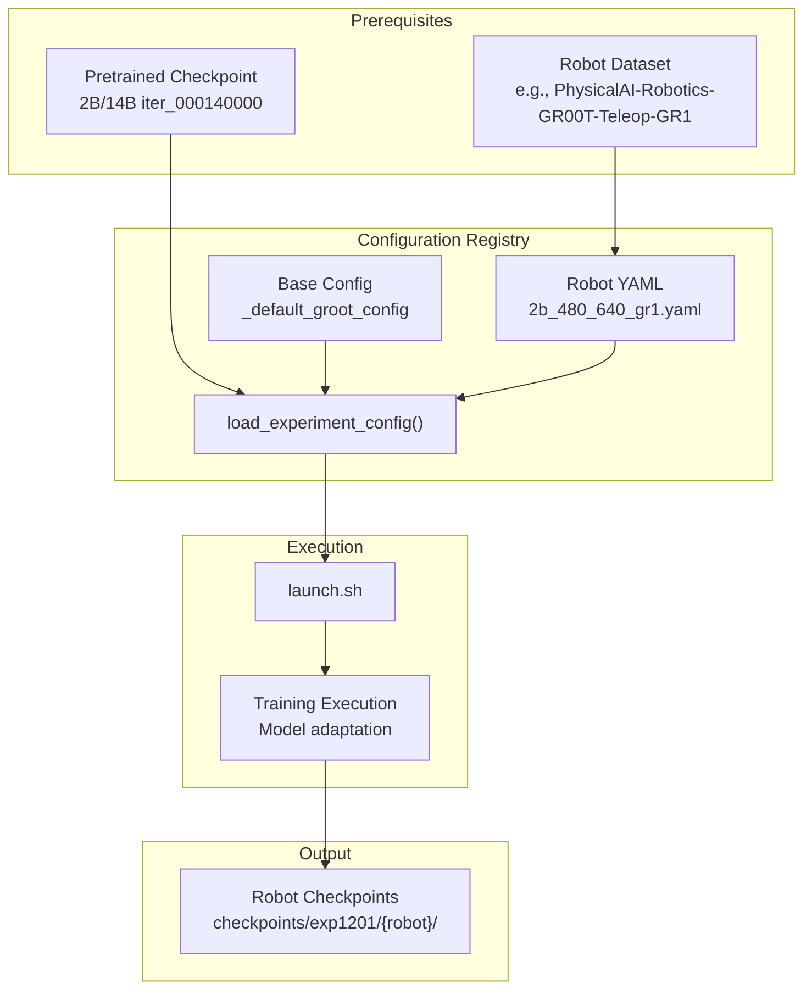
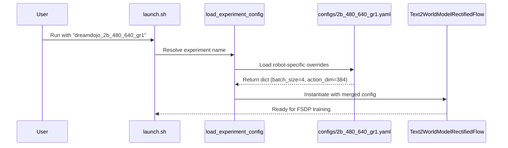

<!-- source: DeepWiki mcp.deepwiki.com · repo NVIDIA/DreamDojo · extra page Robot-Specific Training · fetched 2026-10-26 -->

# Robot-Specific Training

<details>
<summary>Relevant source files</summary>

The following files were used as context for generating this wiki page:

- [configs/14b_480_640_agibot.yaml](configs/14b_480_640_agibot.yaml)
- [configs/14b_480_640_g1.yaml](configs/14b_480_640_g1.yaml)
- [configs/14b_480_640_gr1.yaml](configs/14b_480_640_gr1.yaml)
- [configs/14b_480_640_yam.yaml](configs/14b_480_640_yam.yaml)
- [configs/2b_480_640_gr1.yaml](configs/2b_480_640_gr1.yaml)

</details>


## Purpose and Scope

This document provides a technical guide for training DreamDojo models adapted to specific robot platforms, including GR-1, G1, AgiBot, and YAM. It details the configuration architecture, the `load_experiment_config` registry pattern, and the specific YAML parameters required for the post-training phase.

For information about the unified action space design that enables multi-robot support, see [4.2.1 Action Space Design](). For the broader context of the post-training phase in the overall pipeline, see [4.2 Post-Training]().

---

## Training Pipeline Overview

The robot-specific training process adapts a pretrained generalist world model to a specific robot embodiment by overriding base configurations with platform-specific datasets and parameters.

**Robot-Specific Training Flow**



**Sources:** [configs/2b_480_640_gr1.yaml:1-38](), [configs/14b_480_640_gr1.yaml:1-38]()

---

## Configuration File Structure

Robot platforms utilize dedicated YAML files to override default settings. These files are processed via a registry pattern where the experiment name (e.g., `dreamdojo_2b_480_640_gr1`) maps to a specific YAML file in the `configs/` directory.

### Configuration Mapping to Code Entities

The following diagram illustrates how YAML configuration fields map to internal system components and class attributes.

```mermaid
classDiagram
    class "YAML: job" {
        +project: "dreamdojo"
        +group: "exp1201"
        +name: "gr1"
    }
    class "YAML: trainer" {
        +grad_accum_iter: 1
        +callbacks: dict
    }
    class "YAML: model.config.net" {
        +action_dim: 384
        +num_action_per_chunk: 12
    }
    class "YAML: dataloader_train.dataset" {
        +num_frames: 13
        +dataset_path: list
    }

    class Text2WorldModelRectifiedFlow {
        <<System Entity>>
        +action_dim
        +num_action_per_chunk
    }
    class TrainingScript {
        <<Code Entity>>
        +grad_accum_iter
        +callbacks
    }

    "YAML: model.config.net" ..> Text2WorldModelRectifiedFlow : "Injected via load_experiment_config"
    "YAML: trainer" ..> TrainingScript : "Configures Trainer instance"
```

**Sources:** [configs/2b_480_640_gr1.yaml:1-38](), [configs/14b_480_640_gr1.yaml:1-38]()

---

## Robot Platform Configurations

The repository provides specialized configurations for four primary platforms. All platforms share a unified `action_dim` of 384 to maintain checkpoint compatibility, while differing in dataset paths and hardware-specific optimizations.

### Platform Comparison Table

| Parameter | GR-1 (2B) | GR-1 (14B) | G1 (14B) | AgiBot (14B) | YAM (14B) |
|-----------|-----------|------------|----------|--------------|-----------|
| **Config File** | `2b_480_640_gr1.yaml` | `14b_480_640_gr1.yaml` | `14b_480_640_g1.yaml` | `14b_480_640_agibot.yaml` | `14b_480_640_yam.yaml` |
| **Batch Size** | 4 | 2 | 2 | 2 | 2 |
| **Grad Accum** | 1 | 2 | 2 | 2 | 2 |
| **Dataset Count** | 1 | 1 | 8 | ~100+ | ~100+ |
| **Action Range** | [0, 58) | [0, 58) | [58, 101) | [147, 169) | [101, 147) |

### 1. GR-1 Configuration
The GR-1 setup uses a single standardized dataset path: `datasets/PhysicalAI-Robotics-GR00T-Teleop-GR1/GR1_robot` [configs/2b_480_640_gr1.yaml:34](). It is the baseline for 2B and 14B comparisons.

### 2. G1 Configuration
The G1 humanoid configuration aggregates 8 specific data subsets, including `locked-waist` and `corrected-waist` variants [configs/14b_480_640_g1.yaml:34-41]().

### 3. AgiBot Configuration
The AgiBot setup features an extensive list of over 100 converted dataset paths, covering diverse tasks such as `laundry`, `lang_sep`, and `long_6k` sequences [configs/14b_480_640_agibot.yaml:34-107]().

### 4. YAM Configuration
The YAM (Bimanual) configuration is the most complex, involving hundreds of industrial and household task datasets, including `allen_key_screwing`, `fold_napkin`, and `bus_table` [configs/14b_480_640_yam.yaml:34-94]().

**Sources:** [configs/2b_480_640_gr1.yaml:1-38](), [configs/14b_480_640_gr1.yaml:1-38](), [configs/14b_480_640_g1.yaml:34-41](), [configs/14b_480_640_agibot.yaml:34-107](), [configs/14b_480_640_yam.yaml:34-94]()

---

## Key Configuration Parameters Explained

### Model Architecture (`model.config.net`)
- **`action_dim: 384`**: The global action dimension. Even if a robot only uses 20 dimensions, the model is trained with 384 to allow for zero-shot transfer or multi-robot joint training [configs/2b_480_640_gr1.yaml:23]().
- **`num_action_per_chunk: 12`**: Defines the action horizon. Combined with a `temporal_compression_ratio` of 4, this results in a `state_t` of 4 (1 initial frame + 12/4 future latent states) [configs/2b_480_640_gr1.yaml:21-25]().

### Trainer and Callbacks (`trainer`)
- **`grad_accum_iter`**: Set to `1` for 2B models [configs/2b_480_640_gr1.yaml:7]() and `2` for 14B models [configs/14b_480_640_gr1.yaml:7]() to maintain an effective batch size while fitting into H100 80GB VRAM.
- **`every_n_sample_reg` / `every_n_sample_ema`**: Triggers video generation every 1000 iterations at 5 FPS to monitor training progress [configs/2b_480_640_gr1.yaml:9-14]().

### DataLoader (`dataloader_train`)
- **`num_frames: 13`**: The model processes 13 frames (1 context + 12 future). This aligns with the `num_action_per_chunk` [configs/2b_480_640_gr1.yaml:32]().
- **`single_base_index: false`**: Allows the sampler to pick any frame as the start of a sequence, increasing data variety [configs/2b_480_640_gr1.yaml:36]().

**Sources:** [configs/2b_480_640_gr1.yaml:1-38](), [configs/14b_480_640_gr1.yaml:1-38]()

---

## Launch Procedure

To start robot-specific training, use the `launch.sh` script with the target experiment name. The system uses the `load_experiment_config` pattern to resolve the YAML file.

### Execution Command Pattern
```bash
# Template: bash launch.sh dreamdojo_{size}_{res}_{robot}
bash launch.sh dreamdojo_2b_480_640_gr1
bash launch.sh dreamdojo_14b_480_640_agibot
```

### Data Flow during Initialization

The following diagram traces how the experiment name leads to the instantiation of the model with robot-specific parameters.



**Sources:** [configs/2b_480_640_gr1.yaml:1-38](), [configs/14b_480_640_gr1.yaml:1-38]()

---

