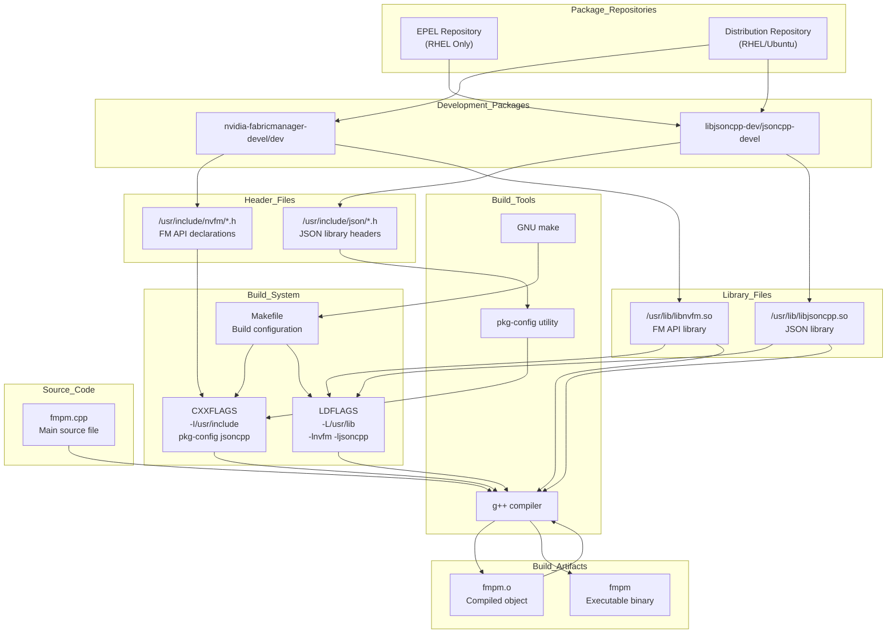
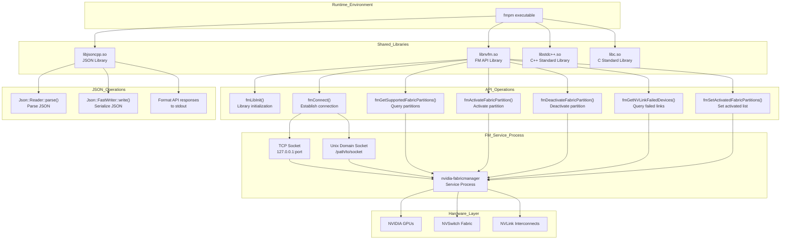

<!-- source: DeepWiki mcp.deepwiki.com · repo NVIDIA/Fabric-Manager-Client · page 2.1 Prerequisites and Dependencies · fetched 2026-10-26 -->

# Prerequisites and Dependencies

<details>
<summary>Relevant source files</summary>

The following files were used as context for generating this wiki page:

- [Makefile](Makefile)
- [README.md](README.md)

</details>


## Purpose and Scope

This document details all prerequisites and dependencies required to build and run the `fmpm` (Fabric Manager Partition Manager) client. It covers build-time development packages, runtime libraries, system requirements, hardware prerequisites, and platform restrictions. For build instructions using these dependencies, see [Building from Source](#2.2). For configuration of the Fabric Manager service that `fmpm` depends on at runtime, see [Configuration](#2.3).

---

## System Requirements

The `fmpm` client requires specific operating system support, hardware infrastructure, and toolchain versions to function correctly.

### Operating System Support

| Distribution | Package Manager | Status |
|--------------|----------------|--------|
| Red Hat Enterprise Linux (RHEL) | `yum` / `dnf` | Supported |
| Ubuntu | `apt` | Supported |
| Other Linux distributions | Varies | Not documented |

The build system assumes a Linux environment with standard POSIX tooling. Windows and macOS are not supported.

### Minimum Toolchain Requirements

| Component | Requirement | Notes |
|-----------|-------------|-------|
| C++ Compiler | `g++` | Used in [Makefile:8]() |
| Build System | GNU Make | Processes [Makefile:1-13]() |
| Package Configuration | `pkg-config` | Required for jsoncpp detection [Makefile:2]() |

**Sources:** [Makefile:1-13]()

---

## Build-Time Dependencies

Build-time dependencies are required only on systems where the `fmpm` binary will be compiled. Once built, the binary can be deployed to other systems with only runtime dependencies installed.

### Development Packages

The following development packages provide header files and static/dynamic libraries required during compilation and linking.

#### NVIDIA Fabric Manager Development Package

This package provides the `libnvfm` library and headers for communicating with the Fabric Manager service.

| Distribution | Package Name | Installation Command |
|--------------|--------------|---------------------|
| RHEL | `nvidia-fabricmanager-devel-<version>` | `yum install nvidia-fabricmanager-devel-<version>` |
| Ubuntu | `nvidia-fabricmanager-dev-<version>` | `apt install nvidia-fabricmanager-dev-<version>` |

**Key Components:**
- Headers: Provide API declarations for functions like `fmLibInit()`, `fmConnect()`, `fmActivateFabricPartition()`
- Library: `libnvfm.so` linked via `-lnvfm` flag [Makefile:5]()

**Version Compatibility:** The development package version should match or be compatible with the Fabric Manager service version running on the target system. Version mismatches can cause API incompatibilities.

**Sources:** [README.md:31-33](), [Makefile:5]()

#### JSON CPP Development Package

This package provides the JSON serialization/deserialization library for formatting API responses.

| Distribution | Package Name | Installation Command | Prerequisites |
|--------------|--------------|---------------------|---------------|
| Ubuntu | `libjsoncpp-dev` | `apt install libjsoncpp-dev` | None |
| RHEL | `jsoncpp-devel` | `yum install jsoncpp-devel` | **EPEL repository** |

**RHEL Specific Requirement:** The [EPEL (Extra Packages for Enterprise Linux) repository](https://www.redhat.com/en/blog/install-epel-linux) must be configured before installing `jsoncpp-devel` on RHEL systems.

```bash
# Example: Enable EPEL on RHEL 8
sudo dnf install epel-release
```

**Key Components:**
- Headers: Detected via `pkg-config --cflags jsoncpp` [Makefile:2]()
- Library: `libjsoncpp.so` linked via `-ljsoncpp` flag [Makefile:5]()

**Sources:** [README.md:35-38](), [Makefile:2](), [Makefile:5]()

### Build Tools and Utilities

| Tool | Purpose | Usage in Build System |
|------|---------|----------------------|
| `g++` | C++ compilation and linking | Compiles `fmpm.cpp`, links libraries [Makefile:8]() |
| `pkg-config` | Library configuration queries | Retrieves jsoncpp compiler flags [Makefile:2]() |
| `make` | Build automation | Executes build targets [Makefile:7-12]() |

**Sources:** [Makefile:1-13]()

---

## Build-Time Dependency Graph

The following diagram shows how build-time dependencies flow into the compilation process and map to specific code entities.



**Sources:** [Makefile:1-13](), [README.md:31-38]()

---

## Runtime Dependencies

Runtime dependencies must be present on any system where the compiled `fmpm` binary will execute. Unlike build-time dependencies, runtime packages do not include development headers or static libraries.

### Fabric Manager Service

The `fmpm` client is a control interface for the NVIDIA Fabric Manager service. The service must be installed, configured, and running before `fmpm` can perform any operations.

| Component | Requirement | Notes |
|-----------|-------------|-------|
| Fabric Manager Service | `nvidia-fabricmanager` package | Must be running as daemon/service |
| Communication Interface | TCP socket or Unix domain socket | Configured via `FM_CMD_BIND_INTERFACE` or `FM_CMD_UNIX_SOCKET_PATH` |
| API Version | Compatible with `libnvfm` version | Version mismatch causes connection failures |

**Service Status Verification:**
```bash
# Systemd-based systems
systemctl status nvidia-fabricmanager

# Check if process is running
ps aux | grep nv-fabricmanager
```

**Configuration Requirements:** The Fabric Manager service must be configured with one of the following before `fmpm` can connect:
- `FM_CMD_BIND_INTERFACE=<IP_ADDRESS>` for TCP socket communication [README.md:14]()
- `FM_CMD_UNIX_SOCKET_PATH=<SOCKET_PATH>` for Unix domain socket communication [README.md:18]()

For detailed configuration instructions, see [Configuration](#2.3).

**Sources:** [README.md:12-19]()

### Runtime Libraries

The following shared libraries must be present in the system library search path (`/usr/lib`, `/usr/lib64`, or configured via `LD_LIBRARY_PATH`):

| Library | Package | Required By |
|---------|---------|-------------|
| `libnvfm.so` | `nvidia-fabricmanager` | All FM API calls |
| `libjsoncpp.so` | `libjsoncpp` (Ubuntu) / `jsoncpp` (RHEL) | JSON output formatting |

**Library Verification:**
```bash
# Check if libraries are available
ldd ./fmpm

# Expected output includes:
# libnvfm.so => /usr/lib/libnvfm.so
# libjsoncpp.so => /usr/lib/libjsoncpp.so
```

**Sources:** [Makefile:5]()

---

## Hardware Requirements

The `fmpm` client manages GPU partitions in NVIDIA NVSwitch-based systems. Specific hardware must be present for the system to function.

### Required Hardware Components

| Component | Requirement | Purpose |
|-----------|-------------|---------|
| NVIDIA GPUs | NVIDIA Platform products | Compute resources managed by partitions |
| NVSwitch Fabric | NVSwitch interconnect | High-speed GPU-to-GPU communication |
| NVLink Interconnects | NVLink topology | Physical links between GPUs and switches |

**Platform Restrictions:** Per the NVIDIA Software License Agreement, the following restrictions apply:
- **Supported:** NVIDIA Platform products (GPUs, SoCs, and systems designed and sold by NVIDIA)
- **Prohibited:** GeForce and Titan products in datacenter deployment
- **Prohibited:** Non-NVIDIA platforms

These restrictions are detailed in [Usage Restrictions and Requirements](#5.2).

### Partition Support Verification

Not all hardware configurations support all partition types. Use the following command to identify unsupported partitions:

```bash
./fmpm --list-unsupported-partitions
```

This command queries the Fabric Manager for partition configurations that cannot be activated due to hardware limitations or topology constraints.

**Sources:** [README.md:21](), High-level system diagrams

---

## Runtime Dependency Mapping

This diagram maps runtime dependencies to specific code operations and API calls within `fmpm`.



**Sources:** [Makefile:5](), [README.md:8-28](), High-level system diagrams

---

## Platform and Configuration Dependencies

### Fabric Manager Configuration Dependencies

The `fmpm` client's connection method must match the Fabric Manager service configuration. Mismatches result in connection failures.

| `fmpm` Option | Required FM Configuration | Connection Type |
|--------------|---------------------------|-----------------|
| `--hostname <IP>` | `FM_CMD_BIND_INTERFACE=<IP>` | TCP socket |
| `--unix-domain-socket <path>` | `FM_CMD_UNIX_SOCKET_PATH=<path>` | Unix domain socket |
| (default, no option) | `FM_CMD_BIND_INTERFACE=127.0.0.1` | TCP localhost |

**Sources:** [README.md:12-19]()

### Resiliency Mode Dependencies

The `--set-activated-list` command requires additional Fabric Manager configuration:

| Feature | Required Configuration | Purpose |
|---------|----------------------|---------|
| Set Activated List | `FABRIC_MODE_RESTART=1` | Enable state persistence and automatic restoration |

Without this configuration, the `--set-activated-list` command will fail or have no persistent effect. See [Resiliency Mode](#3.4) for detailed usage.

**Sources:** [README.md:22-27]()

---

## Dependency Verification

### Pre-Build Verification

Before attempting to build `fmpm`, verify all build-time dependencies are installed:

```bash
# Check g++ compiler
g++ --version

# Check pkg-config
pkg-config --version

# Check jsoncpp development files
pkg-config --modversion jsoncpp
pkg-config --cflags jsoncpp

# Check for libnvfm headers (example path)
ls /usr/include/nvfm/ || echo "nvidia-fabricmanager-devel not installed"

# Check for libnvfm library
ldconfig -p | grep libnvfm
```

### Post-Build Verification

After building `fmpm`, verify the binary has correct library dependencies:

```bash
# Check dynamic library dependencies
ldd ./fmpm

# Expected output should include:
# libnvfm.so => /usr/lib64/libnvfm.so (or similar path)
# libjsoncpp.so => /usr/lib64/libjsoncpp.so (or similar path)

# Verify binary executes
./fmpm -v
```

### Runtime Environment Verification

Before running `fmpm` for partition management, verify the runtime environment:

```bash
# Check Fabric Manager service status
systemctl status nvidia-fabricmanager

# Check Fabric Manager API is accessible
# For TCP (example with default localhost):
netstat -tuln | grep 12345  # (port varies by configuration)

# For Unix socket:
ls -l /var/run/nvidia-fabricmanager/  # (path varies by configuration)

# Verify GPU hardware is detected
nvidia-smi

# Test fmpm connectivity
./fmpm -l
```

**Sources:** [Makefile:1-13](), [README.md:8-28]()

---

## Common Dependency Issues

| Issue | Symptom | Resolution |
|-------|---------|------------|
| EPEL not configured (RHEL) | `jsoncpp-devel` package not found | Enable EPEL repository [README.md:38]() |
| Mismatched FM versions | API connection failures, version errors | Install matching `nvidia-fabricmanager-devel` and `nvidia-fabricmanager` versions |
| Missing `pkg-config` | Build fails with "pkg-config: command not found" | Install `pkgconfig` or `pkg-config` package |
| Library path issues | `error while loading shared libraries: libnvfm.so` | Add library path to `LD_LIBRARY_PATH` or run `ldconfig` |
| FM service not running | `fmpm` connection timeout or refused | Start Fabric Manager service: `systemctl start nvidia-fabricmanager` |
| Configuration mismatch | Connection refused despite running service | Verify `--hostname`/`--unix-domain-socket` matches FM configuration |

**Sources:** [README.md:35-38]()

---

## Summary

The `fmpm` client has clear dependency boundaries between build-time and runtime requirements:

**Build-time:** Development packages (`nvidia-fabricmanager-devel`, `libjsoncpp-dev`), C++ toolchain (`g++`, `make`, `pkg-config`), EPEL repository (RHEL only)

**Runtime:** Fabric Manager service running with matching configuration, runtime libraries (`libnvfm.so`, `libjsoncpp.so`), compatible NVIDIA GPU hardware with NVSwitch fabric

**Configuration:** Matching communication interfaces between client and server, optional Resiliency Mode for state persistence

For build instructions using these dependencies, proceed to [Building from Source](#2.2). For environment configuration, see [Configuration](#2.3).

**Sources:** [README.md:1-39](), [Makefile:1-13](), High-level system diagrams

---

