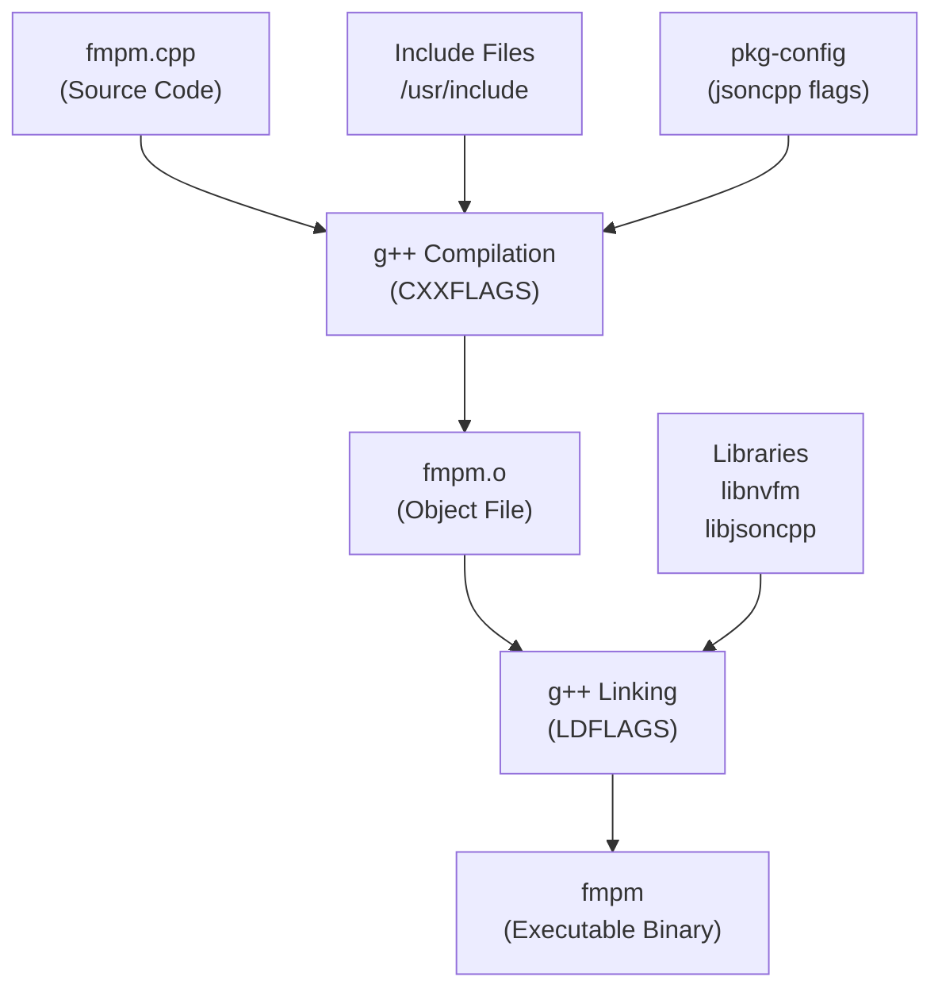
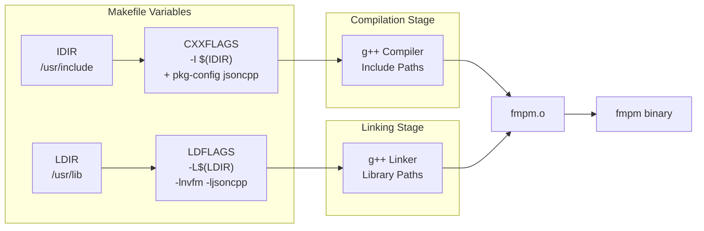
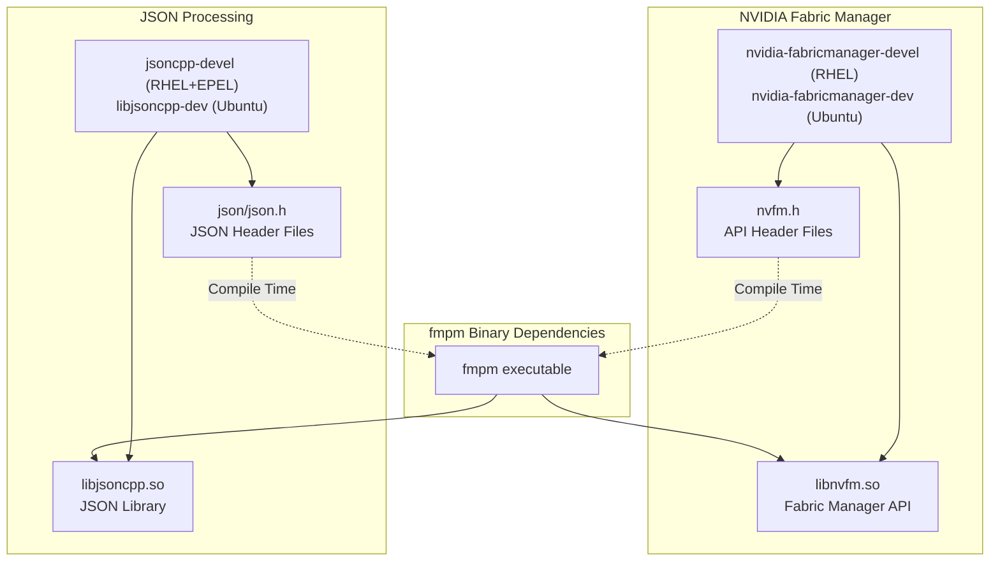
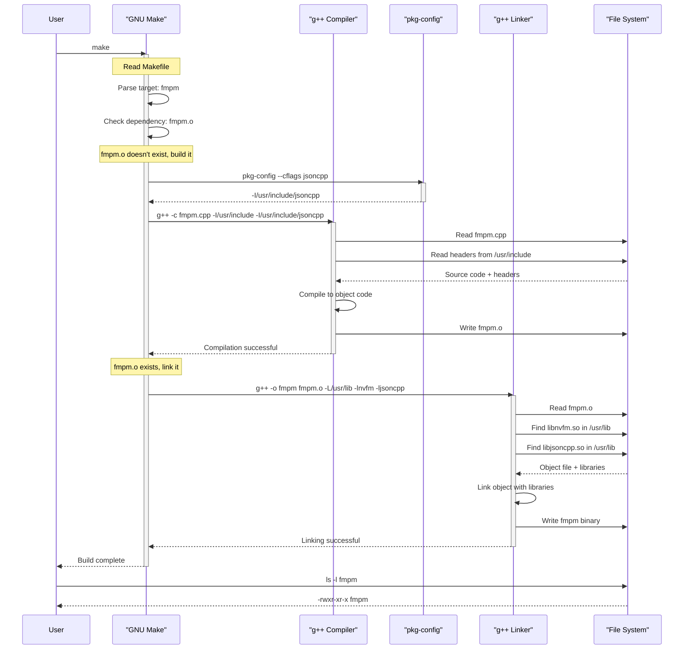

<!-- source: DeepWiki mcp.deepwiki.com · repo NVIDIA/Fabric-Manager-Client · page 2.2 Building from Source · fetched 2026-10-26 -->

# Building from Source

<details>
<summary>Relevant source files</summary>

The following files were used as context for generating this wiki page:

- [Makefile](Makefile)
- [README.md](README.md)

</details>


This page provides step-by-step instructions for compiling the `fmpm` client utility from source code using the provided Makefile. It covers the build process, compilation flags, library linking, and build output verification. For information about installing prerequisite packages and dependencies, see [Prerequisites and Dependencies](#2.1). For runtime configuration after building, see [Configuration](#2.3).

---

## Purpose and Scope

The `fmpm` client is a single C++ source file ([fmpm.cpp]()) that compiles into a self-contained binary executable. The build process links against two external libraries: `libnvfm` (NVIDIA Fabric Manager API) and `libjsoncpp` (JSON processing). This page documents how the [Makefile]() orchestrates the compilation and linking process to produce the final `fmpm` binary.

---

## Build Process Overview

The build system uses GNU Make with a simple two-stage compilation process:



**Build Process Diagram: Two-Stage Compilation**

Sources: [Makefile:1-13]()

| Stage | Input | Output | Command |
|-------|-------|--------|---------|
| **Compilation** | `fmpm.cpp` | `fmpm.o` | `g++` with `CXXFLAGS` |
| **Linking** | `fmpm.o` | `fmpm` | `g++` with `LDFLAGS` |

---

## Compilation Command

To build the `fmpm` binary, execute the following command in the repository root directory:

```bash
make
```

This invokes the default target defined in [Makefile:7-8](), which compiles and links the executable.

To remove build artifacts:

```bash
make clean
```

This removes both `fmpm.o` and the `fmpm` binary as specified in [Makefile:10-12]().

Sources: [Makefile:7-12](), [README.md:31-38]()

---

## Makefile Configuration

The [Makefile]() defines four key variables that control the build process:



**Makefile Variable Flow Diagram**

### Variable Definitions

| Variable | Value | Purpose | Line Reference |
|----------|-------|---------|----------------|
| `IDIR` | `/usr/include` | Base directory for header file search | [Makefile:1]() |
| `CXXFLAGS` | `-I $(IDIR) $(shell pkg-config --cflags jsoncpp)` | Compiler flags for include paths | [Makefile:2]() |
| `LDIR` | `/usr/lib` | Base directory for library search | [Makefile:4]() |
| `LDFLAGS` | `-L$(LDIR) -lnvfm -ljsoncpp` | Linker flags for libraries | [Makefile:5]() |

Sources: [Makefile:1-5]()

### Compiler Flags Breakdown

The `CXXFLAGS` variable ([Makefile:2]()) specifies:

- **`-I $(IDIR)`**: Adds `/usr/include` to the include search path for header files
- **`$(shell pkg-config --cflags jsoncpp)`**: Dynamically retrieves compiler flags for `jsoncpp` library using `pkg-config`

The `pkg-config` invocation typically expands to include paths for `jsoncpp` headers, such as `-I/usr/include/jsoncpp`.

### Linker Flags Breakdown

The `LDFLAGS` variable ([Makefile:5]()) specifies:

- **`-L$(LDIR)`**: Adds `/usr/lib` to the library search path
- **`-lnvfm`**: Links against NVIDIA Fabric Manager API library (`libnvfm.so` or `libnvfm.a`)
- **`-ljsoncpp`**: Links against JSON CPP library (`libjsoncpp.so` or `libjsoncpp.a`)

Sources: [Makefile:2-5]()

---

## Build Target Definition

The main build target is defined in [Makefile:7-8]():

```makefile
fmpm: fmpm.o
	g++ -o $@ $< $(CXXFLAGS) $(LDFLAGS)
```

This rule specifies:

- **Target**: `fmpm` (the output binary)
- **Dependency**: `fmpm.o` (the compiled object file)
- **Recipe**: Links `fmpm.o` into the final binary using both `CXXFLAGS` and `LDFLAGS`

The automatic variables used:
- `$@`: Expands to target name (`fmpm`)
- `$<`: Expands to first dependency (`fmpm.o`)

### Implicit Compilation Rule

The Makefile relies on GNU Make's implicit rule for C++ compilation to produce `fmpm.o` from `fmpm.cpp`. This implicit rule is equivalent to:

```makefile
fmpm.o: fmpm.cpp
	g++ -c fmpm.cpp $(CXXFLAGS)
```

The `-c` flag instructs `g++` to compile without linking, producing only the object file.

Sources: [Makefile:7-8]()

---

## Library Dependencies

The build process links against two external libraries that must be installed on the system:



**Library Dependency Graph**

### libnvfm - Fabric Manager API

- **Library File**: `libnvfm.so` or `libnvfm.a`
- **Linker Flag**: `-lnvfm` ([Makefile:5]())
- **Headers**: API declarations for functions like `fmLibInit()`, `fmConnect()`, `fmActivateFabricPartition()`, etc.
- **Package Name**:
  - RHEL: `nvidia-fabricmanager-devel-<version>` ([README.md:32]())
  - Ubuntu: `nvidia-fabricmanager-dev-<version>` ([README.md:33]())

### libjsoncpp - JSON Processing

- **Library File**: `libjsoncpp.so` or `libjsoncpp.a`
- **Linker Flag**: `-ljsoncpp` ([Makefile:5]())
- **Compiler Flags**: Retrieved via `pkg-config --cflags jsoncpp` ([Makefile:2]())
- **Headers**: JSON parsing and serialization classes
- **Package Name**:
  - Ubuntu: `libjsoncpp-dev` ([README.md:36]())
  - RHEL: `jsoncpp-devel` (requires EPEL repository) ([README.md:37-38]())

Sources: [Makefile:5](), [README.md:31-38]()

---

## Build Process Execution

The complete build process executes as follows:



**Build Process Execution Sequence**

Sources: [Makefile:1-13]()

---

## Build Output

Upon successful compilation, the build process produces:

| File | Type | Description | Created By |
|------|------|-------------|------------|
| `fmpm.o` | Object File | Compiled machine code from `fmpm.cpp` | Compilation stage |
| `fmpm` | Executable | Final linked binary with execution permissions | Linking stage |

The `fmpm` binary is a dynamically linked executable that depends on system libraries:

```bash
$ ldd fmpm
    linux-vdso.so.1
    libnvfm.so => /usr/lib/x86_64-linux-gnu/libnvfm.so
    libjsoncpp.so => /usr/lib/x86_64-linux-gnu/libjsoncpp.so
    libstdc++.so.6 => /usr/lib/x86_64-linux-gnu/libstdc++.so.6
    libc.so.6 => /lib/x86_64-linux-gnu/libc.so.6
    ...
```

Sources: [Makefile:7-8]()

---

## Verification

After building, verify the executable was created successfully:

```bash
$ ls -lh fmpm
-rwxr-xr-x 1 user user 125K Jan 15 10:30 fmpm
```

Test the binary by displaying version information:

```bash
$ ./fmpm -v
```

Or display help text:

```bash
$ ./fmpm -h
```

The help output should match the command reference documented in [README.md:8-29]().

Sources: [README.md:8-29]()

---

## Clean Target

The clean target removes all build artifacts:

```bash
$ make clean
```

This executes the commands defined in [Makefile:10-12]():

```makefile
clean:
	-@rm -f fmpm.o
	-@rm -f fmpm
```

The `-@` prefix suppresses command echoing and ignores errors (if files don't exist). The `-f` flag forces removal without prompting.

Sources: [Makefile:10-12]()

---

## Build Troubleshooting

Common build failures and resolutions:

| Error | Cause | Resolution |
|-------|-------|------------|
| `fatal error: nvfm.h: No such file or directory` | Missing NVIDIA Fabric Manager development package | Install `nvidia-fabricmanager-devel` (RHEL) or `nvidia-fabricmanager-dev` (Ubuntu) |
| `/usr/bin/ld: cannot find -lnvfm` | NVIDIA Fabric Manager library not installed | Install development package with library files |
| `fatal error: json/json.h: No such file or directory` | Missing JSON CPP headers | Install `libjsoncpp-dev` (Ubuntu) or `jsoncpp-devel` (RHEL+EPEL) |
| `Package jsoncpp was not found` | `pkg-config` cannot locate jsoncpp | Verify jsoncpp development package is installed and pkg-config is available |
| `/usr/bin/ld: cannot find -ljsoncpp` | JSON CPP library not installed | Install complete jsoncpp package (headers + library) |

Sources: [README.md:31-38](), [Makefile:2-5]()

---

## Cross-Reference

- For prerequisite package installation details, see [Prerequisites and Dependencies](#2.1)
- For post-build configuration of communication methods, see [Configuration](#2.3)
- For Makefile technical internals and flag customization, see [Build System Details](#4.4)
- For deployment strategies with the built binary, see Architecture Overview diagram in [Technical Reference](#4)

Sources: [README.md:1-39](), [Makefile:1-13]()

---

