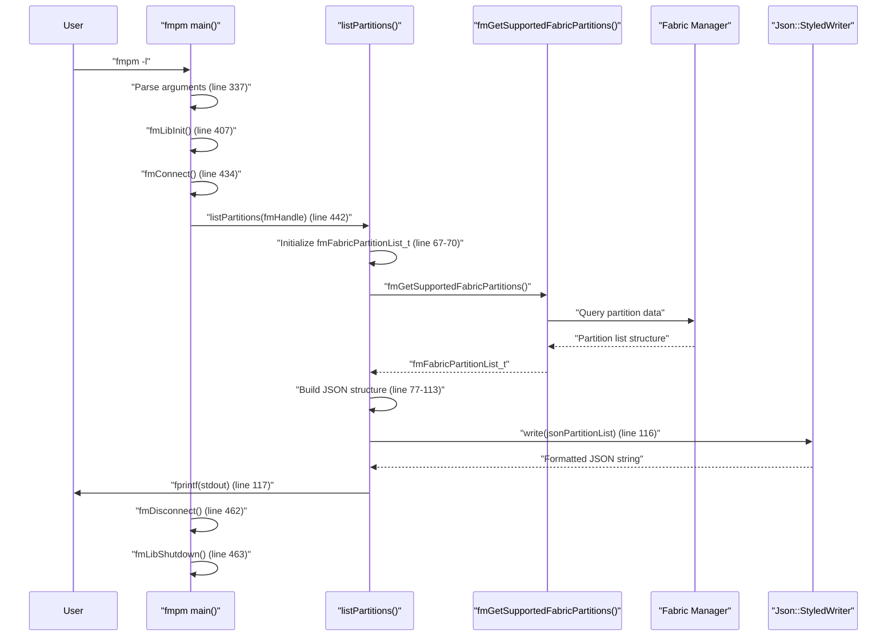
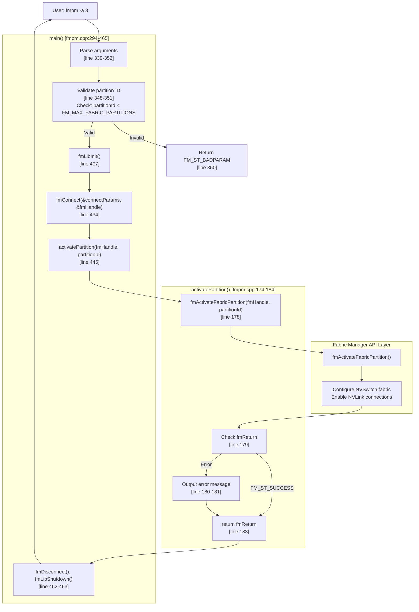
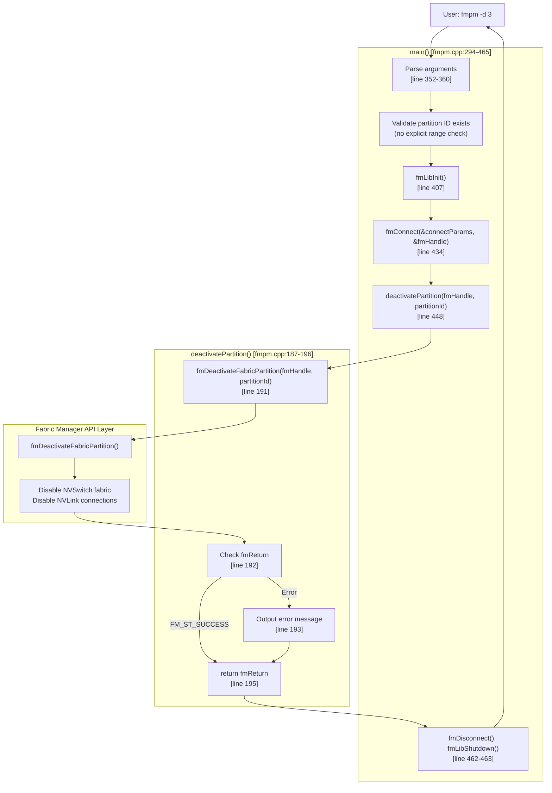
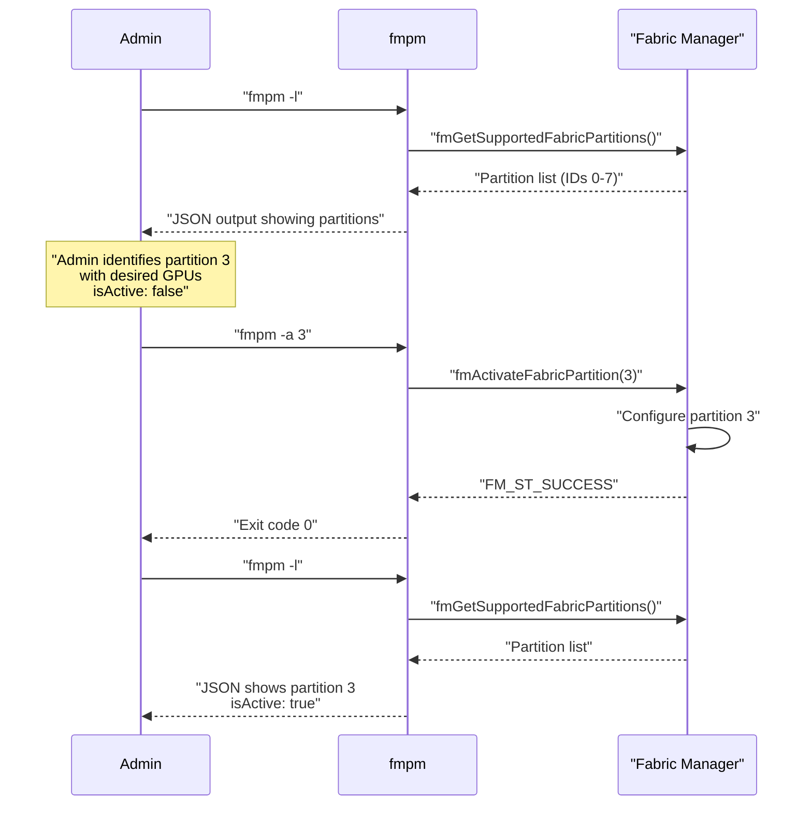
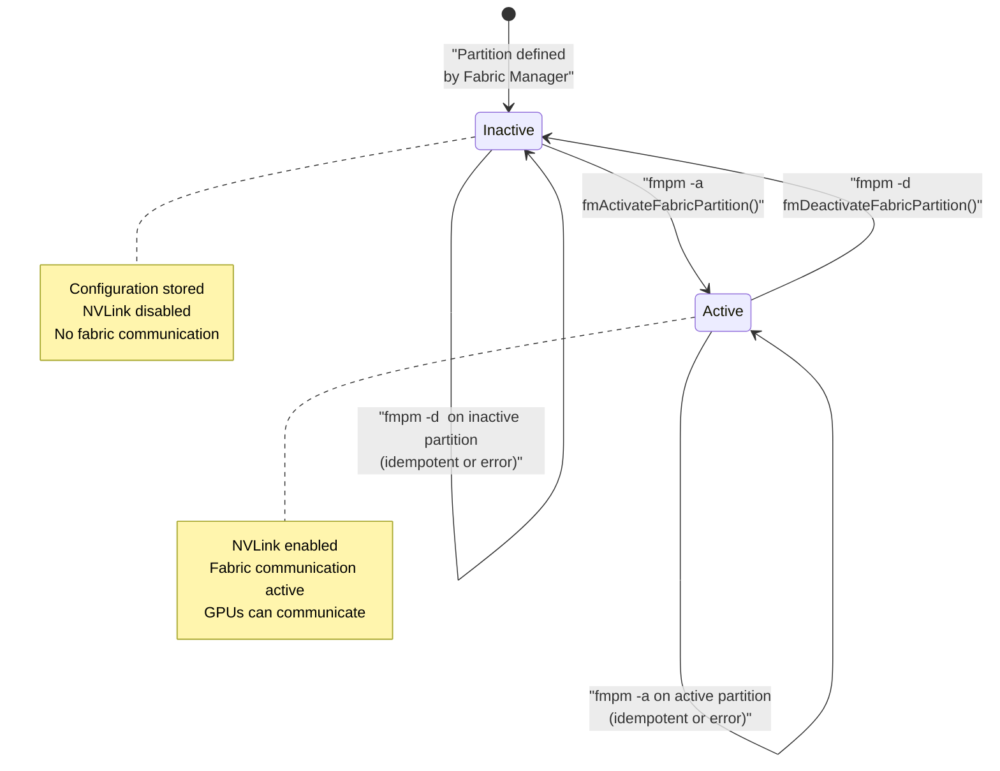

<!-- source: DeepWiki mcp.deepwiki.com · repo NVIDIA/Fabric-Manager-Client · page 3.2 Managing GPU Partitions · fetched 2026-10-26 -->

# Managing GPU Partitions

<details>
<summary>Relevant source files</summary>

The following files were used as context for generating this wiki page:

- [README.md](README.md)
- [fmpm.cpp](fmpm.cpp)

</details>


## Purpose and Scope

This page documents the core partition management operations provided by the `fmpm` utility: listing, activating, and deactivating GPU partitions. These operations allow administrators to configure which groups of GPUs communicate through the NVSwitch fabric.

For connection configuration and command-line options, see [Command-Line Reference](#3.1). For diagnostic operations including failed device queries, see [Monitoring and Diagnostics](#3.3). For persistent partition configuration and automatic restoration, see [Resiliency Mode](#3.4).

## Understanding GPU Partitions

A GPU partition is a logical grouping of GPUs that can communicate with each other through the NVSwitch fabric. Each partition is identified by a numeric `partitionId` and can be in one of two states:

| State | Description |
|-------|-------------|
| Active | GPUs in the partition are configured to communicate through NVSwitch fabric with NVLink enabled |
| Inactive | Partition definition exists but GPUs are not configured for fabric communication |

Partitions are defined by the Fabric Manager based on hardware topology and GPU configuration. The `fmpm` utility queries existing partition definitions and controls their activation state.

**Sources:** [README.md:3-5](), [fmpm.cpp:12-29]()

## Listing Partitions

### Command Syntax

```bash
fmpm -l [--hostname <IP>] [--unix-domain-socket <path>]
```

The `-l` option retrieves all partition definitions from Fabric Manager, including both active and inactive partitions. This is a read-only query operation.

**Sources:** [README.md:9](), [fmpm.cpp:337-338]()

### Operation Flow



**Sources:** [fmpm.cpp:64-120](), [fmpm.cpp:440-442]()

### Data Structures

The partition list operation uses the `fmFabricPartitionList_t` structure, which is initialized at [fmpm.cpp:69-70]() and populated by the API call at [fmpm.cpp:72]().

Key structure fields:

| Field | Type | Description |
|-------|------|-------------|
| `version` | `unsigned int` | API version identifier set to `fmFabricPartitionList_version` |
| `numPartitions` | `unsigned int` | Number of partitions returned |
| `maxNumPartitions` | `unsigned int` | Maximum number of partitions supported by hardware |
| `partitionInfo[]` | `fmFabricPartitionInfo_t[]` | Array of partition information structures |

Each `fmFabricPartitionInfo_t` contains:

| Field | Type | Description |
|-------|------|-------------|
| `partitionId` | `unsigned int` | Unique partition identifier |
| `isActive` | `bool` | Current activation state |
| `numGpus` | `unsigned int` | Number of GPUs in partition |
| `gpuInfo[]` | `fmFabricPartitionGpuInfo_t[]` | Array of GPU information structures |

Each `fmFabricPartitionGpuInfo_t` contains:

| Field | Type | Description |
|-------|------|-------------|
| `physicalId` | `unsigned int` | Hardware GPU physical identifier |
| `uuid` | `char[]` | GPU UUID string |
| `pciBusId` | `char[]` | PCI bus identifier |
| `numNvLinksAvailable` | `unsigned int` | Currently available NVLink count |
| `maxNumNvLinks` | `unsigned int` | Maximum NVLink connections supported |
| `nvlinkLineRateMBps` | `unsigned int` | NVLink data rate in MB/s |

**Sources:** [fmpm.cpp:67-70](), [fmpm.cpp:88-111]()

### Output Format

The list operation outputs JSON to stdout. Example structure:

```json
{
  "version": 1,
  "numPartitions": 3,
  "maxNumPartitions": 8,
  "partitionInfo": [
    {
      "partitionId": 0,
      "isActive": true,
      "numGpus": 2,
      "gpuInfo": [
        {
          "physicalId": 0,
          "uuid": "GPU-abc123...",
          "pciBusId": "0000:00:1e.0",
          "numNvLinksAvailable": 12,
          "maxNumNvLinks": 12,
          "nvlinkLineRateMBps": 25000
        },
        {
          "physicalId": 1,
          "uuid": "GPU-def456...",
          "pciBusId": "0000:00:1f.0",
          "numNvLinksAvailable": 12,
          "maxNumNvLinks": 12,
          "nvlinkLineRateMBps": 25000
        }
      ]
    }
  ]
}
```

The JSON formatting is performed by `libjsoncpp` using `Json::StyledWriter` at [fmpm.cpp:115-117]().

**Sources:** [fmpm.cpp:77-118]()

## Activating Partitions

### Command Syntax

```bash
fmpm -a <Partition ID> [--hostname <IP>] [--unix-domain-socket <path>]
```

The `-a` option activates a single partition by ID. Activation configures the GPUs in the partition to communicate through the NVSwitch fabric with NVLink enabled.

**Sources:** [README.md:10](), [fmpm.cpp:339-352]()

### Operation Flow and Code Mapping



**Sources:** [fmpm.cpp:174-184](), [fmpm.cpp:339-352](), [fmpm.cpp:443-445]()

### Input Validation

The partition ID argument undergoes validation at two stages:

1. **Command-line validation** [fmpm.cpp:348-351](): Checks that `partitionId < FM_MAX_FABRIC_PARTITIONS`
2. **API validation**: The Fabric Manager validates that the partition ID exists and can be activated

Invalid partition IDs result in `FM_ST_BADPARAM` return code.

**Sources:** [fmpm.cpp:348-351]()

### Return Codes

| Return Code | Meaning |
|-------------|---------|
| `FM_ST_SUCCESS` | Partition activated successfully |
| `FM_ST_BADPARAM` | Invalid partition ID |
| Other `fmReturn_t` values | API or hardware errors |

The `activatePartition()` function returns the `fmReturn_t` status directly to the caller at [fmpm.cpp:183](), which is then returned as the process exit code at [fmpm.cpp:464]().

**Sources:** [fmpm.cpp:174-184](), [fmpm.cpp:464]()

## Deactivating Partitions

### Command Syntax

```bash
fmpm -d <Partition ID> [--hostname <IP>] [--unix-domain-socket <path>]
```

The `-d` option deactivates a single partition by ID. Deactivation disables NVLink communication for GPUs in the partition.

**Sources:** [README.md:11](), [fmpm.cpp:352-360]()

### Operation Flow and Code Mapping



**Sources:** [fmpm.cpp:187-196](), [fmpm.cpp:352-360](), [fmpm.cpp:446-448]()

### Deactivation Behavior

The `deactivatePartition()` function at [fmpm.cpp:187-196]() calls `fmDeactivateFabricPartition()` to request deactivation from Fabric Manager. The function follows the same error handling pattern as activation:

- Success returns `FM_ST_SUCCESS`
- Errors output diagnostic message to stderr and return the error code
- Return value becomes process exit code

**Sources:** [fmpm.cpp:187-196]()

## Common Workflows

### Workflow 1: Query and Activate



**Sources:** [fmpm.cpp:64-120](), [fmpm.cpp:174-184]()

### Workflow 2: Exclusive Partition Management

Some hardware configurations may require that only one partition is active at a time. This workflow deactivates existing partitions before activating a new one:

```bash
# List current state
fmpm -l

# Deactivate currently active partition (e.g., partition 1)
fmpm -d 1

# Activate desired partition
fmpm -a 5

# Verify new state
fmpm -l
```

**Sources:** [fmpm.cpp:187-196](), [fmpm.cpp:174-184]()

### Workflow 3: Scripted Automation

The JSON output format enables programmatic parsing in automation scripts:

```bash
#!/bin/bash

# Get partition list
PARTITIONS=$(fmpm -l)

# Parse JSON to find inactive partitions
# (Example uses jq for JSON parsing)
INACTIVE_IDS=$(echo "$PARTITIONS" | jq -r '.partitionInfo[] | select(.isActive == false) | .partitionId')

# Activate each inactive partition
for PART_ID in $INACTIVE_IDS; do
    fmpm -a $PART_ID
    if [ $? -eq 0 ]; then
        echo "Activated partition $PART_ID"
    else
        echo "Failed to activate partition $PART_ID"
    fi
done
```

The consistent JSON output at [fmpm.cpp:115-117]() and return code propagation at [fmpm.cpp:464]() enable reliable automation.

**Sources:** [fmpm.cpp:115-117](), [fmpm.cpp:464]()

## Partition State Management

### State Transitions



**Sources:** [fmpm.cpp:174-196]()

### Connection Lifecycle

Each partition operation follows the same connection lifecycle:

| Stage | Function | Location |
|-------|----------|----------|
| Initialize API | `fmLibInit()` | [fmpm.cpp:407]() |
| Connect to FM | `fmConnect(&connectParams, &fmHandle)` | [fmpm.cpp:434]() |
| Perform operation | Operation-specific function | [fmpm.cpp:440-458]() |
| Disconnect | `fmDisconnect(fmHandle)` | [fmpm.cpp:462]() |
| Shutdown API | `fmLibShutdown()` | [fmpm.cpp:463]() |

The connection is established once per `fmpm` invocation and used for a single operation. The handle obtained from `fmConnect()` at [fmpm.cpp:434]() is passed to all operation functions.

**Sources:** [fmpm.cpp:407-463]()

### Persistence Behavior

Standard activate and deactivate operations are **not persistent**. Partition state is lost when:

- Fabric Manager service restarts
- System reboots
- Hardware resets

For persistent partition configuration that survives restarts, use the Resiliency Mode operations documented in [Resiliency Mode](#3.4).

**Sources:** [README.md:22-27]()

## Command Execution Summary

| Operation | Command | Function | API Call | Line Reference |
|-----------|---------|----------|----------|----------------|
| List partitions | `fmpm -l` | `listPartitions()` | `fmGetSupportedFabricPartitions()` | [fmpm.cpp:64-120]() |
| Activate partition | `fmpm -a <ID>` | `activatePartition()` | `fmActivateFabricPartition()` | [fmpm.cpp:174-184]() |
| Deactivate partition | `fmpm -d <ID>` | `deactivatePartition()` | `fmDeactivateFabricPartition()` | [fmpm.cpp:187-196]() |

All operations output results to stdout (for JSON data) or stderr (for error messages), and return appropriate exit codes for shell script integration.

**Sources:** [fmpm.cpp:64-196](), [fmpm.cpp:440-458]()

---

