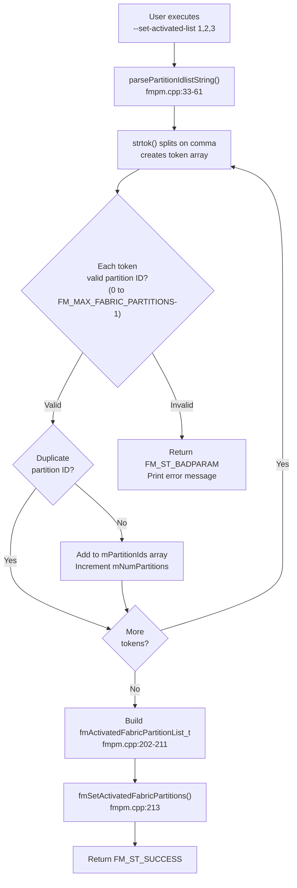
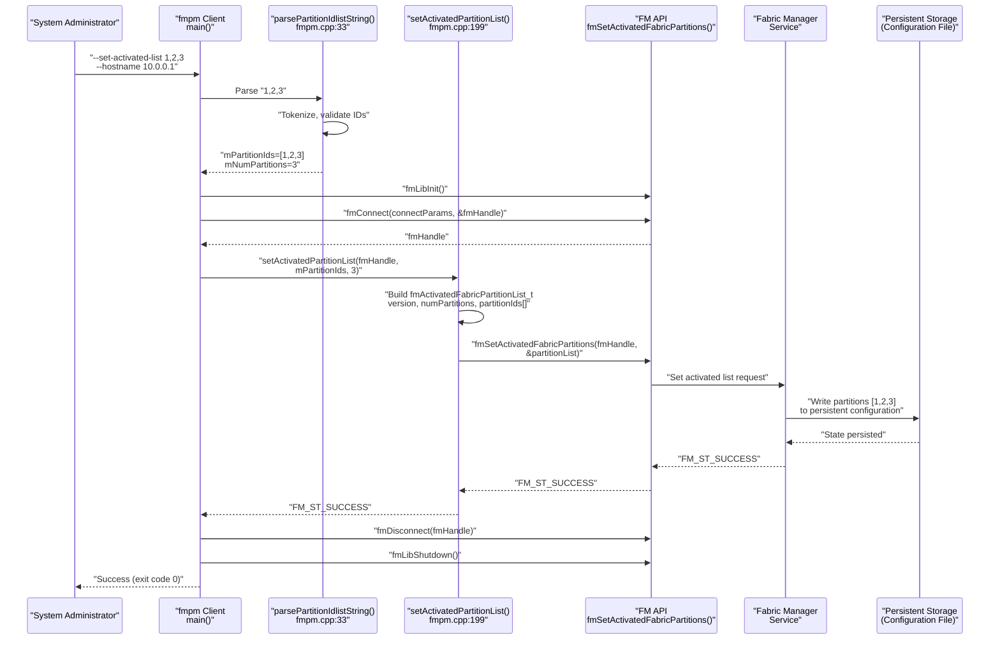
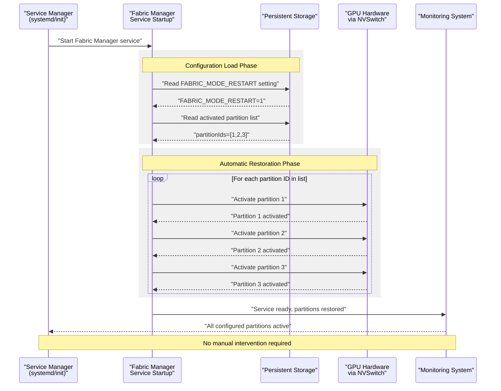
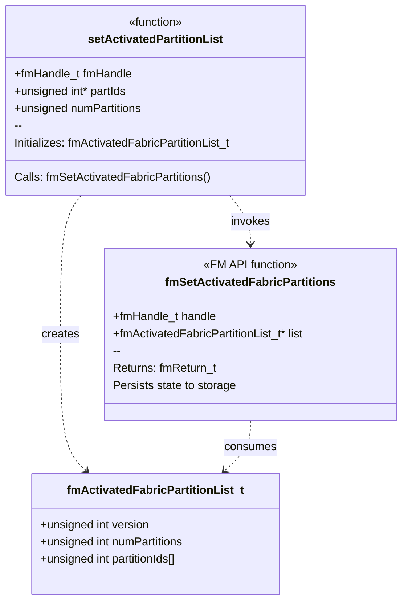
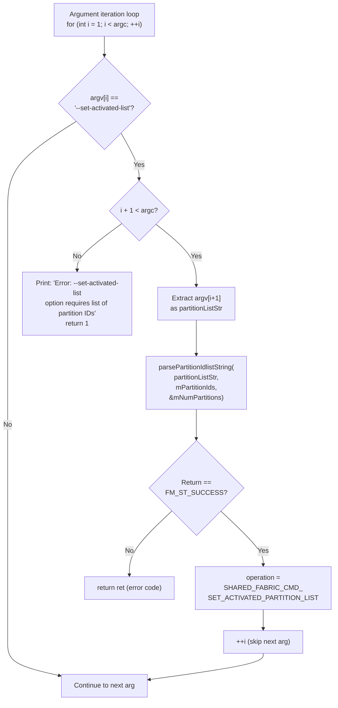
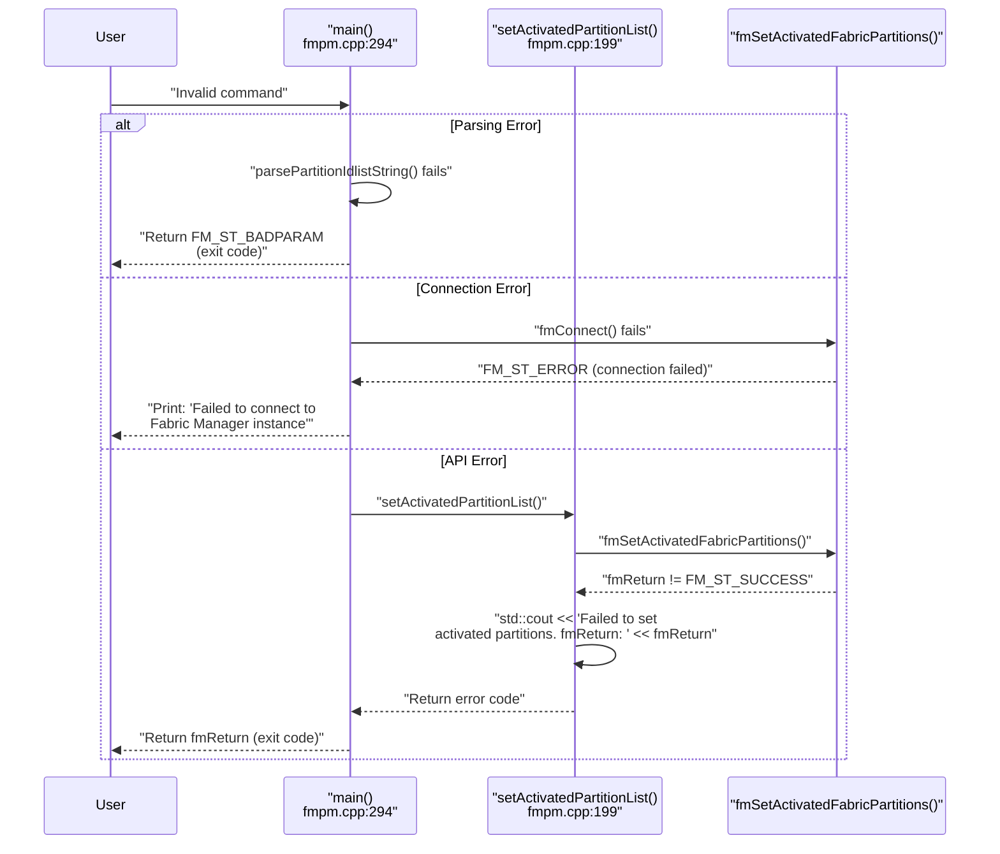
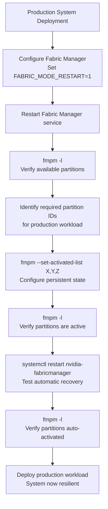

<!-- source: DeepWiki mcp.deepwiki.com · repo NVIDIA/Fabric-Manager-Client · page 3.4 Resiliency Mode · fetched 2026-10-26 -->

# Resiliency Mode

<details>
<summary>Relevant source files</summary>

The following files were used as context for generating this wiki page:

- [README.md](README.md)
- [fmpm.cpp](fmpm.cpp)

</details>


## Purpose and Scope

This page documents the Fabric Manager Resiliency Mode feature, which enables automatic restoration of GPU partition configurations after Fabric Manager service restarts or failures. This capability is critical for production environments requiring high availability and minimal manual intervention during recovery scenarios.

Resiliency Mode is accessed through the `--set-activated-list` command in the `fmpm` client. For general partition management operations (listing, single activation/deactivation), see [Managing GPU Partitions](#3.2). For diagnostic commands, see [Monitoring and Diagnostics](#3.3). For basic configuration setup, see [Configuration](#2.3).

---

## Overview

Resiliency Mode transforms the Fabric Manager from a stateless service into a stateful system with persistent partition configuration. When enabled, the Fabric Manager records which partitions should remain active and automatically restores them after service restarts, crashes, or system reboots.

### Key Characteristics

| Feature | Without Resiliency Mode | With Resiliency Mode |
|---------|------------------------|---------------------|
| **Partition State Persistence** | Volatile (lost on restart) | Persistent across restarts |
| **Post-Restart Behavior** | All partitions inactive | Configured partitions auto-activate |
| **Configuration Method** | Individual `-a`/`-d` commands | Bulk `--set-activated-list` command |
| **Use Case** | Development, testing | Production, high-availability systems |
| **Manual Intervention** | Required after every restart | Not required after initial setup |

The resiliency mechanism operates at the Fabric Manager server level, with the `fmpm` client providing the interface to configure the desired persistent state.

**Sources:** [README.md:22-27](), [fmpm.cpp:320-325]()

---

## Configuration Requirements

### Fabric Manager Configuration

Resiliency Mode **must** be explicitly enabled in the Fabric Manager service configuration. The server-side configuration parameter `FABRIC_MODE_RESTART` controls this behavior:

```
FABRIC_MODE_RESTART=1
```

When set to `1`, the Fabric Manager:
- Persists the activated partition list to storage
- Reads the persisted state on service startup
- Automatically restores all partitions in the activated list

When set to `0` (default) or omitted:
- The `--set-activated-list` command will fail or have no effect
- Partition state is not persisted
- Manual reactivation is required after restarts

### Configuration Mismatch Behavior

If the client attempts to use `--set-activated-list` without `FABRIC_MODE_RESTART=1` configured on the server:
- The API call `fmSetActivatedFabricPartitions()` may return an error code
- The partition list will not be persisted
- No automatic restoration will occur on restart

This tight coupling requires careful coordination between client operations and server configuration.

**Sources:** [README.md:24](), [fmpm.cpp:322]()

---

## Using the --set-activated-list Command

### Command Syntax

```bash
fmpm --set-activated-list <Partition IDs> [connection options]
```

Where:
- `<Partition IDs>`: Comma-separated list of partition IDs (0-based integers)
- **No spaces allowed** between partition IDs in the list
- Connection options: `--hostname` or `--unix-domain-socket`

### Examples

#### Setting Multiple Partitions

```bash
# Set partitions 1, 2, and 3 as the persistent activated list
fmpm --set-activated-list 1,2,3 --hostname 192.168.1.100
```

#### Using Unix Domain Socket

```bash
# Same operation via Unix socket
fmpm --set-activated-list 1,2,3 --unix-domain-socket /var/run/nvidia-fm.sock
```

#### Clearing All Partitions

```bash
# Empty list - no partitions will auto-activate on restart
fmpm --set-activated-list 0 --hostname 127.0.0.1
```

#### Common Error: Spaces in List

```bash
# INCORRECT - contains spaces (will fail)
fmpm --set-activated-list "1, 2, 3"

# CORRECT - no spaces
fmpm --set-activated-list 1,2,3
```

### Input Validation and Parsing

The client performs validation before sending the request to the server:



**Validation Rules:**
1. Partition IDs must be integers in range `[0, FM_MAX_FABRIC_PARTITIONS-1]`
2. Duplicate IDs are silently ignored (not added to the list)
3. Empty list is valid (results in no auto-activated partitions)

**Sources:** [fmpm.cpp:33-61](), [fmpm.cpp:361-374]()

---

## State Persistence and Recovery Flow

### Setting the Activated List

The following sequence diagram shows how the activated partition list is persisted:



**Sources:** [fmpm.cpp:198-220](), [fmpm.cpp:449-451]()

### Automatic Recovery on Restart

When the Fabric Manager service restarts, it automatically restores the partition state:



This automatic restoration ensures:
- **Zero manual intervention**: Administrators do not need to re-run activation commands
- **Consistent state**: The system returns to the known-good configuration
- **Reduced downtime**: Partitions are available immediately after service startup
- **Crash recovery**: Works for both planned restarts and unexpected failures

**Sources:** [README.md:25-27]()

---

## Data Structures and API Integration

### fmActivatedFabricPartitionList_t Structure

The `--set-activated-list` command uses a specific data structure for bulk partition configuration:



### Implementation in setActivatedPartitionList()

The function [fmpm.cpp:198-220]() follows this implementation pattern:

1. **Initialize structure**: Zero-initialize `fmActivatedFabricPartitionList_t`
2. **Set version field**: `partitionList.version = fmActivatedFabricPartitionList_version`
3. **Set count**: `partitionList.numPartitions = numPartitions`
4. **Copy partition IDs**: Loop through `partIds` array and populate `partitionList.partitionIds[]`
5. **Invoke API**: Call `fmSetActivatedFabricPartitions(fmHandle, &partitionList)`
6. **Check return**: Return `FM_ST_SUCCESS` or error code

### API Call Chain

```mermaid
graph LR
    Main["main()<br/>fmpm.cpp:294"]
    Parse["Argument parsing<br/>fmpm.cpp:361-374"]
    SetList["setActivatedPartitionList()<br/>fmpm.cpp:199"]
    BuildStruct["Build fmActivatedFabricPartitionList_t<br/>fmpm.cpp:202-211"]
    APICall["fmSetActivatedFabricPartitions()<br/>FM API function"]
    FMService["Fabric Manager<br/>Service Handler"]
    Storage["Persistent Storage<br/>Write Operation"]
    
    Main --> Parse
    Parse -->|"operation = SHARED_FABRIC_CMD_<br/>SET_ACTIVATED_PARTITION_LIST"| SetList
    SetList --> BuildStruct
    BuildStruct --> APICall
    APICall --> FMService
    FMService --> Storage
```



**Sources:** [fmpm.cpp:198-220](), [fmpm.cpp:449-451]()

---

## Comparison: Resiliency Mode vs. Single Partition Operations

### Operational Differences

| Aspect | `-a` / `-d` Commands | `--set-activated-list` Command |
|--------|---------------------|-------------------------------|
| **Scope** | Single partition per invocation | Multiple partitions in one call |
| **State Persistence** | No (volatile) | Yes (requires `FABRIC_MODE_RESTART=1`) |
| **Post-Restart** | Partition becomes inactive | Partitions auto-activate |
| **API Function** | `fmActivateFabricPartition()`<br/>`fmDeactivateFabricPartition()` | `fmSetActivatedFabricPartitions()` |
| **Data Structure** | `fmFabricPartitionId_t` (scalar) | `fmActivatedFabricPartitionList_t` (array) |
| **Typical Use** | Interactive management | Initial configuration, disaster recovery |

### When to Use Each Approach

#### Use `-a` and `-d` for:
- **Development and testing**: Quick partition state changes during development
- **Temporary configurations**: Short-lived partition activations for specific workloads
- **Interactive debugging**: Manual control during troubleshooting
- **Non-production environments**: Systems without resiliency requirements

#### Use `--set-activated-list` for:
- **Production deployments**: Systems requiring automatic recovery
- **High-availability setups**: Minimize downtime during service restarts
- **Initial provisioning**: Set the baseline partition configuration
- **Disaster recovery**: Define the known-good state for automatic restoration
- **Infrastructure-as-code**: Codify the desired partition state in automation scripts

### Example Workflow Comparison

**Without Resiliency Mode (Manual Recovery):**
```bash
# Initial setup
fmpm -a 1
fmpm -a 2
fmpm -a 3

# After Fabric Manager restart - all partitions inactive
# Administrator must manually reactivate:
fmpm -a 1
fmpm -a 2
fmpm -a 3
```

**With Resiliency Mode (Automatic Recovery):**
```bash
# Initial setup (one-time configuration)
fmpm --set-activated-list 1,2,3

# After Fabric Manager restart - partitions automatically activated
# No manual intervention required
```

**Sources:** [fmpm.cpp:174-196](), [fmpm.cpp:198-220]()

---

## Implementation Details

### Command-Line Parsing Logic

The command-line parser [fmpm.cpp:361-374]() handles the `--set-activated-list` argument:



**Key Implementation Notes:**
1. The parser expects the partition list immediately after the `--set-activated-list` flag
2. Missing argument results in immediate error and exit
3. Invalid partition IDs (detected in `parsePartitionIdlistString()`) cause early termination
4. The `++i` increment skips the partition list argument in the loop

### Error Handling Path



Common error scenarios:
- **Invalid partition ID**: ID out of range `[0, FM_MAX_FABRIC_PARTITIONS-1]`
- **Connection failure**: Cannot reach Fabric Manager (network/socket issue)
- **Resiliency mode not enabled**: `FABRIC_MODE_RESTART=0` or not set on server
- **Malformed input**: Spaces in partition list, non-numeric characters

**Sources:** [fmpm.cpp:361-374](), [fmpm.cpp:198-220]()

---

## Usage Patterns and Best Practices

### Recommended Workflow



### Configuration File Management

While the `fmpm` client does not directly manage configuration files, administrators must ensure:

1. **Fabric Manager configuration** includes `FABRIC_MODE_RESTART=1`
2. **Connection settings** match between client and server:
   - If using TCP: `FM_CMD_BIND_INTERFACE` set on server, `--hostname` on client
   - If using Unix socket: `FM_CMD_UNIX_SOCKET_PATH` set on server, `--unix-domain-socket` on client
3. **Verification** of persisted state after configuration changes

### Integration with Automation

Example integration in a provisioning script:

```bash
#!/bin/bash
# Fabric Manager partition configuration script

FM_HOST="192.168.1.100"
REQUIRED_PARTITIONS="1,2,3,4"

# Verify Fabric Manager is accessible
if ! fmpm -l --hostname "$FM_HOST" > /dev/null 2>&1; then
    echo "ERROR: Cannot connect to Fabric Manager at $FM_HOST"
    exit 1
fi

# Configure persistent activated partition list
echo "Setting activated partition list: $REQUIRED_PARTITIONS"
if ! fmpm --set-activated-list "$REQUIRED_PARTITIONS" --hostname "$FM_HOST"; then
    echo "ERROR: Failed to set activated partition list"
    exit 1
fi

# Verify configuration
echo "Verifying partition configuration..."
fmpm -l --hostname "$FM_HOST"

echo "Configuration complete. Partitions will auto-activate on FM restart."
```

**Sources:** [README.md:22-27](), [fmpm.cpp:320-325]()

---

## Relationship to Other Features

### Connection Methods

Resiliency Mode works with both connection methods:
- **TCP sockets** (`--hostname`): For remote management or distributed systems
- **Unix domain sockets** (`--unix-domain-socket`): For local, high-performance communication

The persistence mechanism operates at the server level, independent of the client connection method.

### NVLink Failure Handling

Resiliency Mode does not automatically handle NVLink failures. If a partition has failed NVLink connections:
- The partition will still be included in the activated list
- Auto-activation may fail if hardware is unhealthy
- Use `--get-nvlink-failed-devices` to diagnose issues before configuring persistent state
- Use `--list-unsupported-partitions` to identify partitions that cannot be activated

See [Monitoring and Diagnostics](#3.3) for details on failure detection.

### Version Compatibility

The `fmActivatedFabricPartitionList_t` structure includes a version field [fmpm.cpp:205]() to ensure compatibility between client and server:
- Client sets `partitionList.version = fmActivatedFabricPartitionList_version`
- Server validates the version field
- Mismatched versions may result in API errors

Always ensure the `fmpm` client and Fabric Manager service versions are compatible.

**Sources:** [fmpm.cpp:198-220](), [fmpm.cpp:205]()

---

