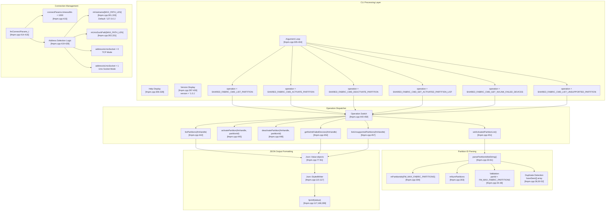

<!-- source: DeepWiki mcp.deepwiki.com · repo NVIDIA/Fabric-Manager-Client · page 4 Technical Reference · fetched 2026-10-26 -->

# Technical Reference

<details>
<summary>Relevant source files</summary>

The following files were used as context for generating this wiki page:

- [README.md](README.md)
- [fmpm.cpp](fmpm.cpp)

</details>


## Purpose and Scope

This section provides in-depth technical documentation of the NVIDIA Fabric Manager Client (fmpm) implementation, covering its architecture, internal systems, data structures, and API interactions. This material is intended for developers who need to understand the codebase internals, build system, or integration points.

For user-facing documentation on commands and workflows, see [User Guide](#3). For licensing terms and restrictions, see [License and Legal](#5).

---

## System Architecture and Code Entity Mapping

The fmpm system implements a client-server architecture where the client application communicates with the NVIDIA Fabric Manager service through the FM API library. The following diagram maps high-level system components to their actual code implementations:

```mermaid
graph TB
    subgraph "fmpm Client Binary"
        Main["main()<br/>[fmpm.cpp:294-465]"]
        ArgParser["Command-line Parser<br/>[fmpm.cpp:335-404]"]
        OpEnum["SharedFabricCmdEnum_t<br/>[fmpm.cpp:12-29]"]
        
        ListPart["listPartitions()<br/>[fmpm.cpp:64-120]"]
        ActPart["activatePartition()<br/>[fmpm.cpp:174-184]"]
        DeactPart["deactivatePartition()<br/>[fmpm.cpp:187-196]"]
        SetActList["setActivatedPartitionList()<br/>[fmpm.cpp:199-220]"]
        GetFailed["getNvlinkFailedDevices()<br/>[fmpm.cpp:223-292]"]
        ListUnsup["listUnsupportedPartitions()<br/>[fmpm.cpp:123-171]"]
        
        JSONWriter["Json::StyledWriter<br/>[json/json.h]"]
    end
    
    subgraph "FM API Library (libnvfm)"
        LibInit["fmLibInit()<br/>[nv_fm_agent.h]"]
        Connect["fmConnect()<br/>[nv_fm_agent.h]"]
        GetPartitions["fmGetSupportedFabricPartitions()<br/>[nv_fm_agent.h]"]
        Activate["fmActivateFabricPartition()<br/>[nv_fm_agent.h]"]
        Deactivate["fmDeactivateFabricPartition()<br/>[nv_fm_agent.h]"]
        SetActivated["fmSetActivatedFabricPartitions()<br/>[nv_fm_agent.h]"]
        GetNVLinkFail["fmGetNvlinkFailedDevices()<br/>[nv_fm_agent.h]"]
        GetUnsupported["fmGetUnsupportedFabricPartitions()<br/>[nv_fm_agent.h]"]
        Disconnect["fmDisconnect()<br/>[nv_fm_agent.h]"]
        LibShutdown["fmLibShutdown()<br/>[nv_fm_agent.h]"]
        
        HandleType["fmHandle_t<br/>Connection Handle"]
        ReturnType["fmReturn_t<br/>Return Codes"]
    end
    
    subgraph "Data Structures"
        PartList["fmFabricPartitionList_t<br/>[nv_fm_agent.h]"]
        PartInfo["fmFabricPartitionInfo_t<br/>[nv_fm_agent.h]"]
        GpuInfo["fmFabricPartitionGpuInfo_t<br/>[nv_fm_agent.h]"]
        ConnParams["fmConnectParams_t<br/>[fmpm.cpp:414-432]"]
        ActList["fmActivatedFabricPartitionList_t<br/>[fmpm.cpp:202-211]"]
        FailedDevs["fmNvlinkFailedDevices_t<br/>[fmpm.cpp:226-229]"]
        UnsupList["fmUnsupportedFabricPartitionList_t<br/>[fmpm.cpp:126-129]"]
    end
    
    Main --> ArgParser
    ArgParser --> OpEnum
    Main --> LibInit
    Main --> Connect
    Main --> ListPart
    Main --> ActPart
    Main --> DeactPart
    Main --> SetActList
    Main --> GetFailed
    Main --> ListUnsup
    Main --> Disconnect
    Main --> LibShutdown
    
    Connect --> HandleType
    Connect --> ConnParams
    
    ListPart --> GetPartitions
    ActPart --> Activate
    DeactPart --> Deactivate
    SetActList --> SetActivated
    GetFailed --> GetNVLinkFail
    ListUnsup --> GetUnsupported
    
    GetPartitions --> PartList
    PartList --> PartInfo
    PartInfo --> GpuInfo
    SetActivated --> ActList
    GetNVLinkFail --> FailedDevs
    GetUnsupported --> UnsupList
    
    ListPart --> JSONWriter
    GetFailed --> JSONWriter
    ListUnsup --> JSONWriter
    
    LibInit --> ReturnType
    Connect --> ReturnType
    GetPartitions --> ReturnType
    Activate --> ReturnType
    Deactivate --> ReturnType
    SetActivated --> ReturnType
```



**Sources:** [fmpm.cpp:1-466](), [README.md:1-39]()

---

## Component Architecture and Implementation

This diagram details how the major functional subsystems are implemented in code:



**Sources:** [fmpm.cpp:1-466]()

---

## API Call Flow and Lifecycle

The complete API interaction lifecycle, showing actual function names and calling sequence:

```mermaid
sequenceDiagram
    participant User
    participant main["main()<br/>[fmpm.cpp:294]"]
    participant fmLibInit["fmLibInit()"]
    participant fmConnect["fmConnect()"]
    participant APIFunc["API Function<br/>(fmGetSupportedFabricPartitions,<br/>fmActivateFabricPartition,<br/>etc.)"]
    participant fmDisconnect["fmDisconnect()"]
    participant fmLibShutdown["fmLibShutdown()"]
    
    Note over User,fmLibShutdown: Initialization Phase
    User->>main: "./fmpm -l --hostname 10.0.0.1"
    activate main
    
    main->>main: "Parse arguments<br/>[fmpm.cpp:335-404]"
    main->>main: "Set operation enum<br/>SharedFabricCmdEnum_t"
    
    main->>fmLibInit: "fmLibInit()<br/>[fmpm.cpp:407]"
    activate fmLibInit
    fmLibInit-->>main: "fmReturn_t (FM_ST_SUCCESS)"
    deactivate fmLibInit
    
    main->>main: "Setup fmConnectParams_t<br/>[fmpm.cpp:414-432]<br/>timeoutMs=1000<br/>addressInfo=mHostname/mUnixSockPath"
    
    main->>fmConnect: "fmConnect(&connectParams, &fmHandle)<br/>[fmpm.cpp:434]"
    activate fmConnect
    fmConnect-->>main: "fmHandle_t, fmReturn_t"
    deactivate fmConnect
    
    Note over User,fmLibShutdown: Operation Phase
    
    alt operation == SHARED_FABRIC_CMD_LIST_PARTITION
        main->>APIFunc: "listPartitions(fmHandle)<br/>[fmpm.cpp:442]"
        activate APIFunc
        APIFunc->>APIFunc: "memset(&partitionList, 0)<br/>[fmpm.cpp:69]"
        APIFunc->>APIFunc: "partitionList.version = fmFabricPartitionList_version<br/>[fmpm.cpp:70]"
        APIFunc->>fmConnect: "fmGetSupportedFabricPartitions(fmHandle, &partitionList)<br/>[fmpm.cpp:72]"
        fmConnect-->>APIFunc: "fmFabricPartitionList_t populated"
        APIFunc->>APIFunc: "Format to JSON<br/>[fmpm.cpp:77-117]"
        APIFunc-->>main: "fmReturn_t"
        deactivate APIFunc
    end
    
    alt operation == SHARED_FABRIC_CMD_ACTIVATE_PARTITION
        main->>APIFunc: "activatePartition(fmHandle, partitionId)<br/>[fmpm.cpp:445]"
        activate APIFunc
        APIFunc->>fmConnect: "fmActivateFabricPartition(fmHandle, partitionId)<br/>[fmpm.cpp:178]"
        fmConnect-->>APIFunc: "fmReturn_t"
        APIFunc-->>main: "fmReturn_t"
        deactivate APIFunc
    end
    
    alt operation == SHARED_FABRIC_CMD_SET_ACTIVATED_PARTITION_LIST
        main->>APIFunc: "setActivatedPartitionList(fmHandle, mPartitionIds, mNumPartitions)<br/>[fmpm.cpp:451]"
        activate APIFunc
        APIFunc->>APIFunc: "memset(&partitionList, 0)<br/>[fmpm.cpp:204]"
        APIFunc->>APIFunc: "Setup fmActivatedFabricPartitionList_t<br/>[fmpm.cpp:205-211]"
        APIFunc->>fmConnect: "fmSetActivatedFabricPartitions(fmHandle, &partitionList)<br/>[fmpm.cpp:213]"
        fmConnect-->>APIFunc: "fmReturn_t"
        APIFunc-->>main: "fmReturn_t"
        deactivate APIFunc
    end
    
    Note over User,fmLibShutdown: Cleanup Phase
    
    main->>fmDisconnect: "fmDisconnect(fmHandle)<br/>[fmpm.cpp:462]"
    activate fmDisconnect
    fmDisconnect-->>main: "void"
    deactivate fmDisconnect
    
    main->>fmLibShutdown: "fmLibShutdown()<br/>[fmpm.cpp:463]"
    activate fmLibShutdown
    fmLibShutdown-->>main: "void"
    deactivate fmLibShutdown
    
    main-->>User: "Exit with fmReturn_t code<br/>[fmpm.cpp:464]"
    deactivate main
```

**Sources:** [fmpm.cpp:294-465]()

---

## Data Structure Relationships

The core data structures used by fmpm and their relationships:

```mermaid
graph TB
    subgraph "Connection Structures"
        ConnParams["fmConnectParams_t<br/>[fmpm.cpp:414]"]
        ConnVersion["version: fmConnectParams_version<br/>[fmpm.cpp:416]"]
        ConnTimeout["timeoutMs: 1000<br/>[fmpm.cpp:415]"]
        ConnAddr["addressInfo[MAX_PATH_LEN]<br/>[fmpm.cpp:418-428]"]
        ConnFlag["addressIsUnixSocket: 0 or 1<br/>[fmpm.cpp:422,427,432]"]
        ConnHandle["fmHandle_t<br/>Opaque handle returned by fmConnect"]
        
        ConnParams --> ConnVersion
        ConnParams --> ConnTimeout
        ConnParams --> ConnAddr
        ConnParams --> ConnFlag
        ConnParams -.->|"used by"| ConnHandle
    end
    
    subgraph "Partition List Structures"
        PartList["fmFabricPartitionList_t<br/>[fmpm.cpp:67]"]
        PartVersion["version: fmFabricPartitionList_version<br/>[fmpm.cpp:70]"]
        NumPart["numPartitions: unsigned int<br/>[fmpm.cpp:84]"]
        MaxNumPart["maxNumPartitions: unsigned int<br/>[fmpm.cpp:85]"]
        PartInfoArray["partitionInfo[]<br/>Array of fmFabricPartitionInfo_t<br/>[fmpm.cpp:88-111]"]
        
        PartList --> PartVersion
        PartList --> NumPart
        PartList --> MaxNumPart
        PartList --> PartInfoArray
    end
    
    subgraph "Partition Info Structure"
        PartInfo["fmFabricPartitionInfo_t<br/>[fmpm.cpp:90]"]
        PartId["partitionId: unsigned int<br/>[fmpm.cpp:93]"]
        IsActive["isActive: bool<br/>[fmpm.cpp:94]"]
        NumGpus["numGpus: unsigned int<br/>[fmpm.cpp:95]"]
        GpuInfoArray["gpuInfo[]<br/>Array of fmFabricPartitionGpuInfo_t<br/>[fmpm.cpp:97-107]"]
        
        PartInfoArray --> PartInfo
        PartInfo --> PartId
        PartInfo --> IsActive
        PartInfo --> NumGpus
        PartInfo --> GpuInfoArray
    end
    
    subgraph "GPU Info Structure"
        GpuInfo["fmFabricPartitionGpuInfo_t<br/>[fmpm.cpp:99]"]
        PhysId["physicalId: unsigned int<br/>[fmpm.cpp:100]"]
        UUID["uuid: char[]<br/>[fmpm.cpp:101]"]
        PCIBus["pciBusId: char[]<br/>[fmpm.cpp:102]"]
        NumLinks["numNvLinksAvailable: unsigned int<br/>[fmpm.cpp:103]"]
        MaxLinks["maxNumNvLinks: unsigned int<br/>[fmpm.cpp:104]"]
        LinkRate["nvlinkLineRateMBps: unsigned int<br/>[fmpm.cpp:105]"]
        
        GpuInfoArray --> GpuInfo
        GpuInfo --> PhysId
        GpuInfo --> UUID
        GpuInfo --> PCIBus
        GpuInfo --> NumLinks
        GpuInfo --> MaxLinks
        GpuInfo --> LinkRate
    end
    
    subgraph "Activated Partition List Structure"
        ActList["fmActivatedFabricPartitionList_t<br/>[fmpm.cpp:202]"]
        ActVersion["version: fmActivatedFabricPartitionList_version<br/>[fmpm.cpp:205]"]
        ActNumPart["numPartitions: unsigned int<br/>[fmpm.cpp:206]"]
        ActPartIds["partitionIds[]<br/>Array of partition IDs<br/>[fmpm.cpp:208-211]"]
        
        ActList --> ActVersion
        ActList --> ActNumPart
        ActList --> ActPartIds
    end
    
    subgraph "NVLink Failed Devices Structure"
        FailedDevs["fmNvlinkFailedDevices_t<br/>[fmpm.cpp:226]"]
        FailVersion["version: fmNvlinkFailedDevices_version<br/>[fmpm.cpp:229]"]
        NumFailGpu["numGpus: unsigned int<br/>[fmpm.cpp:246]"]
        NumFailSwitch["numSwitches: unsigned int<br/>[fmpm.cpp:247]"]
        GpuInfoFail["gpuInfo[]<br/>fmNvlinkFailedDeviceInfo_t<br/>[fmpm.cpp:252-266]"]
        SwitchInfoFail["switchInfo[]<br/>fmNvlinkFailedDeviceInfo_t<br/>[fmpm.cpp:270-284]"]
        
        FailedDevs --> FailVersion
        FailedDevs --> NumFailGpu
        FailedDevs --> NumFailSwitch
        FailedDevs --> GpuInfoFail
        FailedDevs --> SwitchInfoFail
    end
    
    subgraph "Failed Device Info Structure"
        FailDevInfo["fmNvlinkFailedDeviceInfo_t"]
        FailUUID["uuid: char[]<br/>[fmpm.cpp:255,273]"]
        FailPCIBus["pciBusId: char[]<br/>[fmpm.cpp:256,274]"]
        FailNumPorts["numPorts: unsigned int<br/>[fmpm.cpp:257,275]"]
        FailPortArray["portNum[]<br/>Array of port numbers<br/>[fmpm.cpp:260-263]"]
        
        GpuInfoFail --> FailDevInfo
        SwitchInfoFail --> FailDevInfo
        FailDevInfo --> FailUUID
        FailDevInfo --> FailPCIBus
        FailDevInfo --> FailNumPorts
        FailDevInfo --> FailPortArray
    end
    
    subgraph "Unsupported Partition Structures"
        UnsupList["fmUnsupportedFabricPartitionList_t<br/>[fmpm.cpp:126]"]
        UnsupVersion["version: fmUnsupportedFabricPartitionList_version<br/>[fmpm.cpp:129]"]
        UnsupNumPart["numPartitions: unsigned int<br/>[fmpm.cpp:144]"]
        UnsupPartInfo["partitionInfo[]<br/>fmUnsupportedFabricPartitionInfo_t<br/>[fmpm.cpp:147-162]"]
        
        UnsupList --> UnsupVersion
        UnsupList --> UnsupNumPart
        UnsupList --> UnsupPartInfo
        
        UnsupPartInfo --> UnsupPartId["partitionId: unsigned int<br/>[fmpm.cpp:152]"]
        UnsupPartInfo --> UnsupNumGpus["numGpus: unsigned int<br/>[fmpm.cpp:153]"]
        UnsupPartInfo --> UnsupGpuIds["gpuPhysicalIds[]<br/>Array of physical IDs<br/>[fmpm.cpp:155-158]"]
    end
```



**Sources:** [fmpm.cpp:33-292]()

---

## Core Subsystems Overview

The fmpm implementation consists of several interconnected subsystems, each responsible for specific functionality:

### 4.1 Architecture Overview

The overall system architecture, including the client-server model, layered design, communication flow, and major subsystems. See [Architecture Overview](#4.1) for detailed information.

### 4.2 Communication Protocols

The communication layer supports two transport mechanisms:
- **TCP Sockets**: Configured via `--hostname` option [fmpm.cpp:379-387](), requires `FM_CMD_BIND_INTERFACE` in Fabric Manager configuration
- **Unix Domain Sockets**: Configured via `--unix-domain-socket` option [fmpm.cpp:388-396](), requires `FM_CMD_UNIX_SOCKET_PATH` in Fabric Manager configuration

Connection is established through `fmConnect()` with `fmConnectParams_t` [fmpm.cpp:414-438](). The `addressIsUnixSocket` flag [fmpm.cpp:422,427,432]() determines which transport is used. See [Communication Protocols](#4.2) for detailed protocol specifications.

### 4.3 Data Structures and API

The system uses strongly-typed C structures for all API interactions. Key structure families include:

| Structure Family | Purpose | Key Members |
|-----------------|---------|-------------|
| `fmFabricPartitionList_t` | List all partitions | `numPartitions`, `partitionInfo[]` |
| `fmFabricPartitionInfo_t` | Partition metadata | `partitionId`, `isActive`, `numGpus`, `gpuInfo[]` |
| `fmFabricPartitionGpuInfo_t` | GPU details | `uuid`, `pciBusId`, `numNvLinksAvailable` |
| `fmActivatedFabricPartitionList_t` | Resiliency mode list | `numPartitions`, `partitionIds[]` |
| `fmNvlinkFailedDevices_t` | Failed device diagnostics | `numGpus`, `numSwitches`, `gpuInfo[]`, `switchInfo[]` |
| `fmUnsupportedFabricPartitionList_t` | Unsupported configurations | `numPartitions`, `partitionInfo[]` |
| `fmConnectParams_t` | Connection configuration | `timeoutMs`, `addressInfo`, `addressIsUnixSocket` |

All structures include a `version` field for API compatibility checking. See [Data Structures and API](#4.3) for complete structure definitions and field descriptions.

### 4.4 Build System Details

The build system uses a standard Makefile with pkg-config integration for dependency management. Required build dependencies:

| Package | Purpose | Notes |
|---------|---------|-------|
| `nvidia-fabricmanager-devel` (RHEL) | FM API headers and library | Provides `nv_fm_agent.h` |
| `nvidia-fabricmanager-dev` (Ubuntu) | FM API headers and library | Debian package variant |
| `jsoncpp-devel` (RHEL) | JSON serialization | Requires EPEL repository |
| `libjsoncpp-dev` (Ubuntu) | JSON serialization | Standard Ubuntu package |

The build process links against `libnvfm` and `libjsoncpp` libraries. See [Build System Details](#4.4) for compiler flags, linker options, and build configuration.

### 4.5 Error Handling and Return Codes

Error handling uses the `fmReturn_t` enumeration returned by all API functions. Key error handling patterns:

**Validation Errors** [fmpm.cpp:44-48](): Input validation occurs before API calls
```
if ( partId < 0 || partId >= FM_MAX_FABRIC_PARTITIONS ) {
    return FM_ST_BADPARAM;
}
```

**API Call Failures** [fmpm.cpp:73-75](): Checked after every FM API call
```
fmReturn = fmGetSupportedFabricPartitions(fmHandle, &partitionList);
if (fmReturn != FM_ST_SUCCESS) {
    std::cout << "Failed to get partition list. fmReturn: " << fmReturn;
    return fmReturn;
}
```

**Connection Failures** [fmpm.cpp:435-438](): Library initialization and connection errors halt execution

Return codes include:
- `FM_ST_SUCCESS`: Operation completed successfully
- `FM_ST_BADPARAM`: Invalid parameter provided
- `FM_ST_ERROR`: General error condition

See [Error Handling and Return Codes](#4.5) for complete error code reference and troubleshooting guidance.

---

## Implementation Constants and Limits

The following constants define system limits and defaults:

| Constant | Value | Location | Purpose |
|----------|-------|----------|---------|
| `version` | `"1.0.1"` | [fmpm.cpp:6]() | Client version string |
| `MAX_PATH_LEN` | `256` | [fmpm.cpp:8]() | Maximum length for hostname and socket paths |
| `FM_MAX_FABRIC_PARTITIONS` | (defined in nv_fm_agent.h) | [fmpm.cpp:36,44,304,348]() | Maximum number of partitions |
| Default hostname | `"127.0.0.1"` | [fmpm.cpp:333]() | Default TCP connection address |
| Connection timeout | `1000` | [fmpm.cpp:415]() | Connection timeout in milliseconds |

**Sources:** [fmpm.cpp:6-8](), [fmpm.cpp:333](), [fmpm.cpp:415]()

---

## Operational Command Mapping

The following table maps command-line operations to their internal implementations:

| CLI Option | Enum Value | Handler Function | API Call |
|------------|-----------|------------------|----------|
| `-l` | `SHARED_FABRIC_CMD_LIST_PARTITION` | `listPartitions()` [fmpm.cpp:64-120]() | `fmGetSupportedFabricPartitions()` |
| `-a <ID>` | `SHARED_FABRIC_CMD_ACTIVATE_PARTITION` | `activatePartition()` [fmpm.cpp:174-184]() | `fmActivateFabricPartition()` |
| `-d <ID>` | `SHARED_FABRIC_CMD_DEACTIVATE_PARTITION` | `deactivatePartition()` [fmpm.cpp:187-196]() | `fmDeactivateFabricPartition()` |
| `--set-activated-list <IDs>` | `SHARED_FABRIC_CMD_SET_ACTIVATED_PARTITION_LIST` | `setActivatedPartitionList()` [fmpm.cpp:199-220]() | `fmSetActivatedFabricPartitions()` |
| `--get-nvlink-failed-devices` | `SHARED_FABRIC_CMD_GET_NVLINK_FAILED_DEVICES` | `getNvlinkFailedDevices()` [fmpm.cpp:223-292]() | `fmGetNvlinkFailedDevices()` |
| `--list-unsupported-partitions` | `SHARED_FABRIC_CMD_LIST_UNSUPPORTED_PARTITION` | `listUnsupportedPartitions()` [fmpm.cpp:123-171]() | `fmGetUnsupportedFabricPartitions()` |
| `--hostname <IP>` | `SHARED_FABRIC_CMD_HOSTNAME` | (sets `mHostname`) [fmpm.cpp:379-387]() | N/A (configuration) |
| `--unix-domain-socket <path>` | `SHARED_FABRIC_CMD_UNIX_DOMAIN_SOCKET` | (sets `mUnixSockPath`) [fmpm.cpp:388-396]() | N/A (configuration) |
| `-v` | N/A | Direct version output [fmpm.cpp:397-400]() | N/A |
| `-h` | `SHARED_FABRIC_CMD_HELP` | Direct help output [fmpm.cpp:306-328]() | N/A |

**Sources:** [fmpm.cpp:12-29](), [fmpm.cpp:337-404](), [fmpm.cpp:440-458]()

---

## JSON Output Generation

All query operations output structured JSON to stdout for machine readability. The JSON generation process uses the JsonCpp library:

**JSON Construction Pattern** [fmpm.cpp:77-117]():
1. Create `Json::Value` objects for nested data structures
2. Populate values from C structure fields
3. Use `Json::StyledWriter` for formatted output
4. Write to `stdout` via `fprintf()`

**Example: Partition List JSON Structure**
```
{
   "version": <unsigned int>,
   "numPartitions": <unsigned int>,
   "maxNumPartitions": <unsigned int>,
   "partitionInfo": [
      {
         "partitionId": <unsigned int>,
         "isActive": <bool>,
         "numGpus": <unsigned int>,
         "gpuInfo": [
            {
               "physicalId": <unsigned int>,
               "uuid": <string>,
               "pciBusId": <string>,
               "numNvLinksAvailable": <unsigned int>,
               "maxNumNvLinks": <unsigned int>,
               "nvlinkLineRateMBps": <unsigned int>
            }
         ]
      }
   ]
}
```

This structure is generated by iterating through the `fmFabricPartitionList_t` structure [fmpm.cpp:88-111]() and converting each field to JSON.

**Sources:** [fmpm.cpp:77-117](), [fmpm.cpp:138-168](), [fmpm.cpp:238-289]()

---

## Related Documentation

For specific technical topics, refer to these subsections:
- [Architecture Overview](#4.1) - Detailed system architecture and design patterns
- [Communication Protocols](#4.2) - Transport layer implementation details
- [Data Structures and API](#4.3) - Complete API reference and structure definitions
- [Build System Details](#4.4) - Compilation and linking specifications
- [Error Handling and Return Codes](#4.5) - Error codes and troubleshooting procedures

For user-facing information:
- [Getting Started](#2) - Building and configuring fmpm
- [User Guide](#3) - Command-line usage and workflows
- [License and Legal](#5) - Usage restrictions and legal requirements

---

