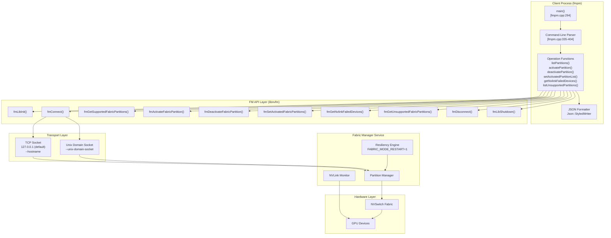
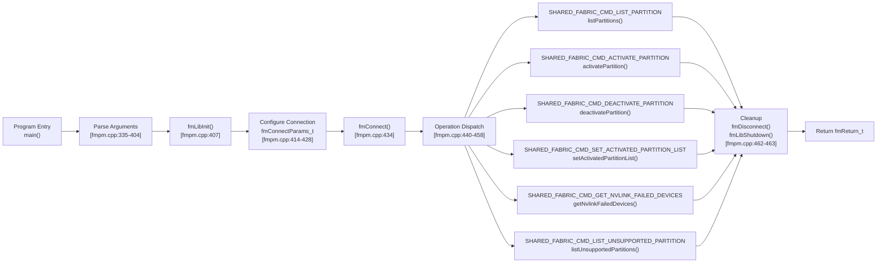
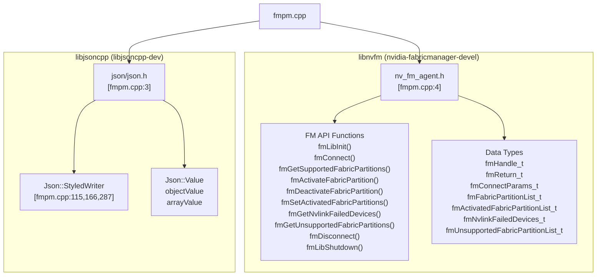
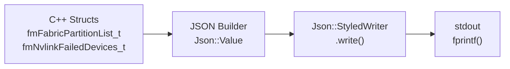
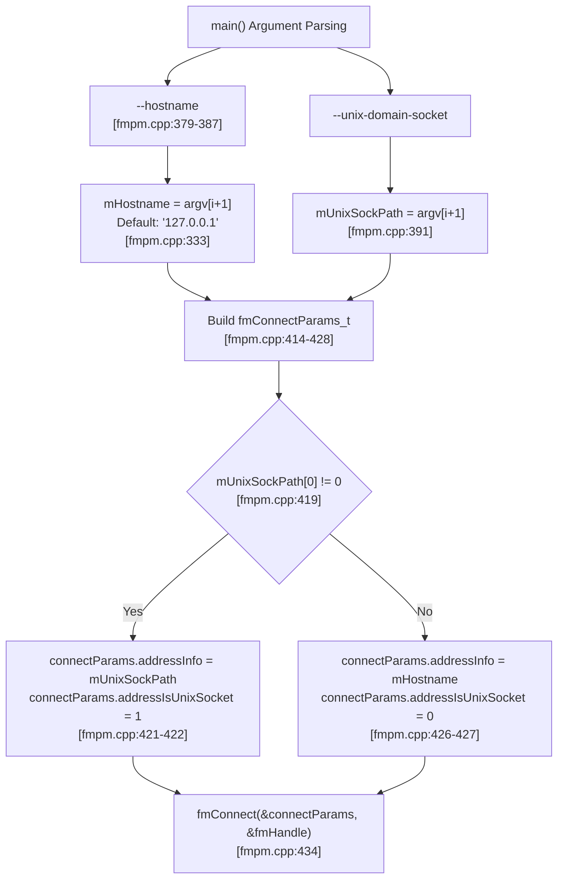
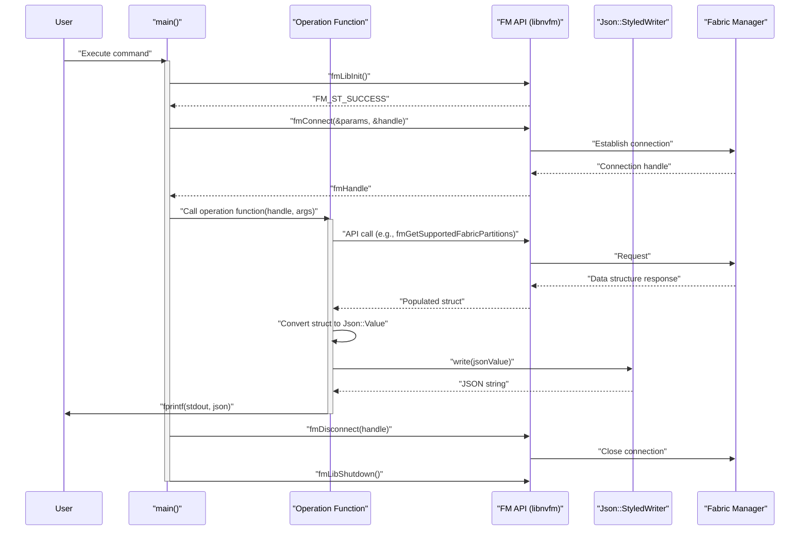
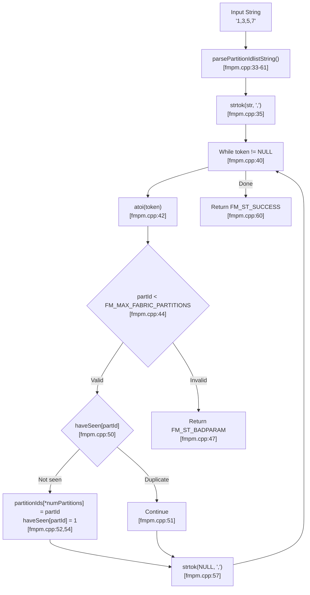
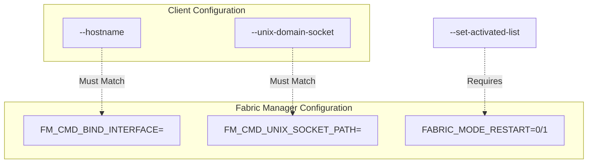

<!-- source: DeepWiki mcp.deepwiki.com · repo NVIDIA/Fabric-Manager-Client · page 4.1 Architecture Overview · fetched 2026-10-26 -->

# Architecture Overview

<details>
<summary>Relevant source files</summary>

The following files were used as context for generating this wiki page:

- [README.md](README.md)
- [fmpm.cpp](fmpm.cpp)

</details>


## Purpose and Scope

This document describes the high-level architecture of the Fabric Manager Client (`fmpm`), a command-line utility for managing GPU partitions in NVIDIA Fabric Manager's Shared NVSwitch feature. It covers the system's layered design, client-server interaction model, and major subsystems.

For detailed communication protocols (TCP/Unix sockets), see [Communication Protocols](#4.2). For API data structures and function signatures, see [Data Structures and API](#4.3). For build system internals, see [Build System Details](#4.4).

## System Architecture

The Fabric Manager Client follows a classic three-tier client-server architecture:



**Sources:** [fmpm.cpp:1-466]()

| Layer | Components | Responsibilities |
|-------|------------|------------------|
| **Client Process** | `fmpm` executable | Command parsing, API invocation, JSON formatting |
| **API Layer** | `libnvfm` (nvidia-fabricmanager-devel) | API abstraction, connection management, data marshalling |
| **Transport Layer** | TCP/Unix sockets | Inter-process communication |
| **Server Layer** | Fabric Manager daemon | Partition lifecycle, NVLink monitoring, state persistence |
| **Hardware Layer** | NVSwitch, GPUs | Physical compute resources |

## Client Architecture

The `fmpm` client is implemented as a single-file C++ application with a linear execution model:



**Sources:** [fmpm.cpp:294-465]()

### Command Enumeration

The client uses a strongly-typed enumeration for operation dispatch:

| Enum Value | Command-Line Option | Function Called | Line Reference |
|------------|---------------------|-----------------|----------------|
| `SHARED_FABRIC_CMD_LIST_PARTITION` | `-l` | `listPartitions()` | [fmpm.cpp:18,337,440-442]() |
| `SHARED_FABRIC_CMD_ACTIVATE_PARTITION` | `-a <ID>` | `activatePartition()` | [fmpm.cpp:19,339-351,443-445]() |
| `SHARED_FABRIC_CMD_DEACTIVATE_PARTITION` | `-d <ID>` | `deactivatePartition()` | [fmpm.cpp:20,352-360,446-448]() |
| `SHARED_FABRIC_CMD_SET_ACTIVATED_PARTITION_LIST` | `--set-activated-list <IDs>` | `setActivatedPartitionList()` | [fmpm.cpp:21,361-374,449-451]() |
| `SHARED_FABRIC_CMD_GET_NVLINK_FAILED_DEVICES` | `--get-nvlink-failed-devices` | `getNvlinkFailedDevices()` | [fmpm.cpp:22,375-376,452-454]() |
| `SHARED_FABRIC_CMD_LIST_UNSUPPORTED_PARTITION` | `--list-unsupported-partitions` | `listUnsupportedPartitions()` | [fmpm.cpp:23,377-378,455-457]() |

**Sources:** [fmpm.cpp:12-29]()

## Library Dependencies

The client integrates two external libraries:



**Sources:** [fmpm.cpp:1-4](), [README.md:31-38]()

### NVIDIA Fabric Manager API (libnvfm)

The FM API provides the core interface to Fabric Manager:

**Lifecycle Functions:**
- `fmLibInit()` - Initialize library [fmpm.cpp:407]()
- `fmConnect(fmConnectParams_t*, fmHandle_t*)` - Establish connection [fmpm.cpp:434]()
- `fmDisconnect(fmHandle_t)` - Close connection [fmpm.cpp:462]()
- `fmLibShutdown()` - Cleanup library [fmpm.cpp:463]()

**Query Functions:**
- `fmGetSupportedFabricPartitions(fmHandle_t, fmFabricPartitionList_t*)` [fmpm.cpp:72]()
- `fmGetUnsupportedFabricPartitions(fmHandle_t, fmUnsupportedFabricPartitionList_t*)` [fmpm.cpp:131]()
- `fmGetNvlinkFailedDevices(fmHandle_t, fmNvlinkFailedDevices_t*)` [fmpm.cpp:231]()

**State Modification Functions:**
- `fmActivateFabricPartition(fmHandle_t, fmFabricPartitionId_t)` [fmpm.cpp:178]()
- `fmDeactivateFabricPartition(fmHandle_t, fmFabricPartitionId_t)` [fmpm.cpp:191]()
- `fmSetActivatedFabricPartitions(fmHandle_t, fmActivatedFabricPartitionList_t*)` [fmpm.cpp:213]()

**Sources:** [fmpm.cpp:4]()

### JSON CPP Library (libjsoncpp)

All output is formatted as JSON using `libjsoncpp`:



**Sources:** [fmpm.cpp:3,77-117,138-168,238-289]()

The client constructs JSON hierarchies using `Json::Value` with type specifiers:
- `Json::objectValue` - JSON objects [fmpm.cpp:77,79,81]()
- `Json::arrayValue` - JSON arrays [fmpm.cpp:78,80]()

## Connection Management

The client supports two connection modes configured via `fmConnectParams_t`:



**Sources:** [fmpm.cpp:301-302,330-333,379-396,414-434]()

### Connection Parameters Structure

The `fmConnectParams_t` structure configures connection behavior:

| Field | Purpose | Value Set |
|-------|---------|-----------|
| `version` | API version | `fmConnectParams_version` [fmpm.cpp:416]() |
| `timeoutMs` | Connection timeout | `1000` milliseconds [fmpm.cpp:415]() |
| `addressInfo` | IP/hostname or socket path | `mHostname` or `mUnixSockPath` [fmpm.cpp:421,426]() |
| `addressIsUnixSocket` | Transport selector | `1` (Unix) or `0` (TCP) [fmpm.cpp:422,427]() |

**Priority:** Unix domain socket takes precedence if specified [fmpm.cpp:419-422]().

**Sources:** [fmpm.cpp:414-428]()

## Operational Flow

Each operation follows a standard lifecycle:



**Sources:** [fmpm.cpp:406-463]()

### Example: List Partitions Flow

The `listPartitions()` function demonstrates the typical data flow pattern:

1. **Initialize data structure** with version [fmpm.cpp:69-70]()
2. **Invoke API function** `fmGetSupportedFabricPartitions()` [fmpm.cpp:72]()
3. **Check return code** for `FM_ST_SUCCESS` [fmpm.cpp:73]()
4. **Build JSON hierarchy**:
   - Create root object `jsonPartitionList` [fmpm.cpp:77]()
   - Create array `jsonPartitionInfoList` [fmpm.cpp:78]()
   - Iterate partitions [fmpm.cpp:88-111]()
   - For each partition, iterate GPUs [fmpm.cpp:97-107]()
   - Build nested JSON objects [fmpm.cpp:93-109]()
5. **Format and output** using `Json::StyledWriter` [fmpm.cpp:115-117]()

**Sources:** [fmpm.cpp:63-120]()

## Data Flow Patterns

### Query Operations (Read-Only)

Query operations retrieve system state without modifications:

| Function | API Call | Data Structure | Output Fields |
|----------|----------|----------------|---------------|
| `listPartitions()` | `fmGetSupportedFabricPartitions()` | `fmFabricPartitionList_t` | `partitionId`, `isActive`, `numGpus`, `gpuInfo[]` |
| `listUnsupportedPartitions()` | `fmGetUnsupportedFabricPartitions()` | `fmUnsupportedFabricPartitionList_t` | `partitionId`, `numGpus`, `gpuPhysicalIds[]` |
| `getNvlinkFailedDevices()` | `fmGetNvlinkFailedDevices()` | `fmNvlinkFailedDevices_t` | `numGpus`, `numSwitches`, `gpuInfo[]`, `switchInfo[]` |

**Sources:** [fmpm.cpp:63-120,122-171,222-292]()

### State Modification Operations (Write)

State modification operations change partition activation status:

| Function | API Call | Input | Effect |
|----------|----------|-------|--------|
| `activatePartition()` | `fmActivateFabricPartition()` | `fmFabricPartitionId_t` | Activates single partition |
| `deactivatePartition()` | `fmDeactivateFabricPartition()` | `fmFabricPartitionId_t` | Deactivates single partition |
| `setActivatedPartitionList()` | `fmSetActivatedFabricPartitions()` | `fmActivatedFabricPartitionList_t` | Sets full activation list (resiliency mode) |

**Sources:** [fmpm.cpp:173-196,198-220]()

### Partition ID List Parsing

The `--set-activated-list` option uses a custom parser for comma-separated IDs:



**Sources:** [fmpm.cpp:32-61]()

Key validation logic:
- **Range check:** Partition ID must be < `FM_MAX_FABRIC_PARTITIONS` [fmpm.cpp:44]()
- **Duplicate detection:** Uses `haveSeen[]` array to ignore duplicates [fmpm.cpp:36,50-52]()
- **No spaces allowed:** Uses `strtok()` with comma delimiter only [fmpm.cpp:35]()

## Hardware Abstraction

The architecture abstracts hardware details through structured data:

### GPU Information

Each GPU in a partition is represented by `fmFabricPartitionGpuInfo_t`:

| Field | Type | Description | JSON Output |
|-------|------|-------------|-------------|
| `physicalId` | Integer | Hardware physical ID | `"physicalId"` [fmpm.cpp:100]() |
| `uuid` | String | GPU UUID | `"uuid"` [fmpm.cpp:101]() |
| `pciBusId` | String | PCI bus identifier | `"pciBusId"` [fmpm.cpp:102]() |
| `numNvLinksAvailable` | Integer | Available NVLink count | `"numNvLinksAvailable"` [fmpm.cpp:103]() |
| `maxNumNvLinks` | Integer | Maximum NVLink count | `"maxNumNvLinks"` [fmpm.cpp:104]() |
| `nvlinkLineRateMBps` | Integer | NVLink bandwidth | `"nvlinkLineRateMBps"` [fmpm.cpp:105]() |

**Sources:** [fmpm.cpp:97-107]()

### Partition Information

Each partition is described by `fmFabricPartitionInfo_t`:

| Field | Description | JSON Output |
|-------|-------------|-------------|
| `partitionId` | Unique partition identifier | `"partitionId"` [fmpm.cpp:93]() |
| `isActive` | Activation status (0/1) | `"isActive"` [fmpm.cpp:94]() |
| `numGpus` | GPU count in partition | `"numGpus"` [fmpm.cpp:95]() |
| `gpuInfo[]` | Array of GPU descriptors | `"gpuInfo"` [fmpm.cpp:109]() |

**Sources:** [fmpm.cpp:88-111]()

### NVLink Failure Information

Failed NVLink devices include port-level details:

| Structure Field | Description | JSON Output |
|----------------|-------------|-------------|
| `uuid` | Device UUID | `"uuid"` [fmpm.cpp:255,273]() |
| `pciBusId` | PCI identifier | `"pciBusId"` [fmpm.cpp:256,274]() |
| `numPorts` | Failed port count | `"numPorts"` [fmpm.cpp:257,275]() |
| `portNum[]` | Array of failed port numbers | `"portNum"` [fmpm.cpp:264,282]() |

**Sources:** [fmpm.cpp:252-285]()

## Configuration Dependencies

The client's connection configuration must match Fabric Manager settings:



**Sources:** [README.md:12-27]()

| Client Option | Required Server Setting | Description |
|---------------|------------------------|-------------|
| `--hostname <IP>` | `FM_CMD_BIND_INTERFACE=<IP>` | TCP socket interface binding |
| `--unix-domain-socket <path>` | `FM_CMD_UNIX_SOCKET_PATH=<path>` | Unix socket path |
| `--set-activated-list` | `FABRIC_MODE_RESTART=1` | Resiliency mode for state persistence |

**Configuration mismatch results in connection failure** [fmpm.cpp:435-437]().

**Sources:** [README.md:12-27](), [fmpm.cpp:310-326]()

## Version Management

The client maintains a version string for compatibility tracking:

```cpp
std::string version = "1.0.1";
```

**Source:** [fmpm.cpp:6]()

Retrieved via `-v` option [fmpm.cpp:397-399](), enabling version verification before operations.

---

