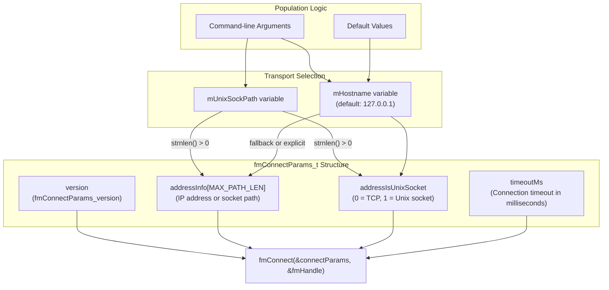
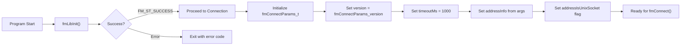
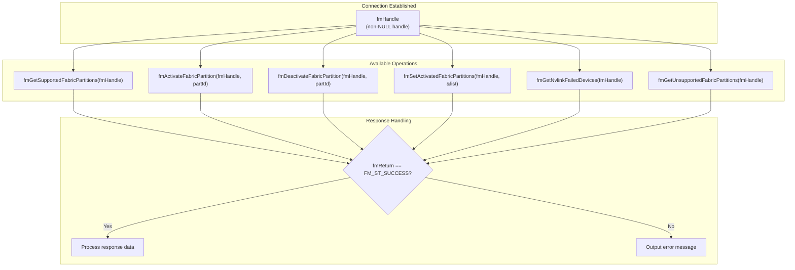
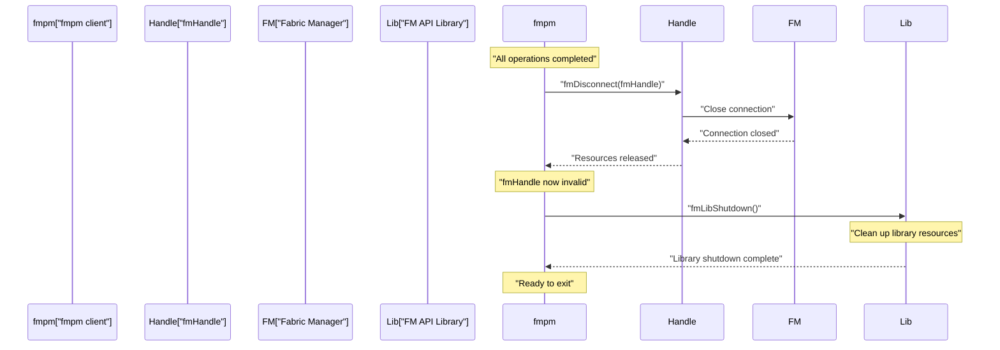
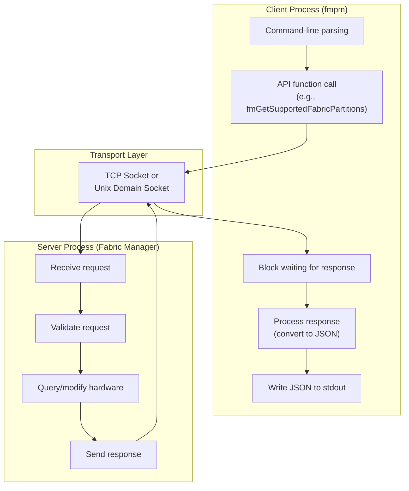
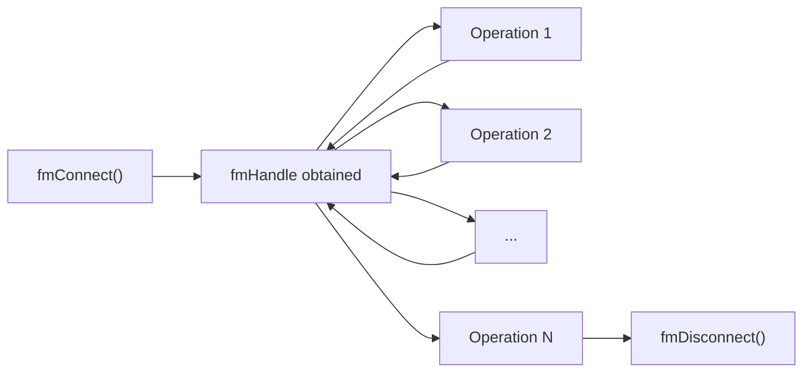

<!-- source: DeepWiki mcp.deepwiki.com · repo NVIDIA/Fabric-Manager-Client · page 4.2 Communication Protocols · fetched 2026-10-26 -->

# Communication Protocols

<details>
<summary>Relevant source files</summary>

The following files were used as context for generating this wiki page:

- [README.md](README.md)
- [fmpm.cpp](fmpm.cpp)

</details>


## Purpose and Scope

This document describes the communication protocols used by the `fmpm` client to connect to and interact with the NVIDIA Fabric Manager service. It covers the two supported transport mechanisms (TCP sockets and Unix domain sockets), connection establishment and teardown procedures, protocol parameters, and the configuration requirements for client-server communication.

For information about the API functions called after establishing a connection, see [Data Structures and API](#4.3). For overall architecture context, see [Architecture Overview](#4.1). For error handling related to connection failures, see [Error Handling and Return Codes](#4.5).

---

## Transport Layer Options

The `fmpm` client supports two mutually exclusive transport mechanisms for communicating with the Fabric Manager service:

| Transport Type | Use Case | Configuration Required | Performance Characteristics |
|----------------|----------|------------------------|----------------------------|
| **TCP Socket** | Remote or local management | `FM_CMD_BIND_INTERFACE` on server, `--hostname` on client | Network overhead, supports distributed deployments |
| **Unix Domain Socket** | Local management only | `FM_CMD_UNIX_SOCKET_PATH` on server, `--unix-domain-socket` on client | Lower latency, higher throughput, limited to same host |

The choice between these transports is determined by command-line arguments. If `--unix-domain-socket` is specified, it takes precedence over TCP socket configuration.

**Sources:** [README.md:12-19](), [fmpm.cpp:379-396]()

---

## Connection Parameter Structure

### fmConnectParams_t Structure

The client uses the `fmConnectParams_t` structure to configure connection parameters before calling `fmConnect()`. This structure encapsulates all transport-specific settings:



**Structure Fields:**

- **`version`**: Protocol version identifier set to `fmConnectParams_version` constant
- **`addressInfo`**: String buffer containing either IP address/hostname (TCP) or filesystem path (Unix socket)
- **`addressIsUnixSocket`**: Boolean flag (0 or 1) indicating transport type
- **`timeoutMs`**: Connection timeout in milliseconds (default: 1000ms)

**Sources:** [fmpm.cpp:414-428]()

---

## TCP Socket Protocol

### Connection Establishment

The TCP socket transport uses standard TCP/IP networking to communicate with the Fabric Manager service over a network interface.

```mermaid
sequenceDiagram
    participant User
    participant fmpm["fmpm (client)"]
    participant OS["Operating System<br/>Network Stack"]
    participant FM["Fabric Manager<br/>Service"]
    
    Note over User,FM: Command: fmpm -l --hostname 10.0.0.50
    
    User->>fmpm: "Execute with --hostname option"
    
    fmpm->>fmpm: "Parse command-line:<br/>mHostname = '10.0.0.50'"
    
    fmpm->>fmpm: "fmLibInit()"
    Note over fmpm: "Initialize FM API library"
    
    fmpm->>fmpm: "Populate fmConnectParams_t:<br/>addressInfo = '10.0.0.50'<br/>addressIsUnixSocket = 0<br/>timeoutMs = 1000"
    
    fmpm->>OS: "fmConnect(&connectParams, &fmHandle)"
    Note over OS: "Create TCP socket"
    
    OS->>FM: "TCP SYN to 10.0.0.50:<br/>default Fabric Manager port"
    
    FM->>OS: "TCP SYN-ACK"
    
    OS->>FM: "TCP ACK"
    Note over OS,FM: "TCP connection established"
    
    OS-->>fmpm: "Return fmHandle"
    Note over fmpm: "Connection handle valid:<br/>ready for API calls"
    
    fmpm->>FM: "API requests via fmHandle<br/>(e.g., fmGetSupportedFabricPartitions)"
    
    FM-->>fmpm: "API responses"
    
    fmpm->>fmpm: "Format response to JSON"
    
    fmpm->>User: "Output JSON to stdout"
    
    fmpm->>FM: "fmDisconnect(fmHandle)"
    FM-->>fmpm: "Connection closed"
    
    fmpm->>fmpm: "fmLibShutdown()"
```

### TCP Configuration Requirements

**Client-side:**
- Default hostname: `127.0.0.1` (localhost)
- Custom hostname/IP via `--hostname` option
- Example: `fmpm -l --hostname 192.168.1.100`

**Server-side:**
- `FM_CMD_BIND_INTERFACE=<IP address>` must be configured in Fabric Manager configuration file
- The IP address must be accessible from the client's network location
- Firewall rules must permit connections to the Fabric Manager port

**Connection Logic in Code:**

[fmpm.cpp:330-333](): Default hostname initialization
```cpp
/* Default to connect to localhost */
strncpy(mHostname, "127.0.0.1", sizeof(mHostname));
```

[fmpm.cpp:379-387](): Parsing custom hostname
```cpp
else if (std::string(argv[i]) == "--hostname") {
    if (i + 1 < argc) {
        std::string str = argv[i + 1];
        snprintf(mHostname, MAX_PATH_LEN, "%s", str.c_str());
        ++i;
    }
}
```

[fmpm.cpp:424-428](): Setting TCP socket parameters
```cpp
if ( strnlen(mHostname, MAX_PATH_LEN) > 0 )
{
    snprintf(connectParams.addressInfo, MAX_PATH_LEN, "%s", mHostname);
    connectParams.addressIsUnixSocket = 0;
}
```

**Sources:** [fmpm.cpp:330-333](), [fmpm.cpp:379-387](), [fmpm.cpp:424-428](), [fmpm.cpp:431-437](), [README.md:12-15]()

---

## Unix Domain Socket Protocol

### Connection Establishment

Unix domain sockets provide inter-process communication on the same host through the filesystem namespace, offering lower latency than TCP sockets.

```mermaid
sequenceDiagram
    participant User
    participant fmpm["fmpm (client)"]
    participant Filesystem
    participant Socket["Unix Socket<br/>(/var/run/fm.sock)"]
    participant FM["Fabric Manager<br/>Service"]
    
    Note over User,FM: Command: fmpm -l --unix-domain-socket /var/run/fm.sock
    
    User->>fmpm: "Execute with --unix-domain-socket option"
    
    fmpm->>fmpm: "Parse command-line:<br/>mUnixSockPath = '/var/run/fm.sock'"
    
    fmpm->>fmpm: "fmLibInit()"
    
    fmpm->>fmpm: "Populate fmConnectParams_t:<br/>addressInfo = '/var/run/fm.sock'<br/>addressIsUnixSocket = 1<br/>timeoutMs = 1000"
    
    fmpm->>Filesystem: "fmConnect(&connectParams, &fmHandle)"
    Note over fmpm: "Check socket path exists"
    
    Filesystem->>Socket: "Open Unix domain socket"
    
    Socket->>FM: "Connect to listening socket"
    
    FM-->>Socket: "Accept connection"
    
    Socket-->>fmpm: "Return fmHandle"
    Note over fmpm: "Connection established:<br/>fmHandle valid"
    
    fmpm->>FM: "API requests via fmHandle<br/>(bypassing network stack)"
    
    FM-->>fmpm: "API responses"
    
    fmpm->>fmpm: "Format response to JSON"
    
    fmpm->>User: "Output JSON to stdout"
    
    fmpm->>FM: "fmDisconnect(fmHandle)"
    FM-->>fmpm: "Connection closed"
    
    fmpm->>fmpm: "fmLibShutdown()"
```

### Unix Socket Configuration Requirements

**Client-side:**
- Unix socket path via `--unix-domain-socket <path>` option
- Path must be absolute or relative to current working directory
- Client process must have read/write permissions for the socket file
- Example: `fmpm -l --unix-domain-socket /var/run/nvidia-fabricmanager/fabricmanager.sock`

**Server-side:**
- `FM_CMD_UNIX_SOCKET_PATH=<path>` must be configured in Fabric Manager configuration file
- Path must match exactly between client and server
- Fabric Manager must have permissions to create socket at specified path
- Socket file ownership and permissions control access

**Connection Logic in Code:**

[fmpm.cpp:330-331](): Unix socket path initialization
```cpp
/* Clear mUnixSockPath */
memset(mUnixSockPath, 0, sizeof(mUnixSockPath));
```

[fmpm.cpp:388-396](): Parsing Unix socket path
```cpp
else if (std::string(argv[i]) == "--unix-domain-socket") {
    if (i + 1 < argc) {
        std::string str = argv[i + 1];
        snprintf(mUnixSockPath, MAX_PATH_LEN, "%s", str.c_str());
        ++i;
    }
}
```

[fmpm.cpp:419-423](): Setting Unix socket parameters
```cpp
if ( strnlen(mUnixSockPath, MAX_PATH_LEN) > 0 )
{
    snprintf(connectParams.addressInfo, MAX_PATH_LEN, "%s", mUnixSockPath);
    connectParams.addressIsUnixSocket = 1;
}
```

### Transport Priority

When both `--hostname` and `--unix-domain-socket` are specified on the command line, the code exhibits a bug where both are processed but the final configuration depends on the order of operations. In practice, the last setting to populate `connectParams.addressInfo` and `connectParams.addressIsUnixSocket` takes effect.

[fmpm.cpp:419-432](): Transport selection logic shows potential override issue

**Sources:** [fmpm.cpp:330-331](), [fmpm.cpp:388-396](), [fmpm.cpp:419-428](), [fmpm.cpp:431-432](), [README.md:16-19]()

---

## Connection Lifecycle

### Initialization Phase



The initialization sequence must complete successfully before any connection attempts:

1. **Library Initialization**: `fmLibInit()` must be called once at program startup
2. **Parameter Setup**: Populate `fmConnectParams_t` structure with appropriate values
3. **Connection Attempt**: Call `fmConnect()` with configured parameters

**Code References:**

[fmpm.cpp:406-411](): Library initialization
```cpp
/* Initialize Fabric Manager API interface library */
fmReturn = fmLibInit();
if (FM_ST_SUCCESS != fmReturn) {
    std::cout << "Failed to initialize Fabric Manager API interface library." << std::endl;
    return fmReturn;
}
```

**Sources:** [fmpm.cpp:406-411](), [fmpm.cpp:414-438]()

---

### Active Connection Phase



Once `fmConnect()` returns `FM_ST_SUCCESS` and a valid `fmHandle`, the client can make API calls. Each API function:

- Accepts the `fmHandle` as the first parameter
- Returns an `fmReturn_t` status code
- May populate output structures passed by pointer
- Operates synchronously (blocks until completion)

The connection remains active across multiple API calls, eliminating the overhead of repeated connection establishment.

**Example API Call Pattern:**

[fmpm.cpp:64-75](): List partitions operation
```cpp
fmReturn_t fmReturn;
fmFabricPartitionList_t partitionList;

memset(&partitionList, 0, sizeof(fmFabricPartitionList_t));
partitionList.version = fmFabricPartitionList_version;

fmReturn = fmGetSupportedFabricPartitions(fmHandle, &partitionList);
if (fmReturn != FM_ST_SUCCESS) {
    std::cout << "Failed to get partition list. fmReturn: " << fmReturn << std::endl;
    return fmReturn;
}
```

**Sources:** [fmpm.cpp:440-458](), [fmpm.cpp:64-119](), [fmpm.cpp:174-196]()

---

### Cleanup Phase



Proper resource cleanup is performed in reverse order of initialization:

1. **Disconnect**: `fmDisconnect(fmHandle)` closes the connection and invalidates the handle
2. **Shutdown**: `fmLibShutdown()` releases library resources

These calls are unconditional in the `fmpm` implementation - they execute regardless of whether previous operations succeeded or failed.

**Code References:**

[fmpm.cpp:461-463](): Cleanup sequence
```cpp
/* Clean up */
fmDisconnect(fmHandle);
fmLibShutdown();
```

**Sources:** [fmpm.cpp:461-463]()

---

## Timeout Configuration

The connection timeout controls how long `fmConnect()` will wait for a successful connection before failing.

### Default Timeout

[fmpm.cpp:415](): Timeout value
```cpp
connectParams.timeoutMs = 1000; // in milliseconds
```

The default timeout is **1000 milliseconds (1 second)**. This value applies to both TCP and Unix socket connections.

### Timeout Behavior

| Scenario | Timeout Effect |
|----------|----------------|
| **Fabric Manager Not Running** | `fmConnect()` fails after 1 second with connection error |
| **Network Unreachable (TCP)** | Connection attempt fails after 1 second |
| **Socket File Missing (Unix)** | Connection fails immediately (no timeout wait) |
| **Fabric Manager Overloaded** | May succeed within 1 second or fail if service cannot respond |

The timeout is **not configurable** via command-line arguments in the current implementation. Changing the timeout requires modifying the source code and recompiling.

**Sources:** [fmpm.cpp:414-416]()

---

## Protocol Data Flow

### Request-Response Pattern

All communication follows a synchronous request-response pattern:



### Message Serialization

The `fmpm` client does not directly handle message serialization. This is abstracted by the FM API library (`libnvfm`):

- **Client Perspective**: Calls C API functions with structured data types
- **Transport Layer**: Library serializes requests and deserializes responses internally
- **Wire Format**: Not documented in client source code (opaque to client)

After receiving responses, the client converts structured C data types to JSON for output:

[fmpm.cpp:77-117](): Example JSON serialization of partition list

**Sources:** [fmpm.cpp:64-119](), [fmpm.cpp:77-117]()

---

## Connection Error Scenarios

### Common Connection Failures

| Error Condition | Symptom | Typical Cause |
|-----------------|---------|---------------|
| **Connection Refused** | `fmConnect()` returns error immediately | Fabric Manager not running or not listening on configured interface |
| **Connection Timeout** | `fmConnect()` returns error after 1000ms | Network unreachable, firewall blocking, or wrong IP address |
| **Socket Not Found** | `fmConnect()` returns error immediately | Unix socket path doesn't exist or incorrect path specified |
| **Permission Denied** | `fmConnect()` returns error immediately | Insufficient permissions to access Unix socket file |
| **Configuration Mismatch** | Connection fails or connects to wrong service | Client uses TCP but server configured for Unix socket (or vice versa) |

### Error Handling in Code

[fmpm.cpp:434-438](): Connection error handling
```cpp
fmReturn = fmConnect(&connectParams, &fmHandle);
if (fmReturn != FM_ST_SUCCESS){
    std::cout << "Failed to connect to Fabric Manager instance." << std::endl;
    return fmReturn;
}
```

When `fmConnect()` fails:
1. Client outputs error message to stdout
2. Returns error code to shell (non-zero exit status)
3. Skips all API operations
4. Still calls cleanup functions (`fmDisconnect()`, `fmLibShutdown()`)

**Sources:** [fmpm.cpp:434-438](), [fmpm.cpp:461-463]()

---

## Configuration Synchronization Requirements

### Client-Server Configuration Matrix

For successful communication, client and server configurations must match:

| Client Configuration | Server Configuration | Result |
|---------------------|----------------------|--------|
| `--hostname 10.0.0.1` | `FM_CMD_BIND_INTERFACE=10.0.0.1` | ✓ Success (TCP) |
| `--hostname 10.0.0.1` | `FM_CMD_BIND_INTERFACE=127.0.0.1` | ✗ Connection refused (server not listening on 10.0.0.1) |
| `--unix-domain-socket /path/sock` | `FM_CMD_UNIX_SOCKET_PATH=/path/sock` | ✓ Success (Unix socket) |
| `--unix-domain-socket /path/sock` | `FM_CMD_UNIX_SOCKET_PATH=/other/path` | ✗ Connection refused (wrong socket path) |
| `--hostname 127.0.0.1` | `FM_CMD_UNIX_SOCKET_PATH=/path/sock` | ✗ Connection refused (protocol mismatch) |
| Default (no options) | `FM_CMD_BIND_INTERFACE=127.0.0.1` | ✓ Success (TCP to localhost) |

### Configuration Discovery

The `fmpm` client does **not** perform automatic discovery or protocol negotiation:

- No service discovery mechanisms (DNS-SD, mDNS, etc.)
- No automatic fallback between TCP and Unix socket
- No protocol version negotiation at connection time
- Configuration must be manually synchronized between client and server

The `fmConnectParams_t.version` field provides API version information but does not enable runtime protocol negotiation.

**Sources:** [README.md:12-19](), [fmpm.cpp:414-438]()

---

## Performance Considerations

### TCP vs Unix Socket Performance

| Characteristic | TCP Socket | Unix Domain Socket |
|----------------|------------|-------------------|
| **Latency** | Higher (network stack overhead) | Lower (direct kernel IPC) |
| **Throughput** | Limited by network bandwidth | Limited by system memory bandwidth |
| **CPU Overhead** | Higher (protocol processing, checksums) | Lower (simple memory copying) |
| **Remote Access** | Supported | Not supported (same host only) |
| **Security** | Network-level security required | Filesystem permissions |

### Connection Reuse

The `fmpm` client establishes **one connection per invocation** and reuses it for all operations within that invocation:

[fmpm.cpp:434-458](): Single connection used for all operations



There is no connection pooling or persistent connection across multiple `fmpm` invocations. Each execution of `fmpm` performs:
1. Full connection establishment
2. All requested operations
3. Full connection teardown

**Sources:** [fmpm.cpp:434-463]()

---

## Protocol Implementation Code Map

### Key Functions and Their Locations

| Function | Purpose | Location |
|----------|---------|----------|
| `fmLibInit()` | Initialize FM API library | Called in [fmpm.cpp:407]() |
| `fmConnect()` | Establish connection to Fabric Manager | Called in [fmpm.cpp:434]() |
| `fmDisconnect()` | Close connection | Called in [fmpm.cpp:462]() |
| `fmLibShutdown()` | Shutdown FM API library | Called in [fmpm.cpp:463]() |

### Data Structures

| Structure | Purpose | Usage |
|-----------|---------|-------|
| `fmConnectParams_t` | Connection parameters | Initialized in [fmpm.cpp:414-432]() |
| `fmHandle_t` | Connection handle (opaque pointer) | Declared in [fmpm.cpp:297](), populated in [fmpm.cpp:434]() |

### Constants

| Constant | Value | Location |
|----------|-------|----------|
| `MAX_PATH_LEN` | 256 | Defined in [fmpm.cpp:8]() |
| `fmConnectParams_version` | (Library constant) | Used in [fmpm.cpp:416]() |
| Default timeout | 1000ms | Set in [fmpm.cpp:415]() |
| Default hostname | "127.0.0.1" | Set in [fmpm.cpp:333]() |

**Sources:** [fmpm.cpp:8](), [fmpm.cpp:294-304](), [fmpm.cpp:406-438](), [fmpm.cpp:461-463]()

---

