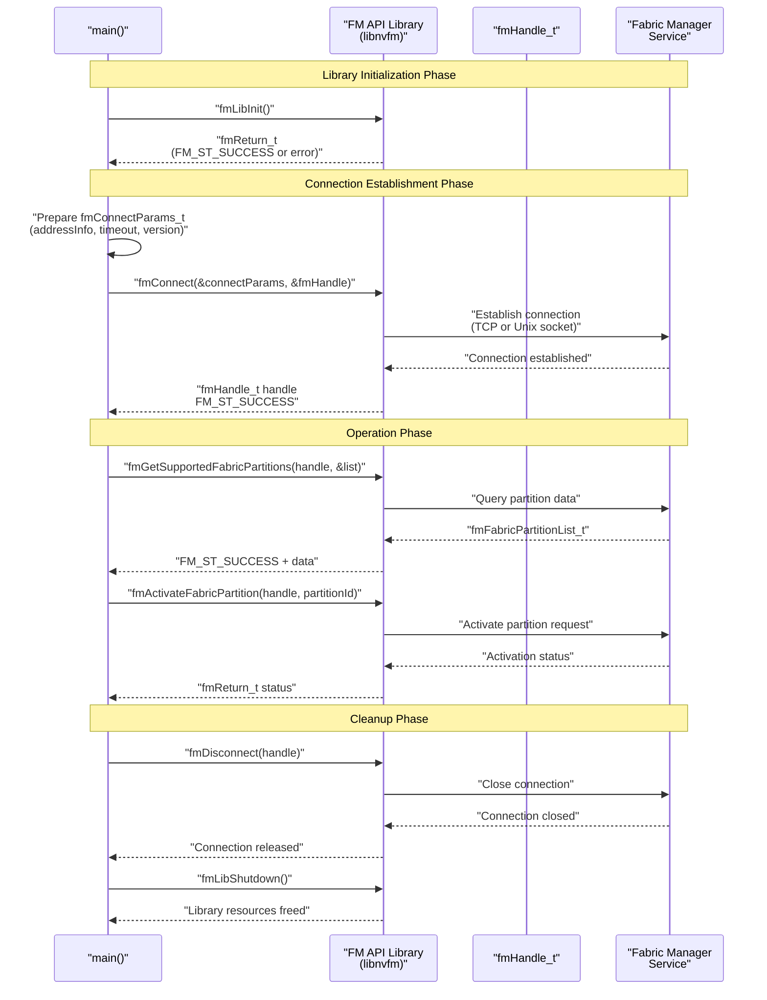
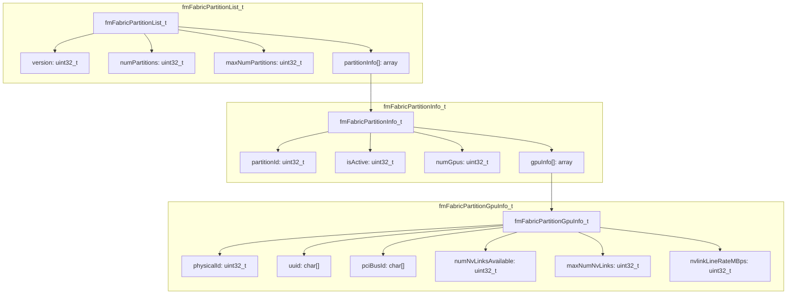
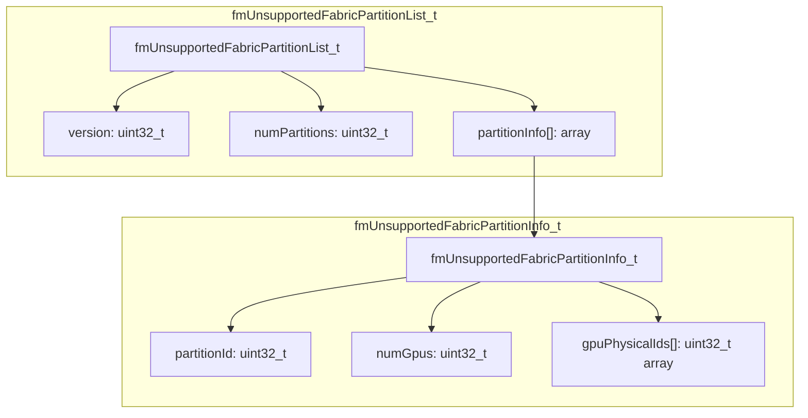
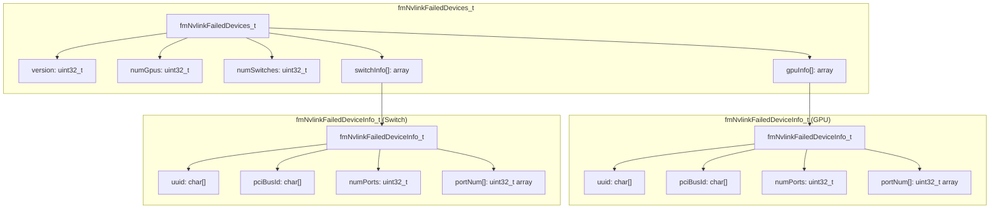
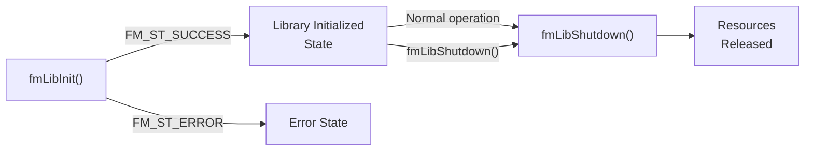
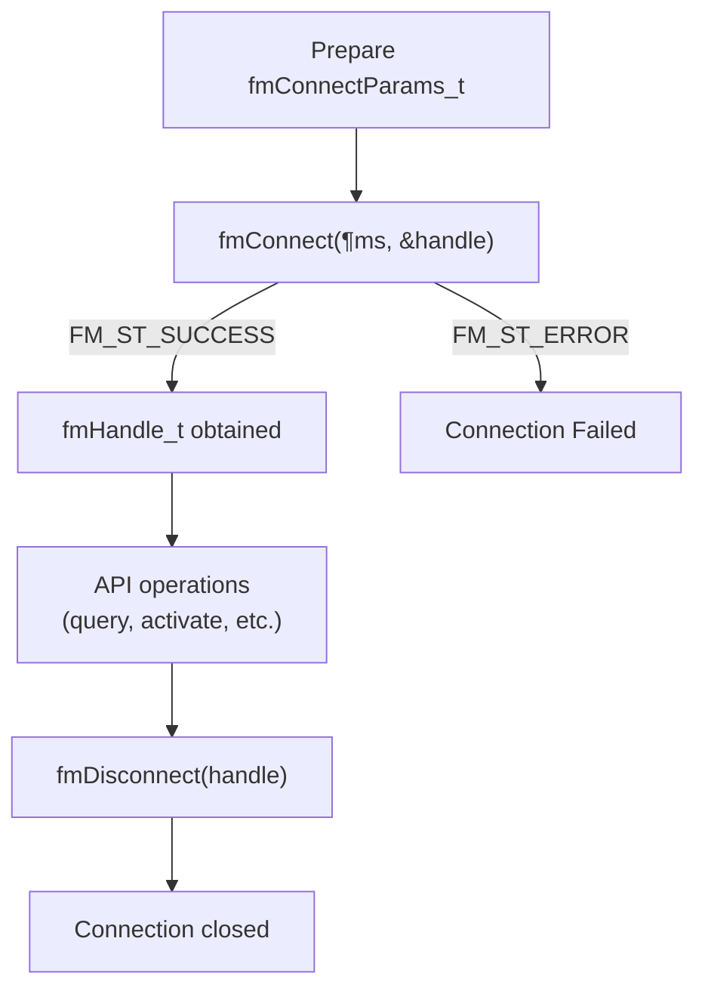
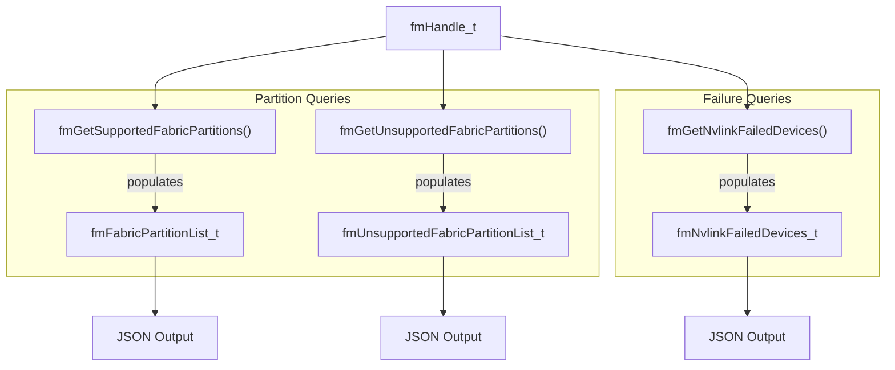
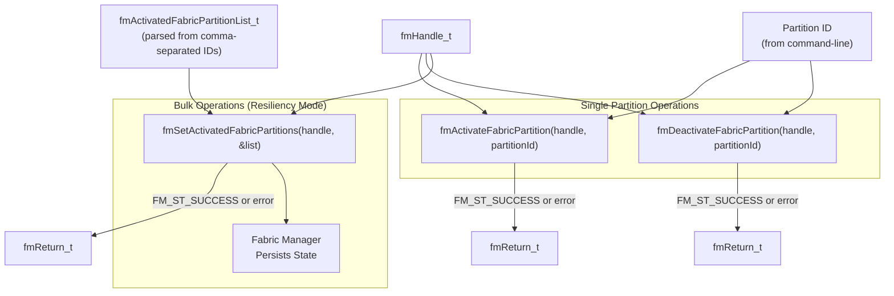

<!-- source: DeepWiki mcp.deepwiki.com · repo NVIDIA/Fabric-Manager-Client · page 4.3 Data Structures and API · fetched 2026-10-26 -->

# Data Structures and API

<details>
<summary>Relevant source files</summary>

The following files were used as context for generating this wiki page:

- [fmpm.cpp](fmpm.cpp)

</details>


This page documents the internal data structures and Fabric Manager (FM) API functions provided by the `libnvfm` library and used by the `fmpm` client. It covers the C API interface that enables communication between the client and Fabric Manager service, including handle management, versioned data structures, and function signatures.

For information about how these APIs are used in command-line operations, see [User Guide](#3). For details about the communication protocols and connection mechanisms, see [Communication Protocols](#4.2). For return code handling and troubleshooting, see [Error Handling and Return Codes](#4.5).

## Scope and Organization

The FM API is exposed through the `nv_fm_agent.h` header file referenced in [fmpm.cpp:4](). All data structures follow a versioned pattern to ensure API stability across different releases. The API functions can be categorized into:

- **Library lifecycle management**: Initialization and shutdown
- **Connection management**: Establishing and terminating connections to Fabric Manager
- **Query operations**: Retrieving partition information and device status
- **State modification operations**: Activating, deactivating, and persisting partition states

---

## API Lifecycle and Execution Flow



**Diagram: API Lifecycle Sequence**

The API follows a strict lifecycle pattern that must be adhered to for proper resource management. The sequence begins with library initialization at [fmpm.cpp:407](), proceeds through connection establishment at [fmpm.cpp:434](), executes operations at [fmpm.cpp:440-458](), and concludes with cleanup at [fmpm.cpp:462-463]().

Sources: [fmpm.cpp:406-438](), [fmpm.cpp:462-463]()

---

## Handle Types and Type Definitions

### Core Types

| Type | Description | Used In |
|------|-------------|---------|
| `fmHandle_t` | Opaque handle representing an active connection to Fabric Manager | All API functions after connection |
| `fmReturn_t` | Enumerated return code indicating success or error type | Return value of all API functions |
| `fmFabricPartitionId_t` | Unsigned integer type representing a partition identifier | Activate/deactivate operations |

The `fmHandle_t` is an opaque pointer initialized to `NULL` at [fmpm.cpp:297]() and populated by `fmConnect()`. This handle serves as the session identifier and must be passed to all subsequent API calls.

### Constants

| Constant | Purpose | Usage |
|----------|---------|-------|
| `FM_MAX_FABRIC_PARTITIONS` | Maximum number of partitions supported | Array bounds checking at [fmpm.cpp:36](), [fmpm.cpp:348]() |
| `FM_ST_SUCCESS` | Return code indicating successful operation | Success validation throughout [fmpm.cpp:73](), [fmpm.cpp:408](), etc. |
| `FM_ST_BADPARAM` | Return code indicating invalid parameters | Parameter validation at [fmpm.cpp:47](), [fmpm.cpp:359]() |

Sources: [fmpm.cpp:36](), [fmpm.cpp:297-304](), [fmpm.cpp:348]()

---

## Data Structures

### Partition Information Structures



**Diagram: Partition Data Structure Hierarchy**

#### `fmFabricPartitionList_t`

The primary structure returned by `fmGetSupportedFabricPartitions()`, containing the complete list of available partitions.

**Fields:**

| Field | Type | Description |
|-------|------|-------------|
| `version` | `uint32_t` | Structure version identifier; must be set to `fmFabricPartitionList_version` before API call |
| `numPartitions` | `uint32_t` | Number of valid entries in the `partitionInfo` array |
| `maxNumPartitions` | `uint32_t` | Maximum number of partitions the system supports |
| `partitionInfo` | `fmFabricPartitionInfo_t[]` | Array of partition information structures |

**Usage:** Initialized with `memset()` at [fmpm.cpp:69]() and version set at [fmpm.cpp:70]() before passing to `fmGetSupportedFabricPartitions()` at [fmpm.cpp:72](). The returned data is serialized to JSON at [fmpm.cpp:77-118]().

#### `fmFabricPartitionInfo_t`

Describes a single GPU partition configuration and its current state.

**Fields:**

| Field | Type | Description |
|-------|------|-------------|
| `partitionId` | `uint32_t` | Unique identifier for this partition |
| `isActive` | `uint32_t` | Boolean flag: 1 if partition is currently active, 0 otherwise |
| `numGpus` | `uint32_t` | Number of GPUs in this partition |
| `gpuInfo` | `fmFabricPartitionGpuInfo_t[]` | Array of GPU information structures for this partition |

**Usage:** Accessed through iteration at [fmpm.cpp:88-111](), with each field serialized to JSON at [fmpm.cpp:93-95]().

#### `fmFabricPartitionGpuInfo_t`

Detailed information about a single GPU within a partition.

**Fields:**

| Field | Type | Description |
|-------|------|-------------|
| `physicalId` | `uint32_t` | Physical GPU identifier |
| `uuid` | `char[]` | GPU UUID string (unique hardware identifier) |
| `pciBusId` | `char[]` | PCI bus address (e.g., "0000:07:00.0") |
| `numNvLinksAvailable` | `uint32_t` | Number of currently functional NVLink connections |
| `maxNumNvLinks` | `uint32_t` | Maximum NVLink connections this GPU supports |
| `nvlinkLineRateMBps` | `uint32_t` | NVLink bandwidth per link in megabytes per second |

**Usage:** Accessed in nested iteration at [fmpm.cpp:97-107]() and serialized to JSON at [fmpm.cpp:100-106]().

Sources: [fmpm.cpp:64-120]()

---

### Unsupported Partition Structures



**Diagram: Unsupported Partition Data Structure**

#### `fmUnsupportedFabricPartitionList_t`

Structure returned by `fmGetUnsupportedFabricPartitions()` containing partitions that cannot be managed due to hardware or configuration constraints.

**Fields:**

| Field | Type | Description |
|-------|------|-------------|
| `version` | `uint32_t` | Structure version identifier; must be set to `fmUnsupportedFabricPartitionList_version` |
| `numPartitions` | `uint32_t` | Number of unsupported partitions |
| `partitionInfo` | `fmUnsupportedFabricPartitionInfo_t[]` | Array of unsupported partition information |

**Usage:** Initialized at [fmpm.cpp:128-129]() and populated by API call at [fmpm.cpp:131]().

#### `fmUnsupportedFabricPartitionInfo_t`

Information about a single unsupported partition.

**Fields:**

| Field | Type | Description |
|-------|------|-------------|
| `partitionId` | `uint32_t` | Partition identifier |
| `numGpus` | `uint32_t` | Number of GPUs in this unsupported partition |
| `gpuPhysicalIds` | `uint32_t[]` | Array of physical GPU IDs in this partition |

**Usage:** Accessed at [fmpm.cpp:147-162]() with simplified GPU information (only physical IDs, not full details).

Sources: [fmpm.cpp:122-171]()

---

### NVLink Failure Structures



**Diagram: NVLink Failure Detection Data Structures**

#### `fmNvlinkFailedDevices_t`

Structure returned by `fmGetNvlinkFailedDevices()` containing all devices (GPUs and switches) with NVLink failures.

**Fields:**

| Field | Type | Description |
|-------|------|-------------|
| `version` | `uint32_t` | Structure version; set to `fmNvlinkFailedDevices_version` |
| `numGpus` | `uint32_t` | Number of GPUs with failed NVLinks |
| `numSwitches` | `uint32_t` | Number of NVSwitches with failed NVLinks |
| `gpuInfo` | `fmNvlinkFailedDeviceInfo_t[]` | Array of GPU failure information |
| `switchInfo` | `fmNvlinkFailedDeviceInfo_t[]` | Array of switch failure information |

**Usage:** Initialized at [fmpm.cpp:228-229]() and populated at [fmpm.cpp:231](). Separate arrays for GPU and switch failures are processed at [fmpm.cpp:252-266]() and [fmpm.cpp:270-284]() respectively.

#### `fmNvlinkFailedDeviceInfo_t`

Describes a single device (GPU or switch) with NVLink port failures. Used for both GPU and switch failure information.

**Fields:**

| Field | Type | Description |
|-------|------|-------------|
| `uuid` | `char[]` | Device UUID string |
| `pciBusId` | `char[]` | PCI bus address |
| `numPorts` | `uint32_t` | Number of failed ports |
| `portNum` | `uint32_t[]` | Array of failed port numbers |

**Usage:** GPU failures processed at [fmpm.cpp:254-265](), switch failures at [fmpm.cpp:272-283](). Port arrays are serialized to JSON at [fmpm.cpp:259-264]() and [fmpm.cpp:277-282]().

Sources: [fmpm.cpp:222-292]()

---

### Connection Parameter Structures

#### `fmConnectParams_t`

Structure passed to `fmConnect()` to specify connection parameters.

**Fields:**

| Field | Type | Description |
|-------|------|-------------|
| `version` | `uint32_t` | Structure version; set to `fmConnectParams_version` |
| `addressInfo` | `char[]` | Connection address: IP address for TCP or file path for Unix socket |
| `addressIsUnixSocket` | `uint32_t` | Boolean: 1 for Unix domain socket, 0 for TCP socket |
| `timeoutMs` | `uint32_t` | Connection timeout in milliseconds |

**Usage:** Initialized and configured at [fmpm.cpp:414-432]():
- Version set at [fmpm.cpp:416]()
- Timeout set at [fmpm.cpp:415]()
- Address cleared at [fmpm.cpp:418]()
- Unix socket path populated at [fmpm.cpp:419-423]()
- TCP hostname populated at [fmpm.cpp:424-428]()

The structure determines the transport mechanism: if `mUnixSockPath` has non-zero length at [fmpm.cpp:419](), Unix socket is used; otherwise TCP with hostname at [fmpm.cpp:424-428](). However, note there is a bug at [fmpm.cpp:431-432]() where the hostname is unconditionally copied again, potentially overriding the Unix socket configuration.

Sources: [fmpm.cpp:413-438]()

---

### Activated Partition List Structures

#### `fmActivatedFabricPartitionList_t`

Structure passed to `fmSetActivatedFabricPartitions()` for Resiliency Mode operations.

**Fields:**

| Field | Type | Description |
|-------|------|-------------|
| `version` | `uint32_t` | Structure version; set to `fmActivatedFabricPartitionList_version` |
| `numPartitions` | `uint32_t` | Number of partitions in the activated list |
| `partitionIds` | `uint32_t[]` | Array of partition IDs that should remain active |

**Usage:** Constructed at [fmpm.cpp:202-211]():
1. Structure cleared with `memset()` at [fmpm.cpp:204]()
2. Version set at [fmpm.cpp:205]()
3. Count set at [fmpm.cpp:206]()
4. Partition IDs copied from parsed input at [fmpm.cpp:208-211]()

This structure enables the Resiliency Mode feature where Fabric Manager persists the list of partitions that should be automatically restored after service restart (requires `FABRIC_MODE_RESTART=1` configuration).

Sources: [fmpm.cpp:198-220]()

---

## API Functions

### Library Lifecycle Functions



**Diagram: Library Lifecycle Function Flow**

#### `fmLibInit()`

**Signature:** `fmReturn_t fmLibInit(void)`

**Purpose:** Initializes the Fabric Manager API library. Must be called before any other API function.

**Parameters:** None

**Return Value:** `fmReturn_t` indicating success (`FM_ST_SUCCESS`) or initialization error

**Usage:** Called at [fmpm.cpp:407]() at program startup. Failure results in immediate program termination at [fmpm.cpp:408-411]().

#### `fmLibShutdown()`

**Signature:** `fmReturn_t fmLibShutdown(void)`

**Purpose:** Releases all resources allocated by the FM API library. Must be called after all connections are closed.

**Parameters:** None

**Return Value:** `fmReturn_t` indicating success or shutdown error

**Usage:** Called at [fmpm.cpp:463]() during cleanup phase, after `fmDisconnect()` at [fmpm.cpp:462]().

Sources: [fmpm.cpp:406-411](), [fmpm.cpp:462-463]()

---

### Connection Management Functions



**Diagram: Connection Management Function Flow**

#### `fmConnect()`

**Signature:** `fmReturn_t fmConnect(const fmConnectParams_t* params, fmHandle_t* handle)`

**Purpose:** Establishes a connection to the Fabric Manager service using either TCP socket or Unix domain socket.

**Parameters:**
- `params`: Pointer to `fmConnectParams_t` structure containing connection parameters
- `handle`: Pointer to `fmHandle_t` that will receive the connection handle

**Return Value:** `fmReturn_t` - `FM_ST_SUCCESS` on successful connection, error code otherwise

**Usage:** Called at [fmpm.cpp:434]() after connection parameters are prepared at [fmpm.cpp:414-432](). The returned handle is stored in the `fmHandle` variable at [fmpm.cpp:297]() and used for all subsequent operations.

#### `fmDisconnect()`

**Signature:** `fmReturn_t fmDisconnect(fmHandle_t handle)`

**Purpose:** Closes the connection to Fabric Manager and releases the handle.

**Parameters:**
- `handle`: The `fmHandle_t` obtained from `fmConnect()`

**Return Value:** `fmReturn_t` indicating success or disconnect error

**Usage:** Called at [fmpm.cpp:462]() during cleanup, before library shutdown.

Sources: [fmpm.cpp:413-438](), [fmpm.cpp:462]()

---

### Query Functions



**Diagram: Query Function Data Flow**

#### `fmGetSupportedFabricPartitions()`

**Signature:** `fmReturn_t fmGetSupportedFabricPartitions(fmHandle_t handle, fmFabricPartitionList_t* partitionList)`

**Purpose:** Retrieves the list of all supported GPU partitions with their current state and configuration.

**Parameters:**
- `handle`: Active connection handle from `fmConnect()`
- `partitionList`: Pointer to pre-allocated `fmFabricPartitionList_t` structure that will be populated

**Return Value:** `fmReturn_t` - `FM_ST_SUCCESS` on successful query, error code otherwise

**Prerequisites:** 
- Structure must be zeroed with `memset()` before call
- `version` field must be set to `fmFabricPartitionList_version`

**Usage:** Called at [fmpm.cpp:72]() within `listPartitions()` function. Structure initialized at [fmpm.cpp:69-70](), result processed at [fmpm.cpp:77-118]().

#### `fmGetUnsupportedFabricPartitions()`

**Signature:** `fmReturn_t fmGetUnsupportedFabricPartitions(fmHandle_t handle, fmUnsupportedFabricPartitionList_t* partitionList)`

**Purpose:** Retrieves partitions that cannot be managed due to hardware limitations or configuration issues.

**Parameters:**
- `handle`: Active connection handle
- `partitionList`: Pointer to pre-allocated `fmUnsupportedFabricPartitionList_t` structure

**Return Value:** `fmReturn_t` indicating success or error

**Prerequisites:**
- Structure must be initialized with `memset()`
- `version` field must be set to `fmUnsupportedFabricPartitionList_version`

**Usage:** Called at [fmpm.cpp:131]() in `listUnsupportedPartitions()`. Initialization at [fmpm.cpp:128-129](), processing at [fmpm.cpp:138-168]().

#### `fmGetNvlinkFailedDevices()`

**Signature:** `fmReturn_t fmGetNvlinkFailedDevices(fmHandle_t handle, fmNvlinkFailedDevices_t* failedDevices)`

**Purpose:** Retrieves information about all GPUs and NVSwitches with NVLink failures, including specific failed port numbers.

**Parameters:**
- `handle`: Active connection handle
- `failedDevices`: Pointer to pre-allocated `fmNvlinkFailedDevices_t` structure

**Return Value:** `fmReturn_t` indicating success or error

**Prerequisites:**
- Structure must be cleared with `memset()`
- `version` field must be set to `fmNvlinkFailedDevices_version`

**Usage:** Called at [fmpm.cpp:231]() in `getNvlinkFailedDevices()`. Initialization at [fmpm.cpp:228-229](), GPU processing at [fmpm.cpp:252-266](), switch processing at [fmpm.cpp:270-284]().

Sources: [fmpm.cpp:64-120](), [fmpm.cpp:122-171](), [fmpm.cpp:222-292]()

---

### State Modification Functions



**Diagram: State Modification Function Relationships**

#### `fmActivateFabricPartition()`

**Signature:** `fmReturn_t fmActivateFabricPartition(fmHandle_t handle, fmFabricPartitionId_t partitionId)`

**Purpose:** Activates a single GPU partition, making its resources available for use.

**Parameters:**
- `handle`: Active connection handle
- `partitionId`: Identifier of the partition to activate (must be less than `FM_MAX_FABRIC_PARTITIONS`)

**Return Value:** `fmReturn_t` indicating success or activation error

**Usage:** Called at [fmpm.cpp:178]() within `activatePartition()` wrapper function. Partition ID validated at [fmpm.cpp:348]() before function invocation at [fmpm.cpp:445]().

**Error Conditions:**
- Partition already active
- Invalid partition ID
- Partition not supported
- Hardware communication failure

#### `fmDeactivateFabricPartition()`

**Signature:** `fmReturn_t fmDeactivateFabricPartition(fmHandle_t handle, fmFabricPartitionId_t partitionId)`

**Purpose:** Deactivates a single GPU partition, releasing its resources.

**Parameters:**
- `handle`: Active connection handle
- `partitionId`: Identifier of the partition to deactivate

**Return Value:** `fmReturn_t` indicating success or deactivation error

**Usage:** Called at [fmpm.cpp:191]() within `deactivatePartition()` wrapper function. Invoked at [fmpm.cpp:448]() when `-d` option is specified.

**Error Conditions:**
- Partition already inactive
- Invalid partition ID
- Resources in use

#### `fmSetActivatedFabricPartitions()`

**Signature:** `fmReturn_t fmSetActivatedFabricPartitions(fmHandle_t handle, const fmActivatedFabricPartitionList_t* partitionList)`

**Purpose:** Sets the list of partitions that should be activated, used for Resiliency Mode to persist partition state across Fabric Manager restarts.

**Parameters:**
- `handle`: Active connection handle
- `partitionList`: Pointer to `fmActivatedFabricPartitionList_t` containing partition IDs

**Return Value:** `fmReturn_t` indicating success or error

**Prerequisites:**
- Fabric Manager must be configured with `FABRIC_MODE_RESTART=1`
- Structure `version` field must be set to `fmActivatedFabricPartitionList_version`

**Usage:** Called at [fmpm.cpp:213]() in `setActivatedPartitionList()`. Partition IDs parsed from comma-separated string at [fmpm.cpp:32-61](), structure prepared at [fmpm.cpp:202-211](), function invoked at [fmpm.cpp:451]().

**Behavior:** This function instructs Fabric Manager to:
1. Activate all partitions in the provided list
2. Persist this list to storage
3. Automatically restore these partitions on service restart

Sources: [fmpm.cpp:173-196](), [fmpm.cpp:198-220](), [fmpm.cpp:440-458]()

---

## Version Management

All data structures include a `version` field that must be set before passing to API functions. This versioning mechanism ensures backward compatibility across different releases of the FM API.

### Version Constants Pattern

Each structure has a corresponding version constant:

| Structure | Version Constant | Set At |
|-----------|-----------------|--------|
| `fmFabricPartitionList_t` | `fmFabricPartitionList_version` | [fmpm.cpp:70]() |
| `fmUnsupportedFabricPartitionList_t` | `fmUnsupportedFabricPartitionList_version` | [fmpm.cpp:129]() |
| `fmNvlinkFailedDevices_t` | `fmNvlinkFailedDevices_version` | [fmpm.cpp:229]() |
| `fmActivatedFabricPartitionList_t` | `fmActivatedFabricPartitionList_version` | [fmpm.cpp:205]() |
| `fmConnectParams_t` | `fmConnectParams_version` | [fmpm.cpp:416]() |

**Version Checking Pattern:**
1. Allocate structure (typically on stack)
2. Clear structure with `memset(&structure, 0, sizeof(structure))`
3. Set `structure.version = structure_version_constant`
4. Pass structure pointer to API function
5. API validates version and populates structure

This pattern appears consistently throughout [fmpm.cpp:69-70](), [fmpm.cpp:128-129](), [fmpm.cpp:228-229](), [fmpm.cpp:204-205](), [fmpm.cpp:415-416]().

Sources: [fmpm.cpp:69-70](), [fmpm.cpp:128-129](), [fmpm.cpp:204-205](), [fmpm.cpp:228-229](), [fmpm.cpp:415-416]()

---

## Return Codes

All API functions return `fmReturn_t`, an enumerated type indicating operation status.

### Common Return Codes

| Code | Description | Usage in fmpm |
|------|-------------|---------------|
| `FM_ST_SUCCESS` | Operation completed successfully | Checked at [fmpm.cpp:73](), [fmpm.cpp:132](), [fmpm.cpp:179](), [fmpm.cpp:192](), [fmpm.cpp:214](), [fmpm.cpp:232](), [fmpm.cpp:408](), [fmpm.cpp:435]() |
| `FM_ST_BADPARAM` | Invalid parameter provided | Returned at [fmpm.cpp:47](), [fmpm.cpp:350](), [fmpm.cpp:359](), [fmpm.cpp:402]() |
| `FM_ST_ERROR` | Generic error condition | Potential return from all API functions |

### Error Handling Pattern

The client uses a consistent error checking pattern:

```cpp
fmReturn = fmApiFunction(...);
if (fmReturn != FM_ST_SUCCESS) {
    std::cout << "Error message. fmReturn: " << fmReturn << std::endl;
    return fmReturn;
}
```

This pattern appears at:
- [fmpm.cpp:73-75]() for partition list query
- [fmpm.cpp:132-135]() for unsupported partition query
- [fmpm.cpp:179-182]() for partition activation
- [fmpm.cpp:192-194]() for partition deactivation
- [fmpm.cpp:214-217]() for set activated list
- [fmpm.cpp:232-235]() for NVLink failed devices
- [fmpm.cpp:408-411]() for library initialization
- [fmpm.cpp:435-438]() for connection

For detailed troubleshooting guidance, see [Error Handling and Return Codes](#4.5).

Sources: [fmpm.cpp:32-61](), [fmpm.cpp:73-75](), [fmpm.cpp:132-135](), [fmpm.cpp:179-194](), [fmpm.cpp:214-217](), [fmpm.cpp:232-235](), [fmpm.cpp:348-350](), [fmpm.cpp:408-411](), [fmpm.cpp:435-438]()

---

## Data Structure Usage Summary

| Operation | Input Structure(s) | Output Structure(s) | API Function |
|-----------|-------------------|---------------------|--------------|
| List partitions | None | `fmFabricPartitionList_t` | `fmGetSupportedFabricPartitions()` |
| List unsupported | None | `fmUnsupportedFabricPartitionList_t` | `fmGetUnsupportedFabricPartitions()` |
| Get NVLink failures | None | `fmNvlinkFailedDevices_t` | `fmGetNvlinkFailedDevices()` |
| Activate partition | `fmFabricPartitionId_t` | None | `fmActivateFabricPartition()` |
| Deactivate partition | `fmFabricPartitionId_t` | None | `fmDeactivateFabricPartition()` |
| Set activated list | `fmActivatedFabricPartitionList_t` | None | `fmSetActivatedFabricPartitions()` |
| Connect | `fmConnectParams_t` | `fmHandle_t` | `fmConnect()` |
| Disconnect | `fmHandle_t` | None | `fmDisconnect()` |

All structures must have their `version` field properly initialized before use. All query functions require pre-allocated structures that are populated by the API.

Sources: [fmpm.cpp:1-465]()

---

