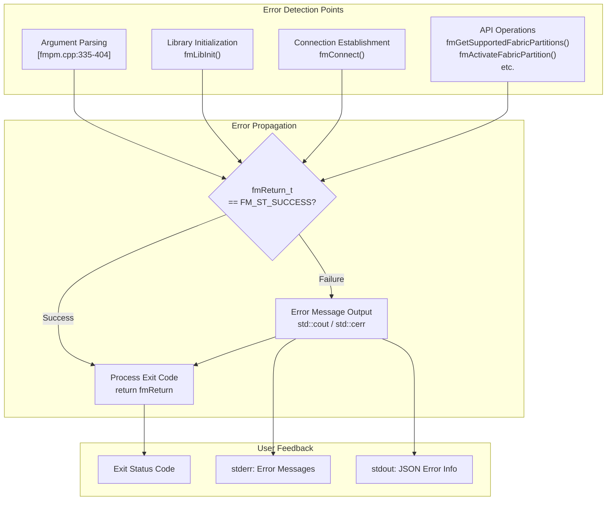
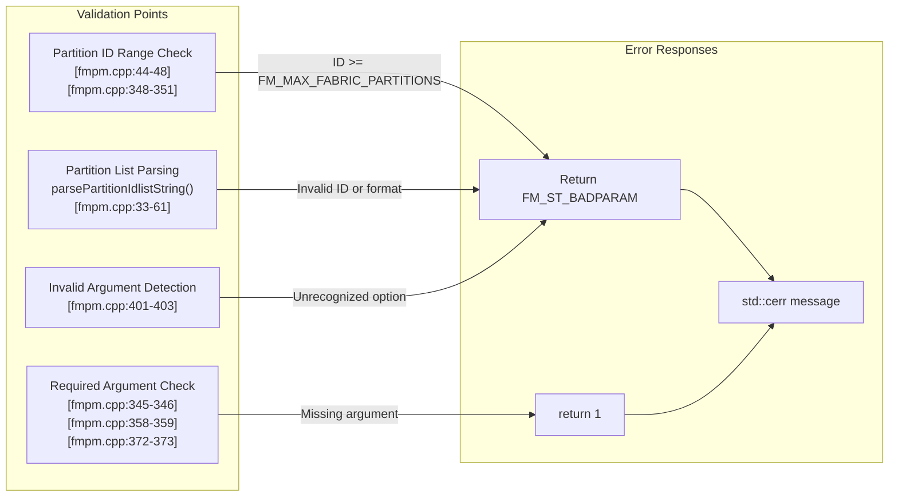
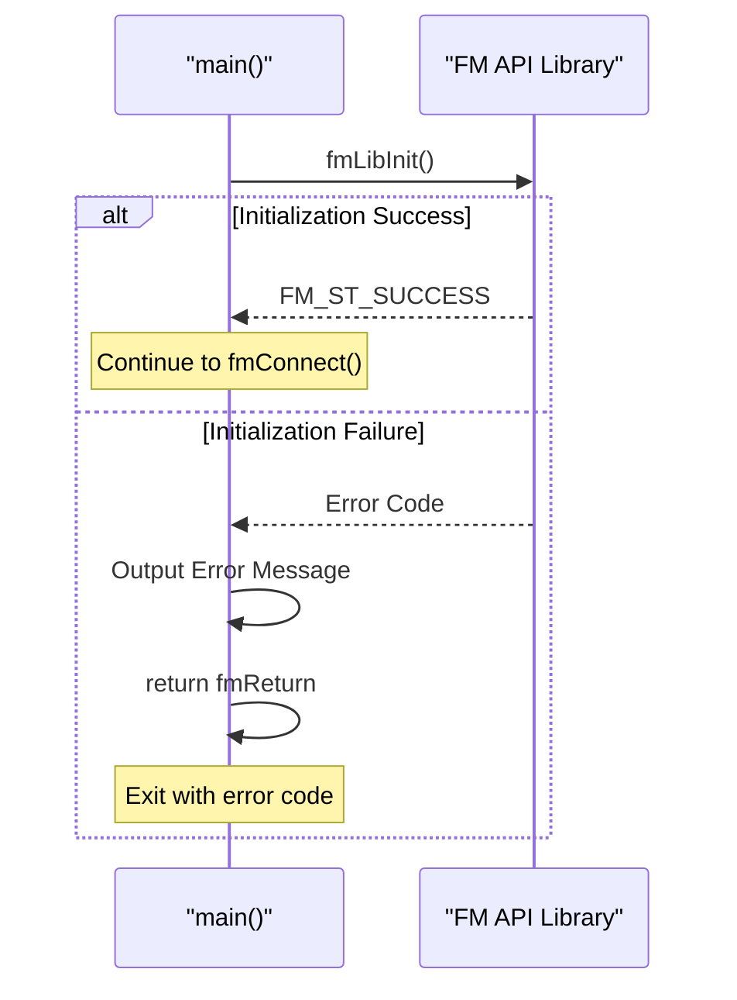
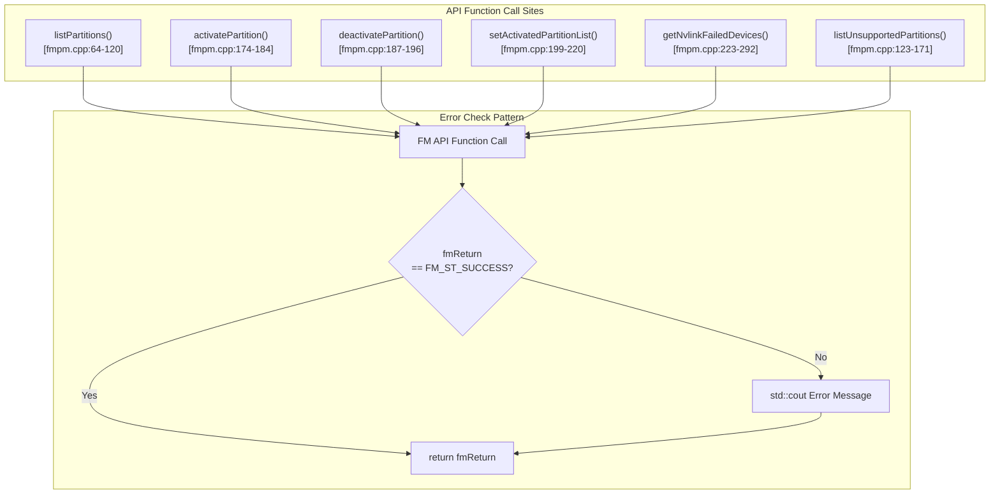
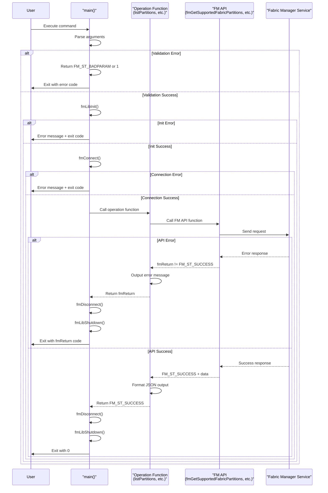
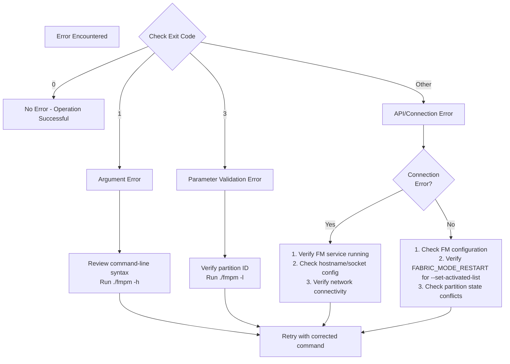

<!-- source: DeepWiki mcp.deepwiki.com · repo NVIDIA/Fabric-Manager-Client · page 4.5 Error Handling and Return Codes · fetched 2026-10-26 -->

# Error Handling and Return Codes

<details>
<summary>Relevant source files</summary>

The following files were used as context for generating this wiki page:

- [README.md](README.md)
- [fmpm.cpp](fmpm.cpp)

</details>


## Purpose and Scope

This page documents the error handling mechanisms, return code types, and troubleshooting procedures for the Fabric Manager Client (`fmpm`). It covers error detection, propagation, and reporting across all system layers, from command-line argument validation to hardware communication failures. 

For information about the data structures returned by API calls, see [Data Structures and API](#4.3). For details on communication protocol errors, see [Communication Protocols](#4.2).

## Error Handling Architecture

The `fmpm` client implements a layered error handling strategy where errors are detected at their source, propagated upward through the call stack, and ultimately reported to the user as structured JSON output or standard error messages. The system uses a unified return code mechanism (`fmReturn_t`) for all API operations.



**Sources:** [fmpm.cpp:1-466]()

## Return Code Type: fmReturn_t

The `fmReturn_t` type is the standard return value for all Fabric Manager API functions. It is defined in the `nv_fm_agent.h` header (included via `nvidia-fabricmanager-devel` package) and provides a consistent mechanism for reporting operation success or failure.

### Primary Return Codes

| Return Code | Meaning | Usage Context |
|-------------|---------|---------------|
| `FM_ST_SUCCESS` | Operation completed successfully | All API calls, used as success indicator in [fmpm.cpp:73](), [fmpm.cpp:132](), [fmpm.cpp:179](), [fmpm.cpp:192](), [fmpm.cpp:214](), [fmpm.cpp:232](), [fmpm.cpp:408](), [fmpm.cpp:435]() |
| `FM_ST_BADPARAM` | Invalid parameter provided | Argument validation failures in [fmpm.cpp:47](), [fmpm.cpp:350](), [fmpm.cpp:359](), [fmpm.cpp:402]() |
| `FM_ST_ERROR` | Generic API operation error | Referenced in error messages as generic failure code |

**Sources:** [fmpm.cpp:32](), [fmpm.cpp:47](), [fmpm.cpp:73](), [fmpm.cpp:132](), [fmpm.cpp:179](), [fmpm.cpp:192](), [fmpm.cpp:214](), [fmpm.cpp:232](), [fmpm.cpp:350](), [fmpm.cpp:359](), [fmpm.cpp:402](), [fmpm.cpp:408](), [fmpm.cpp:435]()

## Error Handling by System Layer

### Client-Side Input Validation

Input validation occurs in the `main()` function during command-line argument parsing. Validation failures return `FM_ST_BADPARAM` or exit with code `1`.



**Validation Examples:**

**Partition ID Range Validation:**
```cpp
// fmpm.cpp:44-48
if ( partId < 0 || partId >= FM_MAX_FABRIC_PARTITIONS )
{
    printf("Invalid partition Id %u was given.\n", partId);
    return FM_ST_BADPARAM;
}

// fmpm.cpp:348-351
if ( partitionId >= FM_MAX_FABRIC_PARTITIONS ) {
    std::cout << "Invalid Partition ID." << std::endl;
    return FM_ST_BADPARAM;
}
```

**Missing Argument Validation:**
```cpp
// fmpm.cpp:344-347
if (i + 1 < argc) {
    partitionId = std::stoul(argv[i + 1]);
    ++i;
} else {
    std::cerr << "Error: -a option requires partition ID." << std::endl;
    return 1;
}
```

**Sources:** [fmpm.cpp:33-61](), [fmpm.cpp:335-404]()

### Library Initialization Errors

The `fmLibInit()` function must succeed before any API operations can be performed. Initialization failures prevent all subsequent operations.



**Implementation:**
```cpp
// fmpm.cpp:407-411
fmReturn = fmLibInit();
if (FM_ST_SUCCESS != fmReturn) {
    std::cout << "Failed to initialize Fabric Manager API interface library." << std::endl;
    return fmReturn;
}
```

**Sources:** [fmpm.cpp:407-411]()

### Connection Errors

Connection establishment via `fmConnect()` can fail due to network issues, socket configuration mismatches, or Fabric Manager service unavailability.

| Error Scenario | Client Configuration | Server Configuration Required | Result |
|----------------|---------------------|-------------------------------|--------|
| TCP connection refused | `--hostname 10.0.0.1` | `FM_CMD_BIND_INTERFACE=10.0.0.1` | Connection failure |
| Unix socket not found | `--unix-domain-socket /path/to/socket` | `FM_CMD_UNIX_SOCKET_PATH=/path/to/socket` | Connection failure |
| Connection timeout | Any valid configuration | Fabric Manager not running | Timeout after `connectParams.timeoutMs` |
| Configuration mismatch | TCP hostname | Unix socket configured on server | Connection failure |

**Connection Parameters:**
```cpp
// fmpm.cpp:414-428
fmConnectParams_t connectParams;
connectParams.timeoutMs = 1000; // in milliseconds
connectParams.version = fmConnectParams_version;

memset(connectParams.addressInfo, 0, sizeof(connectParams.addressInfo));
if ( strnlen(mUnixSockPath, MAX_PATH_LEN) > 0 )
{
    snprintf(connectParams.addressInfo, MAX_PATH_LEN, "%s", mUnixSockPath);
    connectParams.addressIsUnixSocket = 1;
}
if ( strnlen(mHostname, MAX_PATH_LEN) > 0 )
{
    snprintf(connectParams.addressInfo, MAX_PATH_LEN, "%s", mHostname);
    connectParams.addressIsUnixSocket = 0;
}
```

**Error Handling:**
```cpp
// fmpm.cpp:434-438
fmReturn = fmConnect(&connectParams, &fmHandle);
if (fmReturn != FM_ST_SUCCESS){
    std::cout << "Failed to connect to Fabric Manager instance." << std::endl;
    return fmReturn;
}
```

**Sources:** [fmpm.cpp:414-438]()

### API Operation Errors

Each API operation function checks the return value from the underlying Fabric Manager API call and reports failures with descriptive messages.



**Error Handling Pattern:**

All API operation functions follow this consistent pattern:

```cpp
// Example from listPartitions() [fmpm.cpp:72-76]
fmReturn = fmGetSupportedFabricPartitions(fmHandle, &partitionList);
if (fmReturn != FM_ST_SUCCESS) {
    std::cout << "Failed to get partition list. fmReturn: " << fmReturn << std::endl;
    return fmReturn;
}

// Example from activatePartition() [fmpm.cpp:178-183]
fmReturn = fmActivateFabricPartition(fmHandle, partitionId);
if (fmReturn != FM_ST_SUCCESS) {
    std::cout << "Failed to activate partition. fmReturn: " << fmReturn
        << std::endl;
}
return fmReturn;

// Example from setActivatedPartitionList() [fmpm.cpp:213-218]
fmReturn = fmSetActivatedFabricPartitions(fmHandle, &partitionList);
if ( fmReturn != FM_ST_SUCCESS )
{
    std::cout << "Failed to set activated partitions. fmReturn: " << fmReturn << std::endl;
}
return fmReturn;
```

**Sources:** [fmpm.cpp:64-120](), [fmpm.cpp:123-171](), [fmpm.cpp:174-184](), [fmpm.cpp:187-196](), [fmpm.cpp:199-220](), [fmpm.cpp:223-292]()

## Error Propagation Flow

The error propagation mechanism ensures that errors from any layer are captured and returned to the user with appropriate context.



**Implementation in main():**
```cpp
// fmpm.cpp:440-464
if ( operation == SHARED_FABRIC_CMD_LIST_PARTITION ) {
    fmReturn = listPartitions(fmHandle);
} else if ( operation == SHARED_FABRIC_CMD_ACTIVATE_PARTITION ) {
    fmReturn = activatePartition(fmHandle, partitionId);
} else if ( operation == SHARED_FABRIC_CMD_DEACTIVATE_PARTITION ) {
    fmReturn = deactivatePartition(fmHandle, partitionId);
} else if ( operation ==  SHARED_FABRIC_CMD_SET_ACTIVATED_PARTITION_LIST ) {
    fmReturn = setActivatedPartitionList(fmHandle, mPartitionIds, mNumPartitions);
} else if ( operation ==  SHARED_FABRIC_CMD_GET_NVLINK_FAILED_DEVICES ) {
    fmReturn = getNvlinkFailedDevices(fmHandle);
} else if ( operation ==  SHARED_FABRIC_CMD_LIST_UNSUPPORTED_PARTITION ) {
    fmReturn = listUnsupportedPartitions(fmHandle);
}

/* Clean up */
fmDisconnect(fmHandle);
fmLibShutdown();
return fmReturn;  // Exit code is the fmReturn value
```

**Sources:** [fmpm.cpp:440-465]()

## Resource Cleanup

The client ensures proper cleanup of resources even when errors occur. The cleanup sequence is executed unconditionally after all operations complete.

```cpp
// fmpm.cpp:461-464
/* Clean up */
fmDisconnect(fmHandle);
fmLibShutdown();
return fmReturn;
```

This pattern ensures:
- Connection handles are released via `fmDisconnect()`
- Library resources are freed via `fmLibShutdown()`
- Cleanup occurs regardless of operation success or failure
- The error code is preserved and returned as the process exit status

**Sources:** [fmpm.cpp:461-464]()

## Common Error Scenarios

### Invalid Partition ID

**Cause:** Partition ID is negative, exceeds `FM_MAX_FABRIC_PARTITIONS`, or references a non-existent partition.

**Detection:** Client-side validation or API rejection.

**Example:**
```bash
$ ./fmpm -a 999
Invalid Partition ID.
$ echo $?
3  # FM_ST_BADPARAM
```

**Resolution:** Query available partitions with `-l` and use valid partition IDs.

**Sources:** [fmpm.cpp:44-48](), [fmpm.cpp:348-351]()

### Connection Configuration Mismatch

**Cause:** Client connection parameters do not match Fabric Manager server configuration.

**Detection:** `fmConnect()` returns error code.

**Example:**
```bash
$ ./fmpm -l --hostname 10.0.0.1
Failed to connect to Fabric Manager instance.
```

**Resolution:** 
- Verify Fabric Manager has `FM_CMD_BIND_INTERFACE=10.0.0.1` configured
- Check Fabric Manager service is running
- Verify network connectivity and firewall rules
- For Unix sockets, ensure `FM_CMD_UNIX_SOCKET_PATH` matches `--unix-domain-socket` argument

**Sources:** [fmpm.cpp:434-438](), [README.md:14](), [README.md:18]()

### Partition Already Active

**Cause:** Attempting to activate a partition that is already in active state.

**Detection:** `fmActivateFabricPartition()` returns error code.

**Example:**
```bash
$ ./fmpm -a 2 --hostname 10.0.0.1
Failed to activate partition. fmReturn: <error_code>
```

**Resolution:** Query current partition states with `-l` before attempting activation.

**Sources:** [fmpm.cpp:178-183]()

### Resiliency Mode Not Enabled

**Cause:** Using `--set-activated-list` when Fabric Manager does not have `FABRIC_MODE_RESTART=1` configured.

**Detection:** `fmSetActivatedFabricPartitions()` returns error code.

**Example:**
```bash
$ ./fmpm --set-activated-list 1,2,3
Failed to set activated partitions. fmReturn: <error_code>
```

**Resolution:** Configure Fabric Manager with `FABRIC_MODE_RESTART=1` in configuration file.

**Sources:** [fmpm.cpp:213-218](), [README.md:24]()

### Invalid Partition List Format

**Cause:** Partition list string contains spaces, invalid characters, or malformed format.

**Detection:** `parsePartitionIdlistString()` returns `FM_ST_BADPARAM`.

**Example:**
```bash
$ ./fmpm --set-activated-list "1, 2, 3"  # Spaces not allowed
Invalid partition Id <value> was given.
$ echo $?
3  # FM_ST_BADPARAM
```

**Resolution:** Use comma-separated format without spaces: `--set-activated-list 1,2,3`

**Sources:** [fmpm.cpp:33-61](), [README.md:23]()

### Missing Required Dependencies

**Cause:** `nvidia-fabricmanager-devel` or `libjsoncpp` libraries not installed or not found.

**Detection:** Build-time linker errors or runtime library loading failures.

**Resolution:** Install required development packages as documented in [Prerequisites and Dependencies](#2.1).

**Sources:** [README.md:31-38]()

## Exit Code Mapping

The `fmpm` process exit code directly maps to the `fmReturn_t` value from the last operation:

| Exit Code | Meaning | Source |
|-----------|---------|--------|
| `0` | Success (`FM_ST_SUCCESS`) | All operations completed successfully |
| `1` | Invalid argument | Missing required argument [fmpm.cpp:346](), [fmpm.cpp:359](), [fmpm.cpp:373](), [fmpm.cpp:386](), [fmpm.cpp:395]() |
| `3` | Bad parameter (`FM_ST_BADPARAM`) | Invalid partition ID or parameter [fmpm.cpp:47](), [fmpm.cpp:350](), [fmpm.cpp:359](), [fmpm.cpp:402]() |
| Other | API error codes | Returned from `fmLibInit()`, `fmConnect()`, or operation functions |

**Process Exit Mechanism:**
```cpp
// fmpm.cpp:464
return fmReturn;  // Process exit code is the last fmReturn value
```

Shell scripts and automation tools can check the exit code to determine operation success:
```bash
$ ./fmpm -l
# ... JSON output ...
$ echo $?
0  # Success

$ ./fmpm -a 999
Invalid Partition ID.
$ echo $?
3  # FM_ST_BADPARAM
```

**Sources:** [fmpm.cpp:346](), [fmpm.cpp:350](), [fmpm.cpp:359](), [fmpm.cpp:373](), [fmpm.cpp:386](), [fmpm.cpp:395](), [fmpm.cpp:402](), [fmpm.cpp:464]()

## Error Message Output Streams

The client uses different output streams for different message types:

| Stream | Message Type | Usage |
|--------|--------------|-------|
| `stdout` | JSON data output | Successful query results ([fmpm.cpp:117](), [fmpm.cpp:168](), [fmpm.cpp:289]()) |
| `stdout` | Error messages from API operations | API failures ([fmpm.cpp:74](), [fmpm.cpp:134](), [fmpm.cpp:180](), [fmpm.cpp:193](), [fmpm.cpp:216](), [fmpm.cpp:234]()) |
| `stderr` | Command-line argument errors | Input validation failures ([fmpm.cpp:345](), [fmpm.cpp:358](), [fmpm.cpp:372](), [fmpm.cpp:385](), [fmpm.cpp:394](), [fmpm.cpp:401]()) |
| `stdout` | Help text and version | User information ([fmpm.cpp:307-327](), [fmpm.cpp:398]()) |

**Note:** Most error messages are output to `stdout` via `std::cout` rather than `stderr`, which may complicate parsing in some automation scenarios. Scripts should check exit codes to distinguish success from failure rather than relying solely on output stream.

**Sources:** [fmpm.cpp:74](), [fmpm.cpp:117](), [fmpm.cpp:134](), [fmpm.cpp:168](), [fmpm.cpp:180](), [fmpm.cpp:193](), [fmpm.cpp:216](), [fmpm.cpp:234](), [fmpm.cpp:289](), [fmpm.cpp:345](), [fmpm.cpp:358](), [fmpm.cpp:372](), [fmpm.cpp:385](), [fmpm.cpp:394](), [fmpm.cpp:401]()

## Troubleshooting Guide

### Diagnostic Commands

| Command | Purpose | Expected Success Output |
|---------|---------|-------------------------|
| `./fmpm -v` | Verify client version | Version string (e.g., "1.0.1") |
| `./fmpm -l` | Test basic connectivity and list partitions | JSON partition list |
| `./fmpm --get-nvlink-failed-devices` | Identify hardware failures | JSON list of failed devices |
| `./fmpm --list-unsupported-partitions` | Identify unsupported configurations | JSON list of unsupported partitions |

### Error Resolution Workflow



### Enable Verbose Diagnostics

While `fmpm` does not have built-in verbose logging, diagnostics can be enhanced by:

1. **Checking Connection Parameters:**
   - Verify `--hostname` or `--unix-domain-socket` matches server configuration
   - Test network connectivity: `ping <hostname>` or `telnet <hostname> <port>`
   - For Unix sockets: `ls -la /path/to/socket` to verify existence and permissions

2. **Querying System State:**
   - Run `./fmpm -l` to view current partition states
   - Run `./fmpm --get-nvlink-failed-devices` to identify hardware issues
   - Run `./fmpm --list-unsupported-partitions` to identify configuration limitations

3. **Examining Fabric Manager Logs:**
   - Check Fabric Manager service logs for corresponding errors
   - Logs typically located in `/var/log/` or systemd journal

**Sources:** [fmpm.cpp:1-466](), [README.md:1-39]()

---

