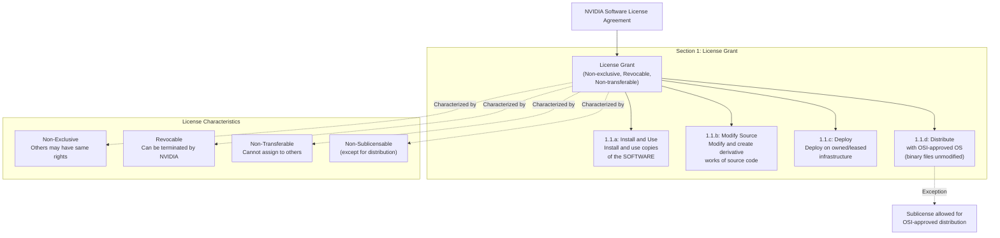
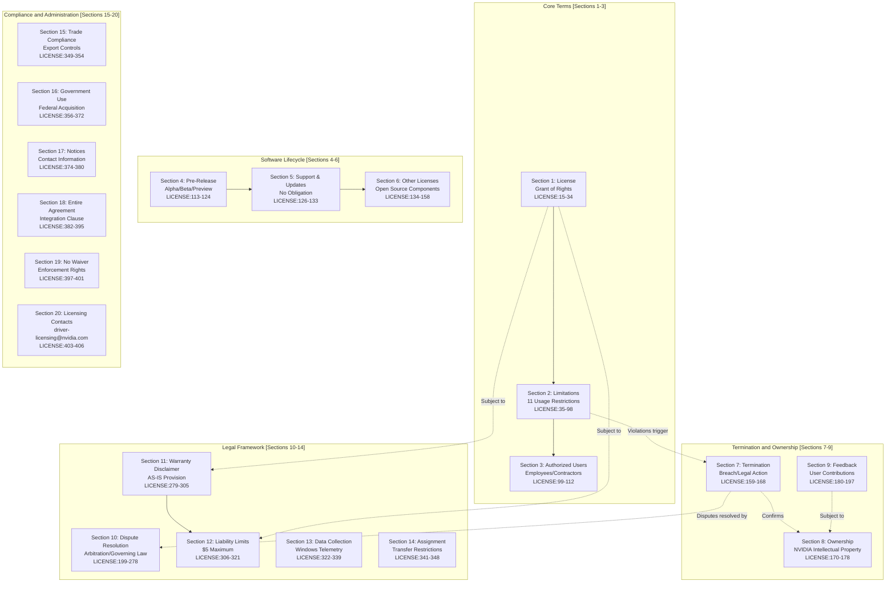
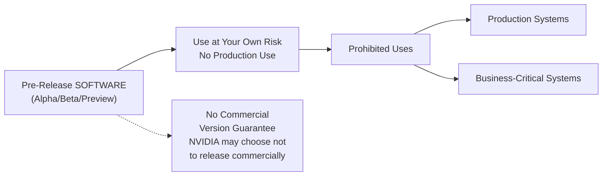
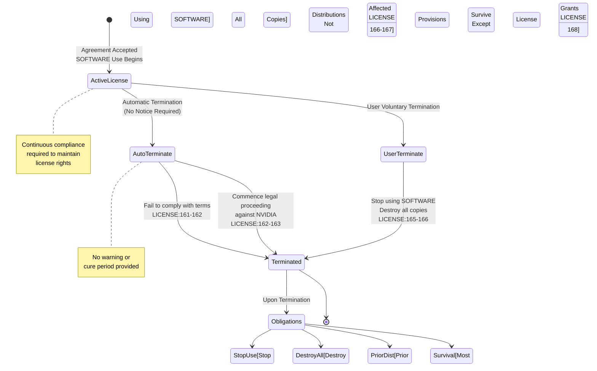
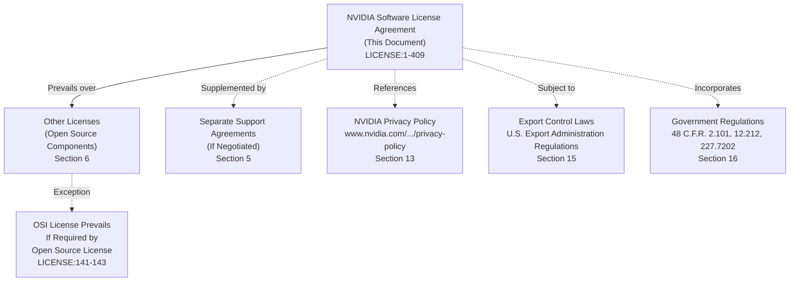

<!-- source: DeepWiki mcp.deepwiki.com · repo NVIDIA/Fabric-Manager-Client · page 5.1 Software License Agreement · fetched 2026-10-26 -->

# Software License Agreement

<details>
<summary>Relevant source files</summary>

The following files were used as context for generating this wiki page:

- [LICENSE](LICENSE)

</details>


## Purpose and Scope

This page documents the NVIDIA Software License Agreement that governs the use of the Fabric Manager Client (`fmpm`) and all associated software components in this repository. It covers the fundamental structure of the agreement, the grant of license rights, acceptance conditions, and the basic terms that enable legal use of the software.

For specific usage restrictions and platform requirements, see [Usage Restrictions and Requirements](#5.2). For warranty disclaimers and liability limitations, see [Disclaimers and Liability](#5.3). For intellectual property terms and feedback provisions, see [Intellectual Property and Feedback](#5.4). For dispute resolution procedures, see [Dispute Resolution](#5.5).

**Sources:** [LICENSE:1-11]()

---

## Agreement Overview

The NVIDIA Software License Agreement is a legally binding contract between the user (individual or entity) and NVIDIA Corporation that establishes the terms under which the SOFTWARE (including `fmpm`, `libnvfm`, and all associated components) may be used, modified, and distributed.

### Critical Notice and Acceptance

The agreement begins with an important notice requiring explicit acceptance before any use of the software:

> "IMPORTANT NOTICE – PLEASE READ AND AGREE BEFORE USING THE SOFTWARE."

**Acceptance Requirements:**
- Must have legal age and authority to enter the Agreement
- Must accept all terms without modification
- Non-acceptance requires immediate cessation of software use
- Use of the software constitutes implicit acceptance

**Sources:** [LICENSE:3-10]()

---

## License Grant Structure

The following diagram illustrates the hierarchical structure of rights granted under Section 1 of the Agreement:



**Sources:** [LICENSE:15-34]()

---

## Granted Rights Detail

### Installation and Use Rights (1.1.a)

Users receive the right to install and use copies of the SOFTWARE without limitation on the number of installations, subject to the license characteristics and limitations defined elsewhere in the Agreement.

**Key Components:**
- `fmpm` executable binary
- `libnvfm` API library
- `libjsoncpp` JSON processing library (if bundled)
- All associated header files and documentation

**Sources:** [LICENSE:21]()

### Modification Rights (1.1.b)

For SOFTWARE components delivered in source code format, users may:
- Modify the source code
- Create derivative works
- Adapt functionality to specific needs

**Restrictions:**
- Binary-only components cannot be modified (see [Usage Restrictions](#5.2))
- Modified files must carry prominent notices ([LICENSE:56-59]())
- Header files cannot be modified for distribution ([LICENSE:54]())

**Sources:** [LICENSE:23-24]()

### Deployment Rights (1.1.c)

Users may deploy the SOFTWARE on infrastructure they own or lease for their own use. This enables:

**Deployment Scenarios:**
- Single-host installation (`fmpm` + Fabric Manager on same server)
- Multi-host management (remote `fmpm` clients)
- Leased cloud infrastructure
- On-premises data centers

**Sources:** [LICENSE:26]()

### Distribution Rights (1.1.d)

Limited distribution rights are granted under specific conditions:

| Condition | Requirement |
|-----------|-------------|
| Operating System | Must be distributed under OSI-approved open source license |
| Binary Integrity | Binary files must not be modified (except decompression) |
| License Inclusion | This Agreement must be provided to each recipient |
| OSI Reference | https://opensource.org |

This provision enables distribution of `fmpm` binaries as part of open source operating system packages (e.g., Ubuntu packages, RHEL RPMs).

**Sources:** [LICENSE:29-33]()

---

## License Characteristics

The following table summarizes the non-negotiable characteristics of the license grant:

| Characteristic | Meaning | Implication |
|----------------|---------|-------------|
| **Non-Exclusive** | Other users/entities may receive identical license | No competitive advantage from license itself |
| **Revocable** | NVIDIA may terminate at will for breach | Continued compliance required to maintain rights |
| **Non-Transferable** | Cannot assign rights to another party | Each user must accept Agreement directly |
| **Non-Sublicensable** | Cannot grant license rights to others (except distribution under 1.1.d) | No white-label redistribution |

**Sources:** [LICENSE:17-19]()

---

## Agreement Structure and Sections

The following diagram maps the complete structure of the License Agreement and the relationship between sections:



**Sources:** [LICENSE:1-409]()

---

## Authorized Users (Section 3)

The Agreement defines who may access and use the SOFTWARE under a single license acceptance:

### Entity Users

Organizations may grant access to:
- **Employees** of the entity
- **Contractors** working on behalf of the entity
- **Subsidiary employees** of the entity

**Requirements:**
- Access must be from the entity's secure network
- Work must be authorized by the Agreement
- Work must be performed on behalf of the licensee

**Sources:** [LICENSE:101-103]()

### Academic Institution Users

Educational institutions have expanded authorized user definitions:
- **Students** enrolled at the institution
- **Faculty** employed by the institution
- **Researchers** affiliated with the institution

**Requirements:**
- Access must be from the institution's secure network
- Use must be for authorized academic purposes

**Sources:** [LICENSE:104-106]()

### Liability for Authorized Users

The licensee (entity or institution) bears full responsibility for all actions of authorized users:

> "You are responsible for the compliance with the terms of this Agreement by your authorized users. Any act or omission that if committed by you would constitute a breach of this Agreement will be deemed to constitute a breach of this Agreement if committed by your authorized users."

This creates vicarious liability—the licensee is accountable for authorized users' compliance as if the licensee performed the actions directly.

**Sources:** [LICENSE:108-111]()

---

## Pre-Release Software (Section 4)

The Agreement establishes distinct terms for pre-release SOFTWARE versions:

### Version Identifiers

Pre-release versions are identified by labels:
- **Alpha** versions
- **Beta** versions
- **Preview** versions
- Other pre-release designations

**Sources:** [LICENSE:115-116]()

### Pre-Release Characteristics

| Characteristic | Description |
|----------------|-------------|
| Functionality | May not be fully functional |
| Quality | May contain errors or design flaws |
| Security | Reduced or different security standards |
| Privacy | Reduced or different privacy standards |
| Accessibility | Reduced or different accessibility standards |
| Reliability | Reduced or different reliability standards |

**Sources:** [LICENSE:115-119]()

### Risk and Usage Limitations



**Risk Warning:**
Users accept full risk for pre-release SOFTWARE, understanding that:
1. It is not intended for production or business-critical systems
2. NVIDIA may never release a commercial version
3. All standard disclaimers and limitations apply with greater force

**Sources:** [LICENSE:121-124]()

---

## Support and Updates (Section 5)

The Agreement establishes no obligation for NVIDIA to provide support or updates:

### Support Policy

> "NVIDIA is not obligated to support any SOFTWARE, unless there is a separate agreement for this purpose."

This means:
- No guaranteed bug fixes
- No guaranteed security patches
- No guaranteed compatibility updates
- No technical support hotline

**Exception:** Separate support agreements may be negotiated independently of this Agreement.

**Sources:** [LICENSE:128-129]()

### Updates and Patches

NVIDIA may, at its sole discretion, provide:
- Patches
- Workarounds
- Updates

**Governance:**
Unless updates include separate governing terms, they are automatically incorporated into and governed by this Agreement as part of the SOFTWARE.

**Sources:** [LICENSE:129-132]()

---

## Termination Conditions (Section 7)

The following diagram illustrates the termination mechanisms and their consequences:



**Sources:** [LICENSE:159-168]()

### Automatic Termination Triggers

The Agreement automatically terminates without notice from NVIDIA upon:

1. **Compliance Failure:**
   - Any failure to comply with any term in the Agreement
   - Includes both major violations (e.g., platform restrictions) and minor violations
   - No grace period or opportunity to cure

2. **Legal Action:**
   - Commencing any legal proceeding against NVIDIA regarding the SOFTWARE
   - Participating in any such legal proceeding

**Sources:** [LICENSE:161-163]()

### User-Initiated Termination

Users may terminate the Agreement at any time by:
1. Stopping all use of the SOFTWARE
2. Destroying all copies of the SOFTWARE

No notice to NVIDIA is required for user-initiated termination.

**Sources:** [LICENSE:165-166]()

### Post-Termination Obligations

Upon termination (automatic or voluntary):

| Obligation | Requirement |
|------------|-------------|
| Use | Must stop all use immediately |
| Copies | Must destroy all copies (no retention) |
| Prior Distributions | Distributions made before termination remain valid |
| Surviving Provisions | All provisions survive except license grants |

The survival clause means that obligations like indemnification, warranty disclaimers, and liability limitations continue indefinitely even after termination.

**Sources:** [LICENSE:164-168]()

---

## Data Collection (Section 13)

For Windows operating systems specifically, the Agreement includes data collection provisions:

### Windows Installation Data Collection

At the time of SOFTWARE installation on Windows, NVIDIA will access and collect data for the following purposes:

| Purpose | Description |
|---------|-------------|
| Configuration | Properly configure system for SOFTWARE use |
| Optimization | Optimize system for SOFTWARE performance |
| Content Delivery | Deliver content or services through SOFTWARE |
| Improvement | Improve NVIDIA products and services |

**Collected Information Types:**
- GPU configuration data
- CPU configuration data
- Operating system information

**Sources:** [LICENSE:324-329]()

### Third-Party Links

The SOFTWARE may contain links to third-party websites and services. The Agreement explicitly states:
- NVIDIA is not responsible for third-party privacy practices
- Users should review third-party privacy statements independently
- NVIDIA encourages privacy statement review before using third-party services

**Sources:** [LICENSE:331-335]()

### NVIDIA Privacy Policy

Users are directed to NVIDIA's comprehensive Privacy Policy at:
- URL: https://www.nvidia.com/en-us/about-nvidia/privacy-policy

This policy explains NVIDIA's broader data collection and usage practices beyond this Agreement.

**Sources:** [LICENSE:337-339]()

---

## Agreement Administration

### Contact Information

**Legal Notices and Correspondence:**
```
NVIDIA Corporation
2788 San Tomas Expressway
Santa Clara, California 95051
United States of America
Attention: Legal Department
```

**Licensing Questions:**
- Email: driver-licensing@nvidia.com

**Sources:** [LICENSE:376-378](), [LICENSE:405-406]()

### Notice Delivery

Users consent to receive notices from NVIDIA via email, and such electronic notices satisfy all legal communication requirements.

**Sources:** [LICENSE:379-380]()

---

## Agreement Version and Modification

**Current Version:** November 23, 2023

The Agreement includes an integration clause establishing that:
- This Agreement constitutes the entire agreement between parties
- It supersedes all prior communications and agreements
- Additional or different terms (in purchase orders, invoices, etc.) are null and void
- Modifications require a writing signed by authorized representatives of both parties

No verbal agreements or informal modifications have any effect.

**Sources:** [LICENSE:408](), [LICENSE:382-390]()

---

## Key Definitions

The following table defines critical terms used throughout the Agreement:

| Term | Definition | Usage Context |
|------|------------|---------------|
| **SOFTWARE** | All NVIDIA software and materials provided, including `fmpm`, `libnvfm`, documentation, and updates | Used throughout to refer to licensed materials |
| **Agreement** | This license agreement document | Refers to the entire legal contract |
| **NVIDIA** | NVIDIA Corporation | The licensor and party granting rights |
| **You** | The licensee, whether individual or entity | The party accepting the license |
| **Authorized Users** | Employees, contractors, subsidiary staff, or academic institution members | Section 3 expanded definition |
| **Critical Application** | Systems where failure could cause injury, death, or catastrophic damage | Section 2.10 prohibited use |
| **Feedback** | User suggestions, fixes, or enhancements | Section 9 intellectual property grant |
| **Dispute** | Any dispute, claim, or controversy arising from SOFTWARE or Agreement | Section 10 resolution procedures |
| **Other Licenses** | Open source or third-party licenses for components | Section 6 component governance |
| **NVIDIA Platform** | Microprocessors, SoCs, GPUs designed and sold by NVIDIA | Section 2.1 platform restriction |

**Sources:** [LICENSE:5-7](), [LICENSE:39-45](), [LICENSE:80](), [LICENSE:99-106](), [LICENSE:183-184](), [LICENSE:201-203]()

---

## Relationship to Other Legal Documents

This Agreement operates within a hierarchy of legal documents:



**Key Relationships:**

1. **This Agreement vs. Open Source Licenses:** This Agreement generally prevails, but if a third-party open source license requires its terms to prevail, those terms control for that component.

2. **This Agreement vs. Support Agreements:** Separate support agreements supplement but do not replace this Agreement.

3. **This Agreement vs. Privacy Policy:** The Privacy Policy is incorporated by reference for data handling specifics.

4. **This Agreement vs. Government Regulations:** Federal acquisition regulations are incorporated for government use scenarios.

**Sources:** [LICENSE:134-148](), [LICENSE:128-129](), [LICENSE:337-339](), [LICENSE:356-372]()

---

## Summary of Rights and Obligations

### Rights Granted to Users

- ✓ Install and use SOFTWARE copies
- ✓ Modify source code portions
- ✓ Deploy on owned/leased infrastructure
- ✓ Distribute with OSI-approved operating systems (unmodified binaries)
- ✓ Use via authorized users (employees, contractors, academic users)

### Primary Obligations

- Must use only on NVIDIA Platform hardware
- Must not reverse engineer binary components
- Must not modify binary components or header files for distribution
- Must comply with all usage restrictions (see [Usage Restrictions](#5.2))
- Must indemnify NVIDIA for damages from products developed with SOFTWARE
- Must accept all dispute resolution terms (arbitration, class action waiver)
- Must destroy all copies upon termination

### Non-Negotiable Terms

- No warranties of any kind (AS-IS delivery)
- No support obligation from NVIDIA
- Maximum liability: $5 USD total cumulative
- No use in Critical Applications
- Automatic termination on any breach
- Binding arbitration in Santa Clara County, California
- Delaware law governs

**Sources:** [LICENSE:15-34](), [LICENSE:35-98](), [LICENSE:279-321]()

---

This Software License Agreement forms the legal foundation for all use of the Fabric Manager Client and associated components. Compliance with all terms is mandatory and continuously required to maintain the license grant. For detailed information on specific restrictions, disclaimers, and legal procedures, refer to the related sections [5.2](#5.2), [5.3](#5.3), [5.4](#5.4), and [5.5](#5.5).

---

