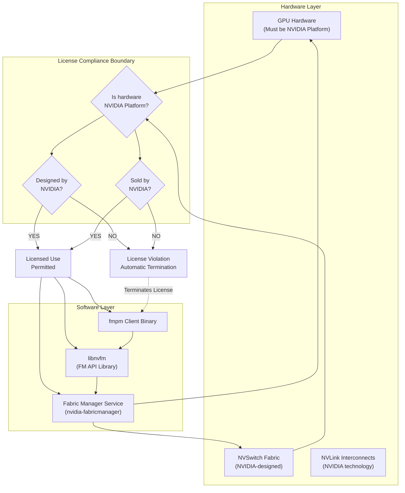
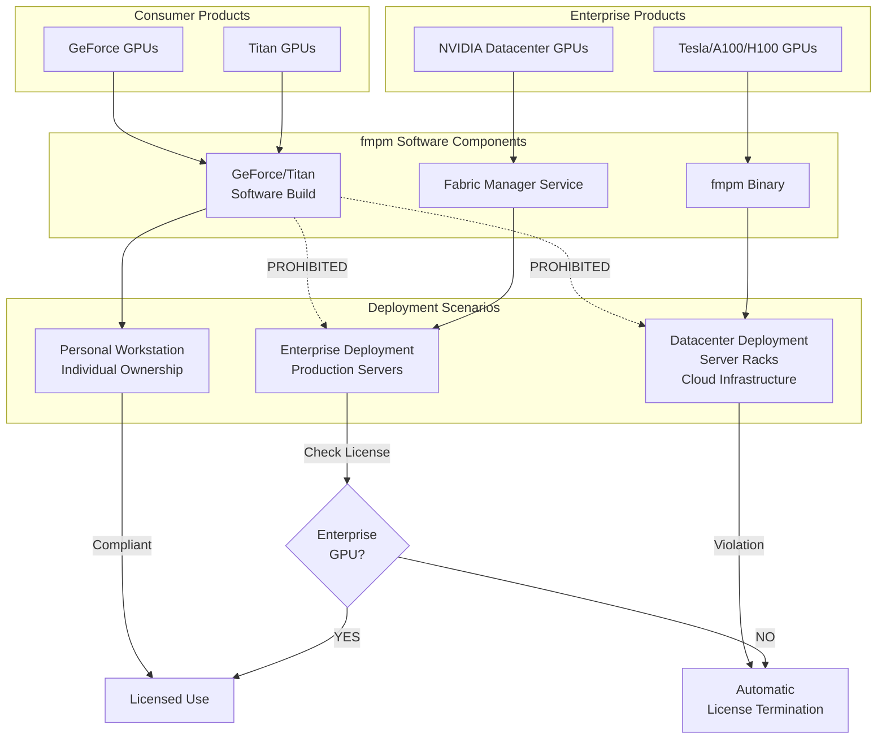
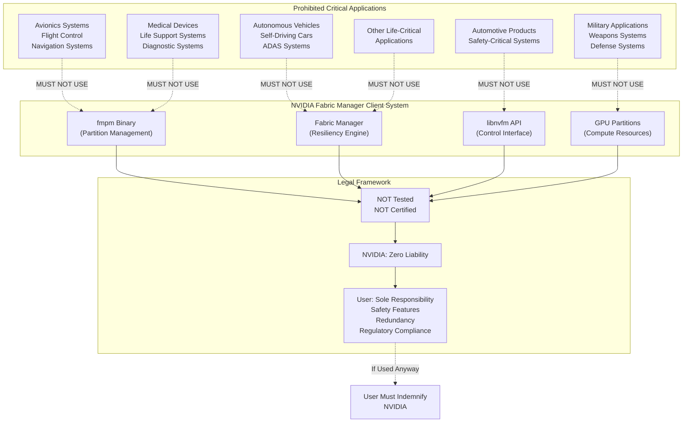
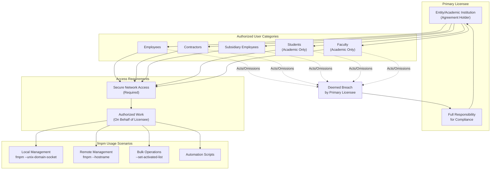
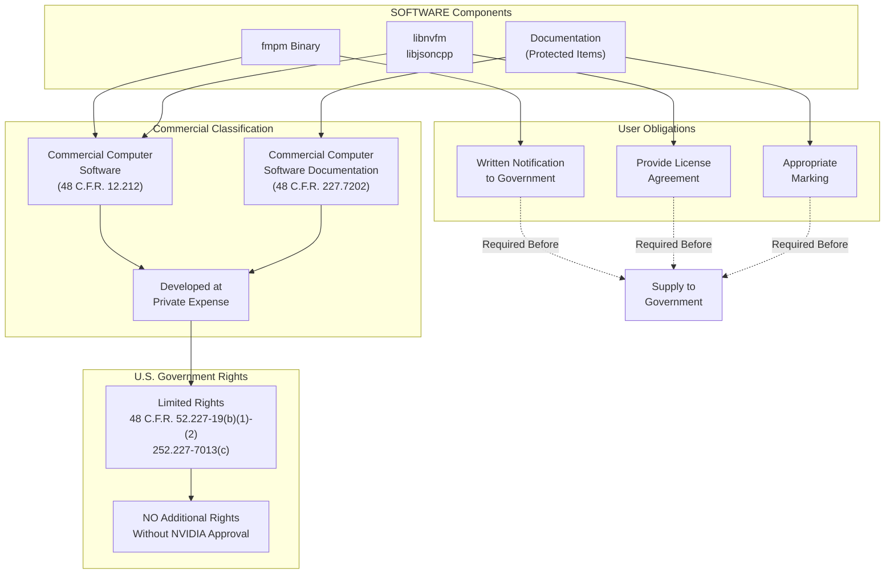

<!-- source: DeepWiki mcp.deepwiki.com · repo NVIDIA/Fabric-Manager-Client · page 5.2 Usage Restrictions and Requirements · fetched 2026-10-26 -->

# Usage Restrictions and Requirements

Relevant source files

The following files were used as context for generating this wiki page:

- [LICENSE](LICENSE)

## Purpose and Scope

This page documents the specific usage restrictions, platform requirements, and prohibited actions that govern the use of the NVIDIA Fabric Manager Client (`fmpm`) and associated libraries. These restrictions are legally binding terms from the NVIDIA Software License Agreement that define how the SOFTWARE may and may not be used.

For the general license terms and grant of rights, see [Software License Agreement](#5.1). For liability disclaimers and warranty limitations, see [Disclaimers and Liability](#5.3).

**Sources:** [LICENSE:1-408]()

---

## Platform Requirements

### NVIDIA Platform Restriction

The SOFTWARE is **only licensed for use with NVIDIA Platform hardware**. This is the most fundamental restriction that defines where the software can legally operate.

**NVIDIA Platform Definition:**
- Microprocessors, SoCs, and GPUs that have been:
  1. Designed by NVIDIA and/or its affiliates, AND
  2. Sold (directly or indirectly) by NVIDIA and/or its affiliates

**Firmware Restrictions:**
- Firmware may only be used in NVIDIA Platforms
- Firmware must not be translated from its original architecture or language
- No cross-compilation or architecture translation is permitted

**Sources:** [LICENSE:39-45]()

### Platform Verification Diagram

**Platform Compliance Requirements:**

| Component | Requirement | Verification |
|-----------|------------|--------------|
| GPUs | NVIDIA-designed and NVIDIA-sold | Must be authentic NVIDIA products |
| NVSwitch | NVIDIA fabric architecture | Part of NVIDIA Platform |
| SoCs/Microprocessors | NVIDIA-designed | No third-party alternatives permitted |
| Firmware | NVIDIA-provided architecture | No translation or cross-compilation |

**Sources:** [LICENSE:39-45]()

---

## Prohibited Actions

### Reverse Engineering and Decompilation

The SOFTWARE provided in binary form is protected against reverse engineering:

**Prohibited Activities:**
- Reverse engineering of binary components
- Decompilation of compiled libraries (`libnvfm`, `libjsoncpp` usage)
- Disassembly of the `fmpm` executable
- Any attempt to obtain source code from binary distributions

**Affected Components:**
- `fmpm` compiled binary
- NVIDIA Fabric Manager service binaries
- Proprietary libraries in development packages

**Sources:** [LICENSE:47-49]()

### Binary Modification Restrictions

**Prohibited Modifications:**
- Modifying SOFTWARE delivered in binary form
- Creating derivative works of binary components
- Distributing modified header files
- Altering the `fmpm` executable or system libraries

**Permitted Modifications:**
- Modifying source code portions delivered by NVIDIA in source format
- Creating derivative works of source code components
- Internal modifications for authorized use

**Sources:** [LICENSE:51-54]()

### Copyright and Attribution Requirements

All uses must maintain proper attribution:

**Required Actions:**
- Preserve copyright notices in the SOFTWARE
- Maintain proprietary notices unchanged
- Mark modified files with prominent change notices
- Do not misrepresent authorship of the SOFTWARE

**Example Violation:** Removing NVIDIA copyright headers from modified source files or misrepresenting modified versions as original NVIDIA software.

**Sources:** [LICENSE:56-59]()

### Technical Protection Measures

Users must not bypass security or technical limitations:

**Prohibited Bypasses:**
- Technical limitation circumvention
- Encryption bypass attempts
- Security mechanism disabling
- Digital rights management (DRM) circumvention
- Authentication mechanism bypassing

This applies to any technical controls NVIDIA implements in the `fmpm` client, FM API, or Fabric Manager service.

**Sources:** [LICENSE:61-63]()

---

## Distribution Restrictions

### General Distribution Limitations

The following distribution activities are prohibited without express permission:

| Activity | Permitted | Conditions |
|----------|-----------|------------|
| Sell SOFTWARE | ❌ No | Except as expressly granted |
| Rent SOFTWARE | ❌ No | No rental agreements permitted |
| Sublicense SOFTWARE | ❌ No | No sub-licensing rights |
| Commercial hosting | ❌ No | No hosting services with SOFTWARE |
| Transfer SOFTWARE | ❌ No | No transfers except as granted |

**Exception:** Distribution with OSI-approved open source operating systems is permitted if:
1. Binary files are not modified (except uncompressing compressed files)
2. This License Agreement is provided to each recipient

**Sources:** [LICENSE:65-67]()

### Modified Header Distribution

**Absolute Prohibition:** Modified header files may not be distributed under any circumstances. This includes:
- Header files from `nvidia-fabricmanager-dev` package
- API headers for `libnvfm`
- Any NVIDIA-provided header files modified by the user

**Sources:** [LICENSE:54]()

---

## GeForce and Titan Datacenter Prohibition

### Critical Restriction for GeForce/Titan Products

**The SOFTWARE licensed for GeForce or Titan hardware has two absolute restrictions:**

1. **Hardware Limitation:** Only licensed for use on GeForce or Titan hardware products you own
2. **Deployment Prohibition:** **NOT licensed for datacenter deployment**

### GeForce/Titan Restriction Diagram

**Datacenter Definition (Not Explicitly Defined in License):**

Common interpretations of "datacenter deployment" include:
- Server rack installations
- Cloud infrastructure (AWS, Azure, GCP)
- Colocation facilities
- Multi-tenant computing environments
- Production server deployments
- Any non-personal computing infrastructure

**Compliance Verification:**

| Hardware Type | Personal Workstation | Datacenter/Production |
|---------------|---------------------|----------------------|
| GeForce | ✅ Permitted | ❌ **Prohibited** |
| Titan | ✅ Permitted | ❌ **Prohibited** |
| Tesla/A100/H100 | ✅ Permitted | ✅ Permitted |
| Enterprise GPUs | ✅ Permitted | ✅ Permitted |

**Enforcement:** This restriction is a license term. Violation results in automatic termination of the license agreement without notice from NVIDIA.

**Sources:** [LICENSE:69-71]()

---

## Critical Applications Restrictions

### Prohibited Use Cases

The SOFTWARE is **explicitly not tested or certified for Critical Applications**. NVIDIA has **zero liability** for use in these scenarios.

**Critical Application Definition:**

Any system or application where:
- Use or failure could result in **injury**
- Use or failure could result in **death**
- Use or failure could result in **catastrophic damage**

### Critical Applications Examples and System Mapping

**Specific Examples from License:**

| Critical Application Type | Description | Restriction |
|---------------------------|-------------|-------------|
| Avionics | Flight control, navigation systems | Prohibited |
| Navigation | GPS-dependent safety systems | Prohibited |
| Autonomous Vehicles | Self-driving car control systems | Prohibited |
| Automotive Products | Safety-critical vehicle systems | Prohibited |
| Military | Weapons systems, defense applications | Prohibited |
| Medical | Life support, diagnostic equipment | Prohibited |
| Life Support | Any system sustaining human life | Prohibited |
| Life-Critical | Any application where failure causes death | Prohibited |

**User Obligations if Used in Critical Applications:**

Despite the prohibition, if users develop Critical Applications using the SOFTWARE, they assume **sole responsibility** for:

1. **Safety Features:** Implementing sufficient safety mechanisms
2. **Redundancy:** Ensuring backup systems and fail-safes
3. **Regulatory Compliance:** Meeting all applicable legal and regulatory standards
4. **Testing and Certification:** Obtaining required certifications
5. **Liability:** Accepting full liability for failures

**Sources:** [LICENSE:77-87]()

### Indemnification Obligation

Users who develop products or services with the SOFTWARE (including for Critical Applications) must:

**Defend, Indemnify, and Hold Harmless:**
- NVIDIA Corporation and affiliates
- Employees, contractors, agents, officers, and directors

**Against:**
- All claims, damages, obligations, losses, liabilities
- Costs, debt, fines, restitutions
- Expenses (including attorney's fees)

**Arising From:**
- Products or services developed with the SOFTWARE
- Use in Critical Applications
- Use outside the scope of the Agreement
- Non-compliance with Agreement terms

**Sources:** [LICENSE:89-97]()

---

## Open Source License Contamination

### Prohibition on Open Source Contamination

Users must ensure the SOFTWARE does not become subject to open source software licenses:

**Prohibited Actions:**
- Using SOFTWARE in a manner that triggers copyleft requirements
- Incorporating SOFTWARE into GPL/LGPL projects where license would propagate
- Creating derivative works that would require NVIDIA to open-source components

**Exception:** Components explicitly distributed under "Other Licenses" (see Section 6 of License Agreement)

**Third-Party License Responsibility:**

Users are solely responsible for:
- Obtaining additional third-party licenses for their products
- Audio/video encoder and decoder licensing
- Technical standards implementation licenses (e.g., codec patents)
- Standard essential patent rights for third-party technology

NVIDIA does **not** grant patent rights for third-party technology under this Agreement.

**Sources:** [LICENSE:73-157]()

---

## Authorized Users

### Who May Use the SOFTWARE

The primary licensee may authorize specific categories of users to access and use the SOFTWARE:

**Corporate/Entity Licensees:**
- Employees of the entity
- Contractors of the entity
- Employees/contractors of subsidiary companies
- Access must be from a **secure network**
- Work must be performed on behalf of the licensee

**Academic Institution Licensees:**
- Users enrolled in the institution
- Users employed by the institution
- Access must be from the institution's **secure network**
- Work must be authorized by the Agreement

### Authorized User Responsibility Mapping

**Breach Attribution:**

Critical provision: **Any act or omission by an authorized user that would constitute a breach if committed by the primary licensee is deemed a breach by the primary licensee.**

This means:
- The entity is liable for all authorized user violations
- Contractors' violations are attributed to the entity
- Student/faculty violations in academic settings are attributed to the institution
- No distinction between direct licensee actions and authorized user actions

**Practical Implications for `fmpm` Deployment:**

| Deployment Scenario | Authorized Users | Network Requirement |
|---------------------|------------------|---------------------|
| Local workstation management | Employee admin | Secure corporate network |
| Remote datacenter management | IT contractors | VPN/secure network |
| Automated partition management | Service accounts (owned by entity) | Internal network |
| Academic research cluster | Graduate students | University network |
| Multi-site deployment | Subsidiary IT staff | Corporate WAN |

**Sources:** [LICENSE:99-112]()

---

## Trade Compliance

### Export Control Requirements

Users must comply with all applicable trade regulations:

**U.S. Regulations:**
- Export Administration Regulations (EAR)
- Office of Foreign Assets Control (OFAC) regulations

**Compliance Areas:**
- **Destinations:** Restrictions on countries/regions
- **End-Users:** Restrictions on specific entities or individuals
- **End-Use:** Restrictions on specific applications (military, weapons, etc.)

**`fmpm` Deployment Considerations:**

Since `fmpm` manages GPU partitions in datacenter environments, export compliance is critical when:
- Deploying to international datacenters
- Providing remote access across borders
- Shipping systems with pre-installed SOFTWARE
- Providing SOFTWARE to international subsidiaries or partners

**Practical Impact:**

The SOFTWARE cannot be deployed to or accessed from:
- Embargoed countries
- Sanctioned entities
- End-users on restricted party lists
- Applications that violate export restrictions

**Liability:** Users are solely responsible for ensuring compliance. Violations may result in civil and criminal penalties from regulatory authorities, independent of license termination by NVIDIA.

**Sources:** [LICENSE:349-354]()

---

## Government Use Requirements

### Special Provisions for U.S. Government Users

If providing the SOFTWARE to the U.S. Government, special requirements apply:

**Classification:** The SOFTWARE is a **Commercial Product** consisting of:
- Commercial computer software (per 48 C.F.R. 12.212)
- Commercial computer software documentation (per 48 C.F.R. 227.7202 & 252.227-7014(a)(1))

**User Obligations Before Government Supply:**

1. **Inform in Writing:** Notify the U.S. Government that Protected Items are commercial software developed at private expense
2. **Provide License Terms:** Inform that the SOFTWARE is subject to this Agreement
3. **Mark Appropriately:** Mark SOFTWARE as commercial computer software developed at private expense

### Government Rights Limitation

**Prohibited Government Rights:**

The U.S. Government **may not** acquire rights beyond those specified in:
- 48 C.F.R. 52.227-19(b)(1)-(2) (civilian agencies)
- 252.227-7013(c) (Department of Defense)

**Exception:** Greater rights only if expressly approved by NVIDIA in writing.

**Practical Implications:**

Government contractors deploying `fmpm` or Fabric Manager must:
- Ensure proper commercial software classification in contracts
- Include license agreement with all SOFTWARE deliveries
- Mark all materials appropriately
- Not grant the government unlimited rights or government purpose rights
- Obtain NVIDIA approval before granting any rights beyond limited rights

**Sources:** [LICENSE:356-372]()

---

## Pre-Release SOFTWARE

### Alpha, Beta, and Preview Versions

Pre-release versions of the SOFTWARE (alpha, beta, preview) have additional restrictions:

**Characteristics:**
- May not be fully functional
- May contain errors or design flaws
- May have reduced security standards
- May have reduced privacy protections
- May have reduced accessibility features
- May have reduced reliability standards

**Usage Restrictions:**
- Use at your own risk
- **NOT intended for production systems**
- **NOT intended for business-critical systems**
- NVIDIA may choose not to release a commercial version

**Relevance to `fmpm`:**

If using a pre-release version of:
- `fmpm` client binary
- `nvidia-fabricmanager` service
- `libnvfm` API library
- Development packages (`nvidia-fabricmanager-dev`)

**Production Deployment Prohibition:**

| Environment Type | Pre-Release Use |
|------------------|-----------------|
| Development/Testing | ✅ Permitted |
| Staging | ⚠️ Use with caution |
| Production | ❌ Prohibited |
| Business-Critical | ❌ Prohibited |

Particularly critical for Fabric Manager Resiliency Mode (`FABRIC_MODE_RESTART=1`), where pre-release versions should never be used for automatic partition restoration in production environments.

**Sources:** [LICENSE:113-124]()

---

## Summary of Key Restrictions

### Quick Reference Matrix

| Restriction Category | Key Limitations | Affected Components |
|---------------------|-----------------|---------------------|
| **Platform** | NVIDIA Platform only | All components |
| **Reverse Engineering** | No decompilation/disassembly | `fmpm`, `libnvfm`, FM service |
| **Binary Modification** | No modification of binaries | `fmpm` executable, libraries |
| **Distribution** | No commercial redistribution | All components |
| **GeForce/Titan** | No datacenter deployment | GeForce/Titan SOFTWARE builds |
| **Critical Applications** | Prohibited, zero liability | All uses |
| **Open Source** | No license contamination | Integration scenarios |
| **Authorized Users** | Secure network, entity liable | Remote management, automation |
| **Export Control** | Full compliance required | International deployments |
| **Government Use** | Limited rights only | Government contracts |
| **Pre-Release** | No production use | Alpha/beta versions |

**Sources:** [LICENSE:35-408]()

---

## Compliance Verification

Users should verify compliance with these restrictions by checking:

1. **Hardware Verification:** Confirm all GPUs are NVIDIA-designed and NVIDIA-sold
2. **Deployment Environment:** Ensure GeForce/Titan not in datacenter
3. **Use Case:** Verify not used in Critical Applications
4. **User Authorization:** Ensure all users are authorized and on secure networks
5. **Export Compliance:** Check destination and end-user restrictions
6. **Government Contracts:** Verify proper classification and marking
7. **Version Status:** Confirm production systems use release versions only

Violation of any restriction results in **automatic termination** of the license without notice from NVIDIA.

**Sources:** [LICENSE:159-168]()

---

