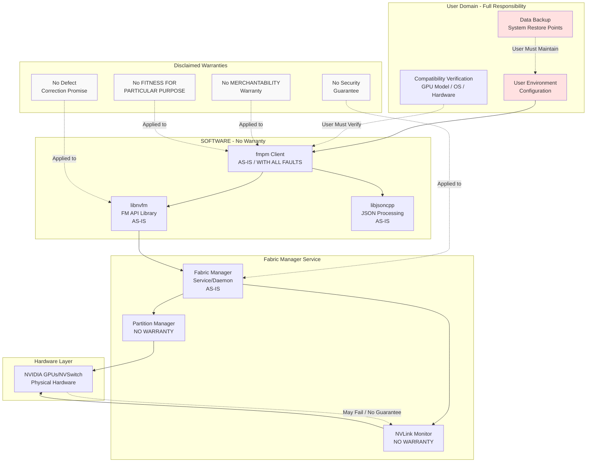
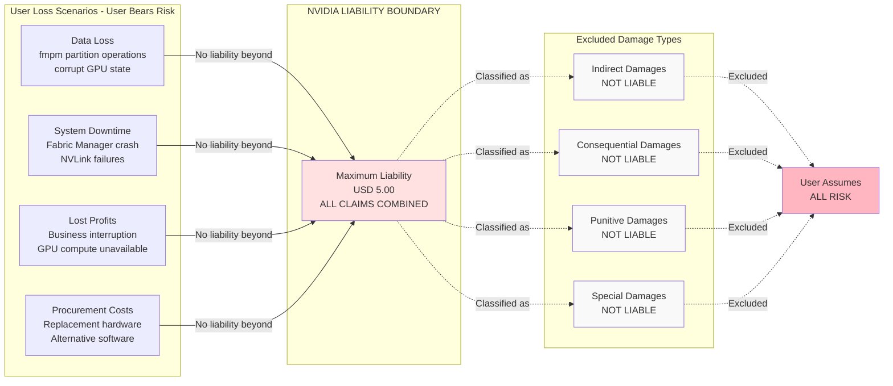
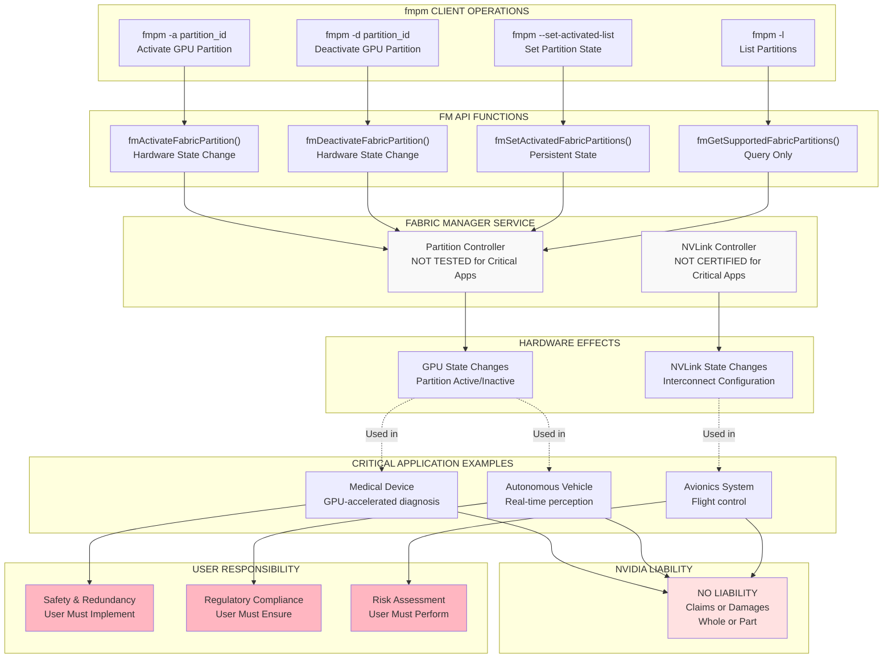
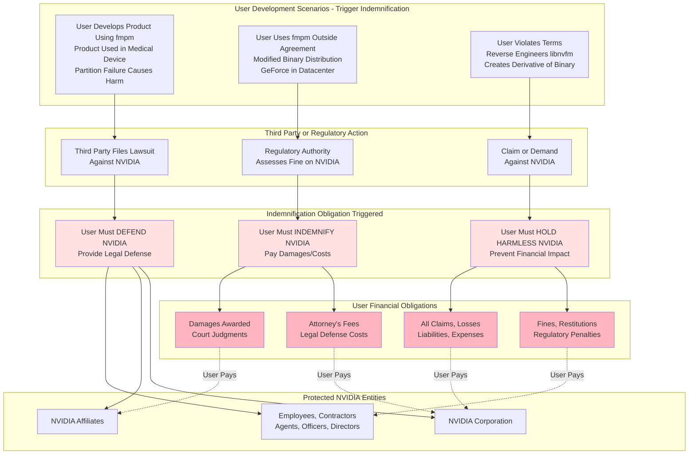

<!-- source: DeepWiki mcp.deepwiki.com · repo NVIDIA/Fabric-Manager-Client · page 5.3 Disclaimers and Liability · fetched 2026-10-26 -->

# Disclaimers and Liability

Relevant source files

The following files were used as context for generating this wiki page:

- [LICENSE](LICENSE)

## Purpose and Scope

This document explains NVIDIA's warranty disclaimers, liability limitations, critical application restrictions, and user indemnification obligations that apply to the Fabric Manager Client (fmpm) and associated SOFTWARE components. These provisions define the legal boundaries of risk allocation between NVIDIA and users of the system.

For information about general license terms and grants, see [Software License Agreement](#5.1). For prohibited actions and platform requirements, see [Usage Restrictions and Requirements](#5.2).

**Sources:** [LICENSE:1-408]()

---

## Warranty Disclaimers

### As-Is Provision

The SOFTWARE is provided "AS-IS" and "WITH ALL FAULTS" without any warranties or representations of any kind. NVIDIA disclaims all warranties, whether express, implied, or statutory, including:

| Warranty Type | Description | Status |
|---------------|-------------|---------|
| **Title** | Legal ownership and right to grant license | Disclaimed |
| **Noninfringement** | Freedom from third-party IP claims | Disclaimed |
| **MERCHANTABILITY** | Suitability for ordinary purposes | Disclaimed |
| **Fitness for Particular Purpose** | Suitability for specific use cases | Disclaimed |
| **Usage of Trade** | Industry-standard functionality | Disclaimed |
| **Course of Dealing** | Historical business practices | Disclaimed |

**Sources:** [LICENSE:279-289]()

### Specific Disclaimers

NVIDIA explicitly does not warrant:

1. **Functionality**: That the SOFTWARE will meet your requirements
2. **Defect Correction**: That defects or errors will be corrected
3. **Content Availability**: That certain content will be available
4. **Security**: That the SOFTWARE is free of viruses or harmful components

**Sources:** [LICENSE:287-289]()

### System Responsibility

Users are solely responsible for:
- Maintaining appropriate data backups
- Maintaining system restore points for systems including the SOFTWARE
- Any damage or loss to systems arising from:
  - Configuration changes initiated through the SOFTWARE
  - Application settings modifications
  - Environment variables, registry, drivers, or BIOS changes
  - Installation of SOFTWARE or third-party patches through NVIDIA update services

**Sources:** [LICENSE:291-299]()

### Technical Verification Requirement

No information or advice given by NVIDIA increases the scope of any warranty. Users are responsible for verifying that the SOFTWARE version is appropriate for:
- NVIDIA product model
- Operating system
- Computer hardware configuration

In the context of fmpm, this means users must verify compatibility with their specific GPU partition configurations and NVSwitch fabric topology.

**Sources:** [LICENSE:301-304]()

---

## Disclaimer Application Architecture

**Diagram: Warranty Disclaimer Application to System Components**

This diagram maps warranty disclaimers to specific system components. All software components (fmpm binary, libnvfm API library, libjsoncpp JSON processor, Fabric Manager service) are provided AS-IS without warranties. Users bear full responsibility for environment configuration, data backup, and compatibility verification.

**Sources:** [LICENSE:279-304]()

---

## Limitations of Liability

### Excluded Damages

NVIDIA will not be liable for the following types of damages, regardless of the cause of action:

| Damage Category | Examples | Liability |
|----------------|----------|-----------|
| **Indirect Damages** | Consequential effects, chain reactions | Not liable |
| **Punitive Damages** | Exemplary damages for misconduct | Not liable |
| **Special Damages** | Unique circumstances damages | Not liable |
| **Incidental Damages** | Additional costs incurred | Not liable |
| **Consequential Damages** | Lost profits, revenue, data | Not liable |
| **Procurement Costs** | Cost of substitute goods | Not liable |
| **Loss of Profits** | Business income loss | Not liable |
| **Loss of Revenues** | Sales or service revenue loss | Not liable |
| **Loss of Use** | Inability to use systems | Not liable |
| **Loss of Data** | Data corruption or deletion | Not liable |
| **Loss of Goodwill** | Reputation or relationship damage | Not liable |

**Applicable even if:**
- NVIDIA has been advised of the possibility of such damages
- A party's remedies fail their essential purpose

**Sources:** [LICENSE:308-315]()

### Liability Cap

NVIDIA's total cumulative aggregate liability for any and all liabilities, obligations, or claims arising from the Agreement:

**Maximum Liability: US $5.00**

This $5 cap applies to all claims combined, not per claim.

**Sources:** [LICENSE:317-320]()

### Legal Bases Covered

The liability limitations apply regardless of the legal theory:
- Breach of contract
- Tort (including negligence)
- Strict liability
- Any other theory of liability

**Sources:** [LICENSE:312-313]()

---

## Liability Boundaries and Monetary Limits

**Diagram: Liability Cap and Risk Allocation**

This diagram illustrates the $5 maximum liability cap and excluded damage types. All operational risks (data loss, system downtime, lost profits, procurement costs) fall outside NVIDIA's liability. Users bear full financial risk for any consequences of using fmpm, the FM API, or the Fabric Manager service.

**Sources:** [LICENSE:306-320]()

---

## Critical Applications

### Definition and Examples

A "Critical Application" is defined as any system or application where the use of, or failure of, such system or application developed with the SOFTWARE could result in:

| Outcome Type | Impact |
|--------------|--------|
| **Injury** | Physical harm to persons |
| **Death** | Loss of human life |
| **Catastrophic Damage** | Severe property or environmental damage |

**Examples of Critical Applications:**
- Avionics systems
- Navigation systems
- Autonomous vehicle applications
- Automotive products (safety-critical)
- Military applications
- Medical devices
- Life support systems
- Other life-critical applications

**Sources:** [LICENSE:77-83]()

### Testing and Certification Status

The SOFTWARE is explicitly:
- **Not tested** by NVIDIA for use in Critical Applications
- **Not certified** by NVIDIA for use in Critical Applications

This applies to all components: fmpm client, libnvfm API, Fabric Manager service, and all associated libraries.

**Sources:** [LICENSE:77-79]()

### Liability Disclaimer for Critical Applications

NVIDIA will not be liable to you or any third party, in whole or in part, for any claims or damages arising from use of the SOFTWARE in Critical Applications.

This is an absolute disclaimer—NVIDIA accepts zero liability regardless of the circumstances of use in Critical Applications.

**Sources:** [LICENSE:83-85]()

### User Responsibilities for Critical Applications

Users are **solely responsible** for:

1. **Safety Features**: Ensuring that systems and applications developed with the SOFTWARE include sufficient safety and redundancy features
2. **Compliance**: Ensuring compliance with all applicable legal and regulatory standards and requirements
3. **Risk Assessment**: Evaluating whether the SOFTWARE is appropriate for Critical Application use

**Sources:** [LICENSE:85-87]()

---

## Critical Application Risk Mapping

**Diagram: Critical Application Risk and Responsibility Allocation**

This diagram maps fmpm commands and FM API functions to hardware state changes and critical application examples. All software components (fmpm binary, FM API functions like `fmActivateFabricPartition()`, Fabric Manager service components) are not tested or certified for Critical Applications. NVIDIA accepts no liability; users must implement safety features, ensure regulatory compliance, and perform risk assessments.

**Sources:** [LICENSE:77-87]()

---

## Indemnification Obligations

### User Obligations

Users agree to **defend, indemnify, and hold harmless** NVIDIA and its affiliates, and their respective employees, contractors, agents, officers, and directors.

### Covered Parties

The indemnification protects:
- NVIDIA Corporation
- NVIDIA affiliates
- Employees of NVIDIA and affiliates
- Contractors of NVIDIA and affiliates
- Agents of NVIDIA and affiliates
- Officers of NVIDIA and affiliates
- Directors of NVIDIA and affiliates

**Sources:** [LICENSE:89-91]()

### Covered Claims

Indemnification covers claims arising from:

1. **Product Development**: Products or services that have been developed with the SOFTWARE
2. **Product Use**: Products or services that use the SOFTWARE
3. **Critical Application Use**: Use of the SOFTWARE in or for Critical Applications
4. **Out-of-Scope Use**: Use of the SOFTWARE outside the scope of the Agreement
5. **Non-Compliant Use**: Use of the SOFTWARE not in compliance with Agreement terms

**Sources:** [LICENSE:92-97]()

### Indemnified Amounts

Users must indemnify NVIDIA for:

| Category | Coverage |
|----------|----------|
| **Claims** | All legal claims |
| **Damages** | Monetary damages awarded |
| **Obligations** | Legal obligations imposed |
| **Losses** | Financial losses incurred |
| **Liabilities** | Legal liabilities |
| **Costs or Debt** | Financial costs and debts |
| **Fines** | Regulatory fines |
| **Restitutions** | Court-ordered restitutions |
| **Expenses** | All related expenses |
| **Attorney's Fees** | Legal fees and costs incident to establishing right of indemnification |

**Sources:** [LICENSE:92-94]()

---

## Indemnification Flow and Trigger Scenarios

**Diagram: Indemnification Trigger Scenarios and User Financial Obligations**

This diagram illustrates scenarios that trigger user indemnification obligations. When users develop products using fmpm/FM API, use the software in Critical Applications, or violate Agreement terms, and third parties or regulators take action against NVIDIA, users must defend, indemnify, and hold harmless NVIDIA. Users bear all financial costs including attorney's fees, damages, fines, and expenses.

**Sources:** [LICENSE:89-97]()

---

## Practical Implications for fmpm Users

### Operational Risk Assessment

When using fmpm to manage GPU partitions, users should assess:

1. **Data Criticality**: Impact of partition activation/deactivation on running workloads
2. **Backup Requirements**: Backup strategies before executing partition state changes
3. **Recovery Planning**: Procedures for recovering from failed partition operations
4. **Hardware Verification**: Compatibility of GPU models, NVSwitch configurations, and OS with current fmpm version

### Development Considerations

Developers building systems that use fmpm or the FM API must:

1. **Avoid Critical Applications**: Do not use the SOFTWARE in systems where failure could cause injury, death, or catastrophic damage
2. **Implement Independent Safety**: If using in high-availability systems, implement independent safety and redundancy mechanisms that do not rely on the SOFTWARE
3. **Compliance Verification**: Ensure compliance with all Agreement terms to avoid triggering indemnification obligations
4. **Legal Review**: Consult legal counsel before deploying products that incorporate the SOFTWARE

### Liability Awareness

Users must understand:

1. **No Recovery for Damages**: Even catastrophic losses (data loss, business interruption, GPU hardware damage) are limited to $5 recovery from NVIDIA
2. **User Insurance**: Consider appropriate insurance coverage for operational risks
3. **Contractual Protections**: When using SOFTWARE in commercial products, ensure end-user agreements limit your downstream liability

### Documentation Requirements

To minimize indemnification risk:

1. **Usage Logging**: Maintain records of SOFTWARE usage within Agreement scope
2. **Compliance Documentation**: Document compliance with platform requirements, usage restrictions, and licensing terms
3. **Modification Tracking**: If modifying source code portions of SOFTWARE, maintain detailed change logs as required by the Agreement

**Sources:** [LICENSE:77-97](), [LICENSE:279-320]()

---

## Summary Table: Risk Allocation

| Risk Category | NVIDIA Responsibility | User Responsibility |
|---------------|----------------------|---------------------|
| **Functionality** | None (AS-IS, no warranty) | Verify suitability for use case |
| **Defects** | None (no correction warranty) | Test thoroughly, implement workarounds |
| **Security** | None (no security guarantee) | Implement security measures |
| **Data Loss** | None ($5 liability cap) | Maintain backups and recovery procedures |
| **System Damage** | None ($5 liability cap) | Verify compatibility, test changes |
| **Business Losses** | None (consequential damages excluded) | Procure insurance, plan redundancy |
| **Critical Application Use** | Zero liability (absolute disclaimer) | Implement safety features, ensure compliance |
| **Third-Party Claims** | User indemnifies NVIDIA | Defend NVIDIA, pay all costs |
| **Regulatory Fines** | User indemnifies NVIDIA | Pay fines arising from user's actions |

**Sources:** [LICENSE:77-97](), [LICENSE:279-320]()

---

