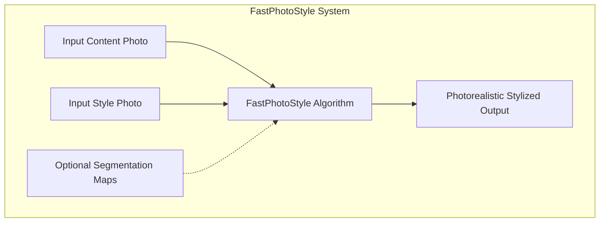
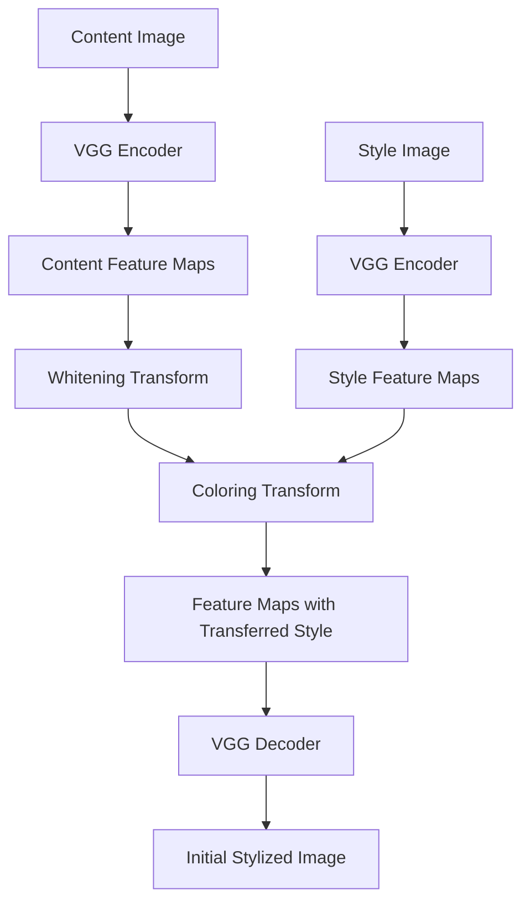
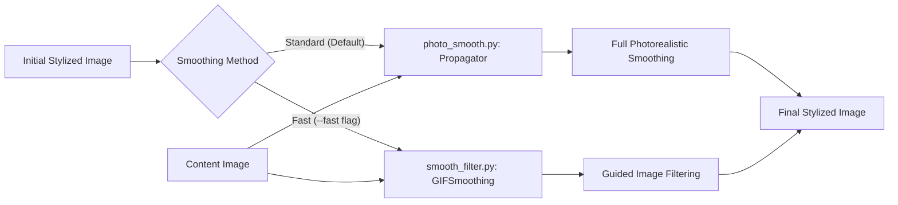
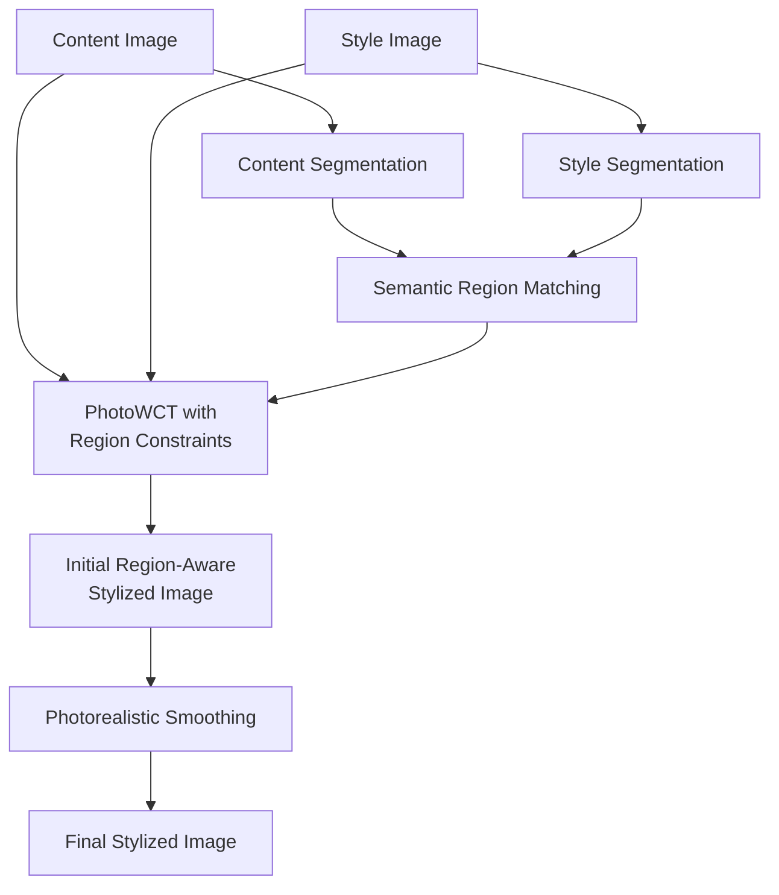
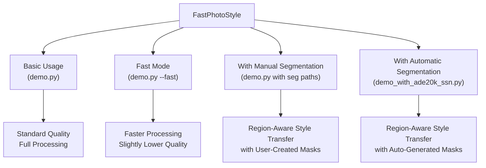
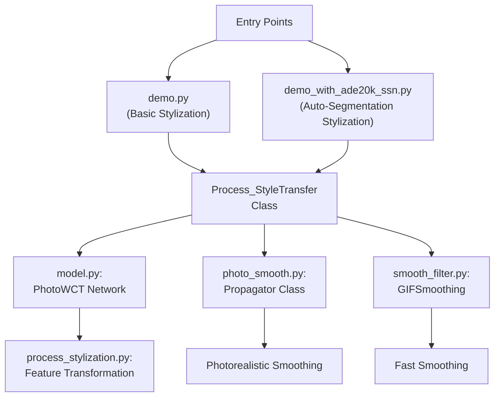

<!-- source: DeepWiki mcp.deepwiki.com · repo NVIDIA/FastPhotoStyle · page 1 FastPhotoStyle Overview · fetched 2026-10-26 -->

# FastPhotoStyle Overview

<details>
<summary>Relevant source files</summary>

The following files were used as context for generating this wiki page:

- [README.md](README.md)
- [TUTORIAL.md](TUTORIAL.md)
- [demo_with_segmentation.gif](demo_with_segmentation.gif)

</details>


## Purpose and Scope

This document provides a comprehensive overview of the FastPhotoStyle system, a photorealistic image stylization tool that transfers the style of one photo to another while preserving photorealism. This document introduces the system's purpose, architecture, core algorithms, and capabilities. For detailed installation instructions, see [Installation and Setup](#2), and for a deeper explanation of the algorithms, see [Core Algorithm](#3).

Sources: [README.md:23-28](), [TUTORIAL.md:8-13]()

## What is FastPhotoStyle?

FastPhotoStyle is an implementation of the "A Closed-form Solution to Photorealistic Image Stylization" research paper. Unlike artistic style transfer methods that make content photos look like paintings, FastPhotoStyle is designed specifically for photorealistic style transfer - transferring the style of one photo to another while ensuring the result still looks like a real photograph.

The system was developed by researchers from NVIDIA and UC Merced and published at the European Conference on Computer Vision (ECCV) 2018.



Sources: [README.md:23-29](), [TUTORIAL.md:8-13](), [TUTORIAL.md:15-16]()

## System Architecture

FastPhotoStyle implements a two-step algorithm for photorealistic style transfer:

```mermaid
flowchart LR
    A["Content Image"] --> C["Step 1: PhotoWCT"]
    B["Style Image"] --> C
    C --> D["Step 2: Photorealistic Smoothing"]
    D --> E["Final Stylized Image"]
    
    F["Content Segmentation"] -.-> C
    G["Style Segmentation"] -.-> C
    H["Content Image"] -.-> D
    
    classDef default width=200px
```

1. **PhotoWCT (Whitening and Coloring Transform)**: This step applies neural style transfer using deep features extracted from the content and style images, transforming the content image to adopt the style characteristics.

2. **Photorealistic Smoothing**: This step refines the initially stylized image to remove distortions and ensure the result maintains photorealistic qualities.

The system accepts optional segmentation masks for both content and style images to enable region-aware style transfer for better results.

Sources: [TUTORIAL.md:23-27]()

## Core Algorithm Components

### PhotoWCT Module

The PhotoWCT module is the first step in the stylization process and implements the Whitening and Coloring Transform:



The PhotoWCT step extracts deep features from both images using VGG encoders, performs statistical transformations to transfer style characteristics, and reconstructs the image using VGG decoders. This produces an initially stylized image that may contain visible distortions.

Sources: [TUTORIAL.md:24]()

### Smoothing Modules

FastPhotoStyle offers two smoothing approaches for the second step:



1. **Standard Smoothing**: Implements a full photorealistic smoothing algorithm with high quality but slower performance (implemented in `photo_smooth.py`).

2. **Fast Smoothing**: Uses guided image filtering for faster processing with slightly lower quality (implemented in `smooth_filter.py`).

The smoothing step is the computational bottleneck in the standard version, while the fast approximation provides significant speedups with minimal quality loss.

Sources: [TUTORIAL.md:83-93]()

## Features and Capabilities

### Segmentation-Guided Stylization

FastPhotoStyle can utilize segmentation masks to achieve better region-aware style transfer:



The system supports three modes of segmentation:

1. **No Segmentation**: Basic style transfer without region constraints
2. **Manual Segmentation**: User-provided segmentation masks created with tools like labelme
3. **Automatic Segmentation**: Generated using pre-trained networks (e.g., ADE20K segmentation model)

Segmentation-guided stylization helps preserve content structure while enabling more precise style transfer between corresponding regions (e.g., sky to sky, trees to trees).

Sources: [TUTORIAL.md:96-99](), [TUTORIAL.md:133-137]()

## Usage Scenarios

FastPhotoStyle offers multiple usage scenarios to accommodate different needs:



The system provides flexible command-line options to control the stylization process, balancing quality, speed, and region-awareness based on user requirements.

Sources: [TUTORIAL.md:49-56]()

## System Requirements

### Hardware and Software Dependencies

FastPhotoStyle requires the following environment:

| Requirement | Specification |
|-------------|---------------|
| Hardware    | PC with NVIDIA GPU (e.g., Titan) |
| OS          | Ubuntu 16.04 |
| CUDA        | CUDA 9.1 |
| Python      | Python 2.7 or 3.5 |
| Framework   | PyTorch 0.4.0 |
| Key Packages| scikit-umfpack, cupy, pynvrtc |
| Optional    | OpenCV (for fast mode), ADE20K dataset (for auto-segmentation) |

A Docker image is also provided for easier environment setup and execution.

Sources: [TUTORIAL.md:29-47](), [TUTORIAL.md:199-208]()

## Technical Implementation

The FastPhotoStyle repository includes several key modules that work together to perform photorealistic style transfer:



The technical implementation leverages PyTorch for deep learning operations, with optimized CUDA components for performance-critical steps. The modular design allows for flexibility in choosing different processing paths based on user requirements.

Sources: [TUTORIAL.md:23-27](), [TUTORIAL.md:83-93]()

## Conclusion

FastPhotoStyle represents a significant advancement in photorealistic style transfer, providing a practical solution for transferring visual styles between photographs while maintaining natural appearance. Its two-step approach (PhotoWCT + smoothing) delivers high-quality results with reasonable computational requirements, particularly when using the fast approximation mode.

The system's support for segmentation-guided stylization further enhances its capabilities, allowing for more precise and controllable style transfer between semantically corresponding regions in the content and style images.

Sources: [README.md:23-29](), [TUTORIAL.md:15-27]()

---

