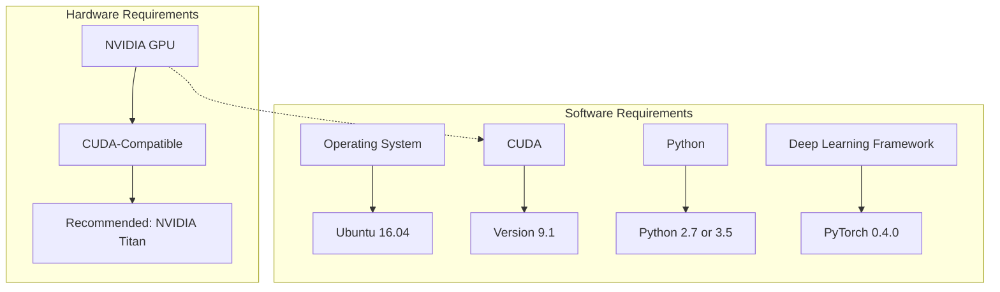
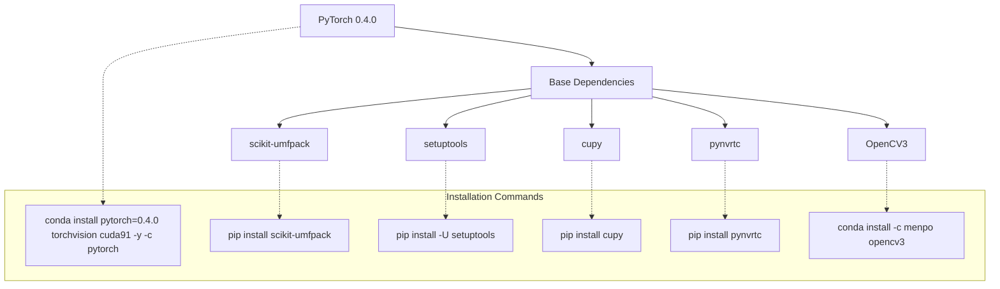
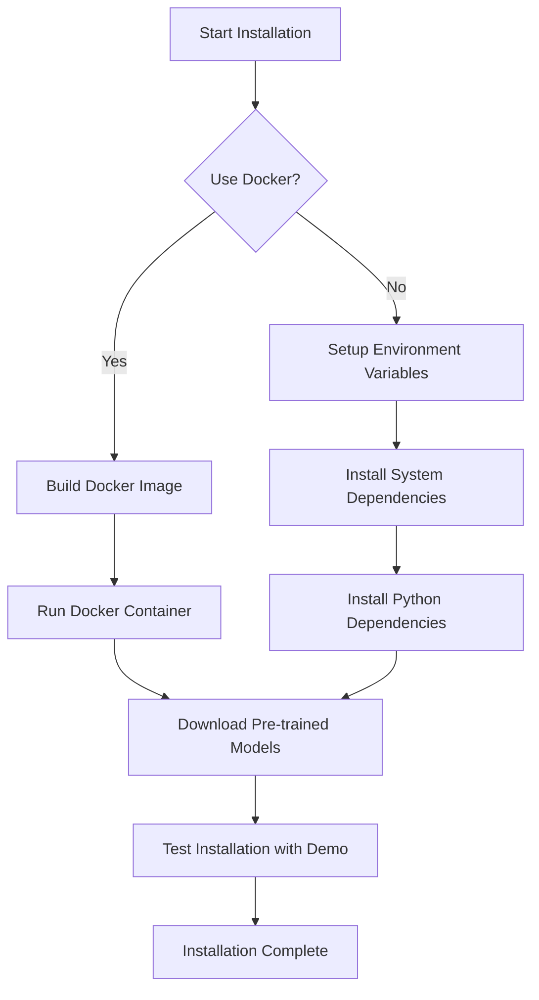
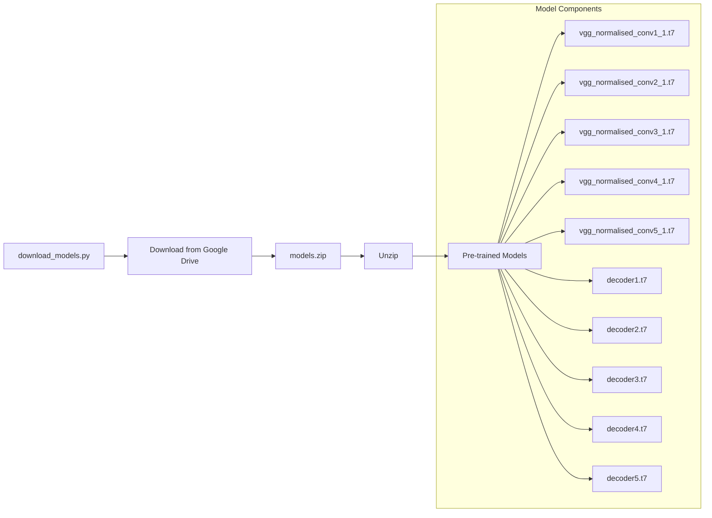
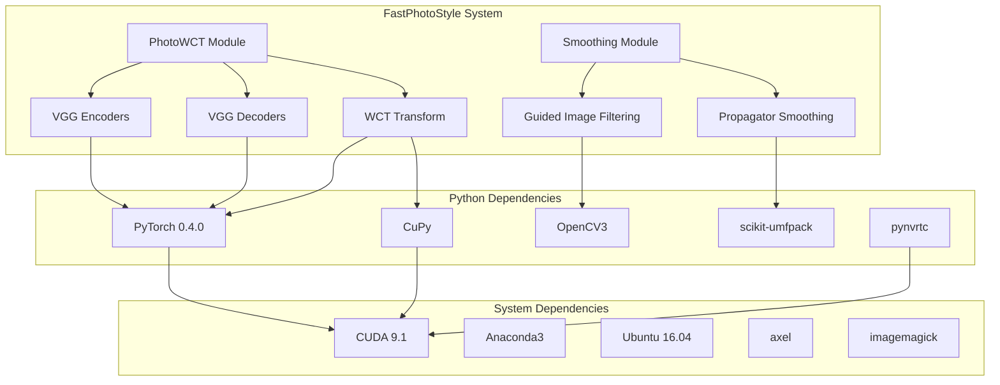

<!-- source: DeepWiki mcp.deepwiki.com · repo NVIDIA/FastPhotoStyle · page 2 Installation and Setup · fetched 2026-10-26 -->

# Installation and Setup

<details>
<summary>Relevant source files</summary>

The following files were used as context for generating this wiki page:

- [Dockerfile](Dockerfile)
- [README.md](README.md)
- [TUTORIAL.md](TUTORIAL.md)
- [demo_with_segmentation.gif](demo_with_segmentation.gif)
- [download_models.py](download_models.py)
- [download_models.sh](download_models.sh)

</details>


This document provides comprehensive instructions for setting up the FastPhotoStyle system on your machine. It covers system requirements, environment configuration, installation of dependencies, and downloading the necessary pre-trained models. For information about the algorithm itself, please see [Core Algorithm](#3).

## 1. System Requirements

FastPhotoStyle has specific hardware and software requirements to function properly:



Sources: [TUTORIAL.md:29-32](), [Dockerfile:1-6]()

## 2. Environment Setup

There are two ways to set up the FastPhotoStyle environment:

1. Native installation on your machine
2. Using Docker (recommended for reproducibility)

### 2.1 Option 1: Native Installation

#### 2.1.1 Setting Up Environment Variables

First, configure essential environment variables:

```bash
export ANACONDA=PATH-TO-YOUR-ANACONDA-LIBRARY
export CUDA_PATH=/usr/local/cuda
export PATH=${ANACONDA}/bin:${CUDA_PATH}/bin:$PATH
export LD_LIBRARY_PATH=${ANACONDA}/lib:${CUDA_PATH}/bin64:$LD_LIBRARY_PATH
export C_INCLUDE_PATH=${CUDA_PATH}/include
```

Sources: [TUTORIAL.md:33-39]()

#### 2.1.2 Installing System Dependencies

Install the required system packages:

```bash
sudo apt-get install -y axel imagemagick
```

Sources: [TUTORIAL.md:40-41](), [Dockerfile:7-22]()

#### 2.1.3 Installing Python Dependencies

Install the required Python packages:



Sources: [TUTORIAL.md:42-47](), [Dockerfile:26-31]()

### 2.2 Option 2: Docker Installation

Using Docker provides a more consistent environment. The repository includes a Dockerfile that sets up all dependencies.

#### 2.2.1 Building the Docker Image

```bash
docker build -t fastphotostyle:v1.0 .
```

#### 2.2.2 Running the Docker Container

```bash
docker run -v YOUR_PATH:YOUR_PATH --runtime=nvidia -i -t fastphotostyle:v1.0 /bin/bash
```

Sources: [TUTORIAL.md:199-209](), [Dockerfile:1-31]()

### 2.3 Installation Flowchart

The following diagram illustrates the complete installation process:



Sources: [TUTORIAL.md:29-47](), [TUTORIAL.md:199-209](), [Dockerfile:1-31]()

## 3. Downloading Pre-trained Models

FastPhotoStyle requires pre-trained models for the PhotoWCT module. These models can be downloaded using the provided scripts.

### 3.1 Using the Download Script

The repository includes a script for downloading the pre-trained models:

```bash
./download_models.sh
```

This script:
1. Runs `download_models.py` to fetch the models from Google Drive
2. Unzips the downloaded file (`models.zip`)

### 3.2 Manual Download (Alternative)

If the script doesn't work, you can manually download the models from the Google Drive link with ID: `1ENgQm9TgabE1R99zhNf5q6meBvX6WFuq`



Sources: [download_models.py:1-35](), [download_models.sh:1-4]()

## 4. Verifying Installation

To ensure your installation is working correctly, run one of the demo examples provided in the repository.

### 4.1 Basic Demo

Run the basic demo without segmentation:

```bash
./demo_example1.sh
```

This will:
1. Create necessary directories
2. Download example content and style images
3. Resize the images to appropriate dimensions
4. Run the style transfer algorithm
5. Output the stylized image to the results folder

### 4.2 Fast Mode Demo

To run the faster approximation of the algorithm:

```bash
./demo_example1_fast.sh
```

Sources: [TUTORIAL.md:57-94]()

## 5. Installation Dependencies Graph

The following diagram shows the key components and dependencies of the FastPhotoStyle system:



Sources: [TUTORIAL.md:29-47](), [Dockerfile:1-31]()

## 6. Troubleshooting

### 6.1 Common Installation Issues

| Issue | Potential Cause | Solution |
|-------|-----------------|----------|
| CUDA version mismatch | Incompatible CUDA version | Install CUDA 9.1 specifically |
| PyTorch import errors | Incorrect PyTorch version | Ensure you have PyTorch 0.4.0 |
| Missing model files | Failed download | Download models manually and place in the models directory |
| GPU not detected | CUDA path issues | Check environment variables and ensure NVIDIA drivers are installed |
| OpenCV import errors | Missing dependencies | Install OpenCV3 with `conda install -c menpo opencv3` |

### 6.2 GPU Memory Requirements

For optimal performance, FastPhotoStyle requires a GPU with sufficient memory:

| Image Size | Minimum GPU Memory |
|------------|-------------------|
| 256x256 | 2 GB |
| 512x512 | 4 GB |
| 1024x1024 | 8 GB |
| 2048x2048 | 12+ GB |

For high-resolution images, you may need to resize them to fit within your GPU's memory constraints.

Sources: [TUTORIAL.md:31]()

## 7. Next Steps

After successful installation, you can proceed to learn about usage patterns. See [Usage Guide](#4) for more information on using FastPhotoStyle in different scenarios, including:

- Basic usage without segmentation
- Using the fast approximation mode
- Using segmentation for region-aware style transfer

Sources: [TUTORIAL.md:49-197]()

---

