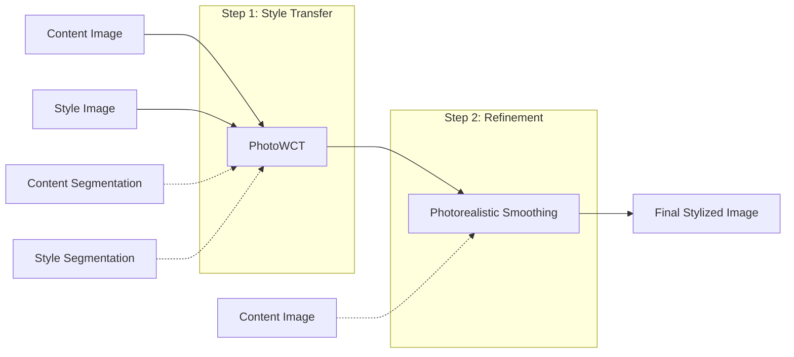
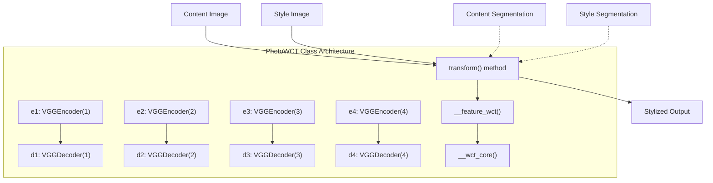
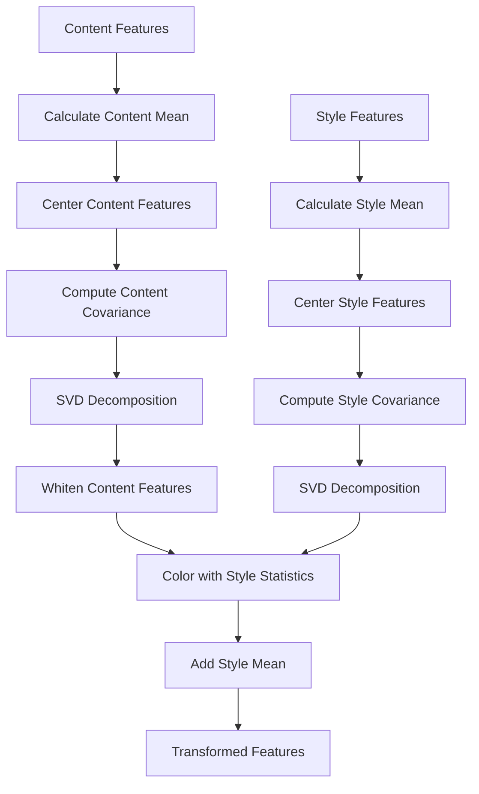
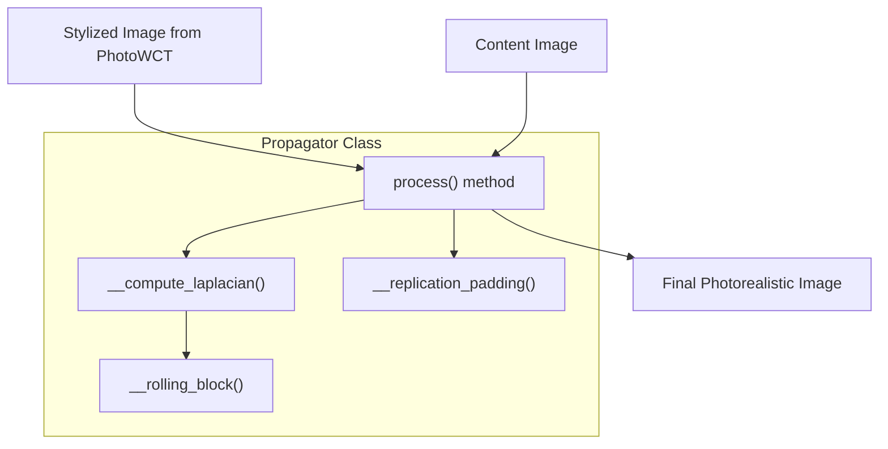
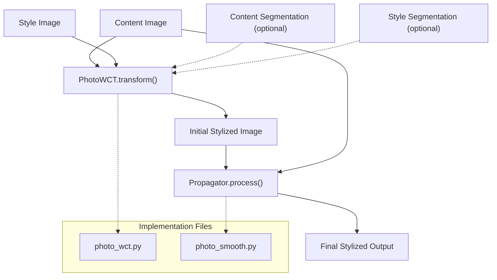

<!-- source: DeepWiki mcp.deepwiki.com · repo NVIDIA/FastPhotoStyle · page 3 Core Algorithm · fetched 2026-10-26 -->

# Core Algorithm

Relevant source files

The following files were used as context for generating this wiki page:

- [README.md](README.md)
- [TUTORIAL.md](TUTORIAL.md)
- [demo_with_segmentation.gif](demo_with_segmentation.gif)
- [photo_smooth.py](photo_smooth.py)
- [photo_wct.py](photo_wct.py)

This document explains the core algorithm of FastPhotoStyle, a photorealistic image stylization system based on a closed-form solution. The algorithm consists of two primary steps: PhotoWCT (Photorealistic Whitening and Coloring Transform) for style transfer and Photorealistic Smoothing for ensuring natural-looking results. For installation and setup instructions, see [Installation and Setup](#2), and for detailed deep dives into each algorithm component, see [PhotoWCT Implementation](#3.1) and [Smoothing Techniques](#3.2).

## Overview

FastPhotoStyle's algorithm transfers the style of a reference photo to a content photo while maintaining photorealism. The approach divides the stylization process into two distinct steps:

**Two-Step Process:**
1. **PhotoWCT**: Applies a whitening and coloring transform to deep features extracted from content and style images, generating an initial stylized image with possible distortions.
2. **Photorealistic Smoothing**: Suppresses distortions in the stylized image using an image smoothing filter while preserving the content image structure.

Sources: [photo_wct.py](), [photo_smooth.py](), [TUTORIAL.md:23-27]()

## PhotoWCT: Whitening and Coloring Transform

The PhotoWCT module implements a neural approach to style transfer using a series of VGG encoders and decoders coupled with a specialized whitening and coloring transform.

### Core Components
- **VGG Encoder-Decoder Architecture**: Multi-level feature extraction and reconstruction at 4 different scales
- **Feature Transform Process**: Applies WCT at each feature level, progressively transforming the style

### Transformation Process
The `transform` method in the PhotoWCT class orchestrates the style transfer by:
1. Processing content and style images through encoders to extract feature maps
2. Applying WCT to transform content features using style statistics
3. Reconstructing the image using decoders

### WCT Core Operation
The heart of the style transformation is the `__wct_core` function which:
1. Centers the content features by subtracting the mean
2. Performs SVD (Singular Value Decomposition) on content feature covariance
3. Whitens the content features
4. Performs SVD on style feature covariance
5. Colors the whitened content features with style statistics
6. Adds back the style mean to the transformed features

This process transforms the content feature distribution to match the style's statistical properties.

### Region-Aware Style Transfer
When segmentation maps are provided, PhotoWCT performs region-aware style transfer by:
1. Resizing segmentation maps to match feature map dimensions
2. Identifying corresponding regions in content and style images
3. Applying WCT separately to each semantic region
4. Combining transformed features from different regions

Sources: [photo_wct.py:13-171]()

## Photorealistic Smoothing

After the initial style transfer, the smoothing step ensures the result maintains photorealism by filtering out possible distortions while preserving the content structure.

### Smoothing Algorithm
The `Propagator` class implements a sophisticated smoothing process that:
1. Pads both the initial stylized image and content image
2. Computes a matting Laplacian based on the content image
3. Solves a large sparse linear system: (I - βS)V = (1-β)B
   - Where I is identity matrix
   - S is normalized Laplacian
   - B is the initial stylized image
   - β is the smoothing parameter (default 0.9999)
4. Removes padding and returns the final smoothed image

### Matting Laplacian
The key component is the matting Laplacian computation which:
1. Creates local windows around each pixel
2. Computes color statistics within each window
3. Builds a sparse Laplacian matrix that encodes color affinities
4. Ensures that pixels with similar colors in the content image maintain similar transformations

This approach preserves the content image's structure while allowing style transfer, preventing distortions and maintaining photorealistic appearance.

Sources: [photo_smooth.py:15-99]()

## Algorithm Integration and Workflow

The complete algorithm workflow integrates both components into a seamless stylization pipeline:

### Execution Flow
1. **Input Processing**:
   - Load content and style images
   - Optionally load or generate segmentation maps

2. **Style Transfer (PhotoWCT)**:
   - Extract multi-level features from both images
   - Apply WCT transforms at each feature level
   - Generate initial stylized image with potential distortions

3. **Refinement (Photorealistic Smoothing)**:
   - Compute matting Laplacian from content image
   - Set up sparse linear system
   - Solve for smoothed image that maintains content structure

4. **Output Generation**:
   - Post-process and return the final photorealistic stylized image

### Performance Considerations
- The smoothing step is computationally intensive, involving large sparse matrix operations
- The system offers a fast approximation mode using guided filtering
- The quality-performance tradeoff can be controlled through the smoothing parameter β

Sources: [TUTORIAL.md:23-93](), [photo_wct.py](), [photo_smooth.py]()

## Algorithm Properties and Extensions

The FastPhotoStyle core algorithm has several important properties that make it effective for photorealistic style transfer:

1. **Content Structure Preservation**: The smoothing step ensures that the structure of the content image is preserved, preventing distortions that would make the result look unrealistic.

2. **Style Statistics Transfer**: The WCT effectively transfers the style's color and texture statistics while maintaining the content's structure.

3. **Region-Aware Processing**: With segmentation maps, the algorithm can transfer style between corresponding semantic regions, avoiding inappropriate transfers across different content types.

4. **Multi-Scale Processing**: The four-level VGG architecture enables style transfer at multiple scales, capturing both fine details and broader styling patterns.

5. **Closed-Form Solution**: Unlike iterative optimization methods, this approach provides a direct solution that is computationally more efficient.

The algorithm can be extended or modified in several ways:
- Adjusting the smoothing parameter β to control the balance between style transfer and structure preservation
- Using different feature extraction networks beyond VGG
- Implementing automatic segmentation to avoid manual mask creation
- Applying the approach to video stylization with temporal constraints

Sources: [photo_wct.py](), [photo_smooth.py](), [TUTORIAL.md]()

---

