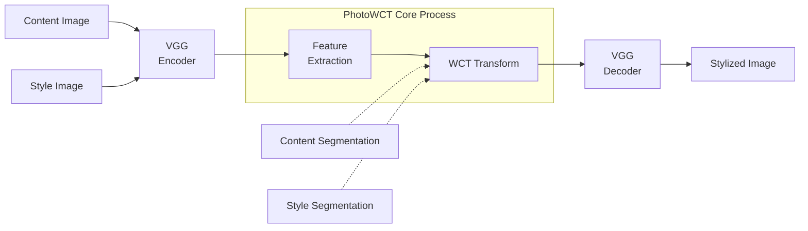
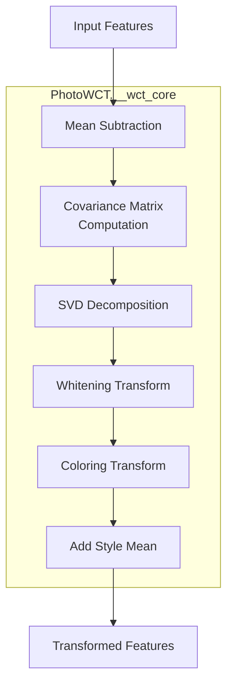
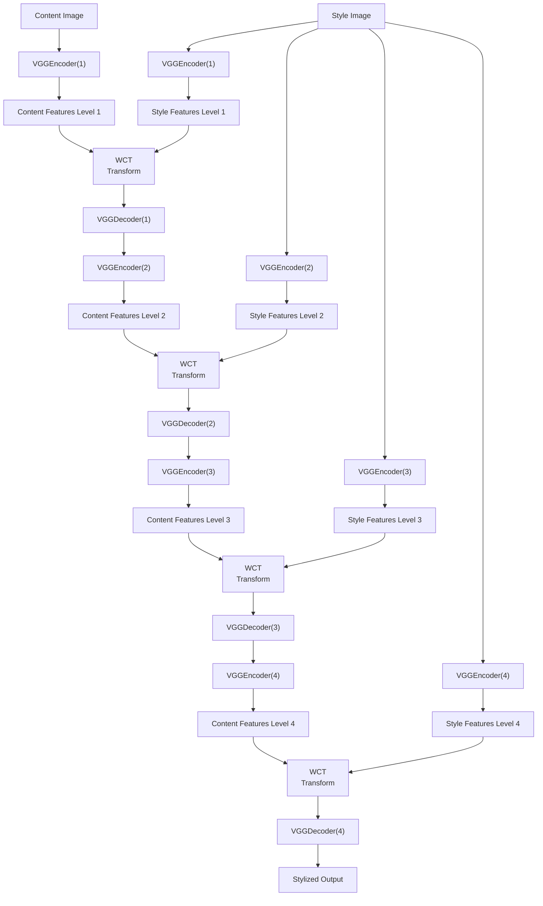
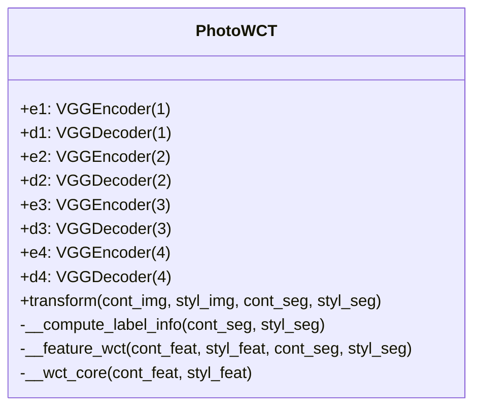
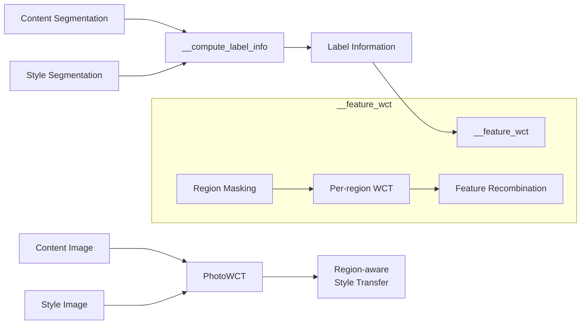

<!-- source: DeepWiki mcp.deepwiki.com · repo NVIDIA/FastPhotoStyle · page 3.1 PhotoWCT Implementation · fetched 2026-10-26 -->

# PhotoWCT Implementation

Relevant source files

The following files were used as context for generating this wiki page:

- [models.py](models.py)
- [photo_wct.py](photo_wct.py)

## Purpose and Scope

This document provides a detailed explanation of the Photorealistic Whitening and Coloring Transform (PhotoWCT) implementation in the FastPhotoStyle codebase. PhotoWCT represents the first step in the two-stage photorealistic style transfer algorithm, responsible for transferring the style characteristics from a style image to a content image. For information about the subsequent smoothing techniques used to ensure photorealism, see [Smoothing Techniques](#3.2).

Sources: [photo_wct.py:13-171]()

## Algorithm Overview

PhotoWCT extends the Whitening and Coloring Transform (WCT) method to achieve photorealistic style transfer. It operates on deep features extracted from both content and style images, transforming the content features to match the statistical properties of the style features while preserving spatial structures.

Sources: [photo_wct.py:25-54](), [photo_wct.py:70-120]()

### Mathematical Foundation

The core of PhotoWCT is the Whitening and Coloring Transform algorithm which consists of three key operations:

1. **Whitening**: Removes the style information from content features
2. **Coloring**: Transfers the style statistics to the whitened content features
3. **Reconstruction**: Rebuilds the image from transformed features

The transformation uses Singular Value Decomposition (SVD) to manipulate the covariance matrices of the content and style features.

Sources: [photo_wct.py:122-164]()

## Multi-level VGG Architecture

PhotoWCT employs a multi-level encoder-decoder architecture based on the VGG network. It processes features at four different levels, applying the WCT transformation at each level to capture style information at different scales and semantic levels.

Sources: [photo_wct.py:13-24](), [photo_wct.py:25-54](), [models.py:8-188](), [models.py:190-297]()

## Implementation Details

### Class Structure

The PhotoWCT implementation is organized into three main classes:

| Class | File | Purpose |
|-------|------|---------|
| `PhotoWCT` | photo_wct.py | Main class that implements the style transfer algorithm |
| `VGGEncoder` | models.py | Extracts multi-level features from images |
| `VGGDecoder` | models.py | Reconstructs images from transformed features |

Sources: [photo_wct.py:13-24](), [models.py:8-189](), [models.py:190-297]()

### PhotoWCT Class

The `PhotoWCT` class initializes a four-level encoder-decoder architecture and provides methods for style transfer:

Sources: [photo_wct.py:13-24]()

### Transform Method

The `transform` method is the main entry point for style transfer:

1. Processes segmentation information if provided
2. Extracts features from style image at all levels
3. Processes content image through each encoder level
4. Applies WCT transformation at each level
5. Reconstructs the image through corresponding decoders
6. Returns the final stylized image

Sources: [photo_wct.py:25-54]()

### Feature WCT

The `__feature_wct` method handles the transformation of content features using style features:

1. Reshapes content and style features for processing
2. If no segmentation is provided, applies WCT to the entire feature maps
3. If segmentation is provided, applies region-specific WCT based on segmentation labels
4. Reshapes the result back to the original feature dimensions

Sources: [photo_wct.py:70-120]()

### WCT Core Algorithm

The `__wct_core` method implements the mathematical core of the WCT algorithm:

1. Computes the mean of content features and centers them
2. Computes the covariance matrix of content features
3. Performs SVD decomposition of the content covariance matrix
4. Determines the effective rank of the content feature space
5. Performs similar operations on style features
6. Applies whitening transform to content features
7. Applies coloring transform using style statistics
8. Adds back the style mean

Sources: [photo_wct.py:122-164]()

## Segmentation-guided Stylization

PhotoWCT supports region-specific style transfer through segmentation maps:

Sources: [photo_wct.py:56-68](), [photo_wct.py:79-116]()

### Label Processing

The `__compute_label_info` method:

1. Extracts unique semantic labels from the content segmentation
2. Validates each label by checking if it has sufficient area in both content and style images
3. Creates an indicator array to track valid labels for transformation

Sources: [photo_wct.py:56-68]()

### Region-specific Transformation

For segmentation-guided style transfer:

1. Segmentation maps are resized to match feature dimensions
2. For each semantic label, corresponding regions are extracted from content and style features
3. WCT is applied separately to each region
4. Transformed regions are recombined into the final feature map

This approach allows for more controlled style transfer that respects semantic boundaries.

Sources: [photo_wct.py:79-116]()

## VGG Encoder-Decoder Architecture

### VGGEncoder

The `VGGEncoder` class implements a partial VGG network for feature extraction:

1. Takes a level parameter (1-4) to determine the network depth
2. Each level adds more convolutional layers and captures higher-level features
3. Returns extracted features and pooling indices for the corresponding decoder

Sources: [models.py:8-187]()

### VGGDecoder

The `VGGDecoder` class mirrors the encoder architecture for image reconstruction:

1. Takes a level parameter (1-4) matching the encoder
2. Uses unpooling with saved indices to preserve spatial information
3. Reconstructs the image through a series of convolution and ReLU layers

Sources: [models.py:190-297]()

## Integration with FastPhotoStyle

PhotoWCT serves as the first step in the FastPhotoStyle pipeline:

1. PhotoWCT produces an initial stylized image with transferred style characteristics
2. This output is then passed to the smoothing module to ensure photorealism
3. The final result preserves the content structure while adopting the style appearance

PhotoWCT can be used with or without segmentation guidance, providing flexibility for different stylization needs.

Sources: [photo_wct.py:13-171]()

---

