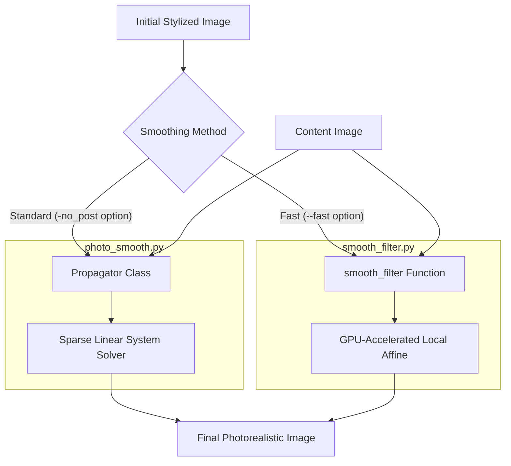
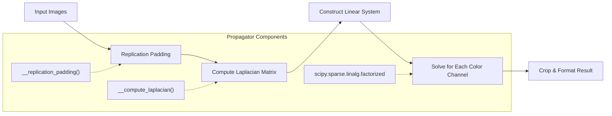
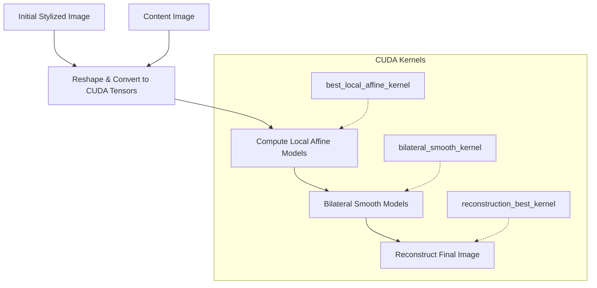
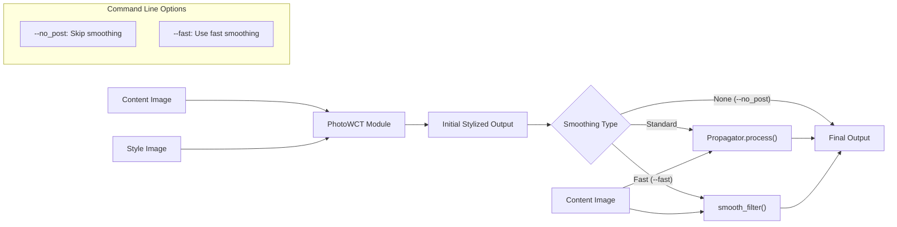

<!-- source: DeepWiki mcp.deepwiki.com · repo NVIDIA/FastPhotoStyle · page 3.2 Smoothing Techniques · fetched 2026-10-26 -->

# Smoothing Techniques

<details>
<summary>Relevant source files</summary>

The following files were used as context for generating this wiki page:

- [photo_smooth.py](photo_smooth.py)
- [smooth_filter.py](smooth_filter.py)

</details>


This page provides detailed documentation on the smoothing techniques used in FastPhotoStyle. Smoothing is the second critical step in the photorealistic style transfer process, following the PhotoWCT transformation (see [PhotoWCT Implementation](#3.1)). While the PhotoWCT step transfers style characteristics, the smoothing step ensures the output maintains photorealism by preserving the structure of the content image.

## 1. Overview of Smoothing in FastPhotoStyle

FastPhotoStyle offers two distinct smoothing techniques:

1. **Standard Smoothing**: A high-quality approach that uses a sparse linear system solver
2. **Fast Smoothing**: An optimized GPU-accelerated approach using local affine transformations



Sources: [photo_smooth.py:15-62](), [smooth_filter.py:380-405]()

## 2. Purpose of Smoothing

Smoothing serves to eliminate artifacts introduced during style transfer while preserving the underlying structure of the content image. It's essential for photorealism because:

1. It preserves important edges from the content image
2. It removes distortions in flat or smooth regions
3. It enhances visual coherence between regions
4. It maintains the natural appearance of the content image

## 3. Standard Smoothing (Propagator)

The standard smoothing technique uses a mathematical approach based on matting Laplacian and sparse linear system solving.

### 3.1 Implementation Overview



Sources: [photo_smooth.py:15-62]()

### 3.2 Core Algorithm

The standard smoothing technique involves solving the linear system:

```
(I - β·S)V = (1-β)B
```

Where:
- `I` is the identity matrix
- `S` is a normalized Laplacian matrix derived from content image
- `β` is a parameter close to 1 (default 0.9999)
- `B` is the input stylized image
- `V` is the output smoothed image

The implementation uses the `scipy.sparse` module to efficiently handle the large sparse matrices involved in the computation.

```python
# Core algorithm steps (simplified)
W = self.__compute_laplacian(content)  # Compute Laplacian from content image
S = D.dot(W).dot(D)                    # Normalize Laplacian
A = scipy.sparse.identity(w1*h1) - self.beta*S  # Construct linear system
solver = scipy.sparse.linalg.factorized(A)      # Create solver
V = solver(B)                          # Solve for each color channel
```

Sources: [photo_smooth.py:43-59]()

### 3.3 Laplacian Computation

The `__compute_laplacian` method creates a sparse matting Laplacian matrix based on local pixel neighborhoods. This is a key component that allows the smoothing to preserve important edges from the content image.

```python
# For each window in the image:
#   1. Compute local color covariance
#   2. Calculate affinity between pixels
#   3. Build sparse Laplacian matrix
```

Sources: [photo_smooth.py:68-87]()

## 4. Fast Smoothing (GIF Smoothing)

The fast smoothing technique uses GPU-accelerated local affine transformations to achieve similar results with better performance.

### 4.1 Implementation Overview



Sources: [smooth_filter.py:332-377](), [smooth_filter.py:380-405]()

### 4.2 Core Algorithm

The fast smoothing technique consists of three main steps, all accelerated using CUDA kernels:

1. **Local Affine Computation**: For each pixel, compute an optimal local affine transformation that maps the content image to the stylized image
2. **Affine Model Smoothing**: Apply bilateral filtering to smooth the affine models while preserving edges from the content image
3. **Image Reconstruction**: Apply the smoothed affine models to the content image to create the final output

```python
# Core algorithm steps (simplified)
# 1. Compute local affine models
_best_local_affine_kernel(output_, input_, affine_model, ...)

# 2. Smooth the affine models
_bilateral_smooth_kernel(affine_model, filtered_affine_model, input_, ...)

# 3. Reconstruct the output image
_reconstruction_best_kernel(input_, filtered_affine_model, filtered_best_output, ...)
```

Sources: [smooth_filter.py:357-375]()

### 4.3 Bilateral Smoothing Parameters

The bilateral smoothing uses two key parameters:

1. `f_radius`: Filter radius (default 15) controlling the spatial extent of the filter
2. `f_edge`: Edge preservation parameter (default 0.1) controlling sensitivity to edges

These parameters can be tuned to balance smoothness and detail preservation.

Sources: [smooth_filter.py:380-405]()

## 5. Comparison of Smoothing Techniques

| Feature | Standard Smoothing (Propagator) | Fast Smoothing (GIF) |
|---------|--------------------------------|----------------------|
| Implementation | `Propagator` class in `photo_smooth.py` | `smooth_filter` function in `smooth_filter.py` |
| Performance | Slower (CPU-based) | Faster (GPU-accelerated) |
| Quality | Highest quality, preserves fine details | Good quality, may lose some subtle details |
| Memory Usage | Higher for large images | More efficient |
| Parameters | Single parameter (`beta`) | Two parameters (`f_radius`, `f_edge`) |
| Backend | SciPy sparse solvers | CUDA kernels |
| CLI Flag | `--no_post` for PhotoWCT only (no smoothing) | `--fast` for using fast smoothing |

## 6. Integration with FastPhotoStyle



Sources: [photo_smooth.py:20-62](), [smooth_filter.py:380-405]()

## 7. Technical Implementation Details

### 7.1 Standard Smoothing Implementation

The `Propagator` class implements standard smoothing through these key methods:

- `process()`: Main method that performs the smoothing
- `__compute_laplacian()`: Computes the matting Laplacian matrix
- `__replication_padding()`: Adds padding to the image borders
- `__rolling_block()`: Utility for computing windows in the image

The implementation uses SciPy's sparse matrix operations for efficiency:

```python
# Core solver step
A = scipy.sparse.identity(w1*h1) - self.beta*S
solver = scipy.sparse.linalg.factorized(A)
V = np.zeros((h1*w1,k))
V[:,0] = solver(B[:,0])  # Red channel
V[:,1] = solver(B[:,1])  # Green channel
V[:,2] = solver(B[:,2])  # Blue channel
```

Sources: [photo_smooth.py:20-62](), [photo_smooth.py:43-59]()

### 7.2 Fast Smoothing Implementation

The fast smoothing is implemented through:

1. `smooth_filter()`: Main function that orchestrates the process
2. `smooth_local_affine()`: Function that calls the CUDA kernels
3. Three CUDA kernels compiled at runtime:
   - `best_local_affine_kernel`: Computes affine models
   - `bilateral_smooth_kernel`: Smooths affine models
   - `reconstruction_best_kernel`: Reconstructs the final image

The CUDA implementation enables significant performance improvements.

Sources: [smooth_filter.py:332-377](), [smooth_filter.py:149-321]()

## 8. Best Practices and Usage Tips

1. **For highest quality**: Use standard smoothing (default option)
2. **For faster processing**: Use fast smoothing (`--fast` option)
3. **For comparison with raw PhotoWCT**: Use the `--no_post` option to skip smoothing
4. **For large images**: Fast smoothing is recommended due to memory constraints
5. **Parameter tuning**:
   - Standard smoothing: Higher `beta` values (closer to 1) increase smoothness
   - Fast smoothing: Larger `f_radius` values increase smoothness, smaller `f_edge` values preserve more edges

---

