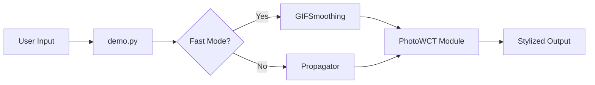
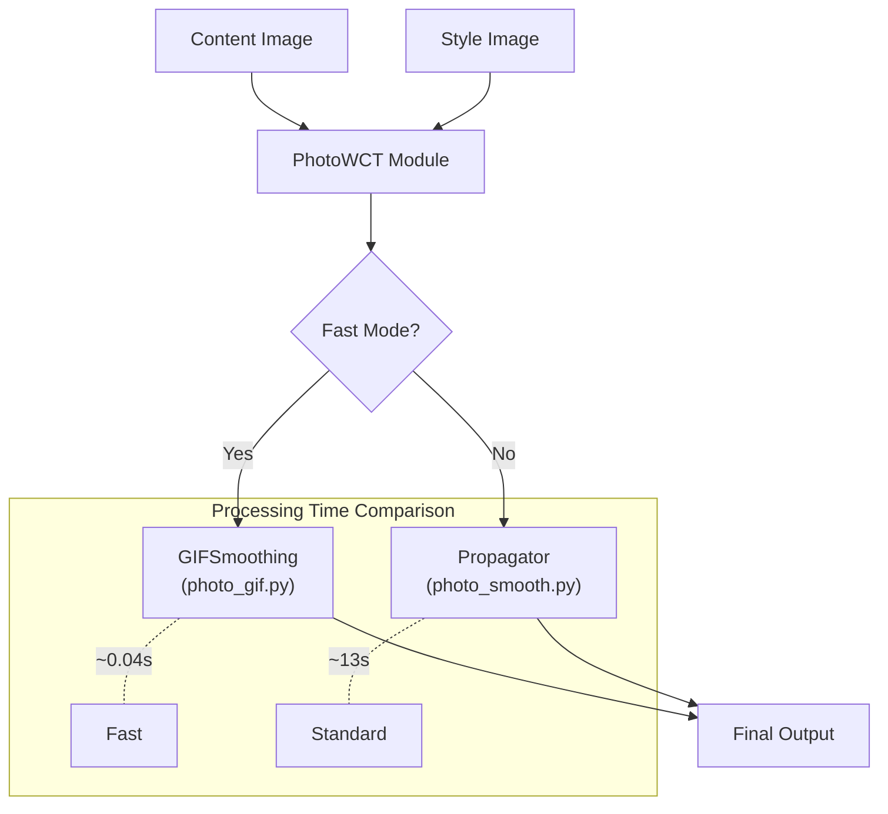
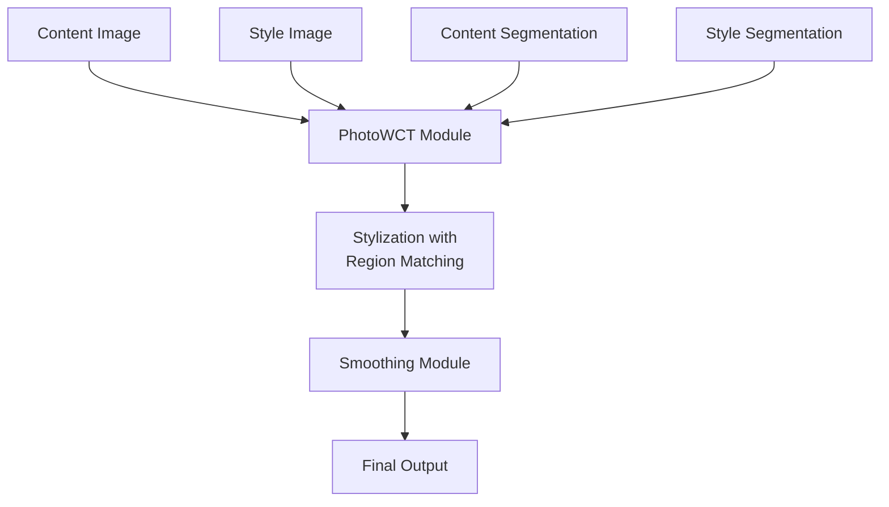
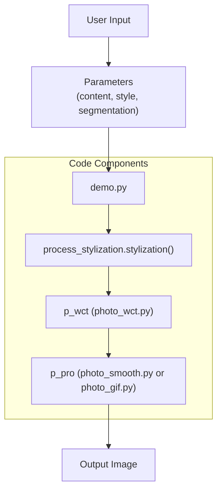

<!-- source: DeepWiki mcp.deepwiki.com · repo NVIDIA/FastPhotoStyle · page 4 Usage Guide · fetched 2026-10-26 -->

# Usage Guide

<details>
<summary>Relevant source files</summary>

The following files were used as context for generating this wiki page:

- [TUTORIAL.md](TUTORIAL.md)
- [demo.py](demo.py)
- [demo_with_segmentation.gif](demo_with_segmentation.gif)

</details>


## Purpose and Scope

This document provides a comprehensive guide on how to use the FastPhotoStyle system for photorealistic image stylization. It covers basic and advanced usage scenarios, command-line interface options, and practical examples. For information about the underlying algorithm and technical details, see [Core Algorithm](#3).

## Command Line Interface

FastPhotoStyle provides a command-line interface through `demo.py` with various options to control the stylization process.



### Main Parameters

| Parameter | Description | Default Value |
|-----------|-------------|---------------|
| `--model` | Path to the PhotoWCT model | `./PhotoWCTModels/photo_wct.pth` |
| `--content_image_path` | Path to the content image | `./images/content1.png` |
| `--style_image_path` | Path to the style image | `./images/style1.png` |
| `--output_image_path` | Path to save the output image | `./results/example1.png` |
| `--content_seg_path` | Path to content segmentation mask | `[]` (empty) |
| `--style_seg_path` | Path to style segmentation mask | `[]` (empty) |
| `--fast` | Enable fast mode using guided filtering | `False` |
| `--no_post` | Skip post-processing step | `False` |
| `--save_intermediate` | Save intermediate results | `False` |
| `--cuda` | Enable CUDA acceleration | `1` (enabled) |

Sources: [demo.py:11-22]()

## Basic Usage

### Standard Mode

The standard mode provides the highest quality results but takes longer to process due to the comprehensive smoothing step.

```bash
python demo.py --content_image_path ./images/content.png --style_image_path ./images/style.png --output_image_path ./results/output.png
```

This command will:
1. Load the content and style images
2. Apply the PhotoWCT transformation
3. Perform photorealistic smoothing using the Propagator
4. Save the final output to the specified path

Sources: [demo.py:32-33](), [TUTORIAL.md:68-76]()

### Fast Mode

For quicker results, the fast mode uses guided image filtering instead of the more computationally intensive propagation-based smoothing.

```bash
python demo.py --fast --content_image_path ./images/content.png --style_image_path ./images/style.png --output_image_path ./results/output_fast.png
```

The fast mode significantly reduces processing time with only a minor impact on quality.



Sources: [demo.py:28-30](), [TUTORIAL.md:83-93]()

### Without Post-Processing

To skip the post-processing smoothing step entirely:

```bash
python demo.py --no_post --content_image_path ./images/content.png --style_image_path ./images/style.png --output_image_path ./results/output_no_post.png
```

This will output the direct result from the PhotoWCT transformation, which may contain visible distortions but can be useful for debugging or when quick results are needed.

Sources: [demo.py:47]()

## Advanced Usage with Segmentation

FastPhotoStyle supports region-aware style transfer using segmentation masks. This produces better results by ensuring that semantically similar regions (e.g., sky to sky, building to building) are matched during stylization.

### Using Manual Segmentation

To use manually created segmentation masks:

```bash
python demo.py --content_image_path ./images/content.png \
               --style_image_path ./images/style.png \
               --content_seg_path ./images/content_seg.png \
               --style_seg_path ./images/style_seg.png \
               --output_image_path ./results/output_seg.png
```

The segmentation masks should be single-channel images with integer labels starting from 0. Corresponding regions in content and style images should have the same label.



Sources: [TUTORIAL.md:97-131]()

### Using Automatic Segmentation

FastPhotoStyle can work with the ADE20K semantic segmentation network to automatically generate segmentation masks:

```bash
python demo_with_ade20k_ssn.py --output_visualization
```

For faster processing, add the `--fast` flag:

```bash
python demo_with_ade20k_ssn.py --fast --output_visualization
```

This will:
1. Generate segmentation masks for both content and style images
2. Use these masks to guide the style transfer process
3. Apply smoothing (either standard or fast mode)
4. Save the final output and visualization of the segmentation masks

Sources: [TUTORIAL.md:134-196]()

## Performance Considerations

### Processing Time Comparison

The processing time is primarily determined by the smoothing method:

| Mode | Smoothing Module | Typical Processing Time |
|------|------------------|-------------------------|
| Standard | Propagator | ~13 seconds |
| Fast | GIFSmoothing | ~0.04 seconds |
| No Post | None | ~0.2 seconds (only PhotoWCT) |

### Hardware Requirements

- For optimal performance, an NVIDIA GPU is recommended
- When using CUDA (default), the model and processing is run on the GPU
- To disable CUDA and run on CPU, use `--cuda 0`

Sources: [TUTORIAL.md:29-47]()

## Docker Usage

FastPhotoStyle can be run in a Docker container to ensure consistent environment setup:

1. Build the Docker image:
```bash
docker build -t fastphotostyle:v1.0 .
```

2. Run an interactive session:
```bash
docker run -v /path/on/host:/path/in/container --runtime=nvidia -i -t fastphotostyle:v1.0 /bin/bash
```

3. Navigate to the mounted directory and run the demo:
```bash
cd /path/in/container
./demo_example1.sh
```

Sources: [TUTORIAL.md:199-209]()

## Data Flow Diagram



Sources: [demo.py:24-48]()

---

