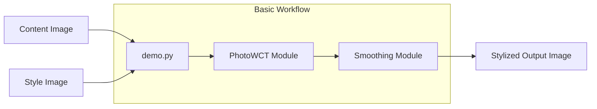
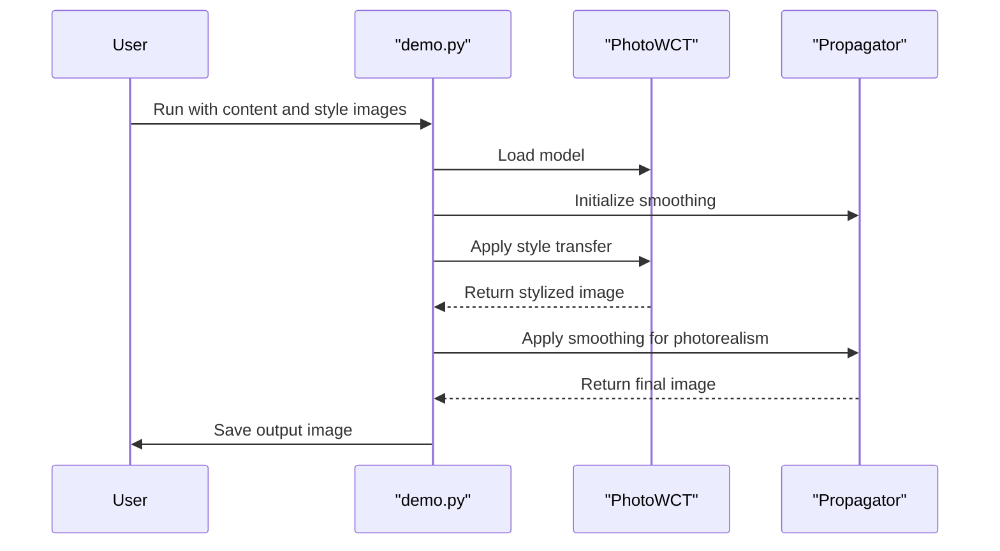
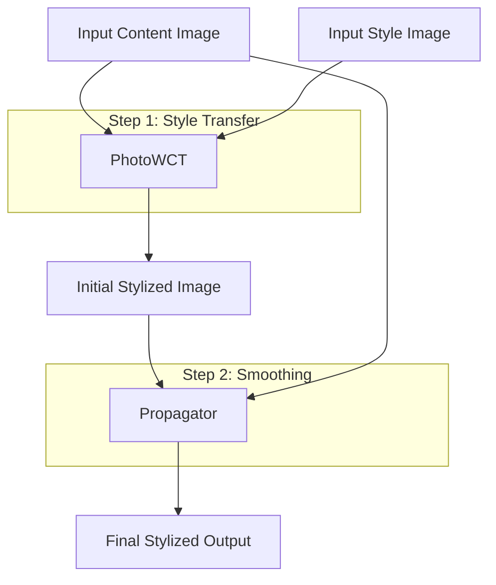

<!-- source: DeepWiki mcp.deepwiki.com · repo NVIDIA/FastPhotoStyle · page 4.1 Basic Usage · fetched 2026-10-26 -->

# Basic Usage

<details>
<summary>Relevant source files</summary>

The following files were used as context for generating this wiki page:

- [TUTORIAL.md](TUTORIAL.md)
- [demo.py](demo.py)
- [demo_example1.sh](demo_example1.sh)
- [demo_with_segmentation.gif](demo_with_segmentation.gif)

</details>


This page explains how to use FastPhotoStyle for transferring the style of one photo to another while maintaining photorealism, without using segmentation masks. For advanced usage with segmentation masks, see [Using Segmentation](#4.3). For faster processing with approximation techniques, see [Fast Mode](#4.2).

## Overview

FastPhotoStyle provides a simple command-line interface for basic style transfer operations. The standard workflow involves:

1. Preparing content and style images
2. Running the style transfer with appropriate parameters
3. Viewing the stylized output image



Sources: [demo.py:37-48](), [TUTORIAL.md:57-93]()

## Command-Line Interface

FastPhotoStyle is primarily used through the `demo.py` script, which accepts several command-line arguments:

| Argument | Default | Description |
|----------|---------|-------------|
| `--model` | ./PhotoWCTModels/photo_wct.pth | Path to the pre-trained model |
| `--content_image_path` | ./images/content1.png | Path to the content image |
| `--style_image_path` | ./images/style1.png | Path to the style image |
| `--output_image_path` | ./results/example1.png | Path for the output stylized image |
| `--fast` | False | Enable fast approximation mode |
| `--no_post` | False | Skip post-processing (smoothing) step |
| `--cuda` | 1 | Enable CUDA acceleration (1=enable, 0=disable) |
| `--save_intermediate` | False | Save intermediate results |

Sources: [demo.py:10-22]()

## Standard Usage Flow

The standard usage process follows these steps:



Sources: [demo.py:24-48](), [TUTORIAL.md:57-76]()

### Step 1: Prepare Images

For optimal results:

1. Select a content image (the photo you want to stylize)
2. Select a style image (the photo whose style you want to transfer)
3. Resize images if they are too large (recommended for faster processing)

Example using ImageMagick for resizing:
```
convert -resize 25% content.png content.png
convert -resize 50% style.png style.png
```

Sources: [TUTORIAL.md:64-66](), [demo_example1.sh:8-9]()

### Step 2: Run Style Transfer

Basic command for running the style transfer:

```
python demo.py --content_image_path PATH_TO_CONTENT_IMAGE --style_image_path PATH_TO_STYLE_IMAGE --output_image_path PATH_TO_OUTPUT_IMAGE
```

For example:

```
python demo.py --content_image_path ./images/content1.png --style_image_path ./images/style1.png --output_image_path ./results/example1.png
```

Sources: [demo.py:10-22](), [TUTORIAL.md:68]()

## Processing Details

The basic style transfer operation consists of two main steps:

1. **PhotoWCT (Whitening and Coloring Transform)**: Applies style transfer using VGG-based neural networks
2. **Photorealistic Smoothing**: Refines the output to ensure the result looks natural and photorealistic



Sources: [TUTORIAL.md:23-27](), [demo.py:24-36]()

### Processing Time

The standard workflow typically involves these processing stages with approximate timing:

```
Elapsed time in stylization: ~0.4 seconds
Elapsed time in propagation: ~13.5 seconds
Elapsed time in post processing: ~0.2 seconds
```

Note that the propagation step (photorealistic smoothing) is computationally intensive and takes the most time.

Sources: [TUTORIAL.md:70-76]()

## Common Options

### Skipping Post-Processing

If you want to skip the smoothing step (which might be useful for debugging or comparing results):

```
python demo.py --no_post --content_image_path ./images/content1.png --style_image_path ./images/style1.png --output_image_path ./results/example1_no_post.png
```

This option will preserve the direct output from the PhotoWCT module without applying the photorealistic smoothing.

Sources: [demo.py:20](), [demo.py:47]()

### Using Fast Mode

For quicker results (with slightly lower quality), use the `--fast` flag:

```
python demo.py --fast --content_image_path ./images/content1.png --style_image_path ./images/style1.png --output_image_path ./results/example1_fast.png
```

This uses a guided image filtering algorithm as an approximation of the full propagation step, significantly reducing processing time. See [Fast Mode](#4.2) for more details.

Sources: [demo.py:19](), [demo.py:28-33](), [TUTORIAL.md:83-93]()

## Example Workflow

Complete example workflow for basic usage:

1. Create directories for images and results:
   ```
   mkdir images && mkdir results
   ```

2. Prepare your content and style images in the images folder

3. Run the style transfer:
   ```
   python demo.py --content_image_path ./images/your_content.png --style_image_path ./images/your_style.png --output_image_path ./results/your_output.png
   ```

4. View the stylized result in the specified output path

Sources: [TUTORIAL.md:60-76](), [demo_example1.sh:1-11]()

## Requirements for Basic Usage

For running FastPhotoStyle's basic functionality, you need:

- NVIDIA GPU with CUDA support
- PyTorch 0.4.0
- Python 2.7 or 3.5
- Required Python packages (see [Installation and Setup](#2))

Sources: [TUTORIAL.md:29-47]()

---

