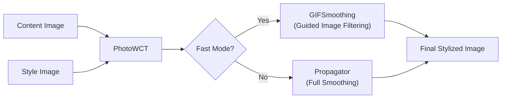
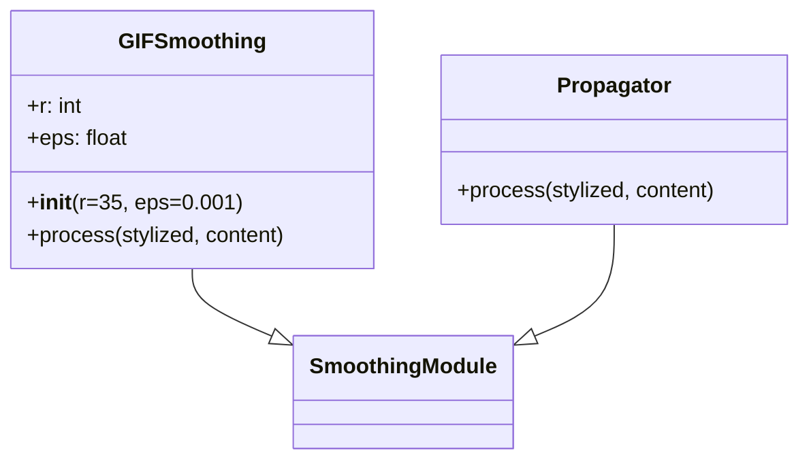
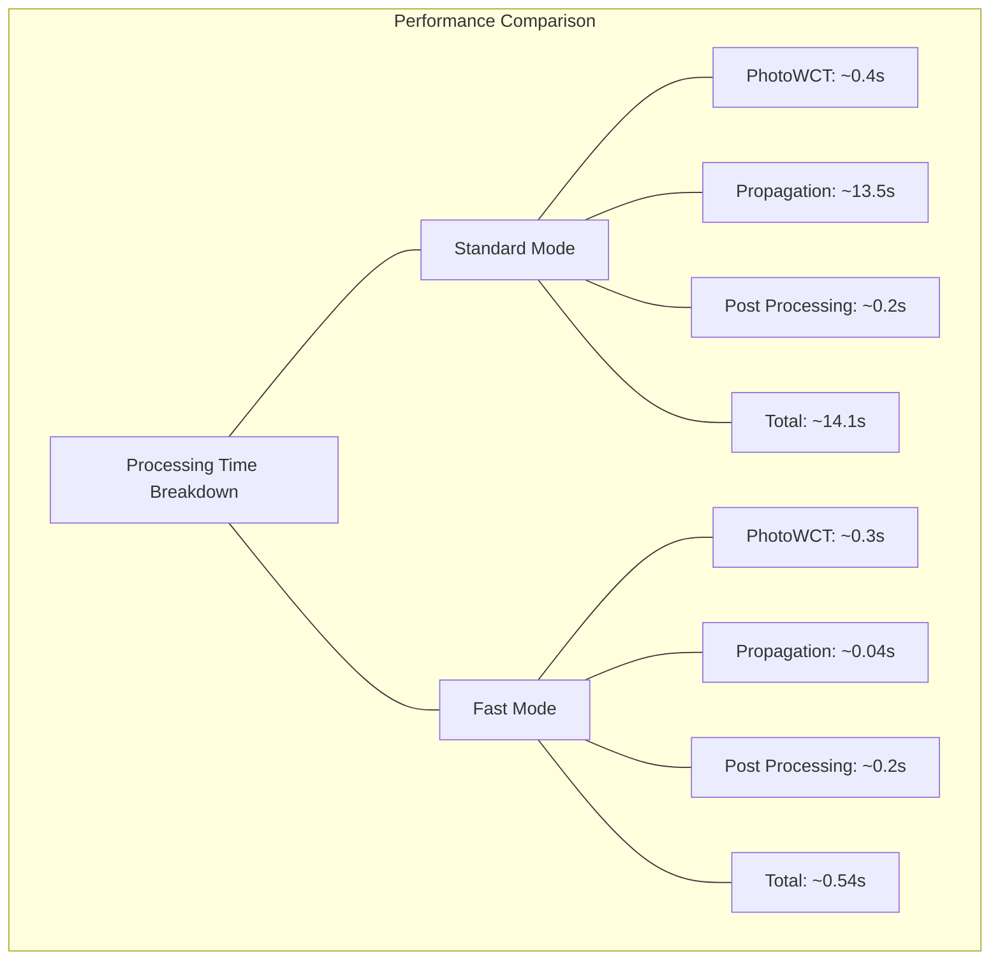
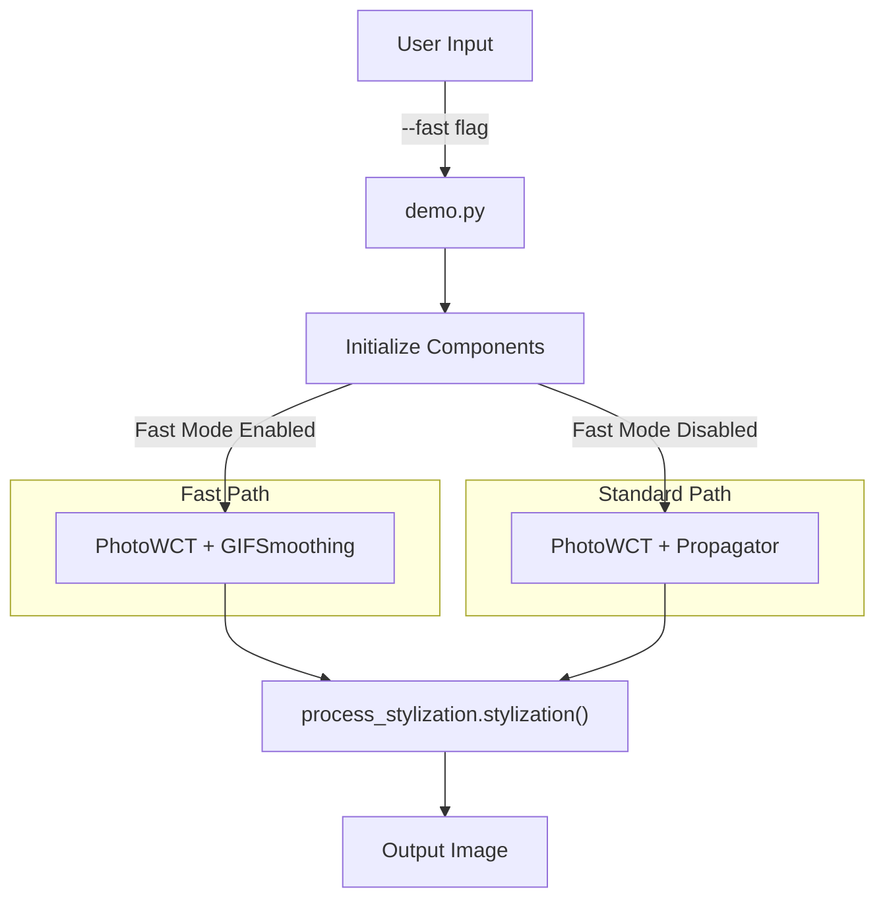

<!-- source: DeepWiki mcp.deepwiki.com · repo NVIDIA/FastPhotoStyle · page 4.2 Fast Mode · fetched 2026-10-26 -->

# Fast Mode

<details>
<summary>Relevant source files</summary>

The following files were used as context for generating this wiki page:

- [TUTORIAL.md](TUTORIAL.md)
- [demo.py](demo.py)
- [demo_example1_fast.sh](demo_example1_fast.sh)
- [demo_with_segmentation.gif](demo_with_segmentation.gif)

</details>


## Overview

Fast Mode is an optimization feature in FastPhotoStyle that significantly accelerates the photorealistic style transfer process by using an alternative approach for the smoothing step of the algorithm. This document covers how Fast Mode works, its implementation, performance benefits, and usage guidelines. For information about the core algorithm, see [Core Algorithm](#3) and for basic usage without Fast Mode, see [Basic Usage](#4.1).

## How Fast Mode Works

In the standard FastPhotoStyle pipeline, the photorealistic smoothing step (second step after PhotoWCT) is the computational bottleneck. Fast Mode addresses this by replacing the standard propagation-based smoothing with a more efficient Guided Image Filtering approach.



Sources: [demo.py:28-33](), [TUTORIAL.md:83-93]()

### Standard vs. Fast Mode Comparison

The table below highlights the key differences between Standard and Fast Mode:

| Feature | Standard Mode | Fast Mode |
|---------|--------------|-----------|
| Smoothing Implementation | Propagator class | GIFSmoothing class |
| Source File | photo_smooth.py | photo_gif.py |
| Algorithm | Full photorealistic smoothing | Guided image filtering |
| Processing Time | ~10-15 seconds | ~0.04 seconds |
| Quality | Reference quality | Slightly lower but comparable |

Sources: [demo.py:28-33](), [TUTORIAL.md:83-93]()

## Technical Implementation

Fast Mode uses Guided Image Filtering as an approximate solution for the smoothing step. The implementation details are as follows:



Sources: [demo.py:28-33]()

### Implementation Details

When Fast Mode is enabled, the system:

1. Uses the same PhotoWCT module for the initial style transfer
2. Initializes a `GIFSmoothing` object with parameters `r=35` and `eps=0.001`
3. Uses this object instead of the standard `Propagator` for the smoothing step

The Guided Image Filtering algorithm provides a local linear model for the filtering process, which has a significantly lower computational complexity than the global optimization problem solved by the standard propagation-based method.

Sources: [demo.py:28-33]()

## Performance Benefits

The performance improvement from using Fast Mode is substantial:



Sources: [TUTORIAL.md:83-93]()

As shown above, Fast Mode reduces the propagation (smoothing) step from approximately 13.5 seconds to just 0.04 seconds - a 300x speedup in this component. The overall processing time is reduced from ~14 seconds to less than 1 second.

## Usage Guide

To enable Fast Mode, use the `--fast` flag when running the demo:

```
python demo.py --fast --output_image_path results/example_fast.png
```

You can also use Fast Mode with segmentation:

```
python demo.py --fast \
  --content_image_path PATH-TO-CONTENT-IMAGE \
  --content_seg_path PATH-TO-CONTENT-LABEL \
  --style_image_path PATH-TO-STYLE-IMAGE \
  --style_seg_path PATH-TO-STYLE-LABEL \
  --output_image_path PATH-TO-OUTPUT
```

For automatic segmentation with ADE20K:

```
python demo_with_ade20k_ssn.py --fast --output_visualization
```

Sources: [demo.py:19](), [TUTORIAL.md:84](), [TUTORIAL.md:175]()

## Quality Comparison

While Fast Mode significantly reduces processing time, it maintains comparable visual quality to the standard mode in most cases:

1. **Standard Mode**: Produces the highest quality results by solving a global optimization problem.
2. **Fast Mode**: Produces visually similar results using local approximations.

The quality difference is minimal for most images, making Fast Mode suitable for:
- Rapid prototyping
- Processing large batches of images
- Interactive applications
- Users with limited computational resources

Sources: [TUTORIAL.md:93]()

## System Integration

Fast Mode is integrated into the overall FastPhotoStyle system as an optional processing path:



Sources: [demo.py:28-33](), [demo.py:37-48]()

## When to Use Fast Mode

Fast Mode is recommended for:

- Initial experiments and testing
- Processing large numbers of images
- Situations where processing speed is more critical than absolute quality
- Systems with limited computational resources

Standard Mode is recommended for:
- Final production-quality images
- Cases where subtle smoothing quality is critical
- Publications and presentations

Sources: [TUTORIAL.md:83-93]()

## Limitations

While Fast Mode provides significant performance benefits, users should be aware of potential limitations:

1. Guided filtering is an approximation that may not preserve all fine details
2. Some edge cases may show more noticeable quality differences
3. The optimal parameters (r=35, eps=0.001) may not be ideal for all images

For critical applications where quality is paramount, testing both modes is recommended.

Sources: [demo.py:28-33]()

---

