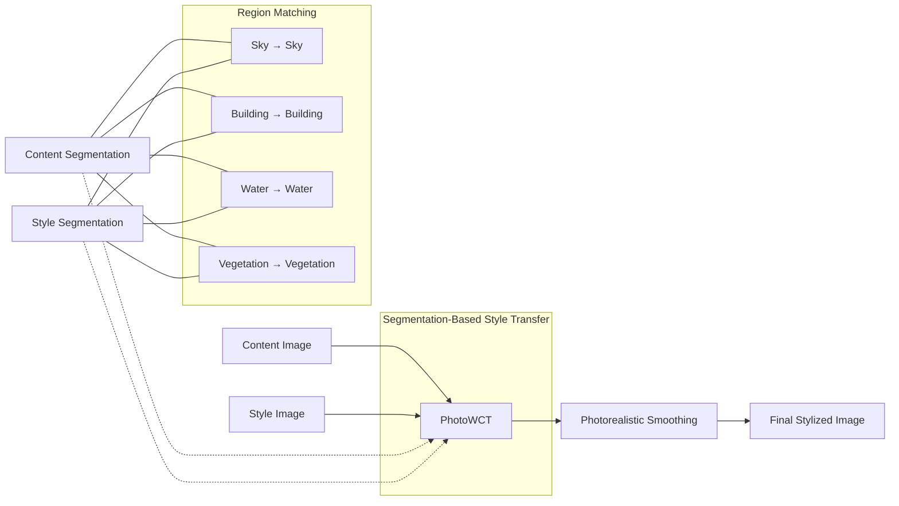
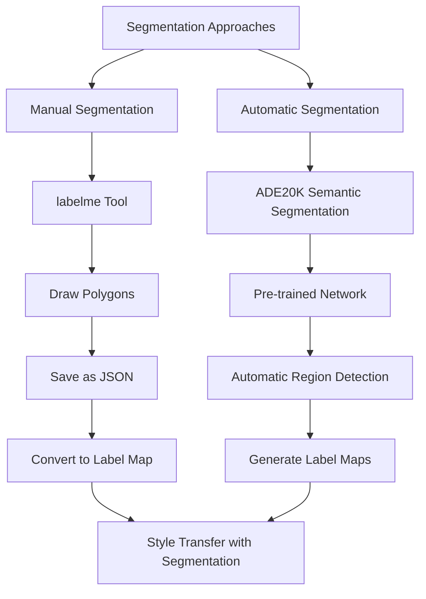
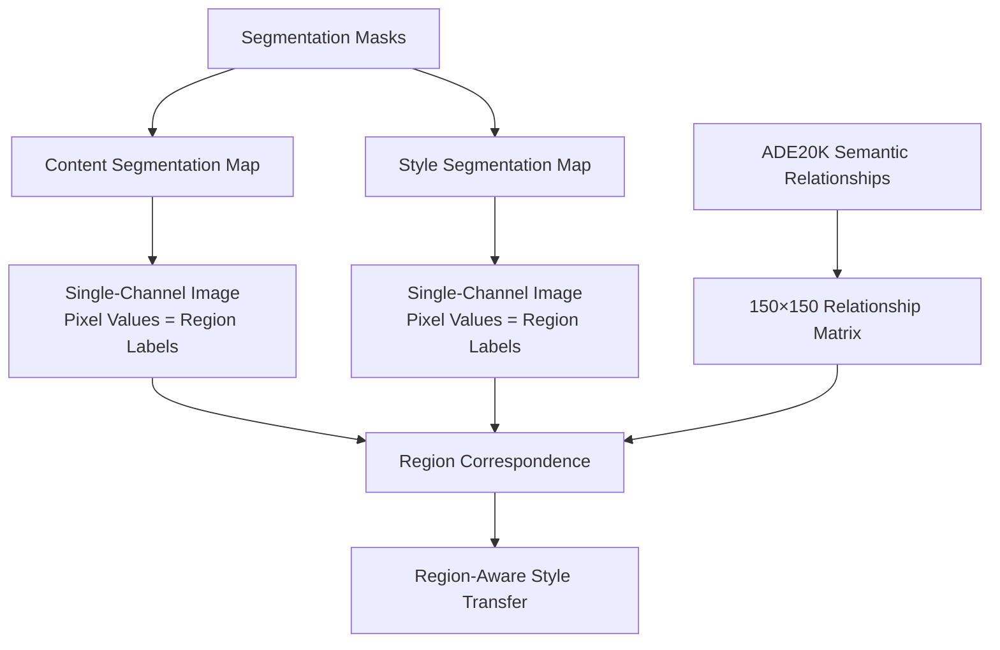
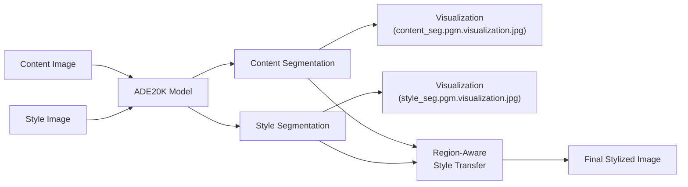
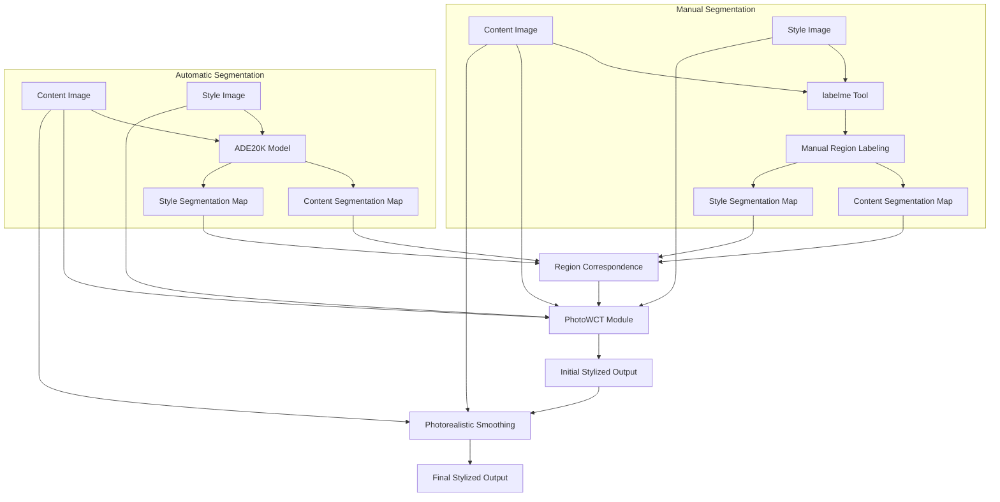

<!-- source: DeepWiki mcp.deepwiki.com · repo NVIDIA/FastPhotoStyle · page 4.3 Using Segmentation · fetched 2026-10-26 -->

# Using Segmentation

<details>
<summary>Relevant source files</summary>

The following files were used as context for generating this wiki page:

- [TUTORIAL.md](TUTORIAL.md)
- [ade20k_semantic_rel.npy](ade20k_semantic_rel.npy)
- [demo_example3.sh](demo_example3.sh)
- [demo_result_content3_seg.pgm.visualization.jpg](demo_result_content3_seg.pgm.visualization.jpg)
- [demo_with_segmentation.gif](demo_with_segmentation.gif)

</details>


## Purpose and Overview

This document explains how to use segmentation in FastPhotoStyle to enhance photorealistic style transfer. Segmentation allows for region-aware style transfer by establishing correspondences between semantically similar regions in content and style images. This results in better stylization effects compared to unsegmented transfers, as the style of specific regions (e.g., sky, trees, buildings) is transferred only to the matching regions in the content image.

This guide covers both manual and automatic segmentation approaches. For basic usage without segmentation, see [Basic Usage](#4.1). For fast approximation mode, see [Fast Mode](#4.2).

## Segmentation in FastPhotoStyle

Segmentation in FastPhotoStyle is an optional feature that allows for more controlled style transfer. When provided with segmentation masks for content and style images, the system establishes region-based correspondences, transferring style characteristics between matching regions.



Sources: [TUTORIAL.md:96-99]()

### Benefits of Using Segmentation

Segmentation offers several advantages for photorealistic style transfer:

1. **Region-specific transfer**: Style is transferred only between semantically similar regions
2. **Improved photorealism**: Prevents style bleeding between unrelated areas
3. **Controlled stylization**: Enables more predictable and controlled results
4. **Better preservation of content structure**: Maintains the semantic integrity of the content image

### Visual Comparison of Results

| Approach | Description | Visual Impact |
|----------|------------|---------------|
| No Segmentation | Global style transfer without region awareness | Style may transfer inappropriately between unrelated regions |
| Manual Segmentation | User-defined region mapping with precise control | Exact correspondence between hand-labeled regions |
| Automatic Segmentation | AI-generated segmentation with ADE20K model | Good region correspondence with minimal user effort |

Sources: [TUTORIAL.md:127-132](), [TUTORIAL.md:187-196]()

## Segmentation Approaches

FastPhotoStyle supports two segmentation approaches:



Sources: [TUTORIAL.md:102-116](), [TUTORIAL.md:136-142]()

### Manual Segmentation

Manual segmentation uses the [labelme](https://github.com/wkentaro/labelme) tool to create precise segmentation masks. This approach provides maximum control over region definitions but requires more user effort.

The process involves:

1. Drawing polygons around regions in both content and style images
2. Assigning matching labels to corresponding regions (e.g., labeling sky regions in both images with the same label)
3. Converting the JSON files to label maps using the labelme utility
4. Running FastPhotoStyle with the generated label maps

Sources: [TUTORIAL.md:102-116]()

### Automatic Segmentation

Automatic segmentation uses a pre-trained neural network (based on ADE20K dataset) to automatically identify and segment regions in both images. This approach is faster and requires minimal user intervention.

The system uses the semantic segmentation implementation from [CSAILVision/semantic-segmentation-pytorch](https://github.com/CSAILVision/semantic-segmentation-pytorch), which can identify 150 different semantic categories in images.

Sources: [TUTORIAL.md:136-142]()

## Implementation Details

### Segmentation Data Structure

The segmentation masks are represented as single-channel images where pixel values correspond to region labels. Labels start from 0 (typically background) and increment for each distinct region. The ADE20K model uses a predefined set of 150 semantic categories.

The relationship between semantic categories is defined in the file `ade20k_semantic_rel.npy`, which contains a 150×150 matrix of semantic relationships used to match regions between content and style images.



Sources: [ade20k_semantic_rel.npy](), [TUTORIAL.md:116]()

### Integration with PhotoWCT

When segmentation masks are provided, the PhotoWCT module uses them to establish region-based correspondences before applying the Whitening and Coloring Transform. This ensures that style characteristics are transferred only between matching regions.

Sources: [TUTORIAL.md:97-99]()

## Using Manual Segmentation

### Creating Manual Segmentation Masks

To create manual segmentation masks:

1. Install labelme: 
   ```
   pip install labelme
   ```
   
2. Launch labelme:
   ```
   labelme
   ```

3. Open your content/style image and create polygons around different regions

4. Ensure matching regions have the same label across content and style images

5. Save the labeling result as a JSON file

6. Convert the JSON file to a label map:
   ```
   labelme_json_to_dataset example.json -o path/example_json
   ```

7. Use the generated `label.png` file from the `example_json` directory as your segmentation mask

Sources: [TUTORIAL.md:102-116]()

### Running Style Transfer with Manual Segmentation

To run style transfer with manual segmentation masks:

```
python demo.py \
   --content_image_path PATH-TO-YOUR-CONTENT-IMAGE \
   --content_seg_path PATH-TO-YOUR-CONTENT-LABEL \
   --style_image_path PATH-TO-YOUR-STYLE-IMAGE \
   --style_seg_path PATH-TO-YOUR-STYLE-LABEL \
   --output_image_path PATH-TO-YOUR-OUTPUT
```

You can also add the `--fast` flag to use the fast approximation mode.

Sources: [TUTORIAL.md:120-127]()

## Using Automatic Segmentation

### Setting Up Automatic Segmentation

To set up automatic segmentation:

1. Clone the modified semantic segmentation repository:
   ```
   git clone https://github.com/mingyuliutw/semantic-segmentation-pytorch segmentation
   ```

2. Verify the setup by running a test:
   ```
   cd segmentation
   ./demo_test.sh
   ```

3. Update your Python path:
   ```
   export PYTHONPATH=$PYTHONPATH:segmentation
   ```

Sources: [TUTORIAL.md:136-143](), [TUTORIAL.md:173]()

### Running Style Transfer with Automatic Segmentation

To run style transfer with automatic segmentation:

```
python demo_with_ade20k_ssn.py [--fast] [--output_visualization]
```

Options:
- `--fast`: Use fast approximation mode for photorealistic smoothing
- `--output_visualization`: Generate visualization of segmentation results

The script will:
1. Automatically compute segmentation masks for content and style images using the ADE20K model
2. Perform photorealistic style transfer using the generated masks
3. Save the final stylized image along with optional visualization of segmentation results

Sources: [TUTORIAL.md:174-176](), [demo_example3.sh]()

## Visualization of Segmentation Results

When running automatic segmentation with the `--output_visualization` flag, the system generates visualizations of the segmentation masks. These are saved as color-coded images where different regions are shown in different colors.

The visualization helps understand how the system identified and segmented different regions in the content and style images, providing insight into the region-based style transfer process.



Sources: [TUTORIAL.md:192-196]()

## Complete Process Workflow

The following diagram shows the complete workflow for segmentation-based style transfer in FastPhotoStyle:



Sources: [TUTORIAL.md:95-132](), [TUTORIAL.md:134-196]()

## Technical Tips and Troubleshooting

### Ensuring Good Segmentation Results

- For manual segmentation, ensure that corresponding regions in content and style images have exactly the same label
- For automatic segmentation, choose content and style images with similar semantic elements for best results
- Large images may cause memory issues; resize them if necessary

### Common Problems and Solutions

| Problem | Possible Cause | Solution |
|---------|---------------|----------|
| Poor region correspondence | Mislabeled regions in manual segmentation | Ensure matching regions have identical labels |
| Missing regions in auto segmentation | ADE20K model limitation for certain objects | Use manual segmentation for more precise control |
| Memory errors | Large images or insufficient GPU memory | Resize images or use CPU mode |
| Style bleeding between regions | Incorrect region boundaries | Refine segmentation masks or increase smoothing |

Sources: [TUTORIAL.md:106-108]()

## Command Line Reference

The following table summarizes the command line options for segmentation-based style transfer:

| Option | Description | Required |
|--------|-------------|----------|
| `--content_image_path` | Path to content image | Yes |
| `--style_image_path` | Path to style image | Yes |
| `--content_seg_path` | Path to content segmentation mask | For manual segmentation |
| `--style_seg_path` | Path to style segmentation mask | For manual segmentation |
| `--output_image_path` | Path to save stylized image | Yes |
| `--fast` | Use fast approximation mode | No |
| `--output_visualization` | Generate visualization of segmentation | For automatic segmentation |

Sources: [TUTORIAL.md:120-127](), [TUTORIAL.md:174-176]()

---

