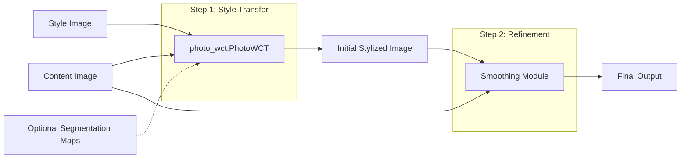
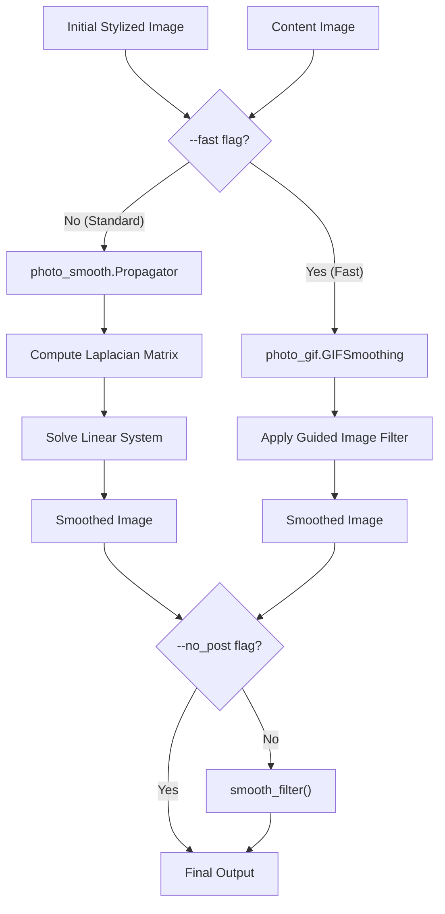
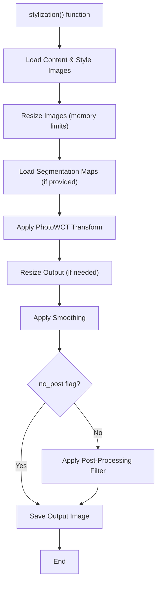
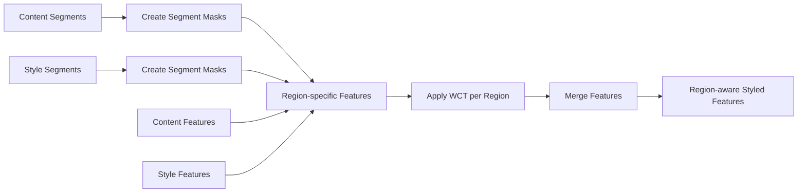

<!-- source: DeepWiki mcp.deepwiki.com · repo NVIDIA/FastPhotoStyle · page 5 System Architecture · fetched 2026-10-26 -->

# System Architecture

<details>
<summary>Relevant source files</summary>

The following files were used as context for generating this wiki page:

- [demo.py](demo.py)
- [photo_smooth.py](photo_smooth.py)
- [photo_wct.py](photo_wct.py)
- [process_stylization.py](process_stylization.py)

</details>


This document describes the architecture of the FastPhotoStyle system, detailing the major components, how they interact, and the data flow through the system. For information on how to use the system, see [Usage Guide](#4).

## Overview

FastPhotoStyle implements a photorealistic image stylization system based on a two-step approach:

1. **Style Transfer**: Applies the Photorealistic Whitening and Coloring Transform (PhotoWCT) to transfer style features
2. **Smoothing**: Ensures photorealism through specialized smoothing techniques

The system is designed to stylize content images while preserving structure and maintaining photorealistic quality.



**Core System Architecture Diagram**

Sources: [demo.py:25-48](), [process_stylization.py:60-136]()

## Core Components

### PhotoWCT Module

The PhotoWCT module is implemented in the `PhotoWCT` class, which performs the style transfer using neural networks with multiple levels of VGG-based encoders and decoders.

```mermaid
flowchart TD
    subgraph "PhotoWCT Class"
        E1["e1 (VGGEncoder(1))"] --> D1["d1 (VGGDecoder(1))"]
        E2["e2 (VGGEncoder(2))"] --> D2["d2 (VGGDecoder(2))"]
        E3["e3 (VGGEncoder(3))"] --> D3["d3 (VGGDecoder(3))"]
        E4["e4 (VGGEncoder(4))"] --> D4["d4 (VGGDecoder(4))"]
    end
    
    Content["Content Image"] --> E4
    Style["Style Image"] --> WCT["feature_wct method"]
    
    E4 --> CF["Content Features"] --> WCT
    WCT --> SF["Stylized Features"] --> D4
    D4 --> Im4["Intermediate Output 4"]
    
    Im4 --> E3
    E3 --> CF3["Content Features 3"] --> WCT3["feature_wct"]
    Style --> WCT3
    WCT3 --> SF3["Stylized Features 3"] --> D3
    D3 --> Im3["Intermediate Output 3"]
    
    Im3 --> E2
    Im3 --> "..."
    
    "..." --> Im1["Intermediate Output 1"] --> FinalOutput["Stylized Output"]
```

**PhotoWCT Multilevel Processing Pipeline**

Sources: [photo_wct.py:13-24](), [photo_wct.py:25-54]()

Key characteristics:
- Consists of 4 levels of encoders and decoders
- Features are processed through the WCT transform at each level
- Supports segment-based style transfer when segmentation maps are provided
- Preserves content structure while transferring style features

The WCT transform is the core algorithm that enables style transfer:


**WCT Core Algorithm Flow**

Sources: [photo_wct.py:122-164]()

### Smoothing Modules

The system offers two smoothing approaches:



**Smoothing Module Selection and Process Flow**

Sources: [demo.py:28-33](), [photo_smooth.py:15-99](), [process_stylization.py:108-135]()

#### Standard Smoothing (Propagator)
- Implemented in `photo_smooth.py`
- Uses a sparse matting Laplacian approach
- Provides high-quality smoothing but is computationally intensive
- Preserves edges from the content image

#### Fast Smoothing (GIFSmoothing)
- Uses guided image filtering
- Offers faster processing at the expense of some quality
- Activated with the `--fast` flag

## Process Coordination

The entire stylization process is coordinated by the `stylization()` function in `process_stylization.py`, which:

1. Loads and resizes images
2. Processes segmentation maps if provided
3. Applies the PhotoWCT transform
4. Applies the selected smoothing method
5. Performs optional post-processing
6. Saves the final output



**End-to-End Stylization Process**

Sources: [process_stylization.py:60-136]()

## Data Flow

### Input Handling

The system accepts:
- Content image (required)
- Style image (required)
- Segmentation maps (optional)
- Configuration flags

Input images undergo preprocessing:
1. Resizing to respect memory constraints
2. Conversion to tensors for processing
3. Optional CUDA transfer for GPU acceleration

### Segmentation Support

When segmentation maps are provided:
- Content and style images are segmented into corresponding regions
- Style transfer is performed region-to-region based on segment labels
- This enables localized styling (e.g., transferring sky style to sky regions only)



**Segment-based Style Transfer Process**

Sources: [photo_wct.py:56-117]()

## Implementation Details

### Key Classes and Their Responsibilities

| Class | File | Responsibility |
|-------|------|----------------|
| `PhotoWCT` | [photo_wct.py]() | Implements the style transfer algorithm using WCT |
| `Propagator` | [photo_smooth.py]() | Standard smoothing using matting Laplacian |
| `GIFSmoothing` | (imported in demo.py) | Fast smoothing using guided image filtering |
| `ReMapping` | [process_stylization.py]() | Handles segment label remapping for segmentation |
| `Timer` | [process_stylization.py]() | Utility for timing processing steps |

### System Configuration Options

The system provides several configuration options through command-line arguments:

| Option | Default | Description |
|--------|---------|-------------|
| `--model` | './PhotoWCTModels/photo_wct.pth' | Path to the pretrained model |
| `--content_image_path` | './images/content1.png' | Path to content image |
| `--style_image_path` | './images/style1.png' | Path to style image |
| `--content_seg_path` | [] | Path to content segmentation |
| `--style_seg_path` | [] | Path to style segmentation |
| `--output_image_path` | './results/example1.png' | Path for output image |
| `--save_intermediate` | False | Save intermediate results |
| `--fast` | False | Use fast smoothing method |
| `--no_post` | False | Skip post-processing |
| `--cuda` | 1 | Enable/disable CUDA |

Sources: [demo.py:11-21]()

## Performance Considerations

- GPU acceleration is recommended and enabled by default
- Memory usage increases with image size
- The system automatically resizes large images to prevent memory errors
- The fast mode provides significant speed improvement with some quality trade-off

Sources: [process_stylization.py:40-57](), [demo.py:28-35]()

## Integration Points

The system is designed to be used as:
1. A command-line tool via `demo.py`
2. A module that can be imported into other Python applications
3. A Docker container for isolated deployment

The main entry point for integration is the `stylization()` function in `process_stylization.py`, which accepts modular style transfer and smoothing components.

Sources: [demo.py:37-48](), [process_stylization.py:60-136]()

---

