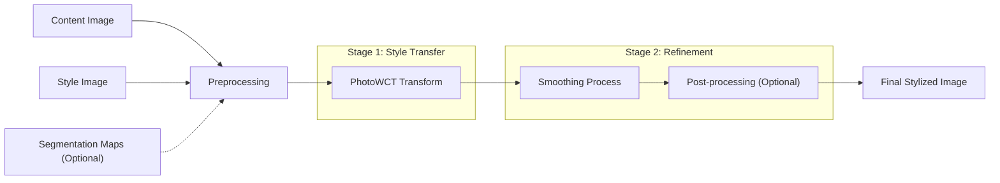
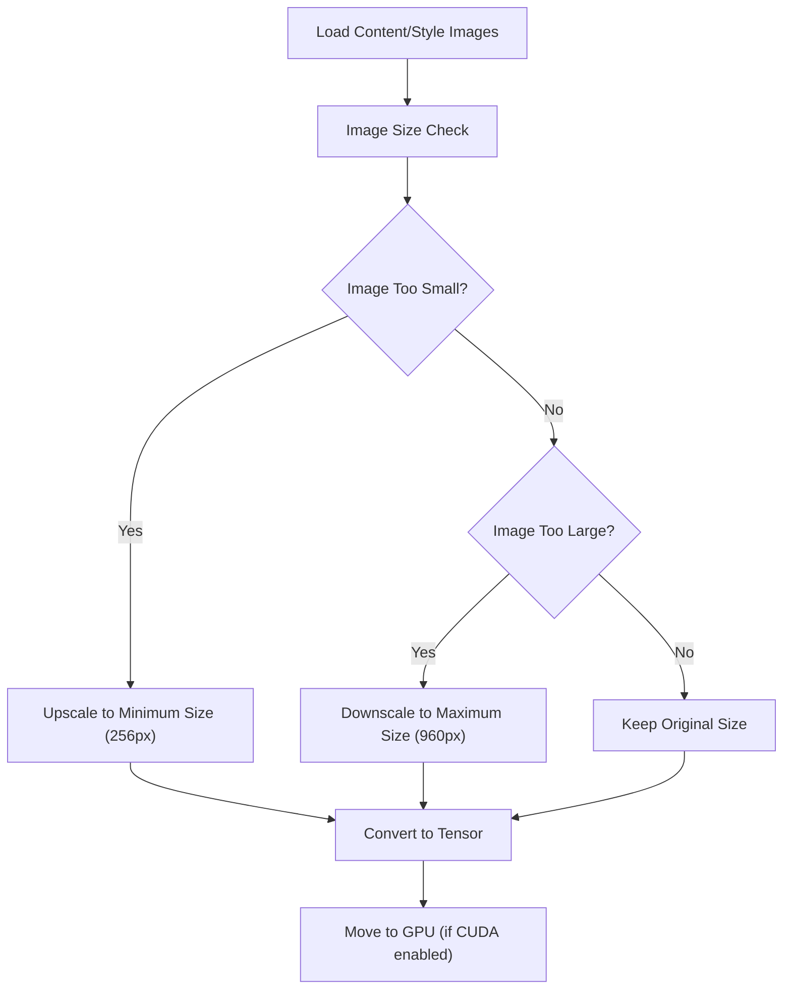
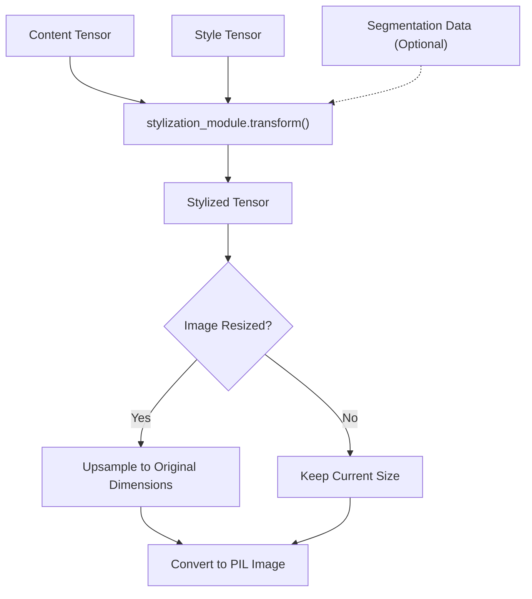
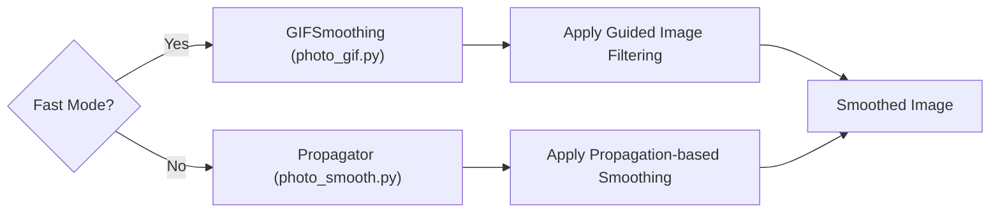
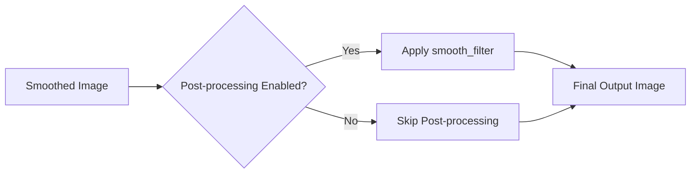
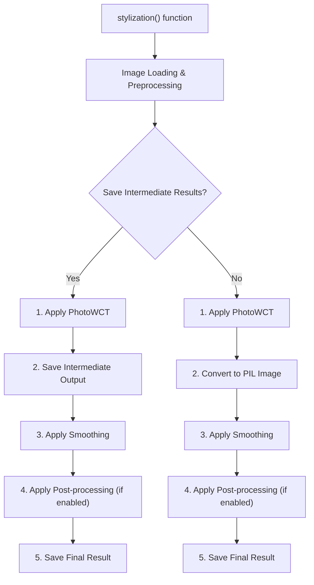
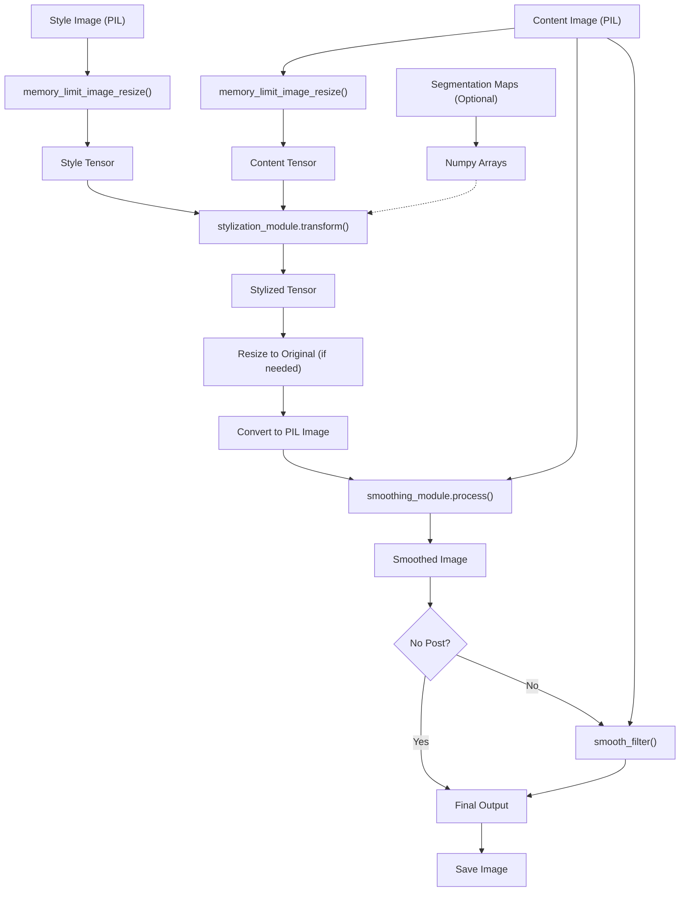
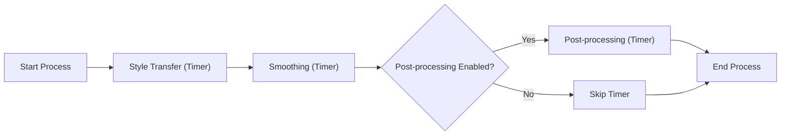

<!-- source: DeepWiki mcp.deepwiki.com · repo NVIDIA/FastPhotoStyle · page 5.1 Image Processing Pipeline · fetched 2026-10-26 -->

# Image Processing Pipeline

Relevant source files

The following files were used as context for generating this wiki page:

- [demo.py](demo.py)
- [process_stylization.py](process_stylization.py)

This document details the end-to-end image processing pipeline implemented in FastPhotoStyle. It covers how images flow through the system from input to output, including preprocessing, style transfer, and post-processing steps to achieve photorealistic style transfer.

For information about the VGG neural network architecture used for feature extraction, see [VGG Encoder-Decoder Architecture](#5.2). For details on the core algorithm theory, see [Core Algorithm](#3).

## 1. Pipeline Overview

The FastPhotoStyle image processing pipeline follows a multi-stage approach to transform a content image using the style from another image while maintaining photorealism.

Sources: [process_stylization.py:60-137](), [demo.py:37-48]()

## 2. Image Preprocessing

Before style transfer begins, several preprocessing steps are applied to the input images to ensure optimal processing.

### 2.1 Image Loading and Resizing

The `memory_limit_image_resize` function ensures images are neither too small nor too large for processing:
- Minimum dimension: 256 pixels
- Maximum dimension: 960 pixels
- Aspect ratio is preserved during resizing

Sources: [process_stylization.py:40-57](), [process_stylization.py:63-87]()

### 2.2 Segmentation Handling

If segmentation maps are provided, they are loaded and processed to enable region-based style transfer.

Segmentation remapping allows for different regions to be matched across content and style images.

Sources: [process_stylization.py:72-98]()

## 3. PhotoWCT Style Transfer

The core style transfer is performed by the PhotoWCT module, which implements a Whitening and Coloring Transform to transfer style features.

The PhotoWCT transform is applied through the `transform` method of the `stylization_module` object. If the content image was resized during preprocessing, the stylized output is upsampled to match the original dimensions.

Sources: [process_stylization.py:100-128]()

## 4. Smoothing and Refinement

After the initial style transfer, smoothing is applied to ensure photorealistic results. FastPhotoStyle provides two smoothing options.

### 4.1 Smoothing Module Selection

The smoothing module is selected based on the `--fast` parameter:
- Standard mode: Uses the `Propagator` class for high-quality smoothing
- Fast mode: Uses the `GIFSmoothing` class for quicker processing

Sources: [demo.py:28-33](), [process_stylization.py:108-131]()

### 4.2 Post-processing

Unless `--no_post` is specified, an additional post-processing step is applied using a smooth filter to further enhance photorealism.

The post-processing uses the `smooth_filter` function with the following parameters:
- Filter radius: 15
- Edge preservation: 0.1

Sources: [process_stylization.py:116-135]()

## 5. Complete Pipeline Implementation

The complete image processing pipeline is implemented in the `stylization` function in `process_stylization.py`. This function orchestrates all steps and handles both the standard flow and intermediate output saving.

### 5.1 Code Path Analysis

The image processing pipeline execution follows these code paths:

| Pipeline Stage | Entry Point | Main Processing Function | Output |
|----------------|-------------|--------------------------|--------|
| Initialization | `demo.py` main section | `PhotoWCT()` initialization | Loaded model |
| Smoothing Selection | `demo.py` lines 28-33 | Either `GIFSmoothing()` or `Propagator()` | Smoothing module |
| Full Pipeline | `demo.py` lines 37-48 | `process_stylization.stylization()` | Processed image |
| Style Transfer | `process_stylization.py` lines 122-125 | `stylization_module.transform()` | Stylized tensor |
| Smoothing | `process_stylization.py` lines 130-131 | `smoothing_module.process()` | Smoothed image |
| Post-processing | `process_stylization.py` lines 133-135 | `smooth_filter()` | Final image |

Sources: [demo.py:25-48](), [process_stylization.py:60-137]()

## 6. Pipeline Data Flow

The following diagram shows the detailed data flow through the image processing pipeline, including the key data transformations at each step:

Sources: [process_stylization.py:60-137](), [demo.py:37-48]()

## 7. Performance Timers

The image processing pipeline includes timing measurements for each major processing step to help understand the performance characteristics:

The `Timer` class is used to measure and report the elapsed time for:
1. Stylization (PhotoWCT transform)
2. Propagation (smoothing)
3. Post-processing (if enabled)

Sources: [process_stylization.py:28-37](), [process_stylization.py:101-135]()

## Summary

The FastPhotoStyle image processing pipeline transforms a content image using the style from another image through a series of carefully designed steps. The pipeline balances quality with performance by offering different modes of operation (standard vs. fast) and optional post-processing. The segmentation-aware design allows for region-specific style transfer when segmentation maps are provided.

By managing each step of the process - from preprocessing through style transfer to refinement - the pipeline ensures both artistic style transfer and photorealistic output.

---

