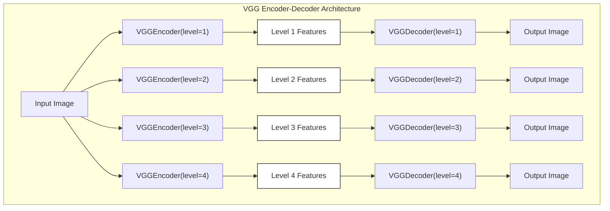
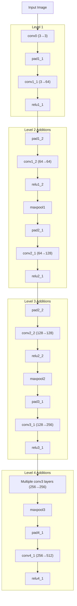
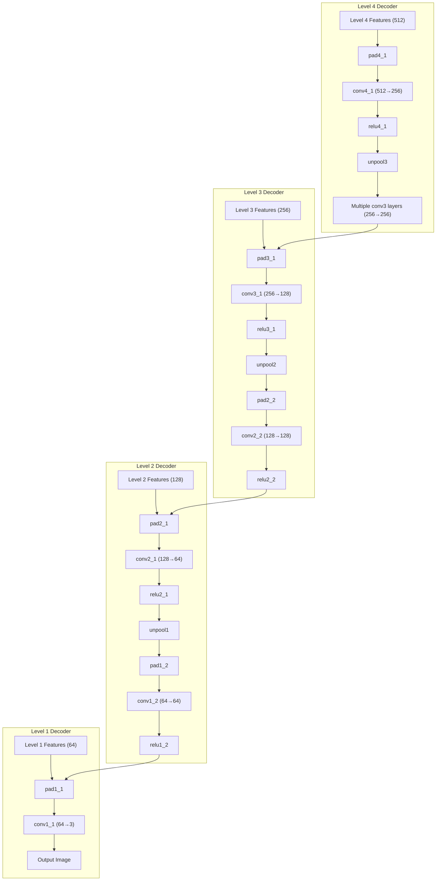
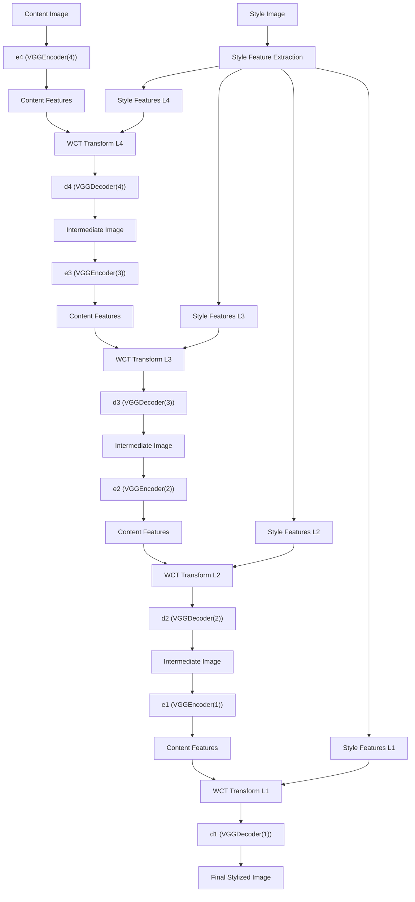
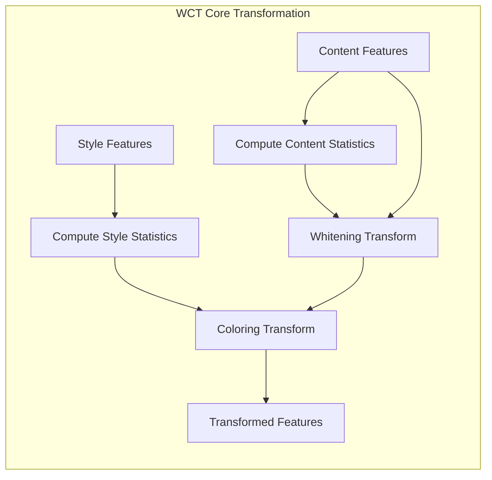
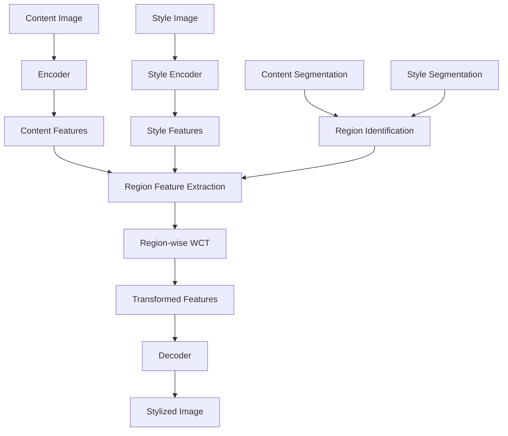

<!-- source: DeepWiki mcp.deepwiki.com · repo NVIDIA/FastPhotoStyle · page 5.2 VGG Encoder-Decoder Architecture · fetched 2026-10-26 -->

# VGG Encoder-Decoder Architecture

Relevant source files

The following files were used as context for generating this wiki page:

- [models.py](models.py)
- [photo_wct.py](photo_wct.py)

This document provides a technical specification of the VGG Encoder-Decoder architecture used in the FastPhotoStyle system. This architecture forms the backbone of the PhotoWCT (Photorealistic Whitening and Coloring Transform) module, which enables high-quality photorealistic style transfer between images.

## Purpose and Scope

The VGG Encoder-Decoder architecture serves two primary functions in the FastPhotoStyle pipeline:

1. **Feature Extraction**: Extract multi-level features from both content and style images
2. **Image Reconstruction**: Reconstruct stylized images from transformed feature representations

For information about how this architecture is used within the overall style transfer algorithm, see [PhotoWCT Implementation](#3.1) and [Image Processing Pipeline](#5.1).

## Architecture Overview

The FastPhotoStyle implementation uses a multi-level VGG-based network architecture adapted specifically for style transfer tasks. It consists of encoder-decoder pairs at four different levels, with each level capturing features at different scales of abstraction.

Sources: [models.py:8-188](). [models.py:190-297]()

### Level Progression

Each level in the architecture represents a different depth:

| Level | Feature Type | Spatial Reduction | Channel Dimensions |
|-------|-------------|-------------------|-------------------|
| 1 | Low-level textures and edges | 1x | 3 → 64 → 3 |
| 2 | Simple patterns and shapes | 2x | 3 → 128 → 3 |
| 3 | Mid-level structures | 4x | 3 → 256 → 3 |
| 4 | High-level semantic features | 8x | 3 → 512 → 3 |

Sources: [models.py:8-188](). [models.py:190-297]()

## VGG Encoder Implementation

The `VGGEncoder` class implements a truncated and modified version of the VGG network architecture for feature extraction.

Sources: [models.py:8-129]()

### Key Implementation Details

- The encoder is initialized with a `level` parameter (1-4) that determines how deep the network goes
- Each convolutional layer is preceded by a reflection padding layer to preserve spatial dimensions at the boundaries
- Max pooling operations record indices and output sizes, which are later used by the decoder for precise unpooling
- Two forward methods are provided:
  - `forward()`: For processing a single image through the encoder
  - `forward_multiple()`: For extracting features at multiple levels simultaneously from a style image

Sources: [models.py:76-129](), [models.py:131-187]()

## VGG Decoder Implementation

The `VGGDecoder` class mirrors the encoder structure but in reverse order, reconstructing an image from feature representations.

Sources: [models.py:190-297]()

### Key Implementation Details

- Like the encoder, the decoder is initialized with a `level` parameter (1-4) that must match the corresponding encoder level
- The decoder uses max unpooling operations with the saved indices from the encoder to restore spatial dimensions
- The decoder receives pool indices and feature map sizes from the encoder for proper unpooling
- The final output is a 3-channel image reconstructed from the transformed features

Sources: [models.py:251-297]()

## Integration in PhotoWCT

The `PhotoWCT` class orchestrates the VGG Encoder-Decoder pairs to implement the Photorealistic Whitening and Coloring Transform algorithm.

Sources: [photo_wct.py:13-24](), [photo_wct.py:25-54]()

### Cascade Processing

The PhotoWCT module implements a multi-level style transfer process:

1. Initialize four encoder-decoder pairs (levels 1-4) in the `PhotoWCT` constructor
2. Extract style features at all levels using `forward_multiple()` on the deepest encoder
3. Process through a cascade of encoder-decoder transformations:
   - Start with the deepest level (4)
   - Extract content features using the encoder
   - Transform features using WCT
   - Reconstruct using the decoder
   - Feed the output into the next level's encoder
   - Repeat for levels 3, 2, and 1

This cascade approach allows style transfer at multiple semantic levels, from global structure to fine details.

Sources: [photo_wct.py:25-54]()

## WCT Feature Transformation

The core of the style transfer process is the Whitening and Coloring Transform, implemented in the `__wct_core()` method:

Sources: [photo_wct.py:122-164]()

### Transformation Steps

1. **Feature Preparation**:
   - Extract and reshape content and style features
   - Center the features by subtracting their means

2. **Whitening Transform**:
   - Compute content feature covariance matrix
   - Perform SVD decomposition to get eigenvectors and eigenvalues
   - Use these components to whiten the content features

3. **Coloring Transform**:
   - Compute style feature covariance matrix
   - Perform SVD decomposition to get eigenvectors and eigenvalues
   - Use these components to color the whitened features
   - Add back the style feature mean

This transformation effectively removes the original style information from content features and applies the target style characteristics.

Sources: [photo_wct.py:70-120](), [photo_wct.py:122-164]()

## Segmentation-Guided Style Transfer

The VGG Encoder-Decoder architecture also supports region-specific style transfer using segmentation masks:

Sources: [photo_wct.py:56-68](), [photo_wct.py:70-120]()

### Region-Specific Processing

When segmentation masks are provided, the PhotoWCT module:

1. Computes label information from content and style segmentation masks
2. Resizes segmentation masks to match feature dimensions
3. For each semantic region/label:
   - Extracts content and style features corresponding to that region
   - Applies WCT only to these region-specific features
   - Places the transformed features back into the original feature map

This region-aware approach preserves semantic structure while enabling region-specific style transfer, which is crucial for photorealistic results.

Sources: [photo_wct.py:56-68](), [photo_wct.py:70-120]()

## Summary

The VGG Encoder-Decoder architecture in FastPhotoStyle is a specialized neural network design that enables multi-level, semantically-aware style transfer. By operating at four different levels of feature abstraction and supporting region-specific transformations, this architecture forms the foundation for photorealistic style transfer that preserves structural integrity while effectively transferring visual styles.

Sources: [models.py:8-297](), [photo_wct.py:13-171]()

---

