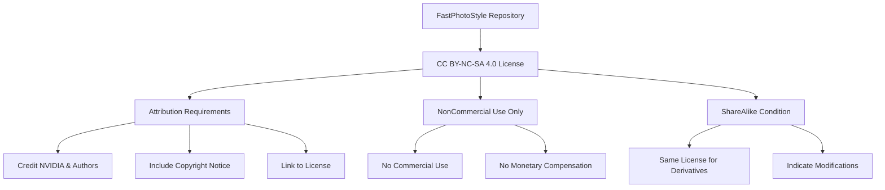
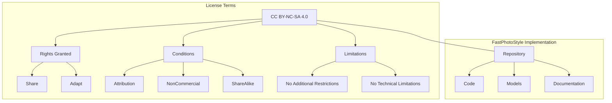
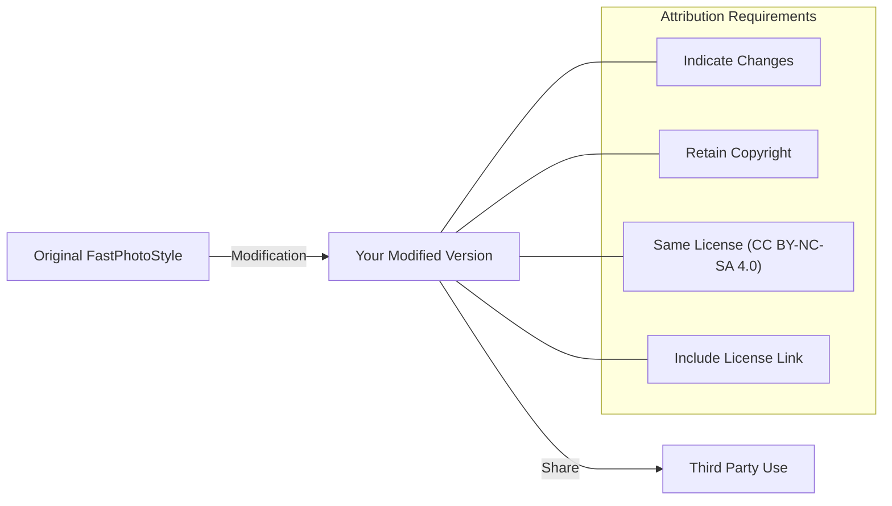

<!-- source: DeepWiki mcp.deepwiki.com · repo NVIDIA/FastPhotoStyle · page 6 License and Attribution · fetched 2026-10-26 -->

# License and Attribution

<details>
<summary>Relevant source files</summary>

The following files were used as context for generating this wiki page:

- [LICENSE.md](LICENSE.md)
- [README.md](README.md)

</details>


This document provides comprehensive information about the licensing terms governing the FastPhotoStyle repository and the proper attribution requirements for both the codebase and the underlying research.

## License Overview

FastPhotoStyle is released under the Creative Commons Attribution-NonCommercial-ShareAlike 4.0 International License (CC BY-NC-SA 4.0), which affects how users can use, modify, and share the code.



Sources: [README.md:7-9](), [LICENSE.md:1-4]()

## License Details

FastPhotoStyle is copyright (C) 2018 NVIDIA Corporation and is licensed under the CC BY-NC-SA 4.0 license. This license has the following key components:

1. **Attribution (BY)**: You must give appropriate credit, provide a link to the license, and indicate if changes were made.

2. **NonCommercial (NC)**: You may not use the material for commercial purposes. This means the code cannot be used primarily for commercial advantage or monetary compensation.

3. **ShareAlike (SA)**: If you remix, transform, or build upon the material, you must distribute your contributions under the same license as the original.

The full license text can be found in the [LICENSE.md]() file in the repository.



Sources: [LICENSE.md:15-17](), [LICENSE.md:82-86](), [README.md:7-9]()

## Research Attribution

The FastPhotoStyle repository implements the algorithm described in the following research paper:

**Paper Title**: "A Closed-form Solution to Photorealistic Image Stylization"  
**Authors**: Yijun Li (UC Merced), Ming-Yu Liu (NVIDIA), Xueting Li (UC Merced), Ming-Hsuan Yang (NVIDIA, UC Merced), Jan Kautz (NVIDIA)  
**Conference**: European Conference on Computer Vision (ECCV), 2018  
**Paper URL**: https://arxiv.org/abs/1802.06474

When using the code or referencing the method implemented in this repository, proper citation of both the code repository and the research paper is required.

Sources: [README.md:25-29]()

## How to Cite

### Citing the Paper

For academic and research purposes, please cite the original paper as follows:

```
@inproceedings{li2018closed,
  title={A Closed-form Solution to Photorealistic Image Stylization},
  author={Li, Yijun and Liu, Ming-Yu and Li, Xueting and Yang, Ming-Hsuan and Kautz, Jan},
  booktitle={European Conference on Computer Vision (ECCV)},
  year={2018}
}
```

### Citing the Code Repository

To reference the code implementation, you can use:

```
@misc{FastPhotoStyle2018,
  author = {NVIDIA Corporation},
  title = {FastPhotoStyle: A Closed-form Solution to Photorealistic Image Stylization},
  year = {2018},
  publisher = {GitHub},
  journal = {GitHub Repository},
  howpublished = {\url{https://github.com/NVIDIA/FastPhotoStyle}}
}
```

Sources: [README.md:25-29]()

## Attribution Requirements in Derivatives

If you modify and share the FastPhotoStyle code, the CC BY-NC-SA 4.0 license requires that you:

1. **Indicate Changes**: Clearly indicate what changes you made to the original code.

2. **Maintain Attributions**: Retain all copyright notices and attributions to original authors.

3. **Apply Same License**: License your derivative work under the same CC BY-NC-SA 4.0 terms.

4. **Include Original License**: Provide a copy of or link to the original license.



Sources: [LICENSE.md:102-105](), [LICENSE.md:110-119]()

## Commercial Use Restrictions

The NonCommercial clause of the CC BY-NC-SA 4.0 license prohibits using FastPhotoStyle for commercial purposes. This means:

1. You cannot use the code in commercial products or services
2. You cannot use the code to generate revenue directly
3. You cannot include the code in applications or services that are primarily intended for commercial advantage

If you require commercial use of the technology, you would need to contact NVIDIA Corporation for alternative licensing options.

Sources: [LICENSE.md:39-41](), [LICENSE.md:55-57]()

## Related Code Components and License Scope

The following table describes what components are covered by the license:

| Component | Covered by License | Notes |
|-----------|-------------------|-------|
| Core FastPhotoStyle algorithms | Yes | Complete implementation of PhotoWCT and smoothing techniques |
| Demo scripts | Yes | All demonstration code including `demo.py` and variants |
| Pre-trained VGG models | Yes | Model weights and architectures |
| Third-party dependencies | No | PyTorch, CUDA, Python, etc. have their own licenses |
| Your input/output images | No | The license does not apply to the content/style images you use or the results |

When using FastPhotoStyle in your project, make sure to properly distinguish between the components covered by this license and those covered by other licenses.

Sources: [README.md:7-9](), [LICENSE.md:34-37]()

## License Evolution

The FastPhotoStyle license and its implementation have evolved over time:

| Date | Event |
|------|-------|
| 2018 | Initial release under CC BY-NC-SA 4.0 license |
| 2018-07-25 | Migration to PyTorch 0.4.0 (License unchanged) |

The licensing terms remain consistent across all versions of the repository.

Sources: [README.md:14-18]()

The CC BY-NC-SA 4.0 license used by FastPhotoStyle strikes a balance between open scientific sharing and protecting the intellectual property of NVIDIA and the research authors. By adhering to the attribution requirements and license restrictions, you help support the continued development and sharing of academic research code.