# Page: FastPhotoStyle Overview

# FastPhotoStyle Overview

<details>
<summary>Relevant source files</summary>

The following files were used as context for generating this wiki page:

- [README.md](README.md)
- [TUTORIAL.md](TUTORIAL.md)
- [demo_with_segmentation.gif](demo_with_segmentation.gif)

</details>


## Purpose and Scope

This document provides a comprehensive overview of the FastPhotoStyle system, a photorealistic image stylization tool that transfers the style of one photo to another while preserving photorealism. This document introduces the system's purpose, architecture, core algorithms, and capabilities. For detailed installation instructions, see [Installation and Setup](#2), and for a deeper explanation of the algorithms, see [Core Algorithm](#3).

Sources: [README.md:23-28](), [TUTORIAL.md:8-13]()

## What is FastPhotoStyle?

FastPhotoStyle is an implementation of the "A Closed-form Solution to Photorealistic Image Stylization" research paper. Unlike artistic style transfer methods that make content photos look like paintings, FastPhotoStyle is designed specifically for photorealistic style transfer - transferring the style of one photo to another while ensuring the result still looks like a real photograph.

The system was developed by researchers from NVIDIA and UC Merced and published at the European Conference on Computer Vision (ECCV) 2018.

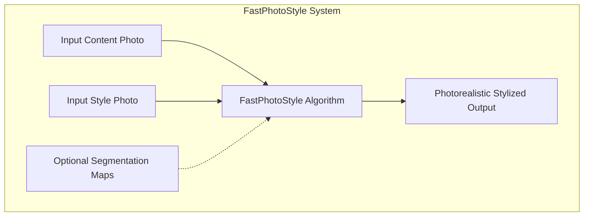

Sources: [README.md:23-29](), [TUTORIAL.md:8-13](), [TUTORIAL.md:15-16]()

## System Architecture

FastPhotoStyle implements a two-step algorithm for photorealistic style transfer:

```mermaid
flowchart LR
    A["Content Image"] --> C["Step 1: PhotoWCT"]
    B["Style Image"] --> C
    C --> D["Step 2: Photorealistic Smoothing"]
    D --> E["Final Stylized Image"]
    
    F["Content Segmentation"] -.-> C
    G["Style Segmentation"] -.-> C
    H["Content Image"] -.-> D
    
    classDef default width=200px
```

1. **PhotoWCT (Whitening and Coloring Transform)**: This step applies neural style transfer using deep features extracted from the content and style images, transforming the content image to adopt the style characteristics.

2. **Photorealistic Smoothing**: This step refines the initially stylized image to remove distortions and ensure the result maintains photorealistic qualities.

The system accepts optional segmentation masks for both content and style images to enable region-aware style transfer for better results.

Sources: [TUTORIAL.md:23-27]()

## Core Algorithm Components

### PhotoWCT Module

The PhotoWCT module is the first step in the stylization process and implements the Whitening and Coloring Transform:

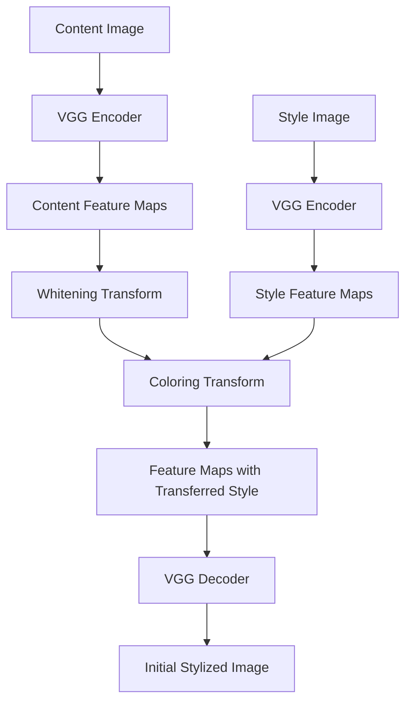

The PhotoWCT step extracts deep features from both images using VGG encoders, performs statistical transformations to transfer style characteristics, and reconstructs the image using VGG decoders. This produces an initially stylized image that may contain visible distortions.

Sources: [TUTORIAL.md:24]()

### Smoothing Modules

FastPhotoStyle offers two smoothing approaches for the second step:

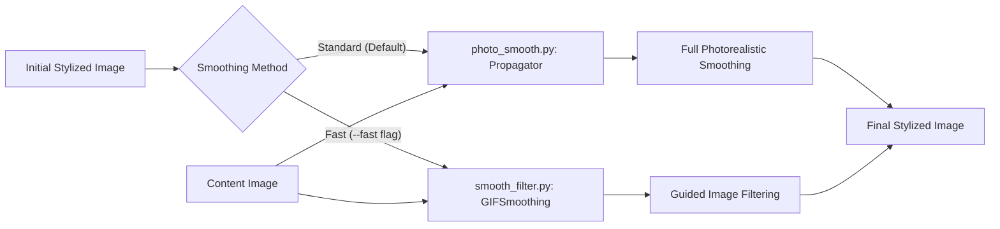

1. **Standard Smoothing**: Implements a full photorealistic smoothing algorithm with high quality but slower performance (implemented in `photo_smooth.py`).

2. **Fast Smoothing**: Uses guided image filtering for faster processing with slightly lower quality (implemented in `smooth_filter.py`).

The smoothing step is the computational bottleneck in the standard version, while the fast approximation provides significant speedups with minimal quality loss.

Sources: [TUTORIAL.md:83-93]()

## Features and Capabilities

### Segmentation-Guided Stylization

FastPhotoStyle can utilize segmentation masks to achieve better region-aware style transfer:

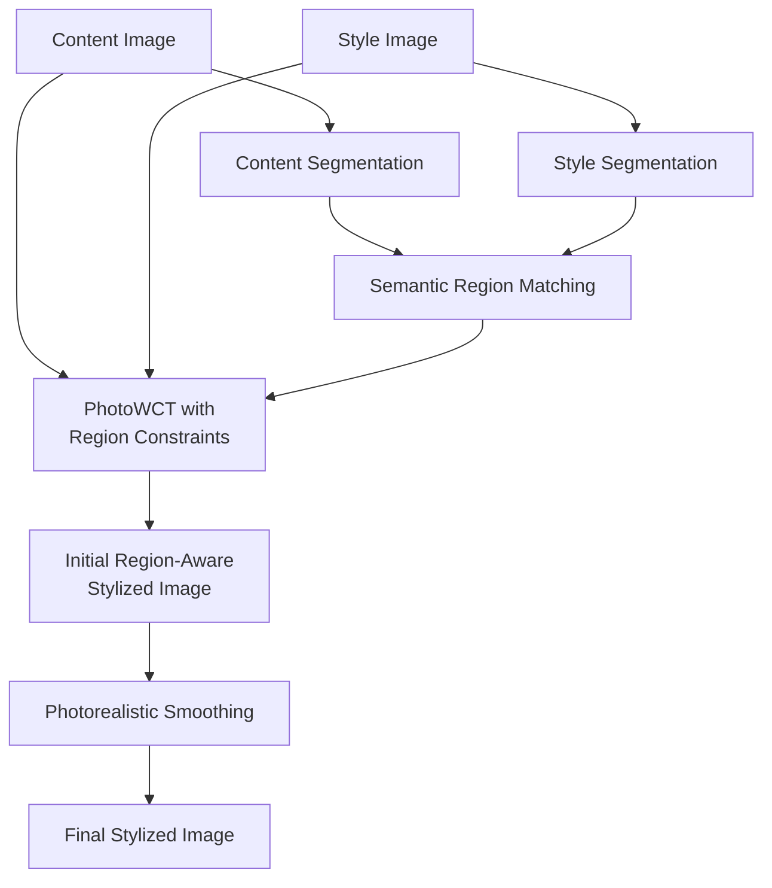

The system supports three modes of segmentation:

1. **No Segmentation**: Basic style transfer without region constraints
2. **Manual Segmentation**: User-provided segmentation masks created with tools like labelme
3. **Automatic Segmentation**: Generated using pre-trained networks (e.g., ADE20K segmentation model)

Segmentation-guided stylization helps preserve content structure while enabling more precise style transfer between corresponding regions (e.g., sky to sky, trees to trees).

Sources: [TUTORIAL.md:96-99](), [TUTORIAL.md:133-137]()

## Usage Scenarios

FastPhotoStyle offers multiple usage scenarios to accommodate different needs:

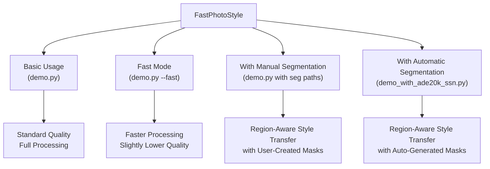

The system provides flexible command-line options to control the stylization process, balancing quality, speed, and region-awareness based on user requirements.

Sources: [TUTORIAL.md:49-56]()

## System Requirements

### Hardware and Software Dependencies

FastPhotoStyle requires the following environment:

| Requirement | Specification |
|-------------|---------------|
| Hardware    | PC with NVIDIA GPU (e.g., Titan) |
| OS          | Ubuntu 16.04 |
| CUDA        | CUDA 9.1 |
| Python      | Python 2.7 or 3.5 |
| Framework   | PyTorch 0.4.0 |
| Key Packages| scikit-umfpack, cupy, pynvrtc |
| Optional    | OpenCV (for fast mode), ADE20K dataset (for auto-segmentation) |

A Docker image is also provided for easier environment setup and execution.

Sources: [TUTORIAL.md:29-47](), [TUTORIAL.md:199-208]()

## Technical Implementation

The FastPhotoStyle repository includes several key modules that work together to perform photorealistic style transfer:

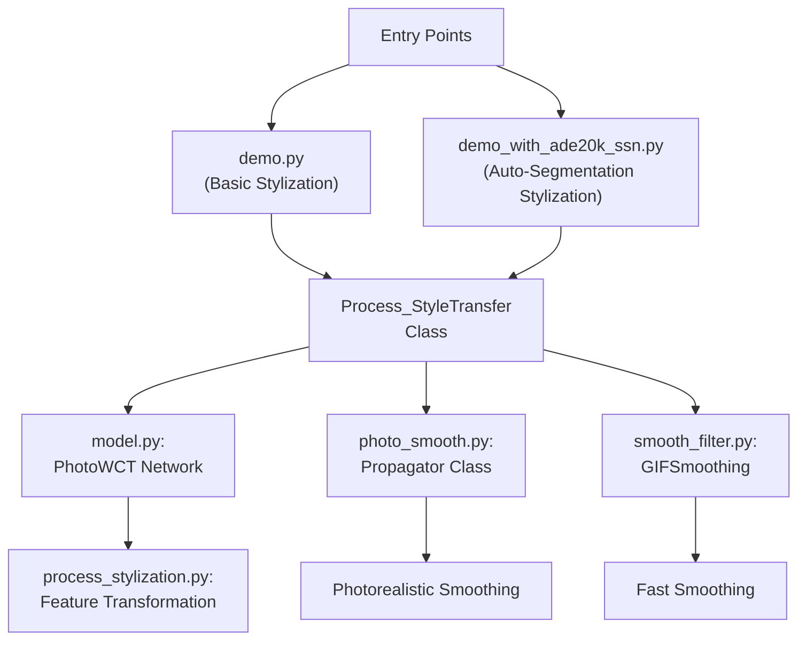

The technical implementation leverages PyTorch for deep learning operations, with optimized CUDA components for performance-critical steps. The modular design allows for flexibility in choosing different processing paths based on user requirements.

Sources: [TUTORIAL.md:23-27](), [TUTORIAL.md:83-93]()

## Conclusion

FastPhotoStyle represents a significant advancement in photorealistic style transfer, providing a practical solution for transferring visual styles between photographs while maintaining natural appearance. Its two-step approach (PhotoWCT + smoothing) delivers high-quality results with reasonable computational requirements, particularly when using the fast approximation mode.

The system's support for segmentation-guided stylization further enhances its capabilities, allowing for more precise and controllable style transfer between semantically corresponding regions in the content and style images.

Sources: [README.md:23-29](), [TUTORIAL.md:15-27]()

---

# Page: Installation and Setup

# Installation and Setup

<details>
<summary>Relevant source files</summary>

The following files were used as context for generating this wiki page:

- [Dockerfile](Dockerfile)
- [README.md](README.md)
- [TUTORIAL.md](TUTORIAL.md)
- [demo_with_segmentation.gif](demo_with_segmentation.gif)
- [download_models.py](download_models.py)
- [download_models.sh](download_models.sh)

</details>


This document provides comprehensive instructions for setting up the FastPhotoStyle system on your machine. It covers system requirements, environment configuration, installation of dependencies, and downloading the necessary pre-trained models. For information about the algorithm itself, please see [Core Algorithm](#3).

## 1. System Requirements

FastPhotoStyle has specific hardware and software requirements to function properly:

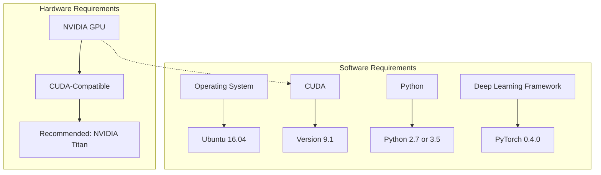

Sources: [TUTORIAL.md:29-32](), [Dockerfile:1-6]()

## 2. Environment Setup

There are two ways to set up the FastPhotoStyle environment:

1. Native installation on your machine
2. Using Docker (recommended for reproducibility)

### 2.1 Option 1: Native Installation

#### 2.1.1 Setting Up Environment Variables

First, configure essential environment variables:

```bash
export ANACONDA=PATH-TO-YOUR-ANACONDA-LIBRARY
export CUDA_PATH=/usr/local/cuda
export PATH=${ANACONDA}/bin:${CUDA_PATH}/bin:$PATH
export LD_LIBRARY_PATH=${ANACONDA}/lib:${CUDA_PATH}/bin64:$LD_LIBRARY_PATH
export C_INCLUDE_PATH=${CUDA_PATH}/include
```

Sources: [TUTORIAL.md:33-39]()

#### 2.1.2 Installing System Dependencies

Install the required system packages:

```bash
sudo apt-get install -y axel imagemagick
```

Sources: [TUTORIAL.md:40-41](), [Dockerfile:7-22]()

#### 2.1.3 Installing Python Dependencies

Install the required Python packages:

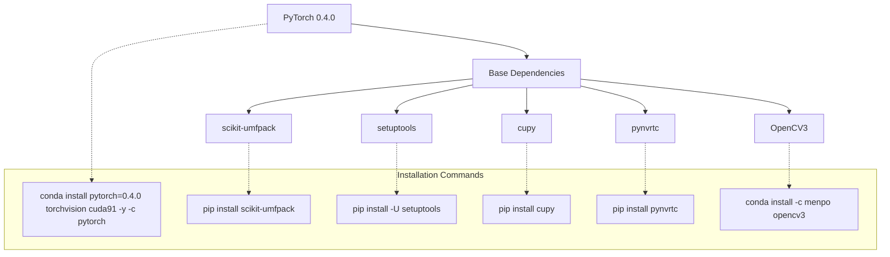

Sources: [TUTORIAL.md:42-47](), [Dockerfile:26-31]()

### 2.2 Option 2: Docker Installation

Using Docker provides a more consistent environment. The repository includes a Dockerfile that sets up all dependencies.

#### 2.2.1 Building the Docker Image

```bash
docker build -t fastphotostyle:v1.0 .
```

#### 2.2.2 Running the Docker Container

```bash
docker run -v YOUR_PATH:YOUR_PATH --runtime=nvidia -i -t fastphotostyle:v1.0 /bin/bash
```

Sources: [TUTORIAL.md:199-209](), [Dockerfile:1-31]()

### 2.3 Installation Flowchart

The following diagram illustrates the complete installation process:

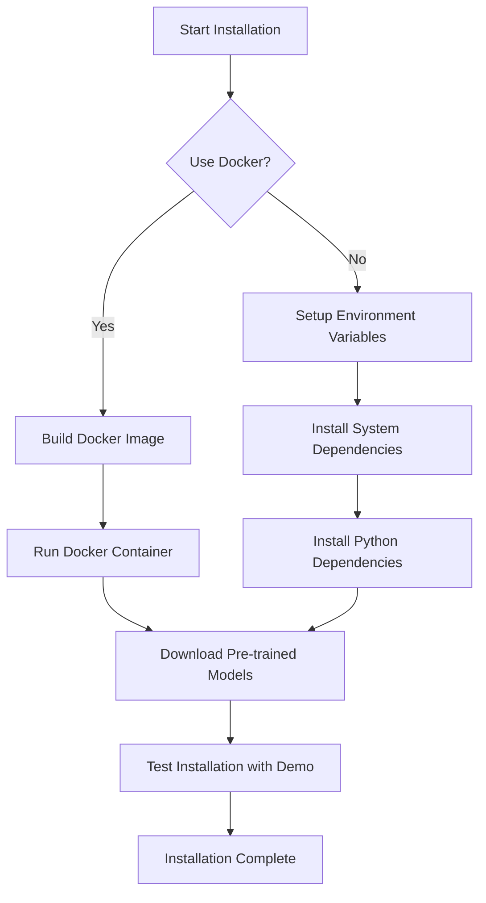

Sources: [TUTORIAL.md:29-47](), [TUTORIAL.md:199-209](), [Dockerfile:1-31]()

## 3. Downloading Pre-trained Models

FastPhotoStyle requires pre-trained models for the PhotoWCT module. These models can be downloaded using the provided scripts.

### 3.1 Using the Download Script

The repository includes a script for downloading the pre-trained models:

```bash
./download_models.sh
```

This script:
1. Runs `download_models.py` to fetch the models from Google Drive
2. Unzips the downloaded file (`models.zip`)

### 3.2 Manual Download (Alternative)

If the script doesn't work, you can manually download the models from the Google Drive link with ID: `1ENgQm9TgabE1R99zhNf5q6meBvX6WFuq`

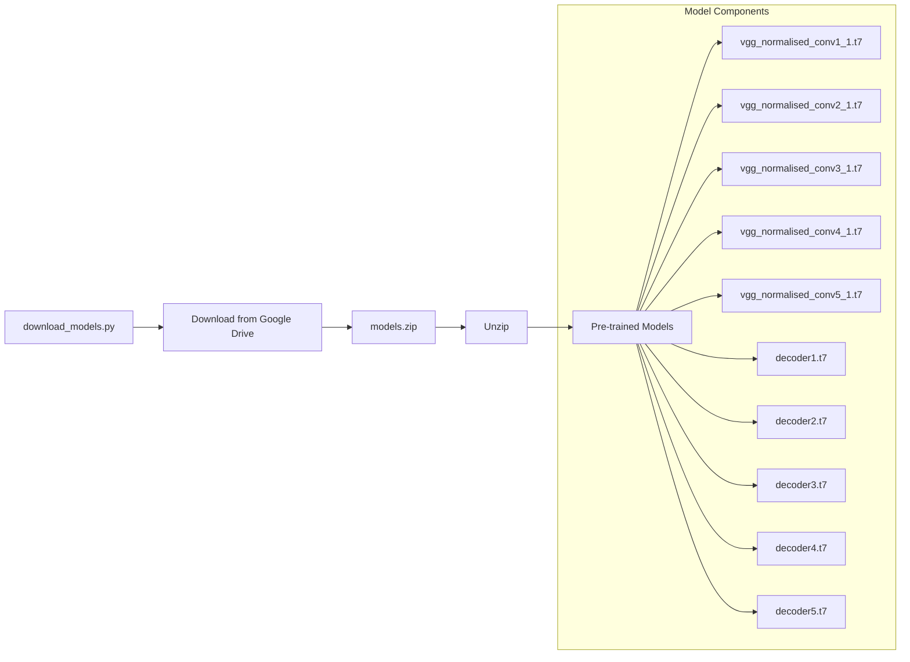

Sources: [download_models.py:1-35](), [download_models.sh:1-4]()

## 4. Verifying Installation

To ensure your installation is working correctly, run one of the demo examples provided in the repository.

### 4.1 Basic Demo

Run the basic demo without segmentation:

```bash
./demo_example1.sh
```

This will:
1. Create necessary directories
2. Download example content and style images
3. Resize the images to appropriate dimensions
4. Run the style transfer algorithm
5. Output the stylized image to the results folder

### 4.2 Fast Mode Demo

To run the faster approximation of the algorithm:

```bash
./demo_example1_fast.sh
```

Sources: [TUTORIAL.md:57-94]()

## 5. Installation Dependencies Graph

The following diagram shows the key components and dependencies of the FastPhotoStyle system:

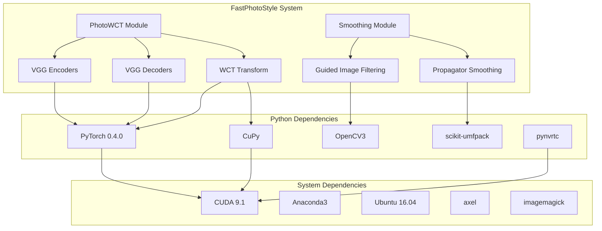

Sources: [TUTORIAL.md:29-47](), [Dockerfile:1-31]()

## 6. Troubleshooting

### 6.1 Common Installation Issues

| Issue | Potential Cause | Solution |
|-------|-----------------|----------|
| CUDA version mismatch | Incompatible CUDA version | Install CUDA 9.1 specifically |
| PyTorch import errors | Incorrect PyTorch version | Ensure you have PyTorch 0.4.0 |
| Missing model files | Failed download | Download models manually and place in the models directory |
| GPU not detected | CUDA path issues | Check environment variables and ensure NVIDIA drivers are installed |
| OpenCV import errors | Missing dependencies | Install OpenCV3 with `conda install -c menpo opencv3` |

### 6.2 GPU Memory Requirements

For optimal performance, FastPhotoStyle requires a GPU with sufficient memory:

| Image Size | Minimum GPU Memory |
|------------|-------------------|
| 256x256 | 2 GB |
| 512x512 | 4 GB |
| 1024x1024 | 8 GB |
| 2048x2048 | 12+ GB |

For high-resolution images, you may need to resize them to fit within your GPU's memory constraints.

Sources: [TUTORIAL.md:31]()

## 7. Next Steps

After successful installation, you can proceed to learn about usage patterns. See [Usage Guide](#4) for more information on using FastPhotoStyle in different scenarios, including:

- Basic usage without segmentation
- Using the fast approximation mode
- Using segmentation for region-aware style transfer

Sources: [TUTORIAL.md:49-197]()

---

# Page: Core Algorithm

# Core Algorithm

<details>
<summary>Relevant source files</summary>

The following files were used as context for generating this wiki page:

- [README.md](README.md)
- [TUTORIAL.md](TUTORIAL.md)
- [demo_with_segmentation.gif](demo_with_segmentation.gif)
- [photo_smooth.py](photo_smooth.py)
- [photo_wct.py](photo_wct.py)

</details>


This document explains the core algorithm of FastPhotoStyle, a photorealistic image stylization system based on a closed-form solution. The algorithm consists of two primary steps: PhotoWCT (Photorealistic Whitening and Coloring Transform) for style transfer and Photorealistic Smoothing for ensuring natural-looking results. For installation and setup instructions, see [Installation and Setup](#2), and for detailed deep dives into each algorithm component, see [PhotoWCT Implementation](#3.1) and [Smoothing Techniques](#3.2).

## Overview

FastPhotoStyle's algorithm transfers the style of a reference photo to a content photo while maintaining photorealism. The approach divides the stylization process into two distinct steps:

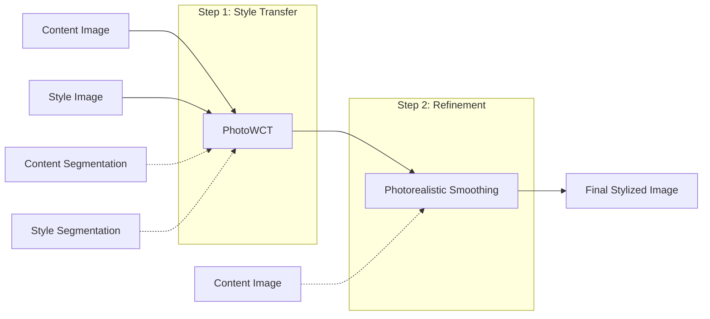

**Two-Step Process:**
1. **PhotoWCT**: Applies a whitening and coloring transform to deep features extracted from content and style images, generating an initial stylized image with possible distortions.
2. **Photorealistic Smoothing**: Suppresses distortions in the stylized image using an image smoothing filter while preserving the content image structure.

Sources: [photo_wct.py](), [photo_smooth.py](), [TUTORIAL.md:23-27]()

## PhotoWCT: Whitening and Coloring Transform

The PhotoWCT module implements a neural approach to style transfer using a series of VGG encoders and decoders coupled with a specialized whitening and coloring transform.

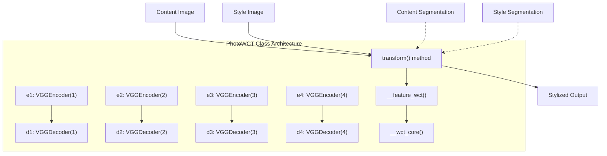

### Core Components
- **VGG Encoder-Decoder Architecture**: Multi-level feature extraction and reconstruction at 4 different scales
- **Feature Transform Process**: Applies WCT at each feature level, progressively transforming the style

### Transformation Process
The `transform` method in the PhotoWCT class orchestrates the style transfer by:
1. Processing content and style images through encoders to extract feature maps
2. Applying WCT to transform content features using style statistics
3. Reconstructing the image using decoders

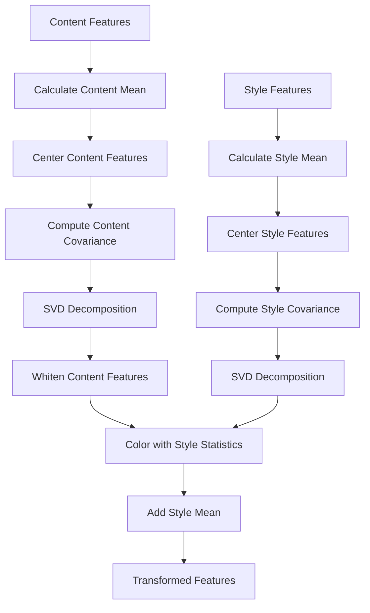

### WCT Core Operation
The heart of the style transformation is the `__wct_core` function which:
1. Centers the content features by subtracting the mean
2. Performs SVD (Singular Value Decomposition) on content feature covariance
3. Whitens the content features
4. Performs SVD on style feature covariance
5. Colors the whitened content features with style statistics
6. Adds back the style mean to the transformed features

This process transforms the content feature distribution to match the style's statistical properties.

### Region-Aware Style Transfer
When segmentation maps are provided, PhotoWCT performs region-aware style transfer by:
1. Resizing segmentation maps to match feature map dimensions
2. Identifying corresponding regions in content and style images
3. Applying WCT separately to each semantic region
4. Combining transformed features from different regions

Sources: [photo_wct.py:13-171]()

## Photorealistic Smoothing

After the initial style transfer, the smoothing step ensures the result maintains photorealism by filtering out possible distortions while preserving the content structure.

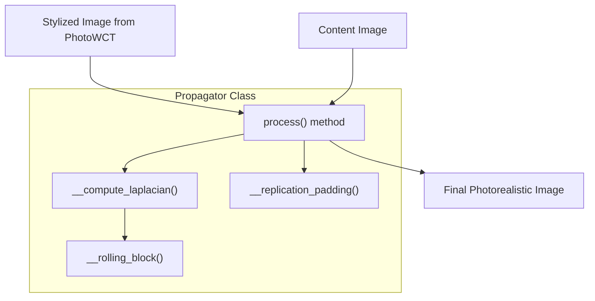

### Smoothing Algorithm
The `Propagator` class implements a sophisticated smoothing process that:
1. Pads both the initial stylized image and content image
2. Computes a matting Laplacian based on the content image
3. Solves a large sparse linear system: (I - βS)V = (1-β)B
   - Where I is identity matrix
   - S is normalized Laplacian
   - B is the initial stylized image
   - β is the smoothing parameter (default 0.9999)
4. Removes padding and returns the final smoothed image

### Matting Laplacian
The key component is the matting Laplacian computation which:
1. Creates local windows around each pixel
2. Computes color statistics within each window
3. Builds a sparse Laplacian matrix that encodes color affinities
4. Ensures that pixels with similar colors in the content image maintain similar transformations

This approach preserves the content image's structure while allowing style transfer, preventing distortions and maintaining photorealistic appearance.

Sources: [photo_smooth.py:15-99]()

## Algorithm Integration and Workflow

The complete algorithm workflow integrates both components into a seamless stylization pipeline:

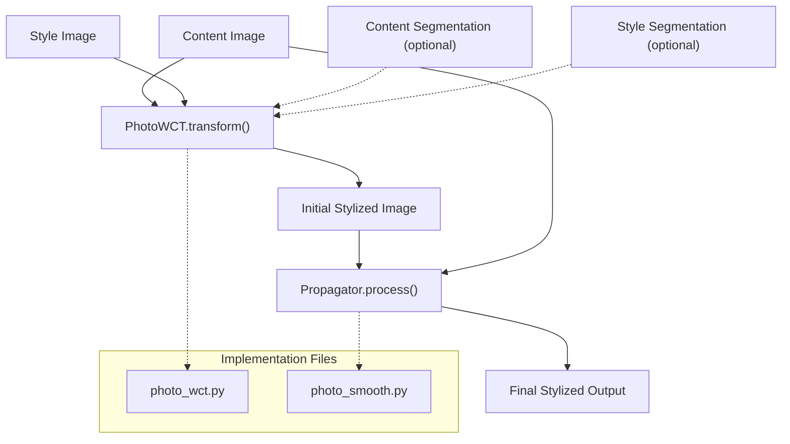

### Execution Flow
1. **Input Processing**:
   - Load content and style images
   - Optionally load or generate segmentation maps

2. **Style Transfer (PhotoWCT)**:
   - Extract multi-level features from both images
   - Apply WCT transforms at each feature level
   - Generate initial stylized image with potential distortions

3. **Refinement (Photorealistic Smoothing)**:
   - Compute matting Laplacian from content image
   - Set up sparse linear system
   - Solve for smoothed image that maintains content structure

4. **Output Generation**:
   - Post-process and return the final photorealistic stylized image

### Performance Considerations
- The smoothing step is computationally intensive, involving large sparse matrix operations
- The system offers a fast approximation mode using guided filtering
- The quality-performance tradeoff can be controlled through the smoothing parameter β

Sources: [TUTORIAL.md:23-93](), [photo_wct.py](), [photo_smooth.py]()

## Algorithm Properties and Extensions

The FastPhotoStyle core algorithm has several important properties that make it effective for photorealistic style transfer:

1. **Content Structure Preservation**: The smoothing step ensures that the structure of the content image is preserved, preventing distortions that would make the result look unrealistic.

2. **Style Statistics Transfer**: The WCT effectively transfers the style's color and texture statistics while maintaining the content's structure.

3. **Region-Aware Processing**: With segmentation maps, the algorithm can transfer style between corresponding semantic regions, avoiding inappropriate transfers across different content types.

4. **Multi-Scale Processing**: The four-level VGG architecture enables style transfer at multiple scales, capturing both fine details and broader styling patterns.

5. **Closed-Form Solution**: Unlike iterative optimization methods, this approach provides a direct solution that is computationally more efficient.

The algorithm can be extended or modified in several ways:
- Adjusting the smoothing parameter β to control the balance between style transfer and structure preservation
- Using different feature extraction networks beyond VGG
- Implementing automatic segmentation to avoid manual mask creation
- Applying the approach to video stylization with temporal constraints

Sources: [photo_wct.py](), [photo_smooth.py](), [TUTORIAL.md]()

---

# Page: PhotoWCT Implementation

# PhotoWCT Implementation

<details>
<summary>Relevant source files</summary>

The following files were used as context for generating this wiki page:

- [models.py](models.py)
- [photo_wct.py](photo_wct.py)

</details>


## Purpose and Scope

This document provides a detailed explanation of the Photorealistic Whitening and Coloring Transform (PhotoWCT) implementation in the FastPhotoStyle codebase. PhotoWCT represents the first step in the two-stage photorealistic style transfer algorithm, responsible for transferring the style characteristics from a style image to a content image. For information about the subsequent smoothing techniques used to ensure photorealism, see [Smoothing Techniques](#3.2).

Sources: [photo_wct.py:13-171]()

## Algorithm Overview

PhotoWCT extends the Whitening and Coloring Transform (WCT) method to achieve photorealistic style transfer. It operates on deep features extracted from both content and style images, transforming the content features to match the statistical properties of the style features while preserving spatial structures.

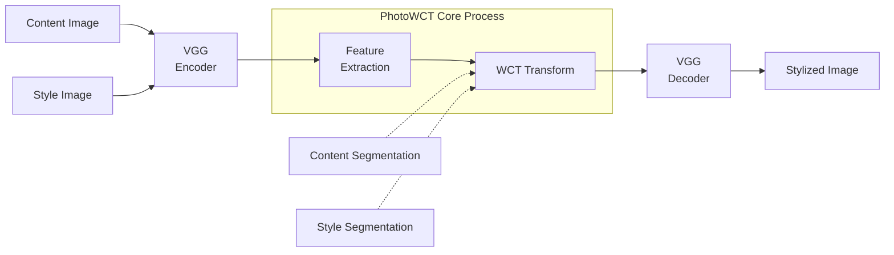

Sources: [photo_wct.py:25-54](), [photo_wct.py:70-120]()

### Mathematical Foundation

The core of PhotoWCT is the Whitening and Coloring Transform algorithm which consists of three key operations:

1. **Whitening**: Removes the style information from content features
2. **Coloring**: Transfers the style statistics to the whitened content features
3. **Reconstruction**: Rebuilds the image from transformed features

The transformation uses Singular Value Decomposition (SVD) to manipulate the covariance matrices of the content and style features.

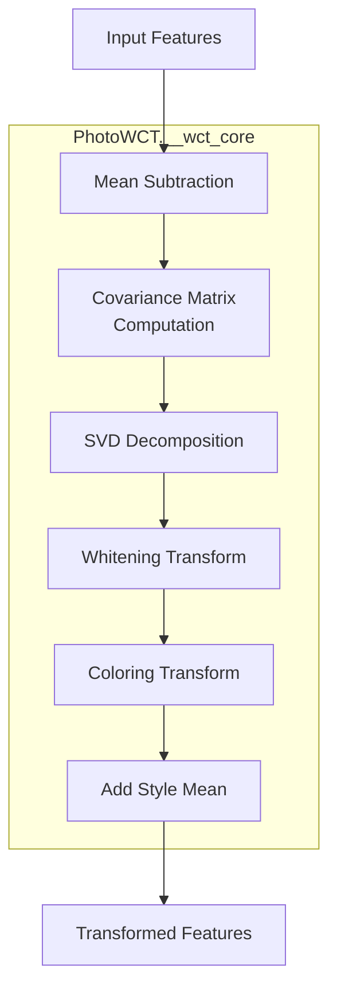

Sources: [photo_wct.py:122-164]()

## Multi-level VGG Architecture

PhotoWCT employs a multi-level encoder-decoder architecture based on the VGG network. It processes features at four different levels, applying the WCT transformation at each level to capture style information at different scales and semantic levels.

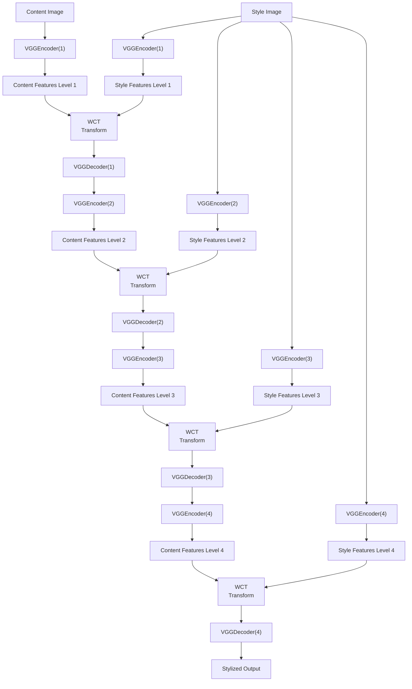

Sources: [photo_wct.py:13-24](), [photo_wct.py:25-54](), [models.py:8-188](), [models.py:190-297]()

## Implementation Details

### Class Structure

The PhotoWCT implementation is organized into three main classes:

| Class | File | Purpose |
|-------|------|---------|
| `PhotoWCT` | photo_wct.py | Main class that implements the style transfer algorithm |
| `VGGEncoder` | models.py | Extracts multi-level features from images |
| `VGGDecoder` | models.py | Reconstructs images from transformed features |

Sources: [photo_wct.py:13-24](), [models.py:8-189](), [models.py:190-297]()

### PhotoWCT Class

The `PhotoWCT` class initializes a four-level encoder-decoder architecture and provides methods for style transfer:

```mermaid
classDiagram
    class PhotoWCT {
        +e1: VGGEncoder(1)
        +d1: VGGDecoder(1)
        +e2: VGGEncoder(2)
        +d2: VGGDecoder(2)
        +e3: VGGEncoder(3)
        +d3: VGGDecoder(3)
        +e4: VGGEncoder(4)
        +d4: VGGDecoder(4)
        +transform(cont_img, styl_img, cont_seg, styl_seg)
        -__compute_label_info(cont_seg, styl_seg)
        -__feature_wct(cont_feat, styl_feat, cont_seg, styl_seg)
        -__wct_core(cont_feat, styl_feat)
    }
```

Sources: [photo_wct.py:13-24]()

### Transform Method

The `transform` method is the main entry point for style transfer:

1. Processes segmentation information if provided
2. Extracts features from style image at all levels
3. Processes content image through each encoder level
4. Applies WCT transformation at each level
5. Reconstructs the image through corresponding decoders
6. Returns the final stylized image

Sources: [photo_wct.py:25-54]()

### Feature WCT

The `__feature_wct` method handles the transformation of content features using style features:

1. Reshapes content and style features for processing
2. If no segmentation is provided, applies WCT to the entire feature maps
3. If segmentation is provided, applies region-specific WCT based on segmentation labels
4. Reshapes the result back to the original feature dimensions

Sources: [photo_wct.py:70-120]()

### WCT Core Algorithm

The `__wct_core` method implements the mathematical core of the WCT algorithm:

1. Computes the mean of content features and centers them
2. Computes the covariance matrix of content features
3. Performs SVD decomposition of the content covariance matrix
4. Determines the effective rank of the content feature space
5. Performs similar operations on style features
6. Applies whitening transform to content features
7. Applies coloring transform using style statistics
8. Adds back the style mean

Sources: [photo_wct.py:122-164]()

## Segmentation-guided Stylization

PhotoWCT supports region-specific style transfer through segmentation maps:

```mermaid
flowchart LR
    A["Content Image"] --> C["PhotoWCT"]
    B["Style Image"] --> C
    D["Content Segmentation"] --> E["__compute_label_info"]
    F["Style Segmentation"] --> E
    E --> G["Label Information"]
    G --> H["__feature_wct"]
    C --> I["Region-aware\nStyle Transfer"]
    
    subgraph "__feature_wct"
        H
        J["Region Masking"] --> K["Per-region WCT"]
        K --> L["Feature Recombination"]
    end
```

Sources: [photo_wct.py:56-68](), [photo_wct.py:79-116]()

### Label Processing

The `__compute_label_info` method:

1. Extracts unique semantic labels from the content segmentation
2. Validates each label by checking if it has sufficient area in both content and style images
3. Creates an indicator array to track valid labels for transformation

Sources: [photo_wct.py:56-68]()

### Region-specific Transformation

For segmentation-guided style transfer:

1. Segmentation maps are resized to match feature dimensions
2. For each semantic label, corresponding regions are extracted from content and style features
3. WCT is applied separately to each region
4. Transformed regions are recombined into the final feature map

This approach allows for more controlled style transfer that respects semantic boundaries.

Sources: [photo_wct.py:79-116]()

## VGG Encoder-Decoder Architecture

### VGGEncoder

The `VGGEncoder` class implements a partial VGG network for feature extraction:

1. Takes a level parameter (1-4) to determine the network depth
2. Each level adds more convolutional layers and captures higher-level features
3. Returns extracted features and pooling indices for the corresponding decoder

Sources: [models.py:8-187]()

### VGGDecoder

The `VGGDecoder` class mirrors the encoder architecture for image reconstruction:

1. Takes a level parameter (1-4) matching the encoder
2. Uses unpooling with saved indices to preserve spatial information
3. Reconstructs the image through a series of convolution and ReLU layers

Sources: [models.py:190-297]()

## Integration with FastPhotoStyle

PhotoWCT serves as the first step in the FastPhotoStyle pipeline:

1. PhotoWCT produces an initial stylized image with transferred style characteristics
2. This output is then passed to the smoothing module to ensure photorealism
3. The final result preserves the content structure while adopting the style appearance

PhotoWCT can be used with or without segmentation guidance, providing flexibility for different stylization needs.

Sources: [photo_wct.py:13-171]()

---

# Page: Smoothing Techniques

# Smoothing Techniques

<details>
<summary>Relevant source files</summary>

The following files were used as context for generating this wiki page:

- [photo_smooth.py](photo_smooth.py)
- [smooth_filter.py](smooth_filter.py)

</details>


This page provides detailed documentation on the smoothing techniques used in FastPhotoStyle. Smoothing is the second critical step in the photorealistic style transfer process, following the PhotoWCT transformation (see [PhotoWCT Implementation](#3.1)). While the PhotoWCT step transfers style characteristics, the smoothing step ensures the output maintains photorealism by preserving the structure of the content image.

## 1. Overview of Smoothing in FastPhotoStyle

FastPhotoStyle offers two distinct smoothing techniques:

1. **Standard Smoothing**: A high-quality approach that uses a sparse linear system solver
2. **Fast Smoothing**: An optimized GPU-accelerated approach using local affine transformations

```mermaid
flowchart TD
    A["Initial Stylized Image"] --> B{"Smoothing Method"}
    B -->|"Standard (-no_post option)"| C["Propagator Class"]
    B -->|"Fast (--fast option)"| D["smooth_filter Function"]
    
    C --> E["Sparse Linear System Solver"]
    D --> F["GPU-Accelerated Local Affine"]
    
    E --> G["Final Photorealistic Image"]
    F --> G
    
    H["Content Image"] --> C
    H --> D
    
    subgraph "photo_smooth.py"
    C
    E
    end
    
    subgraph "smooth_filter.py"
    D
    F
    end
```

Sources: [photo_smooth.py:15-62](), [smooth_filter.py:380-405]()

## 2. Purpose of Smoothing

Smoothing serves to eliminate artifacts introduced during style transfer while preserving the underlying structure of the content image. It's essential for photorealism because:

1. It preserves important edges from the content image
2. It removes distortions in flat or smooth regions
3. It enhances visual coherence between regions
4. It maintains the natural appearance of the content image

## 3. Standard Smoothing (Propagator)

The standard smoothing technique uses a mathematical approach based on matting Laplacian and sparse linear system solving.

### 3.1 Implementation Overview

```mermaid
flowchart LR
    A["Input Images"] --> B["Replication Padding"]
    B --> C["Compute Laplacian Matrix"]
    C --> D["Construct Linear System"]
    D --> E["Solve for Each Color Channel"]
    E --> F["Crop & Format Result"]
    
    subgraph "Propagator Components"
        G["__compute_laplacian()"] -.-> C
        H["__replication_padding()"] -.-> B
        I["scipy.sparse.linalg.factorized"] -.-> E
    end
```

Sources: [photo_smooth.py:15-62]()

### 3.2 Core Algorithm

The standard smoothing technique involves solving the linear system:

```
(I - β·S)V = (1-β)B
```

Where:
- `I` is the identity matrix
- `S` is a normalized Laplacian matrix derived from content image
- `β` is a parameter close to 1 (default 0.9999)
- `B` is the input stylized image
- `V` is the output smoothed image

The implementation uses the `scipy.sparse` module to efficiently handle the large sparse matrices involved in the computation.

```python
# Core algorithm steps (simplified)
W = self.__compute_laplacian(content)  # Compute Laplacian from content image
S = D.dot(W).dot(D)                    # Normalize Laplacian
A = scipy.sparse.identity(w1*h1) - self.beta*S  # Construct linear system
solver = scipy.sparse.linalg.factorized(A)      # Create solver
V = solver(B)                          # Solve for each color channel
```

Sources: [photo_smooth.py:43-59]()

### 3.3 Laplacian Computation

The `__compute_laplacian` method creates a sparse matting Laplacian matrix based on local pixel neighborhoods. This is a key component that allows the smoothing to preserve important edges from the content image.

```python
# For each window in the image:
#   1. Compute local color covariance
#   2. Calculate affinity between pixels
#   3. Build sparse Laplacian matrix
```

Sources: [photo_smooth.py:68-87]()

## 4. Fast Smoothing (GIF Smoothing)

The fast smoothing technique uses GPU-accelerated local affine transformations to achieve similar results with better performance.

### 4.1 Implementation Overview

```mermaid
flowchart TB
    A["Initial Stylized Image"] --> B["Reshape & Convert to CUDA Tensors"]
    C["Content Image"] --> B
    B --> D["Compute Local Affine Models"]
    D --> E["Bilateral Smooth Models"]
    E --> F["Reconstruct Final Image"]
    
    subgraph "CUDA Kernels"
        G["best_local_affine_kernel"] -.-> D
        H["bilateral_smooth_kernel"] -.-> E
        I["reconstruction_best_kernel"] -.-> F
    end
```

Sources: [smooth_filter.py:332-377](), [smooth_filter.py:380-405]()

### 4.2 Core Algorithm

The fast smoothing technique consists of three main steps, all accelerated using CUDA kernels:

1. **Local Affine Computation**: For each pixel, compute an optimal local affine transformation that maps the content image to the stylized image
2. **Affine Model Smoothing**: Apply bilateral filtering to smooth the affine models while preserving edges from the content image
3. **Image Reconstruction**: Apply the smoothed affine models to the content image to create the final output

```python
# Core algorithm steps (simplified)
# 1. Compute local affine models
_best_local_affine_kernel(output_, input_, affine_model, ...)

# 2. Smooth the affine models
_bilateral_smooth_kernel(affine_model, filtered_affine_model, input_, ...)

# 3. Reconstruct the output image
_reconstruction_best_kernel(input_, filtered_affine_model, filtered_best_output, ...)
```

Sources: [smooth_filter.py:357-375]()

### 4.3 Bilateral Smoothing Parameters

The bilateral smoothing uses two key parameters:

1. `f_radius`: Filter radius (default 15) controlling the spatial extent of the filter
2. `f_edge`: Edge preservation parameter (default 0.1) controlling sensitivity to edges

These parameters can be tuned to balance smoothness and detail preservation.

Sources: [smooth_filter.py:380-405]()

## 5. Comparison of Smoothing Techniques

| Feature | Standard Smoothing (Propagator) | Fast Smoothing (GIF) |
|---------|--------------------------------|----------------------|
| Implementation | `Propagator` class in `photo_smooth.py` | `smooth_filter` function in `smooth_filter.py` |
| Performance | Slower (CPU-based) | Faster (GPU-accelerated) |
| Quality | Highest quality, preserves fine details | Good quality, may lose some subtle details |
| Memory Usage | Higher for large images | More efficient |
| Parameters | Single parameter (`beta`) | Two parameters (`f_radius`, `f_edge`) |
| Backend | SciPy sparse solvers | CUDA kernels |
| CLI Flag | `--no_post` for PhotoWCT only (no smoothing) | `--fast` for using fast smoothing |

## 6. Integration with FastPhotoStyle

```mermaid
flowchart LR
    A["Content Image"] --> B["PhotoWCT Module"]
    C["Style Image"] --> B
    B --> D["Initial Stylized Output"]
    D --> E{"Smoothing Type"}
    
    E -->|"None (--no_post)"| H["Final Output (Non-photorealistic)"]
    
    E -->|"Standard"| F["Propagator.process()"]
    E -->|"Fast (--fast)"| G["smooth_filter()"]
    
    F --> H["Final Output"]
    G --> H
    
    I["Content Image"] --> F
    I --> G
    
    subgraph "Command Line Options"
        J["--no_post: Skip smoothing"]
        K["--fast: Use fast smoothing"]
    end
```

Sources: [photo_smooth.py:20-62](), [smooth_filter.py:380-405]()

## 7. Technical Implementation Details

### 7.1 Standard Smoothing Implementation

The `Propagator` class implements standard smoothing through these key methods:

- `process()`: Main method that performs the smoothing
- `__compute_laplacian()`: Computes the matting Laplacian matrix
- `__replication_padding()`: Adds padding to the image borders
- `__rolling_block()`: Utility for computing windows in the image

The implementation uses SciPy's sparse matrix operations for efficiency:

```python
# Core solver step
A = scipy.sparse.identity(w1*h1) - self.beta*S
solver = scipy.sparse.linalg.factorized(A)
V = np.zeros((h1*w1,k))
V[:,0] = solver(B[:,0])  # Red channel
V[:,1] = solver(B[:,1])  # Green channel
V[:,2] = solver(B[:,2])  # Blue channel
```

Sources: [photo_smooth.py:20-62](), [photo_smooth.py:43-59]()

### 7.2 Fast Smoothing Implementation

The fast smoothing is implemented through:

1. `smooth_filter()`: Main function that orchestrates the process
2. `smooth_local_affine()`: Function that calls the CUDA kernels
3. Three CUDA kernels compiled at runtime:
   - `best_local_affine_kernel`: Computes affine models
   - `bilateral_smooth_kernel`: Smooths affine models
   - `reconstruction_best_kernel`: Reconstructs the final image

The CUDA implementation enables significant performance improvements.

Sources: [smooth_filter.py:332-377](), [smooth_filter.py:149-321]()

## 8. Best Practices and Usage Tips

1. **For highest quality**: Use standard smoothing (default option)
2. **For faster processing**: Use fast smoothing (`--fast` option)
3. **For comparison with raw PhotoWCT**: Use the `--no_post` option to skip smoothing
4. **For large images**: Fast smoothing is recommended due to memory constraints
5. **Parameter tuning**:
   - Standard smoothing: Higher `beta` values (closer to 1) increase smoothness
   - Fast smoothing: Larger `f_radius` values increase smoothness, smaller `f_edge` values preserve more edges

---

# Page: Usage Guide

# Usage Guide

<details>
<summary>Relevant source files</summary>

The following files were used as context for generating this wiki page:

- [TUTORIAL.md](TUTORIAL.md)
- [demo.py](demo.py)
- [demo_with_segmentation.gif](demo_with_segmentation.gif)

</details>


## Purpose and Scope

This document provides a comprehensive guide on how to use the FastPhotoStyle system for photorealistic image stylization. It covers basic and advanced usage scenarios, command-line interface options, and practical examples. For information about the underlying algorithm and technical details, see [Core Algorithm](#3).

## Command Line Interface

FastPhotoStyle provides a command-line interface through `demo.py` with various options to control the stylization process.

```mermaid
flowchart LR
    A["User Input"] --> B["demo.py"]
    B --> C{"Fast Mode?"}
    C -->|Yes| D["GIFSmoothing"]
    C -->|No| E["Propagator"]
    D --> F["PhotoWCT Module"]
    E --> F
    F --> G["Stylized Output"]
```

### Main Parameters

| Parameter | Description | Default Value |
|-----------|-------------|---------------|
| `--model` | Path to the PhotoWCT model | `./PhotoWCTModels/photo_wct.pth` |
| `--content_image_path` | Path to the content image | `./images/content1.png` |
| `--style_image_path` | Path to the style image | `./images/style1.png` |
| `--output_image_path` | Path to save the output image | `./results/example1.png` |
| `--content_seg_path` | Path to content segmentation mask | `[]` (empty) |
| `--style_seg_path` | Path to style segmentation mask | `[]` (empty) |
| `--fast` | Enable fast mode using guided filtering | `False` |
| `--no_post` | Skip post-processing step | `False` |
| `--save_intermediate` | Save intermediate results | `False` |
| `--cuda` | Enable CUDA acceleration | `1` (enabled) |

Sources: [demo.py:11-22]()

## Basic Usage

### Standard Mode

The standard mode provides the highest quality results but takes longer to process due to the comprehensive smoothing step.

```bash
python demo.py --content_image_path ./images/content.png --style_image_path ./images/style.png --output_image_path ./results/output.png
```

This command will:
1. Load the content and style images
2. Apply the PhotoWCT transformation
3. Perform photorealistic smoothing using the Propagator
4. Save the final output to the specified path

Sources: [demo.py:32-33](), [TUTORIAL.md:68-76]()

### Fast Mode

For quicker results, the fast mode uses guided image filtering instead of the more computationally intensive propagation-based smoothing.

```bash
python demo.py --fast --content_image_path ./images/content.png --style_image_path ./images/style.png --output_image_path ./results/output_fast.png
```

The fast mode significantly reduces processing time with only a minor impact on quality.

```mermaid
flowchart TB
    A["Content Image"] --> C["PhotoWCT Module"]
    B["Style Image"] --> C
    C --> D{"Fast Mode?"}
    D -->|Yes| E["GIFSmoothing\n(photo_gif.py)"]
    D -->|No| F["Propagator\n(photo_smooth.py)"]
    E --> G["Final Output"]
    F --> G
    subgraph "Processing Time Comparison"
    E -.- |"~0.04s"| H["Fast"]
    F -.- |"~13s"| I["Standard"]
    end
```

Sources: [demo.py:28-30](), [TUTORIAL.md:83-93]()

### Without Post-Processing

To skip the post-processing smoothing step entirely:

```bash
python demo.py --no_post --content_image_path ./images/content.png --style_image_path ./images/style.png --output_image_path ./results/output_no_post.png
```

This will output the direct result from the PhotoWCT transformation, which may contain visible distortions but can be useful for debugging or when quick results are needed.

Sources: [demo.py:47]()

## Advanced Usage with Segmentation

FastPhotoStyle supports region-aware style transfer using segmentation masks. This produces better results by ensuring that semantically similar regions (e.g., sky to sky, building to building) are matched during stylization.

### Using Manual Segmentation

To use manually created segmentation masks:

```bash
python demo.py --content_image_path ./images/content.png \
               --style_image_path ./images/style.png \
               --content_seg_path ./images/content_seg.png \
               --style_seg_path ./images/style_seg.png \
               --output_image_path ./results/output_seg.png
```

The segmentation masks should be single-channel images with integer labels starting from 0. Corresponding regions in content and style images should have the same label.

```mermaid
flowchart TD
    A["Content Image"] --> E["PhotoWCT Module"]
    B["Style Image"] --> E
    C["Content Segmentation"] --> E
    D["Style Segmentation"] --> E
    E --> F["Stylization with\nRegion Matching"]
    F --> G["Smoothing Module"]
    G --> H["Final Output"]
```

Sources: [TUTORIAL.md:97-131]()

### Using Automatic Segmentation

FastPhotoStyle can work with the ADE20K semantic segmentation network to automatically generate segmentation masks:

```bash
python demo_with_ade20k_ssn.py --output_visualization
```

For faster processing, add the `--fast` flag:

```bash
python demo_with_ade20k_ssn.py --fast --output_visualization
```

This will:
1. Generate segmentation masks for both content and style images
2. Use these masks to guide the style transfer process
3. Apply smoothing (either standard or fast mode)
4. Save the final output and visualization of the segmentation masks

Sources: [TUTORIAL.md:134-196]()

## Performance Considerations

### Processing Time Comparison

The processing time is primarily determined by the smoothing method:

| Mode | Smoothing Module | Typical Processing Time |
|------|------------------|-------------------------|
| Standard | Propagator | ~13 seconds |
| Fast | GIFSmoothing | ~0.04 seconds |
| No Post | None | ~0.2 seconds (only PhotoWCT) |

### Hardware Requirements

- For optimal performance, an NVIDIA GPU is recommended
- When using CUDA (default), the model and processing is run on the GPU
- To disable CUDA and run on CPU, use `--cuda 0`

Sources: [TUTORIAL.md:29-47]()

## Docker Usage

FastPhotoStyle can be run in a Docker container to ensure consistent environment setup:

1. Build the Docker image:
```bash
docker build -t fastphotostyle:v1.0 .
```

2. Run an interactive session:
```bash
docker run -v /path/on/host:/path/in/container --runtime=nvidia -i -t fastphotostyle:v1.0 /bin/bash
```

3. Navigate to the mounted directory and run the demo:
```bash
cd /path/in/container
./demo_example1.sh
```

Sources: [TUTORIAL.md:199-209]()

## Data Flow Diagram

```mermaid
flowchart TD
    A["User Input"] --> B["Parameters\n(content, style, segmentation)"]
    B --> C["demo.py"]
    C --> D["process_stylization.stylization()"]
    D --> E["PhotoWCT Module"]
    E --> F["Smoothing Module\n(Propagator or GIFSmoothing)"]
    F --> G["Output Image"]
    
    subgraph "Code Components"
        C
        D
        E["p_wct (photo_wct.py)"]
        F["p_pro (photo_smooth.py or photo_gif.py)"]
    end
```

Sources: [demo.py:24-48]()

---

# Page: Basic Usage

# Basic Usage

<details>
<summary>Relevant source files</summary>

The following files were used as context for generating this wiki page:

- [TUTORIAL.md](TUTORIAL.md)
- [demo.py](demo.py)
- [demo_example1.sh](demo_example1.sh)
- [demo_with_segmentation.gif](demo_with_segmentation.gif)

</details>


This page explains how to use FastPhotoStyle for transferring the style of one photo to another while maintaining photorealism, without using segmentation masks. For advanced usage with segmentation masks, see [Using Segmentation](#4.3). For faster processing with approximation techniques, see [Fast Mode](#4.2).

## Overview

FastPhotoStyle provides a simple command-line interface for basic style transfer operations. The standard workflow involves:

1. Preparing content and style images
2. Running the style transfer with appropriate parameters
3. Viewing the stylized output image

```mermaid
flowchart LR
    A["Content Image"] --> C["demo.py"]
    B["Style Image"] --> C
    C --> D["PhotoWCT Module"]
    D --> E["Smoothing Module"]
    E --> F["Stylized Output Image"]

    subgraph "Basic Workflow"
    C
    D
    E
    end
```

Sources: [demo.py:37-48](), [TUTORIAL.md:57-93]()

## Command-Line Interface

FastPhotoStyle is primarily used through the `demo.py` script, which accepts several command-line arguments:

| Argument | Default | Description |
|----------|---------|-------------|
| `--model` | ./PhotoWCTModels/photo_wct.pth | Path to the pre-trained model |
| `--content_image_path` | ./images/content1.png | Path to the content image |
| `--style_image_path` | ./images/style1.png | Path to the style image |
| `--output_image_path` | ./results/example1.png | Path for the output stylized image |
| `--fast` | False | Enable fast approximation mode |
| `--no_post` | False | Skip post-processing (smoothing) step |
| `--cuda` | 1 | Enable CUDA acceleration (1=enable, 0=disable) |
| `--save_intermediate` | False | Save intermediate results |

Sources: [demo.py:10-22]()

## Standard Usage Flow

The standard usage process follows these steps:

```mermaid
sequenceDiagram
    participant User
    participant Demo as "demo.py"
    participant PWCT as "PhotoWCT"
    participant Prop as "Propagator"
    
    User->>Demo: Run with content and style images
    Demo->>PWCT: Load model
    Demo->>Prop: Initialize smoothing
    Demo->>PWCT: Apply style transfer
    PWCT-->>Demo: Return stylized image
    Demo->>Prop: Apply smoothing for photorealism
    Prop-->>Demo: Return final image
    Demo->>User: Save output image
```

Sources: [demo.py:24-48](), [TUTORIAL.md:57-76]()

### Step 1: Prepare Images

For optimal results:

1. Select a content image (the photo you want to stylize)
2. Select a style image (the photo whose style you want to transfer)
3. Resize images if they are too large (recommended for faster processing)

Example using ImageMagick for resizing:
```
convert -resize 25% content.png content.png
convert -resize 50% style.png style.png
```

Sources: [TUTORIAL.md:64-66](), [demo_example1.sh:8-9]()

### Step 2: Run Style Transfer

Basic command for running the style transfer:

```
python demo.py --content_image_path PATH_TO_CONTENT_IMAGE --style_image_path PATH_TO_STYLE_IMAGE --output_image_path PATH_TO_OUTPUT_IMAGE
```

For example:

```
python demo.py --content_image_path ./images/content1.png --style_image_path ./images/style1.png --output_image_path ./results/example1.png
```

Sources: [demo.py:10-22](), [TUTORIAL.md:68]()

## Processing Details

The basic style transfer operation consists of two main steps:

1. **PhotoWCT (Whitening and Coloring Transform)**: Applies style transfer using VGG-based neural networks
2. **Photorealistic Smoothing**: Refines the output to ensure the result looks natural and photorealistic

```mermaid
graph TD
    A["Input Content Image"] --> C["PhotoWCT"]
    B["Input Style Image"] --> C
    C --> D["Initial Stylized Image"]
    D --> E["Propagator"]
    A --> E
    E --> F["Final Stylized Output"]
    
    subgraph "Step 1: Style Transfer"
    C
    end
    
    subgraph "Step 2: Smoothing"
    E
    end
```

Sources: [TUTORIAL.md:23-27](), [demo.py:24-36]()

### Processing Time

The standard workflow typically involves these processing stages with approximate timing:

```
Elapsed time in stylization: ~0.4 seconds
Elapsed time in propagation: ~13.5 seconds
Elapsed time in post processing: ~0.2 seconds
```

Note that the propagation step (photorealistic smoothing) is computationally intensive and takes the most time.

Sources: [TUTORIAL.md:70-76]()

## Common Options

### Skipping Post-Processing

If you want to skip the smoothing step (which might be useful for debugging or comparing results):

```
python demo.py --no_post --content_image_path ./images/content1.png --style_image_path ./images/style1.png --output_image_path ./results/example1_no_post.png
```

This option will preserve the direct output from the PhotoWCT module without applying the photorealistic smoothing.

Sources: [demo.py:20](), [demo.py:47]()

### Using Fast Mode

For quicker results (with slightly lower quality), use the `--fast` flag:

```
python demo.py --fast --content_image_path ./images/content1.png --style_image_path ./images/style1.png --output_image_path ./results/example1_fast.png
```

This uses a guided image filtering algorithm as an approximation of the full propagation step, significantly reducing processing time. See [Fast Mode](#4.2) for more details.

Sources: [demo.py:19](), [demo.py:28-33](), [TUTORIAL.md:83-93]()

## Example Workflow

Complete example workflow for basic usage:

1. Create directories for images and results:
   ```
   mkdir images && mkdir results
   ```

2. Prepare your content and style images in the images folder

3. Run the style transfer:
   ```
   python demo.py --content_image_path ./images/your_content.png --style_image_path ./images/your_style.png --output_image_path ./results/your_output.png
   ```

4. View the stylized result in the specified output path

Sources: [TUTORIAL.md:60-76](), [demo_example1.sh:1-11]()

## Requirements for Basic Usage

For running FastPhotoStyle's basic functionality, you need:

- NVIDIA GPU with CUDA support
- PyTorch 0.4.0
- Python 2.7 or 3.5
- Required Python packages (see [Installation and Setup](#2))

Sources: [TUTORIAL.md:29-47]()

---

# Page: Fast Mode

# Fast Mode

<details>
<summary>Relevant source files</summary>

The following files were used as context for generating this wiki page:

- [TUTORIAL.md](TUTORIAL.md)
- [demo.py](demo.py)
- [demo_example1_fast.sh](demo_example1_fast.sh)
- [demo_with_segmentation.gif](demo_with_segmentation.gif)

</details>


## Overview

Fast Mode is an optimization feature in FastPhotoStyle that significantly accelerates the photorealistic style transfer process by using an alternative approach for the smoothing step of the algorithm. This document covers how Fast Mode works, its implementation, performance benefits, and usage guidelines. For information about the core algorithm, see [Core Algorithm](#3) and for basic usage without Fast Mode, see [Basic Usage](#4.1).

## How Fast Mode Works

In the standard FastPhotoStyle pipeline, the photorealistic smoothing step (second step after PhotoWCT) is the computational bottleneck. Fast Mode addresses this by replacing the standard propagation-based smoothing with a more efficient Guided Image Filtering approach.

```mermaid
flowchart LR
    A["Content Image"] --> B["PhotoWCT"]
    C["Style Image"] --> B
    B --> D{"Fast Mode?"}
    D -->|"Yes"| E["GIFSmoothing\n(Guided Image Filtering)"]
    D -->|"No"| F["Propagator\n(Full Smoothing)"]
    E --> G["Final Stylized Image"]
    F --> G
```

Sources: [demo.py:28-33](), [TUTORIAL.md:83-93]()

### Standard vs. Fast Mode Comparison

The table below highlights the key differences between Standard and Fast Mode:

| Feature | Standard Mode | Fast Mode |
|---------|--------------|-----------|
| Smoothing Implementation | Propagator class | GIFSmoothing class |
| Source File | photo_smooth.py | photo_gif.py |
| Algorithm | Full photorealistic smoothing | Guided image filtering |
| Processing Time | ~10-15 seconds | ~0.04 seconds |
| Quality | Reference quality | Slightly lower but comparable |

Sources: [demo.py:28-33](), [TUTORIAL.md:83-93]()

## Technical Implementation

Fast Mode uses Guided Image Filtering as an approximate solution for the smoothing step. The implementation details are as follows:

```mermaid
classDiagram
    class GIFSmoothing {
        +r: int
        +eps: float
        +__init__(r=35, eps=0.001)
        +process(stylized, content)
    }
    
    class Propagator {
        +process(stylized, content)
    }
    
    GIFSmoothing --|> SmoothingModule
    Propagator --|> SmoothingModule
```

Sources: [demo.py:28-33]()

### Implementation Details

When Fast Mode is enabled, the system:

1. Uses the same PhotoWCT module for the initial style transfer
2. Initializes a `GIFSmoothing` object with parameters `r=35` and `eps=0.001`
3. Uses this object instead of the standard `Propagator` for the smoothing step

The Guided Image Filtering algorithm provides a local linear model for the filtering process, which has a significantly lower computational complexity than the global optimization problem solved by the standard propagation-based method.

Sources: [demo.py:28-33]()

## Performance Benefits

The performance improvement from using Fast Mode is substantial:

```mermaid
graph TD
    subgraph "Performance Comparison"
        A["Processing Time Breakdown"]
        A --- B["Standard Mode"]
        A --- C["Fast Mode"]
        
        B --- D["PhotoWCT: ~0.4s"]
        B --- E["Propagation: ~13.5s"]
        B --- F["Post Processing: ~0.2s"]
        B --- G["Total: ~14.1s"]
        
        C --- H["PhotoWCT: ~0.3s"]
        C --- I["Propagation: ~0.04s"]
        C --- J["Post Processing: ~0.2s"]
        C --- K["Total: ~0.54s"]
    end
```

Sources: [TUTORIAL.md:83-93]()

As shown above, Fast Mode reduces the propagation (smoothing) step from approximately 13.5 seconds to just 0.04 seconds - a 300x speedup in this component. The overall processing time is reduced from ~14 seconds to less than 1 second.

## Usage Guide

To enable Fast Mode, use the `--fast` flag when running the demo:

```
python demo.py --fast --output_image_path results/example_fast.png
```

You can also use Fast Mode with segmentation:

```
python demo.py --fast \
  --content_image_path PATH-TO-CONTENT-IMAGE \
  --content_seg_path PATH-TO-CONTENT-LABEL \
  --style_image_path PATH-TO-STYLE-IMAGE \
  --style_seg_path PATH-TO-STYLE-LABEL \
  --output_image_path PATH-TO-OUTPUT
```

For automatic segmentation with ADE20K:

```
python demo_with_ade20k_ssn.py --fast --output_visualization
```

Sources: [demo.py:19](), [TUTORIAL.md:84](), [TUTORIAL.md:175]()

## Quality Comparison

While Fast Mode significantly reduces processing time, it maintains comparable visual quality to the standard mode in most cases:

1. **Standard Mode**: Produces the highest quality results by solving a global optimization problem.
2. **Fast Mode**: Produces visually similar results using local approximations.

The quality difference is minimal for most images, making Fast Mode suitable for:
- Rapid prototyping
- Processing large batches of images
- Interactive applications
- Users with limited computational resources

Sources: [TUTORIAL.md:93]()

## System Integration

Fast Mode is integrated into the overall FastPhotoStyle system as an optional processing path:

```mermaid
flowchart TD
    A["User Input"] -->|"--fast flag"| B["demo.py"]
    B --> C["Initialize Components"]
    C -->|"Fast Mode Enabled"| D["PhotoWCT + GIFSmoothing"]
    C -->|"Fast Mode Disabled"| E["PhotoWCT + Propagator"]
    D --> F["process_stylization.stylization()"]
    E --> F
    F --> G["Output Image"]
    
    subgraph "Fast Path"
        D
    end
    
    subgraph "Standard Path"
        E
    end
```

Sources: [demo.py:28-33](), [demo.py:37-48]()

## When to Use Fast Mode

Fast Mode is recommended for:

- Initial experiments and testing
- Processing large numbers of images
- Situations where processing speed is more critical than absolute quality
- Systems with limited computational resources

Standard Mode is recommended for:
- Final production-quality images
- Cases where subtle smoothing quality is critical
- Publications and presentations

Sources: [TUTORIAL.md:83-93]()

## Limitations

While Fast Mode provides significant performance benefits, users should be aware of potential limitations:

1. Guided filtering is an approximation that may not preserve all fine details
2. Some edge cases may show more noticeable quality differences
3. The optimal parameters (r=35, eps=0.001) may not be ideal for all images

For critical applications where quality is paramount, testing both modes is recommended.

Sources: [demo.py:28-33]()

---

# Page: Using Segmentation

# Using Segmentation

<details>
<summary>Relevant source files</summary>

The following files were used as context for generating this wiki page:

- [TUTORIAL.md](TUTORIAL.md)
- [ade20k_semantic_rel.npy](ade20k_semantic_rel.npy)
- [demo_example3.sh](demo_example3.sh)
- [demo_result_content3_seg.pgm.visualization.jpg](demo_result_content3_seg.pgm.visualization.jpg)
- [demo_with_segmentation.gif](demo_with_segmentation.gif)

</details>


## Purpose and Overview

This document explains how to use segmentation in FastPhotoStyle to enhance photorealistic style transfer. Segmentation allows for region-aware style transfer by establishing correspondences between semantically similar regions in content and style images. This results in better stylization effects compared to unsegmented transfers, as the style of specific regions (e.g., sky, trees, buildings) is transferred only to the matching regions in the content image.

This guide covers both manual and automatic segmentation approaches. For basic usage without segmentation, see [Basic Usage](#4.1). For fast approximation mode, see [Fast Mode](#4.2).

## Segmentation in FastPhotoStyle

Segmentation in FastPhotoStyle is an optional feature that allows for more controlled style transfer. When provided with segmentation masks for content and style images, the system establishes region-based correspondences, transferring style characteristics between matching regions.

```mermaid
flowchart LR
    A["Content Image"] --> C["PhotoWCT"]
    B["Style Image"] --> C
    C --> D["Photorealistic Smoothing"]
    D --> E["Final Stylized Image"]
    
    F["Content Segmentation"] -..-> C
    G["Style Segmentation"] -..-> C
    
    subgraph "Segmentation-Based Style Transfer"
    C
    end
    
    subgraph "Region Matching"
    H["Sky → Sky"]
    I["Building → Building"]
    J["Water → Water"]
    K["Vegetation → Vegetation"]
    end
    
    F --- H & I & J & K
    G --- H & I & J & K
```

Sources: [TUTORIAL.md:96-99]()

### Benefits of Using Segmentation

Segmentation offers several advantages for photorealistic style transfer:

1. **Region-specific transfer**: Style is transferred only between semantically similar regions
2. **Improved photorealism**: Prevents style bleeding between unrelated areas
3. **Controlled stylization**: Enables more predictable and controlled results
4. **Better preservation of content structure**: Maintains the semantic integrity of the content image

### Visual Comparison of Results

| Approach | Description | Visual Impact |
|----------|------------|---------------|
| No Segmentation | Global style transfer without region awareness | Style may transfer inappropriately between unrelated regions |
| Manual Segmentation | User-defined region mapping with precise control | Exact correspondence between hand-labeled regions |
| Automatic Segmentation | AI-generated segmentation with ADE20K model | Good region correspondence with minimal user effort |

Sources: [TUTORIAL.md:127-132](), [TUTORIAL.md:187-196]()

## Segmentation Approaches

FastPhotoStyle supports two segmentation approaches:

```mermaid
flowchart TD
    A["Segmentation Approaches"] --> B["Manual Segmentation"]
    A --> C["Automatic Segmentation"]
    
    B --> D["labelme Tool"]
    D --> E["Draw Polygons"]
    E --> F["Save as JSON"]
    F --> G["Convert to Label Map"]
    
    C --> H["ADE20K Semantic Segmentation"]
    H --> I["Pre-trained Network"]
    I --> J["Automatic Region Detection"]
    J --> K["Generate Label Maps"]
    
    G --> L["Style Transfer with Segmentation"]
    K --> L
```

Sources: [TUTORIAL.md:102-116](), [TUTORIAL.md:136-142]()

### Manual Segmentation

Manual segmentation uses the [labelme](https://github.com/wkentaro/labelme) tool to create precise segmentation masks. This approach provides maximum control over region definitions but requires more user effort.

The process involves:

1. Drawing polygons around regions in both content and style images
2. Assigning matching labels to corresponding regions (e.g., labeling sky regions in both images with the same label)
3. Converting the JSON files to label maps using the labelme utility
4. Running FastPhotoStyle with the generated label maps

Sources: [TUTORIAL.md:102-116]()

### Automatic Segmentation

Automatic segmentation uses a pre-trained neural network (based on ADE20K dataset) to automatically identify and segment regions in both images. This approach is faster and requires minimal user intervention.

The system uses the semantic segmentation implementation from [CSAILVision/semantic-segmentation-pytorch](https://github.com/CSAILVision/semantic-segmentation-pytorch), which can identify 150 different semantic categories in images.

Sources: [TUTORIAL.md:136-142]()

## Implementation Details

### Segmentation Data Structure

The segmentation masks are represented as single-channel images where pixel values correspond to region labels. Labels start from 0 (typically background) and increment for each distinct region. The ADE20K model uses a predefined set of 150 semantic categories.

The relationship between semantic categories is defined in the file `ade20k_semantic_rel.npy`, which contains a 150×150 matrix of semantic relationships used to match regions between content and style images.

```mermaid
flowchart TD
    A["Segmentation Masks"] --> B["Content Segmentation Map"]
    A --> C["Style Segmentation Map"]
    
    B --> D["Single-Channel Image\nPixel Values = Region Labels"]
    C --> E["Single-Channel Image\nPixel Values = Region Labels"]
    
    F["ADE20K Semantic Relationships"] --> G["150×150 Relationship Matrix"]
    
    D --> H["Region Correspondence"]
    E --> H
    G --> H
    
    H --> I["Region-Aware Style Transfer"]
```

Sources: [ade20k_semantic_rel.npy](), [TUTORIAL.md:116]()

### Integration with PhotoWCT

When segmentation masks are provided, the PhotoWCT module uses them to establish region-based correspondences before applying the Whitening and Coloring Transform. This ensures that style characteristics are transferred only between matching regions.

Sources: [TUTORIAL.md:97-99]()

## Using Manual Segmentation

### Creating Manual Segmentation Masks

To create manual segmentation masks:

1. Install labelme: 
   ```
   pip install labelme
   ```
   
2. Launch labelme:
   ```
   labelme
   ```

3. Open your content/style image and create polygons around different regions

4. Ensure matching regions have the same label across content and style images

5. Save the labeling result as a JSON file

6. Convert the JSON file to a label map:
   ```
   labelme_json_to_dataset example.json -o path/example_json
   ```

7. Use the generated `label.png` file from the `example_json` directory as your segmentation mask

Sources: [TUTORIAL.md:102-116]()

### Running Style Transfer with Manual Segmentation

To run style transfer with manual segmentation masks:

```
python demo.py \
   --content_image_path PATH-TO-YOUR-CONTENT-IMAGE \
   --content_seg_path PATH-TO-YOUR-CONTENT-LABEL \
   --style_image_path PATH-TO-YOUR-STYLE-IMAGE \
   --style_seg_path PATH-TO-YOUR-STYLE-LABEL \
   --output_image_path PATH-TO-YOUR-OUTPUT
```

You can also add the `--fast` flag to use the fast approximation mode.

Sources: [TUTORIAL.md:120-127]()

## Using Automatic Segmentation

### Setting Up Automatic Segmentation

To set up automatic segmentation:

1. Clone the modified semantic segmentation repository:
   ```
   git clone https://github.com/mingyuliutw/semantic-segmentation-pytorch segmentation
   ```

2. Verify the setup by running a test:
   ```
   cd segmentation
   ./demo_test.sh
   ```

3. Update your Python path:
   ```
   export PYTHONPATH=$PYTHONPATH:segmentation
   ```

Sources: [TUTORIAL.md:136-143](), [TUTORIAL.md:173]()

### Running Style Transfer with Automatic Segmentation

To run style transfer with automatic segmentation:

```
python demo_with_ade20k_ssn.py [--fast] [--output_visualization]
```

Options:
- `--fast`: Use fast approximation mode for photorealistic smoothing
- `--output_visualization`: Generate visualization of segmentation results

The script will:
1. Automatically compute segmentation masks for content and style images using the ADE20K model
2. Perform photorealistic style transfer using the generated masks
3. Save the final stylized image along with optional visualization of segmentation results

Sources: [TUTORIAL.md:174-176](), [demo_example3.sh]()

## Visualization of Segmentation Results

When running automatic segmentation with the `--output_visualization` flag, the system generates visualizations of the segmentation masks. These are saved as color-coded images where different regions are shown in different colors.

The visualization helps understand how the system identified and segmented different regions in the content and style images, providing insight into the region-based style transfer process.

```mermaid
flowchart LR
    A["Content Image"] --> B["ADE20K Model"]
    C["Style Image"] --> B
    
    B --> D["Content Segmentation"]
    B --> E["Style Segmentation"]
    
    D --> F["Visualization\n(content_seg.pgm.visualization.jpg)"]
    E --> G["Visualization\n(style_seg.pgm.visualization.jpg)"]
    
    D --> H["Region-Aware\nStyle Transfer"]
    E --> H
    
    H --> I["Final Stylized Image"]
```

Sources: [TUTORIAL.md:192-196]()

## Complete Process Workflow

The following diagram shows the complete workflow for segmentation-based style transfer in FastPhotoStyle:

```mermaid
flowchart TD
    subgraph "Manual Segmentation"
        A1["Content Image"] --> B1["labelme Tool"]
        C1["Style Image"] --> B1
        B1 --> D1["Manual Region Labeling"]
        D1 --> E1["Content Segmentation Map"]
        D1 --> F1["Style Segmentation Map"]
    end
    
    subgraph "Automatic Segmentation"
        A2["Content Image"] --> B2["ADE20K Model"]
        C2["Style Image"] --> B2
        B2 --> E2["Content Segmentation Map"]
        B2 --> F2["Style Segmentation Map"]
    end
    
    E1 & E2 --> G["Region Correspondence"]
    F1 & F2 --> G
    
    A1 & A2 --> H["PhotoWCT Module"]
    C1 & C2 --> H
    G --> H
    
    H --> I["Initial Stylized Output"]
    I --> J["Photorealistic Smoothing"]
    A1 & A2 --> J
    
    J --> K["Final Stylized Output"]
```

Sources: [TUTORIAL.md:95-132](), [TUTORIAL.md:134-196]()

## Technical Tips and Troubleshooting

### Ensuring Good Segmentation Results

- For manual segmentation, ensure that corresponding regions in content and style images have exactly the same label
- For automatic segmentation, choose content and style images with similar semantic elements for best results
- Large images may cause memory issues; resize them if necessary

### Common Problems and Solutions

| Problem | Possible Cause | Solution |
|---------|---------------|----------|
| Poor region correspondence | Mislabeled regions in manual segmentation | Ensure matching regions have identical labels |
| Missing regions in auto segmentation | ADE20K model limitation for certain objects | Use manual segmentation for more precise control |
| Memory errors | Large images or insufficient GPU memory | Resize images or use CPU mode |
| Style bleeding between regions | Incorrect region boundaries | Refine segmentation masks or increase smoothing |

Sources: [TUTORIAL.md:106-108]()

## Command Line Reference

The following table summarizes the command line options for segmentation-based style transfer:

| Option | Description | Required |
|--------|-------------|----------|
| `--content_image_path` | Path to content image | Yes |
| `--style_image_path` | Path to style image | Yes |
| `--content_seg_path` | Path to content segmentation mask | For manual segmentation |
| `--style_seg_path` | Path to style segmentation mask | For manual segmentation |
| `--output_image_path` | Path to save stylized image | Yes |
| `--fast` | Use fast approximation mode | No |
| `--output_visualization` | Generate visualization of segmentation | For automatic segmentation |

Sources: [TUTORIAL.md:120-127](), [TUTORIAL.md:174-176]()

---

# Page: System Architecture

# System Architecture

<details>
<summary>Relevant source files</summary>

The following files were used as context for generating this wiki page:

- [demo.py](demo.py)
- [photo_smooth.py](photo_smooth.py)
- [photo_wct.py](photo_wct.py)
- [process_stylization.py](process_stylization.py)

</details>


This document describes the architecture of the FastPhotoStyle system, detailing the major components, how they interact, and the data flow through the system. For information on how to use the system, see [Usage Guide](#4).

## Overview

FastPhotoStyle implements a photorealistic image stylization system based on a two-step approach:

1. **Style Transfer**: Applies the Photorealistic Whitening and Coloring Transform (PhotoWCT) to transfer style features
2. **Smoothing**: Ensures photorealism through specialized smoothing techniques

The system is designed to stylize content images while preserving structure and maintaining photorealistic quality.

```mermaid
flowchart LR
    A["Content Image"] --> C["photo_wct.PhotoWCT"]
    B["Style Image"] --> C
    C --> D["Initial Stylized Image"]
    D --> E["Smoothing Module"]
    A --> E
    E --> F["Final Output"]
    
    G["Optional Segmentation Maps"] -.-> C
    
    subgraph "Step 1: Style Transfer"
    C
    end
    
    subgraph "Step 2: Refinement"
    E
    end
```

**Core System Architecture Diagram**

Sources: [demo.py:25-48](), [process_stylization.py:60-136]()

## Core Components

### PhotoWCT Module

The PhotoWCT module is implemented in the `PhotoWCT` class, which performs the style transfer using neural networks with multiple levels of VGG-based encoders and decoders.

```mermaid
flowchart TD
    subgraph "PhotoWCT Class"
        E1["e1 (VGGEncoder(1))"] --> D1["d1 (VGGDecoder(1))"]
        E2["e2 (VGGEncoder(2))"] --> D2["d2 (VGGDecoder(2))"]
        E3["e3 (VGGEncoder(3))"] --> D3["d3 (VGGDecoder(3))"]
        E4["e4 (VGGEncoder(4))"] --> D4["d4 (VGGDecoder(4))"]
    end
    
    Content["Content Image"] --> E4
    Style["Style Image"] --> WCT["feature_wct method"]
    
    E4 --> CF["Content Features"] --> WCT
    WCT --> SF["Stylized Features"] --> D4
    D4 --> Im4["Intermediate Output 4"]
    
    Im4 --> E3
    E3 --> CF3["Content Features 3"] --> WCT3["feature_wct"]
    Style --> WCT3
    WCT3 --> SF3["Stylized Features 3"] --> D3
    D3 --> Im3["Intermediate Output 3"]
    
    Im3 --> E2
    Im3 --> "..."
    
    "..." --> Im1["Intermediate Output 1"] --> FinalOutput["Stylized Output"]
```

**PhotoWCT Multilevel Processing Pipeline**

Sources: [photo_wct.py:13-24](), [photo_wct.py:25-54]()

Key characteristics:
- Consists of 4 levels of encoders and decoders
- Features are processed through the WCT transform at each level
- Supports segment-based style transfer when segmentation maps are provided
- Preserves content structure while transferring style features

The WCT transform is the core algorithm that enables style transfer:

```mermaid
flowchart LR
    CF["Content Features"] --> CM["Remove Mean"]
    CM --> SVD["SVD Decomposition"]
    SVD --> WCF["Whitened Content Features"]
    
    SF["Style Features"] --> SM["Remove Mean"]
    SM --> SSVD["SVD Decomposition"]
    
    WCF --> CTF["Color Transform"]
    SSVD --> CTF
    SM --> CTF
    
    CTF --> Output["Transformed Features"]
```

**WCT Core Algorithm Flow**

Sources: [photo_wct.py:122-164]()

### Smoothing Modules

The system offers two smoothing approaches:

```mermaid
flowchart TB
    Input["Initial Stylized Image"] --> Choice{"--fast flag?"}
    ContentImg["Content Image"] --> Choice
    
    Choice -->|"No (Standard)"| Propagator["photo_smooth.Propagator"]
    Choice -->|"Yes (Fast)"| GIF["photo_gif.GIFSmoothing"]
    
    Propagator --> MatrixComp["Compute Laplacian Matrix"]
    MatrixComp --> SolveSystem["Solve Linear System"]
    SolveSystem --> Output1["Smoothed Image"]
    
    GIF --> GuidedFilter["Apply Guided Image Filter"]
    GuidedFilter --> Output2["Smoothed Image"]
    
    Output1 --> PostProc{"--no_post flag?"}
    Output2 --> PostProc
    
    PostProc -->|"No"| FinalFilter["smooth_filter()"]
    PostProc -->|"Yes"| Final["Final Output"]
    
    FinalFilter --> Final
```

**Smoothing Module Selection and Process Flow**

Sources: [demo.py:28-33](), [photo_smooth.py:15-99](), [process_stylization.py:108-135]()

#### Standard Smoothing (Propagator)
- Implemented in `photo_smooth.py`
- Uses a sparse matting Laplacian approach
- Provides high-quality smoothing but is computationally intensive
- Preserves edges from the content image

#### Fast Smoothing (GIFSmoothing)
- Uses guided image filtering
- Offers faster processing at the expense of some quality
- Activated with the `--fast` flag

## Process Coordination

The entire stylization process is coordinated by the `stylization()` function in `process_stylization.py`, which:

1. Loads and resizes images
2. Processes segmentation maps if provided
3. Applies the PhotoWCT transform
4. Applies the selected smoothing method
5. Performs optional post-processing
6. Saves the final output

```mermaid
flowchart TD
    Start["stylization() function"] --> LoadImages["Load Content & Style Images"]
    LoadImages --> ResizeImages["Resize Images (memory limits)"]
    ResizeImages --> LoadSeg["Load Segmentation Maps (if provided)"]
    LoadSeg --> ApplyPhotoWCT["Apply PhotoWCT Transform"]
    ApplyPhotoWCT --> ResizeOutput["Resize Output (if needed)"]
    ResizeOutput --> ApplySmoothing["Apply Smoothing"]
    ApplySmoothing --> PostProcCheck{"no_post flag?"}
    PostProcCheck -->|"No"| ApplyPost["Apply Post-Processing Filter"]
    PostProcCheck -->|"Yes"| SaveOutput["Save Output Image"]
    ApplyPost --> SaveOutput
    SaveOutput --> End["End"]
```

**End-to-End Stylization Process**

Sources: [process_stylization.py:60-136]()

## Data Flow

### Input Handling

The system accepts:
- Content image (required)
- Style image (required)
- Segmentation maps (optional)
- Configuration flags

Input images undergo preprocessing:
1. Resizing to respect memory constraints
2. Conversion to tensors for processing
3. Optional CUDA transfer for GPU acceleration

### Segmentation Support

When segmentation maps are provided:
- Content and style images are segmented into corresponding regions
- Style transfer is performed region-to-region based on segment labels
- This enables localized styling (e.g., transferring sky style to sky regions only)

```mermaid
flowchart LR
    CS["Content Segments"] --> CM["Create Segment Masks"]
    SS["Style Segments"] --> SM["Create Segment Masks"]
    
    CM --> F["Region-specific Features"]
    SM --> F
    
    CF["Content Features"] --> F
    SF["Style Features"] --> F
    
    F --> WCT["Apply WCT per Region"]
    WCT --> MF["Merge Features"]
    MF --> Out["Region-aware Styled Features"]
```

**Segment-based Style Transfer Process**

Sources: [photo_wct.py:56-117]()

## Implementation Details

### Key Classes and Their Responsibilities

| Class | File | Responsibility |
|-------|------|----------------|
| `PhotoWCT` | [photo_wct.py]() | Implements the style transfer algorithm using WCT |
| `Propagator` | [photo_smooth.py]() | Standard smoothing using matting Laplacian |
| `GIFSmoothing` | (imported in demo.py) | Fast smoothing using guided image filtering |
| `ReMapping` | [process_stylization.py]() | Handles segment label remapping for segmentation |
| `Timer` | [process_stylization.py]() | Utility for timing processing steps |

### System Configuration Options

The system provides several configuration options through command-line arguments:

| Option | Default | Description |
|--------|---------|-------------|
| `--model` | './PhotoWCTModels/photo_wct.pth' | Path to the pretrained model |
| `--content_image_path` | './images/content1.png' | Path to content image |
| `--style_image_path` | './images/style1.png' | Path to style image |
| `--content_seg_path` | [] | Path to content segmentation |
| `--style_seg_path` | [] | Path to style segmentation |
| `--output_image_path` | './results/example1.png' | Path for output image |
| `--save_intermediate` | False | Save intermediate results |
| `--fast` | False | Use fast smoothing method |
| `--no_post` | False | Skip post-processing |
| `--cuda` | 1 | Enable/disable CUDA |

Sources: [demo.py:11-21]()

## Performance Considerations

- GPU acceleration is recommended and enabled by default
- Memory usage increases with image size
- The system automatically resizes large images to prevent memory errors
- The fast mode provides significant speed improvement with some quality trade-off

Sources: [process_stylization.py:40-57](), [demo.py:28-35]()

## Integration Points

The system is designed to be used as:
1. A command-line tool via `demo.py`
2. A module that can be imported into other Python applications
3. A Docker container for isolated deployment

The main entry point for integration is the `stylization()` function in `process_stylization.py`, which accepts modular style transfer and smoothing components.

Sources: [demo.py:37-48](), [process_stylization.py:60-136]()

---

# Page: Image Processing Pipeline

# Image Processing Pipeline

<details>
<summary>Relevant source files</summary>

The following files were used as context for generating this wiki page:

- [demo.py](demo.py)
- [process_stylization.py](process_stylization.py)

</details>


This document details the end-to-end image processing pipeline implemented in FastPhotoStyle. It covers how images flow through the system from input to output, including preprocessing, style transfer, and post-processing steps to achieve photorealistic style transfer.

For information about the VGG neural network architecture used for feature extraction, see [VGG Encoder-Decoder Architecture](#5.2). For details on the core algorithm theory, see [Core Algorithm](#3).

## 1. Pipeline Overview

The FastPhotoStyle image processing pipeline follows a multi-stage approach to transform a content image using the style from another image while maintaining photorealism.

```mermaid
flowchart LR
    A["Content Image"] --> B["Preprocessing"]
    C["Style Image"] --> B
    D["Segmentation Maps (Optional)"] -.-> B
    
    B --> E["PhotoWCT Transform"]
    E --> F["Smoothing Process"]
    F --> G["Post-processing (Optional)"]
    G --> H["Final Stylized Image"]
    
    subgraph "Stage 1: Style Transfer"
    E
    end
    
    subgraph "Stage 2: Refinement"
    F
    G
    end
```

Sources: [process_stylization.py:60-137](), [demo.py:37-48]()

## 2. Image Preprocessing

Before style transfer begins, several preprocessing steps are applied to the input images to ensure optimal processing.

### 2.1 Image Loading and Resizing

```mermaid
flowchart TD
    A["Load Content/Style Images"] --> B["Image Size Check"]
    B --> C{"Image Too Small?"}
    C -->|Yes| D["Upscale to Minimum Size (256px)"]
    C -->|No| E{"Image Too Large?"}
    E -->|Yes| F["Downscale to Maximum Size (960px)"]
    E -->|No| G["Keep Original Size"]
    D --> H["Convert to Tensor"]
    F --> H
    G --> H
    H --> I["Move to GPU (if CUDA enabled)"]
```

The `memory_limit_image_resize` function ensures images are neither too small nor too large for processing:
- Minimum dimension: 256 pixels
- Maximum dimension: 960 pixels
- Aspect ratio is preserved during resizing

Sources: [process_stylization.py:40-57](), [process_stylization.py:63-87]()

### 2.2 Segmentation Handling

If segmentation maps are provided, they are loaded and processed to enable region-based style transfer.

```mermaid
flowchart LR
    A["Load Segmentation Maps"] --> B{"Maps Available?"}
    B -->|Yes| C["Resize to Match Content/Style"]
    B -->|No| D["Use Empty Segmentation"]
    C --> E["Apply Remapping (if provided)"]
    D --> F["Proceed to Style Transfer"]
    E --> F
```

Segmentation remapping allows for different regions to be matched across content and style images.

Sources: [process_stylization.py:72-98]()

## 3. PhotoWCT Style Transfer

The core style transfer is performed by the PhotoWCT module, which implements a Whitening and Coloring Transform to transfer style features.

```mermaid
flowchart TD
    A["Content Tensor"] --> D["stylization_module.transform()"]
    B["Style Tensor"] --> D
    C["Segmentation Data (Optional)"] -.-> D
    D --> E["Stylized Tensor"]
    E --> F{"Image Resized?"}
    F -->|Yes| G["Upsample to Original Dimensions"]
    F -->|No| H["Keep Current Size"]
    G --> I["Convert to PIL Image"]
    H --> I
```

The PhotoWCT transform is applied through the `transform` method of the `stylization_module` object. If the content image was resized during preprocessing, the stylized output is upsampled to match the original dimensions.

Sources: [process_stylization.py:100-128]()

## 4. Smoothing and Refinement

After the initial style transfer, smoothing is applied to ensure photorealistic results. FastPhotoStyle provides two smoothing options.

### 4.1 Smoothing Module Selection

```mermaid
flowchart LR
    A{"Fast Mode?"}
    A -->|Yes| B["GIFSmoothing (photo_gif.py)"]
    A -->|No| C["Propagator (photo_smooth.py)"]
    B --> D["Apply Guided Image Filtering"]
    C --> E["Apply Propagation-based Smoothing"]
    D --> F["Smoothed Image"]
    E --> F
```

The smoothing module is selected based on the `--fast` parameter:
- Standard mode: Uses the `Propagator` class for high-quality smoothing
- Fast mode: Uses the `GIFSmoothing` class for quicker processing

Sources: [demo.py:28-33](), [process_stylization.py:108-131]()

### 4.2 Post-processing

Unless `--no_post` is specified, an additional post-processing step is applied using a smooth filter to further enhance photorealism.

```mermaid
flowchart LR
    A["Smoothed Image"] --> B{"Post-processing Enabled?"}
    B -->|Yes| C["Apply smooth_filter"]
    B -->|No| D["Skip Post-processing"]
    C --> E["Final Output Image"]
    D --> E
```

The post-processing uses the `smooth_filter` function with the following parameters:
- Filter radius: 15
- Edge preservation: 0.1

Sources: [process_stylization.py:116-135]()

## 5. Complete Pipeline Implementation

The complete image processing pipeline is implemented in the `stylization` function in `process_stylization.py`. This function orchestrates all steps and handles both the standard flow and intermediate output saving.

```mermaid
flowchart TD
    A["stylization() function"] --> B["Image Loading & Preprocessing"]
    B --> C{"Save Intermediate Results?"}
    
    C -->|Yes| D["1. Apply PhotoWCT"]
    D --> E["2. Save Intermediate Output"]
    E --> F["3. Apply Smoothing"]
    F --> G["4. Apply Post-processing (if enabled)"]
    G --> H["5. Save Final Result"]
    
    C -->|No| I["1. Apply PhotoWCT"]
    I --> J["2. Convert to PIL Image"]
    J --> K["3. Apply Smoothing"]
    K --> L["4. Apply Post-processing (if enabled)"]
    L --> M["5. Save Final Result"]
```

### 5.1 Code Path Analysis

The image processing pipeline execution follows these code paths:

| Pipeline Stage | Entry Point | Main Processing Function | Output |
|----------------|-------------|--------------------------|--------|
| Initialization | `demo.py` main section | `PhotoWCT()` initialization | Loaded model |
| Smoothing Selection | `demo.py` lines 28-33 | Either `GIFSmoothing()` or `Propagator()` | Smoothing module |
| Full Pipeline | `demo.py` lines 37-48 | `process_stylization.stylization()` | Processed image |
| Style Transfer | `process_stylization.py` lines 122-125 | `stylization_module.transform()` | Stylized tensor |
| Smoothing | `process_stylization.py` lines 130-131 | `smoothing_module.process()` | Smoothed image |
| Post-processing | `process_stylization.py` lines 133-135 | `smooth_filter()` | Final image |

Sources: [demo.py:25-48](), [process_stylization.py:60-137]()

## 6. Pipeline Data Flow

The following diagram shows the detailed data flow through the image processing pipeline, including the key data transformations at each step:

```mermaid
flowchart TD
    A["Content Image (PIL)"] --> B["memory_limit_image_resize()"]
    C["Style Image (PIL)"] --> D["memory_limit_image_resize()"]
    
    B --> E["Content Tensor"]
    D --> F["Style Tensor"]
    G["Segmentation Maps (Optional)"] --> H["Numpy Arrays"]
    
    E --> I["stylization_module.transform()"]
    F --> I
    H -.-> I
    
    I --> J["Stylized Tensor"]
    J --> K["Resize to Original (if needed)"]
    K --> L["Convert to PIL Image"]
    
    L --> M["smoothing_module.process()"]
    A --> M
    
    M --> N["Smoothed Image"]
    N --> O{"No Post?"}
    
    O -->|Yes| P["Final Output"]
    O -->|No| Q["smooth_filter()"]
    A --> Q
    Q --> P
    
    P --> R["Save Image"]
```

Sources: [process_stylization.py:60-137](), [demo.py:37-48]()

## 7. Performance Timers

The image processing pipeline includes timing measurements for each major processing step to help understand the performance characteristics:

```mermaid
flowchart LR
    A["Start Process"] --> B["Style Transfer (Timer)"]
    B --> C["Smoothing (Timer)"]
    C --> D{"Post-processing Enabled?"}
    D -->|Yes| E["Post-processing (Timer)"]
    D -->|No| F["Skip Timer"]
    E --> G["End Process"]
    F --> G
```

The `Timer` class is used to measure and report the elapsed time for:
1. Stylization (PhotoWCT transform)
2. Propagation (smoothing)
3. Post-processing (if enabled)

Sources: [process_stylization.py:28-37](), [process_stylization.py:101-135]()

## Summary

The FastPhotoStyle image processing pipeline transforms a content image using the style from another image through a series of carefully designed steps. The pipeline balances quality with performance by offering different modes of operation (standard vs. fast) and optional post-processing. The segmentation-aware design allows for region-specific style transfer when segmentation maps are provided.

By managing each step of the process - from preprocessing through style transfer to refinement - the pipeline ensures both artistic style transfer and photorealistic output.

---

# Page: VGG Encoder-Decoder Architecture

# VGG Encoder-Decoder Architecture

<details>
<summary>Relevant source files</summary>

The following files were used as context for generating this wiki page:

- [models.py](models.py)
- [photo_wct.py](photo_wct.py)

</details>


This document provides a technical specification of the VGG Encoder-Decoder architecture used in the FastPhotoStyle system. This architecture forms the backbone of the PhotoWCT (Photorealistic Whitening and Coloring Transform) module, which enables high-quality photorealistic style transfer between images.

## Purpose and Scope

The VGG Encoder-Decoder architecture serves two primary functions in the FastPhotoStyle pipeline:

1. **Feature Extraction**: Extract multi-level features from both content and style images
2. **Image Reconstruction**: Reconstruct stylized images from transformed feature representations

For information about how this architecture is used within the overall style transfer algorithm, see [PhotoWCT Implementation](#3.1) and [Image Processing Pipeline](#5.1).

## Architecture Overview

The FastPhotoStyle implementation uses a multi-level VGG-based network architecture adapted specifically for style transfer tasks. It consists of encoder-decoder pairs at four different levels, with each level capturing features at different scales of abstraction.

```mermaid
graph TD
    subgraph "VGG Encoder-Decoder Architecture"
        Input["Input Image"] --> E1["VGGEncoder(level=1)"]
        E1 --> F1["Level 1 Features"]
        F1 --> D1["VGGDecoder(level=1)"]
        D1 --> Out1["Output Image"]
        
        Input --> E2["VGGEncoder(level=2)"]
        E2 --> F2["Level 2 Features"]
        F2 --> D2["VGGDecoder(level=2)"]
        D2 --> Out2["Output Image"]
        
        Input --> E3["VGGEncoder(level=3)"]
        E3 --> F3["Level 3 Features"]
        F3 --> D3["VGGDecoder(level=3)"]
        D3 --> Out3["Output Image"]
        
        Input --> E4["VGGEncoder(level=4)"]
        E4 --> F4["Level 4 Features"]
        F4 --> D4["VGGDecoder(level=4)"]
        D4 --> Out4["Output Image"]
    end
    
    classDef features fill:#fff,stroke:#000;
    class F1,F2,F3,F4 features;
```

Sources: [models.py:8-188](). [models.py:190-297]()

### Level Progression

Each level in the architecture represents a different depth:

| Level | Feature Type | Spatial Reduction | Channel Dimensions |
|-------|-------------|-------------------|-------------------|
| 1 | Low-level textures and edges | 1x | 3 → 64 → 3 |
| 2 | Simple patterns and shapes | 2x | 3 → 128 → 3 |
| 3 | Mid-level structures | 4x | 3 → 256 → 3 |
| 4 | High-level semantic features | 8x | 3 → 512 → 3 |

Sources: [models.py:8-188](). [models.py:190-297]()

## VGG Encoder Implementation

The `VGGEncoder` class implements a truncated and modified version of the VGG network architecture for feature extraction.

```mermaid
graph TD
    Input["Input Image"] --> Conv0["conv0 (3→3)"]
    
    subgraph "Level 1"
        Conv0 --> Pad1["pad1_1"] 
        Pad1 --> Conv1["conv1_1 (3→64)"]
        Conv1 --> Relu1["relu1_1"]
    end
    
    subgraph "Level 2 Additions"
        Relu1 --> Pad12["pad1_2"]
        Pad12 --> Conv12["conv1_2 (64→64)"]
        Conv12 --> Relu12["relu1_2"]
        Relu12 --> Pool1["maxpool1"]
        Pool1 --> Pad21["pad2_1"]
        Pad21 --> Conv21["conv2_1 (64→128)"]
        Conv21 --> Relu21["relu2_1"]
    end
    
    subgraph "Level 3 Additions"
        Relu21 --> Pad22["pad2_2"]
        Pad22 --> Conv22["conv2_2 (128→128)"]
        Conv22 --> Relu22["relu2_2"]
        Relu22 --> Pool2["maxpool2"]
        Pool2 --> Pad31["pad3_1"]
        Pad31 --> Conv31["conv3_1 (128→256)"]
        Conv31 --> Relu31["relu3_1"]
    end
    
    subgraph "Level 4 Additions"
        Relu31 --> L4Rest["Multiple conv3 layers (256→256)"]
        L4Rest --> Pool3["maxpool3"]
        Pool3 --> Pad41["pad4_1"]
        Pad41 --> Conv41["conv4_1 (256→512)"]
        Conv41 --> Relu41["relu4_1"]
    end
```

Sources: [models.py:8-129]()

### Key Implementation Details

- The encoder is initialized with a `level` parameter (1-4) that determines how deep the network goes
- Each convolutional layer is preceded by a reflection padding layer to preserve spatial dimensions at the boundaries
- Max pooling operations record indices and output sizes, which are later used by the decoder for precise unpooling
- Two forward methods are provided:
  - `forward()`: For processing a single image through the encoder
  - `forward_multiple()`: For extracting features at multiple levels simultaneously from a style image

Sources: [models.py:76-129](), [models.py:131-187]()

## VGG Decoder Implementation

The `VGGDecoder` class mirrors the encoder structure but in reverse order, reconstructing an image from feature representations.

```mermaid
graph TD
    subgraph "Level 4 Decoder"
        F4["Level 4 Features (512)"] --> Pad41d["pad4_1"]
        Pad41d --> Conv41d["conv4_1 (512→256)"]
        Conv41d --> Relu41d["relu4_1"]
        Relu41d --> Unpool3["unpool3"]
        Unpool3 --> L4Layers["Multiple conv3 layers (256→256)"]
    end
    
    subgraph "Level 3 Decoder"
        F3["Level 3 Features (256)"] --> Pad31d["pad3_1"]
        L4Layers --> Pad31d
        Pad31d --> Conv31d["conv3_1 (256→128)"]
        Conv31d --> Relu31d["relu3_1"]
        Relu31d --> Unpool2["unpool2"]
        Unpool2 --> Pad22d["pad2_2"]
        Pad22d --> Conv22d["conv2_2 (128→128)"]
        Conv22d --> Relu22d["relu2_2"]
    end
    
    subgraph "Level 2 Decoder"
        F2["Level 2 Features (128)"] --> Pad21d["pad2_1"]
        Relu22d --> Pad21d
        Pad21d --> Conv21d["conv2_1 (128→64)"]
        Conv21d --> Relu21d["relu2_1"]
        Relu21d --> Unpool1["unpool1"]
        Unpool1 --> Pad12d["pad1_2"]
        Pad12d --> Conv12d["conv1_2 (64→64)"]
        Conv12d --> Relu12d["relu1_2"]
    end
    
    subgraph "Level 1 Decoder"
        F1["Level 1 Features (64)"] --> Pad1d["pad1_1"]
        Relu12d --> Pad1d
        Pad1d --> Conv1d["conv1_1 (64→3)"]
        Conv1d --> Output["Output Image"]
    end
```

Sources: [models.py:190-297]()

### Key Implementation Details

- Like the encoder, the decoder is initialized with a `level` parameter (1-4) that must match the corresponding encoder level
- The decoder uses max unpooling operations with the saved indices from the encoder to restore spatial dimensions
- The decoder receives pool indices and feature map sizes from the encoder for proper unpooling
- The final output is a 3-channel image reconstructed from the transformed features

Sources: [models.py:251-297]()

## Integration in PhotoWCT

The `PhotoWCT` class orchestrates the VGG Encoder-Decoder pairs to implement the Photorealistic Whitening and Coloring Transform algorithm.

```mermaid
graph TD
    ContentImg["Content Image"] --> E4["e4 (VGGEncoder(4))"]
    StyleImg["Style Image"] --> SE["Style Feature Extraction"]
    
    E4 --> CF4["Content Features"]
    SE --> SF4["Style Features L4"]
    CF4 --> WCT4["WCT Transform L4"]
    SF4 --> WCT4
    WCT4 --> D4["d4 (VGGDecoder(4))"]
    D4 --> Im4["Intermediate Image"]
    
    Im4 --> E3["e3 (VGGEncoder(3))"]
    SE --> SF3["Style Features L3"]
    E3 --> CF3["Content Features"]
    CF3 --> WCT3["WCT Transform L3"]
    SF3 --> WCT3
    WCT3 --> D3["d3 (VGGDecoder(3))"]
    D3 --> Im3["Intermediate Image"]
    
    Im3 --> E2["e2 (VGGEncoder(2))"]
    SE --> SF2["Style Features L2"]
    E2 --> CF2["Content Features"]
    CF2 --> WCT2["WCT Transform L2"]
    SF2 --> WCT2
    WCT2 --> D2["d2 (VGGDecoder(2))"]
    D2 --> Im2["Intermediate Image"]
    
    Im2 --> E1["e1 (VGGEncoder(1))"]
    SE --> SF1["Style Features L1"]
    E1 --> CF1["Content Features"]
    CF1 --> WCT1["WCT Transform L1"]
    SF1 --> WCT1
    WCT1 --> D1["d1 (VGGDecoder(1))"]
    D1 --> Im1["Final Stylized Image"]
```

Sources: [photo_wct.py:13-24](), [photo_wct.py:25-54]()

### Cascade Processing

The PhotoWCT module implements a multi-level style transfer process:

1. Initialize four encoder-decoder pairs (levels 1-4) in the `PhotoWCT` constructor
2. Extract style features at all levels using `forward_multiple()` on the deepest encoder
3. Process through a cascade of encoder-decoder transformations:
   - Start with the deepest level (4)
   - Extract content features using the encoder
   - Transform features using WCT
   - Reconstruct using the decoder
   - Feed the output into the next level's encoder
   - Repeat for levels 3, 2, and 1

This cascade approach allows style transfer at multiple semantic levels, from global structure to fine details.

Sources: [photo_wct.py:25-54]()

## WCT Feature Transformation

The core of the style transfer process is the Whitening and Coloring Transform, implemented in the `__wct_core()` method:

```mermaid
graph LR
    subgraph "WCT Core Transformation"
        CF["Content Features"] --> CSM["Compute Content Statistics"]
        CSM --> W["Whitening Transform"]
        CF --> W
        
        SF["Style Features"] --> SSM["Compute Style Statistics"]
        SSM --> C["Coloring Transform"]
        
        W --> C
        C --> TF["Transformed Features"]
    end
```

Sources: [photo_wct.py:122-164]()

### Transformation Steps

1. **Feature Preparation**:
   - Extract and reshape content and style features
   - Center the features by subtracting their means

2. **Whitening Transform**:
   - Compute content feature covariance matrix
   - Perform SVD decomposition to get eigenvectors and eigenvalues
   - Use these components to whiten the content features

3. **Coloring Transform**:
   - Compute style feature covariance matrix
   - Perform SVD decomposition to get eigenvectors and eigenvalues
   - Use these components to color the whitened features
   - Add back the style feature mean

This transformation effectively removes the original style information from content features and applies the target style characteristics.

Sources: [photo_wct.py:70-120](), [photo_wct.py:122-164]()

## Segmentation-Guided Style Transfer

The VGG Encoder-Decoder architecture also supports region-specific style transfer using segmentation masks:

```mermaid
graph TD
    ContentImg["Content Image"] --> E["Encoder"]
    ContentSeg["Content Segmentation"] --> RI["Region Identification"]
    StyleImg["Style Image"] --> SE["Style Encoder"]
    StyleSeg["Style Segmentation"] --> RI
    
    E --> CF["Content Features"]
    SE --> SF["Style Features"]
    
    CF --> RFE["Region Feature Extraction"]
    SF --> RFE
    RI --> RFE
    
    RFE --> RWCT["Region-wise WCT"]
    RWCT --> TF["Transformed Features"]
    TF --> D["Decoder"]
    D --> SI["Stylized Image"]
```

Sources: [photo_wct.py:56-68](), [photo_wct.py:70-120]()

### Region-Specific Processing

When segmentation masks are provided, the PhotoWCT module:

1. Computes label information from content and style segmentation masks
2. Resizes segmentation masks to match feature dimensions
3. For each semantic region/label:
   - Extracts content and style features corresponding to that region
   - Applies WCT only to these region-specific features
   - Places the transformed features back into the original feature map

This region-aware approach preserves semantic structure while enabling region-specific style transfer, which is crucial for photorealistic results.

Sources: [photo_wct.py:56-68](), [photo_wct.py:70-120]()

## Summary

The VGG Encoder-Decoder architecture in FastPhotoStyle is a specialized neural network design that enables multi-level, semantically-aware style transfer. By operating at four different levels of feature abstraction and supporting region-specific transformations, this architecture forms the foundation for photorealistic style transfer that preserves structural integrity while effectively transferring visual styles.

Sources: [models.py:8-297](), [photo_wct.py:13-171]()

---

# Page: License and Attribution

# License and Attribution

<details>
<summary>Relevant source files</summary>

The following files were used as context for generating this wiki page:

- [LICENSE.md](LICENSE.md)
- [README.md](README.md)

</details>


This document provides comprehensive information about the licensing terms governing the FastPhotoStyle repository and the proper attribution requirements for both the codebase and the underlying research.

## License Overview

FastPhotoStyle is released under the Creative Commons Attribution-NonCommercial-ShareAlike 4.0 International License (CC BY-NC-SA 4.0), which affects how users can use, modify, and share the code.

```mermaid
flowchart TD
    A["FastPhotoStyle Repository"] --> B["CC BY-NC-SA 4.0 License"]
    B --> C["Attribution Requirements"]
    B --> D["NonCommercial Use Only"]
    B --> E["ShareAlike Condition"]
    
    C --> C1["Credit NVIDIA & Authors"]
    C --> C2["Include Copyright Notice"]
    C --> C3["Link to License"]
    
    D --> D1["No Commercial Use"]
    D --> D2["No Monetary Compensation"]
    
    E --> E1["Same License for Derivatives"]
    E --> E2["Indicate Modifications"]
```

Sources: [README.md:7-9](), [LICENSE.md:1-4]()

## License Details

FastPhotoStyle is copyright (C) 2018 NVIDIA Corporation and is licensed under the CC BY-NC-SA 4.0 license. This license has the following key components:

1. **Attribution (BY)**: You must give appropriate credit, provide a link to the license, and indicate if changes were made.

2. **NonCommercial (NC)**: You may not use the material for commercial purposes. This means the code cannot be used primarily for commercial advantage or monetary compensation.

3. **ShareAlike (SA)**: If you remix, transform, or build upon the material, you must distribute your contributions under the same license as the original.

The full license text can be found in the [LICENSE.md]() file in the repository.

```mermaid
graph TD
    subgraph "License Terms"
        A["CC BY-NC-SA 4.0"]
        A --> B["Rights Granted"]
        A --> C["Conditions"]
        A --> D["Limitations"]
        
        B --> B1["Share"]
        B --> B2["Adapt"]
        
        C --> C1["Attribution"]
        C --> C2["NonCommercial"]
        C --> C3["ShareAlike"]
        
        D --> D1["No Additional Restrictions"]
        D --> D2["No Technical Limitations"]
    end
    
    subgraph "FastPhotoStyle Implementation"
        E["Repository"]
        E --> F["Code"]
        E --> G["Models"]
        E --> H["Documentation"]
    end
    
    A --- E
```

Sources: [LICENSE.md:15-17](), [LICENSE.md:82-86](), [README.md:7-9]()

## Research Attribution

The FastPhotoStyle repository implements the algorithm described in the following research paper:

**Paper Title**: "A Closed-form Solution to Photorealistic Image Stylization"  
**Authors**: Yijun Li (UC Merced), Ming-Yu Liu (NVIDIA), Xueting Li (UC Merced), Ming-Hsuan Yang (NVIDIA, UC Merced), Jan Kautz (NVIDIA)  
**Conference**: European Conference on Computer Vision (ECCV), 2018  
**Paper URL**: https://arxiv.org/abs/1802.06474

When using the code or referencing the method implemented in this repository, proper citation of both the code repository and the research paper is required.

Sources: [README.md:25-29]()

## How to Cite

### Citing the Paper

For academic and research purposes, please cite the original paper as follows:

```
@inproceedings{li2018closed,
  title={A Closed-form Solution to Photorealistic Image Stylization},
  author={Li, Yijun and Liu, Ming-Yu and Li, Xueting and Yang, Ming-Hsuan and Kautz, Jan},
  booktitle={European Conference on Computer Vision (ECCV)},
  year={2018}
}
```

### Citing the Code Repository

To reference the code implementation, you can use:

```
@misc{FastPhotoStyle2018,
  author = {NVIDIA Corporation},
  title = {FastPhotoStyle: A Closed-form Solution to Photorealistic Image Stylization},
  year = {2018},
  publisher = {GitHub},
  journal = {GitHub Repository},
  howpublished = {\url{https://github.com/NVIDIA/FastPhotoStyle}}
}
```

Sources: [README.md:25-29]()

## Attribution Requirements in Derivatives

If you modify and share the FastPhotoStyle code, the CC BY-NC-SA 4.0 license requires that you:

1. **Indicate Changes**: Clearly indicate what changes you made to the original code.

2. **Maintain Attributions**: Retain all copyright notices and attributions to original authors.

3. **Apply Same License**: License your derivative work under the same CC BY-NC-SA 4.0 terms.

4. **Include Original License**: Provide a copy of or link to the original license.

```mermaid
flowchart LR
    A["Original FastPhotoStyle"]
    B["Your Modified Version"]
    C["Third Party Use"]
    
    A --> |"Modification"| B
    B --> |"Share"| C
    
    subgraph "Attribution Requirements"
        D["Indicate Changes"]
        E["Retain Copyright"]
        F["Same License (CC BY-NC-SA 4.0)"]
        G["Include License Link"]
    end
    
    B --- D
    B --- E
    B --- F
    B --- G
```

Sources: [LICENSE.md:102-105](), [LICENSE.md:110-119]()

## Commercial Use Restrictions

The NonCommercial clause of the CC BY-NC-SA 4.0 license prohibits using FastPhotoStyle for commercial purposes. This means:

1. You cannot use the code in commercial products or services
2. You cannot use the code to generate revenue directly
3. You cannot include the code in applications or services that are primarily intended for commercial advantage

If you require commercial use of the technology, you would need to contact NVIDIA Corporation for alternative licensing options.

Sources: [LICENSE.md:39-41](), [LICENSE.md:55-57]()

## Related Code Components and License Scope

The following table describes what components are covered by the license:

| Component | Covered by License | Notes |
|-----------|-------------------|-------|
| Core FastPhotoStyle algorithms | Yes | Complete implementation of PhotoWCT and smoothing techniques |
| Demo scripts | Yes | All demonstration code including `demo.py` and variants |
| Pre-trained VGG models | Yes | Model weights and architectures |
| Third-party dependencies | No | PyTorch, CUDA, Python, etc. have their own licenses |
| Your input/output images | No | The license does not apply to the content/style images you use or the results |

When using FastPhotoStyle in your project, make sure to properly distinguish between the components covered by this license and those covered by other licenses.

Sources: [README.md:7-9](), [LICENSE.md:34-37]()

## License Evolution

The FastPhotoStyle license and its implementation have evolved over time:

| Date | Event |
|------|-------|
| 2018 | Initial release under CC BY-NC-SA 4.0 license |
| 2018-07-25 | Migration to PyTorch 0.4.0 (License unchanged) |

The licensing terms remain consistent across all versions of the repository.

Sources: [README.md:14-18]()

The CC BY-NC-SA 4.0 license used by FastPhotoStyle strikes a balance between open scientific sharing and protecting the intellectual property of NVIDIA and the research authors. By adhering to the attribution requirements and license restrictions, you help support the continued development and sharing of academic research code.